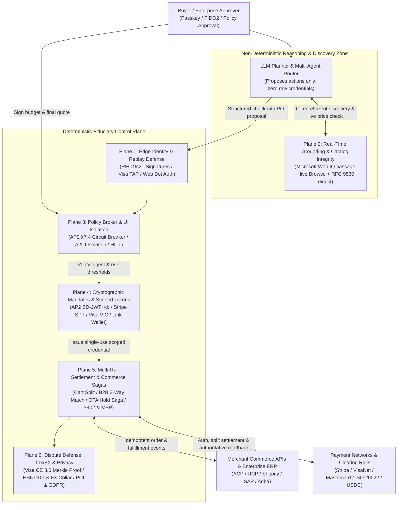

# Enterprise Agentic Commerce Lab — Reference Architecture & AI Solution Architect Playbooks

🌐 **Language / 语言切换**: **[中文主页 (`README.md`)](README.md)** | **English (Current)** | **[📚 Full SA Decision Guide Catalog (198 Bilingual FAQs)](docs/index.en.md)** | **[🚀 Interactive SA Workbench (`live-demo.en.html`)](live-demo.en.html)** | **[📊 7-Card Benchmark Deck (`benchmark-cards.en.html`)](benchmark-cards.en.html)**

> **An Enterprise Engineering & Architecture Reference Hub for AI Solution Architects**
> Focused exclusively on **Retail & Multi-Merchant E-Commerce, Agent Payment & Cryptographic Mandate Protocols (`Google AP2`, `Stripe SPT`, `Visa VIC & TAP`, `Mastercard Agent Pay`, `PayPal`, `x402`), Enterprise B2B Procurement & ERP 3-Way Match, OTA / Airline (`IATA NDC`) Dynamic Booking, SaaS Usage Metering & FinOps, and Cross-Border Tax (`MoR`) / FX Clearing / `Visa CE 3.0` Chargeback Defense** — pairing executive decision guides with a **6-Plane Reference Architecture, deterministic Python guardrails, and self-contained interactive workbenches**.

---

## 1. Executive Overview: Why Agentic Commerce Needs a Fiduciary Control Plane

When enterprises evolve from read-only shopping assistants to **transactional AI agents** capable of sourcing, locking quotes, routing approvals, and settling funds across organizational boundaries, classic 3-tier web assumptions break down:

1. **Non-Deterministic LLM Planning vs. Financial Authority**: An LLM planner is susceptible to indirect DOM prompt injection, stale search-index prices, and context drift. Production architectures must isolate **budget enforcement, final cart binding, and credential issuance** inside a **Deterministic Fiduciary Control Plane** outside the model prompt loop.
2. **Protocol Stack Fragmentation**: Solution Architects must cleanly separate and compose tool access (`MCP`), cross-agent delegation (`A2A`), commerce session & feed schemas (`ACP`, `UCP`), cryptographic buyer mandates (`Google AP2`, `Poppy`), edge bot attestation (`Visa TAP` / `RFC 9421` / `Web Bot Auth`), and scoped payment rails (`Stripe SPT`, `Visa VIC`, `Mastercard Agent Pay`, `x402`, `Stripe MPP Tempo`).
3. **Multi-Party Ledger Conservation & Non-Repudiation**: Multi-seller marketplace splits, B2B `PO == GRN == Invoice` 3-way matching, cross-border `DDP` landed-cost locks, and `Visa CE 3.0` friendly-fraud representment require exact cent-conservation state machines and independently verifiable cryptographic receipts rather than mutable application logs.

---

## 2. Interactive Workbenches & 7-Card Benchmark Suites

All HTML workbenches and `4:5` 7-Card visual benchmark decks are 100% self-contained (`Content-Security-Policy: default-src 'none'; style-src 'unsafe-inline'`) with zero external scripts or network calls:

| Deliverable | English Entry | 中文入口 | Architectural Scope & Key Findings |
|---|---|---|---|
| **Interactive SA Commerce Workbench** | [`live-demo.en.html`](live-demo.en.html) | [`live-demo.html`](live-demo.html) | Microsoft Web IQ grounding + Google AP2 circuit breaker + Stripe SPT / `x402` dual-rail checkout + **searchable Explorer of 121 Enterprise Policy Sandboxes** |
| **Web IQ Grounding & Checkout 7-Card Deck** | [`benchmark-cards.en.html`](benchmark-cards.en.html) | [`benchmark-cards.html`](benchmark-cards.html) | Async parallel `passage` grounding (`2.75x` speedup, `7.1x` token reduction), `100%` hidden DOM injection block rate, and `0.0 pt` option-reversal drift |
| **6-Plane AI-Native Workload Benchmark** | [`reports/agentic-commerce-6plane-bench/index.html`](reports/agentic-commerce-6plane-bench/index.html) | [`report.json`](reports/agentic-commerce-6plane-bench/report.json) | Evaluates 6-Plane deterministic fiduciary controls vs. classic 3-tier web handling across replay, drift, and authorization edge cases |
| **Enterprise B2B Procurement & 3-Way Match** | [`reports/agentic-commerce-enterprise-procurement-bench/index.html`](reports/agentic-commerce-enterprise-procurement-bench/index.html) | [`report.json`](reports/agentic-commerce-enterprise-procurement-bench/report.json) | `PO == GRN == Invoice` tolerances, Commit-Reveal Vickrey RFQs, BEC IBAN hijack defense, and `2/10 Net 30` dynamic discounting |
| **Global Clearing, FX & Privacy Benchmark** | [`reports/agentic-commerce-global-clearing-privacy-bench/index.html`](reports/agentic-commerce-global-clearing-privacy-bench/index.html) | [`report.json`](reports/agentic-commerce-global-clearing-privacy-bench/report.json) | Largest-Remainder marketplace split conservation, 120s FX collars, HS6 DDP undervaluation blocks, PCI redaction & GDPR crypto-shredding |
| **Subscription Metering, Loyalty & BNPL** | [`reports/agentic-commerce-lifecycle-finance-bench/index.html`](reports/agentic-commerce-lifecycle-finance-bench/index.html) | [`report.json`](reports/agentic-commerce-lifecycle-finance-bench/report.json) | UUIDv7 usage watermark deduplication, symmetric FTC Click-to-Cancel, promo floor-margin protection, and B2B trade-credit underwriting |
| **Resilience & Cloudflare Executive Brief** | [`reports/agentic-commerce-resilience-bench/index.html`](reports/agentic-commerce-resilience-bench/index.html) | [`Cloudflare Executive Summary`](reports/cloudflare-agentic-commerce-2026-11-14/Cloudflare-Agentic-Commerce-2026-Executive-Summary.en.html) | 7-Gate unified checkout pipeline chaos testing plus Cloudflare Web Bot Auth executive architecture briefing |

---

## 3. Six-Plane Enterprise Agentic Commerce Reference Architecture



| Architectural Plane | Core Risk Mitigated | Standards & Protocols | Executable Reference Modules (`lab/`) |
|---|---|---|---|
| **Plane 1: Edge Identity & Bot Governance** | Spoofed scrapers bypassing WAF, signature replay, flash-sale inventory scalping | `RFC 9421 HTTP Message Signatures`, `Visa TAP`, `Cloudflare Web Bot Auth`, `Poppy v0.2 DPoP` | [`lab/agent_identity_attestation_guard.py`](lab/agent_identity_attestation_guard.py), [`lab/poppy_guard.py`](lab/poppy_guard.py) |
| **Plane 2: Real-Time Grounding & Feed Integrity** | Stale search prices, hidden DOM prompt injection, truncated catalog sync wiping SKUs | `Microsoft Web IQ (/v3/search/web & /v3/browse)`, `UCP Feed (RFC 9530)`, `ACP Catalog` | [`lab/webiq_commerce_demo.py`](lab/webiq_commerce_demo.py), [`lab/ucp_preflight.py`](lab/ucp_preflight.py) |
| **Plane 3: Fiduciary Policy & UI Isolation** | Unapproved irreversible spend, merchant HTML polluting LLM context, recalled-product purchase | `Google AP2 §7.4 Fiduciary Circuit Breaker`, `UCP Declarative A2UI`, `WebMCP` | [`lab/payment_approvals.py`](lab/payment_approvals.py), [`lab/protocol_readiness_auditor.py`](lab/protocol_readiness_auditor.py) |
| **Plane 4: Mandates & Scoped Tokenization** | Raw PAN or live merchant secret keys leaking into prompts, cross-merchant token misuse | `Google AP2 (SD-JWT+kb)`, `Stripe SPT`, `Visa VIC`, `Mastercard Agent Pay`, `FIDO2 SPC` | [`lab/checkout.py`](lab/checkout.py), [`lab/mcp_migration.py`](lab/mcp_migration.py) |
| **Plane 5: Multi-Rail Settlement & Sagas** | Partial multi-seller stockouts, B2B `PO/GRN/Invoice` mismatch, sub-cent metering forfeiture | `Stripe Connect Split`, `IATA NDC`, `ERP 3-Way Match`, `x402 (EIP-3009)`, `MPP Tempo` | [`lab/unified_checkout_pipeline.py`](lab/unified_checkout_pipeline.py), [`lab/b2b_three_way_match_guard.py`](lab/b2b_three_way_match_guard.py), [`lab/marketplace_split_settlement_guard.py`](lab/marketplace_split_settlement_guard.py) |
| **Plane 6: Disputes, Tax/FX & Privacy** | Friendly-fraud chargebacks, FX spread/slippage, customs undervaluation fines, PII/PAN leaks | `Visa CE 3.0 / VAMP`, `ACP ATDRP`, `ISO 20022 pacs.008`, `PCI-DSS v4.0.1`, `GDPR Art. 17` | [`lab/dispute_evidence_replay.py`](lab/dispute_evidence_replay.py), [`lab/fx_treasury_iso20022_guard.py`](lab/fx_treasury_iso20022_guard.py), [`lab/zk_eligibility_privacy_redaction_guard.py`](lab/zk_eligibility_privacy_redaction_guard.py) |

---

## 4. Solution Architect Platform, Grounding & Protocol Selection Matrix

### 4.1 Enterprise Agent Platform Selection
| Dimension | Microsoft Copilot Studio | Azure AI Foundry + LangGraph / Agent Framework | Salesforce Agentforce / Shopify Sidekick |
|---|---|---|---|
| **Best-Fit Workload** | Internal M365 employee procurement intake, approval routing, rapid low-code rollout | Multi-merchant discovery, custom deterministic fiduciary state machines, hybrid SLM/LLM FinOps routing | Single-merchant storefront conversion or CRM-native post-purchase servicing |
| **Governance Boundary** | Native Entra ID + Power Platform DLP connector policies | Full control over mandate verification, offline-verifiable AP2/SPT brokers, private VNet isolation | Native Salesforce object permissions or Shopify Checkout extension sandboxes |
| **Reference Playbook** | [English Guide](docs/agentic-commerce-platform-copilot-studio-vs-foundry-langgraph-vs-agentforce-shopify-selection-faq.en.md) · [中文](docs/agentic-commerce-platform-copilot-studio-vs-foundry-langgraph-vs-agentforce-shopify-selection-faq.md) | [Full-Stack Blueprint](docs/research/2026-10-18-agentic-commerce-full-stack-architecture.en.md) · [中文](docs/research/2026-10-18-agentic-commerce-full-stack-architecture.md) | [Protocol Stack Guide](docs/agentic-commerce-protocol-stack-mcp-vs-a2a-acp-ucp-ap2-x402-interoperability-selection-faq.en.md) · [中文](docs/agentic-commerce-protocol-stack-mcp-vs-a2a-acp-ucp-ap2-x402-interoperability-selection-faq.md) |

### 4.2 Real-Time Web Grounding Selection
| Provider | Architectural Role | Core Strengths | Guardrails Required Before Checkout |
|---|---|---|---|
| **Microsoft Web IQ** (`/v3/search/web` + `/v3/browse`) | Two-stage commerce grounding (`passage` discovery + pre-checkout live `/v3/browse` verification) | `7.1x` lower prompt token footprint, structured snippets, recall-news screening | Require `liveCrawlSucceeded == true` and strip hidden DOM prompt injections ([Competitive Matrix](docs/research/2026-11-12-webiq-search-competitive.en.md)) |
| **Perplexity Sonar / Tavily** | Synthesized Q&A search summaries | Fast time-to-first-prototype for top-of-funnel research | Synthesized prose can mask SKU stock/shipping fees; **never authorize payment without live merchant quote verification** |
| **Exa / Firecrawl / Browser-Use** | Semantic discovery / full-page Markdown / headless browser execution | Reaches long-tail web catalogs and interactive BNPL/3DS WebViews | High token/latency cost on full pages; enforce human confirmation on `consequentialHint` actions |

### 4.3 Payment & Mandate Rail Selection
| Mechanism | Underlying Settlement Rail | Target Transaction Profile | Mandatory SA Controls |
|---|---|---|---|
| **Stripe SPT + ACP / UCP** | Seller-scoped single-use payment tokens | Retail checkout, OTA/service bookings (up to 180-day TTL), marketplace splits | Bind `network_business_profile`, `max_amount`, and `expires_at`; single-use `SPT Resolve` for external PSPs |
| **Visa VIC + TAP / Mastercard Agent Pay** | Network-enforced agent tokens + Passkey Payment Instructions | Cross-merchant personal shopping agents & high-AOV consumer retail | Verify `RFC 9421` signatures + replay nonces at edge; enforce merchant & amount caps at network auth |
| **Google AP2 (`SD-JWT+kb`)** | Cryptographic Intent & Checkout Mandates | Autonomous replenishment (`Open Mandate`), B2B budget delegation, multi-hop agents | Verify `checkout_hash` + §7.4 Fiduciary Circuit Breaker; require human-signed recovery after trip |
| **HTTP 402 (`x402` / `Stripe MPP Tempo`)** | On-chain USDC (`EIP-3009`) or streaming micropayment sessions | Pay-per-call API/data acquisition & machine-to-machine metering | Enforce block finality depth & stablecoin depeg circuit breaker; align Tempo sessions to whole-cent steps |

---

## 5. Six Enterprise Pillars & Flagship SA Playbooks (198 Bilingual Guides)

> 📚 **Browse the Complete Catalog**: [**English Full Catalog (198 Bilingual FAQs + 21 Blueprints)**](docs/index.en.md) ｜ [**中文总目录 (`docs/index.md`)**](docs/index.md)

1. **Platform Selection, Real-Time Web Grounding (Web IQ) & Edge Governance**
   - [Copilot Studio vs Azure AI Foundry + LangGraph vs Agentforce/Shopify Selection](docs/agentic-commerce-platform-copilot-studio-vs-foundry-langgraph-vs-agentforce-shopify-selection-faq.en.md) · [中文](docs/agentic-commerce-platform-copilot-studio-vs-foundry-langgraph-vs-agentforce-shopify-selection-faq.md)
   - [Microsoft Web IQ vs Perplexity Sonar / Tavily / Exa / Firecrawl / Browser-Use Grounding](docs/agentic-commerce-grounding-webiq-vs-perplexity-sonar-tavily-exa-firecrawl-browseruse-selection-faq.en.md) · [中文](docs/agentic-commerce-grounding-webiq-vs-perplexity-sonar-tavily-exa-firecrawl-browseruse-selection-faq.md)
   - [Social & Search Native Checkout: Google UCP vs. TikTok Buy Direct vs. Shopify Fall '26 vs. Walmart MCP](docs/social-search-native-checkout-google-ucp-vs-tiktok-buy-direct-shopify-walmart-mcp-selection-faq.en.md) · [中文](docs/social-search-native-checkout-google-ucp-vs-tiktok-buy-direct-shopify-walmart-mcp-selection-faq.md)
   - [Pre-Purchase Anti-Wrong-Buy Verifier (Eliminating Visa Benchmark 54% Failed-Run Purchases)](docs/ecommerce-pre-purchase-verification-anti-wrong-buy-visa-benchmark-gate-selection-faq.en.md) · [中文](docs/ecommerce-pre-purchase-verification-anti-wrong-buy-visa-benchmark-gate-selection-faq.md)
   - [Trusted Agent Identity: Cloudflare Web Bot Auth & Visa TAP vs Legacy WAF Blocking](docs/ecommerce-agent-identity-web-bot-auth-tap-vs-waf-faq.en.md) · [中文](docs/ecommerce-agent-identity-web-bot-auth-tap-vs-waf-faq.md)
2. **Agent Payment Protocols, Cryptographic Mandates & Strong Authentication**
   - [MCP vs A2A vs ACP / UCP / AP2 / x402 Protocol Layering & Interoperability](docs/agentic-commerce-protocol-stack-mcp-vs-a2a-acp-ucp-ap2-x402-interoperability-selection-faq.en.md) · [中文](docs/agentic-commerce-protocol-stack-mcp-vs-a2a-acp-ucp-ap2-x402-interoperability-selection-faq.md)
   - [Stripe SPT vs Visa VIC vs Mastercard Agent Pay vs PayPal Virtual Card Toolkit](docs/agentic-payment-toolkit-stripe-spt-vs-visa-vic-mastercard-paypal-virtual-card-selection-faq.en.md) · [中文](docs/agentic-payment-toolkit-stripe-spt-vs-visa-vic-mastercard-paypal-virtual-card-selection-faq.md)
   - [Personal Agent Persistent Intent: Sierra/Meta Poppy v0.1 + MCP Intent Services vs. AP2](docs/personal-agent-persistent-intent-services-poppy-vs-ap2-recurring-budget-selection-faq.en.md) · [中文](docs/personal-agent-persistent-intent-services-poppy-vs-ap2-recurring-budget-selection-faq.md)
   - [3DS2 Decoupled Challenge & FIDO2 / Passkey Biometric Step-Up vs SMS OTP Takeover](docs/agentic-3ds2-fido2-spc-biometric-stepup-mandate-vs-sms-otp-scraping-takeover-faq.en.md) · [中文](docs/agentic-3ds2-fido2-spc-biometric-stepup-mandate-vs-sms-otp-scraping-takeover-faq.md)
3. **Multi-Merchant Retail Sagas, Marketplace Split Settlement & Travel / OTA (NDC)**
   - [Multi-Merchant Split-Cart Two-Phase Saga vs Single-Platform Connect Settlement](docs/multi-merchant-split-cart-saga-vs-connect-faq.en.md) · [中文](docs/multi-merchant-split-cart-saga-vs-connect-faq.md)
   - [OTA Travel Dynamic Price-Drop Rebooking & IATA NDC ONE Order Saga Architecture](docs/ota-travel-planning-price-drop-rebooking-ndc-saga-architecture-selection-faq.en.md) · [中文](docs/ota-travel-planning-price-drop-rebooking-ndc-saga-architecture-selection-faq.md)
   - [Marketplace Seller KYB Rolling Reserves & Delivery-Attested Escrow Architecture](docs/marketplace-seller-kyb-rolling-reserve-delivery-escrow-agent-selection-faq.en.md) · [中文](docs/marketplace-seller-kyb-rolling-reserve-delivery-escrow-agent-selection-faq.md)
4. **Enterprise B2B Procurement, ERP 3-Way Match & Supply-Chain Trade Finance**
   - [B2B RFQ Sourcing, Contract Redlining & SAP / Ariba / Coupa Procurement Agents](docs/b2b-rfq-sourcing-supplier-comparison-contract-redline-erp-copilot-selection-faq.en.md) · [中文](docs/b2b-rfq-sourcing-supplier-comparison-contract-redline-erp-copilot-selection-faq.md)
   - [Enterprise AP Automation: PO-GRN-Invoice 3-Way Match & Dynamic Discounting](docs/enterprise-ap-automation-three-way-match-dynamic-discounting-treasury-agent-selection-faq.en.md) · [中文](docs/enterprise-ap-automation-three-way-match-dynamic-discounting-treasury-agent-selection-faq.md)
   - [Enterprise Treasury & Supplier Portal AP Payment: Stripe Treasury MCP vs. Visa × BILL (`TAP`)](docs/enterprise-treasury-supplier-portal-ap-payment-stripe-mcp-vs-visa-bill-tap-selection-faq.en.md) · [中文](docs/enterprise-treasury-supplier-portal-ap-payment-stripe-mcp-vs-visa-bill-tap-selection-faq.md)
   - [Vendor Onboarding Bank-Change BEC Defense & Sanctions Screening Guardrails](docs/b2b-vendor-onboarding-bank-account-change-bec-fraud-sanctions-mandate-vs-email-iban-hijack-faq.en.md) · [中文](docs/b2b-vendor-onboarding-bank-account-change-bec-fraud-sanctions-mandate-vs-email-iban-hijack-faq.md)
5. **SaaS Subscription Lifecycle, Usage Metering & Machine Micropayments**
   - [Enterprise SaaS Seat Telemetry True-Up vs Shelfware Auto-Renewal Governance](docs/saas-seat-trueup-telemetry-mandate-vs-shelfware-auto-renewal-faq.en.md) · [中文](docs/saas-seat-trueup-telemetry-mandate-vs-shelfware-auto-renewal-faq.md)
   - [HTTP 402 (`x402` / `Stripe MPP`) Streaming Micropayment Netting vs Card Fixed-Fee Erosion](docs/agentic-x402-mpp-streaming-micropayment-channel-netting-mandate-vs-card-fixed-fee-margin-wipeout-faq.en.md) · [中文](docs/agentic-x402-mpp-streaming-micropayment-channel-netting-mandate-vs-card-fixed-fee-margin-wipeout-faq.md)
   - [Commercial Agent SLM vs Frontier LLM Tiered Routing, Semantic Caching & FinOps](docs/commercial-agent-model-routing-slm-vs-frontier-llm-finops-cache-selection-faq.en.md) · [中文](docs/commercial-agent-model-routing-slm-vs-frontier-llm-finops-cache-selection-faq.md)
6. **Cross-Border Tax / MoR, Treasury FX, Privacy Redaction & Chargeback Defense**
   - [Cross-Border Tax Compliance: Merchant of Record (MoR) vs Seller of Record + DDP](docs/cross-border-tax-compliance-mor-vs-sor-stripe-tax-ddp-duty-agent-selection-faq.en.md) · [中文](docs/cross-border-tax-compliance-mor-vs-sor-stripe-tax-ddp-duty-agent-selection-faq.md)
   - [Visa CE 3.0 Compelling Evidence & Ethoca / RDR vs Friendly-Fraud VAMP Penalties](docs/agentic-chargeback-ce30-compelling-evidence-ethoca-rdr-mandate-vs-friendly-fraud-vdmp-penalty-faq.en.md) · [中文](docs/agentic-chargeback-ce30-compelling-evidence-ethoca-rdr-mandate-vs-friendly-fraud-vdmp-penalty-faq.md)
   - [Stripe President John Collison on the 7 Major Trends of Agentic Commerce](docs/research/2026-11-01-stripe-collison-7-agentic-commerce-trends.en.md) · [中文](docs/research/2026-11-01-stripe-collison-7-agentic-commerce-trends.md)

---

## 6. Repository Layout & Deterministic Verification

```text
agentic-commerce-lab/
├── README.md / README.en.md          # Bilingual Solution Architect overview & selection hub
├── live-demo.html / live-demo.en.html # Self-contained H5 interactive SA workbenches (ZH / EN)
├── benchmark-cards.html / .en.html   # 7-Card 4:5 visual benchmark decks (ZH / EN)
├── docs/
│   ├── index.md / index.en.md        # Categorized catalog of all 198 bilingual SA Decision Guides
│   ├── *-faq.md / *-faq.en.md        # Scenario FAQs with Mermaid architecture diagrams & checklists
│   ├── architecture/                 # 21 deterministic domain state-machine & conservation blueprints
│   └── research/                     # Full-stack 6-plane blueprint, Web IQ competitive matrix & trend reports
├── research/                         # Foundational personal agent architecture, protocol layering & sources
├── lab/                              # Zero-dependency Python fiduciary control-plane guards & bench builders
├── src/agentic_commerce/             # Microsoft Web IQ × Agentic Commerce evaluation engine
├── reports/                          # Sealed benchmark report bundles (JSON data + self-contained HTML)
└── tests/                            # 1056 deterministic unit tests across 69 test modules
```

### Quickstart (Python 3.11+ Standard Library Only)

```bash
# 1. Run the complete deterministic test suite (69 test modules / 1056 assertions)
python -m unittest discover -s tests

# 2. Run the offline final-cart approval, idempotency & tamper-block baseline demo
python -m lab.demo

# 3. Regenerate the bilingual interactive workbenches & 7-Card benchmark reports
python -m lab.webiq_commerce_demo --output reports/2026-11-09-webiq-commerce-demo
```

> **Provenance & Scope Note**: All executable guards and benchmarks operate offline by default (`status=simulated`) with zero live payment charges or external credentials. Every metric carries explicit provenance metadata (`measured`, `deterministic_offline_simulation`, or `official_doc_snapshot`), and unmeasured vendor latencies remain explicitly labeled `not_measured`.
