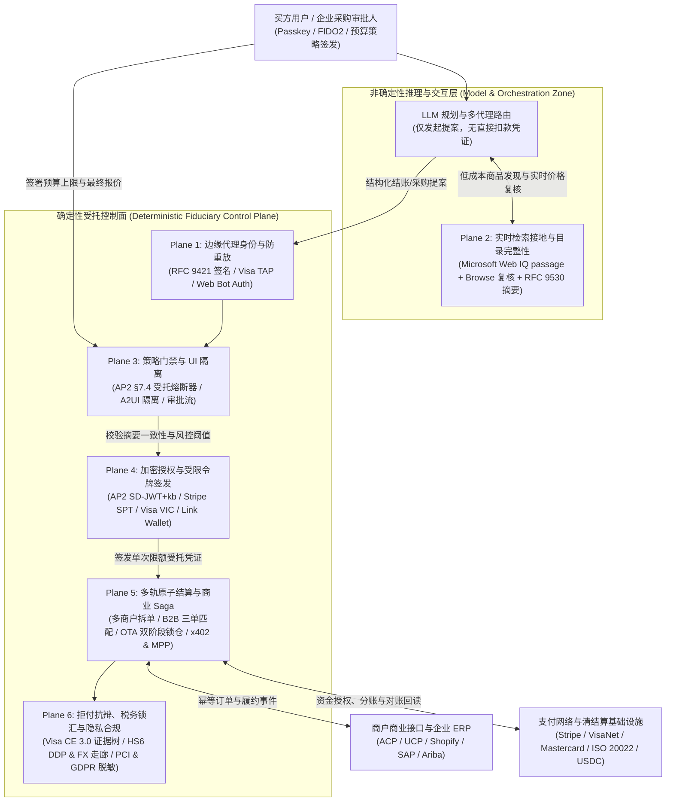

# Enterprise Agentic Commerce Lab — 企业智能体商业参考架构与 AI 解决方案架构师决策库

🌐 **语言切换 / Language**: **中文主页 (当前)** | **[English (`README.en.md`)](README.en.md)** | **[📚 SA 决策指南总目录（120 篇双语 FAQ）](docs/index.md)** | **[🚀 交互式架构工作台 (`live-demo.html`)](live-demo.html)** | **[📊 7-Card 基准测试报告 (`benchmark-cards.html`)](benchmark-cards.html)**

> **面向 AI Solution Architect（AI 解决方案架构师）的企业级智能体商业工程参考库**
> 聚焦**零售电商与多商户编排、智能体支付与加密授权协议（AP2 / Stripe SPT / Visa VIC & TAP / Mastercard / x402）、B2B 采购与 ERP 三单匹配、酒旅航司（OTA / IATA NDC）动态预订、SaaS 用量计费与 FinOps、跨境税务（MoR）/ 外汇清结算与 Visa CE 3.0 拒付抗辩**六大核心领域，提供**可复用的六平面参考架构、平台与协议选型对比矩阵、确定性受托控制面（Fiduciary Control Plane）Python 护栏模块及自包含交互式演示台**。

---

## 1. 核心价值与架构师视角（Executive Overview）

当企业从“对话式导购助手（Copilot）”迈向“可代客寻源、锁价、审批与结算的自主商业智能体（Transactional Agent）”时，传统三层 Web 架构（前端表单 + 无状态服务 + 数据库）面临三大根本挑战：

1. **非确定性推理与资金授权边界冲突**：大语言模型（LLM）易受网页隐藏提示词注入（DOM Poisoning）、陈旧目录缓存或长上下文幻觉影响。生产级架构必须将**资金批准、价格上限校验与令牌签发**移出模型提示词循环，沉降到**确定性受托控制面（Deterministic Fiduciary Control Plane）**。
2. **多方商业协议碎片化**：企业需同时评估并桥接工具层（`MCP`）、智能体协作层（`A2A`）、商业会话与目录层（`ACP`、`UCP`）、加密意图授权层（`Google AP2`、`Poppy`）、可信代理请求签名（`Visa TAP` / `RFC 9421`）以及受限支付凭证与微支付轨（`Stripe SPT`、`Visa VIC`、`Mastercard Agent Pay`、`x402`、`MPP Tempo`）。
3. **跨组织财务守恒与司法级不可抵赖证据**：跨商户拆单分账、B2B 采购三单匹配（`PO == GRN == Invoice`）、跨境完税价（`DDP`）锁汇以及友好欺诈拒付抗辩（`Visa CE 3.0`）无法依赖内部应用日志，必须具备美分守恒状态机与可独立验签的四柱加密证据包。

---

## 2. 交互式架构工作台与 7-Card 基准测试集（Live Workbenches & Benchmarks）

本仓库所有 HTML 演示台与 7-Card（`4:5` 竖版卡片流）评测报告均为零外部依赖的自包含产物（严格遵循 `Content-Security-Policy: default-src 'none'; style-src 'unsafe-inline'`）：

| 资产类型 | 中文版入口 | English Entry | 面向架构师的核心演示与评测内容 |
|---|---|---|---|
| **旗舰交互式架构工作台** | [`live-demo.html`](live-demo.html) | [`live-demo.en.html`](live-demo.en.html) | Microsoft Web IQ 实时网页接地 + Google AP2 熔断器 + Stripe SPT / x402 双轨结算 + **121 个企业业务场景策略沙盒（含实时搜索筛选）** |
| **Web IQ 接地与结算 7-Card 报告** | [`benchmark-cards.html`](benchmark-cards.html) | [`benchmark-cards.en.html`](benchmark-cards.en.html) | 覆盖并行 `passage` 接地（`2.75x` 加速、`7.1x` Token 削减）、DOM 提示词注入 `100%` 拦截与报价逆序一致性（`0.0 pt` 漂移） |
| **六平面 AI-Native 工作负载评测** | [`reports/agentic-commerce-6plane-bench/index.html`](reports/agentic-commerce-6plane-bench/index.html) | [`report.json`](reports/agentic-commerce-6plane-bench/report.json) | 6 平面确定性控制架构 vs 传统三层 Web 架构在授权越权、重放与目录篡改场景下的对比 |
| **B2B 企业采购与三单匹配评测** | [`reports/agentic-commerce-enterprise-procurement-bench/index.html`](reports/agentic-commerce-enterprise-procurement-bench/index.html) | [`report.json`](reports/agentic-commerce-enterprise-procurement-bench/report.json) | `PO == GRN == Invoice` 三单匹配、Vickrey 密封竞价 RFQ、BEC 篡改拦截与 `2/10 Net 30` 动态贴现 |
| **跨境清结算、外汇与隐私合规评测** | [`reports/agentic-commerce-global-clearing-privacy-bench/index.html`](reports/agentic-commerce-global-clearing-privacy-bench/index.html) | [`report.json`](reports/agentic-commerce-global-clearing-privacy-bench/report.json) | 多商户最大余数分账守恒、120s 锁汇走廊、HS6 DDP 报关防低报、PCI 脱敏与 GDPR 加密粉碎 |
| **订阅计费、忠诚度与嵌入式金融评测** | [`reports/agentic-commerce-lifecycle-finance-bench/index.html`](reports/agentic-commerce-lifecycle-finance-bench/index.html) | [`report.json`](reports/agentic-commerce-lifecycle-finance-bench/report.json) | 用量水位线幂等去重、FTC 一键退订、优惠券防叠加破底价与企业贸易信贷核保 |
| **高可用韧性与 Cloudflare 全栈简报** | [`reports/agentic-commerce-resilience-bench/index.html`](reports/agentic-commerce-resilience-bench/index.html) | [`Cloudflare Executive Summary`](reports/cloudflare-agentic-commerce-2026-11-14/Cloudflare-Agentic-Commerce-2026-Executive-Summary.en.html) | 7 门禁统一结账流水线韧性测试，以及 Cloudflare 边缘可信代理（Web Bot Auth）执行摘要 |

---

## 3. 企业智能体商业六平面参考架构（6-Plane Reference Architecture）



| 架构平面 | 解决的核心架构风险 | 关键协议与标准 | 仓库参考实现模块 (`lab/`) |
|---|---|---|---|
| **Plane 1：边缘身份与可信代理鉴权** | 恶意爬虫伪装 AI 代理绕过 WAF、重放请求或抢购稀缺库存 | `RFC 9421 HTTP Message Signatures`、`Visa TAP`、`Cloudflare Web Bot Auth`、`Poppy v0.2 DPoP` | [`lab/agent_identity_attestation_guard.py`](lab/agent_identity_attestation_guard.py)、[`lab/poppy_guard.py`](lab/poppy_guard.py) |
| **Plane 2：实时网页接地与目录完整性** | 陈旧索引导致结账价格漂移、网页隐藏 DOM 提示词注入、残缺目录同步误删商品 | `Microsoft Web IQ (/v3/search/web & /v3/browse)`、`UCP Feed (RFC 9530)`、`ACP Catalog` | [`lab/webiq_commerce_demo.py`](lab/webiq_commerce_demo.py)、[`lab/ucp_preflight.py`](lab/ucp_preflight.py) |
| **Plane 3：受托策略门禁与交互隔离** | LLM 擅自确认不可逆扣款、商户下发富文本污染模型上下文、安全召回商品误购 | `Google AP2 §7.4 Fiduciary Circuit Breaker`、`UCP Declarative A2UI`、`WebMCP` | [`lab/payment_approvals.py`](lab/payment_approvals.py)、[`lab/protocol_readiness_auditor.py`](lab/protocol_readiness_auditor.py) |
| **Plane 4：加密授权令与受限支付令牌** | 原始卡号（PAN）或长效商户私钥暴露给模型、超预算扣款、跨商户令牌挪用 | `Google AP2 (SD-JWT+kb)`、`Stripe SPT`、`Visa VIC`、`Mastercard Agent Pay`、`FIDO2 SPC` | [`lab/checkout.py`](lab/checkout.py)、[`lab/mcp_migration.py`](lab/mcp_migration.py) |
| **Plane 5：多轨清结算与跨系统 Saga** | 跨商户部分缺货、B2B 收货与发票不一致、订阅超额计费、高频 API 亚美分尾差损耗 | `Stripe Connect Split`、`IATA NDC`、`ERP 3-Way Match`、`x402 (EIP-3009)`、`MPP Tempo` | [`lab/unified_checkout_pipeline.py`](lab/unified_checkout_pipeline.py)、[`lab/b2b_three_way_match_guard.py`](lab/b2b_three_way_match_guard.py)、[`lab/marketplace_split_settlement_guard.py`](lab/marketplace_split_settlement_guard.py) |
| **Plane 6：拒付抗辩、跨境财税与隐私保护** | 友好欺诈（Friendly Fraud）败诉、汇率剧烈滑点、报关低报罚没、日志泄露 PAN/PII | `Visa CE 3.0 / VAMP`、`ACP ATDRP`、`ISO 20022 pacs.008`、`PCI-DSS v4.0.1`、`GDPR Art. 17` | [`lab/dispute_evidence_replay.py`](lab/dispute_evidence_replay.py)、[`lab/fx_treasury_iso20022_guard.py`](lab/fx_treasury_iso20022_guard.py)、[`lab/zk_eligibility_privacy_redaction_guard.py`](lab/zk_eligibility_privacy_redaction_guard.py) |

---

## 4. 关键技术栈与协议选型速查矩阵（SA Selection Matrix）

### 4.1 企业智能体平台底座选型
| 评估维度 | Microsoft Copilot Studio | Azure AI Foundry + LangGraph / Agent Framework | Salesforce Agentforce / Shopify Sidekick |
|---|---|---|---|
| **最适业务场景** | M365 内部员工采购申请、审批流协同、低代码快速上线 | 复杂多商户比价、自定义确定性受托控制面、混合模型 FinOps 路由 | 已深度绑定 Salesforce CRM 或 Shopify 单一商户店内的导购与售后 |
| **权限与合规控制** | 原生 Entra ID + Power Platform DLP 连接器治理 | 完全可控的状态机、离线可验签 AP2/SPT 网关与私有 VNet 隔离 | 原生复用 CRM 对象权限或 Shopify Checkout 扩展沙盒 |
| **详细选型指南** | [中文指南](docs/agentic-commerce-platform-copilot-studio-vs-foundry-langgraph-vs-agentforce-shopify-selection-faq.md) · [English](docs/agentic-commerce-platform-copilot-studio-vs-foundry-langgraph-vs-agentforce-shopify-selection-faq.en.md) | [全栈参考蓝图](docs/research/2026-10-18-agentic-commerce-full-stack-architecture.md) · [English](docs/research/2026-10-18-agentic-commerce-full-stack-architecture.en.md) | [协议互操作选型](docs/agentic-commerce-protocol-stack-mcp-vs-a2a-acp-ucp-ap2-x402-interoperability-selection-faq.md) · [English](docs/agentic-commerce-protocol-stack-mcp-vs-a2a-acp-ucp-ap2-x402-interoperability-selection-faq.en.md) |

### 4.2 实时商品发现与网页接地（Web Grounding）选型
| 方案 | 核心架构定位 | 优势 | 局限与架构护栏要求 |
|---|---|---|---|
| **Microsoft Web IQ** (`/v3/search/web` + `/v3/browse`) | 原生双阶段商业接地（毫秒级 `passage` 召回 + 结算前实时 `/v3/browse` 落地页核验） | Token 消耗低、支持结构化切片与安全召回新闻筛查 | 结账前必须核对 `liveCrawlSucceeded == true` 并过滤隐藏 DOM 注入（[深度对比](docs/research/2026-11-12-webiq-search-competitive.md)） |
| **Perplexity Sonar / Tavily** | 聚合问答式检索摘要 | 接入极简，适合早期导购问答意图澄清 | 摘要易折叠实时库存/运费细节，**不可直接作为扣款最终报价依据** |
| **Exa / Firecrawl / Browser-Use** | 语义发现 / 整页 Markdown 提取 / 无头浏览器表单执行 | 覆盖无 API 长尾站点与受控 WebView 交接 | 整页抓取延迟与 Token 成本高；切换支付方式或点击不可逆按钮需强制人工确认 |

### 4.3 智能体支付与授权轨道选型
| 支付/授权机制 | 资金结算轨道 | 最适交易金额与场景 | 核心风控与对账要点 |
|---|---|---|---|
| **Stripe SPT + ACP / UCP** | 卡组织 / 钱包受限单次令牌 | 零售电商、酒旅预订（最长 180 天有效期）、平台拆单 | 严格绑定卖家 Profile、`max_amount` 与到期时间；外部 PSP 仅单次调用 `SPT Resolve` |
| **Visa VIC + TAP / Mastercard Agent Pay** | 卡网络级受托代理令牌 + Passkey 指令 | 跨商户个人购物代理、高客单价消费品 | 网关验签 `RFC 9421` 请求头防重放；由发卡/卡网执行商户与金额硬约束 |
| **Google AP2 (`SD-JWT+kb`)** | 跨协议加密意图与购物车授权证明 | 自主补货（Open Mandate）、B2B 预算委托与多跳代理链路 | 强制校验 `checkout_hash` 与 §7.4 受托熔断器，熔断后须人类签署恢复令 |
| **HTTP 402 (`x402` / `Stripe MPP Tempo`)** | 链上 USDC（`EIP-3009`）或流式微支付会话 | 高频 API / 数据采购、智能体间按调用或亚美分计量付费 | 校验区块确认深度与稳定币脱锚熔断；Tempo 流式会话按整美分步长对齐消除尾差 |

---

## 5. 六大企业业务域与精选 SA 决策指南（全库共 119 篇双语 FAQ）

> 📚 **完整索引入口**：[**中文总目录（119 篇双语 FAQ + 21 份架构蓝图）**](docs/index.md) ｜ [**English Full Catalog (`docs/index.en.md`)**](docs/index.en.md)

1. **平台选型、实时网页接地（Web IQ）与入口治理**
   - [Copilot Studio vs Azure AI Foundry + LangGraph vs Agentforce/Shopify 平台选型](docs/agentic-commerce-platform-copilot-studio-vs-foundry-langgraph-vs-agentforce-shopify-selection-faq.md) · [EN](docs/agentic-commerce-platform-copilot-studio-vs-foundry-langgraph-vs-agentforce-shopify-selection-faq.en.md)
   - [Microsoft Web IQ vs Perplexity Sonar / Tavily / Exa / Firecrawl / Browser-Use 接地选型](docs/agentic-commerce-grounding-webiq-vs-perplexity-sonar-tavily-exa-firecrawl-browseruse-selection-faq.md) · [EN](docs/agentic-commerce-grounding-webiq-vs-perplexity-sonar-tavily-exa-firecrawl-browseruse-selection-faq.en.md)
   - [智能体身份鉴权：Cloudflare Web Bot Auth & Visa TAP vs 传统 WAF IP 封禁](docs/ecommerce-agent-identity-web-bot-auth-tap-vs-waf-faq.md) · [EN](docs/ecommerce-agent-identity-web-bot-auth-tap-vs-waf-faq.en.md)
2. **智能体支付协议、加密授权令牌（Mandates）与强核身**
   - [MCP vs A2A vs ACP / UCP / AP2 / x402 全栈协议分层与互操作选型](docs/agentic-commerce-protocol-stack-mcp-vs-a2a-acp-ucp-ap2-x402-interoperability-selection-faq.md) · [EN](docs/agentic-commerce-protocol-stack-mcp-vs-a2a-acp-ucp-ap2-x402-interoperability-selection-faq.en.md)
   - [Stripe SPT vs Visa VIC vs Mastercard Agent Pay vs PayPal 虚拟卡方案选型](docs/agentic-payment-toolkit-stripe-spt-vs-visa-vic-mastercard-paypal-virtual-card-selection-faq.md) · [EN](docs/agentic-payment-toolkit-stripe-spt-vs-visa-vic-mastercard-paypal-virtual-card-selection-faq.en.md)
   - [3DS2 解耦挑战与 FIDO2 / Passkey 生物核身 vs 短信 OTP 劫持防护](docs/agentic-3ds2-fido2-spc-biometric-stepup-mandate-vs-sms-otp-scraping-takeover-faq.md) · [EN](docs/agentic-3ds2-fido2-spc-biometric-stepup-mandate-vs-sms-otp-scraping-takeover-faq.en.md)
3. **多商户零售编排、平台分账与酒旅航司（OTA / NDC）**
   - [跨商户购物车两阶段锁仓 Saga vs 平台单一收单 Connect 分账选型](docs/multi-merchant-split-cart-saga-vs-connect-faq.md) · [EN](docs/multi-merchant-split-cart-saga-vs-connect-faq.en.md)
   - [OTA 机酒动态降价重订、IATA NDC ONE Order 与退改签 Saga 架构](docs/ota-travel-planning-price-drop-rebooking-ndc-saga-architecture-selection-faq.md) · [EN](docs/ota-travel-planning-price-drop-rebooking-ndc-saga-architecture-selection-faq.en.md)
   - [电商平台卖家 KYB 滚动保证金（Rolling Reserve）与签收托管防跑路架构](docs/marketplace-seller-kyb-rolling-reserve-delivery-escrow-agent-selection-faq.md) · [EN](docs/marketplace-seller-kyb-rolling-reserve-delivery-escrow-agent-selection-faq.en.md)
4. **B2B 企业采购寻源、ERP 三单匹配与供应链金融**
   - [B2B 寻源比价、合同红线审阅与 SAP / Ariba / Coupa 采购智能体集成](docs/b2b-rfq-sourcing-supplier-comparison-contract-redline-erp-copilot-selection-faq.md) · [EN](docs/b2b-rfq-sourcing-supplier-comparison-contract-redline-erp-copilot-selection-faq.en.md)
   - [企业应付账款（AP）三单匹配（PO-GRN-Invoice）与动态现金折扣自动化](docs/enterprise-ap-automation-three-way-match-dynamic-discounting-treasury-agent-selection-faq.md) · [EN](docs/enterprise-ap-automation-three-way-match-dynamic-discounting-treasury-agent-selection-faq.en.md)
   - [企业智能体司库管理与供应商门户自动付款：Stripe Treasury MCP vs. Visa × BILL (TAP)](docs/enterprise-treasury-supplier-portal-ap-payment-stripe-mcp-vs-visa-bill-tap-selection-faq.md) · [EN](docs/enterprise-treasury-supplier-portal-ap-payment-stripe-mcp-vs-visa-bill-tap-selection-faq.en.md)
   - [供应商准入银行账户变更防 BEC 邮件诈骗与制裁筛查护栏](docs/b2b-vendor-onboarding-bank-account-change-bec-fraud-sanctions-mandate-vs-email-iban-hijack-faq.md) · [EN](docs/b2b-vendor-onboarding-bank-account-change-bec-fraud-sanctions-mandate-vs-email-iban-hijack-faq.en.md)
5. **SaaS 订阅生命周期、用量计费与机器微支付**
   - [企业 SaaS 席位真实活跃度盘点（True-Up）与防僵尸续费授权](docs/saas-seat-trueup-telemetry-mandate-vs-shelfware-auto-renewal-faq.md) · [EN](docs/saas-seat-trueup-telemetry-mandate-vs-shelfware-auto-renewal-faq.en.md)
   - [HTTP 402（x402 / Stripe MPP）流式微支付通道轧差 vs 卡组织固定手续费侵蚀](docs/agentic-x402-mpp-streaming-micropayment-channel-netting-mandate-vs-card-fixed-fee-margin-wipeout-faq.md) · [EN](docs/agentic-x402-mpp-streaming-micropayment-channel-netting-mandate-vs-card-fixed-fee-margin-wipeout-faq.en.md)
   - [商业智能体 SLM vs 前沿大模型分级路由、语义缓存与 FinOps 成本治理](docs/commercial-agent-model-routing-slm-vs-frontier-llm-finops-cache-selection-faq.md) · [EN](docs/commercial-agent-model-routing-slm-vs-frontier-llm-finops-cache-selection-faq.en.md)
6. **跨境税务（MoR）、外汇资金池、隐私脱敏与拒付抗辩**
   - [跨境电商税务合规：Merchant of Record（MoR）vs 自建 PSP + Stripe Tax / DDP 选型](docs/cross-border-tax-compliance-mor-vs-sor-stripe-tax-ddp-duty-agent-selection-faq.md) · [EN](docs/cross-border-tax-compliance-mor-vs-sor-stripe-tax-ddp-duty-agent-selection-faq.en.md)
   - [Visa CE 3.0 强证据链与 Ethoca / RDR 预警 vs 友好欺诈（VAMP）拒付抗辩](docs/agentic-chargeback-ce30-compelling-evidence-ethoca-rdr-mandate-vs-friendly-fraud-vdmp-penalty-faq.md) · [EN](docs/agentic-chargeback-ce30-compelling-evidence-ethoca-rdr-mandate-vs-friendly-fraud-vdmp-penalty-faq.en.md)
   - [Stripe 总裁 John Collison 论智能体商业 7 大趋势与五级自主性架构映射](docs/research/2026-11-01-stripe-collison-7-agentic-commerce-trends.md) · [EN](docs/research/2026-11-01-stripe-collison-7-agentic-commerce-trends.en.md)

---

## 6. 仓库目录结构与本地验证（Repository Layout & Quickstart）

```text
agentic-commerce-lab/
├── README.md / README.en.md          # 中英双语架构师总览与选型入口
├── live-demo.html / live-demo.en.html # 自包含 H5 交互式智能体商业工作台（双语）
├── benchmark-cards.html / .en.html   # 7-Card 4:5 视觉基准评测卡片流（双语）
├── docs/
│   ├── index.md / index.en.md        # 119 篇双语 SA 决策指南（FAQ）分类总目录
│   ├── *-faq.md / *-faq.en.md        # 六大企业商业域架构选型、Mermaid 图与核查清单
│   ├── architecture/                 # 21 份确定性领域状态机与美分守恒规格说明
│   └── research/                     # 全栈六平面蓝图、Web IQ 竞品矩阵与行业趋势深度报告
├── research/                         # 个人智能体基础参考架构、协议分层、使用场景与来源注册表
├── lab/                              # 零第三方依赖的确定性受托控制面 Python 实现与基准生成器
├── src/agentic_commerce/             # Microsoft Web IQ × Agentic Commerce 核心评估引擎
├── reports/                          # 密封的基准评测报告包（JSON 数据源 + HTML 视觉卡片）
└── tests/                            # 覆盖全部协议门禁、美分守恒与幂等恢复的 997 项单元测试
```

### 快速运行与验证（仅依赖 Python 3.11+ 标准库）

```bash
# 1. 运行全量确定性单元测试套件（69 个测试模块 / 997 项断言）
python -m unittest discover -s tests

# 2. 运行离线受托结账与幂等重放基线演示（默认无外部网络调用、零真实扣款）
python -m lab.demo

# 3. 重新生成双语交互式工作台与 7-Card 基准测试报告
python -m lab.webiq_commerce_demo --output reports/2026-11-09-webiq-commerce-demo
```

> **数据溯源与边界说明（Provenance）**：本仓库默认采用零外部扣款的确定性离线仿真与架构验证（`status=simulated`），所有评测指标均明确标注数据来源类型（`measured` / `deterministic_offline_simulation` / `official_doc_snapshot`），未实测的供应商延迟均严格保留为 `not_measured`，绝不捏造基准坐标或替代支付机构生产合规认证。
