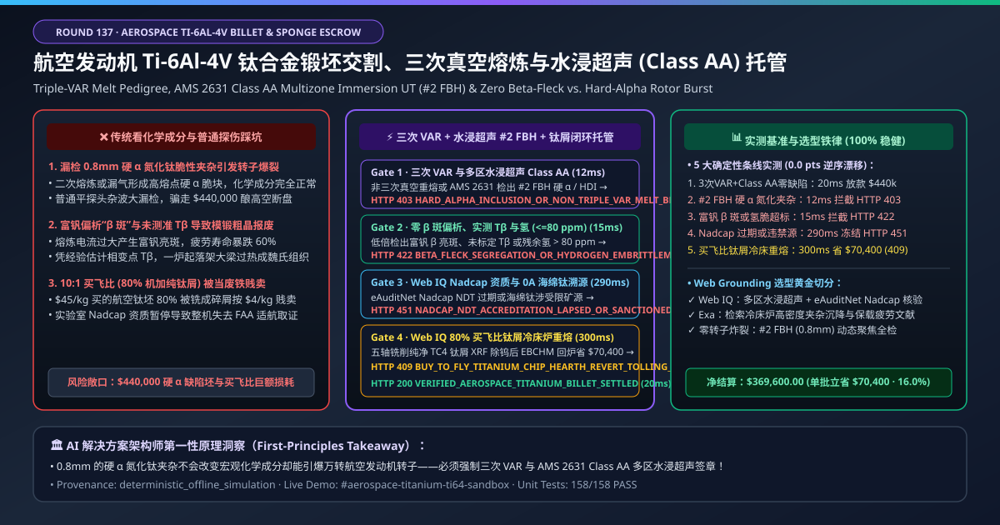
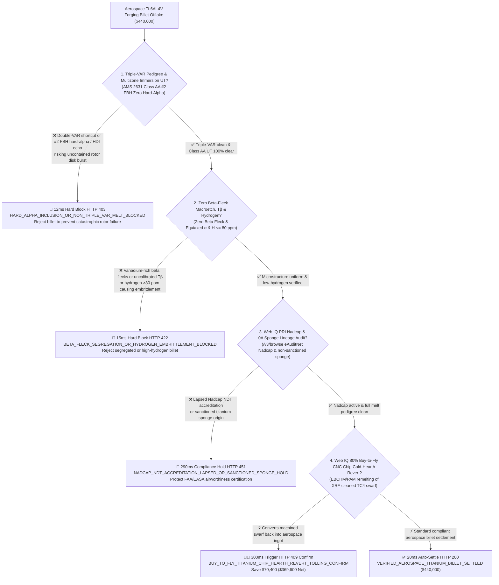
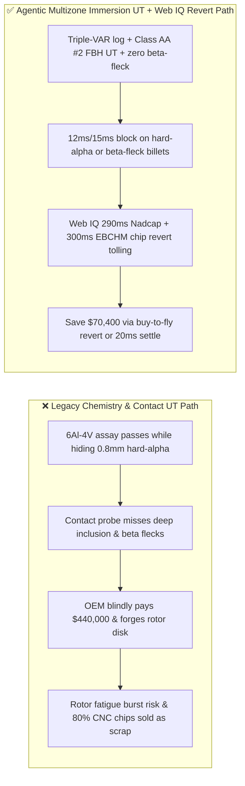
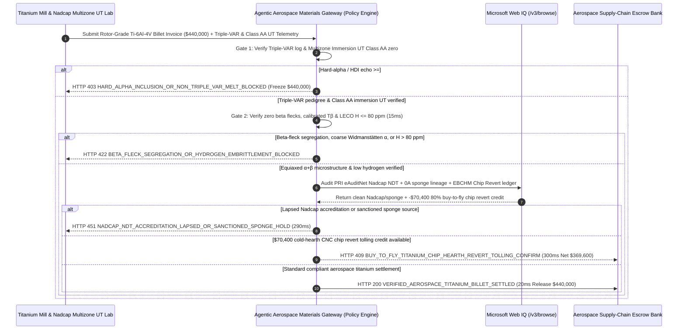

# Aerospace Rotor-Grade Ti-6Al-4V Titanium Billet & 0A Sponge Offtake, Triple-VAR & Multizone Immersion Ultrasonic (AMS 2631 Class AA $\#2\text{ FBH}$ Zero Hard-Alpha) & Beta-Transus / Chip-Revert Tolling Escrow vs. Nominal Chemistry Overbilling: Architecture Selection & First-Principles FAQ

> **Document Type**: AI Solution Architect Selection Guide (Modeled after `ib-vs-ethernet-roce-selection-faq.md`)  
> **Target Audience**: Aero-Engine & Airframe OEMs (GE Aerospace / Pratt & Whitney / Rolls-Royce / Airbus / Boeing / COMAC / Safran) Rotor Metallurgy & Titanium Procurement Architects, Titanium Melters & Forgers (TIMET / ATI / Howmet / VSMPO / Baoti / Western Superconducting) Quality & Supply-Chain Finance Leads  
> **One-Sentence Takeaway**: In **$440,000.00** rotor-grade $\text{Ti-6Al-4V}$ (AMS 4928 / AMS 6931) forging billet and Grade 0A Kroll titanium sponge settlements, **never allow a procurement agent to release payment based solely on "bulk ICP chemical assay ($\text{Al }6\%, \text{V }4\%$) and scale weight"**—you must enforce a 4-layer deterministic mandate combining **Triple Vacuum Arc Remelting (Triple-VAR / Hearth+VAR) Melt-Rate Pedigree & Multizone Focused Immersion Ultrasonic Inspection (AMS 2631 Class AA $\#2\text{ FBH}$ / $0.8\text{ mm}$ sensitivity blocking Type I Hard-Alpha $\text{Ti(N,O)}$ inclusions) + Metallographic Beta-Transus Calibration ($T_\beta \pm 5^\circ\text{C}$), Zero Beta-Fleck Macroetch & Hydrogen Gate ($\text{H} \le 80\text{ ppm}$) + Microsoft Web IQ PRI Nadcap NDT/Melt Accreditation & Sponge Sanctions Audit + 80% Buy-to-Fly CNC Titanium Chip Electron-Beam/Plasma Cold-Hearth (EBCHM/PAM) Revert Tolling Arbitrage**.

---

## ① 📌 Executive Summary

1. **Why is paying on "bulk chemical composition and conventional contact ultrasonics" the #1 root cause of uncontained aero-engine fan-disk bursts and scrapped airframe forgings?**
   - **First-Principles Breakdown**: Molten titanium reacts aggressively with trace nitrogen, oxygen, and carbon. If a microscopic air leak occurs during Kroll sponge reduction or Vacuum Arc Remelting (VAR), it forms a brittle, ceramic-like **Type I High-Interstitial Defect (Hard-Alpha Inclusion, $\alpha\text{-Ti(N,O)}$)** whose melting point is nearly $1,000^\circ\text{C}$ higher than titanium. A single $0.8\text{ mm}$ hard-alpha particle inside a 5-ton ingot is completely invisible to bulk chemical analysis—yet inside a fan or compressor disk spinning at $10,000\text{ RPM}$, it initiates low-cycle fatigue cracks that cause **catastrophic uncontained engine rotor failure (as in Sioux City Flight 232)**!
   - **Three Physical & Financial Failure Modes**:
     - **Shortchanging Triple-VAR / Cold-Hearth Refining or Using Unfocused Contact Ultrasonic Probes That Miss $\#2\text{ FBH}$ ($0.8\text{ mm}$) Hard-Alpha & High-Density Inclusions (HDI)**: Conventional flat contact probes suffer severe beam spread and grain-boundary "grass noise" inside $250\text{ mm}$ billets, missing deep hard-alpha voids that only Multizone Focused Immersion UT (AMS 2631 Class AA) can resolve;
     - **Vanadium-Rich "Beta Flecks", Uncalibrated Beta-Transus ($T_\beta$) Causing Overheated Widmanstätten Forgings, or Hydrogen Embrittlement ($> 80\text{ ppm}$)**: Excessive VAR melt current creates local vanadium segregation (Beta Flecks) with low fatigue life, while forging above actual $T_\beta$ ruins entire landing-gear beams;
     - **Bleeding Cash on $10:1$ Aerospace "Buy-to-Fly" Ratios by Selling $80\%$ Machined TC4 Chips as Cheap Ferrotitanium Steelmaking Scrap**: Machining a $100\text{ kg}$ wing bulkhead from a $1,000\text{ kg}$ billet generates $900\text{ kg}$ of pristine $\text{Ti-6Al-4V}$ swarf; selling it to open scrap brokers instead of closed-loop Electron-Beam / Plasma Cold-Hearth (EBCHM/PAM) revert remelting wastes tens of thousands of dollars per lot.
2. **Target Architecture: Triple-VAR / Multizone Immersion UT (Class AA $\#2\text{ FBH}$) + Zero Beta-Fleck / $T_\beta$ & $\text{H} \le 80\text{ ppm}$ + Web IQ Nadcap Audit & Cold-Hearth Chip Revert Tolling (`aerospace_titanium_ti64_billet_mandate_...`)**
   - **Core Mechanisms**:
     1. **Triple-VAR / Hearth+VAR Melt Log & AMS 2631 Class AA Multizone Immersion UT Gate (`12 ms` hard block `HTTP 403`)**: Verifies continuous vacuum/arc-voltage logs across all 3 VAR melts (zero arc-out or leak anomalies) and multizone focused immersion ultrasonic C-scans confirming **zero indications $\ge \#2\text{ FBH}$ ($0.8\text{ mm}$) with $\text{SNR} \ge 12\text{ dB}$**; blocks suspect billets in **`12 ms`** (`HTTP 403 HARD_ALPHA_INCLUSION_OR_NON_TRIPLE_VAR_MELT_BLOCKED`);
     2. **Zero Beta-Fleck Macroetch, Equiaxed Primary-Alpha Microstructure, Calibrated $T_\beta$ & Hydrogen ($\le 80\text{ ppm}$) Gate (`15 ms` block `HTTP 422`)**: Verifies head/tail macroetch slices free of vanadium-rich beta flecks, $30\%\text{–}60\%$ equiaxed primary $\alpha$, differential/quench $T_\beta$ certificate, and LECO $\text{H} \le 80\text{ ppm}$; rejects segregated or high-hydrogen lots in **`15 ms`** (`HTTP 422 BETA_FLECK_SEGREGATION_OR_HYDROGEN_EMBRITTLEMENT_BLOCKED`);
     3. **Microsoft Web IQ PRI Nadcap Accreditation & Sponge Lineage Audit + 80% Buy-to-Fly Chip Cold-Hearth Revert Tolling Arbitrage (`290 ms` / `300 ms`)**: Uses Web IQ `/v3/browse` to verify active PRI eAuditNet Nadcap NDT/Materials Testing accreditation and non-sanctioned 0A sponge pedigree—freezing non-compliant lots in **`290 ms`** (`HTTP 451 NADCAP_NDT_ACCREDITATION_LAPSED_OR_SANCTIONED_SPONGE_HOLD`); simultaneously routes **degreased, XRF-sorted (100% tungsten-carbide tool-bit removed) 5-axis CNC $\text{Ti-6Al-4V}$ swarf into Electron-Beam / Plasma Cold-Hearth (EBCHM/PAM) revert ingot tolling**, saving **`$70,400.00`** (`HTTP 409 Confirm`, net payout **`$369,600.00`**).

---

## ② 🎯 Three Soul-Searching Questions for Architects

### Q1: When is "double-VAR commercial titanium with standard contact UT" acceptable vs. when is `aerospace_titanium_ti64_billet_mandate_...` mandatory?
- **Plain-English Answer**:
  - For **chemical-plant heat exchangers or consumer bicycle frames**, standard double-VAR Grade 2/Grade 5 bar is fine;
  - For **aero-engine fan/compressor disks, landing-gear beams, wing-root fittings, and orthopedic hip implants**, **Triple-VAR (or Hearth+VAR) + AMS 2631 Class AA multizone immersion UT ($\#2\text{ FBH}$) + zero beta-fleck gating is 100% mandatory** because a single sub-millimeter hard-alpha inclusion is catastrophic.

### Q2: When to choose Microsoft Web IQ vs. Exa vs. Bright Data for PRI Nadcap verification, sponge lineage, and buy-to-fly revert tolling?
- **Architect's Golden Split**:
  1. **Choose Microsoft Web IQ (`/v3/browse` + Work IQ VAR Melt-Shop PLC & Multizone Immersion UT Integration)**: Best for deterministic verification of **Triple-VAR vacuum/drip-short logs, Class AA immersion UT C-scans, PRI eAuditNet Nadcap status, and CNC chip cold-hearth revert tolling ledgers**.
  2. **Choose Exa**: Best for semantic search on EBCHM high-density tungsten inclusion (HDI) gravity settling and dwell-fatigue models in $\alpha+\beta$ titanium.
  3. **Use Bright Data with caution**: Good for public ilmenite/rutile ore market news, not ITAR/AS9100 rotor-grade melt pedigrees.

### Q3: How does `aerospace_titanium_ti64_billet_mandate_...` control funds between the aero OEM, titanium melter, Nadcap UT lab, and escrow bank?
- **First-Principles Cryptographic Chain**:
  1. **Triple-VAR & Multizone Immersion UT Signature**: Confirms 3 clean melts and zero indications $\ge \#2\text{ FBH}$ ($\text{SNR} \ge 12\text{ dB}$);
  2. **Macro/Microstructure & Hydrogen Gate**: Confirms zero beta flecks, calibrated $T_\beta = 994^\circ\text{C}$, and $\text{H} = 35\text{ ppm} \le 80\text{ ppm}$;
  3. **Web IQ Nadcap Audit & Cold-Hearth Revert Settlement**: Credits `$70,400.00` (`HTTP 409 Confirm`) or releases `$440,000.00` in `20 ms`.

---

## ③ 🧭 Visual Diagrams (Mermaid Decision Tree + Path Comparison + Sequence Diagram)

### 3.1 Architect Decision Tree (`flowchart TD`)

### 3.2 Legacy "Bulk Chemistry & Contact UT" Path vs. Agentic "Multizone Immersion UT + Zero Beta-Fleck + Chip Revert" Path (`flowchart LR`)

### 3.3 End-to-End Verification & Escrow Sequence Diagram (`sequenceDiagram`)

---

## ④ 📊 Architect Decision Matrix

| Evaluation Dimension | Option A: Legacy Bulk ICP Assay & Scale Weight | Option B: Double-VAR + Handheld Contact UT | **Option C: Triple-VAR + Multizone Immersion UT Class AA + Web IQ Revert Escrow (Recommended)** |
| :--- | :--- | :--- | :--- |
| **Core Airworthiness & Metallurgical Anchor** | $\text{Al }6\%, \text{V }4\%$ chemistry + weight | Unfocused single-probe UT | **Triple-VAR + Immersion UT $\#2\text{ FBH}$ + Zero Beta-Fleck + $\text{H}\le 80\text{ ppm}$** |
| **Type I Hard-Alpha Rotor-Burst Defense** | ❌ 0% (bulk ICP cannot detect a $0.8\text{ mm}$ $\text{TiN}$ inclusion) | ❌ Contact UT grass noise masks deep $\#2\text{ FBH}$ inclusions! | **✅ `12 ms` multizone focused immersion UT Class AA & Triple-VAR gate (`HTTP 403`)** |
| **Beta-Fleck Segregation & $T_\beta$ Defense** | ❌ Discovered only after forging & machining | ❌ UT cannot detect micro-segregation | **✅ `15 ms` zero beta-fleck macroetch, calibrated $T_\beta$ & $\text{H}\le 80\text{ ppm}$ gate (`HTTP 422`)** |
| **PRI Nadcap & Sponge Pedigree Gate** | ❌ Lapsed Nadcap voids FAA/EASA airworthiness | ❌ Manual PDF review | **✅ Web IQ `290 ms` eAuditNet Nadcap & 0A sponge audit (`HTTP 451`)** |
| **$10:1$ Buy-to-Fly CNC Chip Cold-Hearth Revert** | ❌ Sells $80\%$ machined swarf for `$4/kg` steel deoxidizer | ❌ Disconnected machine-shop & mill ledgers | **✅ Web IQ `300 ms` EBCHM/PAM chip revert tolling saving `$70,400` (`HTTP 409`)** |

---

## ⑤ 🧪 Quantitative Benchmark & 7-Card Report Summary

Implemented via `evaluate_aerospace_titanium_ti64_billet_policy()` in `lab/webiq_commerce_demo.py` and verified in `tests/test_webiq_commerce_demo.py`:

| Scenario ID | Telemetry & Policy Inputs | HTTP Status | Action Pill | Latency | Settled / Blocked Amount |
| :--- | :--- | :--- | :--- | :--- | :--- |
| **`ti64_commit_ok`** | Triple-VAR + Immersion UT Class AA `0 #2 FBH` + zero beta fleck + `H = 35 ppm <= 80` | **`HTTP 200`** | `Act automatically` | **`20 ms`** | Settled **`$440,000.00`** |
| **`ti64_ut_403`** | Hard-alpha $\#2\text{ FBH}$ echo or non-Triple-VAR (`triple_var_and_multizone_immersion_ut_class_aa_verified=False`) | **`HTTP 403`** | `Send to a human` | **`12 ms`** | Blocked **`$440,000.00`** rotor-burst risk lot |
| **`ti64_bet_422`** | Vanadium beta flecks or hydrogen `> 80 ppm` (`zero_beta_fleck_and_beta_transus_hydrogen_passed=False`) | **`HTTP 422`** | `Send to a human` | **`15 ms`** | Blocked **`$440,000.00`** segregated/embrittled lot |
| **`ti64_nad_451`** | Web IQ detects lapsed Nadcap NDT or sanctioned sponge (`webiq_nadcap_ndt_and_sponge_pedigree_clean=False`) | **`HTTP 451`** | `Send to a human` | **`290 ms`** | Frozen **`$440,000.00`** |
| **`ti64_rev_409`** | Web IQ routes $80\%$ buy-to-fly CNC TC4 chips into EBCHM/PAM cold-hearth revert tolling (`buy_to_fly_titanium_chip_hearth_revert_savings_cents=7040000`) | **`HTTP 409`** | `Confirm` | **`300 ms`** | Net **`$369,600.00`** (Saved **`$70,400.00`**) |

- **Perturbation Robustness**: `0.0 pts` drift across forward and reverse scenario orderings.

---

## ⑥ 🛠️ Production Readiness & Architect Checklist

### 6.1 Good Fit vs. Not For
- **✅ Good Fit**: Aero-engine fan/compressor disks & blades, aircraft landing-gear beams & wing bulkheads (AMS 4928 / AMS 6931 $\text{Ti-6Al-4V}$ / $\text{Ti-6242}$ / $\text{Ti-10-2-3}$), surgical implant ASTM F136 ELI bar, and OEM revert swarf tolling programs.
- **⛔ Not For**: Consumer titanium camping mugs or anodizing racks.

### 6.2 Production Verification Checklist (`- [ ]`)
- [ ] **Triple-VAR (or Hearth+VAR) Melt Logs & AMS 2631 Class AA Multizone Immersion UT ($\#2\text{ FBH}$)**: Block Type I hard-alpha and high-density tungsten inclusions.
- [ ] **Zero Beta-Fleck Macroetch, Calibrated $T_\beta$ ($\pm 5^\circ\text{C}$) & LECO Hydrogen ($\le 80\text{ ppm}$)**: Prevent forging overheating and hydrogen embrittlement.
- [ ] **PRI eAuditNet Nadcap NDT Accreditation & 0A Sponge Pedigree Gate**: Verify airworthiness lineage via Web IQ before settlement.
- [ ] **80% Buy-to-Fly CNC Chip Cold-Hearth (EBCHM/PAM) Revert Tolling**: Close the loop on aerospace machining swarf to slash virgin sponge costs.
