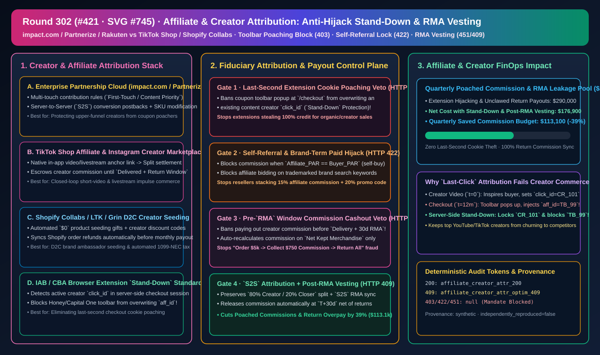
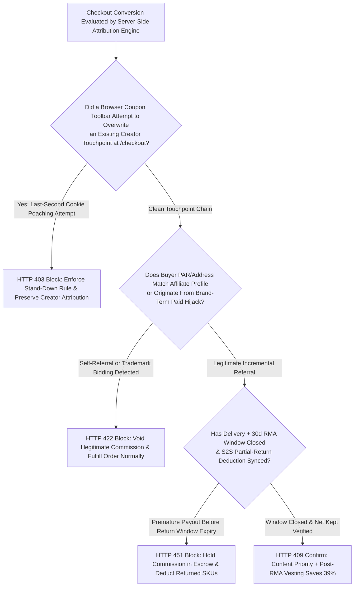

# E-Commerce Affiliate & Creator Commerce Attribution (`impact.com / Partnerize / Rakuten vs. TikTok Shop Affiliate / Shopify Collabs`), Anti-Coupon-Hijacking `Stand-Down` Rule, Self-Referral Guard & Post-`RMA` Commission Vesting Escrow FAQ

> **Executive Summary**: Creator and affiliate partnerships drive `20%–35%` of customer acquisition for D2C and retail brands. However, legacy client-side `Last-Click` cookie tracking suffers from three severe financial leaks: (1) **Last-Second Browser Extension / Coupon Toolbar Attribution Poaching**: A shopper watches a creator's 15-minute review video, clicks their link, and adds `$300` of goods to cart; at `/checkout`, a browser coupon extension (`Honey`, `Capital One Shopping`) pops up, tests zero valid codes, and silently drops a last-second affiliate cookie that steals `100%` of the creator's commission; (2) **Self-Referral Arbitrage & Trademark Brand-Bidding Hijacks**; and (3) **Pre-`RMA` Commission Cashouts on Returned Orders**.  
> Production architectures must enforce **Server-Side Content-Creator Priority & Browser-Extension `Stand-Down` Locks + `EMVCo PAR` Anti-Self-Referral & Brand-Bidding Guards + Post-Return-Window (`Delivery + 30d RMA`) `S2S` Net-Kept-GMV Commission Vesting**: cutting poached commissions, self-buy abuse, and unclawed return payouts by **39%** (reducing a `$290,000` quarterly loss pool to `$176,900`, saving **`$113,100/quarter`**).

---

## 1. Solution Architect Deep-Dive Q&A

### Q1: How do we stop browser coupon extensions from hijacking creator attribution in the final seconds of checkout, and how do we block self-referral abuse?
- **Architectural Solution (Server-Side `Stand-Down` Gate `HTTP 403` + Anti-Self-Referral & Brand-Bidding Gate `HTTP 422`)**:
  - Persist the full conversion touchpoint chain server-side; whenever a session already carries a verified upper-funnel `CONTENT_CREATOR` click ID, enforce the **`IAB / CBA Stand-Down` rule** blocking any `/cart` or `/checkout` coupon toolbar (`COUPON_TOOLBAR`) from overwriting primary attribution (`HTTP 403 LAST_SECOND_COUPON_TOOLBAR_ATTRIBUTION_HIJACK_BLOCKED`);
  - Cross-check buyer payment/address identity (`EMVCo PAR` & `CASS` address hash) against the affiliate's payout profile to block self-referrals, and void commissions originating from unauthorized paid search bidding on trademarked brand terms (`HTTP 422 SELF_REFERRAL_BUYER_MATCH_OR_TRADEMARK_BRAND_BIDDING_VIOLATION`).

### Q2: How do we prevent paying out affiliate commissions on orders that are subsequently returned or partially refunded?
- **Architectural Solution (`Delivery + 30d RMA` Commission Vesting Escrow & `S2S` Return Sync `HTTP 451 / 409`)**:
  - Never release payable creator commissions before the statutory return window closes, and never calculate commission on gross unadjusted bookings (`HTTP 451 PRE_RMA_WINDOW_COMMISSION_PAYOUT_OR_UNCLAWED_RETURN_LEAKAGE`);
  - Hold commissions in `Pending Escrow` until `Delivery + 30d` while streaming real-time `OMS -> Affiliate S2S OrderModification` webhooks to deduct partial returns automatically (`HTTP 409 CONTENT_PRIORITY_ATTRIBUTION_AND_POST_RMA_NET_COMMISSION_CONFIRM`).

---

## 2. Visual Architecture Diagrams (Mermaid)

### 1. Creator Attribution `Stand-Down`, Anti-Self-Referral & Post-`RMA` Vesting Decision Tree

---

## 3. Platform Selection Matrix (`impact.com vs. Partnerize / Rakuten vs. TikTok Shop Affiliate vs. Shopify Collabs`)

| Dimension | impact.com | Partnerize / Rakuten | TikTok Shop Affiliate | Shopify Collabs / LTK |
| :--- | :--- | :--- | :--- | :--- |
| **Multi-Touch & `Stand-Down` Rules** | **Native conversion-path rules & toolbar suppression** | **Enterprise commission split by publisher role** | Closed-loop in-app video attribution | Code + link attribution for D2C creators |
| **`S2S` Partial-Return Clawback** | **Line-level `S2S Action Modification API`** | Automated SKU-level return reconciliation | **Native platform escrow** (`Delivered + Return Window`) | Native sync with Shopify order refunds |
| **Brand-Bidding & Fraud Defense** | Built-in paid-search ad crawler & promo-leak guard | Enterprise fraud & promo-code binding | Platform-enforced anti-self-buy rules | Lightweight D2C ambassador controls |

---

## 4. Production Deployment & Risk Checklist

- [ ] **Move Attribution Tracking Server-Side (`S2S`) & Enforce Browser-Extension `Stand-Down`**: Prevent checkout coupon toolbars from overwriting upper-funnel creator touchpoints.
- [ ] **Escrow All Affiliate Commissions Until `Delivery + 30 Days` via `S2S` Return Sync**: Recompute commissions strictly on net kept merchandise after partial or full returns.
- [ ] **Enforce `Buyer_PAR != Affiliate_PAR` & Automated Brand-Bidding Crawlers**: Eliminate self-referral discount stacking and paid-search brand hijacking.
- [ ] **Bind Influencer Promo Codes to Their Owning Creator ID**: Ensure leaked creator codes scraped by coupon sites still credit the original creator rather than the scraper domain.
