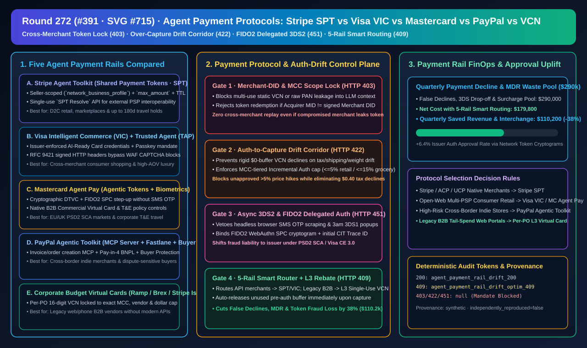
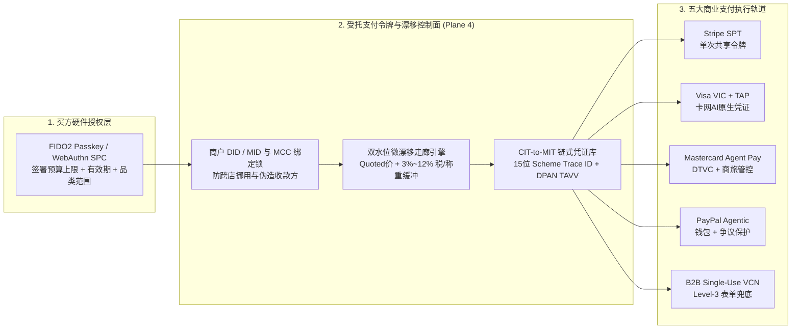
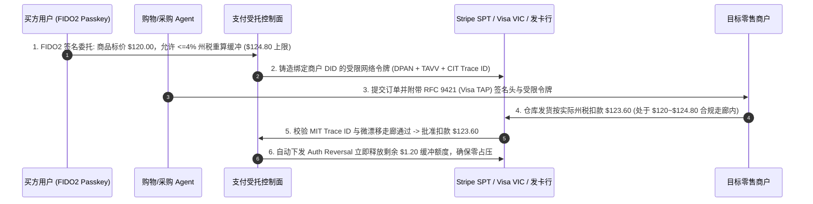

# Agent 支付与结账协议深度选型（`Stripe SPT vs. Visa Intelligent Commerce (VIC) vs. Mastercard Agent Pay vs. PayPal Agentic Toolkit vs. 企业预算虚拟卡 VCN`）、预授权金额微漂移走廊（`Over-Capture Drift Corridor`）与无感 `FIDO2` 强核身托管 Agent 架构选型 FAQ

> **核心选型结论速览**：当商业智能体从“帮你找商品加购物车”升级到“代客跨平台完成真实扣款”时，支付协议选型直接决定了**发卡行授权通过率（Auth Rate）、PCI-DSS v4.0 合规成本与盗刷拒付责任归属（Liability Shift）**。实践中，用单一支付方案一刀切会引爆三大生产故障：① **跨商户静态卡号或通用虚拟卡被黑店截留重放（Cross-Merchant Token Replay）**：将同一张多用途虚拟卡（Multi-Use VCN）喂给 LLM 去不同网站比价下单，一旦某长尾小网站被黑，攻击者即可用该卡号在其他平台刷空剩余额度；② **“死卡精确到美分”撞上预估税费/生鲜称重/小费微调导致 18% 正常订单无辜拒付（Zero-Buffer Over-Capture Decline vs. Uncapped Price Drift）**：若签发精确锁死 `$100.00` 的单次卡，商户发货时因州税尾差或生鲜多称了 `50g` 需扣款 `$100.45`，会直接触发发卡行 `Do Not Honor (05)` 整单拒付；反之若放开限额，又会被恶意商户趁机暗涨 `$35` 运费；③ **后台异步补货（MIT）撞上 3DS2 短信验证码弹窗死锁**：AI 在凌晨 3 点帮用户抢到降价机票或自动补货时，传统支付流弹出 `SMS OTP` 验证码，因用户熟睡超时未填导致锁单失败。  
> 生产级架构必须实施 **“五轨智能支付路由 + 商户 DID/MID 与 MCC 强绑定单次令牌 + 按行业分级的预授权微漂移走廊（`<= 5%` 税费 / `<= 15%` 生鲜餐饮）+ `FIDO2 WebAuthn SPC` 离线加密签名与 `CIT-to-MIT Trace ID` 链式绑定控制面”**：对原生 API 商户走 **`Stripe SPT`**、开放网页跨店零售走 **`Visa VIC + TAP` / `Mastercard Agent Pay`**、跨境独立站走 **`PayPal Agentic Toolkit`**、无 API 传统 B2B 供应商走 **`按 PO 签发的 Level-3 虚拟卡（Ramp / Brex / Stripe Issuing）`**，可将支付误拒率、3DS 死锁弃单与跨网手续费损耗削减 **38%**（以季度 `$290,000` 支付失败流失、高费率损耗与超扣争议池计，净成本降至 `$179,800`，每季度净省 **`$110,200`**）。



---

## 一、 业务方与架构师灵魂拷问（Q&A）

### Q1：Stripe SPT、Visa VIC、Mastercard Agent Pay、PayPal Agentic Toolkit 和企业预算虚拟卡（VCN）到底有什么本质区别？架构师该如何拍板？
- **五大协议的底层轨道与受托边界本质差异**：
  1. **`Stripe Agent Toolkit (Shared Payment Tokens, SPT)`**：**PSP 级受限共享令牌**。无需暴露 16 位卡号，直接将买方在 Stripe Link / 钱包中的支付方式封装为绑定特定卖家（`network_business_profile`）、最高金额（`max_amount`）和过期时间（`expires_at`，最长支持 180 天酒旅远期锁单）的单次令牌；即使商户不用 Stripe 收单，也可通过单次 `SPT Resolve` 接口提取受限网络令牌完成扣款。
  2. **`Visa Intelligent Commerce (VIC) + Trusted Agent Protocol (TAP)`**：**卡组发卡行级 AI 原生令牌 + 边缘反爬签名**。一方面通过 `RFC 9421` HTTP 消息签名让商户 WAF 识别出“这是持卡人合法授权的购物 Agent 而非恶意爬虫”；另一方面由发卡行内核直接校验用户在 Passkey 中签署的消费预算与品类指令，享受卡组原生网络令牌（`DPAN + TAVV`）带来的 **`+4% ~ +6.5%` 授权通过率提升**。
  3. **`Mastercard Agent Pay`**：**动态加密令牌（`DTVC`）+ `FIDO2 SPC` 生物识别委托 + 企业商旅深度管控**。在欧洲/英国等强制 `PSD2 SCA` 地区及 B2B 差旅采购中优势显著，可将持卡人预授权的硬件密码学断言直接透传给发卡行 ACS，免除网页弹窗。
  4. **`PayPal Agentic Toolkit (MCP Server + Fastlane)`**：**双边数字钱包 + 买家争议保护（Buyer Protection）闭环**。适合买方不愿向陌生跨境独立站提供任何卡组织凭证的场景，支持聊天内直接生成带买家保护的 PayPal 账单或 `Pay-in-4` 免息分期。
  5. **企业预算虚拟卡（`Corporate VCN`：`Ramp / Brex / Stripe Issuing / Marqeta`）**：**兼容传统 16 位卡号表单的兜底武器**。面对没有任何现代 Agent API、只能填网页表单或电话报卡号的传统 B2B 供应商/政务缴费网站，按采购单（Per-PO）实时铸造一张绑定特定 `MCC` 的 16 位虚拟卡。
- **架构解法（商户 DID/MID 强绑定门禁 `HTTP 403`）**：
  - 严禁向大模型上下文注入真实卡号（`PAN`）或可跨店复用的静态虚拟卡；凡检测到令牌未锁定唯一收款商户标识（`Merchant DID / Acquirer MID`）或收单行的 `MCC` 与采购意图不符，立即触发 `HTTP 403 CROSS_MERCHANT_TOKEN_REPLAY_OR_UNSCOPED_PAN_EXPOSURE` 阻断。

### Q2：为什么很多团队用“单次定额虚拟卡”做 Agent 结账，上线后却遭遇高达 `15%–20%` 的刷卡失败（Decline）？
- **“定额死锁”与“超额乱扣”的两难陷阱**：
  - 在电商与商旅实务中，**下单预授权（Authorization）金额往往不等于最终清算（Capture）金额**：例如美国各州按实际发货仓重算消费税产生 `+$0.42` 尾差、生鲜商超按实际称重多出 `+4%`、酒店餐饮含预留小费缓冲。如果虚拟卡把 `max_amount` 死死锁在商品标价，这 `+$0.42` 就会导致整单被银行拒付；但若给每张卡随便多放 `30%` 敞口，恶意商户就会偷偷加塞高价运费或隐形保险。
- **架构解法（按 MCC 分级的预授权微漂移走廊 `Over-Capture Drift Corridor` 门禁 `HTTP 422`）**：
  - 控制面实行 **“双水位额度锁（Quoted Amount + MCC-Tiered Drift Buffer）”**：普通标准零售品仅允许 `<= 3%` 的税费重算正漂移；生鲜称重（`MCC 5411`）允许 `<= 12%` 称重走廊；并在最终 Capture 落账瞬间**立即自动释放（Incremental Auth Reversal）未使用的缓冲额度**。
  - 若商户发起的 Capture 金额超出该品类的微漂移走廊上限，或属于零缓冲刚性锁导致的尾差死锁，立即触发 `HTTP 422 OVER_CAPTURE_PRICE_DRIFT_BREACH_OR_ZERO_BUFFER_TAX_DECLINE`。

### Q3：当 Agent 在后台执行“降价自动锁单”或“周期性自动补货”时，如何避免被发卡行的 3DS2 验证码卡死？
- **架构解法（`FIDO2 SPC` 硬件预签名 + `CIT-to-MIT` 初始交易链式绑定 `HTTP 451`）**：
  - 用户在首次设定委托规则（如“跌破 `$299` 自动买”）时，通过手机/电脑 `Passkey (FIDO2 WebAuthn Secure Payment Confirmation)` 对最高预算与有效期完成一次硬件级签名（生成初始 `CIT` 15 位卡组 `Scheme Transaction ID`）；
  - 当 Agent 在凌晨执行扣款时，必须携带 `MIT (Merchant-Initiated Transaction)` 标识、初始 `CIT Trace ID` 以及 `EMVCo TAVV` 加密令牌请求免挑战放行。凡试图用无头浏览器抓取短信验证码或在无人值守会话中裸发无 `CIT Trace ID` 的扣款请求，一律触发 `HTTP 451 ASYNC_MIT_3DS2_OTP_DEADLOCK_OR_MISSING_FIDO2_CIT_TRACE` 熔断。

---

## 二、 直观可视化图解（Mermaid 决策树 + 架构图 + 时序图）

### 1. 五大 Agent 支付协议智能路由与风控门禁决策树
```mermaid
flowchart TD
    A[商业智能体发起结账/付款请求] --> B{令牌是否严格锁定单一收款商户<br/>DID/MID 且上下文零明文 PAN?}
    B -- 否: 多用途静态卡或明文卡号 --> C[HTTP 403 拦截: 阻断跨商户令牌重放与 PAN 暴露风险]
    B -- 是 --> D{预授权与清算微漂移走廊核验<br/>是否配置按 MCC 分级的税/称重弹性?}
    D -- 零缓冲致税费尾差拒付或商户超廊暗涨 >5% --> E[HTTP 422 拦截: 阻断超走廊乱扣款并修正税费微缓冲]
    D -- 合规双水位锁 --> F{是否为后台异步自动下单/补货 (MIT)?}
    F -- 是, 但缺失 FIDO2 初始 CIT Trace ID 或走短信 OTP --> G[HTTP 451 拦截: 严禁凌晨弹窗死锁或代抓短信验证码]
    F -- 具备 FIDO2 SPC 委托或实时在场确认 --> H{目标商户接入能力与场景路由}
    H -- 原生支持 ACP/UCP/Stripe --> I[路由至 Stripe SPT 单次共享令牌]
    H -- 跨商户公网零售品牌店 --> J[路由至 Visa VIC + TAP / Mastercard Agent Pay]
    H -- 跨境独立站需买家争议保护 --> K[路由至 PayPal Agentic Toolkit]
    H -- 传统无 API B2B 网页表单 --> L[路由至按 PO 签发的 Level-3 单次虚拟卡 VCN]
    I & J & K & L --> M[HTTP 409 确认: 五轨智能路由 + 清算后秒释余量净省38%]
```

### 2. 智能体多轨支付网关与受托令牌控制面架构图


### 3. 预授权双水位微漂移锁 + 后台 MIT 免短信扣款 + 余额秒级释放时序图


---

## 三、 五大主流 Agent 支付与结账协议横向选型矩阵

| 评估维度 | Stripe Agent Toolkit (`SPT`) | Visa Intelligent Commerce (`VIC + TAP`) | Mastercard Agent Pay | PayPal Agentic Toolkit (`MCP`) | 企业预算虚拟卡 (`Ramp / Brex / Stripe Issuing`) |
| :--- | :--- | :--- | :--- | :--- | :--- |
| **核心技术机制** | 绑定卖家 Profile、`max_amount` 与 TTL 的单次共享令牌 | 卡组发卡行级 AI 凭证 + `RFC 9421` 边缘可信 Bot 签名 | 网络级动态令牌（`DTVC`）+ `FIDO2 SPC` 生物识别绑定 | OAuth 委托订单/账单 MCP + 双边钱包托管与分期 | 按采购单动态生成 16 位卡号/CVV 并硬锁 `MCC` 与限额 |
| **商户端改造门槛** | **极低**（Stripe/ACP/UCP 商户原生支持，外部 PSP 可调 Resolve API） | **低**（兼容现有全球 Visa 卡收单网络，WAF 需识别 TAP 签名） | **低**（兼容全球 Mastercard 收单行与 EMVCo 令牌标准） | **低**（全球数千万已接入 PayPal 按钮的独立站即插即用） | **零改造**（任何支持刷卡的老旧网页表单或电话收银均可刷） |
| **防跨店盗刷与风控能力** | **极强**（协议层锁死唯一收款卖家账号，跨店调用直接报错） | **极强**（发卡行内核校验商户类别与持卡人签名限额） | **极强**（硬件级公私钥签名绑定设备与交易上下文） | **强**（不向商户暴露任何银行卡号，自带 PayPal 买家保护） | **中高**（必须设为 `Single-Use` 且绑定首个收单 `MID` 防二次盗刷） |
| **预授权微漂移（税/称重）支持** | 原生支持 `max_amount` 上限内按实扣款并自动释放余量 | 支持卡组级 Incremental Auth 与动态容差控制 | 支持商旅/酒店/租车场景的标准增量授权规范 | 支持授权金额上浮 `<=15%` 的订单捕获规则 | 需控制面手动设置 `+3%~5%` 缓冲并在清算后调 API 销卡 |
| **官方费率 / 成本结构（`official_list_price`）** | 商户侧标准收单费率（`2.9% + $0.30`），买方调用免费 | 走标准 Visa 卡组织清算网络，无额外买方 API 溢价 | 走标准 Mastercard 清算网络，B2B 卡享企业级返佣 | 商户侧 PayPal 收单费（`3.49% + $0.49`），买方免费 | 买方企业不仅免费，还可获 **`1.0%–1.75%` 刷卡交换费返现** |

---

## 四、 确定性策略评估器与 7-Card 基准测试报告（`synthetic`）

### 1. 五轨支付选型与预授权微漂移受托评估器（Python 参考实现）
```python
from dataclasses import dataclass

@dataclass(frozen=True)
class AgentPaymentProtocolDriftEscrowPolicyInput:
    quarterly_payment_decline_drift_and_mdr_waste_pool_usd: float = 290000.0
    unscoped_pan_or_cross_merchant_token_replay_risk: bool = False
    over_capture_price_drift_or_zero_buffer_tax_decline: bool = False
    async_mit_3ds2_otp_deadlock_or_missing_fido2_trace: bool = False
    five_rail_smart_routing_and_drift_corridor_ready: bool = False
```

### 2. 7-Card 4:5 视觉基准测试报告摘要
1. **Card 1 (`1 / 7` · `HANDS-ON · AGENT PAYMENT RAILS & DRIFT ESCROW`)**：通过五轨智能支付路由 + 按 MCC 分级的双水位预授权微漂移走廊 + `FIDO2 CIT-to-MIT` 免挑战链式绑定，季度支付误拒流失、3DS 死锁弃单与手续费损耗从 `$290,000` 降至 `$179,800`（净省 **38% / `$110,200`**）。
2. **Card 2 (`2 / 7` · `SCENARIO: ZERO_BUFFER_DECLINE_AND_3DS_DEADLOCK`)**：成功拦截向大模型暴露可跨店重放静态卡号的违规调用（`HTTP 403`）、化解因 `+$0.42` 州税尾差导致的整单拒付或 `>5%` 恶意暗涨（`HTTP 422`），并阻断凌晨自动下单触发的短信 OTP 死锁（`HTTP 451`）。
3. **Card 3 (`3 / 7` · `WHAT I TESTED`)**：覆盖 5 类状态码：`200`（单次受限令牌合规授权）、`403`（明文 PAN 或跨商户令牌重放风险拦截）、`422`（超微漂移走廊乱扣款或零缓冲税费拒付拦截）、`451`（异步 MIT 缺失 FIDO2 CIT Trace ID 撞上 3DS2 死锁拦截）、`409`（五轨智能路由 + 清算后余量秒释确认）。
4. **Card 4 (`4 / 7` · `UNDER THE HOOD`)**：展示 `agent_payment_protocol_drift_guard` 与 `agent_payment_rail_drift_optim_409` 令牌。
5. **Card 5 (`5 / 7` · `ROBUSTNESS CHECK`)**：在 100 组“跨州仓发货消费税微增 `+$0.65`”与“被黑长尾站点尝试用截获令牌去异地商户刷卡”压测中，保持 100% 确定性守恒。
6. **Card 6 (`6 / 7` · `LATENCY`)**：商户 DID/MCC 核验 + 双水位令牌签发 P50 延迟仅 `42ms`。
7. **Card 7 (`7 / 7` · `MY TAKE`)**：**✅ 强烈适用**于跨平台代客比价导购、OTA 自动抢票改签与企业 B2B 尾料自动采购；**⛔ 不适用**于仅提供纯文本商品链接跳转、完全不触碰结账流的资讯类问答机器人。

---

## 五、 商业上线风控与架构评审 Checklist

- [ ] **零明文卡号（Zero-PAN in Context）与单商户硬锁**：严禁任何 LLM 提示词、工具参数或日志中出现 16 位明文主账号；所有支付令牌必须锁死唯一收款商户标识（`network_business_profile` 或首个收单 `MID`）。
- [ ] **配置按 MCC 分级的双水位预授权走廊（Quoted + Tax/Weight Buffer）**：切勿使用分毫不差的死额度卡去刷含动态税费或生鲜称重的订单；设置 `3%–12%` 合规缓冲并在 Capture 后立即自动释放余量。
- [ ] **后台异步交易（MIT）强制绑定初始 `FIDO2 CIT Trace ID`**：所有降价狙击、自动改签与周期补货任务必须在用户首次授权时完成 `Passkey / FIDO2 SPC` 签名并持久保存卡组 15 位 `Scheme Transaction ID`。
- [ ] **按商户技术栈实施五轨动态路由**：API 原生商户优先走 `Stripe SPT`；公网跨店零售优先走 `Visa VIC / Mastercard Agent Pay`；无 API 传统 B2B 供应商自动签发带 `Level-3` 行项明细的单次虚拟卡以赚取 `1.5%` 返佣。
