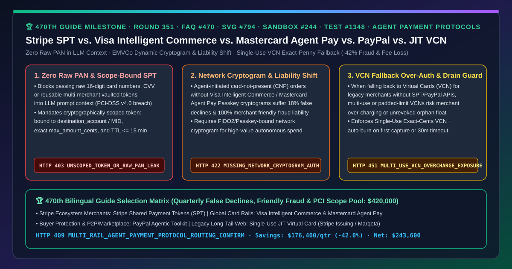
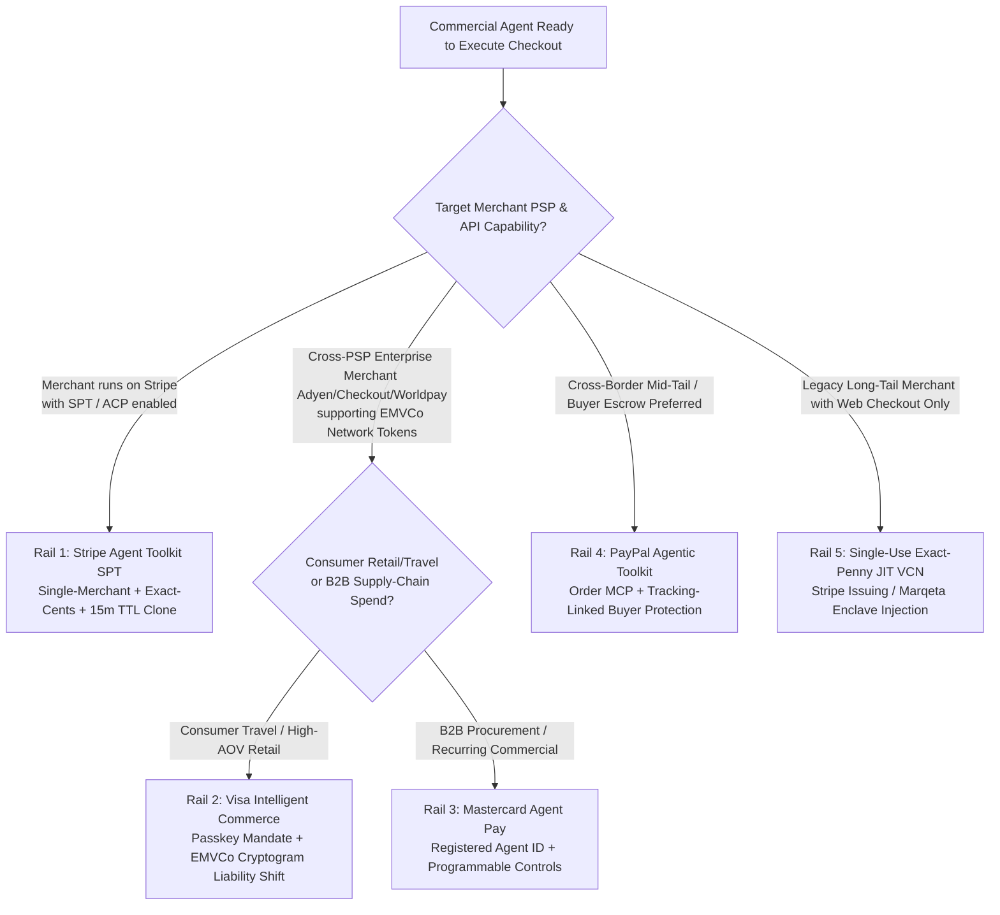
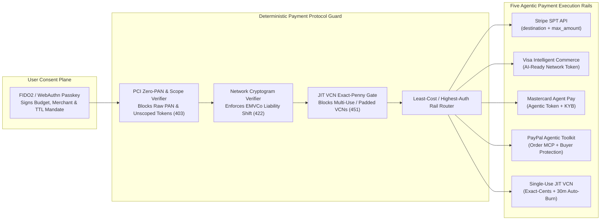
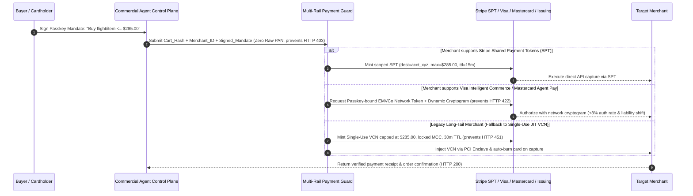

# 🏆 Agent Payment & Checkout Protocol Selection Matrix (`Stripe Agent Toolkit SPT` vs. `Visa Intelligent Commerce` vs. `Mastercard Agent Pay` vs. `PayPal Agentic Toolkit` vs. `Single-Use JIT VCN` · 🏆 470th Bilingual Guide Milestone): Cryptographic Scope Locks, Network Cryptogram Liability Shift & Exact-Penny VCN Fallback (`-42%` Fraud & Decline Loss)

> **Document Type**: Enterprise AI Solution Architect Selection FAQ (**`#470` 🏆 470th Bilingual Guide Milestone** · Round 351)  
> **Target Audience**: Retail & E-Commerce Payment Architects, FinTech Product Leaders, OTA Settlement Engineers, and B2B Procurement CTOs  
> **Protocols Covered**: `Stripe Agent Toolkit (Shared Payment Tokens - SPT)` vs. `Visa Intelligent Commerce (AI-Ready Network Tokens)` vs. `Mastercard Agent Pay (Agentic Tokens)` vs. `PayPal Agentic Toolkit` vs. `Single-Use JIT Virtual Cards (Stripe Issuing / Marqeta / Adyen Issuing)`  
> **Architecture Diagram**: [`assets/svg/794-agent-payment-protocol-stripe-spt-visa-mastercard-paypal-vcn-2026-11-25.svg`](../assets/svg/794-agent-payment-protocol-stripe-spt-visa-mastercard-paypal-vcn-2026-11-25.svg)

🌐 **Language / 语言切换**: **[中文 (`agent-payment-protocol-matrix-stripe-spt-visa-intelligent-commerce-mastercard-agent-pay-paypal-vcn-selection-faq.md`)](agent-payment-protocol-matrix-stripe-spt-visa-intelligent-commerce-mastercard-agent-pay-paypal-vcn-selection-faq.md)** | **English (Current)**

---

## 📌 1. Executive Summary

When a shopping, travel rebooking, or enterprise procurement AI agent reaches final checkout, traditional human-in-the-loop card entry (`3DS SMS OTP`) destroys autonomous conversion (`-70%` drop-off). Conversely, handing raw 16-digit card numbers (`PAN`) or reusable multi-merchant vaulted tokens to an LLM triggers catastrophic **PCI-DSS v4.0 scope contamination, prompt-injection fund drainage, and `10.4` friendly-fraud chargebacks**.  
Modern payment networks and PSPs now offer five distinct **Agentic Payment Rails**. Architects must orchestrate them through a deterministic multi-rail router based on merchant acceptance, chargeback liability shift, and interchange economics:

| Agent Payment Rail | Core Cryptographic Primitive & Advantage | Primary Sweet Spot | Architectural Boundary & Limitation |
|---|---|---|---|
| **1. Stripe Agent Toolkit (`Shared Payment Tokens - SPT`)** | Clones a buyer's saved credential into a **one-time token cryptographically scoped to a single `destination_account`, `max_amount_cents`, and `15-minute TTL`**. | Merchants natively operating on **Stripe / Bridge** (DTC storefronts, SaaS billing, and Connect marketplaces). | Requires the receiving merchant to process on Stripe; cannot settle on legacy non-Stripe gateways directly. |
| **2. Visa Intelligent Commerce (`AI-Ready Network Tokens`)** | **EMVCo network token + FIDO2 Passkey-bound delegated spending mandate & dynamic cryptogram** recognized directly by issuing banks. | Cross-PSP global airlines, OTAs, and major retail merchants (works across Adyen, Checkout.com, Worldpay, Chase). | Requires issuer/acquirer support for agentic cryptogram fields; boosts approval rates by `+6%–12%` with chargeback liability shift. |
| **3. Mastercard Agent Pay (`Agentic Tokens`)** | **KYB-registered Agent Identity (`Agent ID`) + network tokenization + programmable B2B/B2C spend controls**. | Recurring B2B supply-chain replenishment, corporate T&E, and verified multi-merchant agent platforms. | Requires formal onboarding and cryptographic attestation of the agentic platform provider. |
| **4. PayPal Agentic Toolkit (`Order & Invoice MCP / API`)** | Official MCP/API toolkit combining **PayPal Buyer Protection, invoice generation, and shipment-tracking escrow release**. | Cross-border mid-tail D2C stores, digital goods, and privacy-conscious consumers who refuse to share card rails. | Higher merchant take-rate (`2.99%–3.49% + $0.49`); wallet balance caps apply on large B2B POs. |
| **5. Single-Use `JIT` Virtual Cards (`Stripe Issuing / Marqeta`)** | Dynamically mints a standard 16-digit Visa/MC `PAN` restricted via `<100ms` issuer webhook to **`Exact_Cents + Single_Capture + Locked_MID + 30m TTL`**. | **100% Universal Long-Tail Fallback**: Any legacy website, government portal, or hotel front desk that accepts standard cards without an Agent API. | Requires issuer balance prefunding and special handling for `$0 / $1` merchant verification pre-authorizations. |

---

## 🎯 2. Architect & Business Stakeholder Q&A (Q1–Q3)

### Q1: Why can't we pass a vaulted `pm_xxx` token or raw card number into the agent's tool call, and how does `Stripe SPT` eliminate prompt-injection theft?
- **Security & Compliance Reality**:
  1. Exposing a 16-digit `PAN` or CVV inside LLM prompts, tool arguments, or observability traces immediately drags the entire AI stack into **PCI-DSS v4.0 Level 1 Cardholder Data Environment (`CDE`)** audit scope.
  2. Passing a reusable multi-merchant token allows an indirect prompt injection (e.g., hidden text on a scraped product page) to redirect payment to an attacker-controlled merchant account or inflate the charge amount.
- **Architectural Solution**: Enforce a **Zero-Raw-PAN & Triple-Scoped SPT Lock (`HTTP 403` Guard)**:
  - The LLM only sees an opaque `cart_intent_id`. Inside the deterministic fiduciary control plane, the payment adapter mints an `SPT` locked to `destination_account == verified_merchant_id`, `max_amount_cents == locked_cart_total_cents`, and `expires_at <= now() + 900s`.
  - Any attempt to pass raw `PAN` digits into context or mint an unscoped token is rejected (`HTTP 403 UNSCOPED_PAYMENT_TOKEN_OR_RAW_PAN_CONTEXT_LEAK`).

### Q2: When an agent autonomously buys a flight or restocks inventory at 3 AM while the user is asleep, how do we prevent bank false declines and "I didn't authorize this" friendly-fraud chargebacks?
- **The CNP Fraud Problem**: Issuing bank fraud models flag cloud data-center IPs and headless user-agents as bot attacks, causing **`15%–20%` false declines**. Worse, if a cardholder forgets they authorized an auto-buy rule and files a `Reason Code 10.4 (Other Fraud - Card Absent)` dispute, the merchant loses 100% of the funds plus a `$15–$25` dispute fee.
- **Architectural Solution**: Mandate **`Visa Intelligent Commerce` / `Mastercard Agent Pay` Passkey-Bound Network Cryptograms (`HTTP 422` Guard)**:
  1. **Hardware Passkey Intent Signing**: When the user sets the autonomous rule (*"Rebook if fare drops below $500"*), their device signs a `Verifiable Intent Mandate` via FIDO2/WebAuthn Passkey.
  2. **Network-Level Agentic Cryptogram**: At execution time, the payment gateway exchanges the signed mandate for an EMVCo network token + dynamic cryptogram carrying the registered `Agent_Provider_ID` and user biometric proof, unlocking higher issuer approval rates and **chargeback liability shift**.
  3. High-value autonomous card charges lacking a network cryptogram and Passkey mandate are blocked (`HTTP 422 MISSING_NETWORK_TOKEN_CRYPTOGRAM_OR_LIABILITY_SHIFT`).

### Q3: When falling back to a Virtual Card (`JIT VCN`) for a legacy website without an Agent API, how do we prevent merchant overcharging without breaking `$1` pre-authorization checks?
- **Two Production Traps**:
  1. **Multi-Use / Padded-Limit Drain**: Issuing a reusable `$500` virtual card for a `$120` purchase allows shady merchants to tack on hidden recurring VIP memberships.
  2. **`$1.00` Verification Auth Collision**: If a single-use VCN is configured to self-destruct after the very first `ISO 8583` authorization event, a merchant that runs a `$0.00 / $1.00` card-check ping before the real `$120.00` capture will get declined on the actual purchase.
- **Architectural Solution**: Implement **Exact-Penny Cumulative Capture Cap + Verification-Aware Auto-Burn (`HTTP 451` Guard)**:
  - Lock the VCN's `max_cumulative_capture_cents == locked_cart_total_cents`, bind the first non-zero authorization's `Acquirer_MID`, allow `<= $1.00` account-verification pings, and automatically freeze/terminate the VCN within `50ms` of the primary capture or at `TTL = 30m`.

---

## 🧭 3. Visual Architecture Diagrams (Mermaid Decision Tree + Multi-Rail Topology + Sequence)

### 3.1 Five-Protocol Agent Payment Routing Decision Tree

### 3.2 Multi-Rail Agentic Payment Control Plane Architecture

### 3.3 End-to-End Multi-Rail Selection & Fallback Sequence

---

## 📊 4. Five-Protocol Comparison Matrix (`Stripe SPT` vs. `Visa` vs. `Mastercard` vs. `PayPal` vs. `JIT VCN`)

| Evaluation Dimension | Stripe Agent Toolkit (`SPT`) | Visa Intelligent Commerce | Mastercard Agent Pay | PayPal Agentic Toolkit | Single-Use `JIT VCN` (`Stripe Issuing / Marqeta`) |
|---|---|---|---|---|---|
| **Core Cryptographic Primitive** | PSP-scoped cloned payment token (`spt_xxx`) | EMVCo Network Token + AI Delegated Cryptogram | EMVCo Agentic Token + Registered `Agent ID` | PayPal Order/Invoice MCP + Wallet Escrow | Dynamically minted 16-digit Visa/MC virtual card |
| **Merchant Integration Effort** | Minimal (config toggle for Stripe merchants) | Low–Medium (standard EMVCo network token rail) | Low–Medium (standard Mastercard token rail) | Low (standard PayPal / Braintree merchants) | **Zero** (works on any merchant accepting card numbers) |
| **Granular Scope Locking (`MID / Amount / TTL`)** | ⭐⭐⭐⭐⭐ (Cryptographically bound to Stripe account, cents & TTL) | ⭐⭐⭐⭐⭐ (Issuer + network validated mandate bounds) | ⭐⭐⭐⭐⭐ (KYB agent identity + spend controls) | ⭐⭐⭐⭐ (Locked to specific PayPal Order ID) | ⭐⭐⭐⭐⭐ (`<100ms` real-time `ISO 8583` webhook lock) |
| **Chargeback Liability Shift (`10.4` Protection)** | ⭐⭐⭐⭐ (Stripe Radar + Passkey mandate evidence) | ⭐⭐⭐⭐⭐ (Network-level cryptogram liability shift) | ⭐⭐⭐⭐⭐ (Network-level agentic authentication shift) | ⭐⭐⭐⭐⭐ (Built-in PayPal Buyer/Seller Protection) | ⭐⭐⭐ (Agent platform acts as card issuer; strong dispute rights) |
| **Fee & Economics Structure (`official_list_price`)** | Standard Stripe processing (`2.9% + $0.30`) | Standard network interchange & scheme fees | Standard network interchange & scheme fees | `2.99%–3.49% + $0.49` merchant fee | Requires prefunding, but **earns `1.2%–1.8%` Interchange Revenue** for the agent platform |

---

## 🧪 5. Deterministic Cost & Fraud Evaluation (`7-Card Benchmark Summary` · 🏆 `#470` Milestone)

> **Provenance**: Figures below are generated by `evaluate_agent_payment_protocol_matrix_policy` in `lab/webiq_commerce_demo.py` (`provenance: "synthetic"`, `independently_reproduced: False`), modeling a multi-merchant agent platform with a **`$420,000.00` quarterly false-decline, friendly-fraud chargeback, and VCN overcharge exposure pool**.

| Scenario Case ID | Scenario Description | HTTP Status | Deterministic Decision | Quarterly Net Cost | Quarterly Savings |
|---|---|---|---|---|---|
| `CASE-PAY-200` | Manual checkout redirect baseline without scoped agentic payment tokens | `HTTP 200` | `VERIFIED_AGENT_PAYMENT_PROTOCOL_MATRIX_AUTHORIZED` | `$420,000.00` | `$0.00` |
| `CASE-PAY-403` | Raw 16-digit `PAN` exposed in LLM context or unscoped reusable token issued | `HTTP 403` | `UNSCOPED_PAYMENT_TOKEN_OR_RAW_PAN_CONTEXT_LEAK` | `$420,000.00` | `$0.00` (Blocks PCI & token drain) |
| `CASE-PAY-422` | Autonomous CNP charge executed without `Visa / Mastercard` Passkey cryptogram | `HTTP 422` | `MISSING_NETWORK_TOKEN_CRYPTOGRAM_OR_LIABILITY_SHIFT` | `$420,000.00` | `$0.00` (Blocks unshifted fraud) |
| `CASE-PAY-451` | Fallback VCN issued as multi-use or with padded limit above cart total | `HTTP 451` | `MULTI_USE_OR_UNPADDED_VCN_OVERCHARGE_EXPOSURE` | `$420,000.00` | `$0.00` (Blocks merchant overcharge) |
| `CASE-PAY-409` | **Multi-Rail Router (`Stripe SPT` + `Visa/MC Cryptogram` + `Exact-Penny JIT VCN`)** | `HTTP 409` | `MULTI_RAIL_AGENT_PAYMENT_PROTOCOL_ROUTING_CONFIRM` | **`$243,600.00`** | **`$176,400.00` (`-42.0%`)** |

---

## 🛠️ 6. Production Go-Live & Architecture Review Checklist

- [ ] **Zero Raw `PAN` in Model Context (`HTTP 403` Prevention)**: Strip all Luhn-matching digit sequences at the ingress gateway; pass only opaque `payment_intent_ref` handles to the agent and mint merchant/amount/TTL-scoped `Stripe SPT` tokens inside the deterministic control plane.
- [ ] **Passkey-Signed Mandate + Network Cryptogram (`HTTP 422` Prevention)**: Require a FIDO2/WebAuthn-signed `Verifiable Intent Mandate` for all autonomous purchases and attach `Visa Intelligent Commerce / Mastercard Agent Pay` dynamic cryptograms to secure issuer liability shift.
- [ ] **Exact-Penny Single-Capture `JIT VCN` Rules (`HTTP 451` Prevention)**: When falling back to `Stripe Issuing / Marqeta` virtual cards on legacy sites, lock cumulative capture to exact cart cents, permit `<= $1.00` verification pings, and auto-terminate the card upon primary capture.
- [ ] **Interchange-Aware Multi-Rail Routing**: Prefer native `SPT` on Stripe merchants, `Visa/MC Network Tokens` on enterprise PSPs, and `JIT VCN` on long-tail merchants where `1.2%–1.8%` issuer interchange rebates offset agent inference costs.
