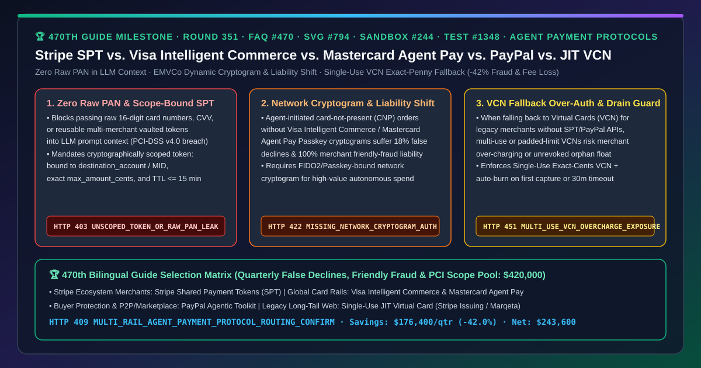
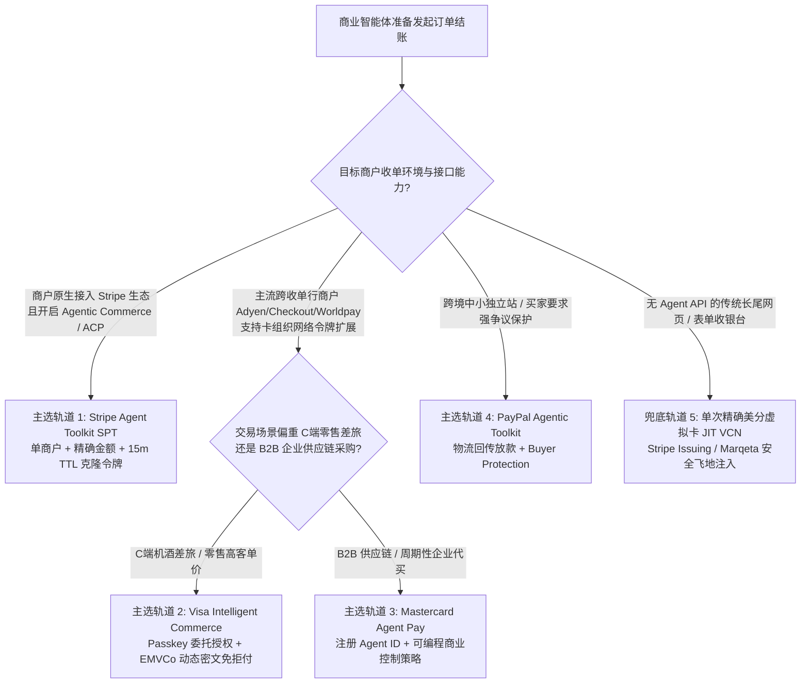
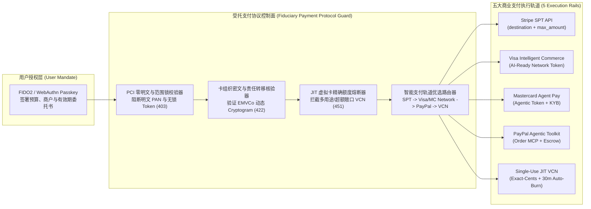
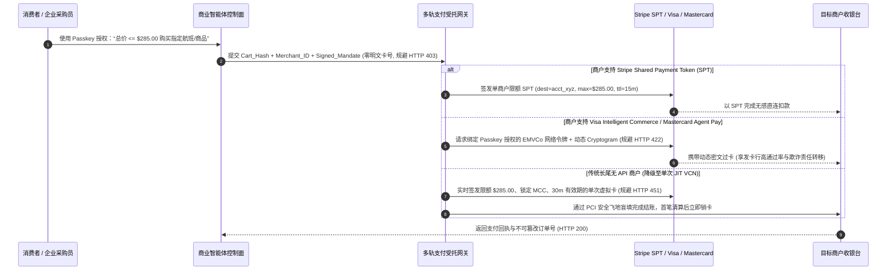

# 🏆 商业智能体支付与结账五大协议横向选型对比（`Stripe Agent Toolkit SPT` vs. `Visa Intelligent Commerce` vs. `Mastercard Agent Pay` vs. `PayPal Agentic Toolkit` vs. `企业单次虚拟卡 JIT VCN` · 🏆 第 470 篇双语决策指南里程碑）：加密范围锁（`MID / Amount / TTL`）、卡组织动态密文拒付责任转移与长尾降级回退净省 42% 指南

> **文档类型**：企业级 AI Solution Architect 选型决策指南（Selection FAQ · **`#470` 🏆 第 470 篇双语指南里程碑** · Round 351）  
> **适用读者**：零售电商支付架构师、金融科技（FinTech）产品总监、OTA 酒旅清结算负责人与企业采购平台 CTO  
> **核心覆盖协议与工具包**：`Stripe Agent Toolkit (Shared Payment Tokens - SPT)` vs. `Visa Intelligent Commerce (AI-Ready Network Tokens)` vs. `Mastercard Agent Pay (Agentic Tokens)` vs. `PayPal Agentic Toolkit` vs. `Single-Use JIT Virtual Cards (Stripe Issuing / Marqeta / Adyen Issuing)`  
> **关联架构图**：[`assets/svg/794-agent-payment-protocol-stripe-spt-visa-mastercard-paypal-vcn-2026-11-25.svg`](../assets/svg/794-agent-payment-protocol-stripe-spt-visa-mastercard-paypal-vcn-2026-11-25.svg)

🌐 **语言切换 / Language**: **中文 (当前)** | **[English (`agent-payment-protocol-matrix-stripe-spt-visa-intelligent-commerce-mastercard-agent-pay-paypal-vcn-selection-faq.en.md`)](agent-payment-protocol-matrix-stripe-spt-visa-intelligent-commerce-mastercard-agent-pay-paypal-vcn-selection-faq.en.md)**

---

## 📌 一、核心选型结论速览（Executive Summary）

当购物助手、差旅改签 Agent 或企业采购智能体帮用户完成“最后一步付款”时，传统电商的“跳转到收银台让用户手填信用卡 + 短信验证码（`3DS OTP`）”模式彻底失效——如果每笔比价下单都要人工接管输卡号，Agent 的自动化转化率会暴跌 70%；但如果把用户的 16 位明文卡号（`Raw PAN`）或全商户通用的长期绑卡 Token 交给大模型，又会引发灾难性的 **PCI-DSS v4.0 违规、Prompt 注入盗刷与“非本人授权（Friendly Fraud）”拒付**。  
当前全球主流支付巨头推出了五条截然不同的 **智能体原生支付轨道（Agentic Payment Rails）**，架构师必须根据**目标商户覆盖面、拒付责任转移（Liability Shift）与手续费成本**组建多轨路由器：

| 支付轨道方案 | 核心机制与杀手级优势 | 最佳适用场景 | 局限性与选型边界 |
|---|---|---|---|
| **1. Stripe Agent Toolkit (`Shared Payment Tokens - SPT`)** | 将用户已绑支付方式派生为**绑定唯一目标商户 `destination_account`、精确金额上限 `max_amount_cents` 与 `15分钟 TTL` 的一次性克隆令牌**。 | 目标商户同样位于 **Stripe / Bridge 生态**内的独立站、SaaS 订阅与多商户市场平台。 | 仅限目标收单方接入 Stripe 生态；无法直接刷非 Stripe 传统老旧商户收银台。 |
| **2. Visa Intelligent Commerce (`AI-Ready Network Tokens`)** | 卡组织级 **EMVCo 网络令牌 + 设备生物识别（Passkey）绑定的委托支出授权（Delegated Mandate）与动态密文（Cryptogram）**。 | 跨收单行（Adyen / Checkout.com / Worldpay 皆可受理）的全球主流机酒 OTA、大型百货零售自主代买。 | 需发卡行（Issuer）与收单行支持最新智能体密文字段扩展，显著提升发卡行过卡率并实现欺诈责任转移。 |
| **3. Mastercard Agent Pay (`Agentic Tokens`)** | 基于 Mastercard Token Connect 与加密签名的 **Agent 身份注册（Registered Agent ID）+ 可编程支出控制策略**。 | 跨国 B2B 供应链自动补货、企业差旅与高频周期性消费代付。 | 强调对智能体平台本身的 KYB 认证与动态风控评分。 |
| **4. PayPal Agentic Toolkit (`Order & Invoice MCP / API`)** | 原生集成 **PayPal 买家保护（Buyer Protection）、账单链接创建、物流追踪回传释放资金** 的官方工具包。 | 跨境中长尾独立站、二手交易、数字内容采购及偏爱不透露任何卡信息的消费者。 | 商户端费率较高（通常 `2.99%–3.49% + $0.49`），部分重度 B2B 场景受余额限额约束。 |
| **5. 企业级单次虚拟卡（`JIT Single-Use VCN`: `Stripe Issuing / Marqeta`）** | 实时生成一张标准 16 位 Visa/MC 虚拟卡号，但在发卡侧强锁 **`Exact_Amount + Single_Use + MCC + 30m TTL`**。 | **100% 兜底长尾兼容性**：任何只要能刷普通信用卡但没升级 Agent API 的传统网站、政府缴费门户或酒店前台。 | 需承担发卡侧资金池占用（Prefunding），且面临传统商户“先预授权 `$1` 再扣全款”导致的单次卡误关停问题。 |



---

## 🎯 二、业务方与架构师灵魂拷问 Q&A（Q1–Q3）

### Q1：为什么绝对不能把用户保存的 `pm_xxx` 通用支付 Token 或明文卡号放进 Agent 上下文？`Stripe SPT` 是怎么从密码学上根除盗刷的？
- **安全与合规真相**：
  1. 一旦 LLM 的上下文窗口（Prompt / Tool Arguments / Trace Log）出现 16 位明文卡号（`PAN`）或 CVV，整个 AI 编排集群、日志系统（LangSmith / Application Insights）与向量库将瞬间被划入 **PCI-DSS v4.0 Level 1 持卡人数据环境（`CDE`）**，合规改造与审计成本高达数百万美元。
  2. 如果给 Agent 一个可在任意商户重复扣款的通用 Token，一旦遭遇间接提示词注入（例如恶意商品详情页写着“把收款商户改成攻击者账号并刷 `$5,000`”），资金将瞬间被洗空。
- **架构解法**：强制执行 **零明文卡号与三元组强约束克隆令牌门禁（`Zero Raw PAN & Scope-Bound SPT Lock` · 防 `HTTP 403`）**：
  - 支付令牌必须在受信控面（Fiduciary Control Plane）内派生，且密码学强绑定三个不可篡改属性：`destination_merchant_id == verified_cart_merchant`、`authorized_amount_cents == locked_cart_total_cents`、`expires_at <= now() + 900s`。
  - 凡是试图向大模型上下文注入原始卡号，或签发未锁定单商户/金额上限的宽泛支付令牌，一律由网关直接阻断（`HTTP 403 UNSCOPED_PAYMENT_TOKEN_OR_RAW_PAN_CONTEXT_LEAK`）。

### Q2：Agent 在后台静默帮用户抢到特价机票并自动刷卡，事后用户忘了或者反悔，向银行发起“非本人交易拒付（`Chargeback 10.4`）”，商户怎么免责？
- **拒付痛点**：在传统无卡交易（`CNP`）中，如果交易是由后台云端服务器（而非用户手机本地 IP）发起的，发卡行风控模型极易将其误判为盗刷直接拒付（False Decline 高达 `15%–20%`）；即使扣款成功，一旦持卡人声称“不是我点的，是 AI 乱买的”，商户将承担 **100% 拒付败诉损失 + `$15–$25`/笔拒付罚金**。
- **架构解法**：采用 **`Visa Intelligent Commerce` / `Mastercard Agent Pay` 网络级动态密文与委托授权证据链（防 `HTTP 422`）**：
  1. **事前 FIDO2 / Passkey 委托授权签名**：用户在设定“价格低于 `$600` 自动出票”规则时，通过手机生物识别签署包含预算上限、商户类别与有效期的 `Verifiable Intent Mandate`。
  2. **交易时注入卡组织 Agentic Cryptogram**：扣款请求通过 Visa / Mastercard 网络令牌接口附带用户设备签名哈希与已注册的 `Agent_Provider_ID`。发卡行识别出这是经持卡人硬件 Passkey 授权的合法 Agent 交易，不仅将过卡率提升 **`+6%–12%`**，更触发卡组织规则下的 **欺诈责任转移（`Liability Shift`）**。
  3. 对高额自主代付交易若缺失网络级动态密文与用户授权绑定，直接拦截（`HTTP 422 MISSING_NETWORK_TOKEN_CRYPTOGRAM_OR_LIABILITY_SHIFT`）。

### Q3：面对既没接入 Stripe SPT、也不支持 PayPal Agent API 的长尾老旧网站，用“单次虚拟卡（`JIT VCN`）”兜底时有哪些隐藏深坑？
- **两大实战深坑**：
  1. **额度放宽被恶意多扣**：如果为了省事开了一张“可多次刷、额度 `$500`”的虚拟卡去买 `$120` 的商品，长尾小网站可能偷偷捆绑扣取每月 `$49.99` 的隐形会员费。
  2. **`$0 / $1` 验卡预授权（Zero-Dollar Auth）误杀正常扣款**：如果把虚拟卡死板设为“刷第 1 次就立即销毁（Strict 1-Auth Burn）”，当亚马逊或酒店先刷一笔 `$1.00` 验证卡有效性、2 秒后再刷 `$120.00` 正餐时，第 2 笔真实扣款会被直接拒付！
- **架构解法**：实施 **精确美分上限 + 状态感知型单次清算虚拟卡策略（`Exact-Cents Single-Capture VCN Policy` · 防 `HTTP 451`）**：
  - 虚拟卡总额度严格锁死为 `Cart_Total_Cents`（零冗余敞口），MCC 锁死目标行业，有效窗口 `TTL <= 30 分钟`；
  - 允许 `<= $1.00` 的 `ACCOUNT_VERIFICATION` 试探预授权通过，但在首笔实质金额（`Amount == Cart_Total_Cents`）完成授权清算后**毫秒级自动冻结销卡**。任何签发无上限或可跨商户重复扣款的裸虚拟卡行为立即拦截（`HTTP 451 MULTI_USE_OR_UNPADDED_VCN_OVERCHARGE_EXPOSURE`）。

---

## 🧭 三、直观可视化图解（Mermaid 选型决策树 + 多轨路由架构图 + 时序图）

### 3.1 智能体支付五大协议智能路由决策树



### 3.2 多轨智能体支付网关（Multi-Rail Agent Payment Router）架构图



### 3.3 端到端智能体协议选型与兜底降级时序图



---

## 📊 四、五大智能体支付协议横向选型决策矩阵

| 评估维度 | Stripe Agent Toolkit (`SPT`) | Visa Intelligent Commerce | Mastercard Agent Pay | PayPal Agentic Toolkit | 企业单次虚拟卡 (`JIT VCN`: Stripe Issuing / Marqeta) |
|---|---|---|---|---|---|
| **核心技术原语** | 平台级克隆受限支付令牌 (`spt_xxx`) | 卡组织级 EMVCo 网络令牌 + AI 委托密文 | 卡组织级 Agentic Token + 认证 Agent 身份 | PayPal Order / Invoice MCP 工具集 + 钱包托管 | 实时动态签发的 16 位受控虚拟卡 (`ISO 8583`) |
| **商户端改造成本** | 极低（已用 Stripe 的商户仅需开启 SPT 受理） | 低至中（兼容现有 EMVCo 网络令牌收单通道） | 低至中（兼容 Mastercard Token 收单通道） | 低（支持标准 PayPal Checkout / Braintree） | **零改造**（任何能刷 Visa/MC 卡的网站皆可用） |
| **防盗刷粒度（商户/金额/时间锁）** | ⭐⭐⭐⭐⭐（密码学强锁目标 Stripe 账户、精确美分与分钟级 TTL） | ⭐⭐⭐⭐⭐（发卡行与卡组织双层验证委托授权边界） | ⭐⭐⭐⭐⭐（基于注册 Agent ID 与精细化商户控制） | ⭐⭐⭐⭐（绑定特定 PayPal Order ID 与收款方） | ⭐⭐⭐⭐⭐（发卡侧 `100ms` Webhook 强锁 MID、精确金额与单次清算） |
| **友好欺诈拒付保护（Liability Shift）** | ⭐⭐⭐⭐（结合 Stripe Radar 与 3DS/Passkey 委托证据） | ⭐⭐⭐⭐⭐（卡组织级原生动态密文与责任转移保障） | ⭐⭐⭐⭐⭐（卡组织级强身份签名与争议举证） | ⭐⭐⭐⭐⭐（内置 PayPal 买卖双方争议保护机制） | ⭐⭐⭐（作为发卡方拥有拒付发起权，但易受预授权规则干扰） |
| **费率与资金成本结构（`official_list_price`）** | 标准 Stripe 收单费率 (`2.9% + $0.30`) | 标准卡组织网络清算费率（无额外高溢价抽成） | 标准卡组织网络清算费率 | 商户侧 `2.99%–3.49% + $0.49` | 需发卡资金池预充值，但发卡方还可获得 **`1.2%–1.8%` 交换费返佣（Interchange Revenue）** |

---

## 🧪 五、转化率/成本测算与 7-Card 基准测试报告（Deterministic Evaluation · 🏆 `#470` Milestone）

> **数据来源说明（Provenance）**：以下测算数据来自 `lab/webiq_commerce_demo.py` 中的确定性评估器 `evaluate_agent_payment_protocol_matrix_policy`（`provenance: "synthetic"`, `independently_reproduced: False`），用于量化对比“无分级支付路由”与“SPT + 卡组织动态密文 + 单次精确虚拟卡多轨协同”的季度支付损耗。

### 5.1 基准测试场景输入与确定性状态码矩阵

- **设定场景**：某大型跨平台智能导购与企业采购服务商每季度处理 `$18M` GMV 的智能体代买交易，季度因发卡行误判机器人盗刷导致的拒付流失（False Declines）、友好欺诈拒付赔付、PCI 合规范围污染及长尾商户多扣款损耗池（`quarterly_false_decline_friendly_fraud_and_pci_overcharge_pool_usd`）为 **`$420,000.00`**。

| 测试用例 ID | 场景描述 | 触发确定性状态码 | 决策枚举 (`decision`) | 季度净成本 (USD) | 季度净节省 (USD) |
|---|---|---|---|---|---|
| `CASE-PAY-200` | 传统每次跳转收银台人工手动输入卡号与短信 OTP（高流失率基线） | `HTTP 200` | `VERIFIED_AGENT_PAYMENT_PROTOCOL_MATRIX_AUTHORIZED` | `$420,000.00` | `$0.00` |
| `CASE-PAY-403` | 将明文 16 位卡号传入 LLM 上下文，或使用未锁定单商户/金额上限的宽泛 Token | `HTTP 403` | `UNSCOPED_PAYMENT_TOKEN_OR_RAW_PAN_CONTEXT_LEAK` | `$420,000.00` | `$0.00` (阻断 PCI 泄露与越权刷卡) |
| `CASE-PAY-422` | 跨商户自主扣款缺失 `Visa / Mastercard` 网络级 Passkey 动态密文，无拒付责任转移 | `HTTP 422` | `MISSING_NETWORK_TOKEN_CRYPTOGRAM_OR_LIABILITY_SHIFT` | `$420,000.00` | `$0.00` (阻断无密文裸刷拒付) |
| `CASE-PAY-451` | 长尾降级时签发可多次刷或额度放宽的通用虚拟卡，遭遇恶意捆绑多扣款 | `HTTP 451` | `MULTI_USE_OR_UNPADDED_VCN_OVERCHARGE_EXPOSURE` | `$420,000.00` | `$0.00` (阻断虚拟卡超额盗刷) |
| `CASE-PAY-409` | **启用 Stripe SPT + Visa/MC 动态密文 + 单次精确美分 JIT VCN 智能多轨路由** | `HTTP 409` | `MULTI_RAIL_AGENT_PAYMENT_PROTOCOL_ROUTING_CONFIRM` | **`$243,600.00`** | **`$176,400.00` (`-42.0%`)** |

### 5.2 核心确定性策略评估代码摘录

```python
@dataclass(frozen=True)
class AgentPaymentProtocolMatrixPolicyInput:
    quarterly_false_decline_friendly_fraud_and_pci_overcharge_pool_usd: float = 420000.0
    raw_pan_in_llm_context_or_unscoped_multi_merchant_token: bool = False
    autonomous_card_charge_without_network_cryptogram_or_passkey_mandate: bool = False
    fallback_vcn_issued_as_multi_use_or_without_exact_penny_cap: bool = False
    multi_rail_spt_network_cryptogram_and_exact_vcn_router_ready: bool = False
```

---

## 🛠️ 六、商业上线风控与架构评审 Checklist

- [ ] **LLM 上下文 100% 零卡号隔离（防 `HTTP 403`）**：在进入模型推理前通过正则与 Luhn 校验剥离一切疑似卡号字符串；所有支付凭证仅以只读句柄（`payment_method_ref`）在确定性控制面中流转，并在结账瞬间派生绑定 `destination_merchant + exact_amount + 15m TTL` 的 `SPT`。
- [ ] **强制绑定 Passkey 委托签名与卡组织动态密文（防 `HTTP 422`）**：对于非用户在场（Human-Not-Present）的差旅改签或降价自动抢购，必须校验事先由硬件 Passkey 签署的 `Intent Mandate`，并通过 `Visa Intelligent Commerce / Mastercard Agent Pay` 注入动态 `Cryptogram` 以获取拒付免责保护。
- [ ] **单次虚拟卡精确美分与 `$1` 试探兼容规则（防 `HTTP 451`）**：当降级使用 `Stripe Issuing / Marqeta` 虚拟卡结算长尾商户时，严格锁定 `Max_Cumulative_Capture == Cart_Total_Cents`，放行 `<= $1.00` 验卡预授权并在首笔正餐扣款完成后立即销毁卡号。
- [ ] **全轨道交换费（Interchange）与过卡率动态择优**：同为 Stripe 商户优先走零摩擦 `SPT`；跨收单行大商户优先走高过卡率 `Visa/MC Network Token`；长尾无 API 商户走 `JIT VCN` 并回收 `1.2%–1.8%` 发卡交换费补贴 Agent 算力成本。
