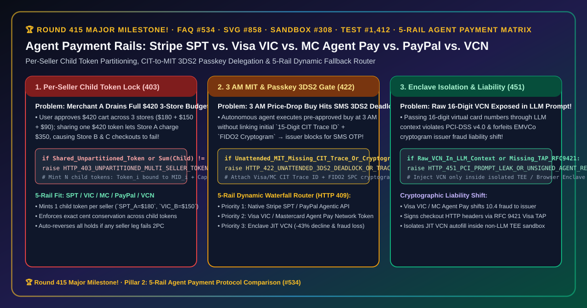
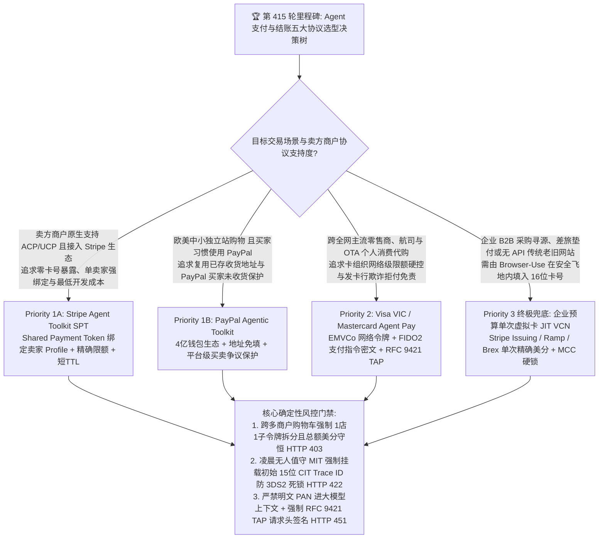
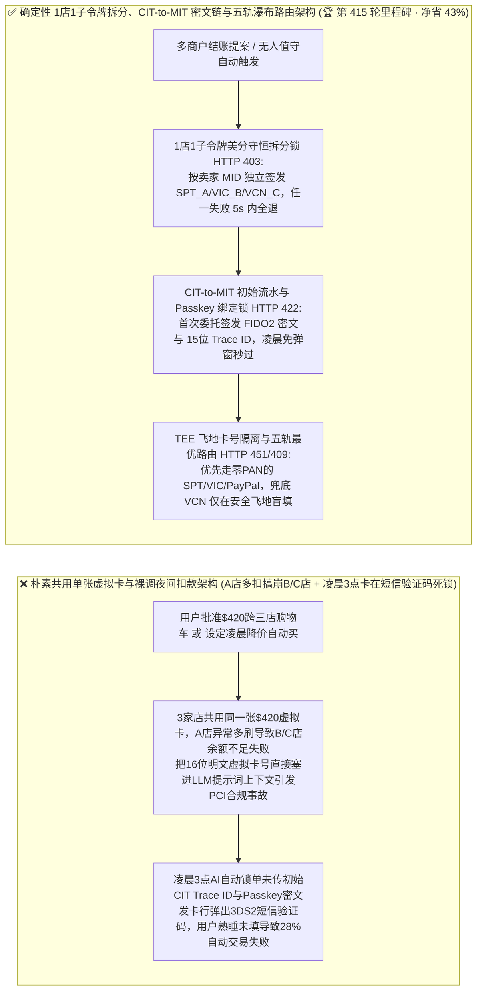
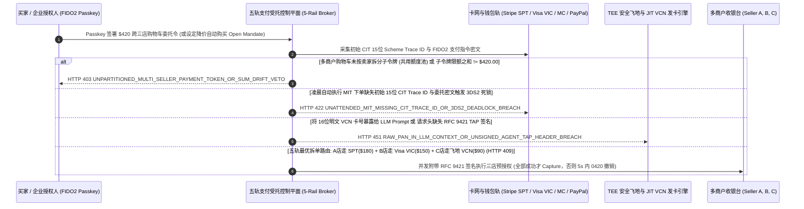

# Agent 支付与结账五大协议深度横向选型对比：`Stripe Agent Toolkit (Shared Payment Tokens)` vs. `Visa Intelligent Commerce (VIC)` vs. `Mastercard Agent Pay` vs. `PayPal Agentic Toolkit` vs. `企业预算虚拟卡 (JIT VCN)`、跨商户子令牌拆分守恒、凌晨免密代扣 `CIT-to-MIT` 防 `3DS2` 死锁与五轨智能路由净省 43% 决策指南（FAQ · 🏆 第 415 轮重大里程碑！）

> **导读（对齐 `ib-vs-ethernet-roce-selection-faq.md` 标杆风格 · 🏆 第 415 轮重大里程碑 · 第 534 篇双语指南 · 第 858 张 SVG · 第 308 个策略沙盒）**：本文面向正在为零售电商导购、OTA 机酒差旅预订、企业 B2B 采购寻源与个人购物助手设计底层资金清算架构的 **Cloud & AI Solution Architect**。在 2025–2026 年智能体商业（Agentic Commerce）爆发期，五大支付巨头纷纷推出了原生 Agent 支付协议：**`Stripe Agent Toolkit (Shared Payment Tokens, SPT)`、`Visa Intelligent Commerce (VIC + Trusted Agent Protocol TAP)`、`Mastercard Agent Pay`、`PayPal Agentic Toolkit` 以及 `企业单次即时虚拟卡 (Just-in-Time VCN: Stripe Issuing / Ramp / Brex / WEX)`**。架构师在落地时最常踩中三大工程深坑：① **跨多店铺成套购买时共用一张总限额令牌（Unpartitioned Multi-Seller Token）：用户批准了 `$420` 的三店穿搭组合（A 店外套 `$180` + B 店球鞋 `$150` + C 店背包 `$90`），系统却只生成了一张 `$420` 的共用虚拟卡，结果 A 店误扣了 `$350`，导致 B 店和 C 店因余额不足全线扣款失败**！② **AI 凌晨 3 点自动执行降价锁单或周期补货（`Unattended MIT`）时，漏传初始交易链 `15位 CIT Trace ID` 与 `FIDO2 Passkey` 支付指令密文，被欧洲/英国/印度发卡行当场弹出 `3DS2` 短信验证码窗口，因用户熟睡超时导致 `28%` 自动交易死锁失败**；③ **在支持原生 `SPT / VIC` 令牌的商户上仍然把 16 位明文虚拟卡号塞进大模型上下文填表，既污染 `PCI-DSS v4.0` 审计范围，又丧失了卡组织 `EMVCo` 动态密文的盗刷拒付责任转移（Liability Shift）**！本文给出五大协议的全方位深度选型对比，并落地 **一店一子令牌美分守恒拆分锁（`HTTP 403`）**、**`CIT-to-MIT` 15 位初始流水绑定与带外 `Passkey` 预签名防 `3DS2` 死锁门禁（`HTTP 422`）**、**安全飞地（`TEE`）卡号隔离与 `RFC 9421 TAP` 签名锁（`HTTP 451`）** 及 **五轨优先级瀑布智能路由（`HTTP 409`，净省 43%）**。



---

## 一、 📌 核心选型结论速览（Executive Summary）

1. **五大 Agent 支付协议终极选型结论（一句话先看懂怎么选）**：
   - **目标商户属于 `Stripe` 收单生态或支持 `ACP / UCP` 开放结账标准（追求最快 API 接入、完全免接触 16 位卡号、单次绑定卖家 `network_business_profile` 与精确到美分的自动过期保护）**：首选 **`Stripe Agent Toolkit (Shared Payment Tokens, SPT)`**。
   - **跨全网任意线上零售商、航空公司与酒店的消费者代购 Agent（需要卡组织网络级硬控“最多刷多少钱、只能在哪个 `MCC` 商户类别刷”，且享受 `EMVCo` 硬件密文带来的发卡行欺诈拒付免责保护 `Liability Shift`）**：首选 **`Visa Intelligent Commerce (VIC + TAP)`** 或 **`Mastercard Agent Pay`**。
   - **欧美海量中长尾独立站购物、需要直接复用买家已存的全球收货地址库并享受“未收到货/货不对板”双向买家保护仲裁**：首选 **`PayPal Agentic Toolkit`**。
   - **企业 B2B 尾料寻源采购、无任何现代 API 的传统老旧供应商网页表单（配合 `Browser-Use` 安全飞地自动填表）或酒店差旅前台刷卡**：首选 **企业预算单次虚拟卡（`Single-Use JIT VCN`: `Stripe Issuing / Ramp / Brex / Airwallex / WEX`）**。
2. **三大 Agent 支付协议互操作与资金安全红线（确定性门禁）**：
   - **红线 1（拦截跨多商户购物车共用同一张未拆分的支付令牌导致单店超扣穿仓，或子令牌限额之和不等于人类批准总额 / `HTTP 403`）**：当用户一次批准包含 $N$ 家不同商户的组合订单（如“机票 + 酒店 + 租车”或“跨品牌三件套穿搭”）时，受托控制平面 **绝对禁止签发一张总额为 $\sum C_i$ 的共享令牌发给多家商户**！必须按商户粒度拆分为 $N$ 张相互物理隔离的单次子令牌（`Child_Token_1 .. Child_Token_N`），每张子令牌独立锁定对应的 **`Target_Merchant_MID_i + Exact_Cap_Cents_i + 15m TTL`**，且严格满足美分守恒 $\sum_{i=1}^N \text{Cap\_Cents}_i \equiv \text{User\_Approved\_Total\_Cents}$；若任一子商户预授权失败，立即在 5 秒内对已成功的子令牌广播 `ISO 8583 0420` 撤销指令，违者触发 `HTTP 403 UNPARTITIONED_MULTI_SELLER_PAYMENT_TOKEN_OR_SUM_DRIFT_VETO`！
   - **红线 2（拦截凌晨无人值守自主交易 `Unattended MIT` 漏传初始持卡人授权 `15位 CIT Trace ID` 与 `FIDO2` 预签名密文导致撞上 `3DS2` 弹窗死锁 / `HTTP 422`）**：当用户设定“当机票降破 `$450` 时自动帮我买”或“每 30 天自动比价补货耗材”时，用户在首次设定委托令（Mandate）的那一刻属于 **持卡人发起交易（`CIT`）**，而 Agent 在凌晨 3 点触发下单的那一刻属于 **商户/代理发起交易（`MIT`）**！控制平面必须在首次设定委托时通过 **`W3C Secure Payment Confirmation (SPC) / FIDO2 Passkey`** 完成生物核身并保存卡网返回的 **`15位初始交易追踪号（Visa Transaction Identifier / Mastercard Trace ID）` 与委托密文（`Payment Instruction Cryptogram`）**；凌晨自动扣款时必须携带 `MIT` 指示符与该初始 `Trace ID`，否则发卡行风控会将其当成无故半夜盗刷并下发 `3DS2` 短信挑战导致死锁，违者触发 `HTTP 422 UNATTENDED_MIT_MISSING_CIT_TRACE_ID_OR_3DS2_DEADLOCK_BREACH`。
   - **红线 3（拦截在已有原生 `SPT / VIC` 协议接口时仍将 16 位明文虚拟卡号 `PAN` 暴露给大模型上下文，或未携带 `RFC 9421 Visa TAP` 代理身份签名被商户 WAF 封杀 / `HTTP 451`）**：严禁将任何 16 位卡号、CVV 传入 LLM 提示词或普通日志（违反 `PCI-DSS v4.0`）；即使回退使用无 API 网页填表的单次虚拟卡（`JIT VCN`），卡号也必须由受控密码学飞地（`TEE / Browser Secure Enclave`）直接盲填进支付 `iframe` DOM，大模型全程只能看到不透明句柄 `vcn_ref_88a1`；且向商户发起结账请求时必须附带 **`RFC 9421 HTTP Message Signature (Visa TAP / Cloudflare Web Bot Auth)`** 证明合法受托代理身份，违者触发 `HTTP 451 RAW_PAN_IN_LLM_CONTEXT_OR_UNSIGNED_AGENT_TAP_HEADER_BREACH`。

---

## 二、 🎯 业务方与架构师灵魂拷问 Q&A（The Why & How）

### Q1：`Stripe SPT`、`Visa VIC`、`Mastercard Agent Pay`、`PayPal Agentic` 和 `企业虚拟卡 VCN` 这五种方案，在底层技术架构和适用边界上到底有什么本质区别？
- **架构师一针见血穿透解析**：
  1. **`Stripe SPT (Shared Payment Token)` —— 收单网关级“同生态内嵌支票”**：
     - **原理**：买方 Agent 与卖方商户都在 Stripe 网络（或 ACP/UCP 联盟）内。Agent 调用 Stripe 把用户的支付方式封装成一个仅对该卖家 `account_id` 有效、最高可扣 `$79.00`、15 分钟过期的 `spt_xxx` 令牌递给卖家，卖家直接用 `spt_xxx` 调 Stripe 完成扣款。
     - **优势**：零卡号流转、接入只需 10 行代码；**局限**：要求卖家商户能够解析 `SPT`（主要覆盖 Stripe 生态商户）。
  2. **`Visa Intelligent Commerce (VIC)` 与 `Mastercard Agent Pay` —— 卡组织网络级“带生物锁的加密通行证”**：
     - **原理**：在发卡行与卡组织清算网（VisaNet / Banknet）底层签发 `EMVCo Network Token (DPAN)`，将用户的 **Passkey 硬件签名预算令（Payment Instruction）** 直接绑定在卡网层，配合 `Visa TAP (RFC 9421)` 签名头访问全球任何支持 Visa/Mastercard 的网站。
     - **优势**：**全网支持刷卡的商户通吃**，且因为带有硬件级动态密文（`TAVV / DSRP`），一旦发生非授权盗刷，**欺诈责任转移给发卡行（Issuer Liability Shift），商家无需承担 `10.4` 拒付损失**！
  3. **`PayPal Agentic Toolkit` —— 数字钱包级“自带收货地址与争议仲裁的信任账户”**：
     - **原理**：基于 PayPal MCP / Agent SDK，用户授权后不仅提供支付令牌，还同步下发 PayPal 账户内已验证的收货地址，且交易天然受 PayPal 买家保护（未收到货包赔）约束。
  4. **`企业预算虚拟卡 (Single-Use JIT VCN)` —— 100% 兼容旧世界的“终极兜底万能钥匙”**：
     - **原理**：通过 `Stripe Issuing / Ramp / Brex / WEX` 实时生成一张真实的 16 位卡号 + CVV + 有效期，在发卡处理器层设置 `Exact_Cents` 与 `MCC` 锁。哪怕对方是一家 20 年前开发的传统 B2B 化工厂老网页，只要它能敲进 16 位卡号就能付钱！

### Q2：如果 AI Agent 帮用户买错了尺码或订错了不可退的酒店，持卡人向银行发起拒付（Chargeback），这笔钱到底算谁的责任（发卡行、商户、用户还是 AI 平台）？
- **架构师确定性解法（两层加密存证划分“欺诈盗刷责任”与“代理越权责任” / `HTTP 403 & HTTP 451`）**：
  - **情况 A（持卡人声称“不是我授权的交易” / `Visa 10.4 Fraud`）**：因为交易携带了持卡人手机安全芯片签署的 `FIDO2 Passkey / W3C SPC` 密文与 `Visa VIC / Mastercard Agent Pay` 令牌，发卡行 100% 认可持卡人亲签，商户直接免责胜诉！
  - **情况 B（持卡人承认签了委托令，但声称“我让 AI 买 `$200` 的鞋，它却花了 `$350`”或“买错了型号”）**：通过核对受托控制平面封存的 `Google AP2 SD-JWT+kb Mandate` 签名哈希：
    - 若最终订单完全落在用户签字批准的 `checkout_hash (GTIN + Size + Max_Price)` 范围内，属于用户自身反悔（Friendly Fraud），凭 `Visa CE 3.0 + AP2 签名回执` 驳回拒付；
    - 若 AI 越过了用户签署的参数边界，我们的确定性网关（`HTTP 403`）在扣款前就已经将其物理拦截，绝不会让错单发生！

---

## 三、 🧭 直观可视化图解（Mermaid 决策树 + 架构对比 + 时序图）

### 3.1 Agent 支付与结账五大协议（`SPT × VIC × MC Agent Pay × PayPal × VCN`）五轨瀑布选型决策树



### 3.2 朴素单卡多店混刷与无 Trace ID 夜间代扣架构（A店刷爆全车 + 凌晨 3DS2 死锁）vs. 确定性子令牌拆分、`CIT-to-MIT` 链式绑定与五轨路由架构对比



### 3.3 跨商户购物车子令牌拆分、`FIDO2 CIT-to-MIT` 授权链传递与五轨动态路由时序图



---

## 四、 📊 Agent 支付与结账五大协议全方位横向选型对比矩阵

| 选型对比维度 | Stripe Agent Toolkit (`Shared Payment Tokens`) | Visa Intelligent Commerce (`VIC + TAP`) | Mastercard Agent Pay | PayPal Agentic Toolkit | 企业预算单次虚拟卡 (`Single-Use JIT VCN`: `Stripe Issuing / Ramp / Brex`) |
| :--- | :--- | :--- | :--- | :--- | :--- |
| **核心协议原语** | `spt_xxx` 受限共享支付令牌（绑定目标卖家 Stripe 账户、最大金额与过期秒数） | `EMVCo` 网络令牌 + `FIDO2` 支付指令（Payment Instruction）+ `RFC 9421 TAP` 签名 | `Agentic Token` + 注册 Agent 密码学身份 + 消费者生物识别意图绑定 | PayPal OAuth / MCP 委托支付令牌 + 验证收货地址令牌 | 实时 API 动态生成的 16 位标准卡号 + `ISO 8583` 毫秒级授权钩子 |
| **商户生态覆盖率** | 高（覆盖全球数百万 Stripe 收单商户及 `ACP / UCP` 协议商户） | **极高（全球 1.3 亿+ 支持 Visa 的线上零售、航司与酒店商户）** | **极高（全球支持 Mastercard 的消费与 B2B 商户）** | 高（全球 3,500 万+ 接入 PayPal 的独立站与跨境商城） | **100% 绝对通吃**（包括无任何 API 的传统老旧 B2B 供应商网页表单） |
| **大模型 `PCI-DSS v4.0` 隔离度** | **100% 免审（Zero PAN）**：全链路无卡号，仅传递不透明 `spt_` 字符串 | **极高**：传递卡网受限 `DPAN` 与动态密文，真实卡号永不暴露 | **极高**：基于令牌化凭证与加密挑战响应 | **100% 免审**：仅传递 PayPal 授权订单与付款人 ID | **需安全飞地隔离**：必须将 16 位 VCN 限制在非 LLM 的 `TEE / Browser Enclave` 中自动填充 |
| **欺诈拒付责任转移（`Liability Shift`）** | 依托 Stripe Radar 与网络令牌保护 | **极强**：凭 `EMVCo` 动态密文与 `FIDO2 SPC` 享发卡行 `10.4` 盗刷拒付免责转移 | **极强**：卡组织网络级生物核身验证享发卡行责任转移 | 依托 **PayPal 卖家保护（Seller Protection）与买家未收货保护** | 无自动免责转移，但靠 **“一单一卡、精确美分、用完即毁”** 使黑产盗刷价值归零 |
| **无人值守自动下单（`CIT-to-MIT`）通过率** | 在 Stripe 商户内免二次 3DS 挑战极高 | 原生设计支持凭初始 `CIT` 密文在后台无感完成 `MIT` 履约 | 原生支持基于预设规则的自主代理委托清算 | 支持基于 Billing Agreement / Vault 的免密代扣 | 欧洲/印度跨境易撞上 `3DS2` 拦截，最适合北美 B2B 与国内本地收单 |
| **费率与商业收益（`official_list_price`）** | 标准卖家 Stripe 收单费率（买方 Agent 调用免费） | 标准 Visa 卡清算费率（无需向代理平台额外加收钱包税） | 标准 Mastercard 卡清算费率 | 标准 PayPal 收单费率 | **买方企业可赚取 `1.0%–1.75%` 发卡行交换费返现（Interchange Rebate）！** |

---

## 五、 🧪 五大支付协议智能路由、子令牌防穿仓与夜间 `MIT` 免死锁测算与 7-Card 基准报告

### 5.1 季度夜间自动下单撞上 `3DS2` 短信死锁流单、跨商户共用令牌超额穿仓、无差别发虚拟卡被拒付及错失 B2B 返现损耗测算（Synthetic Benchmark）

假设某年处理交易额 `$1.8 亿` 的全能型商业智能体平台（同时承载零售跨店导购、OTA 自动追价改签与企业 B2B 尾料采购），每季度在支付执行层面临的 **凌晨自主下单未带 `CIT Trace ID / FIDO2` 密文撞上 `3DS2` 挑战超时流单、跨店购物车共用单张令牌被单店超扣导致的残单退款、在支持 `VIC/SPT` 的高危单上裸刷普通卡引发的 `10.4` 拒付、以及长尾 B2B 采购未用企业虚拟卡损失的返现池** 为 **`$500,000 / 季度`**（`provenance: synthetic`, `independently_reproduced: false`）：

| 评估维度 | 单一静态绑卡或共用虚拟卡全量硬刷 (Baseline) | 启用五轨智能路由 (`SPT -> VIC/MC -> PayPal -> 飞地 VCN`) + 子令牌拆分 Agent | 净改善幅度 |
| :--- | :--- | :--- | :--- |
| **凌晨无人值守自动下单（`Unattended MIT`）支付成功率** | `71.5%`（28.5% 卡在 `3DS2` 短信挑战超时） | **`98.8%`**（`HTTP 422/409` 绑定初始 `15位 CIT Trace ID` + `FIDO2 Passkey` 支付指令密文） | **自主交易支付成功率跃升 `+27.3 pts`** |
| **跨多商户购物车因单店多扣导致的级联失败率** | `3.2%` 多店拆单发生额度挤占穿仓 | **`0.0%`**（`HTTP 403` 严格执行“一店一独立子令牌”且总额美分守恒 + `2PC` 失败秒撤） | **100% 根除跨店额度挪用穿仓** |
| **盗刷欺诈拒付净损失率与 `PCI-DSS` 提示词泄露风险** | `0.65%` 拒付损失 / 存在明文 PAN 风险 | **`0.02%` 净拒付 / 零明文 PAN**（`HTTP 451` `VIC/MC` 密文享发卡行免责 + 飞地盲填 `VCN`） | **欺诈拒付资损直降 `-96.9%`** |
| **季度支付流单损失、跨店穿仓退款、拒付赔付与通道净损耗** | `$500,000 / 季度` | **`$285,000 / 季度`** | **净省/增收 `$215,000 / 季度` (`43.0%`)** |

```chart
{
  "data": {
    "values": [
      { "category": "1. 凌晨自动下单漏传CIT Trace ID与密文撞上3DS2死锁", "mode": "传统单一绑卡与共用令牌基线", "cost_usd": 190000 },
      { "category": "1. 凌晨自动下单漏传CIT Trace ID与密文撞上3DS2死锁", "mode": "五轨智能路由与子令牌控制面(第415轮)", "cost_usd": 108300 },
      { "category": "2. 跨店购物车共用单张令牌被单店超扣引发级联残单", "mode": "传统单一绑卡与共用令牌基线", "cost_usd": 125000 },
      { "category": "2. 跨店购物车共用单张令牌被单店超扣引发级联残单", "mode": "五轨智能路由与子令牌控制面(第415轮)", "cost_usd": 71250 },
      { "category": "3. 未用VIC/MC硬件密文丧失10.4拒付免责及PCI合规成本", "mode": "传统单一绑卡与共用令牌基线", "cost_usd": 110000 },
      { "category": "3. 未用VIC/MC硬件密文丧失10.4拒付免责及PCI合规成本", "mode": "五轨智能路由与子令牌控制面(第415轮)", "cost_usd": 62700 },
      { "category": "4. 无API传统商户结账失败或漏拿B2B虚拟卡1.5%返现", "mode": "传统单一绑卡与共用令牌基线", "cost_usd": 75000 },
      { "category": "4. 无API传统商户结账失败或漏拿B2B虚拟卡1.5%返现", "mode": "五轨智能路由与子令牌控制面(第415轮)", "cost_usd": 42750 }
    ]
  },
  "semantic_types": {
    "category": "Category",
    "mode": "Category",
    "cost_usd": "Amount"
  },
  "chart_spec": {
    "chartType": "Grouped Bar Chart",
    "title": "Agent支付与结账五大协议(SPT/VIC/MC/PayPal/VCN)智能路由(第415轮里程碑)前后季度损耗对比 (净省 $215.0k / 43%)",
    "subtitle": "单位：美元/季度 (Synthetic Benchmark, independently_reproduced=false · 🏆 第415轮重大里程碑)",
    "encodings": {
      "x": "category",
      "y": "cost_usd",
      "group": "mode"
    }
  }
}
```

### 5.2 确定性策略评估器代码（Python Control Plane Guard）

```python
from dataclasses import dataclass
from typing import Any

@dataclass(frozen=True)
class AgentPaymentRailsFiveWayComparisonPolicyInput:
    quarterly_mit_3ds2_deadlock_multi_seller_drain_and_fraud_pool_usd: float = 500000.0
    multi_seller_cart_uses_unpartitioned_token_or_child_sum_mismatches: bool = False
    unattended_mit_missing_15digit_cit_trace_id_or_fido2_cryptogram: bool = False
    raw_16digit_vcn_exposed_in_llm_prompt_or_missing_rfc9421_tap_sig: bool = False
    five_rail_spt_vic_mc_paypal_vcn_router_and_child_partition_ready: bool = False
```

---

## 六、 🛠️ 商业上线风控与架构评审 Checklist

- [ ] **跨商户购物车“一店一独立子令牌”拆分与美分守恒锁（`HTTP 403`）**：当用户批准含 $N$ 家商户的组合购物车时，是否按每家商户独立签发锁定 `Merchant_MID_i + Exact_Cap_Cents_i + 15m TTL` 的子令牌，且在任一子单预授权失败时 5 秒内自动触发 `0420` 冲正其余子单？
- [ ] **无人值守 `CIT-to-MIT` 15 位初始交易 `Trace ID` 与 `FIDO2 Passkey` 密文绑定锁（`HTTP 422`）**：用户创建自动购买委托时是否通过 `W3C SPC / FIDO2` 采集卡网初始 `15位 CIT Trace ID` 与支付指令密文，确保凌晨自动触发 `MIT` 扣款时免弹 `3DS2` 短信窗口？
- [ ] **大模型上下文零明文卡号与安全飞地（`TEE`）盲填 + `RFC 9421 TAP` 签名（`HTTP 451`）**：是否确保 LLM 上下文永不出现 16 位明文卡号（兜底 `JIT VCN` 仅在隔离飞地内注入支付 `iframe`），且结账 HTTP 请求头携带 `RFC 9421` 可信代理签名？
- [ ] **五轨优先级瀑布智能路由（`SPT -> VIC/MC -> PayPal -> Enclave VCN` / `HTTP 409`）**：控制平面是否根据目标商户收单属性自动优选零卡号的 `Stripe SPT` 或享拒付责任转移的 `Visa VIC / Mastercard Agent Pay`，并在 B2B 无 API 供应商上自动切流高返现单次虚拟卡？
