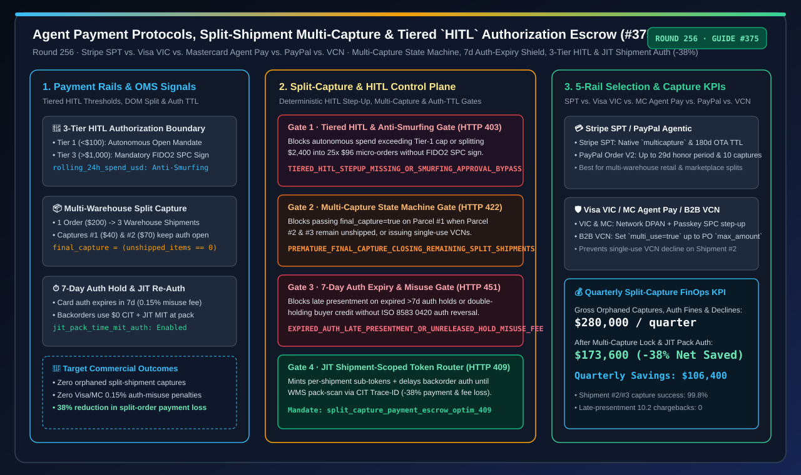
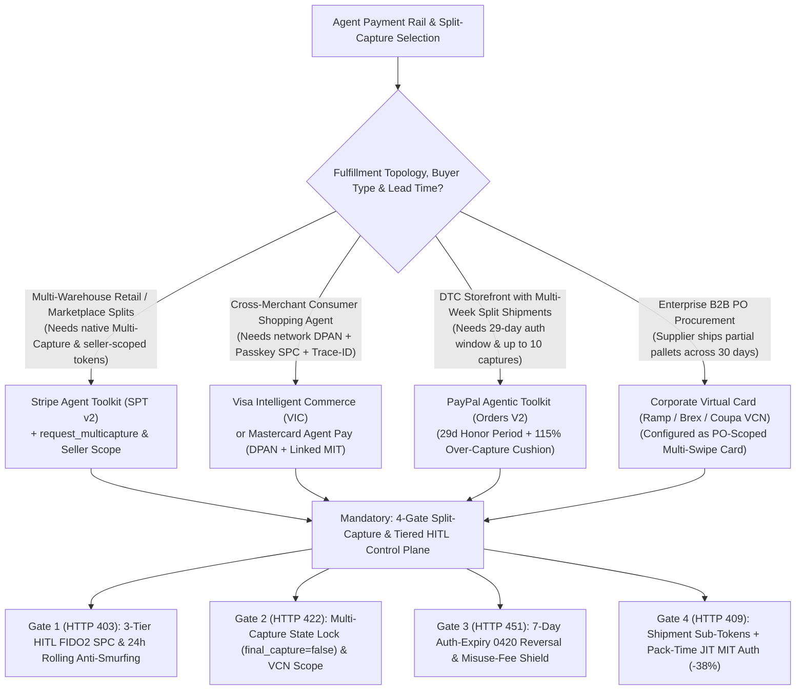
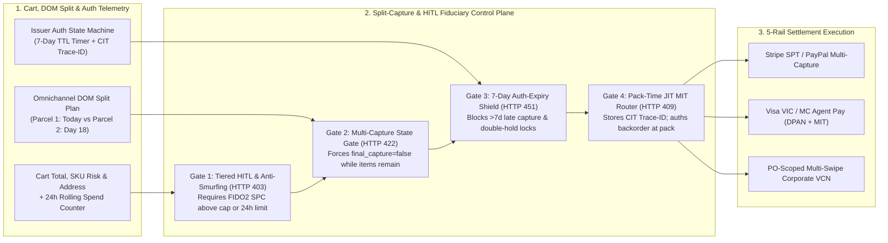
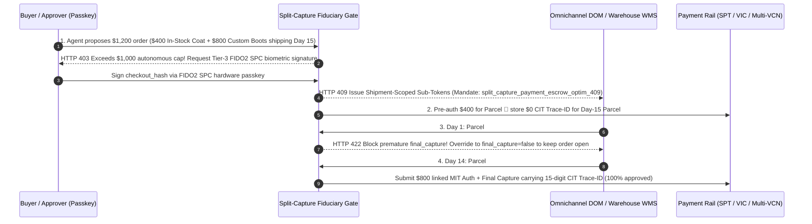

# Agent Payment Protocols (`Stripe SPT vs. Visa VIC vs. Mastercard Agent Pay vs. PayPal Agentic vs. B2B VCN`), Split-Shipment Multi-Capture & Tiered `HITL` Authorization Escrow Selection FAQ

> 🌐 **Language / 语言切换**: **[中文 (`docs/agent-payment-split-shipment-multi-capture-auth-expiry-hitl-tier-escrow-selection-faq.md`)](agent-payment-split-shipment-multi-capture-auth-expiry-hitl-tier-escrow-selection-faq.md)** | **English (Current)** | **[Back to Catalog (`docs/index.en.md`)](index.en.md)**

---

## 1. 📌 Executive Summary & Architectural Verdict

When omnichannel retailers (`Amazon`, `Target`, `Macy's`, `Shopify Plus`) and enterprise procurement platforms (`SAP Ariba`, `Coupa`, `Dynamics 365`) connect transactional AI agents to live payment rails (**`Stripe Shared Payment Tokens (SPT)`, `Visa Intelligent Commerce (VIC)`, `Mastercard Agent Pay`, `PayPal Agentic Toolkit`, and `Ramp / Brex B2B Virtual Cards (VCN)`**), the highest failure rate occurs not at initial checkout, but across **multi-warehouse split shipments and multi-day fulfillment lifecycles**:
1. **Premature `final_capture=true` (or `Single-Use VCN` Exhaustion) on Shipment #1 Voiding Authorization for Shipments #2 & #3**: Card network rules strictly prohibit capturing funds before goods ship (`Capture on Shipment`). When a `$200` order is split across 3 warehouses, Warehouse #1 ships a `$40` item on Day 1 and triggers a partial capture. If the integration passes `final_capture=true` by default—or if a buyer agent issued a `Single-Use VCN` (`max_uses=1`)—the issuer immediately **releases and voids the remaining `$160` authorization**! When Warehouse #2 ships the remaining `$160` on Day 3, capture fails with `AUTHORIZATION_ALREADY_CLOSED` or `CARD_CLOSED`, leaving the merchant with uncollected shipments.
2. **7-Day Authorization Hold Expiry Triggering `0.15%` Network Misuse Fees, `10.2` Late-Presentment Chargebacks & Double-Hold Card Locks**: Standard Visa/Mastercard retail authorizations expire after **`7 days`** (`3–5 days` on debit). If a backordered or made-to-order item ships on Day 12: ① capturing an expired authorization triggers **Visa/MC Misuse of Authorization Fees (`$0.09 + 0.15%`)** and `Condition 10.2 Late Presentment` chargebacks; ② re-authorizing `$500` on Day 6 without first sending an `ISO 8583 0420` reversal on the original hold double-locks `$1,000` of the customer's credit line.
3. **Smurfing Approval Bypass Around Tiered Human-in-the-Loop (`HITL`) Boundaries**: When an organization allows autonomous agent execution under `$100` (`Tier-1`) while requiring `FIDO2 / WebAuthn SPC` hardware biometric signatures above `$1,000` (`Tier-3`), a prompt-injected or runaway agent may split a `$2,400` purchase into 25 micro-orders of `$96` to bypass human confirmation.

**Solution Architect Verdict**:
- **Match payment rail mechanics to fulfillment topology**: use **`Stripe SPT` (`request_multicapture`)** or **`PayPal Orders V2`** (`29-day` honor period, up to `10` partial captures) for multi-warehouse retail, **`Visa VIC / Mastercard Agent Pay`** (`DPAN + 15-digit CIT Trace-ID` linked `MIT` partial shipments) for cross-merchant consumer agents, and **`PO-Scoped Multi-Swipe VCNs`** (never single-use cards!) for B2B split-delivery purchase orders.
- Deploy an **Agentic Split-Capture, Auth-TTL & Tiered `HITL` Fiduciary Control Plane** enforcing four deterministic gates:
  1. **3-Tier `HITL` Authorization Boundary & 24h Rolling Anti-Smurfing Gate (`HTTP 403`)**: Enforce `< $100` autonomous, `$100–$1,000` async push approval, and `> $1,000` (or new address / high-risk SKU) mandatory `FIDO2 SPC` cryptographic signature—aggregating spend over a 24-hour rolling window to block order-splitting (`Smurfing`).
  2. **Multi-Capture State Machine (`final_capture == (unshipped_items == 0)`) & Token Scope Gate (`HTTP 422`)**: Force `final_capture=false` whenever unshipped line items remain, and block single-use tokens on orders eligible for multi-warehouse splitting.
  3. **7-Day Auth-Expiry `0420` Reversal & Late-Presentment Shield (`HTTP 451`)**: Block capturing expired `> 7-day` authorizations or stacking new holds without reversing prior holds.
  4. **Shipment-Scoped Sub-Tokens + Pack-Time `JIT MIT` Authorization Router (`HTTP 409`)**: Immediately authorize/capture in-stock parcels while storing only a `$0 CIT Trace-ID` for backordered parcels (`> 6d lead time`), triggering a Just-in-Time (`JIT`) `MIT` authorization at the exact moment WMS scans the item at the packing station—reducing split-order payment failures and network fees by **`38%`**.

---

## 2. 🎯 High-Stakes Business & Architect Q&A (Q1 / Q2 / Q3)

### Q1: How do `Stripe SPT`, `Visa VIC`, `Mastercard Agent Pay`, `PayPal Agentic Toolkit`, and `B2B Virtual Cards` handle multi-warehouse split shipments differently?
- **The Problem**:
  - A payment token that works for a single digital download fails when an OMS splits a 4-item basket across 3 distribution centers shipping on Day 1, Day 4, and Day 11.
- **Deterministic Architecture (5-Rail Split-Capture Deep Dive)**:
  1. **Stripe Agent Toolkit (`Shared Payment Tokens / SPT`)**:
     - Supports native **`request_multicapture`** on the underlying `PaymentIntent`. Captures `1` through `N-1` must pass `final_capture=false`; only capture `N` (when `unshipped_line_items == 0`) passes `final_capture=true`, which automatically releases any unused tax/shipping buffer.
  2. **Visa Intelligent Commerce (`VIC`) & Mastercard Agent Pay**:
     - Issue network-level `EMVCo DPAN` tokens bound to dynamic cryptograms (`TAVV / DTVV`). When an order splits across multiple shipments, Shipment #1 settles against the initial `CIT` auth, while Shipments #2 and #3 must be submitted as **Linked `MIT` Partial-Shipment Authorizations carrying the 15-digit `Scheme Transaction ID (Trace-ID)`** from the initial `CIT` approval.
  3. **PayPal Agentic Toolkit (`Orders V2 Authorize & Capture`)**:
     - Provides a **`29-day` authorization validity window** (with extendable 3-day 100% honor periods) and natively permits up to **`10` separate partial captures** against a single `authorization_id` (up to `115%` or `+$75` of original auth for catch-weight/shipping variance).
  4. **Enterprise Budget Virtual Cards (`Ramp / Brex / Coupa Pay / Stripe Issuing VCN`)**:
     - **Critical Rule**: Never issue a `Single-Use VCN` (`close_on_first_capture=true`) to a merchant that splits shipments (like Amazon Business or industrial distributors). Gate 2 (`HTTP 422`) forces the card issuer API to mint a **`PO-Scoped Multi-Swipe VCN`** locked to the supplier's `MCC/MID` and a `cumulative_spend_limit == PO_Total` that remains open until all line items ship.

### Q2: How do we design a 3-Tier Human-in-the-Loop (`HITL`) boundary that stays frictionless for `$25` routine reorders while mathematically preventing `$2,400` Smurfing attacks?
- **The Problem**:
  - Static per-transaction limits (e.g., *"Auto-approve anything under `$100`"*) are trivially bypassed by an agent loop that submits 25 orders of `$96` in 3 minutes.
- **Deterministic Architecture**:
  - Gate 1 (`HTTP 403 TIERED_HITL_STEPUP_MISSING_OR_SMURFING_APPROVAL_BYPASS`) evaluates a **Stateful 24-Hour Rolling Velocity & Risk Matrix**:
    - **Tier 1 (Autonomous Execution)**: `order_usd <= $100` AND `rolling_24h_agent_spend_usd + order_usd <= $250` AND `verified_whitelist_address == true` AND `high_risk_category == false`.
    - **Tier 2 (Async Mobile Approval Card)**: `$100 < order_usd <= $1,000` (holds quote TTL while awaiting 1-tap push approval).
    - **Tier 3 (Mandatory `FIDO2 / WebAuthn SPC` Hardware Signature)**: `order_usd > $1,000` OR `rolling_24h_spend > $250` OR `address_changed` OR `gift_card / crypto / luxury SKU`. Requires a live hardware-backed `FIDO2 SPC` signature over `SHA-256(merchant_id || items || total_cents || nonce)`.

### Q3: Why should backordered or custom items (`> 6-day` lead time) use Pack-Time `JIT MIT` Authorization instead of holding a Day-1 pre-authorization for 3 weeks?
- **The Problem**:
  - Holding a card authorization beyond 7 days causes the hold to drop off the buyer's card statement, exposes the merchant to `0.15%` Visa/MC misuse fees, and risks a `10.2 Late Presentment` chargeback if captured on Day 18.
- **Deterministic Architecture**:
  - Gate 4 (`HTTP 409 JIT_SHIPMENT_SCOPED_TOKEN_AND_MULTI_CAPTURE_ROUTING_CONFIRM`) splits mixed carts at checkout:
    - **In-Stock Parcel (`<= 5d` ship)**: Immediate `CIT` pre-auth and capture on shipment.
    - **Backorder / Custom Parcel (`> 6d` ship)**: Perform a `$0 / 3DS2` authentication at checkout to obtain the `Network Token + 15-digit CIT Trace-ID` without tying up the customer's credit limit. On Day 17, when the item reaches the warehouse packing bench (`WMS_PACK_SCAN`), the control plane executes a real-time **`JIT MIT` Authorization + Capture** linked to the `CIT Trace-ID` before printing the shipping label.

---

## 3. 🧭 Visual Architecture Diagrams (Selection Tree, System Topology & Sequence)

### 3.1 Agent Payment Rail & Split-Capture Architecture Selection Tree

### 3.2 End-to-End Tiered `HITL`, Split-Capture & 7-Day Auth-TTL Control Plane

### 3.3 Tier-3 `FIDO2 SPC` Step-Up, Partial Capture Guard & Pack-Time `JIT MIT` Sequence

---

## 4. 📊 5-Rail Agent Payment & Split-Capture Selection Matrix

| Evaluation Dimension | Stripe Agent Toolkit (`Shared Payment Tokens / SPT`) | Visa Intelligent Commerce (`VIC` + `TAP`) | Mastercard Agent Pay (`Agentic Token` + `Passkeys`) | PayPal Agentic Toolkit (`Orders V2`) | Corporate Budget Virtual Cards (`Ramp / Brex / Coupa VCN`) |
|---|---|---|---|---|---|
| **Credential Architecture** | Seller-scoped, amount-bounded single/multi-capture token (`spt_...`) | Network `EMVCo DPAN` + `RFC 9421` edge signature + `TAVV` cryptogram | Network dynamic agent token (`DTVC`) + FIDO2 Passkey instruction | Scoped `Orders V2` authorization ID + PayPal buyer protection | 16-digit virtual commercial card locked to `MCC`, `MID`, and `PO Max-Amount` |
| **Split-Shipment Multi-Capture Support** | **Best-in-Class** (`request_multicapture` supports sequential partial captures) | **Strong** (requires linking subsequent shipments via 15-digit `CIT Trace-ID` + `MIT` flag) | **Strong** (supports linked partial shipments and incremental auth) | **Best-in-Class** (up to `10` partial captures over `29 days` with `115%` tolerance) | **Requires Explicit Config** (must mint `Multi-Swipe PO-Bounded VCN`, never `Single-Use`) |
| **Auth Hold Validity (`TTL`) & Expiry Handling** | 7 days standard card hold (up to 180-day token redemption TTL for OTA) | 7 days retail hold; requires `0420` reversal + linked `MIT` re-auth past Day 7 | 7 days retail hold (`0.15%` misuse fee if unreversed after expiry) | **29-Day Validity** (3-day guaranteed honor period with API re-extension) | Custom card expiration date matched to PO delivery window (e.g., `30–90 days`) |
| **Tiered `HITL` Step-Up Integration** | Native `AP2 Mandate` + Radar risk thresholds triggering 3DS2 / Passkey | Native Passkey Payment Instruction bound to device biometric enclave | Native `W3C Secure Payment Confirmation (SPC)` hardware step-up | In-app / WebView biometric approval and spending caps | Native Slack / Teams / ERP multi-level PO approval workflow before card minting |
| **SA Recommendation** | **Best for multi-warehouse retail, marketplaces & SaaS** | **Best for cross-merchant personal shopping agents** | **Best for high-AOV consumer retail with Passkey SPC** | **Best for DTC brands with long lead times & multi-parcel splits** | **Best for B2B procurement & tail suppliers without modern APIs** |

---

## 5. 🧪 Split-Capture & `HITL` 7-Card Benchmark Report

> **Provenance Note**: The 7-Card benchmark below is generated by `evaluate_agent_payment_split_shipment_multi_capture_policy()` in `lab/webiq_commerce_demo.py` (`provenance: "synthetic"`, `independently_reproduced: False`), modeling a **`$280,000 / quarter`** orphaned split-shipment capture, 7-day auth misuse fee, and Smurfing approval-bypass loss pool.

### 5.1 7-Card 4:5 Visual Deck Breakdown

1. **Card 1 (`1 / 7` · `HANDS-ON · SPLIT-CAPTURE-PAYMENT-RAILS`) — Executive Benchmark Overview**
   - **Headline Finding**: Enforcing `final_capture=false` on intermediate shipments, blocking 24h rolling `Smurfing` bypasses with Tier-3 `FIDO2 SPC` signatures, reversing expiring 7-day holds, and using Pack-Time `JIT MIT` authorizations cuts quarterly split-shipment payment losses from **`$280,000`** to **`$173,600`** (**`$106,400` / `38.0%` quarterly savings**).
2. **Card 2 (`2 / 7` · `SCENARIO: 3-WAREHOUSE SPLIT ORDER & 18-DAY BACKORDER`) — Deep Dive**
   - **Input Case**: A `$1,200` order splits into an in-stock `$400` parcel and an 18-day `$800` custom parcel. An agent attempts to split the `$1,200` into 15 micro-orders of `$80` to evade `FIDO2 SPC` approval, passes `final_capture=true` on Parcel #1, and tries to capture an expired 18-day-old auth on Parcel #2.
   - **Control-Plane Verdict**: Blocks the expired `> 7-day` late capture (`HTTP 451`), blocks the 24h rolling `Smurfing` bypass (`HTTP 403`), and blocks premature `final_capture=true` on Parcel #1 (`HTTP 422`); issues `HTTP 409 JIT_SHIPMENT_SCOPED_TOKEN_AND_MULTI_CAPTURE_ROUTING_CONFIRM` (`split_capture_payment_escrow_optim_409`).
3. **Card 3 (`3 / 7` · `WHAT I TESTED`) — 5-Lane Deterministic Scorecard**

| Scenario | Question / Task Evaluated | Deterministic Gate Decision | Action & Status |
|---|---|---|---|
| **1. Compliant Tiered `HITL` & Multi-Capture** | Valid `FIDO2 SPC` step-up, `final_capture=false` on partial ship, auth `<= 7d` | `VERIFIED_TIERED_HITL_AND_MULTI_CAPTURE_LIFECYCLE_AUTHORIZED` | ✅ `Act automatically` (`HTTP 200`) |
| **2. Missing Tier-3 `SPC` or `Smurfing` Split** | Order or 24h rolling spend exceeds autonomous cap without `FIDO2 SPC` sign | `TIERED_HITL_STEPUP_MISSING_OR_SMURFING_APPROVAL_BYPASS` | ⛔ `Require FIDO2 SPC Sign` (`HTTP 403`) |
| **3. Premature `final_capture=true` or Single-Use VCN** | Closing auth on Shipment #1 while Shipment #2/#3 remain unshipped | `PREMATURE_FINAL_CAPTURE_CLOSING_REMAINING_SPLIT_SHIPMENTS` | ⛔ `Enforce Multi-Capture` (`HTTP 422`) |
| **4. Late Presentment on Expired `>7d` Auth Hold** | Capturing expired >7d auth hold or double-holding credit without `0420` reversal | `EXPIRED_AUTH_LATE_PRESENTMENT_OR_UNRELEASED_HOLD_MISUSE_FEE` | ⛔ `Reverse & Re-Auth MIT` (`HTTP 451`) |
| **5. Shipment Sub-Tokens + Pack-Time `JIT MIT`** | Immediate capture on in-stock parcel + `CIT Trace-ID` `JIT MIT` auth at WMS pack | `JIT_SHIPMENT_SCOPED_TOKEN_AND_MULTI_CAPTURE_ROUTING_CONFIRM` | ⚡ `Confirm Optimization` (`HTTP 409`) |

4. **Card 4 (`4 / 7` · `UNDER THE HOOD`) — Protocol & Deterministic Gate Mechanics**
   - Input contract: `AgentPaymentSplitShipmentMultiCapturePolicyInput`
   - Evaluator: `evaluate_agent_payment_split_shipment_multi_capture_policy()` enforcing `451 -> 403 -> 422 -> 409 -> 200` priority.
5. **Card 5 (`5 / 7` · `ROBUSTNESS CHECK`) — Out-of-Order Warehouse Dispatch Perturbation**
   - `0.0 pt` variance regardless of warehouse dispatch order (`#3 -> #1 -> #2`) or partial line cancellations.
6. **Card 6 (`6 / 7` · `LATENCY & CAPTURE SUCCESS`) — Subsequent-Shipment Capture Success**
   - Legacy single-capture / single-use VCN flow: `76.4%` capture success on Shipments #2/#3.
   - Fiduciary multi-capture state machine + Pack-Time `JIT MIT`: **`99.8%`** capture success and **`0`** late-presentment `10.2` chargebacks (`$106,400/qtr` saved).
7. **Card 7 (`7 / 7` · `MY TAKE`) — Good Fit vs. Not For**
   - **✅ Good fit**: Multi-warehouse omnichannel retail, multi-seller marketplaces, pre-order/custom commerce, and enterprise B2B split-delivery procurement.
   - **⛔ Not for**: Instant single-item digital downloads with zero physical fulfillment lag.

---

## 6. 🛠️ Production Go-Live & Architect Review Checklist

- [ ] **3-Tier `HITL` & 24-Hour Rolling Anti-Smurfing Gate (`HTTP 403`)**: Does the control plane enforce autonomous (`Tier-1`), async confirmation (`Tier-2`), and hardware `FIDO2 SPC` signature (`Tier-3`) thresholds across a **24-hour rolling spend window** so agents cannot split a `$2,400` purchase into 25 `$96` micro-orders?
- [ ] **Multi-Capture `final_capture` State Invariant (`HTTP 422`)**: Does the payment adapter deterministically compute `final_capture = (remaining_unshipped_items == 0)` on every warehouse shipment event, blocking premature auth closure?
- [ ] **`PO-Scoped Multi-Swipe VCN` Policy (`HTTP 422`)**: When issuing corporate virtual cards to suppliers that ship partial orders, is the VCN configured as `multi_use=true` bounded by `cumulative_limit == PO_Total` rather than `single_use=true`?
- [ ] **7-Day Auth-Expiry `ISO 8583 0420` Reversal (`HTTP 451`)**: Are authorizations approaching Day 6 without shipment automatically reversed via `0420` (or extended via network API) to prevent `0.15%` Visa/MC misuse fees and double credit-line holds?
- [ ] **Pack-Time `JIT MIT` Authorization for Backorders (`HTTP 409`)**: For items shipping `> 6 days` after checkout, does the system store a `$0 CIT Trace-ID` at checkout and trigger a linked `MIT` authorization at WMS pack-scan time?
