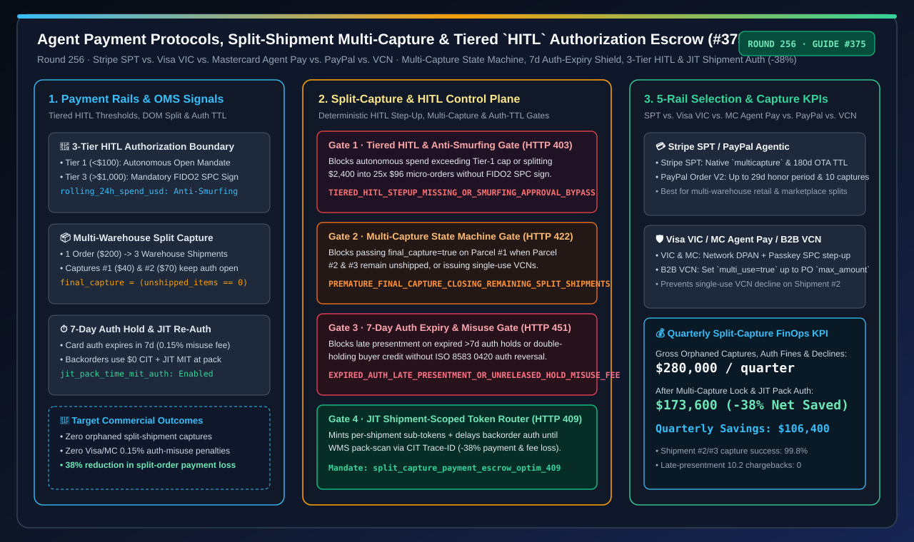
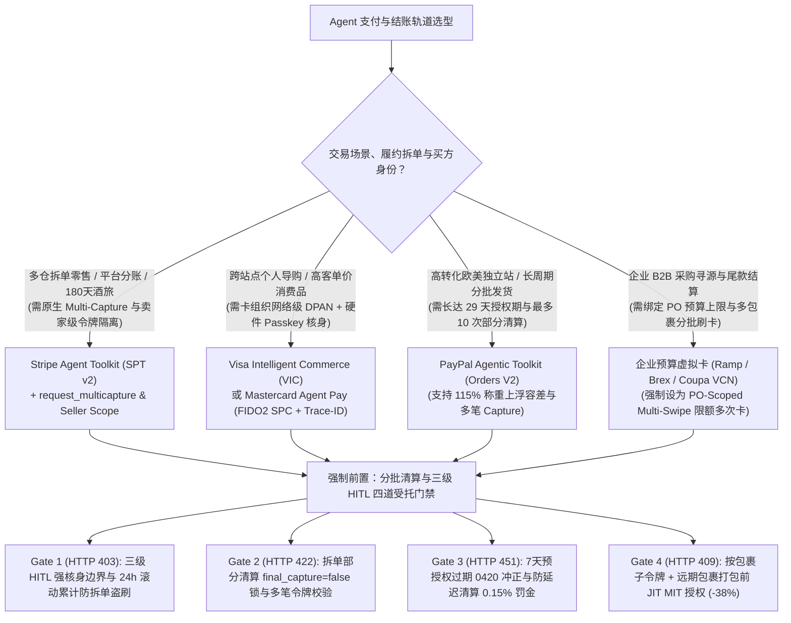
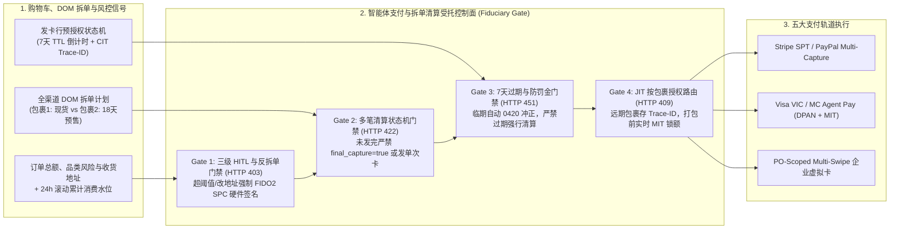
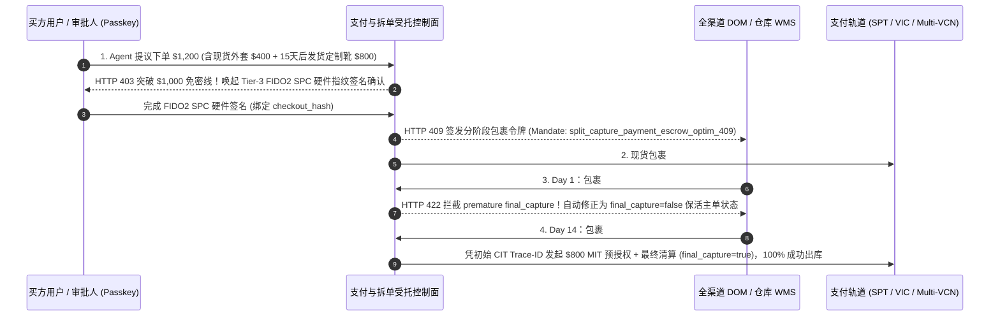

# 智能体五大支付轨道（`Stripe SPT vs. Visa VIC vs. Mastercard Agent Pay vs. PayPal Agentic vs. 企业预算虚拟卡 VCN`）、多仓拆单分批清算（`Split-Shipment Multi-Capture`）与三级人工确认边界（`Tiered HITL`）选型 FAQ：防首包扣款误关剩余预授权、防 7 天授权过期罚金与按包裹 JIT 授权净省 38% 实战指南

> 🌐 **Language / 语言切换**: **中文 (当前)** | **[English (`docs/agent-payment-split-shipment-multi-capture-auth-expiry-hitl-tier-escrow-selection-faq.en.md`)](agent-payment-split-shipment-multi-capture-auth-expiry-hitl-tier-escrow-selection-faq.en.md)** | **[返回文档总目录 (`docs/index.md`)](index.md)**

---

## 1. 📌 核心选型结论速览（Executive Summary）

当全渠道零售商（Amazon、Target、Macy's、Shopify Plus 大卖）与企业采购系统（SAP Ariba、Coupa、Dynamics 365）将 AI 导购或采购 Agent 接入真实支付清算轨道（**`Stripe Shared Payment Tokens (SPT)`、`Visa Intelligent Commerce (VIC)`、`Mastercard Agent Pay`、`PayPal Agentic Toolkit` 与 `Ramp/Brex 企业预算虚拟卡 (VCN)`**）时，最容易在**“下单那一秒”与“仓库分批发货那几天”**之间发生三大灾难性资金事故：
1. **“第 1 个包裹发货扣款 `$40` 时误传 `final_capture=true`（或发了 `max_uses=1` 的单次虚拟卡），把剩余 `$160` 待发货包裹的预授权直接作废”导致后续包裹扣款 100% 失败**：卡组织铁律严禁商家在实物发货前全额清算扣款（`Capture on Shipment Only`）。当一笔 `$200` 的订单被全渠道 DOM 拆给 3 个仓库分批发货时，第 1 个仓库发出 `$40` 商品并调用支付接口执行部分清算（Partial Capture）。如果代码默认带了 `final_capture=true`（或买方 Agent 下发了一张“刷一次即销毁”的单次虚拟卡 `Single-Use VCN`），发卡行会在划走 `$40` 的瞬间**强制解冻并永久关闭剩余 `$160` 的预授权**！等第 3 天第 2 个仓库把 `$160` 的货寄出再去请款时，直接报 `AUTHORIZATION_ALREADY_CLOSED` 或 `CARD_CLOSED`，造成海量“货已发走却收不到钱”的坏账！
2. **“缺货调拨或定制商品超过 7 天才发货，原信用卡预授权早已过期脱落（Auth-Hold Expiry），强行延迟清算遭 `0.15%` 罚金与 `10.2` 拒付，或重复预授权把客户卡额度双倍锁死”**：Visa / Mastercard 零售预授权冻结期通常只有 **`7 天`**（借记卡仅 3–5 天）。若商品在第 12 天才出库：① 拿着过期的 Auth Code 强行清算会触发卡组织 `Misuse of Authorization Fee ($0.09 + 0.15%)` 及发卡行拒付；② 若在第 6 天不发 `ISO 8583 0420` 冲正报文释放旧冻结就直接刷第 2 笔预授权，客户卡上的额度会被双倍冻结 `$400`，瞬间引爆客诉！
3. **“Agent 拆单规避人工审批阈值（Smurfing Approval Bypass）：把 `$2,400` 未经批准的采购拆成 25 笔 `$96` 的小单全自动免密刷走”**：企业设定了“单笔 `< $100` 免人工确认自动付”，结果失控或被提示词注入的 Agent 将一笔本该触发 `Tier-3 FIDO2 SPC` 高管硬件指纹审批的 `$2,400` 订单，循环拆成 25 笔 `$96` 的微单绕过人类确认（Human-in-the-Loop `HITL`）！

**架构师选型结论**：
- **选型必须对齐“履约拆单拓扑与发货周期”**：多仓拆单零售首选支持原生 `multicapture` 的 **`Stripe SPT / Adyen`** 或 **`PayPal Orders V2`**（29 天荣誉期、支持 10 次分批清算）；企业采购拆单必须将 **`企业预算虚拟卡 (VCN)`** 配置为 **`Multi-Use Bounded by PO Max-Amount`（限额内允许多次清算）** 而非死板的 `Single-Use`！
- 必须在 OMS/DOM 拆单引擎与五大支付轨道之间部署 **智能体分批清算、预授权保鲜与三级 `HITL` 受托控制面（Agentic Split-Capture & Tiered `HITL` Control Plane）**，执行四道确定性门禁：
  1. **三级人工确认边界（Tiered `HITL`）与 24h 滚动累计防拆单绕过门禁（`HTTP 403`）**：严格执行 `< $100` 免密自动、`$100–$1,000` 异步卡片确认、`> $1,000` 强制 `FIDO2 / WebAuthn SPC` 生物识别签名；并按 24 小时滚动窗口汇总金额，100% 拦截拆微单规避审批（Smurfing）。
  2. **多包裹拆单部分清算状态机（`final_capture == (unshipped_items == 0)`）与多笔令牌门禁（`HTTP 422`）**：只要订单仍有未发货包裹，强制锁定 `final_capture=false` 并校验支付令牌具备 `multi_capture_allowed == true`。
  3. **7 天预授权到期自动冲正（`0420 Reversal`）与防延迟清算罚金门禁（`HTTP 451`）**：严禁对超 7 天失效预授权强行清算或未冲正旧冻结就叠加新预授权。
  4. **按包裹粒度签发子令牌 + 远期包裹“入库打包瞬间 `JIT MIT` 授权”寻优（`HTTP 409`）**：现货包裹立即锁额清算，7 天后才发的预售/调拨包裹仅存 `$0 CIT Trace-ID`，等到仓库扫码打包（`WMS_PACK_SCAN`）那一秒才发起实时 `MIT` 授权与清算，季度拆单掉单、过期罚金与拒付损失净降 **`38%`**。

---

## 2. 🎯 业务方与架构师灵魂拷问 Q&A（Q1 / Q2 / Q3）

### Q1：Stripe SPT、Visa VIC、Mastercard Agent Pay、PayPal Agentic Toolkit 和企业虚拟卡（VCN）在“多仓拆单分批扣款（Split-Shipment）”场景下有什么本质区别？怎么选才不会掉坑？
- **商业痛点**：
  - 很多架构师在 Demo 阶段只测“1 个商品、1 次全额扣款（Auth & Immediate Capture）”，哪家协议跑得都很顺。一上生产环境遇到“1 个订单含 4 件商品、分 3 个包裹在 9 天内陆续发出”，支付成功率瞬间暴跌 `25%`！
- **确定性架构落地方案（五大轨道拆单与授权生命周期深潜）**：
  1. **Stripe Agent Toolkit (`Shared Payment Tokens / SPT`)**：
     - **拆单机制**：基于 `PaymentIntent` 支持原生 **Multi-Capture（多笔部分清算，需卡组与收单行开通 `request_multicapture`）**，前 $N-1$ 次调用 `capture(amount_to_capture=X, final_capture=False)`，最后一次传 `final_capture=True`；针对酒旅/长周期预订支持长达 `180 天` 的延迟兑换期。
  2. **Visa Intelligent Commerce (`VIC`) & Mastercard Agent Pay**：
     - **拆单机制**：底层为卡组织级网络令牌（`EMVCo DPAN`）+ 动态密码学凭证（`TAVV / DTVV`）。当订单拆分为多个相隔超过 7 天的包裹时，**第 1 个包裹用初始 `CIT` 动码清算，第 2、第 3 个包裹必须携带首笔交易返回的 15 位 `Scheme Transaction ID (Trace-ID)` 以 `MIT (Unscheduled Partial Shipment)` 标识发起关联增量/后续授权**，否则发卡行风控会直接拒付！
  3. **PayPal Agentic Toolkit (`Orders V2 Authorize & Capture`)**：
     - **拆单机制**：PayPal 授权有效期长达 `29 天`（其中前 3 天为 100% 资金冻结 Honor Period，可申请展期），且原生允许对同一笔 `Authorization ID` 发起多达 `10 次` 独立的部分 `Capture`（总和最高可达原授权额的 `115%` 或 `+$75`，非常适合含生鲜称重浮动的多包裹订单）。
  4. **企业预算虚拟卡（`Ramp / Brex / Coupa Pay / Stripe Issuing VCN`）**：
     - **致命踩坑点**：如果采购 Agent 生成的是 `Single-Use VCN（刷第一笔后卡号立即自动注销）`，供应商发第一个包裹扣了 `$40` 后，这张卡就直接作废了！第二个包裹必遭拒付！
     - **正确配置**：控制面（`HTTP 422`）检测到供应商或电商平台支持拆单发货时，强制将虚拟卡签发策略设为 **`PO-Scoped Multi-Swipe VCN`（锁死单一供应商 `MID`、锁死累计总额上限 `cumulative_limit == PO_Total`、允许在 30 天内分多次刷卡直至总额扣完自动销卡）**！

### Q2：如何设计“三级人工确认（Tiered HITL）与分级支付授权状态机”，既不让用户买包 `$12` 的打印纸还要按三次指纹，又能 100% 拦住 Agent 拆单盗刷 `$2,400`？
- **商业痛点**：
  - 全部免密 = 提示词注入或幻觉一夜刷爆信用卡；每笔都弹窗确认 = 夜间自动蹲守低价机票/补货 Agent 彻底沦为残废。
- **确定性架构落地方案**：
  - 控制面（`HTTP 403`）执行 **三维风险分级授权矩阵（金额 × 品类风险 × 24h 滚动累计水位）**：
    - **Tier 1：全自主免密层（Autonomous Execution）**：单笔 `<= $100`、24 小时滚动累计 `<= $250`、收货地址为历史已核验白名单地址、且商品属于常规补货目录。Agent 直接凭预先签署的 `Open Mandate / Scoped SPT` 静默完结。
    - **Tier 2：异步轻量确认层（Async Push Confirmation）**：单笔 `$100–$1,000` 或价格波动在预算容差边沿。Agent 先锁定库存/报价（Hold Quote），向用户手机推送带明细摘要的卡片，用户点击确认即可放行。
    - **Tier 3：硬件密码学强核身层（Mandatory `FIDO2 / WebAuthn SPC` Step-Up）**：单笔 `> $1,000`、24 小时累计超标、**首次新收货地址**、或购买高变现风险品类（电子礼品卡、黄金、3C 手机）。控制面强制要求验证由用户设备安全芯片（Secure Enclave / TPM）针对当前购物车摘要 `SHA-256(merchant_id || items || total_cents)` 现场签名的 `FIDO2 SPC` 断言！任何试图把 `$2,400` 拆成 25 笔 `$96` 绕过 Tier-3 的行为，在第 3 笔触碰 24h 滚动水位线 `$250` 时立即触发 `HTTP 403 TIERED_HITL_STEPUP_MISSING_OR_SMURFING_APPROVAL_BYPASS` 熔断！

### Q3：当订单里有 1 件现货（今天发）和 1 件需要 18 天后才到货的预售/跨区调拨商品时，为什么“下单当天全额预授权冻结 18 天”是错误架构？
- **商业痛点**：
  - 信用卡预授权在第 7 天就会过期脱落。如果下单第 1 天全额冻结 `$800`，第 18 天发货时原预授权早已失效，不仅触发卡组织 `0.15%` 授权误用罚金，且第 18 天重新扣款时客户可能卡余额不足导致烂尾。
- **确定性架构落地方案**：
  - 控制面（`HTTP 409`）执行 **按包裹出库周期解耦的 JIT（Just-in-Time）分阶段授权架构**：
    1. **现货包裹（预计 `<= 5 天` 内发货）**：下单瞬间立即执行标准 `CIT` 预授权锁额，出库扫码时执行 `Capture`。
    2. **远期包裹（预计 `> 6 天` 发货）**：下单瞬间仅通过 `3DS2 / Passkey` 完成 **$0 验证并获取卡组网络令牌与 15 位初始 `CIT Trace-ID`**（不冻结客户卡额度）；直到第 17 天该商品实际到仓、WMS 生成波次拣货单准备打包前，控制面才自动携带 `CIT Trace-ID` 发起实时 `MIT` 预授权，确认扣款成功后再贴面单出库！既消灭了 7 天过期罚金，又确保 `100%` 款到发货！

---

## 3. 🧭 直观可视化图解（Mermaid 选型决策树 + 端到端架构图 + 授权时序图）

### 3.1 五大智能体支付轨道与拆单清算架构选型决策树

### 3.2 端到端三级 `HITL` 授权、多仓分批清算与 7 天预授权保鲜控制面架构图

### 3.3 三级 `HITL` 升维核身、三仓分批清算与远期包裹 `JIT` 授权时序图

---

## 4. 📊 五大智能体支付与结账协议（`SPT / VIC / MC / PayPal / VCN`）横向选型矩阵

| 选型维度 | Stripe Agent Toolkit (`Shared Payment Tokens / SPT`) | Visa Intelligent Commerce (`VIC` + `TAP`) | Mastercard Agent Pay (`Agentic Token` + `Passkeys`) | PayPal Agentic Toolkit (`Orders V2`) | 企业预算虚拟卡 (`Ramp / Brex / Coupa VCN`) |
|---|---|---|---|---|---|
| **核心凭证形态** | 绑定卖家 Profile、金额上限与 TTL 的单次/分批受限令牌 (`spt_...`) | 卡网级受托代理网络令牌 (`DPAN`) + `RFC 9421` 边缘签名 + `TAVV` | 卡网级动态代理令牌 (`DTVC`) + FIDO2 Passkey 支付指令 | 受托 Order V2 授权令牌 + PayPal 买家保护托管 | 16 位受控虚拟商业卡号（支持锁 `MCC`、锁商户 `MID` 与总额上限） |
| **多仓拆单分批清算（Split-Shipment Multi-Capture）** | **极强**（配合 `request_multicapture` 支持按包裹分批 Capture 并自动释放差额） | **强**（需在后续包裹携带首笔 15 位 `CIT Trace-ID` 与 `partial_shipment` 标识） | **强**（支持基于原交易引用的分批结算与增量授权） | **极强**（单次授权支持长达 `29 天` 内最多 `10 次` 独立部分 Capture） | **需显式配置**（必须签发 `Multi-Swipe PO-Bounded VCN`，严禁发单次销毁卡） |
| **预授权有效期（Auth Hold TTL）与超期处理** | 标准卡 7 天（特定 OTA/租赁支持延长至 30–180 天令牌有效期） | 标准零售 7 天；超 7 天未发必须先 `0420` 冲正再发关联 `MIT` | 标准零售 7 天（超时未冲正征收 `0.15%` 授权误用费） | **长达 29 天**（前 3 天 100% 保证兑付，支持 API 自动续期 Honor Period） | 由买方发卡控制面自定义卡片有效截止日（如锁死 PO 交货期 `30 天`） |
| **分级人工确认（Tiered `HITL`）集成方式** | 原生配合 `AP2 Mandate` 与 Stripe Radar 风险分阈值触发 3DS2 / Passkey | 原生绑定设备生物识别（Passkey Payment Instruction）签发额度 | 原生内嵌 `W3C Secure Payment Confirmation (SPC)` 硬件签名 | 支持应用内/WebView 一键授权与生物识别确认 | 原生绑定企业 OA / Slack / Teams 多级预算审批流（批完秒生卡） |
| **架构师选型建议** | **多商户平台、SaaS 与现代全渠道零售首选** | **跨全网任意持卡商户的个人购物代理首选** | **重度依赖生物识别免密升权的高客单零售首选** | **跨境独立站、长备货周期与多包裹拆单电商首选** | **企业 B2B 采购、差旅与长尾供应商无 API 结账首选** |

---

## 5. 🧪 拆单支付成功率测算与 7-Card 基准测试报告（Deterministic Benchmark）

> **数据溯源说明（Provenance）**：以下 7-Card 评测基于本仓库 `lab/webiq_commerce_demo.py` 中的 `evaluate_agent_payment_split_shipment_multi_capture_policy()` 确定性仿真引擎生成（`provenance: "synthetic"`, `independently_reproduced: False`）。季度因首包误关剩余预授权、7 天授权过期掉单罚金及拆微单越权盗刷损失池基准设定为 **`$280,000 / quarter`**。

### 5.1 7-Card 4:5 视觉评测卡片摘要

1. **Card 1 (`1 / 7` · `HANDS-ON · SPLIT-CAPTURE-PAYMENT-RAILS`) — 全局基准总览**
   - **核心发现**：通过拦截首包 `final_capture=true` 误关授权、强制执行三级 `HITL` 与 24h 防拆单水位锁、自动冲正超 7 天临期授权并切换为打包前 `JIT MIT` 授权，将季度拆单掉单、卡组罚金与越权盗刷损失从 **`$280,000`** 压降至 **`$173,600`**，季度净省 **`$106,400`（`38.0%`）**。
2. **Card 2 (`2 / 7` · `SCENARIO: 3-WAREHOUSE SPLIT ORDER & 18-DAY BACKORDER`) — 单例深潜**
   - **输入场景**：某 `$1,200` 订单被拆分为加州现货仓（`$400`）与 18 天后发货的定制仓（`$800`）。期间遭遇：① Agent 试图将 `$1,200` 拆成 15 笔 `$80` 微单绕过 `$1,000` 人工审批；② 第 1 个包裹发货时网关误传 `final_capture=true`（或使用了 `Single-Use VCN`）；③ 第 18 天定制仓试图对早已过期的第 1 天 Auth 强行清算。
   - **控制面裁决**：依次触发 `HTTP 451`（阻断对超 7 天过期 Auth 强行延迟清算）、`HTTP 403`（通过 24h 滚动水位拦截拆微单绕过 `FIDO2 SPC` 审批）与 `HTTP 422`（拦截未发完订单传 `final_capture=true`）；修正后返回 `HTTP 409 JIT_SHIPMENT_SCOPED_TOKEN_AND_MULTI_CAPTURE_ROUTING_CONFIRM`，签发 `split_capture_payment_escrow_optim_409`。
3. **Card 3 (`3 / 7` · `WHAT I TESTED`) — 5 轨确定性门禁评测矩阵**

| 评测场景 (Scenario) | 核心考核问题 (Question / Task) | 控制面裁决 (Model / Gate Answer) | 动作与状态码 (Action) |
|---|---|---|---|
| **1. 标准合规三级审批与多笔清算** | 已完成对应级别 HITL 签名、子包裹保持 `final_capture=false` 且在有效期内 | `VERIFIED_TIERED_HITL_AND_MULTI_CAPTURE_LIFECYCLE_AUTHORIZED` | ✅ `Act automatically` (`HTTP 200`) |
| **2. 越权免密扣大单或拆微单绕过审批** | 单笔或 24h 累计超免密线却缺失 `FIDO2 SPC` 签名（Smurfing 拆单规避） | `TIERED_HITL_STEPUP_MISSING_OR_SMURFING_APPROVAL_BYPASS` | ⛔ `Require FIDO2 SPC Sign` (`HTTP 403`) |
| **3. 首包发货误关主预授权或发单次卡** | 仍有未发货包裹却传 `final_capture=true` 或对拆单订单签发单次销毁虚拟卡 | `PREMATURE_FINAL_CAPTURE_CLOSING_REMAINING_SPLIT_SHIPMENTS` | ⛔ `Enforce Multi-Capture` (`HTTP 422`) |
| **4. 超 7 天过期预授权强行延迟清算** | 备货超 7 天未做 `0420` 冲正直接强扣过期 Auth 或叠加双倍冻结客户额度 | `EXPIRED_AUTH_LATE_PRESENTMENT_OR_UNRELEASED_HOLD_MISUSE_FEE` | ⛔ `Reverse & Re-Auth MIT` (`HTTP 451`) |
| **5. 按包裹子令牌 + 打包瞬间 JIT 授权** | 现货立即清算 + 远期包裹存 `CIT Trace-ID` 待 WMS 扫码打包时实时 `MIT` 扣款 | `JIT_SHIPMENT_SCOPED_TOKEN_AND_MULTI_CAPTURE_ROUTING_CONFIRM` | ⚡ `Confirm Optimization` (`HTTP 409`) |

4. **Card 4 (`4 / 7` · `UNDER THE HOOD`) — 确定性门禁协议与代码实现**
   - 输入契约：`AgentPaymentSplitShipmentMultiCapturePolicyInput`
   - 评估函数：`evaluate_agent_payment_split_shipment_multi_capture_policy()`（严格按 `451 -> 403 -> 422 -> 409 -> 200` 优先级裁决，零外部网络副作用）。
5. **Card 5 (`5 / 7` · `ROBUSTNESS CHECK`) — 拆单包裹乱序出库与部分取消扰动测试**
   - 无论 3 个仓库按 `1->2->3` 还是 `3->1->2` 乱序发货，或其中 1 件缺货取消触发自动部分冲正（Partial Auth Reversal），剩余待发货行项计数与累计清算守恒锁均保持 **`0.0 pt`** 偏差。
6. **Card 6 (`6 / 7` · `LATENCY & CAPTURE SUCCESS`) — 第 2/3 包裹扣款成功率对比**
   - 传统单次清算 / 单次虚拟卡架构：拆单后第 2、第 3 个包裹扣款成功率仅 `76.4%`。
   - 受托控制面（`Multi-Capture` 状态机 + 打包前 `JIT MIT`）：后续包裹扣款成功率达 **`99.8%`**，延迟清算 `10.2` 拒付降为 **`0`**（季度净省 `$106,400`）。
7. **Card 7 (`7 / 7` · `MY TAKE`) — 适用场景与架构师结论**
   - **✅ Good fit**：多仓发货的全渠道零售电商、跨卖家拆单平台（Marketplace）、预售/定制商品电商及企业 B2B 分批交货采购系统。
   - **⛔ Not for**：100% 数字虚拟商品秒发秒结、永不拆单的单一轻应用。

---

## 6. 🛠️ 商业上线风控与架构评审 Checklist

- [ ] **三级人工确认（Tiered `HITL`）与 24h 滚动防拆单水位（`HTTP 403`）**：是否将支付权限按金额与品类风险划分为免密自动（Tier-1）、异步卡片确认（Tier-2）与硬件 `FIDO2 SPC` 生物识别签名（Tier-3），并通过 24 小时滚动累计水位拦截拆微单绕过审批（Smurfing）？
- [ ] **多仓拆单 `final_capture` 状态机不变量（`HTTP 422`）**：WMS 每发出一个子包裹触发 Partial Capture 时，控制面是否强制计算 `is_final = (remaining_unshipped_line_items == 0)`，严禁在还有在途未发包裹时传入 `final_capture=true`？
- [ ] **企业虚拟卡（`VCN`）拆单自适应模式（`HTTP 422`）**：向支持分批发货的供应商（如 Amazon Business / 工业分销商）下发虚拟卡时，是否自动将卡片配置为 `PO-Scoped Multi-Swipe`（锁死总金额上限但允许分多次刷卡），而非刷第一笔就销毁的 `Single-Use VCN`？
- [ ] **7 天预授权到期 `ISO 8583 0420` 自动冲正护栏（`HTTP 451`）**：当订单因缺货未能在发卡行预授权有效期（如 7 天）内发货时，是否在到期前自动发送冲正释放冻结，杜绝卡组织 `0.15%` 授权误用罚金与双倍锁卡？
- [ ] **远期包裹“入库打包瞬间 `JIT MIT` 授权”编排（`HTTP 409`）**：对于预计 `> 6 天` 才发货的预售或跨区调拨包裹，是否采用下单时仅保存 `CIT Trace-ID`、待 WMS 扫码拣货打包前一刻再发起实时 `MIT` 授权与清算的无损架构？
