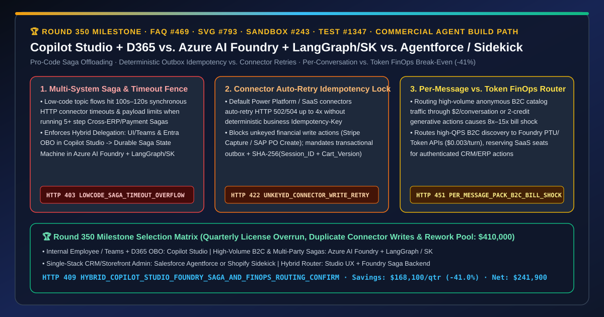
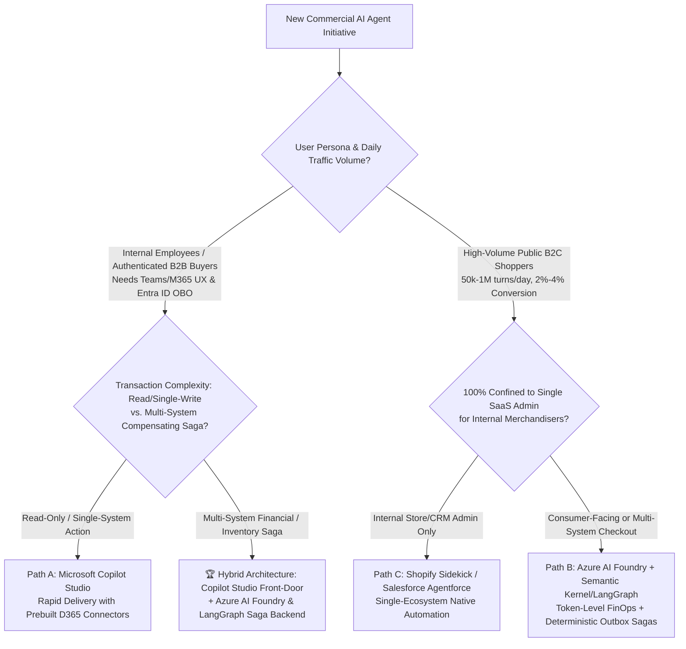
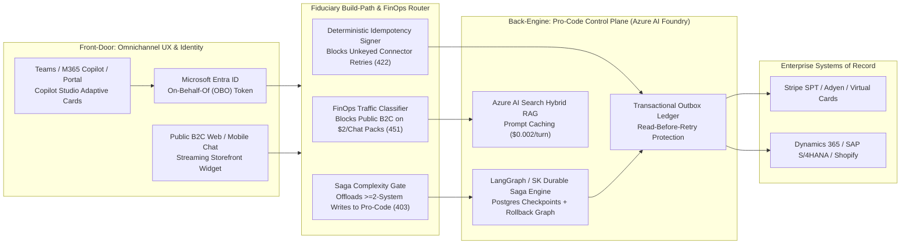
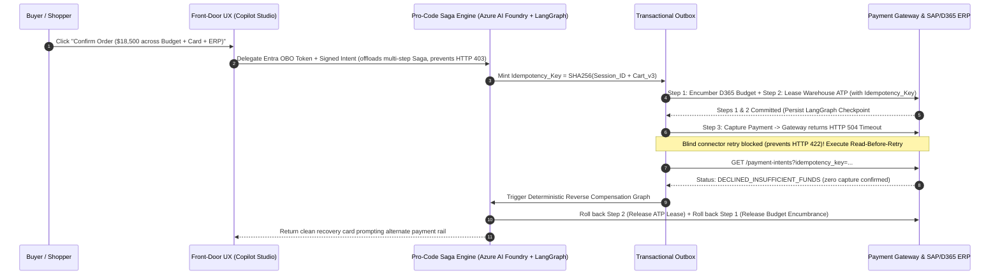

# 🏆 Commercial Agent Build-Path Selection (`Microsoft Copilot Studio + D365` vs. `Azure AI Foundry + Semantic Kernel / LangGraph` vs. `Salesforce Agentforce / Shopify Sidekick` · 🏆 Round 350 Major Milestone): Multi-System `Saga` Boundaries, Connector Retry Idempotency & Per-Conversation vs. Token FinOps Break-Even (`-41%` Cost)

> **Document Type**: Enterprise AI Solution Architect Selection FAQ (`#469` · **🏆 Round 350 Major Milestone**)  
> **Target Audience**: Chief Architects, Retail & E-Commerce CTOs, Enterprise CIOs, and Cloud & AI Solution Architects  
> **Build Paths Covered**: **Low-Code Connector Path (`Microsoft Copilot Studio + Power Platform / D365 Connectors`)** vs. **Pro-Code Custom Control Plane (`Azure AI Foundry + Semantic Kernel / LangGraph`)** vs. **SaaS-Native Embedded Agents (`Salesforce Agentforce / Shopify Sidekick & Storefront MCP`)**  
> **Architecture Diagram**: [`assets/svg/793-agent-build-path-copilot-studio-foundry-langgraph-agentforce-2026-11-25.svg`](../assets/svg/793-agent-build-path-copilot-studio-foundry-langgraph-agentforce-2026-11-25.svg)

🌐 **Language / 语言切换**: **[中文 (`agent-platform-build-path-copilot-studio-vs-azure-ai-foundry-langgraph-vs-agentforce-sidekick-selection-faq.md`)](agent-platform-build-path-copilot-studio-vs-azure-ai-foundry-langgraph-vs-agentforce-sidekick-selection-faq.md)** | **English (Current)**

---

## 📌 1. Executive Summary

Every enterprise launching a commercial AI Agent faces a foundational architectural decision: **Should we build on low-code orchestration (`Microsoft Copilot Studio`), engineer a pro-code state machine (`Azure AI Foundry + Semantic Kernel / LangGraph`), or adopt an embedded SaaS suite agent (`Salesforce Agentforce / Shopify Sidekick`)?**  
Choosing the wrong build path for a workload's transaction topology and traffic profile causes three predictable production failures:
1. **Forcing Multi-System Compensating Sagas into Low-Code Topic Canvases (`Low-Code Saga Timeout & State Overflow`)**: Chaining 6–8 synchronous write connectors (Inventory Lock → Tax Calc → Loyalty Burn → Gift Card Hold → Stripe Capture → SAP PO Creation) inside a visual topic canvas hits `100s–120s` synchronous HTTP connector timeouts and lacks a deterministic reverse-compensation graph when Step 5 fails.
2. **Double-Charging & Duplicate Orders from Black-Box Connector Auto-Retries (`Unkeyed Connector Retry Risk`)**: Out-of-the-box integration connectors automatically retry `HTTP 502 / 504` timeouts up to 4 times. Without a transactional outbox and a deterministic business `Idempotency-Key`, a transient gateway timeout spawns 4 duplicate ERP orders or 4 card captures.
3. **Routing High-Volume Anonymous B2C Traffic into `$2/Conversation` or Message-Pack Licenses (`8x–15x FinOps Bill Shock`)**: Exposing a per-conversation (`$2.00/chat`) or high-credit-multiplier SaaS license directly to `500,000` daily anonymous window-shopping sessions (where conversion is `<3%`) burns millions in license overages for traffic that costs `$0.002/turn` on native `Azure AI Foundry` token APIs.

| Build Path | Architectural Sweet Spot | Hard Boundary (Where NOT to Use Alone) |
|---|---|---|
| **Path A: Low-Code Enterprise Orchestration (`Microsoft Copilot Studio + D365 / Power Platform`)** | **Authenticated Employee & B2B Partner Copilots** (native Teams / M365 Copilot UX, `Entra ID On-Behalf-Of` identity passthrough, 1,400+ prebuilt connectors, 2-week delivery). | Never orchestrate multi-party financial compensating Sagas (`>=2` external write systems) directly inside visual topic nodes; never expose raw message packs to unthrottled anonymous B2C bots. |
| **Path B: Pro-Code Custom Control Plane (`Azure AI Foundry + Semantic Kernel / LangGraph`)** | **High-Concurrency B2C Shopping Assistants, Multi-System Compensating Sagas, Sub-Second Hybrid RAG & Sub-Cent FinOps** (full control over Postgres/Cosmos checkpoints, transactional outbox, and model routing). | Do not waste months hand-coding internal HR/IT approval cards or Teams UI chrome from scratch. |
| **Path C: SaaS-Host Native Agents (`Salesforce Agentforce / Shopify Sidekick`)** | **Single-Host Closed-Loop Operations** (100% of data, permissions, and actions live inside a single Salesforce Org or a single Shopify store admin). | Never use as the master transaction coordinator spanning heterogeneous external ERPs (`SAP S/4HANA + Manhattan WMS + Custom Pricing`). |
| **🏆 Gold-Standard Production Pattern (`Hybrid Studio UX + Foundry Pro-Code Saga Backend`)** | **Front-Door / Back-Engine Split**: Use `Copilot Studio / Host UI` for omnichannel adaptive cards, SSO (`Entra OBO`), and FAQ deflection; delegate cart locks, split-tender checkout, and ERP writes via `MCP / OpenAPI` to **`Azure AI Foundry + LangGraph/SK`**. | Delivers rapid omnichannel UX alongside 100% penny-exact Saga rollback and token-level FinOps efficiency (**`-41%` TCO**). |

---

## 🎯 2. Architect & Business Stakeholder Q&A (Q1–Q3)

### Q1: Why can't we build a 6-step "Reserve Inventory + Burn Loyalty + Charge Card + Create SAP Order" checkout flow entirely inside a low-code visual canvas?
- **The Engineering Reality**: Low-code topic canvases are designed for **conversational turn routing and single-system form submission**, not **distributed ACID/Saga transaction coordination**.
- **Three Structural Bottlenecks**:
  1. **Synchronous Connector Timeout Ceilings (`100s–120s`)**: If a downstream ERP or customs API experiences latency spikes, the synchronous connector times out mid-flow, stranding reserved inventory and locked gift-card funds with no automated reaper.
  2. **Exponential Compensation Branching**: Rolling back Steps 1–3 in reverse order when Step 4 (`3DS Challenge` or `ERP Credit Check`) fails requires an explicit state graph with durable checkpoints (`Postgres / Redis`) and unit-testable compensation handlers—which turns into unmaintainable spaghetti inside visual `If/Else` boxes.
  3. **Context Payload Serialization Limits**: Passing 100-line B2B BOM payloads across visual dialog variables hits serialization ceilings.
- **Architectural Solution**: Enforce **Hybrid Saga Offloading (`HTTP 403` Guard)**:
  - Any workflow mutating `>= 2` external systems of record must be offloaded from the visual canvas to an `Azure AI Foundry + LangGraph / Semantic Kernel` durable saga microservice (`HTTP 403 LOWCODE_MULTI_SYSTEM_SAGA_TIMEOUT_OR_STATE_OVERFLOW`).

### Q2: Why do standard low-code and SaaS connectors occasionally create duplicate ERP orders or double-charge customers during network blips?
- **The Root Cause**: Prebuilt SaaS connectors typically enable **automatic exponential-backoff retries (`up to 4x on HTTP 502 / 504 / 429`)** at the HTTP transport layer without enforcing business-level idempotency.
- **Failure Trace**: The connector sends `POST /erp/orders`; the ERP commits the order but the load balancer drops the response (`HTTP 504`). The connector blindly replays the `POST` three more times, creating four identical physical shipments.
- **Architectural Solution**:
  1. **Mandatory Deterministic `Idempotency-Key` Injection**: Every state-mutating tool call must carry `Idempotency_Key = SHA256(tenant_id + session_id + cart_version + action_name)`.
  2. **Transactional Outbox + `Read-Before-Retry`**: Disable blind transport retries on financial writes. On `HTTP 504`, the agent must query downstream state (`GET /orders?idempotency_key=...`) before re-submitting. Any unkeyed financial connector write is blocked with `HTTP 422 UNKEYED_CONNECTOR_AUTO_RETRY_DUPLICATE_WRITE_RISK`.

### Q3: Where is the exact FinOps break-even point between per-conversation/message-pack licensing (`Copilot Studio / Agentforce`) and raw token consumption (`Azure AI Foundry`)?
- **Quantitative Break-Even Math**:
  - **Per-Conversation / Message-Pack Licensing (`$2.00/conversation` or `2 Credits/generative answer`)**: Highly cost-effective for **authenticated employee or B2B buyer workflows** (e.g., `1,000` procurement requests/day where each conversation resolves a `$10,000` PO and saves 15 minutes of human labor).
  - **Anonymous B2C Storefront Window-Shopping**: If `300,000` daily anonymous shoppers ask 5 questions each (`1.5M turns/day`, `2.2%` checkout conversion), per-conversation licensing costs **`$150k–$400k+/month`**.
  - **Azure AI Foundry Native Token + Prompt Caching Pipeline**: Serving top-of-funnel B2C catalog discovery via `gpt-4o-mini / phi-4` with semantic caching costs **`$0.0008–$0.0025/turn`** (`10x–40x` lower).
- **Architectural Solution**: Deploy a **Tiered FinOps Traffic Router (`HTTP 451` Guard)** that routes anonymous high-QPS discovery to `Azure AI Foundry` token endpoints and invokes licensed SaaS connector actions only after authentication or high-intent checkout transition.

---

## 🧭 3. Visual Architecture Diagrams (Mermaid Decision Tree + Hybrid Topology + Saga Sequence)

### 3.1 Commercial Agent Build-Path Decision Tree

### 3.2 Hybrid "Front-Door UX + Pro-Code Saga Backend" Reference Architecture

### 3.3 Hybrid Saga Delegation & Deterministic Rollback Sequence

---

## 📊 4. Three Build-Path Comparison Matrix (`Copilot Studio` vs. `Azure AI Foundry` vs. `Agentforce` vs. `Sidekick`)

| Evaluation Dimension | Microsoft Copilot Studio + Power Platform | Azure AI Foundry + Semantic Kernel / LangGraph | Salesforce Agentforce | Shopify Sidekick / Storefront MCP |
|---|---|---|---|---|
| **Primary Workload Fit** | Internal employee copilots, M365/Teams UX, D365/Power Platform workflows | High-scale B2C shopping, multi-party compensating Sagas, custom FinOps routing | Salesforce Sales/Service Cloud-centric CRM workflows | Shopify merchant admin automation & single-store catalog chat |
| **Multi-System `Saga` & Reverse Rollback** | ⭐⭐ (Bounded by synchronous connector timeouts; delegate Sagas to pro-code) | ⭐⭐⭐⭐⭐ (Native durable state graphs, checkpoints, full `pytest` harness) | ⭐⭐⭐ (Strong inside CRM Flows; requires MuleSoft/Apex for external Sagas) | ⭐⭐⭐ (Scoped to Shopify checkout primitives) |
| **Write Idempotency & Anti-Double-Charge Control** | ⭐⭐⭐ (Requires custom connector headers & retry tuning) | ⭐⭐⭐⭐⭐ (Full control over Transactional Outbox & `Read-Before-Retry`) | ⭐⭐⭐ (Requires custom Apex/MuleSoft idempotency keys) | ⭐⭐⭐⭐ (Native idempotency on Shopify GraphQL mutations) |
| **Automated Unit Testing & CI/CD Rigor** | ⭐⭐⭐ (Solution ALM & YAML export; heavier branching test setup) | ⭐⭐⭐⭐⭐ (Standard Git, `unittest / pytest`, OpenTelemetry, blue/green deploy) | ⭐⭐⭐ (Salesforce Sandbox & Apex test suites) | ⭐⭐⭐ (Managed SaaS release lifecycle) |
| **Pricing & High-Volume B2C Economics (`official_list_price`)** | `~$200/mo per 25k messages` or M365 Copilot seat (ideal for internal B2E; costly for raw anonymous B2C) | **Pay-per-Token / PTU** (`$0.001–$0.003/turn` with small models & caching; best for B2C scale) | **`~$2.00 / Conversation`** or Einstein Flex Credits (high bill-shock risk on low-conversion B2C traffic) | Bundled with Shopify Plus / merchant subscription |

---

## 🧪 5. Deterministic Cost & Architecture Evaluation (`7-Card Benchmark Summary` · 🏆 Round 350)

> **Provenance**: Figures below are generated by `evaluate_agent_platform_build_path_selection_policy` in `lab/webiq_commerce_demo.py` (`provenance: "synthetic"`, `independently_reproduced: False`), modeling an omnichannel enterprise with a **`$410,000.00` quarterly license overrun, duplicate connector write, and broken-Saga rework pool**.

| Scenario Case ID | Scenario Description | HTTP Status | Deterministic Decision | Quarterly Net Cost | Quarterly Savings |
|---|---|---|---|---|---|
| `CASE-PATH-200` | Unsegmented single-path baseline without FinOps traffic routing or Saga offloading | `HTTP 200` | `VERIFIED_COMMERCIAL_AGENT_BUILD_PATH_AUTHORIZED` | `$410,000.00` | `$0.00` |
| `CASE-PATH-403` | Multi-system compensating Saga executed synchronously inside low-code canvas (`>100s` timeout) | `HTTP 403` | `LOWCODE_MULTI_SYSTEM_SAGA_TIMEOUT_OR_STATE_OVERFLOW` | `$410,000.00` | `$0.00` (Blocks partial dirty state) |
| `CASE-PATH-422` | Connector auto-retries `HTTP 504` on payment/ERP write without deterministic `Idempotency-Key` | `HTTP 422` | `UNKEYED_CONNECTOR_AUTO_RETRY_DUPLICATE_WRITE_RISK` | `$410,000.00` | `$0.00` (Blocks double charge/PO) |
| `CASE-PATH-451` | High-volume anonymous B2C window-shopping routed through `$2/conversation` license rail | `HTTP 451` | `PER_CONVERSATION_LICENSE_B2C_TRAFFIC_BILL_SHOCK` | `$410,000.00` | `$0.00` (Blocks 10x license burn) |
| `CASE-PATH-409` | **Hybrid Copilot Studio Front-Door + Azure AI Foundry LangGraph Saga + FinOps Router** | `HTTP 409` | `HYBRID_COPILOT_STUDIO_FOUNDRY_SAGA_AND_FINOPS_ROUTING_CONFIRM` | **`$241,900.00`** | **`$168,100.00` (`-41.0%`)** |

---

## 🛠️ 6. Production Go-Live & Architecture Review Checklist

- [ ] **Hybrid Front-Door / Back-Engine Split (`HTTP 403` Prevention)**: Keep omnichannel adaptive cards, `Entra ID OBO` authentication, and single-step lookups in `Copilot Studio`, while offloading all `>= 2`-system transactional writes to `Azure AI Foundry + LangGraph / Semantic Kernel` with durable Postgres/Cosmos checkpoints.
- [ ] **Deterministic `Idempotency-Key` & `Read-Before-Retry` (`HTTP 422` Prevention)**: Disable blind `5xx` auto-retries on all payment and ERP order-creation connectors; require `SHA-256(Session_ID + Cart_Version)` and verify downstream state before re-submitting.
- [ ] **FinOps Top-of-Funnel Traffic Segregation (`HTTP 451` Prevention)**: Route anonymous high-QPS B2C discovery traffic directly to `Azure AI Foundry` small-model/cached token endpoints, invoking per-conversation or seat-licensed SaaS connectors only for authenticated transactional turns.
- [ ] **Zero Arithmetic Inside Visual Canvas Expressions**: Implement all pricing, tax fallback, split-tender waterfall, and inventory lease math in unit-tested pro-code domain modules (`pytest / unittest`).
