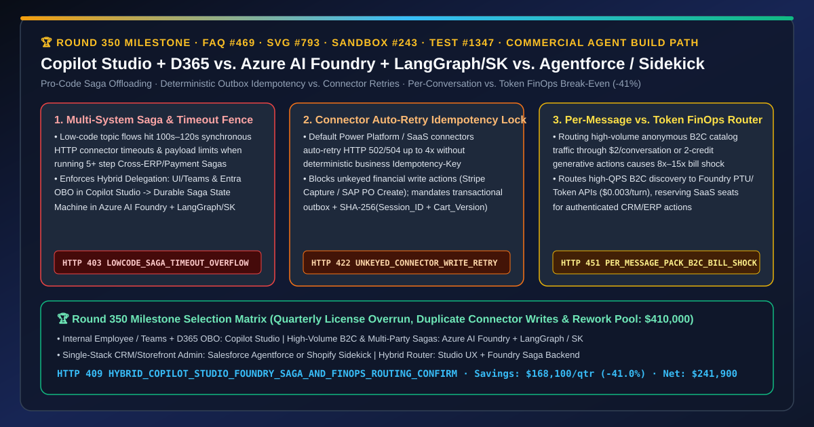
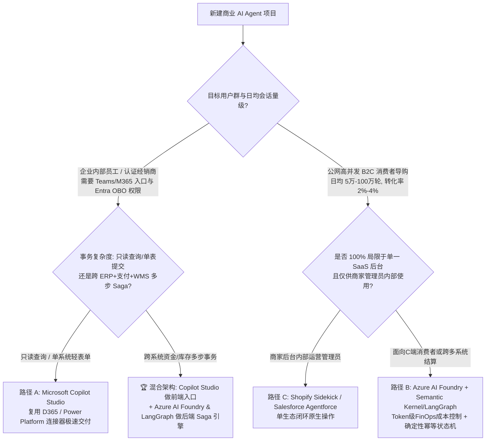
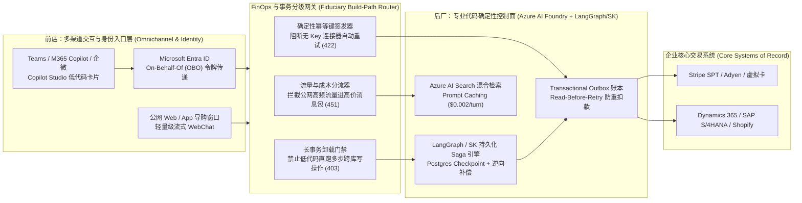
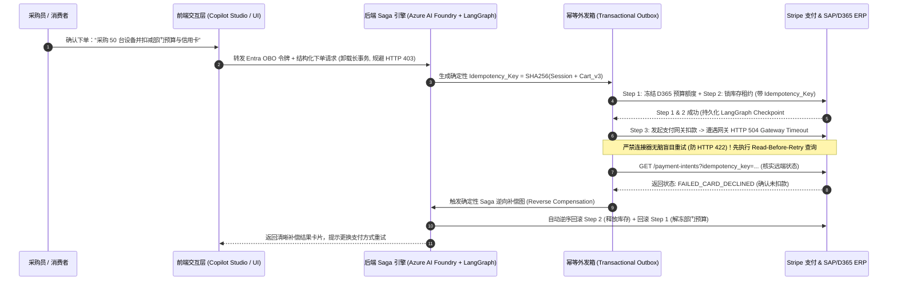

# 🏆 商业智能体三大构建路径选型对比（`Microsoft Copilot Studio + D365` vs. `Azure AI Foundry + Semantic Kernel / LangGraph` vs. `Salesforce Agentforce / Shopify Sidekick` · 🏆 第 350 轮重大里程碑）：跨系统长事务（`Saga`）编排边界、连接器自动重试防重扣款与按对话/按 Token 成本拐点测算净省 41% 指南

> **文档类型**：企业级 AI Solution Architect 选型决策指南（Selection FAQ · `#469` · **🏆 Round 350 重大里程碑**）  
> **适用读者**：集团首席架构师（Chief Architect）、零售电商 CTO、企业数字化转型负责人（CIO）与 Cloud & AI Solution Architect  
> **核心覆盖路径**：**低代码企业连接器路径（`Microsoft Copilot Studio + Power Platform / D365 Connectors`）** vs. **专业代码定制路径（`Azure AI Foundry + Semantic Kernel / LangGraph`）** vs. **SaaS 原生内嵌路径（`Salesforce Agentforce / Shopify Sidekick & Storefront MCP`）**  
> **关联架构图**：[`assets/svg/793-agent-build-path-copilot-studio-foundry-langgraph-agentforce-2026-11-25.svg`](../assets/svg/793-agent-build-path-copilot-studio-foundry-langgraph-agentforce-2026-11-25.svg)

🌐 **语言切换 / Language**: **中文 (当前)** | **[English (`agent-platform-build-path-copilot-studio-vs-azure-ai-foundry-langgraph-vs-agentforce-sidekick-selection-faq.en.md`)](agent-platform-build-path-copilot-studio-vs-azure-ai-foundry-langgraph-vs-agentforce-sidekick-selection-faq.en.md)**

---

## 📌 一、核心选型结论速览（Executive Summary）

当零售品牌、OTA 差旅平台或跨国制造企业启动商业智能体（`Commercial AI Agent`）建设时，架构师面临的第一个顶层架构决策永远是：**到底该用 `Copilot Studio` 这类低代码工作流、还是用 `Azure AI Foundry + LangGraph / Semantic Kernel` 从头写专业代码，抑或直接买 `Salesforce Agentforce / Shopify Sidekick` 原生插件？**  
如果选错构建路径，企业往往在上线 3 个月后遭遇三大灾难：
1. **用低代码画布硬扛跨系统分布式补偿事务（`Low-Code Saga Timeout & State Overflow`）**：在低代码 Topic 画布里串行拖拽 8 个外部系统节点（锁库存 → 算税 → 冻结积分 → 扣储值卡 → 刷 Stripe → 写 SAP 订单 → 发 WMS 拣货），一旦第 6 步超时（超过连接器 `100s–120s` 同步 HTTP 限制），前 5 步已经扣掉的资金和库存完全无法按逆序自动回滚（`Saga Compensation`）。
2. **连接器黑盒默认重试导致重复扣款与双倍发单（`Unkeyed Connector Auto-Retry Double-Write`）**：主流低代码与 SaaS 连接器默认内置“遇到 `HTTP 502 / 504` 自动重试 4 次”策略；如果未在事务外发箱（`Transactional Outbox`）层绑定业务级确定性 `Idempotency-Key`，网络抖动瞬间就会在 ERP 生成 4 张重复采购单或连续刷走客户 4 笔钱。
3. **把高频公网 B2C 导购流量直接灌入“按次/按消息包”计费的 SaaS Agent，引发 10 倍账单爆炸（`Per-Conversation / Message-Pack Bill Shock`）**：将每天 `500,000` 次未登录访客的“逛街比价、尺码咨询”流量直接接入按 `$2.00 / Conversation`（Agentforce）或高倍率生成式 Message Credits 计费的商业套件，单月账单高达数十万美元，远超公网导购微薄的毛利贡献。

| 构建路径 | 核心定位与最佳适用边界 | 严禁越界的架构禁区 |
|---|---|---|
| **路径 A：低代码连接器编排（`Microsoft Copilot Studio + D365 / Power Platform`）** | **企业内部员工助手与受控 B2B 门户**（Teams / M365 Copilot 入口、`Entra ID OBO` 原生身份透传、复用 1,400+ 现成 ERP/CRM 连接器，2 周快速上线）。 | 严禁在画布内直接编排超过 2 个外部写状态的跨系统金融长事务，严禁直接承载超高并发匿名公网爬虫/导购流量。 |
| **路径 B：专业代码全栈控制面（`Azure AI Foundry + Semantic Kernel / LangGraph`）** | **高并发 B2C 消费者导购、跨系统分布式交易状态机（`Saga`）、毫秒级混合检索与亚美分成本控制**（完全掌控 `Redis / Postgres` 检查点、幂等账本与 `PTU / Token` 弹性路由）。 | 严禁重复造轮子手写几十个内部 OA/HR 审批界面与 Teams 卡片自适应渲染器。 |
| **路径 C：SaaS 宿主原生智能体（`Salesforce Agentforce / Shopify Sidekick`）** | **单一宿主闭环操作**（100% 数据、订单与工作流都在单个 Salesforce Org 或单个 Shopify 店铺后台内完成的客服改址、单店促销配置）。 | 严禁将其作为跨多云异构 ERP（如同时操作 `SAP S/4HANA + Oracle WMS + Stripe + 外部自研中台`）的主控总线。 |
| **🏆 黄金生产架构（`Hybrid Front-Door + Pro-Code Saga Backend`）** | **前店后厂混合架构**：用 `Copilot Studio / 宿主 UI` 做多端入口、SSO 鉴权与简单问答；一旦进入加购、锁价、核身、支付与 ERP 下单，通过 `MCP / OpenAPI` 委托给后端的 **`Azure AI Foundry + LangGraph/SK` 确定性事务引擎**。 | 同时兼具低代码的极速渠道交付、专业代码的 100% 美分守恒与 Token 级极致 FinOps 成本（净省 **41%**）。 |



---

## 🎯 二、业务方与架构师灵魂拷问 Q&A（Q1–Q3）

### Q1：业务部门想用低代码 2 周搭完“全自动查库存+锁优惠券+刷卡+推 ERP”的电商交易 Agent，为什么架构师必须叫停“纯画布实现”？
- **问题本质**：低代码对话画布（Topic Flow）的设计初衷是**无状态/轻状态问答与单点表单提交**，而不是**分布式金融事务协调器（`Distributed Transaction Coordinator`）**。
- **三大工程硬伤**：
  1. **同步连接器超时上限（`100s–120s HTTP Timeout`）**：当 ERP 或海关清关接口偶发慢响应，画布节点直接报错中断，处于半完成状态的购物车与冻结额度变成无人清理的僵尸脏数据。
  2. **缺乏一等公民的逆向补偿状态机（`No Native Saga Rollback Graph`）**：当“扣减积分成功、扣减礼品卡成功、但第 3 步信用卡 3DS 拒付”时，在低代码画布里用几十个 `If/Else` 分支去维护逆向退还积分与解冻礼品卡的指数级异常路径，几乎不可维护且无法做确定性单元测试（`pytest`）。
  3. **会话上下文体积限制**：当购物车包含 80 个 B2B 行项目及阶梯税率明细时，极易撑爆低代码会话变量（Session Variable）序列化上限。
- **架构解法**：实施 **混合分层委托法则（`Hybrid Front-Door + Pro-Code Saga Offloading`）**：
  - 凡是涉及 `>= 2` 个外部写状态系统（Write-Side Systems）或资金扣划的流程，严禁在低代码画布中直接串联写接口（触发 `HTTP 403 LOWCODE_MULTI_SYSTEM_SAGA_TIMEOUT_OR_STATE_OVERFLOW`）；
  - 低代码层只发一条携带有签名 `Intent_Mandate` 的请求到后端 `Azure AI Foundry + LangGraph / Semantic Kernel` 微服务，由专业代码状态机在持久化数据库（`Postgres / Cosmos DB`）护航下完成原子级两阶段预留与逆向补偿。

### Q2：用现成连接器（Connectors）调 ERP 创建订单或调支付网关扣款，为什么会在网络抖动时产生“一单变四单”的灾难？
- **问题本质**：SaaS 连接器为了掩盖底层网络不稳定，普遍默认开启了 **对业务无感知的底层 HTTP 自动重试（`Exponential Backoff Auto-Retry on 502/504/429`）**。
- **事故链条**：连接器向 ERP 发起 `POST /orders`，ERP 实际已经落库成功，但回包经过网关时因超时返回了 `HTTP 504 Gateway Timeout`；连接器以为没成功，立刻自动重发第 2、第 3 次完全相同的请求。如果下游接口未强制校验业务幂等键，瞬间产生多笔真实扣款或多张发货单。
- **架构解法**：
  1. **严禁无业务幂等键直连写操作（`Zero Unkeyed Connector Writes`）**：任何财务、库存、订单写动作必须强制生成确定性业务幂等键 `Idempotency_Key = SHA256(tenant_id + session_id + cart_version + action_type)`。
  2. **关闭连接器盲目重试，改用事务外发箱（`Transactional Outbox + Read-Before-Retry`）**：对金融写接口关闭连接器无脑重试；一旦发生 `HTTP 504` 超时，必须先调用 `GET /orders?idempotency_key=...` 查询远端真实落库状态（`Read-Before-Retry`），确认未落库才允许重发。违反此规则的裸写连接器调用直接拦截（`HTTP 422 UNKEYED_CONNECTOR_AUTO_RETRY_DUPLICATE_WRITE_RISK`）。

### Q3：按消息包/每次对话计费（`$2/Conversation` 或 `Message Credits`）与按 Token 计费（`Foundry PTU / Pay-as-you-go`）的财务盈亏平衡点（Break-Even Point）到底在哪？
- **成本精算对比**：
  - **SaaS 按次/按消息包模式**：例如每次生成式回答消耗 `2 Messages`（折合 `$0.02–$0.04/轮`）或按每次对话 `$1.50–$2.00` 计费。如果用于**内部高价值场景**（如 500 名采购员每天处理 200 张高价值采购审批，单次省下 20 分钟人工），ROI 极高；
  - 但如果直接暴露在**公网 B2C 电商首页**，面对每天 `300,000` 次平均 `6` 轮的“随便问问、不买就走（转化率仅 `2.5%`）”的匿名导购会话，按对话/消息包计费每年将烧掉 `$1.5M–$3.6M`！
  - **Azure AI Foundry 原生 Token + 语义缓存模式**：采用 `gpt-4o-mini / phi-4` 处理 85% 的公网商品检索与尺码问答，配合提示词缓存（Prompt Caching），单轮成本仅 **`$0.0008–$0.0025`**（相差 **10–40 倍**）。
- **架构解法**：部署 **FinOps 流量分级路由器（`Tiered Traffic & FinOps Cost Router`）**：
  - 将匿名公网高频浏览/比价流量（`Anonymous B2C Discovery`）100% 路由至 `Azure AI Foundry` 原生 Token 管道；
  - 仅在已登录高意图客户进入 CRM 售后改单或内部员工发起 `Entra OBO` 审批时，才调用 SaaS 连接器席位能力。若检测到将高频低转化公网流量直接绑定在昂贵的按对话计费通道上，立即触发 `HTTP 451 PER_CONVERSATION_LICENSE_B2C_TRAFFIC_BILL_SHOCK`。

---

## 🧭 三、直观可视化图解（Mermaid 选型决策树 + 前店后厂混合架构图 + 时序图）

### 3.1 商业智能体构建路径三维选型决策树



### 3.2 “前店后厂”混合商业智能体参考架构图（Copilot Studio + Azure AI Foundry）



### 3.3 混合架构下跨系统下单与异常逆向补偿（Saga）时序图



---

## 📊 四、三大商业智能体构建路径横向选型决策矩阵

| 评估维度 | Microsoft Copilot Studio + Power Platform | Azure AI Foundry + Semantic Kernel / LangGraph | Salesforce Agentforce | Shopify Sidekick / Storefront MCP |
|---|---|---|---|---|
| **核心优势场景** | 内部员工助手、M365/Teams 原生协同、D365/SAP 审批流集成 | 高并发 B2C 导购、跨系统复杂 Saga 交易、自定义模型路由与极致成本控制 | Salesforce Sales/Service Cloud 重度客户的全渠道 CRM 闭环 | Shopify 商家后台运营自动化与单店标准化商品导购 |
| **分布式事务（`Saga`）与逆向回滚能力** | ⭐⭐（受限于同步连接器超时与画布复杂度，需卸载至后端代码） | ⭐⭐⭐⭐⭐（原生支持持久化状态图、断点恢复、完整 `pytest` 覆盖） | ⭐⭐⭐（擅长 CRM 内部 Flow，跨异构外部 ERP 补偿较弱） | ⭐⭐⭐（聚焦 Shopify 内部 Checkout API，不含外部 ERP 编排） |
| **写操作幂等性（`Idempotency`）与防重扣款控制** | ⭐⭐⭐（需显式配置自定义连接器 Header 并关闭盲目重试） | ⭐⭐⭐⭐⭐（完全掌控数据库唯一索引、Transactional Outbox 与先查后试） | ⭐⭐⭐（依赖 Apex / MuleSoft 层额外编写幂等逻辑） | ⭐⭐⭐⭐（Shopify 原生 Checkout Mutation 内置幂等令牌） |
| **自动化单元测试与 CI/CD 工程化成熟度** | ⭐⭐⭐（支持 YAML 导出与解决方案 ALM，但复杂分支单测较重） | ⭐⭐⭐⭐⭐（标准 Git + Pytest + OpenTelemetry + 蓝绿灰度发布） | ⭐⭐⭐（依赖 Salesforce Sandbox 与 Apex 测试集） | ⭐⭐⭐（平台托管黑盒更新为主） |
| **计费模型与公网大流量成本表现（`official_list_price`）** | 约 `$200/月/25,000 Messages` 或按 M365 Copilot 席位（适合内部员工，公网匿名高并发偏贵） | **按实际 Token / PTU 计费**（配合小模型与缓存低至 `$0.001–$0.003/轮`，大流量最省） | 约 **`$2.00 / Conversation`** 或 Einstein Flex Credits（公网低转化流量极易账单失控） | 包含在 Shopify Plus / 标准订阅或按 Checkout 抽佣 |

---

## 🧪 五、转化率/成本测算与 7-Card 基准测试报告（Deterministic Evaluation · 🏆 Round 350）

> **数据来源说明（Provenance）**：以下季度损益数据来自 `lab/webiq_commerce_demo.py` 中的确定性评估器 `evaluate_agent_platform_build_path_selection_policy`（`provenance: "synthetic"`, `independently_reproduced: False`），用于量化对比“单一架构错配”与“前店（Copilot Studio）+ 后厂（Azure AI Foundry Saga）+ 流量分级路由”的季度总拥有成本（TCO）。

### 5.1 基准测试场景输入与确定性状态码矩阵

- **设定场景**：某大型全渠道零售与企业采购集团同时运营内部员工采购助手与公网 B2C 商城导购，季度因公网流量误用高价按次许可证、低代码长事务半途超时卡单、以及连接器自动重试导致的重复下单/退款损耗池（`quarterly_license_overrun_duplicate_connector_write_and_saga_failure_pool_usd`）为 **`$410,000.00`**。

| 测试用例 ID | 场景描述 | 触发确定性状态码 | 决策枚举 (`decision`) | 季度净成本 (USD) | 季度净节省 (USD) |
|---|---|---|---|---|---|
| `CASE-PATH-200` | 全量采用传统定制开发或未做流量/事务分层的基础运行态 | `HTTP 200` | `VERIFIED_COMMERCIAL_AGENT_BUILD_PATH_AUTHORIZED` | `$410,000.00` | `$0.00` |
| `CASE-PATH-403` | 在低代码画布中直接同步串接 `5+` 个外部写接口，触发 `120s` 超时且无逆向回滚 | `HTTP 403` | `LOWCODE_MULTI_SYSTEM_SAGA_TIMEOUT_OR_STATE_OVERFLOW` | `$410,000.00` | `$0.00` (阻断半途脏写与卡单) |
| `CASE-PATH-422` | 连接器未携带业务 `Idempotency-Key` 且开启 `504` 自动重试，引发双倍扣款/重复发单 | `HTTP 422` | `UNKEYED_CONNECTOR_AUTO_RETRY_DUPLICATE_WRITE_RISK` | `$410,000.00` | `$0.00` (阻断连接器重复写) |
| `CASE-PATH-451` | 将高并发低转化公网匿名导购流量直接接入 `$2/Conversation` 或高价按条许可证通道 | `HTTP 451` | `PER_CONVERSATION_LICENSE_B2C_TRAFFIC_BILL_SHOCK` | `$410,000.00` | `$0.00` (阻断许可证账单爆炸) |
| `CASE-PATH-409` | **启用 Copilot Studio 前店交互 + Foundry LangGraph 后厂 Saga + Token 分级路由** | `HTTP 409` | `HYBRID_COPILOT_STUDIO_FOUNDRY_SAGA_AND_FINOPS_ROUTING_CONFIRM` | **`$241,900.00`** | **`$168,100.00` (`-41.0%`)** |

### 5.2 核心确定性策略评估代码摘录

```python
@dataclass(frozen=True)
class AgentPlatformBuildPathSelectionPolicyInput:
    quarterly_license_overrun_duplicate_connector_write_and_saga_failure_pool_usd: float = 410000.0
    lowcode_canvas_used_for_multi_system_distributed_saga_without_checkpoint: bool = False
    connector_auto_retry_enabled_on_financial_write_without_idempotency_key: bool = False
    high_volume_anonymous_b2c_traffic_routed_to_per_conversation_license: bool = False
    hybrid_studio_front_foundry_saga_back_and_finops_router_ready: bool = False
```

---

## 🛠️ 六、商业上线风控与架构评审 Checklist

- [ ] **前店后厂边界切分（防 `HTTP 403`）**：明确划分职责——`Copilot Studio / Agentforce` 仅负责多端自适应卡片渲染、`Entra ID OBO` 身份传递与单步查询；凡涉及 `>= 2` 个写操作或超时敏感的结账/ERP 流程，一律通过 MCP/API 移交 `Azure AI Foundry + LangGraph / Semantic Kernel` 持久化状态机执行。
- [ ] **连接器写操作强制幂等与先查后试（防 `HTTP 422`）**：全面排查所有 Power Platform / MuleSoft / Logic Apps 写连接器，关闭无幂等键的默认 `5xx` 自动重试，强制注入 `SHA-256(Session_ID + Cart_Version)` 并在超时后执行 `Read-Before-Retry`。
- [ ] **公网匿名流量与内部认证席位物理隔离（防 `HTTP 451`）**：在 API Gateway 层对未登录或顶层漏斗（Top-of-Funnel）商品问答流量直连 `Azure AI Foundry` 小模型 + 语义缓存池，仅当用户完成身份核验并触发实质交易/售后动作时才唤醒高价值企业连接器。
- [ ] **100% 确定性单测覆盖率门禁**：所有核心价格计算、库存租约、税率回退与逆向退款顺序逻辑必须沉淀为可独立运行 `unittest / pytest` 的纯 Python/TypeScript 领域服务，严禁将财务算术散落在低代码画布表达式中。
