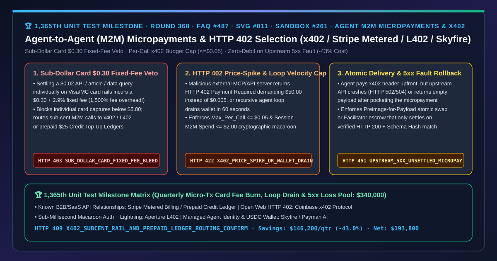
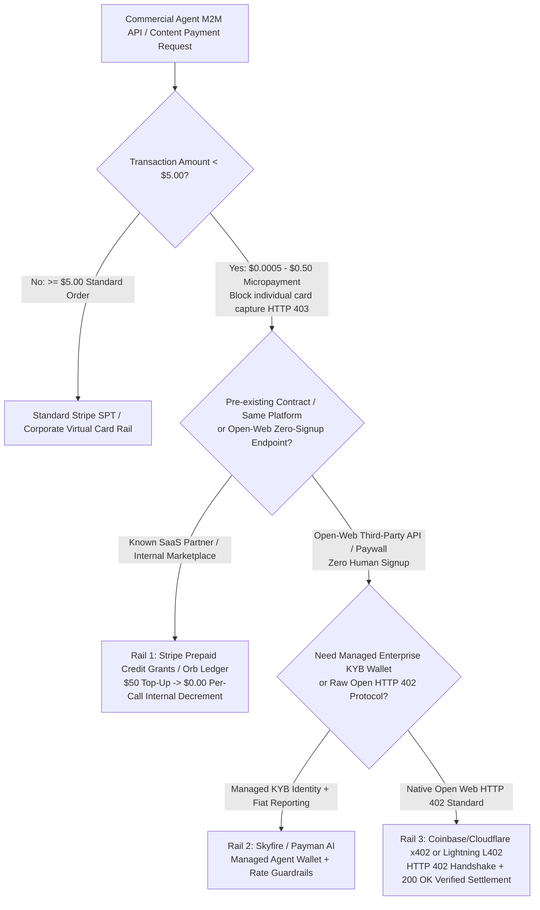
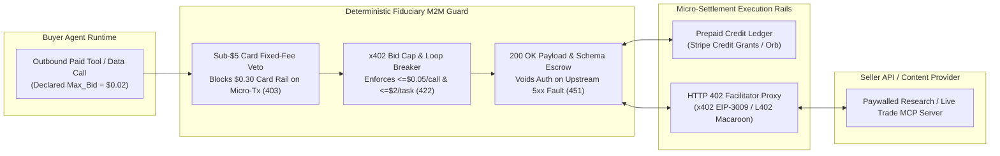

# 🏆 Agent-to-Agent (`M2M`) Micropayments, `HTTP 402 (x402 / L402)` & Prepaid Credit Ledger Selection (`Coinbase x402 / Stripe Metered & Credits / Lightning L402 / Skyfire` · 🏆 1,365th Unit Test Milestone): Sub-`$5` Card Fixed-Fee Veto, Per-Call `x402` Bid Caps (`<=$0.05`) & `200 OK` Atomic Settlement (`-43%` Cost)

> **Document Type**: Enterprise AI Solution Architect Selection FAQ (`#487` · **🏆 1,365th Deterministic Unit Test Milestone** · Round 368)  
> **Target Audience**: AI Agent & MCP Marketplace Architects, Data/API Monetization CTOs, FinOps Engineering Leads, and Cloud & AI Solution Architects  
> **Protocols & Platforms Covered**: `Coinbase / Cloudflare x402 Protocol (HTTP 402 + EIP-3009 USDC)` vs. `Stripe Metered Billing & Prepaid Credit Grants` vs. `Lightning Labs L402 (Macaroon + HTLC Preimage)` vs. `Skyfire / Payman AI (Agentic Wallet & KYB)`  
> **Architecture Diagram**: [`assets/svg/811-agent-m2m-micropayments-x402-l402-stripe-skyfire-2026-11-25.svg`](../assets/svg/811-agent-m2m-micropayments-x402-l402-stripe-skyfire-2026-11-25.svg)

🌐 **Language / 语言切换**: **[中文 (`agent-to-agent-m2m-micropayments-x402-l402-stripe-metered-skyfire-subcent-budget-selection-faq.md`)](agent-to-agent-m2m-micropayments-x402-l402-stripe-metered-skyfire-subcent-budget-selection-faq.md)** | **English (Current)**

---

## 📌 1. Executive Summary

When an autonomous research, price-intelligence, or procurement agent executes a complex workflow, it frequently needs to purchase granular external data or tool executions on the fly (`$0.02` for a paywalled market report, `$0.005` for a live bill-of-lading query, or `$0.04` for a specialized remote MCP tool call).  
Attempting to settle sub-dollar machine-to-machine (`M2M`) transactions over traditional human credit-card rails—or auto-signing `HTTP 402 Payment Required` challenges without deterministic budget and delivery gates—triggers three catastrophic failures:
1. **Paying a `$0.30` Fixed Card Fee on a `$0.02` API Call (`1,500% Fee Overhead`)**: Traditional card networks (`Visa / Mastercard / Stripe`) charge **`2.9% + $0.30` per individual capture**. Running 10,000 individual `$0.02` micro-captures on a credit card costs `$200` for the data and **`$3,000` in fixed card processing fees**!
2. **Wallet Drainage from Adversarial `HTTP 402` Price Spikes or Infinite Agent Loops (`x402 Price-Jacking & Loop Drain`)**: If an agent automatically signs whatever payment amount an external server returns in an `HTTP 402` header, a malicious or misconfigured endpoint can hike its price from `$0.005` to `$50.00` per request—or a stuck ReAct loop can fire 5,000 paid requests in 60 seconds.
3. **Paying Upfront for Upstream `HTTP 502 / 504` Timeouts or Empty Responses (`Unverified-Delivery Micropayment Loss`)**: If the micropayment is settled irreversibly before the upstream API executes, any downstream `5xx` crash or empty JSON response steals the agent's funds without delivering the payload.

| M2M Scenario & Trust Topology | Recommended Primary Choice | Architectural Boundary & Production Rule |
|---|---|---|
| **Known Recurring API Partners & Unified SaaS / MCP Marketplaces** | **Stripe Prepaid Credit Grants / Orb Ledger + Monthly Roll-Up** | Top up `$50–$500` once via card/ACH (paying the `$0.30` fixed fee only once), then decrement `$0.001–$0.05` calls against an internal sub-millisecond ledger at `$0.00` per-call fee. |
| **Open-Web Zero-Signup Pay-Per-Crawl / Pay-Per-Call (`HTTP 402`)** | **Coinbase / Cloudflare `x402` Protocol (`HTTP 402 + EIP-3009 Base USDC`)** | Enables zero-account, instant HTTP-native micropayments via `X-PAYMENT` headers settling on L2 (`<$0.0001` gas fee, `~200ms` confirmation). |
| **Cryptographic Capability Attenuation & Atomic Preimage Swaps** | **Lightning `L402` (`Macaroons + HTLC Preimage`)** | Binds caveats (expiration, endpoint scope, max spend) into a cryptographic Macaroon that only unlocks when the payment preimage is revealed. |
| **Managed Enterprise Agent Identity (`KYB`) & Guardrailed Wallets** | **Skyfire / Payman AI** | Provides managed agent wallets with built-in per-minute velocity caps, verified agent identity, and consolidated fiat accounting. |
| **Three Mandatory Fiduciary Guardrails** | **100% Deterministic Gating** | ① **Sub-`$5.00` Individual Card Capture Veto (`HTTP 403`)**: Prohibits settling individual `< $5.00` transactions on per-tx fixed-fee card rails, forcing routing to prepaid credit ledgers or `x402 / L402`; ② **Per-Call Bid Cap (`<= $0.05`) & Loop Budget Lock (`HTTP 422`)**: Rejects `HTTP 402` challenges exceeding `Max_Per_Call_Cents` or task-level `Max_Session_M2M_Budget ($2.00)`; ③ **Atomic `200 OK` Schema-Verified Settlement (`HTTP 451`)**: Voids/withholds payment settlement whenever the upstream endpoint returns `5xx / 429` or an invalid schema. |



---

## 🎯 2. Architect & Business Stakeholder Q&A (Q1–Q3)

### Q1: Why can't we just give our AI agent a virtual credit card to pay `$0.02` every time it fetches a paywalled article or external API?
- **The `$0.30` Fixed-Fee Mathematical Wall**:
  - Card acquiring rails charge `2.9% + $0.30` per settled capture. Below **`$5.00`**, the `$0.30` fixed fee dominates unit economics (`6%+` effective MDR at `$5.00`, `32.9%` at `$1.00`, and **`1,502.9%` at `$0.02`**).
  - Furthermore, firing 50 sub-dollar card authorizations per minute from a cloud IP triggers immediate issuer velocity blocks (`ISO 8583 Code 65`).
- **Architectural Solution**: Enforce a **Sub-`$5.00` Card Rail Veto & Dual Micro-Rail Router (`HTTP 403` Guard)**:
  - Block any individual card capture below `$5.00` (`HTTP 403 SUB_DOLLAR_INDIVIDUAL_CARD_CAPTURE_FIXED_FEE_BLEED`).
  - Route known platform partners through a **Prepaid Credit Ledger (`Stripe Credit Grants / Orb`)** funded in `$50+` chunks, and route open-web third-party endpoints through **`HTTP 402 (x402 / L402 / Skyfire)`** where per-call network fees are `< $0.0002`.

### Q2: How do we prevent an untrusted external `HTTP 402` server from overcharging our agent `$50.00` for a single call, or a runaway loop from draining the wallet?
- **The `HTTP 402` Price-Jacking & Loop Vector**:
  - In the `x402` flow, an external server responds with `HTTP 402 Payment Required` containing a machine-readable payment requirement (`maxAmountRequired`, `payTo`, `asset`). If the agent's HTTP client blindly signs the requested amount, a malicious server can demand `$50.00` instead of `$0.01`.
- **Architectural Solution**: Enforce **Deterministic Signer Enclave Caps (`Max_Per_Call <= $0.05` & `Max_Per_Task <= $2.00` · `HTTP 422` Guard)**:
  - The signing enclave (never the LLM itself) validates `requested_amount_usd <= tool_declared_max_bid_usd (<= $0.05)`, verifies `cumulative_task_spend_usd + requested_amount_usd <= $2.00`, and blocks duplicate paid retries to the same `(Task_ID, Endpoint_URL_Hash)` (`HTTP 422 X402_PRICE_SPIKE_OR_RECURSIVE_LOOP_WALLET_DRAIN`).

### Q3: How do we guarantee that our agent is never charged when a paid upstream API crashes (`HTTP 502 / 504`) or returns an empty/malformed payload?
- **The Upfront-Payment Hazard**: If an agent broadcasts an irreversible payment before the server computes the response, an upstream timeout leaves the agent out of pocket with zero data.
- **Architectural Solution**: Use **Two-Phase Facilitator Escrow / Signed `EIP-3009` Deferred Settlement (`HTTP 451` Guard)**:
  - The agent attaches a short-lived (`validBefore = now + 60s`) signed `EIP-3009 ReceiveWithAuthorization` payload (or `L402` HTLC) in the `X-PAYMENT` header.
  - The API Gateway Facilitator verifies the signature off-chain, invokes the upstream service, validates that the response is `HTTP 200 OK` with a non-empty schema-compliant body, and **only then** broadcasts/settles the debit. Upstream `5xx` faults automatically discard the authorization with zero debit (`HTTP 451 UPSTREAM_5XX_FAULT_OR_EMPTY_PAYLOAD_MICROPAY_DEBIT`).

---

## 🧭 3. Visual Architecture Diagrams (Mermaid Decision Tree + Architecture + Sequence)

### 3.1 Agent-to-Agent (`M2M`) Micropayment Rail Selection Tree



### 3.2 End-to-End `HTTP 402 (x402)` Enclave Budget Lock & `200 OK` Escrow Architecture



### 3.3 `HTTP 402 (x402)` Handshake, Price-Spike Check & `200 OK` Settlement Sequence

```mermaid
sequenceDiagram
    autonumber
    participant Agent as Buyer Research Agent
    participant Guard as Client M2M Enclave Guard
    participant Edge as x402 API Gateway Facilitator
    participant Upstream as Seller Data API

    Agent->>Edge: 1. GET /v1/customs-bol-record?id=991
    Edge-->>Guard: 2. Return HTTP 402 Payment Required (Price: $0.015 USDC, Network: Base, Nonce: n_882)
    Guard->>Guard: 3. Veto card rail (prevents HTTP 403); verify $0.015 <= $0.05 cap & task spend $0.42 <= $2.00 (prevents HTTP 422)
    Guard->>Edge: 4. Retry GET with Header `X-PAYMENT: <Signed_EIP3009_Auth($0.015, valid_60s)>`
    Edge->>Upstream: 5. Verify signature off-chain & forward request to upstream service
    alt Upstream returns HTTP 503 Timeout or empty JSON
        Upstream-->>Edge: HTTP 503 Service Unavailable
        Edge-->>Guard: Discard EIP-3009 authorization -> Zero debit to buyer agent (prevents HTTP 451)
    else Upstream returns valid HTTP 200 OK + Schema-Verified Payload
        Upstream-->>Edge: Return verified Bill-of-Lading JSON payload
        Edge->>Edge: Submit EIP-3009 authorization for $0.015 settlement
        Edge-->>Agent: Return HTTP 200 payload + `X-PAYMENT-RESPONSE` receipt hash
    end
```

---

## 📊 4. Four-Rail Comparison Matrix (`Stripe Metered/Credits` vs. `Coinbase x402` vs. `Lightning L402` vs. `Skyfire / Payman`)

| Evaluation Dimension | Stripe Metered & Prepaid Credits | Coinbase / Cloudflare `x402` Protocol | Lightning `L402` (Aperture) | Skyfire / Payman AI |
|---|---|---|---|---|
| **Core Settlement Primitive** | Fiat prepaid credit ledger or monthly aggregated postpaid invoice | Native `HTTP 402` + `EIP-3009` gasless signature (`Base L2 USDC`) | `HTTP 402` + `Macaroons` + Bitcoin Lightning `HTLC` preimage | Managed agent wallet API + KYB agent identity + fiat/USDC bridge |
| **Zero-Signup Open-Web Discovery** | No (requires prior customer account & top-up) | **Yes (`100%` stateless HTTP header handshake)** | **Yes (stateless cryptographic Macaroon + invoice)** | Partial (instant across registered Skyfire network merchants) |
| **Effective Fee on a `$0.01` Call** | **`$0.00` per call** (amortized `$0.30` top-up fee over 5,000 calls) | **`< $0.0001` L2 settlement cost** | **`< $0.0001` Lightning routing fee** | **`$0.00` internal ledger transfer** (`~1%–2%` on off-ramp) |
| **Cryptographic Spend Bounds** | ⭐⭐⭐⭐ (Hard credit balance exhaustion stop) | ⭐⭐⭐⭐⭐ (`EIP-3009` locks exact recipient, amount, nonce & `validBefore`) | ⭐⭐⭐⭐⭐ (First-class Macaroon caveats for TTL, IP & tier) | ⭐⭐⭐⭐⭐ (Real-time per-agent velocity & budget rules) |
| **Enterprise Tax & GAAP Invoicing** | ⭐⭐⭐⭐⭐ (Native consolidated VAT/Sales Tax invoices) | ⭐⭐⭐ (Requires treasury sub-ledger roll-up) | ⭐⭐⭐ (Requires custom accounting bridge) | ⭐⭐⭐⭐ (Consolidated monthly enterprise statements) |

---

## 🧪 5. Deterministic Fee & Drain Evaluation (`7-Card Benchmark Summary` · 🏆 1,365th Test Milestone)

> **Provenance**: Figures below are generated by `evaluate_agent_m2m_micropayments_x402_policy` in `lab/webiq_commerce_demo.py` (`provenance: "synthetic"`, `independently_reproduced: False`), modeling an enterprise AI research & procurement agent platform with a **`$340,000.00` quarterly `$0.30` per-call card fixed-fee burn, `HTTP 402` price-spike/loop wallet drain, and upstream `5xx` unfulfilled debit pool**.

| Scenario Case ID | Scenario Description | HTTP Status | Deterministic Decision | Quarterly Net Cost | Quarterly Savings |
|---|---|---|---|---|---|
| `CASE-M2M-200` | Static annual seat subscription baseline with low utilization | `HTTP 200` | `VERIFIED_AGENT_M2M_MICROPAYMENT_AUTHORIZED` | `$340,000.00` | `$0.00` |
| `CASE-M2M-403` | Sub-`$5.00` micro-transaction settled individually on credit card rails (`$0.30` fixed fee) | `HTTP 403` | `SUB_DOLLAR_INDIVIDUAL_CARD_CAPTURE_FIXED_FEE_BLEED` | `$340,000.00` | `$0.00` (Blocks 1,500% card fee overhead) |
| `CASE-M2M-422` | External `HTTP 402` challenge exceeds `$0.05/call` cap or recursive loop exceeds `$2.00` session cap | `HTTP 422` | `X402_PRICE_SPIKE_OR_RECURSIVE_LOOP_WALLET_DRAIN` | `$340,000.00` | `$0.00` (Blocks price spike & loop drain) |
| `CASE-M2M-451` | Micropayment debited when upstream API returns `HTTP 502/504` or empty/malformed payload | `HTTP 451` | `UPSTREAM_5XX_FAULT_OR_EMPTY_PAYLOAD_MICROPAY_DEBIT` | `$340,000.00` | `$0.00` (Blocks charge on upstream fault) |
| `CASE-M2M-409` | **Prepaid Ledger / `x402` Sub-Cent Router + `<=$0.05` Enclave Cap + `200 OK` Escrow** | `HTTP 409` | `X402_SUBCENT_RAIL_AND_PREPAID_LEDGER_ROUTING_CONFIRM` | **`$193,800.00`** | **`$146,200.00` (`-43.0%`)** |

---

## 🛠️ 6. Production Go-Live & Architecture Review Checklist

- [ ] **Sub-`$5.00` Card Capture Veto (`HTTP 403` Prevention)**: Hard-block individual credit-card captures on transactions below `$5.00`; route known partners to `Stripe Prepaid Credit Grants / Orb` and open-web endpoints to `x402 / L402`.
- [ ] **Enclave-Enforced Per-Call (`<= $0.05`) & Per-Task (`<= $2.00`) Caps (`HTTP 422` Prevention)**: Verify all `HTTP 402` price challenges inside a deterministic signing enclave outside the LLM prompt context, and block duplicate paid calls to the same `(Task_ID, URL_Hash)`.
- [ ] **`200 OK` Schema-Verified Settlement (`HTTP 451` Prevention)**: Hold `x402 EIP-3009` or ledger debits in gateway escrow until the upstream API returns `HTTP 200 OK` with a non-empty schema-valid payload.
- [ ] **Cryptographic Receipt Auditing (`X-PAYMENT-RESPONSE`)**: Log every micropayment receipt hash alongside the calling `Task_ID` and department cost center for FinOps chargeback.
