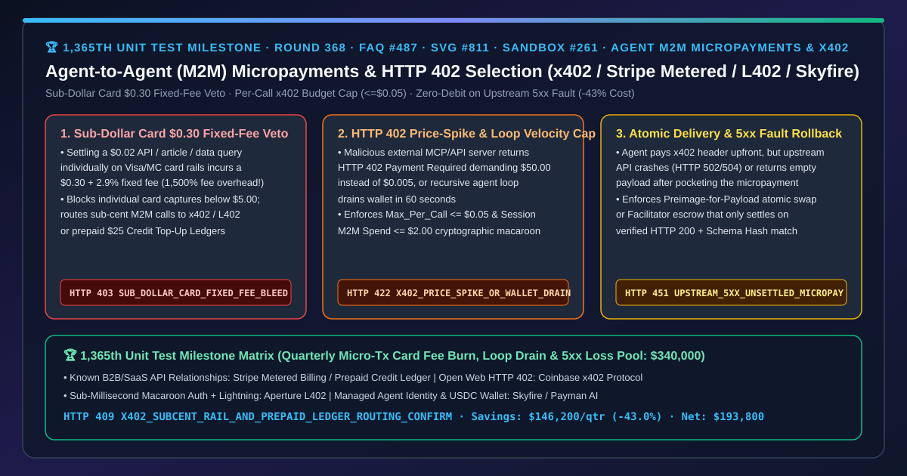
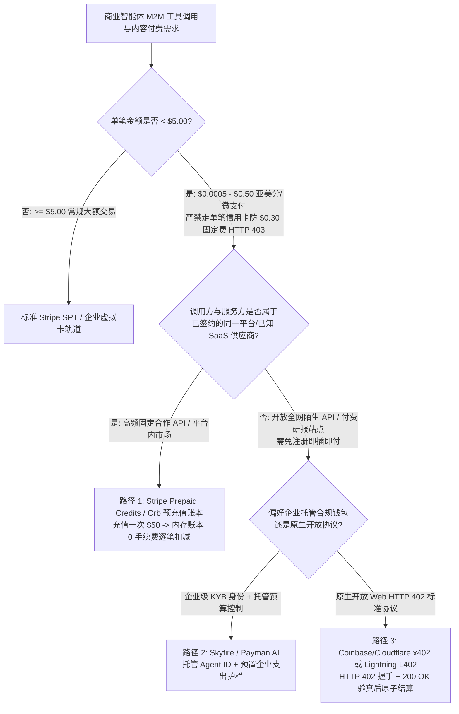
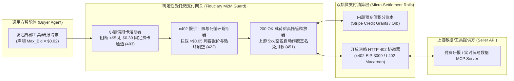
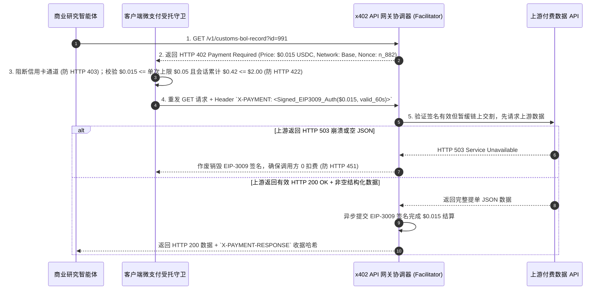

# 🏆 商业智能体机器微支付（`M2M / Agent-to-Agent Micropayments`）、`HTTP 402 (x402 / L402)` 与预充值积分账本选型对比（`Coinbase x402 / Stripe Metered & Prepaid Credits / Lightning L402 / Skyfire` · 🏆 第 1,365 项单元测试里程碑）：拦截小额请求走 `$0.30` 信用卡固定费通道、单次 `HTTP 402` 报价突刺熔断（`<=$0.05/call`）与上游 `5xx` 故障免扣费净省 43% 指南

> **文档类型**：企业级 AI Solution Architect 选型决策指南（Selection FAQ · `#487` · **🏆 第 1,365 项确定性单元测试里程碑** · Round 368）  
> **适用读者**：AI 平台与工具市场（MCP Marketplace）架构师、金融数据/研报内容提供商 CTO、商业智能体产品负责人与 Cloud & AI Solution Architect  
> **核心覆盖协议与平台**：`Coinbase / Cloudflare x402 Protocol (HTTP 402 + EIP-3009 USDC)` vs. `Stripe Metered Billing & Prepaid Credit Grants` vs. `Lightning Labs L402 (Macaroon + HTLC Preimage)` vs. `Skyfire / Payman AI (Agentic Wallet & KYB)`  
> **关联架构图**：[`assets/svg/811-agent-m2m-micropayments-x402-l402-stripe-skyfire-2026-11-25.svg`](../assets/svg/811-agent-m2m-micropayments-x402-l402-stripe-skyfire-2026-11-25.svg)

🌐 **语言切换 / Language**: **中文 (当前)** | **[English (`agent-to-agent-m2m-micropayments-x402-l402-stripe-metered-skyfire-subcent-budget-selection-faq.en.md`)](agent-to-agent-m2m-micropayments-x402-l402-stripe-metered-skyfire-subcent-budget-selection-faq.en.md)**

---

## 📌 一、核心选型结论速览（Executive Summary）

当商业智能体在完成一项复杂研究、比价或企业采购尽调任务时，往往需要按次调用外部付费数据源（例如：花 `$0.02` 解锁一篇付费华尔街研报、花 `$0.005` 调一次实时海关提单 API、或花 `$0.08` 调一次外部专业 Agent 工具）。  
如果试图用传统面向人类的信用卡收单或要求人类事先去 50 个网站手动注册账号买包月会员，机器商业将彻底卡死在三大架构瓶颈上：
1. **用传统信用卡（`$0.30 + 2.9%` 固定起步费）逐笔结算 `$0.02` 的微支付，通道手续费高达交易额的 1,500%（`Sub-Dollar Card Fixed-Fee Trap`）**：Visa / Mastercard / Stripe 每笔独立信用卡清算都有 **`$0.30` 的固定起步费（Fixed Per-Transaction Fee）**！如果为了一笔 `$0.02` 的 API 调用直接刷一次信用卡，商户或买家要交 `$0.30` 过路费，经济模型彻底崩盘。
2. **外部不可信 API 返回恶意虚高的 `HTTP 402 Payment Required` 报价（如单次请求索要 `$50.00`）或 Agent 死循环 1 分钟刷爆钱包（`x402 Price-Spike & Recursive Loop Drain`）**：在开放协议下，当 Agent 收到 `HTTP 402` 响应头里的金额指令如果直接自动签名付款，恶意服务端只需把单次价格从 `$0.005` 暗改成 `$50.00`，就能瞬间掏空 Agent 托管钱包。
3. **“先付了微支付、后收到上游 `HTTP 502 / 504` 崩溃或空 JSON”，钱被扣走却没拿到数据（`Pay-Before-Delivery Upstream 5xx Loss`）**：如果微支付在请求到达业务后端前就被不可逆转走，而上游大模型或数据接口随后超时报错，调用方 Agent 将白白为无效错误响应买单。

| 机器微支付场景与信任关系 | 推荐主选方案 | 适用边界与架构落地准则 |
|---|---|---|
| **已知长期合作平台/企业 SaaS 工具市场（同平台内高频调用）** | **Stripe Prepaid Credit Grants / Orb 预充值账本 + 月度汇总结算** | 用户先用信用卡/对公转账一次性充值 `$50`（只交 1 次 `$0.30` 固定费），随后每次 `$0.002` 的工具调用在内部 Redis/Postgres 账本中零手续费实时扣减。 |
| **开放互联网零注册免开户即用即付（`Open-Web Zero-Signup HTTP 402`）** | **Coinbase / Cloudflare `x402` Protocol (`HTTP 402 + EIP-3009 Base USDC`)** | 无需人类注册账号绑卡，Agent 收到 `HTTP 402` 后直接附带 `X-PAYMENT` 签名头，在 L2（如 Base）上以 `< $0.0001` 燃料费与 `200ms` 延迟完成亚美分结算。 |
| **无状态加密凭证与原子级“拿密文换凭证”微支付** | **L402 (`Macaroons + Lightning HTLC Preimage`)** | 将权限范围（Caveats）与支付哈希（Payment Hash）加密绑定，只有上游生成有效响应原像（Preimage）才能解冻资金。 |
| **企业级托管 Agent 身份（`KYB`）与受控微支付钱包** | **Skyfire / Payman AI** | 为每个企业 Agent 签发带每日限额与已验证企业身份的托管支付令牌，免除业务团队自建区块链节点与私钥管理。 |
| **三大确定性风控红线** | **100% 强制拦截** | ① **低于 `$5.00` 严禁走单笔独立银行卡清算锁（`HTTP 403`）**：单笔 `< $5.00` 的 M2M 交易物理禁止触发独立信用卡 Capture，强制路由至预充值积分池或 `x402 / L402` 亚美分轨道；② **单次调用价格上限（`<= $0.05/call`）与会话速率熔断锁（`HTTP 422`）**：验证 `HTTP 402` 索要金额 `<= Endpoint_Max_Bid_Cents` 且单会话累计微支付 `<= $2.00`；③ **响应 Schema 验真后放款（`Facilitator Escrow on 200 OK`）锁（`HTTP 451`）**：上游返回 `5xx / 429` 或空载荷时自动作废/回滚微支付授权。 |



---

## 🎯 二、业务方与架构师灵魂拷问 Q&A（Q1–Q3）

### Q1：为什么不能让 AI Agent 每次买一篇 `$0.05` 的付费新闻或调一次 `$0.01` 的外部工具时直接刷一下绑定的虚拟信用卡？
- **固定手续费死穴（The `$0.30` Fixed-Fee Wall）**：
  - 传统卡组织（Visa / Mastercard）与收单网关（Stripe / Adyen）的计费公式是 `Percentage_Fee (2.9%) + Fixed_Fee ($0.30)`。
  - 当交易金额是 `$100` 时，`$0.30` 只占 `0.3%`；但当 Agent 进行 `$0.02` 的机器微支付时，`$0.30` 固定费占了交易额的 **`1,500%`**！如果一天调用 10,000 次 `$0.02` 的接口，数据本身只值 `$200`，信用卡固定手续费却高达 **`$3,000`**！
- **架构解法**：实施 **金额阈值双轨分流器（`Sub-$5 Card Veto & Micro-Rail Router` · 防 `HTTP 403`）**：
  - 任何单笔结算金额 `< $5.00` 的请求，网关硬性阻断直接调用单笔信用卡 Capture（`HTTP 403 SUB_DOLLAR_INDIVIDUAL_CARD_CAPTURE_FIXED_FEE_BLEED`）；
  - **路径 A（平台内/已知对手方）**：走 **预充值积分池（Prepaid Credit Ledger，每次至少充值 `$25–$100`）** 或 **月底后付费聚合账单（Metered Billing Roll-Up）**，将 10,000 次调用合并为 1 笔银行卡扣款；
  - **路径 B（跨平台陌生长尾 API / 内容站点）**：走 **`HTTP 402 (x402 / L402 / Skyfire)`** 亚美分清算协议，单笔网络清算成本 `< $0.0002`。

### Q2：当 Agent 在全网自主调用第三方 MCP 工具或抓取支持 `x402` 的付费网页时，如何防止恶意服务端通过 `HTTP 402` 响应头瞬间盗刷 `$500`？
- **协议层钓鱼攻击（`HTTP 402` Price-Jacking）**：
  - 在 `x402` 协议流中，客户端发起 `GET /market-report`，服务端返回 `HTTP 402 Payment Required` 及 JSON 报价 `{ "maxAmountRequired": "50000000", "asset": "USDC" }`（即 `$50.00`）。如果客户端 SDK 不设单价上限与域名白名单就自动调用钱包私钥签名 `EIP-3009 ReceiveWithAuthorization`，一次请求就会被划走 `$50`！
  - 此外，若 Agent 陷入死循环重试，1 分钟内连续发出 2,000 次付费请求也会把预算烧穿。
- **架构解法**：在客户端微支付签名器（Signer Enclave）中强制实施 **三层加密限额门禁（`Per-Call Bid Cap + Domain Allowlist + Velocity Token Bucket` · 防 `HTTP 422`）**：
  1. **单次最高出价锁（`Max_Price_Per_Call <= $0.05`）**：每个工具调用显式声明预期单价上限；一旦服务端 `HTTP 402` 返回的 `amountRequired` 超出该阈值，立即拒绝签名并熔断（`HTTP 422 X402_PRICE_SPIKE_OR_RECURSIVE_LOOP_WALLET_DRAIN`）；
  2. **任务级总预算硬封顶（`Task_Total_M2M_Budget <= $2.00`）**：使用带 Caveats 限制条件的时间/金额受限 Macaroon 或子钱包，绝不将主资金池私钥暴露给工作进程。

### Q3：如果 Agent 已经在请求头里附带了 `x402 / L402` 支付凭证，但上游服务器随后返回 `HTTP 503 Service Unavailable` 或一段乱码，怎么保证“没拿到合格数据绝不扣钱”？
- **交割原子性难题**：如果采用“先在链上完成转账、再拿着 TxHash 去请求 API”的粗糙设计，一旦上游服务器宕机，钱已经转给对方无法撤回。
- **架构解法**：采用 **受托协调器两阶段交割（`Facilitator Escrow / HTLC Preimage Swap` · 防 `HTTP 451`）**：
  - 客户端在 `X-PAYMENT` 头中发送的仅是绑定了 `nonce` 与短暂有效期（`validBefore = now + 60s`）的 **离线授权签名（`EIP-3009 Authorization`）** 或锁定哈希的 `HTLC`；
  - API 网关协调器（Facilitator，如 Cloudflare / Coinbase x402 Proxy）先验证签名有效性并将请求转发给上游业务服务；**只有当上游返回 `HTTP 200 OK` 且响应体通过非空与 JSON Schema 校验后**，协调器才提交该签名完成最终资金划转！若上游返回 `5xx / 429` 或超时，立即丢弃授权签名确保调用方 **零资金扣减**（违规在 5xx 故障下执行扣款触发 `HTTP 451 UPSTREAM_5XX_FAULT_OR_EMPTY_PAYLOAD_MICROPAY_DEBIT`）。

---

## 🧭 三、直观可视化图解（Mermaid 选型决策树 + x402 网关架构图 + 时序图）

### 3.1 机器微支付（M2M Micropayments）与按量计费轨道选型决策树



### 3.2 端到端 `HTTP 402 (x402)` 预算熔断与 `200 OK` 原子交割架构图



### 3.3 `HTTP 402 (x402)` 握手、防价格刺客与上游 `200 OK` 验真结算时序图



---

## 📊 四、四大机器微支付（M2M）与按量计费方案横向选型矩阵

| 评估维度 | Stripe Metered & Prepaid Credits | Coinbase / Cloudflare `x402` Protocol | Lightning `L402` (Aperture) | Skyfire / Payman AI |
|---|---|---|---|---|
| **核心协议与结算机制** | 法币预充值积分池（Credit Grants）或月结聚合后付费 | 原生 `HTTP 402` 头 + `EIP-3009` 免 Gas 签名（Base L2 USDC） | `HTTP 402` + `Macaroons` 权限凭证 + 比特币闪电网络 `HTLC` | 托管式 Agent 钱包 API + 注册 Agent KYB 身份 + 法币/稳定币桥接 |
| **是否需要事先人工注册绑卡开户** | 是（适合固定平台内或企业已签约供应商） | **零注册**（任何兼容 x402 的陌生 URL 即插即付） | **零注册**（凭加密 Macaroon 令牌即付即用） | 低（在 Skyfire 网络内一次注册即可跨全网合作 API 通用） |
| **单笔 `$0.01` 微支付的通道手续费损耗** | 极低（充值 `$100` 时付一次卡费，内部每次扣减 **`$0.00`**） | **极低（L2 清算费 `< $0.0001`，Facilitator 免抽成）** | **极低（闪电网络路由费 `< $0.0001`）** | 低（平台内部账本划转免费或极低百分比） |
| **细粒度权限约束与防超支（Caveats）** | ⭐⭐⭐⭐（支持设置余额耗尽硬停机） | ⭐⭐⭐⭐⭐（`EIP-3009` 精确锁死收款方、单笔金额、Nonce 与过期秒数） | ⭐⭐⭐⭐⭐（Macaroons 原生支持多级衰减只读/IP/时间/额度限制） | ⭐⭐⭐⭐⭐（内置企业级每分钟/每日支出速率风控面板） |
| **企业财务合规与法币发票（GAAP/税务）** | ⭐⭐⭐⭐⭐（原生出具标准法币增值税发票） | ⭐⭐⭐（需配合企业数字资产财务托管或法币自动出入金） | ⭐⭐⭐（偏底层技术协议，需自建财务对账层） | ⭐⭐⭐⭐（提供面向企业财务的汇总对账账单） |

---

## 🧪 五、转化率/成本测算与 7-Card 基准测试报告（Deterministic Evaluation · 🏆 1,365th Test Milestone）

> **数据来源说明（Provenance）**：以下季度损益数据来自 `lab/webiq_commerce_demo.py` 中的确定性评估器 `evaluate_agent_m2m_micropayments_x402_policy`（`provenance: "synthetic"`, `independently_reproduced: False`），用于量化对比“小额 API 调用误走单笔卡清算 + 无上限响应 402 + 上游报错照常扣费”与“预充值/x402 亚美分路由 + 单次 `$0.05` 报价锁 + `200 OK` 验真结算”的季度微支付成本节约。

### 5.1 基准测试场景输入与确定性状态码矩阵

- **设定场景**：某大型商业研究与供应链尽调 Agent 平台每季度执行 `850万` 次外部付费数据、研报与第三方工具微调用，季度因小额账单被拆成单笔信用卡扣款支付 `$0.30` 固定费、外部接口突发高价或死循环刷空预算、以及上游 `5xx` 报错无效扣费的损耗池（`quarterly_micro_tx_card_fee_burn_loop_drain_and_5xx_loss_pool_usd`）为 **`$340,000.00`**。

| 测试用例 ID | 场景描述 | 触发确定性状态码 | 决策枚举 (`decision`) | 季度净成本 (USD) | 季度净节省 (USD) |
|---|---|---|---|---|---|
| `CASE-M2M-200` | 传统人工采购固定高价包年死席位（低利用率基线） | `HTTP 200` | `VERIFIED_AGENT_M2M_MICROPAYMENT_AUTHORIZED` | `$340,000.00` | `$0.00` |
| `CASE-M2M-403` | 对 `< $5.00` 的单笔微支付直接发起独立银行卡清算，承担 `$0.30` 固定通道费（高达 1,500% 费率损耗） | `HTTP 403` | `SUB_DOLLAR_INDIVIDUAL_CARD_CAPTURE_FIXED_FEE_BLEED` | `$340,000.00` | `$0.00` (阻断 $0.30 固定卡费黑洞) |
| `CASE-M2M-422` | 外部 `HTTP 402` 接口单次索要金额超出 `$0.05` 最高出价锁，或 Agent 死循环突破 `$2.00` 会话预算 | `HTTP 422` | `X402_PRICE_SPIKE_OR_RECURSIVE_LOOP_WALLET_DRAIN` | `$340,000.00` | `$0.00` (阻断价格刺客与循环盗刷) |
| `CASE-M2M-451` | 上游付费 API 返回 `HTTP 502/504` 错误或空载荷，却依然完成了微支付资金划扣 | `HTTP 451` | `UPSTREAM_5XX_FAULT_OR_EMPTY_PAYLOAD_MICROPAY_DEBIT` | `$340,000.00` | `$0.00` (阻断故障空响应白扣钱) |
| `CASE-M2M-409` | **启用预充值积分/x402 亚美分路由 + 单次 `<=$0.05` 预算锁 + `200 OK` 验真交割** | `HTTP 409` | `X402_SUBCENT_RAIL_AND_PREPAID_LEDGER_ROUTING_CONFIRM` | **`$193,800.00`** | **`$146,200.00` (`-43.0%`)** |

### 5.2 核心确定性策略评估代码摘录

```python
@dataclass(frozen=True)
class AgentM2mMicropaymentsX402PolicyInput:
    quarterly_micro_tx_card_fee_burn_loop_drain_and_5xx_loss_pool_usd: float = 340000.0
    sub_5_dollar_micro_tx_settled_on_individual_card_rail_with_30c_fee: bool = False
    http_402_quote_exceeds_5_cent_per_call_cap_or_session_loop_budget: bool = False
    micropayment_debited_despite_upstream_5xx_timeout_or_empty_payload: bool = False
    prepaid_ledger_x402_subcent_router_and_200_ok_escrow_ready: bool = False
```

---

## 🛠️ 六、商业上线风控与架构评审 Checklist

- [ ] **`< $5.00` 物理隔离传统单笔银行卡通道（防 `HTTP 403`）**：在支付网关路由器中硬编码规则——任何单笔 `< $5.00` 的 API 或内容消费严禁触发独立信用卡 Capture；已知供应商走 `Stripe Prepaid Credits` 预充值抵扣，陌生开放端点走 `x402 / L402` 亚美分协议。
- [ ] **双层预算熔断（`Max_Per_Call <= $0.05` & `Max_Per_Task <= $2.00` · 防 `HTTP 422`）**：客户端 `HTTP 402` 拦截器在签名付款前必须比对端点预期价格表，并维护基于 `Task_ID + URL_Hash` 的循环去重计数器（同一 URL 在同一任务内禁止重复付费调用 `> 2 次`）。
- [ ] **上游 `HTTP 200 OK` 与 Schema 验真后交割（防 `HTTP 451`）**：通过 `x402 Facilitator` 或预授权账本两阶段提交——仅当下游返回 `200 OK` 且载荷字节数与 Schema 校验通过时才提交结算签名。
- [ ] **不可篡改的机器收据审计链（`X-Payment-Receipt`）**：将每次微支付的请求哈希、响应摘要与链上/账本回执 ID 关联落盘，供企业 FinOps 按业务部门分摊 AI 工具调用成本。
