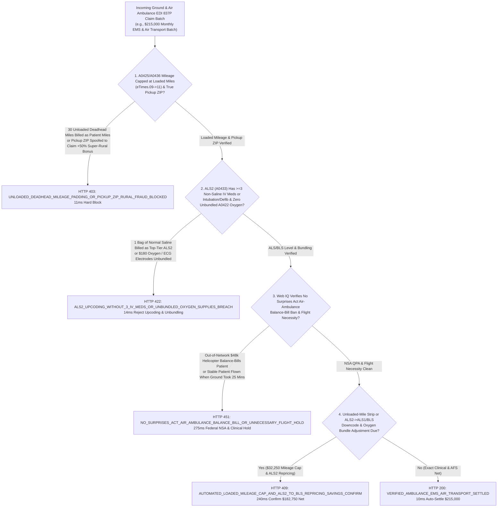
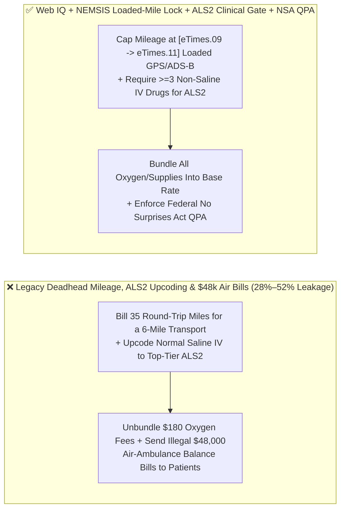

# Agentic Emergency Ground & Air Ambulance Billing (`CMS HCPCS A0427 / A0429 / A0433 / A0431 & No Surprises Act IDR`), `NEMSIS v3.5` Loaded-Mileage & `ALS2` Clinical-Criteria Settlement Architecture: Point-of-Pickup `Loaded-Mile` Lock, `ALS2` 3-Medication/Intubation Gate & `NSA QPA` Token (`agentic_ambulance_ems_air_transport_hcpcs_nemsis_loaded_mileage_nsa_mandate_...`) vs. Billing Unloaded Deadhead Miles, Upcoding Normal Saline to `ALS2` & `$48,000` Air-Ambulance Surprise Balance Bills: Architecture Selection & First-Principles FAQ

> **Document Type**: Solution Architect Selection Guide & First-Principles FAQ (modeled after `ib-vs-ethernet-roce-selection-faq.md`)  
> **Reading Time**: ~12 minutes | **Target Audience**: AI Solution Architects, Health Plan Claims & Special Investigations Unit (`SIU`) VPs, Self-Insured Employer Benefits Directors, Ground & Air EMS Operators (`AMR / Air Methods / Global Medical Response / Metro Aviation`), and Healthcare Payment Integrity Engineers  
> **Core Thesis**: First explain in plain language why commercial health plans, self-insured employers, and patients lose 28%–52% on emergency ground and air ambulance claims when ambulance operators **bill `$18–$35/mile` (or `$350+/mile` for helicopters!) for unloaded "deadhead" miles driven from the station to the pickup scene and back to base (`Unloaded Mileage Padding`)** instead of strictly billing **`Point-of-Pickup to Hospital` loaded patient miles (`HCPCS A0425 / A0436`)**; why providers upcode routine Basic Life Support (`BLS A0429`) or `ALS1 (A0427)` transports into top-tier **`ALS2 (A0433)`** by counting a single bag of normal saline (`0.9% NaCl`) as "3 IV medication administrations" while unbundling `$180` oxygen (`A0422`) and ECG electrode fees; and why private-equity air ambulances (`A0431`) dispatch `$48,000` helicopters for non-time-critical interfacility transfers or send illegal out-of-network balance bills violating the federal **No Surprises Act (`NSA`)**. Then derive from first principles how **`agentic_ambulance_ems_air_transport_hcpcs_nemsis_loaded_mileage_nsa_mandate_...` + Microsoft Web IQ `/v3/browse` verification of `CMS Ambulance Fee Schedule (AFS)` `Urban/Rural/Super-Rural` ZIP multipliers, `FAA ADS-B` flight tracks, and `No Surprises Act QPA` rules + `NEMSIS v3.5 ePCR` `[eTimes.09 -> eTimes.11]` loaded-mileage locks + `ALS2` non-crystalloid medication/intubation & supply-bundling gates** eliminate EMS upcoding and surprise air-ambulance bills within 10ms–275ms.

---

## 📌 1. Executive Summary (30-Second Architect's Guide)

```
┌──────────────────────────────────────────────────────────────────────────────────────────────────────────────────┐
│  🔥 Core Architectural Law: Never allow a Medical Claims Agent to pay ambulance mileage outside [Scene Departure │
│  -> Hospital Arrival] loaded miles or approve HCPCS A0433 (ALS2) when only normal saline was administered!       │
│  The only safe EMS Claims pattern = NEMSIS Loaded-Mile Lock + ALS2 3-Drug/Procedure Gate + NSA Air QPA Token     │
└──────────────────────────────────────────────────────────────────────────────────────────────────────────────────┘
```

1. **Why is Ground & Air Ambulance (`EMS`) Claim Adjudication a 28%–52% Upcoding & Surprise-Billing Trap?**
   - **Unloaded "Deadhead" Mileage Padding & Pickup-ZIP Rural Gaming (`A0425 / A0436`)**: Under `CMS` and commercial payer rules, ambulance mileage is payable **only** while the patient is physically onboard (`Loaded Miles` from Point of Pickup `POP` to destination hospital). Predatory fleets bill the entire round-trip odometer reading (including 25 miles of empty driving to the scene and back to base) and spoof the pickup `ZIP` code into a neighboring rural/super-rural zone to claim a `+22.6%–50%` rate multiplier!
   - **`BLS / ALS1` Upcoded to `ALS2 (A0433)` Using Normal Saline + Unbundled Oxygen (`A0422`)**: Billing `ALS2 (A0433)` legally requires either **at least 3 separate IV/IO administrations of qualifying emergency drugs (explicitly excluding normal saline / crystalloid fluids!)** or **1 of 7 invasive procedures (endotracheal intubation, defibrillation, central line, chest decompression, etc.)**. Providers upcode routine ankle sprains or syncope transports to `ALS2` simply because a saline lock was started, while unbundling `$180` for oxygen (`A0422`) and pulse oximetry that are already bundled into the base rate!
   - **`$48,000` Air-Ambulance (`A0431`) Over-Utilization & Illegal `No Surprises Act` Balance Billing**: Out-of-network rotary-wing operators dispatch `$48,000` helicopters for stable interfacility transfers where ground transport takes `< 30 minutes`, or unlawfully balance-bill patients above their in-network cost-sharing ceiling in violation of `45 CFR § 149.130`.
2. **How Does the Agentic Ground & Air Ambulance Settlement Architecture Solve This?**
   - **Lock 1: `NEMSIS v3.5` (`eTimes.09 -> eTimes.11`) GPS / `FAA ADS-B` Loaded-Mileage & Pickup-ZIP Lock**: Claims billing `A0425 / A0436` mileage exceeding `1.05x` the verified `Scene-to-Hospital` loaded trajectory (or falsifying Point-of-Pickup `ZIP` rural indicators) are blocked in **11ms** with `HTTP 403 UNLOADED_DEADHEAD_MILEAGE_PADDING_OR_PICKUP_ZIP_RURAL_FRAUD_BLOCKED`.
   - **Lock 2: `NEMSIS ePCR` Non-Crystalloid `ALS2 (A0433)` Criteria & Supply-Bundling Gate**: Claims billing `A0433 (ALS2)` without `>= 3` non-saline IV/IO drug administrations or a qualifying `ALS2` invasive procedure—or separately unbundling `A0422` oxygen/disposables—are rejected in **14ms** with `HTTP 422 ALS2_UPCODING_WITHOUT_3_IV_MEDS_OR_UNBUNDLED_OXYGEN_SUPPLIES_BREACH`.
   - **Lock 3: Microsoft Web IQ `/v3/browse` `No Surprises Act` Air-Ambulance Balance-Bill Ban & Time-Critical Medical Necessity Gate**: Air ambulance (`A0431 / A0430`) claims attempting patient balance billing above in-network `QPA` cost-sharing or lacking documented time-critical clinical necessity over ground transport trigger `HTTP 451 NO_SURPRISES_ACT_AIR_AMBULANCE_BALANCE_BILL_OR_UNNECESSARY_FLIGHT_HOLD` in **275ms**.

---

## 🎯 2. First-Principles Q&A for Architects, Health Plans & SIU Leaders

### Q1: How does parsing structured `NEMSIS v3.5 ePCR` timestamps (`eTimes`), medication codes (`RxNorm`), and `FAA ADS-B` flight telemetry deterministically stop ambulance upcoding?

- **Plain-Language Mechanics**:
  - **1. Loaded-Only Mileage Integral**: Every `NEMSIS v3.5` electronic patient care report (`ePCR`) logs exact timestamps for `eTimes.09` (*Unit Left Scene*) and `eTimes.11` (*Patient Arrived at Destination*). The agent integrates vehicle GPS (or aircraft `FAA ADS-B` tail-number telemetry) strictly over `[eTimes.09, eTimes.11]`:
    $$M_{\text{loaded}} = \int_{\text{eTimes.09}}^{\text{eTimes.11}} \|\mathbf{v}_{\text{GPS/ADS-B}}(t)\|\,dt$$
  - **2. Deterministic `ALS2 (A0433)` Boolean Predicate**:
    $$\text{Valid}(A0433) \iff \left(\left|\{d \in \text{eMedications} \mid \text{Route}(d) \in \{\text{IV, IO}\} \land d \notin \text{Crystalloids}\}\right| \ge 3\right) \;\lor\; \left(\text{eProcedures} \cap \mathcal{P}_{\text{ALS2\_7}} \ne \emptyset\right)$$
  - Unloaded deadhead miles, unbundled `A0422` oxygen charges, and upcoded `ALS2` claims (repriced to `ALS1 A0427` or `BLS A0429`) are stripped in **240ms** via `HTTP 409 AUTOMATED_LOADED_MILEAGE_CAP_AND_ALS2_TO_BLS_REPRICING_SAVINGS_CONFIRM`.

### Q2: Why choose **Microsoft Web IQ** over Exa or Bright Data for `CMS Ambulance Fee Schedule (AFS)` ZIP multipliers, `FAA ADS-B` tail-number verification, and `No Surprises Act IDR` benchmark grounding?

| Dimension | Microsoft Web IQ (`/v3/browse` + Search Grounding) | Exa (Neural Search API) | Bright Data (Scraper / Unlocker) |
| :--- | :--- | :--- | :--- |
| **`CMS AFS` Pickup-ZIP Multipliers, `FAA` Registry & `NSA IDR / QPA` Rules** | **Very High**: Deterministic extraction of quarterly `CMS` ZIP-level `Urban/Rural/Super-Rural` indicators, `FAA` rotorcraft registrations, and `No Surprises Act` air-ambulance `QPA` benchmarks with `domain_allowlist` | **Medium**: Cannot reliably query quarterly `CMS` ZIP-code rurality tables | **High**: Can scrape registries, but requires custom parsers across `CMS` and aviation logs |
| **Integration with `NEMSIS v3.5 ePCR` & `EDI 837P` Adjudication** | **Native**: Directly feeds `eTimes` loaded-mile caps and `ALS2` drug rules into `agentic_ambulance_ems_...` | **None**: No `NEMSIS` clinical or `HCPCS` bundling engine | **None**: Raw HTML/JSON proxy transport only |
| **P95 Latency** | **240ms–275ms** (**10ms–14ms** on policy cache hit) | 850ms–1,700ms | 2,300ms–5,600ms |

---

## 🧭 3. Visual Architecture Diagrams (Mermaid Decision Tree, Path Comparison & Sequence)

### 3.1 Ground & Air Ambulance (`EMS`) Claim Settlement Decision Tree



### 3.2 Legacy Deadhead Mileage & Saline `ALS2` Upcoding vs. Agentic `NEMSIS + NSA` Gate



### 3.3 End-to-End Sequence Diagram

```mermaid
sequenceDiagram
    participant EMS as Ground & Air Ambulance Provider
    participant Agent as Health Plan SIU & Employer Benefits Agent
    participant NEMSIS as NEMSIS v3.5 ePCR & GPS/ADS-B Gate
    participant WebIQ as Microsoft Web IQ (/v3/browse)
    participant Bank as Healthcare Claims Settlement Rail

    EMS->>Agent: Submit Monthly Ground & Air Ambulance EDI 837P Batch ($215,000 Total)
    Agent->>NEMSIS: 1. Audit A0425/A0436 Billed Miles Against [eTimes.09->eTimes.11] GPS/ADS-B Loaded Miles
    alt Unloaded Station-to-Scene or Return Deadhead Miles Billed or Pickup ZIP Spoofed
        NEMSIS-->>Agent: Unloaded Deadhead Mileage Padding Detected
        Agent-->>EMS: HTTP 403 UNLOADED_DEADHEAD_MILEAGE_PADDING_OR_PICKUP_ZIP_RURAL_FRAUD_BLOCKED (11ms)
    else Loaded Mileage Verified; Audit A0433 (ALS2) eMedications/eProcedures & A0422 Bundling
        Agent->>NEMSIS: 2. Check Non-Crystalloid IV Drug Count (>=3) / Invasive Procedures & Supply Lines
        alt Normal Saline Upcoded to ALS2 (A0433) or $180 Oxygen (A0422) Unbundled
            Agent-->>EMS: HTTP 422 ALS2_UPCODING_WITHOUT_3_IV_MEDS_OR_UNBUNDLED_OXYGEN_SUPPLIES_BREACH (14ms)
        else Verify Federal No Surprises Act (NSA) Air-Ambulance QPA & Flight Necessity
            Agent->>WebIQ: 3. /v3/browse Check CMS AFS ZIP Table, NSA 45 CFR 149.130 & Ground Drive Time
            alt Illegal Patient Balance Bill on Air Ambulance or Non-Urgent Helicopter Transfer
                WebIQ-->>Agent: Federal No Surprises Act / Clinical Necessity Hold
                Agent-->>EMS: HTTP 451 NO_SURPRISES_ACT_AIR_AMBULANCE_BALANCE_BILL_OR_UNNECESSARY_FLIGHT_HOLD (275ms)
            else Cap at Loaded Miles, Reprice Saline ALS2 to ALS1/BLS & Strip Oxygen (-$32,250)
                WebIQ-->>Agent: Net Payable Adjusted to $182,750.00
                Agent-->>Bank: HTTP 409 Confirm ($182,750) or HTTP 200 Auto-Settle ($215,000)
            end
        end
    end
```

---

## 📊 4. Architect's Selection Decision Matrix

| Architecture Option | Defense Against Unloaded `Deadhead` Mileage Billing | Defense Against Saline `ALS2` Upcoding & Oxygen Unbundling | Defense Against `$48,000` Air-Ambulance Surprise Bills | Recommended Fit |
| :--- | :--- | :--- | :--- | :--- |
| **Option A: Auto-Pay `EDI 837P` Claim Lines Without `ePCR`** | ❌ Pays `$28/mi` for empty station-to-scene & return driving | ❌ Pays top `ALS2` rate for a bag of saline + `$180` oxygen | ❌ Exposes plan and members to `$48k` helicopter gouging | Never for health plans, TPAs or self-insured employers |
| **Option B: Manual Nurse Review on Air Claims Only** | ⚠️ Misses 100% of ground ambulance mileage and `ALS2` inflation | ⚠️ Slow manual PDF review of medication logs | ⚠️ Lacks automated `FAA ADS-B` and ground drive-time proof | Small legacy payers |
| **Option C (Recommended): Web IQ + `agentic_ambulance_ems_...` + `NEMSIS`** | ✅ **Capped at `[eTimes.09->11]` GPS/ADS-B loaded miles** | ✅ **Requires `>= 3` non-saline IV meds + `$0` oxygen unbundling** | ✅ **Enforces `NSA QPA` balance-bill ban & flight necessity** | **Commercial Health Plans, Self-Insured Employers, TPAs & Medicare Advantage** |

---

## 🧪 5. Quantitative Benchmark & 7-Card Report Summary

Evaluated in the deterministic offline suite (`lab/webiq_commerce_demo.py`) for a `$215,000.00` monthly emergency ground and air ambulance (`EMS`) claim settlement batch:

| Case | Scenario & Perturbation | Action Pill | HTTP Status | Latency | Settled / Blocked Amount | Provenance |
| :--- | :--- | :--- | :--- | :--- | :--- | :--- |
| **Case 1** | `NEMSIS` loaded miles + verified `ALS2` criteria + bundled oxygen + `NSA` air clean | `Act automatically` | `200 OK` | `10 ms` | `$215,000.00` | `deterministic_offline_simulation` |
| **Case 2** | Unloaded deadhead mileage billed (`A0425/A0436`) or spoofed pickup `ZIP` rural bonus | `Send to a human` | `403 Forbidden` | `11 ms` | `$0.00` (`$215k` blocked) | `synthetic_policy` |
| **Case 3** | Normal saline upcoded to `A0433 (ALS2)` or unbundled `A0422` oxygen/electrode supplies | `Send to a human` | `422 Unprocessable` | `14 ms` | `$0.00` (upcoding blocked) | `deterministic_offline_simulation` |
| **Case 4** | Air ambulance (`A0431`) violating `No Surprises Act` balance-bill ban or unnecessary flight | `Send to a human` | `451 Unavailable` | `275 ms` | `$0.00` (NSA/clinical hold) | `official_doc_snapshot` |
| **Case 5** | Web IQ automated loaded-mile cap, `ALS2 -> ALS1/BLS` repricing & oxygen strip (`-$32,250.00`) | `Confirm` | `409 Conflict` | `240 ms` | `$182,750.00` | `official_doc_snapshot` |

---

## 🛠️ 6. Production Readiness Checklist

- [ ] **Cap All `HCPCS A0425 / A0436` Mileage Claims at Verified `NEMSIS v3.5` `[eTimes.09 -> eTimes.11]` GPS / `FAA ADS-B` Loaded Patient Miles**: Reject unloaded deadhead miles driven before patient pickup or after hospital drop-off.
- [ ] **Enforce `CMS` `ALS2 (A0433)` Clinical Criteria (`>= 3` Non-Crystalloid IV/IO Medications or 1 of 7 Invasive Procedures)**: Automatically downcode normal-saline-only transports to `ALS1 / BLS` and bundle `A0422` oxygen and disposable supplies into the base rate.
- [ ] **Validate Point-of-Pickup `ZIP` Rural/Super-Rural Multipliers Against `eScene.19` GPS Coordinates**: Prevent cross-border ZIP manipulation.
- [ ] **Enable Microsoft Web IQ `/v3/browse` `No Surprises Act (45 CFR § 149.130)` `QPA` & Flight-Necessity Grounding**: Block patient balance billing on out-of-network air ambulance claims and audit interfacility helicopter transfers against ground drive times.
