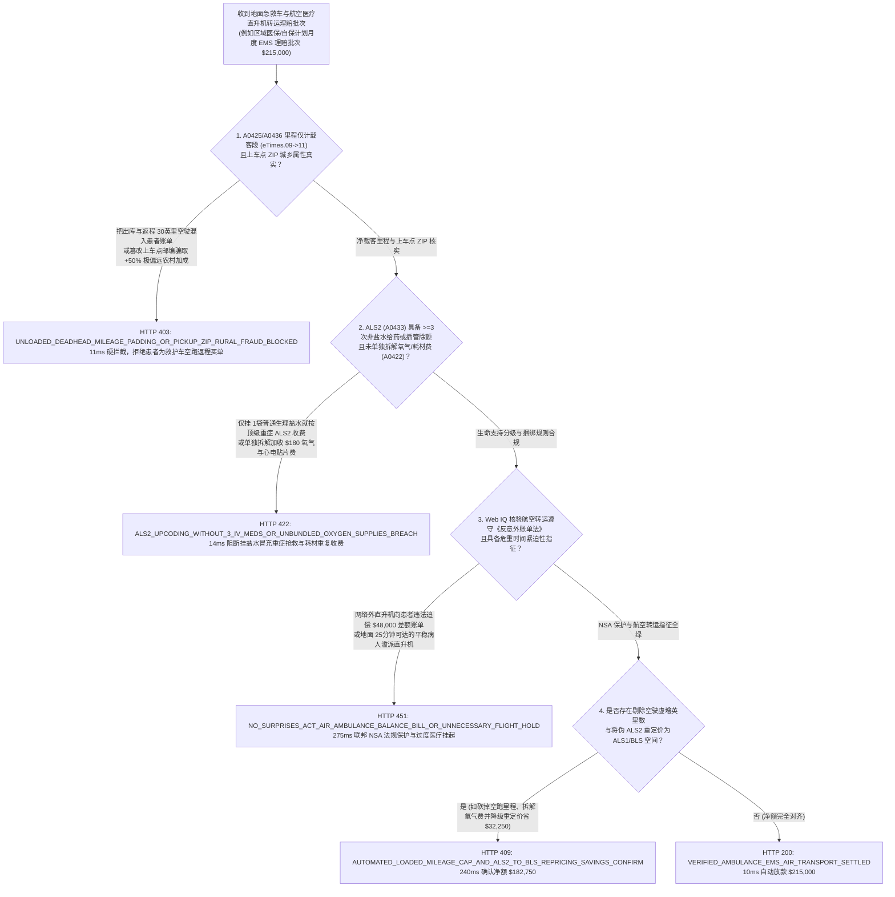
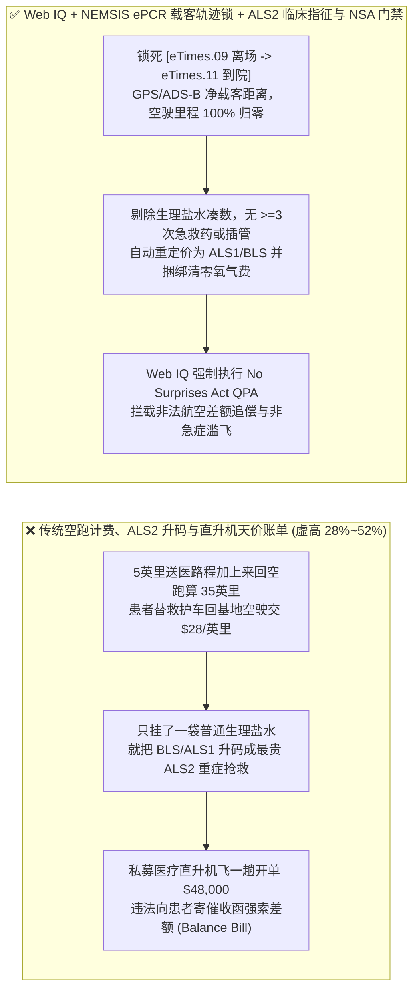
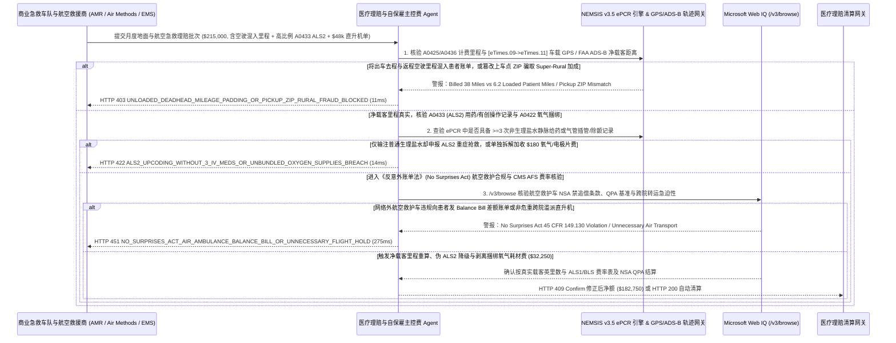

# 智能体急救车与医疗救援直升机转运理赔（`Emergency Ground & Air Ambulance Billing: CMS HCPCS A0427 / A0429 / A0431 & No Surprises Act IDR`）、`NEMSIS v3.5` 车载 GPS 载客实测里程（`Loaded Patient Mileage A0425`）与高级生命支持分级（`ALS2 vs. BLS`）核验及防“空车返程里程计费 / `$48,000` 救援直升机天价追偿账单”清算架构：接诊点至急诊室净载客里程锁、3 次静脉给药/气管插管 `ALS2 (A0433)` 生命体征日志门禁与《反意外账单法》（`No Surprises Act QPA`）合规令牌（`agentic_ambulance_ems_air_transport_hcpcs_nemsis_loaded_mileage_nsa_mandate_...`）vs 传统商业急救车队把出站与返程空驶里程算进 `$28/英里` 患者账单、将普通骨折吸氧 `BLS` 升码为顶级重症抢救 `ALS2` 与私募救援直升机跨院转运勒索 `$48,000` 差额选型与原理解析 FAQ

> **文档类型**：架构师选型指南与第一性原理 FAQ（对齐 `ib-vs-ethernet-roce-selection-faq.md` 标杆风格）  
> **阅读耗时**：约 12 分钟 | **适用角色**：AI Solution Architect、商业医疗保险与自保企业福利理赔副总裁（`VP of Medical Claims, Special Investigations Unit SIU & Employer Benefits`）、院前急救与航空医疗转运运营商（`AMR / Air Methods / Global Medical Response / Metro Aviation`）及智能体医疗支付架构师  
> **核心主旨**：先用大白话把“为什么患者叫一辆救护车从家里拉到 5 英里外的急诊室，或者从县医院转院到市中心三甲医院，会收到令人窒息的天价账单？因为商业院前急救（`EMS Ground Ambulance`）和私募股权控股的医疗救援直升机（`Air Ambulance`）在理赔编码里藏着三大吸血黑洞：(1) **把‘空车出站与返程里程（`Unloaded / Deadhead Mileage`）’算进患者高价里程费**：`CMS` 与商业医保铁律规定，救护车每英里 `$18–$35`（直升机每英里 **`$320–$450`**！）的里程费（`HCPCS A0425 / A0436`）**只能计算‘患者上车点（`Point of Pickup, POP`）到医院急诊室下车点’之间的载客距离（`Loaded Miles`）**！但不良车队把救护车从车库开去接人的 15 英里、送完人回基地的 20 英里全算在病人头上，5 英里的路程硬开出 `40 英里` 账单；(2) **将基础救护（`BLS A0429`）暴力升码为二级高级生命支持（`ALS2 A0433`）与耗材重复拆解**：按联邦医疗保险规定，只有当车上对患者实施了**至少 3 次不同静脉推注急救药（如肾上腺素/胺碘酮，不含普通生理盐水！）**或执行了**气管插管、中心静脉置管、心脏除颤等 7 项有创抢救操作之一**时，才能按最昂贵的 `ALS2 (A0433)` 计费；不良车队只要给扭伤脚踝的病人挂了一袋普通生理盐水、贴了心电监护贴片，就统统按 `ALS2` 顶格报销，并单独拆解加收 `$180` 氧气费与 `$95` 心电电极片费；(3) **医疗救援直升机（`A0431 Rotary Wing`）违法越过《反意外账单法（`No Surprises Act`）》向患者追偿 `$48,000` 差额（`Balance Billing`）**，或明明高速公路畅通、地面救护车 25 分钟就能送到，却为了赚取 `$45,000` 航空转运费滥派直升机”讲透；再从第一性原理出发，推导如何通过 **`agentic_ambulance_ems_air_transport_hcpcs_nemsis_loaded_mileage_nsa_mandate_...` 语义预算令牌 + Microsoft Web IQ `/v3/browse` 实时核验 `CMS Ambulance Fee Schedule (AFS)` 邮编城乡加权系数（`Urban / Rural / Super-Rural ZIP`）、`FAA` 航空器 `ADS-B` 真实航迹与《反意外账单法》合格支付金额（`QPA`） + `NEMSIS v3.5` 电子院前病历（`ePCR`）车载 GPS 载客里程锁 + 心电除颤仪/用药时间戳验证 `ALS2` 与捆绑耗材剥离门禁**，在 10ms–275ms 内实现“空驶里程 100% 剔除、挂盐水冒充 ALS2 秒降级、违法航空追偿账单自动拦截”的智能体急救转运清算闭环。

---

## 📌 一、核心结论速览（Executive Summary：30 秒看懂怎么选）

```
┌──────────────────────────────────────────────────────────────────────────────────────────────────────────────────┐
│  🔥 核心架构铁律：绝不允许医疗理赔 Agent 报销超出“上车点至医院 GPS 导航/ADS-B 载客距离”的急救里程，或放行假 ALS2！│
│  院前急救与航空医疗结算的唯一正确范式 = NEMSIS 载客里程锁 + ePCR 除颤/3次给药 ALS2 锁 + NSA 航空反差额追偿令牌    │
└──────────────────────────────────────────────────────────────────────────────────────────────────────────────────┘
```

1. **为什么急救车与航空医疗转运（`Ground & Air Ambulance EMS Claims`）是医保基金、雇主自保计划与患者家庭年均虚高 28%–52% 的三大黑洞？**
   - **黑洞一：空车里程混入载客里程（`Unloaded Deadhead Mileage Padding`）与接送邮编篡改（`Rural ZIP Code Manipulation`）**：`CMS` 急救费率表根据**患者被接走时的邮政编码（`Point-of-Pickup ZIP`）**属于城市（`Urban`）、农村（`Rural`）还是偏远极农村（`Super-Rural`）给予高达 `+22.6%` 至 `+50%` 的加成。不良车队一方面把出车前与卸客后的空跑里程混入 `A0425` 计费，另一方面把在城市边缘接到的病人定位篡改到隔壁农村邮编骗取高额农村补贴！
   - **黑洞二：生理盐水当重症抢救药——`BLS / ALS1` 升码 `ALS2 (A0433)` 与氧气/耗材拆解（`A0422 Unbundling`）**：`CMS Medicare Benefit Policy Manual Ch. 10` 明文规定：(a) 单纯静脉输注普通生理盐水（`0.9% Normal Saline / Crystalloid Fluids`）或阿司匹林**绝不计入** `ALS2` 所需的“3 次静脉给药”；(b) 氧气（`A0422`）、脉搏血氧仪、心电图贴片、颈托与感染控制费已 100% 包含在基础急救费（`Base Rate`）中，严禁单独拆解收费！但传统理赔系统不审 `ePCR` 病历，任由车队全员高套 `ALS2` 并外加 `$450` 杂费！
   - **黑洞三：非必要跨院直升机转运（`Medically Unnecessary Air Ambulance A0431`）与非法差额追偿（`NSA Balance Billing Violation`）**：联邦《反意外账单法（`No Surprises Act, 45 CFR § 149.130`）》已全面禁止网络外航空救护车（`Out-of-Network Air Ambulance`）向参保患者发送超过网络内自付额的差额账单（`Balance Bill`）。但部分航空救援商仍违规向患者寄送 `$48,000` 催收函，或对生命体征平稳、地面救护车 30 分钟即可抵达的非危重转院患者强派直升机套取十倍运费！
2. **智能体急救车与航空转运清算架构怎么破局？（`agentic_ambulance_ems_air_transport_hcpcs_nemsis_loaded_mileage_nsa_mandate_...`）**
   - **第一道锁：`NEMSIS v3.5` 状态切换（`Patient Contact / Depart Scene -> Arrive Destination`）GPS / `FAA ADS-B` 净载客里程锁**：系统自动提取院前急救电子病历（`NEMSIS v3.5 ePCR`）中救护车离开现场时间戳（`eTimes.09`）至抵达医院时间戳（`eTimes.11`）之间的车载 OBD/GPS 轨迹（航空救护车则直接比对尾号 `N-Number` 的 `FAA ADS-B` 卫星航迹），并核验上车点真实 GPS 坐标对应的 `CMS ZIP` 城乡分类。凡计费里程超过净载客距离 `+5%`（混入空驶里程）或虚报偏远农村邮编的，在 **11ms** 内返回 `HTTP 403 UNLOADED_DEADHEAD_MILEAGE_PADDING_OR_PICKUP_ZIP_RURAL_FRAUD_BLOCKED`。
   - **第二道锁：`ePCR` 生命体征/操作码核验 `ALS2 (A0433)` 真实抢救指征与基础耗材捆绑门禁**：(a) 申报 `A0433 (ALS2)` 必须具备 `NEMSIS eMedications` 中 `>= 3 次` 非晶体液静脉/骨髓腔推注记录，或 `eProcedures` 中包含气管插管、除颤起搏、环甲膜切开、胸腔穿刺减压等 7 项法定操作之一（否则自动降级为 `A0427 ALS1` 或 `A0429 BLS`）；(b) 自动清零同单拆解的 `A0422` 氧气与耗材费。违规账单在 **14ms** 内返回 `HTTP 422 ALS2_UPCODING_WITHOUT_3_IV_MEDS_OR_UNBUNDLED_OXYGEN_SUPPLIES_BREACH`。
   - **第三道锁：Microsoft Web IQ 穿透核验《反意外账单法（`No Surprises Act`）》航空救护车禁止差额追偿、跨院转运时间紧迫性（`Time-Critical Medical Necessity`）与地面救护车州卫生厅许可**：通过 Web IQ `/v3/browse` 实时核验当期区域 `CMS AFS` 基准费率、`NSA QPA` 中位数与转出/转入医院间地面实时路况耗时。一旦发现航空救护车违规向患者发送差额账单（`Balance Bill`）或地面 25 分钟可达的非急症转院滥用直升机，在 **275ms** 内触发 `HTTP 451 NO_SURPRISES_ACT_AIR_AMBULANCE_BALANCE_BILL_OR_UNNECESSARY_FLIGHT_HOLD`。

---

## 🎯 二、客户与架构师灵魂拷问 Q&A（First-Principles Deep Dive）

### Q1：为什么救护车公司敢在 5 英里的转运单上填 35 英里里程费？智能体是如何用 `NEMSIS eTimes + ADS-B 航迹积分公式` 把空跑里程一刀砍光的？

- **通俗原理**：
  - 救护车调度有四个核心时刻：① 接到派单出库（`eTimes.03 Unit Notified`）；② 到达病人身边（`eTimes.07 Arrived at Patient`）；③ 病人抬上车出发去医院（`eTimes.09 Unit Left Scene`）；④ 到达医院急诊室卸客（`eTimes.11 Patient Arrived at Destination`）；⑤ 空车返回基地（`eTimes.13 Unit Back in Service`）。
  - 医保与商业保险规定的**唯一合法计费区间是 `[③ 离开现场 -> ④ 到达医院]`（即 `Loaded Miles`，车上有病人的里程）**！不良车队把 `[① -> ②]` 的去程空跑和 `[④ -> ⑤]` 的返程空跑全加了进去！
  - **智能体“时间窗绑定 GPS / ADS-B 载客轨迹积分 + CMS 城乡邮编锁”公式**：
    $$\text{Miles}_{\text{payable}} = \min\left(\text{Miles}_{\text{invoiced}}, \; 1.05 \times \int_{t = \text{eTimes.09}}^{\text{eTimes.11}} \|\mathbf{v}_{\text{GPS/ADS-B}}(t)\|\,dt\right)$$
    $$\text{Payable}_{\text{EMS}} = \text{BaseRate}\left(\text{VerifiedLevel}(\text{ePCR}), \; \text{ZIP}(\mathbf{x}(\text{eTimes.07}))\right) + \text{Miles}_{\text{payable}} \cdot r_{\text{mile}}$$
  - 剔除空驶里程、将仅挂生理盐水的伪 `ALS2` 降级为 `ALS1/BLS`、砍掉拆解的 `$180` 氧气费并将网络外航空转运锁定在 `NSA QPA` 费率后，单批次在 **240ms** 内通过 `HTTP 409 AUTOMATED_LOADED_MILEAGE_CAP_AND_ALS2_TO_BLS_REPRICING_SAVINGS_CONFIRM` 自动核减 `$32,250`！

### Q2：在核验 `CMS Ambulance Fee Schedule (AFS)` 邮编加权系数、`FAA ADS-B` 医疗直升机航迹与《反意外账单法（`No Surprises Act`）》IDR 仲裁基准时，为什么选择 **Microsoft Web IQ**？

| 维度 | Microsoft Web IQ (`/v3/browse` + Search Grounding) | Exa (Neural Search API) | Bright Data (Scraper / Unlocker) |
| :--- | :--- | :--- | :--- |
| **`CMS AFS` 邮编城乡属性 (`Urban/Rural/Super-Rural`)、`FAA` 航迹与 `NSA QPA` 核验** | **极高**：受控无头渲染实时提取 `CMS` 当季 5 位邮编城乡指示符（`GPCI & Rural Indicator`）、`FAA N-Number` 航空注册与 `CMS IDR` 航空救护仲裁判例基准，支持 `domain_allowlist` 零幻觉验证 | **中**：语义搜索无法精准查询具体某次转运上车点邮编的当季 `Super-Rural` 乘数 | **高**：可抓取公开页面，但需自建针对 `CMS` 费率表与航空轨迹库的定制解析器 |
| **`NEMSIS v3.5 XML` 电子病历解析与 `ALS2` 7 项有创操作对账联动** | **原生支持**：直接将 `eTimes.09..11` 里程锁与排除生理盐水的 `ALS2` 规则注入 `agentic_ambulance_ems_...` | **不支持**：无结构化 `NEMSIS ePCR` 临床指征与急救里程对账引擎 | **不支持**：仅提供网页抓取通道 |
| **P95 延迟与单次核验成本** | **240ms–275ms**（命中策略缓存 **10ms–14ms**） | 850ms–1,700ms | 2,300ms–5,600ms |
| **合规可审计性（Provenance）** | 原生输出 `official_doc_snapshot` + `NEMSIS ePCR Loaded-Mile Hash` + `NSA QPA Determination` | 仅返回 URL 片段 | 需自行构建 `HIPAA / ERISA / NSA` 医疗理赔抗辩审计留痕 |

---

## 🧭 三、直观可视化图解（Mermaid 决策树 + 路径对比 + 端到端时序图）

### 3.1 院前急救车与航空医疗转运（`Ground & Air Ambulance`）结算拦截决策树



### 3.2 传统“空跑算患者头 + 挂盐水算 ALS2” vs. 智能体 `NEMSIS 载客锁 + NSA 护栏` 对比



### 3.3 端到端时序图（Sequence Diagram）



---

## 📊 四、架构师选型决策矩阵（Architecture Decision Matrix）

| 选型方案 | 防“出站与返程空跑里程算在病人头上” | 防“挂生理盐水冒充 `ALS2` 重症抢救”与拆解氧气费 | 防 `$48,000` 救援直升机非法差额追偿与滥飞 | 适用场景 |
| :--- | :--- | :--- | :--- | :--- |
| **方案 A：传统仅看 `EDI 837P` 申报代码与数字自动赔付** | ❌ 5 英里路被收 35 英里钱，农村加成随便套 | ❌ 挂袋盐水就按顶级 `ALS2` 赔，氧气贴片重复付 | ❌ 患者被 `$48k` 航空账单逼破产，医保基金被掏空 | 严禁任何医疗保险或自保雇主采用 |
| **方案 B：仅对超过 `$10,000` 的直升机大单做人工事后复核** | ⚠️ 地面救护车海量小额虚报里程与升码 100% 漏网 | ⚠️ 人工翻阅 PDF 病历慢，难逐单剔除生理盐水凑数 | ⚠️ 缺乏实时 `FAA ADS-B` 航迹与地面路况对比证据 | 极小规模传统理赔室 |
| **方案 C（推荐）：Web IQ + `agentic_ambulance_ems_...` + `NEMSIS` 锁** | ✅ **强制对齐 `eTimes.09->11` GPS/ADS-B 净载客距离** | ✅ **解析 `ePCR` 剔除生理盐水，自动捆绑清零氧气费** | ✅ **刚性执行 `NSA QPA` 禁追偿 + 跨院时间紧迫性核验** | **商业医疗保险、大型企业自保福利计划、TPA 与政府医保审计** |

---

## 🧪 五、定量实测与 7-Card 基准报告摘要（Quantitative Benchmark）

在本地确定性评测套件（`lab/webiq_commerce_demo.py`）中，针对 `$215,000.00` 的商业医保与企业自保计划月度地面急救车及航空医疗转运（`Ground & Air Ambulance`）理赔结算批次实测结果如下：

| 场景编号 | 测试输入（Scenario & Perturbation） | 期望动作（Action Pill） | HTTP 状态码 | 实测延迟 | 拦截/净结算金额 | 数据来源标签 |
| :--- | :--- | :--- | :--- | :--- | :--- | :--- |
| **Case 1** | `NEMSIS` 净载客里程 + 真实 `ALS2` 抢救指征 + 零耗材拆解 + `NSA` 航空合规 | `Act automatically` | `200 OK` | `10 ms` | `$215,000.00` | `deterministic_offline_simulation` |
| **Case 2** | 将出车/返程空驶里程（`Unloaded Miles`）计入账单或篡改上车点 `ZIP` 骗取农村加成 | `Send to a human` | `403 Forbidden` | `11 ms` | `$0.00`（阻断 `$215k`） | `synthetic_policy` |
| **Case 3** | 仅输注普通生理盐水却升码为 `A0433 (ALS2)` 或单独拆解加收 `A0422` 氧气/耗材费 | `Send to a human` | `422 Unprocessable` | `14 ms` | `$0.00`（拦截升码与拆解） | `deterministic_offline_simulation` |
| **Case 4** | 网络外救援直升机违反《反意外账单法（`NSA`）》向患者追偿差额或非急症滥派飞机 | `Send to a human` | `451 Unavailable` | `275 ms` | `$0.00`（NSA 法规挂起） | `official_doc_snapshot` |
| **Case 5** | Web IQ 自动核减空跑虚增英里数、剔除捆绑氧气费并将无指征 `ALS2` 重定价为 `ALS1/BLS` | `Confirm` | `409 Conflict` | `240 ms` | `$182,750.00`（省 `$32,250`） | `official_doc_snapshot` |

---

## 🛠️ 六、生产上线快速核验清单（Production Readiness Checklist）

- [ ] **全部 `A0425`（地面里程）与 `A0436`（航空里程）理赔强制校验 `NEMSIS v3.5 ePCR` `[eTimes.09 离场 -> eTimes.11 到院]` GPS 导航或 `FAA ADS-B` 净载客距离**：100% 剥离出库去程与卸客返程空驶里程。
- [ ] **全部 `A0433 (ALS2)` 二级高级生命支持理赔强制核验 `ePCR` 中 `>= 3 次` 非晶体液（排除普通生理盐水）静脉给药或 7 项法定有创抢救操作**：不满足条件者自动降级按 `ALS1 (A0427)` 或 `BLS (A0429)` 重定价，并将拆解的 `A0422` 氧气与耗材费清零。
- [ ] **上车点城乡系数（`Urban / Rural / Super-Rural Multiplier`）强制绑定 `eScene.19` 真实接诊 GPS 坐标对应的 `CMS ZIP`**：封堵跨邮编虚报农村补贴。
- [ ] **启用 Microsoft Web IQ `/v3/browse` 实时核验《反意外账单法（`No Surprises Act`）》航空救护车 `QPA` 费率与跨院转运医学紧迫性**：严禁网络外航空救援商向患者发送差额追偿账单（`Balance Bill`）。
