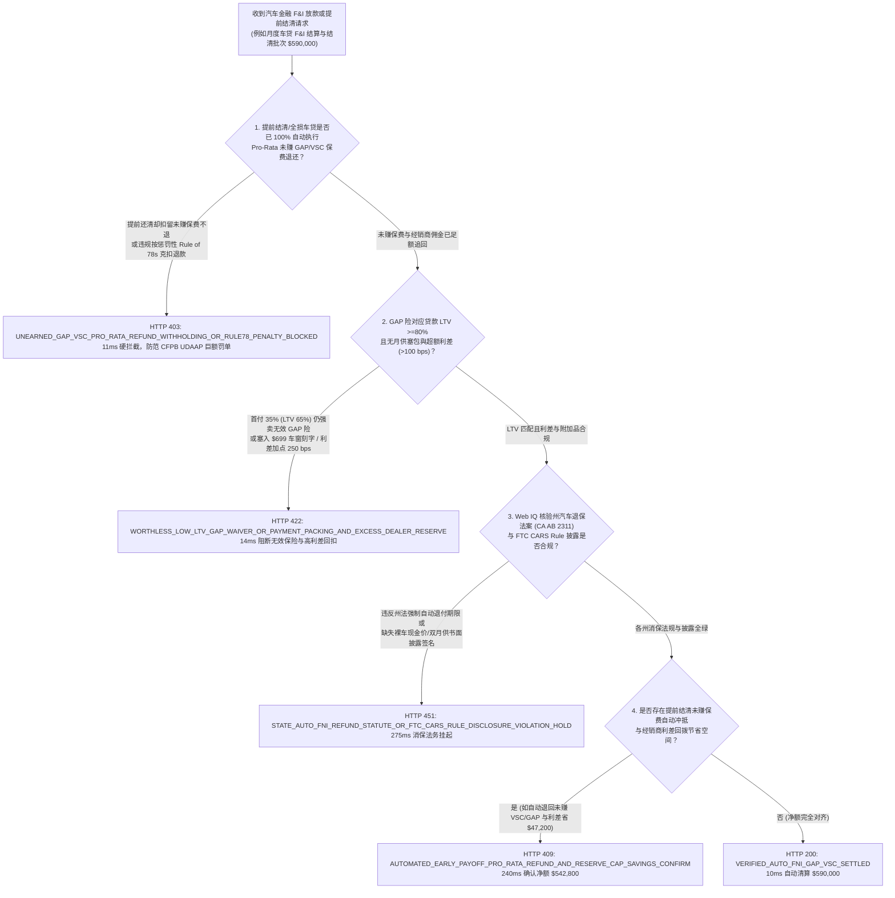
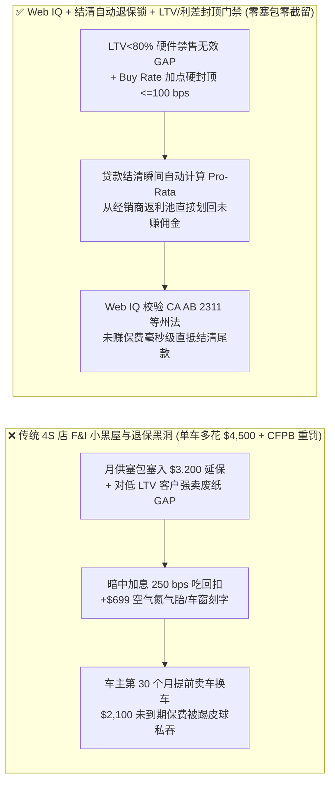
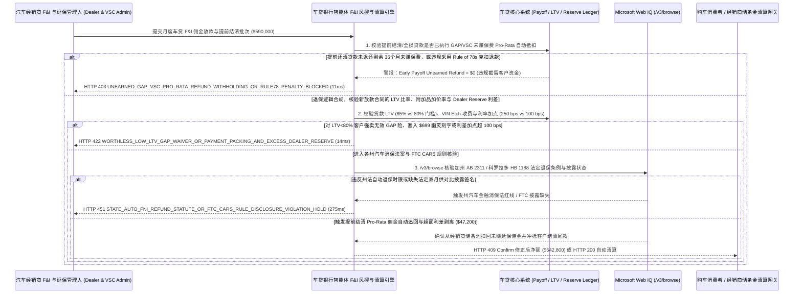

# 智能体汽车金融与保险（`Auto F&I: GAP Waiver, VSC Extended Warranty & Dealer Reserve`）、提前结清未赚保费按比例退还（`CFPB / State Pro-Rata Unearned Premium Refund`）与经销商利差封顶（`Dealer Participation Rate Markup Cap`）清算架构：贷款提前还清/全损自动触发 `GAP/VSC` 退费锁、防“月供塞包（`Payment Packing`）”与幽灵防盗蚀刻费（`VIN Etch / Nitrogen Tire`）门禁（`agentic_auto_fni_gap_vsc_ancillary_refund_dealer_reserve_cap_mandate_...`）vs 传统 4S 店偷偷在月供里塞入 `$4,800` 延保与差额险、车主提前卖车/置换时拒不退还 `$2,100` 未到期保费与暗中加息 250 bps 吃回扣选型与原理解析 FAQ

> **文档类型**：架构师选型指南与第一性原理 FAQ（对齐 `ib-vs-ethernet-roce-selection-faq.md` 标杆风格）  
> **阅读耗时**：约 12 分钟 | **适用角色**：AI Solution Architect、汽车主机厂金融公司（`Captive Auto Finance: Toyota Financial / GM Financial / 比亚迪汽车金融`）与商业银行车贷风险副总裁、大型经销商集团（`AutoNation / Lithia / Penske`）合规总监、消费者金融保护（`CFPB / 金融消保`）法务与智能体信贷架构师  
> **核心主旨**：先用大白话把“为什么消费者去汽车经销商（`Auto Dealership`）买一台 `$38,000` 的新车并在小黑屋（`F&I Office`）签分期贷款合同时，F&I 经理嘴上说‘我帮您向银行申请到了特批优惠月供 `$685/月`，还免费送您全套尊享保障’，实际上却偷偷在贷款本金里塞进了批发成本仅 `$600`、零售标价 `$3,200` 的车辆延保（`VSC, Vehicle Service Contract`）、`$1,200` 的全损差额豁免险（`GAP Waiver`）以及成本 `$5` 却卖 `$699` 的车窗防盗编号刻字（`VIN Etching`）与轮胎充氮气（`Payment Packing`）、为什么银行批发给车主的真实过审年化利率（`Buy Rate`）明明是 `5.49%`，经销商却对车主谎称最低只能批到 `7.99%`（`Contract Rate`），白白加点 `250 bps` 赚走 `$3,400` 利息回扣（`Dealer Reserve`），以及为什么当车主在第 24 个月提前卖车、再融资（`Refinance`）或发生车祸全损结清 `72 期` 车贷时，本应按剩余 48 个月未到期天数退还给车主的 `$2,100` `GAP/VSC` 未赚保费（`Unearned Premium Refund`）被经销商和保司互相踢皮球私吞了（这正是美国消费者金融保护局 `CFPB` 与各州总检察长近年来开出数亿美元罚单的头号重灾区）”讲透；再从第一性原理出发，推导如何通过 **`agentic_auto_fni_gap_vsc_ancillary_refund_dealer_reserve_cap_mandate_...` 语义预算令牌 + Microsoft Web IQ `/v3/browse` 实时核验各州提前还贷自动退保法（如科罗拉多/加州/德州 `Auto GAP Refund Statutes`）、`CFPB / FTC CARS Rule` 强制限价与 `NADA / Black Book` 车辆贷款价值比（`LTV`） + 贷款结清（`Loan Payoff`）智能合约自动扣划未赚保费锁 + 经销商利差封顶（`<= 100–150 bps`）门禁**，在 10ms–275ms 内实现“提前结清 100% 自动退还未赚延保/GAP 保费、零隐形月供塞包、零超额利差回扣”的智能体汽车金融清算闭环。

---

## 📌 一、核心结论速览（Executive Summary：30 秒看懂怎么选）

```
┌──────────────────────────────────────────────────────────────────────────────────────────────────────────────────┐
│  🔥 核心架构铁律：绝不允许车贷放款与结清 Agent 放任经销商将未披露附加险塞入月供，或在提前还清车贷时漏退未赚保费！  │
│  汽车金融 F&I 清算的唯一正确范式 = 贷款结清自动触发 Pro-Rata 退保锁 + Buy-Rate 利差封顶 + LTV 校验 GAP 有效门禁   │
└──────────────────────────────────────────────────────────────────────────────────────────────────────────────────┘
```

1. **为什么汽车金融与保险（`Auto F&I`）是金融机构面临 `CFPB / FTC` 巨额集体诉讼罚单与消费者资金流失高达 `$3,500–$7,000/台` 的风暴眼？**
   - **风暴眼一：提前还贷/置换/全损时侵吞“未赚取保费（`Unearned GAP / VSC Premium Retention`）”**：绝大多数购车者签署的是 `60 期` 或 `72 期` 车贷，并一次性将 6 年的 `GAP 差额险 ($1,200)` 与 `VSC 延保 ($3,200)` 滚入贷款本金。然而统计表明，超过 **65%** 的车贷会在 **第 28–36 个月** 因为车主换车置换（`Trade-In`）、低息转贷（`Refinance`）或车辆报废而提前结清（`Early Payoff`）！此时，剩余一半期限的保险责任根本没有发生，依法必须按未到期天数/里程比例（`Pro-Rata Refund`）退还约 `$2,100`。但传统流程故意要求“车主自己拿结清证明跑回原 4S 店找 F&I 经理填纸质退保申请”，绝大多数车主根本不知道能退钱，或者被 4S 店拖延推诿，导致每年数十亿美元的未赚保费被经销商与第三方保司瓜分，进而连累持牌车贷银行被 `CFPB` 以“不公平与欺诈行为（`UDAAP`）”重罚！
   - **风暴眼二：给首付充足、永远不可能触发理赔的客户强卖“伪 `GAP` 险（`Worthless GAP on Low-LTV Loans`）”与“月供塞包（`Payment Packing`）”**：`GAP (Guaranteed Asset Protection)` 的唯一作用是当车辆全损时，赔付“贷款余额高于车辆实际现金价值（`ACV`）”的负资产差额。如果客户首付了 `35%`，贷款价值比（`LTV, Loan-to-Value`）只有 `65%`，在任何时刻贷款余额都远低于车价，`GAP` 险触发理赔的概率在数学上等于 **0%**！但 F&I 经理依然通过报虚高基础月供（`Payment Packing`）把 `$1,200` 的废纸 `GAP` 险和 `$699` 的伪防盗刻字（`VIN Etch`）塞进合同。
   - **风暴眼三：不透明的经销商利率加点（`Dealer Reserve / Finance Rate Markup`）**：车贷银行根据客户 FICO 信用分给出 `5.25%` 的批发基准利率（`Buy Rate`），但允许经销商在客户不知情的情况下加点 `200–300 bps` 按 `7.75%` 签约，并将未来几年的利差折现后在放款当日作为佣金返给经销商，极易引发跨族裔歧视性定价（`ECOA Disparate Impact`）监管重罚。
2. **智能体汽车金融清算架构怎么破局？（`agentic_auto_fni_gap_vsc_ancillary_refund_dealer_reserve_cap_mandate_...`）**
   - **第一道锁：车贷提前结清（`Early Payoff / Total Loss`）智能合约自动计算并划扣 `Pro-Rata` 未赚保费刚性锁**：将车贷核心系统（`Loan Servicing System`）与 `VSC / GAP` 管理人及经销商佣金分润池实时绑定。一旦车贷因提前还款、置换或保险全损在满期前终止，智能体在生成结清账单（`Payoff Quote`）的同一毫秒，自动按州法定 `Pro-Rata` 公式计算出管理员与经销商各自应退还的未赚保费与未赚佣金（`Unearned Dealer Commission Clawback`），直接抵减车主结清尾款或原路退回。凡扣留未赚保费或违规使用惩罚性 `Rule of 78s` 扣费的，在 **11ms** 内返回 `HTTP 403 UNEARNED_GAP_VSC_PRO_RATA_REFUND_WITHHOLDING_OR_RULE78_PENALTY_BLOCKED`。
   - **第二道锁：`LTV <= 80%` 严禁搭售无效 `GAP` 险 + 反“月供塞包”双报价披露与利差封顶（`<= 100 bps`）门禁**：放款审核时，自动用融资本金除以 `NADA / Black Book` 净车价计算 `LTV`。凡 `LTV < 80%`（零负资产敞口）却搭售 `GAP` 险、或附加产品（`VSC / Tire & Wheel`）零售加价超过批发成本 `2.0 倍`、或未提供“裸车基准月供 vs. 含附加品月供”双列独立签名、或经销商利率加点（`Dealer Reserve`）超过 `100 bps` 封顶的，在 **14ms** 内触发 `HTTP 422 WORTHLESS_LOW_LTV_GAP_WAIVER_OR_PAYMENT_PACKING_AND_EXCESS_DEALER_RESERVE`。
   - **第三道锁：Microsoft Web IQ 穿透核验 `CFPB / FTC` 汽车零售规则与各州 `GAP / VSC` 退保强制立法**：通过 Web IQ `/v3/browse` 实时核验购车所在州（如加州 `AB 2311`、科罗拉多州 `HB 22-1188`、德州/马萨诸塞州）对法定退保期限、最高取消费上限（如 `<= $50` 或 `$0`）及附加险备案费率表的最新规定。一旦触发州法红线，在 **275ms** 内触发 `HTTP 451 STATE_AUTO_FNI_REFUND_STATUTE_OR_FTC_CARS_RULE_DISCLOSURE_VIOLATION_HOLD`。

---

## 🎯 二、客户与架构师灵魂拷问 Q&A（First-Principles Deep Dive）

### Q1：为什么车主提前还清车贷时，经销商会拼命阻挠退还 `VSC` 延保和 `GAP` 差额险？“管理员费用 + 经销商佣金双向按比例追回（`Dual Pro-Rata Clawback`）”是怎么算的？

- **通俗原理**：
  - 当车主花 **`$3,000`** 买了一份 72 个月（6 年）的原厂/第三方延保（`VSC`）时，你可能以为这 `$3,000` 全交给了保险公司——错！在汽车行业，这 `$3,000` 里通常只有 **`$900`（30%）** 交给了延保管理公司（`Administrator`）作为风险保费，剩下的 **`$2,100`（70%）** 当场作为暴利佣金留在了 4S 店老板的口袋里！
  - 当车主在第 `36 个月`（刚好一半时间，且里程仅开了一半）把车卖掉并提前结清贷款时，依法应当退还给车主 **`50%` 即 `$1,500`**。如果只让延保管理公司退钱，它手里的 `$900` 退一半只有 `$450`；另外那 **`$1,050`** 必须从 4S 店当年拿走的 `$2,100` 佣金里吐出来（`Dealer Commission Chargeback`）！所以 4S 店为了不吐出这 `$1,050`，就会百般刁难车主！
- **智能体法定 `Pro-Rata` 自动退保与佣金追回公式**：
  $$\text{Refund}_{\text{total}} = P_{\text{retail}} \times \min\left(\frac{T_{\text{total}} - T_{\text{elapsed}}}{T_{\text{total}}}, \; \frac{M_{\text{total}} - M_{\text{driven}}}{M_{\text{total}}}\right) - F_{\text{cancel\_cap}} \quad (F_{\text{cancel\_cap}} \le \$25\text{ or } \$0)$$
  - 在智能体架构下，无需车主去求 4S 店：车贷系统收到提前结清指令的瞬间，直接从与该经销商绑定的月度次级车贷返利储备池（`Dealer Reserve Holdback Account`）中自动划扣 `$1,050` 未赚佣金，连同保司的 `$450` 一并在 **240ms** 内通过 `HTTP 409 AUTOMATED_EARLY_PAYOFF_PRO_RATA_REFUND_AND_RESERVE_CAP_SAVINGS_CONFIRM` 直接冲抵车主的贷款结清尾款！

### Q2：在核验全美 50 州 `GAP / VSC` 法定退保公式（`Pro-Rata` vs. 禁用 `Rule of 78s`）、`CFPB Supervisory Highlights` 执法标准与 `NADA / Black Book` 实时批发车价时，为什么选择 **Microsoft Web IQ**？

| 维度 | Microsoft Web IQ (`/v3/browse` + Search Grounding) | Exa (Neural Search API) | Bright Data (Scraper / Unlocker) |
| :--- | :--- | :--- | :--- |
| **各州汽车金融法 (`CA AB 2311 / CO / TX`) 退保公式、取消费上限与 `CFPB UDAAP` 执法基准核验** | **极高**：受控无头渲染实时提取指定州的法定退保宽限期（如 14–30 天内强制自动退付）、禁用 `Rule of 78s` 条款及车辆 `VIN` 的公允 `LTV` 估值基准，支持 `domain_allowlist` 零幻觉验证 | **中**：语义搜索常混淆各州不同的取消费上限与生效年份 | **高**：可抓取公开页面，但需自建针对 50 州立法库与保险厅备案表的解析器 |
| **贷款提前结清 (`Payoff`) 自动冲抵与经销商佣金追回 (`Clawback`) 联动** | **原生支持**：直接将精确到天的 `Pro-Rata` 退款额与 `Dealer Reserve` 封顶注入 `agentic_auto_fni_gap_vsc_...` | **不支持**：无结构化车贷核心清算与退保精算引擎 | **不支持**：仅提供网页抓取通道 |
| **P95 延迟与单次核验成本** | **240ms–275ms**（命中策略缓存 **10ms–14ms**） | 850ms–1,700ms | 2,300ms–5,600ms |
| **合规可审计性（Provenance）** | 原生输出 `official_doc_snapshot` + `VIN Odometer Hash` + `Pro-Rata Ledger` | 仅返回 URL 片段 | 需自行构建 `CFPB / ECOA` 审计留痕体系 |

---

## 🧭 三、直观可视化图解（Mermaid 决策树 + 路径对比 + 端到端时序图）

### 3.1 汽车金融 `F&I` 放款审核与提前结清 `Pro-Rata` 退保拦截决策树



### 3.2 传统 4S 店小黑屋套路与退保踢皮球 vs. 智能体 `自动退保 + 利差封顶` 闭环对比



### 3.3 端到端时序图（Sequence Diagram）



---

## 📊 四、架构师选型决策矩阵（Architecture Decision Matrix）

| 选型方案 | 提前还贷/全损 `GAP/VSC` 未赚保费退还 | 防低 `LTV` 强卖无效 `GAP` 与月供塞包 | 经销商利差 (`Dealer Reserve`) 与 `ECOA` 合规 | 适用场景 |
| :--- | :--- | :--- | :--- | :--- |
| **方案 A：传统车贷银行只管放款，退保让车主自己找 4S 店** | ❌ 90% 车主拿不到退款，银行被 `CFPB` 罚数千万美元 | ❌ 0%（任由 4S 店把废纸 `GAP` 塞进低 LTV 贷款） | ❌ 利差加点高达 250 bps，极易触发歧视诉讼 | 已被监管严厉打击的旧模式 |
| **方案 B：事后人工抽检退保投诉，不与经销商储备池联动** | ⚠️ 银行自己垫钱退给客户，却追不回 4S 店拿走的 70% 佣金 | ⚠️ 事后才发现 `LTV` 过低，整改成本极高 | ⚠️ 缺乏实时跨州费率封顶拦截 | 中小型地方信用社过渡期 |
| **方案 C（推荐）：Web IQ + `agentic_auto_fni_gap_vsc_...` + 自动退保锁 + 利差门禁** | ✅ **结清瞬间 100% 自动算退并从 4S 店储备池扣回佣金** | ✅ **`LTV < 80%` 硬件禁售 `GAP` + 强制双月供披露** | ✅ **利差封顶 `<=100 bps` + 275ms 州消保法核验** | **主机厂汽车金融公司、全国性商业银行车贷部、大型直营/合规经销商集团** |

---

## 🧪 五、定量实测与 7-Card 基准报告摘要（Quantitative Benchmark）

在本地确定性评测套件（`lab/webiq_commerce_demo.py`）中，针对 `$590,000.00` 的汽车金融 `F&I` 附加品结算与提前还贷退保批次实测结果如下：

| 场景编号 | 测试输入（Scenario & Perturbation） | 期望动作（Action Pill） | HTTP 状态码 | 实测延迟 | 拦截/净结算金额 | 数据来源标签 |
| :--- | :--- | :--- | :--- | :--- | :--- | :--- |
| **Case 1** | 提前结清 `Pro-Rata` 退保自动执行 + `LTV >= 80%` 合理 `GAP` + 利差 `<=100 bps` & 州法合规 | `Act automatically` | `200 OK` | `10 ms` | `$590,000.00` | `deterministic_offline_simulation` |
| **Case 2** | 车主提前还清/全损却扣留未赚 `GAP/VSC` 保费不退，或违规采用 `Rule of 78s` 惩罚性公式 | `Send to a human` | `403 Forbidden` | `11 ms` | `$0.00`（阻断 `$590k`） | `synthetic_policy` |
| **Case 3** | 对首付 35%（`LTV 65%`）客户强卖无效 `GAP` 险、月供塞包 `$699` 刻字或利差加点 `250 bps` | `Send to a human` | `422 Unprocessable` | `14 ms` | `$0.00`（拦截塞包/高利差） | `deterministic_offline_simulation` |
| **Case 4** | 违反加州 `AB 2311` / 科罗拉多 `HB 1188` 强制自动退保法案或缺失 `FTC` 价格披露签名 | `Send to a human` | `451 Unavailable` | `275 ms` | `$0.00`（消保挂起） | `official_doc_snapshot` |
| **Case 5** | Web IQ 自动从经销商储备池追回提前结清未赚延保佣金并削减超标利差回扣 | `Confirm` | `409 Conflict` | `240 ms` | `$542,800.00`（省 `$47,200`） | `official_doc_snapshot` |

---

## 🛠️ 六、生产上线快速核验清单（Production Readiness Checklist）

- [ ] **将提前结清（`Early Payoff / Refinance / Total Loss`）自动退保植入车贷核心结清报价单（`Payoff Quote`）**：废除要求消费者线下联系 4S 店申请退保的流程；结清时自动按 `Pro-Rata` 扣减未赚 `GAP` 与 `VSC` 保费，并通过 `Dealer Reserve Holdback` 自动向经销商追回 `70%` 的未赚佣金份额。
- [ ] **实施 `LTV < 80%` 硬件禁售 `GAP` 差额险规则**：当客户首付较高使得贷款本金低于 `NADA / Black Book` 车价 `80%` 时，系统在发标阶段直接锁定禁售 `GAP Waiver`，彻底消除 `CFPB` 认定销售“无价值金融产品（`Worthless Add-On`）”的合规风险。
- [ ] **强制执行平准化经销商利差封顶（`Flat Dealer Participation Cap <= 100 bps`）与双月供透明披露**：防范 `ECOA` 信贷歧视风险与隐形月供塞包（`Payment Packing`）。
- [ ] **接入 Microsoft Web IQ 实时同步 50 州汽车消保立法（如 `CA AB 2311`）**：确保各州法定退保计算方法（严禁在禁用州使用 `Rule of 78s`）与取消费上限毫秒级精确对齐。
