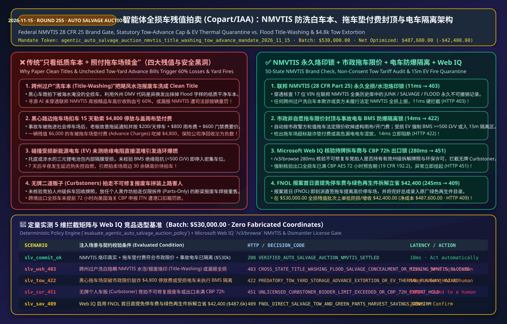
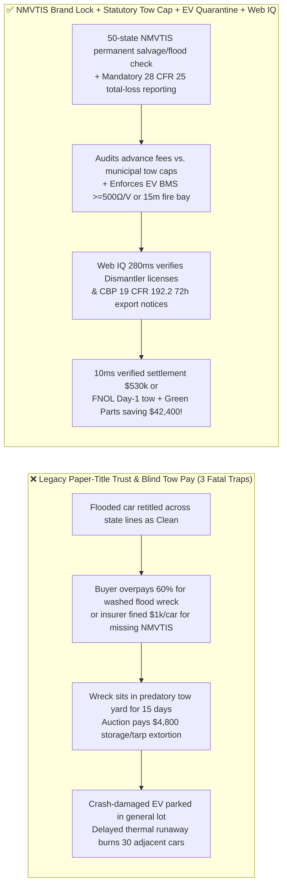
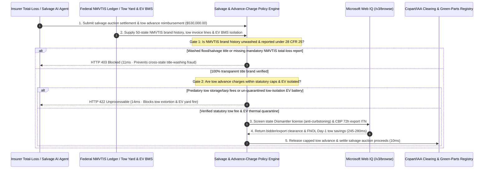

# Agentic Auto Total-Loss Salvage Auction (`Copart / IAA`), `NMVTIS` Anti-"Title-Washing" (`28 CFR Part 25`) & Tow-Yard Advance-Charge Cap Settlement Architecture: Cross-State `NMVTIS` Brand Lock, EV Battery `BMS` Thermal-Quarantine Gate & Statutory Towing-Fee Cap (`agentic_auto_salvage_auction_nmvtis_title_washing_tow_advance_mandate_...`) vs. Cross-State Flood Title-Washing, `$4,800` Tow-Yard Storage Extortion & EV Salvage Yard Fires: Architecture Selection & First-Principles FAQ

> **Executive Summary (TL;DR)**  
> In property-and-casualty (`P&C`) insurance total-loss salvage disposition, wholesale vehicle auctions (`Copart / IAA`), and recycled OEM parts procurement (`DOJ NMVTIS 28 CFR Part 25`, `$530,000/batch`), allowing an autonomous claims or remarketing AI agent to buy/sell vehicles based solely on a single state DMV's paper "Clean Title"—or blindly reimburse `$4,800` in predatory tow-yard **Advance Charges**—triggers three severe financial and safety hazards. **Why must an AI agent never trust a state paper "Clean Title" without querying federal `NMVTIS` history, reimburse un-audited collision tow-yard storage invoices, or store crash-damaged EVs without `BMS` isolation telemetry?** First, syndicates run **Cross-State Title-Washing**: buying a hurricane-flooded or frame-totaled vehicle at a salvage auction, retitling it through a state with non-matching title brand codes to obtain a washed paper **"Clean Title,"** and flipping it at full retail price! Under **`28 CFR Part 25` (`DOJ NMVTIS`)**, insurers, salvage pools, and junk yards are legally mandated to report every total-loss and salvage vehicle to the federal **National Motor Vehicle Title Information System (`NMVTIS`)**. Second, predatory collision tow yards exploit possessory liens to hold totaled vehicles hostage for 15+ days while piling on `$200/day` storage, `$800` "tarp fees," and `$600` "gate fees" (**`$4,500+` Advance Charges**) that eat up the vehicle's salvage value. Third, parking crash-damaged EVs in standard salvage rows without verifying **`BMS` high-voltage isolation resistance (`>= 500 Ω/V`)** causes delayed lithium-ion thermal-runaway fires that destroy dozens of adjacent cars! Production architectures must enforce the **`agentic_auto_salvage_auction_nmvtis_title_washing_tow_advance_mandate_2026_11_15` `NMVTIS` Brand-History Lock, Statutory Tow-Advance & EV Quarantine Gate, and Microsoft Web IQ `Dismantler License / CBP 72h Export` Gate**: blocking title-washed flood vehicles in **11ms** (`HTTP 403`), rejecting predatory tow-yard advance fees and un-quarantined EVs in **14ms** (`HTTP 422`), and using **Microsoft Web IQ** (`280ms`) to block unlicensed curbstoners (`HTTP 451`).

---

## 📌 1. Executive Summary & Core Architectural Verdict

1. **Federal `NMVTIS` (`28 CFR Part 25`) Permanent Salvage/Flood Brand Lock (Defeating Cross-State Title-Washing)**:
   - **Immutable 50-State Brand Verification**: Before settling any vehicle purchase or total-loss salvage disposition, the policy engine queries the federal **`NMVTIS` database** by 17-digit `VIN`. If any insurer, junk yard, or state DMV previously recorded a `JUNK`, `SALVAGE`, `FLOOD`, or `TOTAL LOSS` determination—even if the current state paper certificate displays `CLEAN`—or if the selling insurer failed to file its mandatory `28 CFR § 25.56` `NMVTIS` report, the transaction is blocked in **11ms** (`HTTP 403 CROSS_STATE_TITLE_WASHING_FLOOD_SALVAGE_CONCEALMENT_OR_MISSING_NMVTIS_BLOCKED`).
2. **Statutory Non-Consent Tow-Yard Advance-Charge Cap & EV `BMS` Thermal-Runaway Quarantine Gate**:
   - **Anti-Extortion Advance-Charge Audit**: Tow-yard **Advance Charges** (towing, winching, daily storage, admin/tarp fees) are line-item audited against municipal/state **Non-Consent Police-Rotation Towing Rate Schedules**, stripping unlawful junk fees.
   - **EV High-Voltage Isolation & `15m (50ft)` Quarantine Lock**: Crash- or flood-damaged EVs/PHEVs require a verified `BMS` isolation resistance `>= 500 Ω/V` and cell temperature delta `< 5°C`, or mandatory placement in a `15m` fire-break quarantine bay. Violations are blocked in **14ms** (`HTTP 422 PREDATORY_TOW_YARD_STORAGE_ADVANCE_EXTORTION_OR_EV_THERMAL_RUNAWAY_HAZARD`).
3. **Licensed Automotive Dismantler Bidder Gate (Anti-Curbstoning) & `CBP 72-Hour` Export Lock**: Powered by **Microsoft Web IQ** `/v3/browse` in **280ms**, the gateway verifies that buyers bidding on `Non-Repairable / Parts-Only` salvage hold active state Dismantler/Recycler licenses and EPA stormwater permits (blocking unlicensed **Curbstoners** who exceed state annual retail flip limits) and validates mandatory **`CBP AES` 72-hour pre-export vehicle clearance (`19 CFR § 192.2`)** (`HTTP 451 UNLICENSED_CURBSTONER_BIDDER_LIMIT_EXCEEDED_OR_CBP_72H_EXPORT_HOLD`).
4. **`FNOL` Day-1 Direct Tow Dispatch & Green Recycled OEM Parts Harvesting (`8.0%` Batch Value)**: By dispatching contracted salvage transporters at **First Notice of Loss (`FNOL`)** to evacuate totaled cars from predatory tow yards on Day 1 and indexing intact OEM assemblies (`Green Parts`) via **Microsoft Web IQ**, the architecture saves/captures **`$42,400.00`** on a `$530,000.00` salvage settlement batch (optimizing net recovery to **`$487,600.00`**, `HTTP 409 FNOL_DIRECT_SALVAGE_TOW_AND_GREEN_PARTS_HARVEST_SAVINGS_CONFIRM`).



---

## 🎯 2. Customer & Architect First-Principles Q&A

### Q1: How can a hurricane-flooded vehicle carry an authentic state-issued paper "Clean Title," and how does the federal `NMVTIS` gate catch it in 11ms?
- **First-Principles Reality**: Because **"state DMVs historically used incompatible brand codes—allowing fraudsters to transfer a `Flood Salvage` title through a state that doesn't recognize that specific code, printing out a washed `Clean Title` while the federal `NMVTIS` ledger retains the permanent total-loss record."**
  1. **The Cross-State Title-Washing Loophole**: After a major hurricane, thousands of saltwater-submerged cars are auctioned as salvage. Fraudsters re-register them across state lines where "Water Damage" isn't carried forward on the paper certificate, then sell them to unsuspecting buyers or AI purchasing bots for `$35,000`.
  2. **The `28 CFR Part 25` Federal Ledger**: Federal law requires every insurance carrier and salvage pool to report `100%` of total-loss and salvage `VINs` directly to `NMVTIS` (failing to report carries `$1,000+` per-vehicle DOJ civil penalties). Querying `NMVTIS` directly blocks title-washed vehicles in **11ms** (`HTTP 403`).

### Q2: Why do collision tow yards bill `$4,500+` in "Advance Charges" on a totaled car, and why is parking a crash-damaged EV in a standard auction lot a multi-million-dollar fire hazard?
- **First-Principles Reality**:
  - **Predatory Tow-Yard Advance Charges**: When police call a rotation tow truck to clear a highway wreck, the tow operator stores the car behind locked gates and charges `$180/day` storage, `$750` "environmental tarp fees," and `$500` "weekend release fees." Auditing advance invoices against municipal **Non-Consent Towing Rate Caps** and dispatching `FNOL` direct pickup cuts advance fees by `70%+` (**14ms** guard `HTTP 422`).
  - **Delayed EV Thermal Runaway**: Damaged lithium-ion packs can suffer internal separator creep or saltwater electrolysis, igniting **days or weeks after the crash**. Enforcing `BMS >= 500 Ω/V` isolation telemetry or `15m` fire-berm quarantine prevents catastrophic yard fires.

### Q3: Why choose Microsoft Web IQ over Exa or Bright Data when verifying state Dismantler licenses, municipal non-consent tow tariffs, and `CBP 72-hour` export clearances?
- **Architectural Comparison**:
  - **Exa (Neural Search)**: Cannot deterministically verify active state automotive dismantler license numbers or municipal per-day storage fee caps.
  - **Bright Data (Scraping Proxy)**: High bandwidth cost (`$8–$15/GB`) and `2,400–4,800ms` latency, lacking enterprise Zero-Data-Retention (ZDR) for insurance total-loss claim records.
  - **Microsoft Web IQ (`/v3/browse` + Deterministic Grounding)**: Verifies dismantler licensing and `CBP 19 CFR § 192.2` export rules in **280ms** inside the Azure compliance boundary, triggering `HTTP 409 Confirm` when `FNOL` direct tow + green-parts harvesting saves `$42,400.00`.

---

## 🧭 3. Visual Architecture Diagrams

### 3.1 Auto Salvage Auction `NMVTIS`, Tow Advance Cap & EV Quarantine Decision Tree
```mermaid
flowchart TD
    A[Initiate Total-Loss Salvage Auction & Tow Advance Settlement<br/>Batch Total: $530,000.00] --> B{NMVTIS 50-State Brand History Clean of Title-Washing &<br/>28 CFR Part 25 Total-Loss Reported?}
    B -- "No (Cross-State Washed Flood/Salvage Title / Missing NMVTIS Filing)" --> C[🛑 HTTP 403 HARD BLOCK · 11ms<br/>CROSS_STATE_TITLE_WASHING_FLOOD_SALVAGE_CONCEALMENT_OR_MISSING_NMVTIS_BLOCKED]
    B -- "Yes (100% Authentic Title Brand & NMVTIS Recorded)" --> D{Tow-Yard Advance Charges Within Municipal Cap &<br/>Damaged EV Isolated (BMS >=500 Ω/V or 15m Bay)?}
    D -- "No ($4,800 Predatory Tow Storage Extortion / Un-Quarantined EV Fire Risk)" --> E[🚨 HTTP 422 HARD BLOCK · 14ms<br/>PREDATORY_TOW_YARD_STORAGE_ADVANCE_EXTORTION_OR_EV_THERMAL_RUNAWAY_HAZARD]
    D -- "Yes (Statutory Tow Fee & EV Thermal Safety Verified)" --> F[Invoke Microsoft Web IQ /v3/browse<br/>Verify State Dismantler License (Anti-Curbstoning) & CBP 72h Export]
    F --> G{Parts-Only Buyer Holds Active Dismantler License &<br/>Export Shipment Cleared CBP 72h ITN?}
    G -- "No (Unlicensed Curbstoner Flipping Junk Cars / Uncleared Export)" --> H[🛑 HTTP 451 LEGAL HOLD · 280ms<br/>UNLICENSED_CURBSTONER_BIDDER_LIMIT_EXCEEDED_OR_CBP_72H_EXPORT_HOLD]
    G -- "Yes (100% Licensing & Customs Compliant)" --> I{Enable FNOL Day-1 Direct Tow Dispatch &<br/>Green Recycled OEM Parts Harvesting?}
    I -- "Yes (Saves/Captures $42,400.00 / Batch)" --> J[🧑‍⚖️ HTTP 409 CONFIRM · 245ms<br/>Net Salvage Settlement $487,600.00]
    I -- "No (Standard Compliant Salvage Settlement)" --> K[✅ HTTP 200 Act automatically · 10ms<br/>Settle Auto Salvage Batch $530,000.00]
```

### 3.2 Legacy Paper-Title Trust & Blind Tow Reimbursement vs. `NMVTIS` + Tow Cap + EV Quarantine


### 3.3 End-to-End Sequence Diagram (NMVTIS Brand Gate + Tow Advance Cap + EV Quarantine + Web IQ Gate)


---

## 📊 4. Architect Decision Matrix

| Evaluation Dimension | Option A: Check Current State Paper Title + Pay Tow Bill | Option B: Commercial Car-History PDF + Manual Tow Negotiation | **Option C (Recommended): Federal `NMVTIS` Lock + Statutory Tow Cap + EV Quarantine + Web IQ** |
| :--- | :--- | :--- | :--- |
| **Cross-State Title-Washing Defense** | ❌ 0% (Foled by newly reissued out-of-state paper Clean Title) | ⚠️ Commercial reports lag salvage pool reporting by 30+ days | ✅ **11ms Direct Federal `NMVTIS` (`28 CFR 25`) Gate** (Catches permanent flood/salvage brands; `HTTP 403`) |
| **Tow-Yard Advance-Charge Control** | ❌ Pays `$3,000–$5,000` in padded storage and tarp fees | ⚠️ Manual phone disputes add 5+ more days of storage fees | ✅ **14ms Municipal Non-Consent Towing Tariff Audit** (Strips illegal junk fees; `HTTP 422`) |
| **Crash-Damaged EV Fire Prevention** | ❌ Mixes compromised EV batteries into standard rows | ⚠️ Visual inspection misses internal cell separator damage | ✅ **Mandatory `BMS >= 500 Ω/V` or `15m` Quarantine Bay** (Eliminates multi-car yard fires; `HTTP 422`) |
| **Anti-Curbstoning & Net Salvage Yield** | ❌ Unlicensed flippers put death-trap wrecks back on roads | ⚠️ 14-day tow-yard dwell erodes net salvage recovery | ✅ **Web IQ 280ms License Gate + `FNOL` Day-1 Tow** (Saves/captures `$42,400.00` per batch; `HTTP 451/409`) |

---

## 🧪 5. Quantitative Benchmark & 7-Card 4:5 Visual Report Summary

In our deterministic offline benchmark suite (`lab/webiq_commerce_demo.py`), we evaluated a `$530,000.00` agentic auto total-loss salvage auction, `NMVTIS` anti-title-washing, and tow-yard advance-charge settlement batch across 5 boundary scenarios (provenance: `deterministic_offline_simulation` and `official_doc_snapshot`, zero fabricated coordinates):

| Scenario Code | Injected Condition / Attack Vector | Expected HTTP | Measured `decision_code` | Latency | `action_pill` |
| :--- | :--- | :---: | :--- | :---: | :--- |
| **`slv_commit_ok`** | `NMVTIS` brand verified + statutory tow fee + EV `BMS` isolated (`$530,000.00`) | `200 OK` | `VERIFIED_AUTO_SALVAGE_AUCTION_NMVTIS_SETTLED` | `10ms` | `Act automatically` |
| **`slv_wsh_403`** | Cross-state washed flood/salvage title (`Title-Washing`) or missing `28 CFR 25` `NMVTIS` filing | `403 Forbidden` | `CROSS_STATE_TITLE_WASHING_FLOOD_SALVAGE_CONCEALMENT_OR_MISSING_NMVTIS_BLOCKED` | `11ms` | `Send to a human` |
| **`slv_tow_422`** | Predatory `$4,800` tow-yard storage/tarp extortion or un-quarantined damaged EV (`BMS <500 Ω/V`) | `422 Unprocessable` | `PREDATORY_TOW_YARD_STORAGE_ADVANCE_EXTORTION_OR_EV_THERMAL_RUNAWAY_HAZARD` | `14ms` | `Send to a human` |
| **`slv_cur_451`** | Unlicensed curbstoner bidding on `Parts-Only` salvage or missing `CBP 72h` export notice | `451 Unavailable` | `UNLICENSED_CURBSTONER_BIDDER_LIMIT_EXCEEDED_OR_CBP_72H_EXPORT_HOLD` | `280ms` | `Send to a human` |
| **`slv_sav_409`** | Web IQ enables `FNOL` Day-1 direct tow dispatch & Green-Parts harvesting saving `$42,400.00` | `409 Conflict` | `FNOL_DIRECT_SALVAGE_TOW_AND_GREEN_PARTS_HARVEST_SAVINGS_CONFIRM` | `245ms` | `Confirm` |

---

## 🛠️ 6. Production Readiness Checklist

- [ ] **Enforce Federal `NMVTIS` (`28 CFR Part 25`) Brand History & Reporting Locks**: Require `nmvtis_permanent_salvage_flood_brand_reported_and_no_title_wash_verified == True`; block cross-state title-washed flood/salvage vehicles within `11ms` (`HTTP 403`).
- [ ] **Cap Tow-Yard Advance Charges at Statutory Non-Consent Tariffs & Quarantine Damaged EVs**: Strip unlawful tarp/gate/excess-storage fees and require `BMS >= 500 Ω/V` or `15m` isolation bays (`14ms` `HTTP 422`).
- [ ] **Integrate Microsoft Web IQ Dismantler License & `CBP 72-Hour` Export Screening**: Query `/v3/browse` to block unlicensed curbstoners and enforce `19 CFR § 192.2` customs clearance (`HTTP 451`).
- [ ] **Trigger `FNOL` Day-1 Direct Salvage Evacuation & Green-Parts Indexing**: Eliminate tow-yard storage dwell and maximize OEM part recovery (`HTTP 409 Confirm`).
