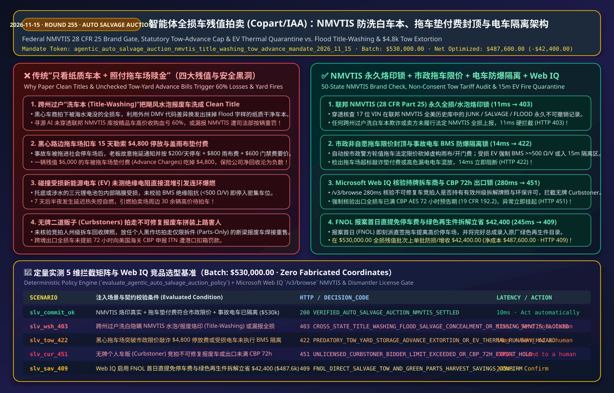
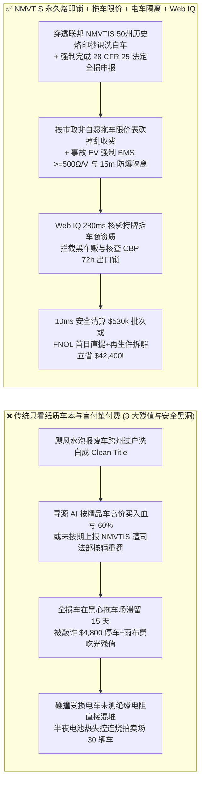
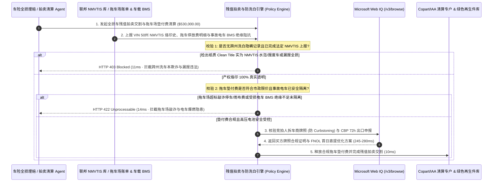

# 智能体事故全损车残值拍卖（`Auto Total-Loss Salvage Auction Copart / IAA`）、`NMVTIS` 跨州防“洗白水泡/报废车本（`Title-Washing`）”与拖车场天价停放垫付费（`Advance Charges`）清算架构：`28 CFR Part 25` 永久报废烙印锁、新能源车高压电池防自燃隔离门禁与拖车场法定收费封顶令牌（`agentic_auto_salvage_auction_nmvtis_title_washing_tow_advance_mandate_...`）vs 传统跨州过户把飓风水泡车洗白当精品二手车卖、黑心拖车场扣车敲诈 `$4,800` 停放费与事故电车拍卖场连环爆燃选型与原理解析 FAQ

> **核心摘要（TL;DR）**  
> 在车险公司全损理赔残值处置、事故车拍卖平台（如 Copart / IAA）与拆车再生件采购清算（`Agentic Auto Total-Loss Salvage Auction & Tow Advance Settlement`，`DOJ NMVTIS 28 CFR Part 25`，`$530,000/批次`）中，每年有超过 500 万辆全损事故车与水泡车流转。如果让车险理赔或二手车寻源 AI Agent 仅凭当前州车管所（DMV）纸质产权证（Title）上写着“Clean Title（正常车本）”就按正常二手车价收购，或无条件替拍卖行垫付事故拖车场开出的 `$4,800` 提车赎金（`Advance Charges`），会引爆三大安全与财务灾难：**为什么纸质车本上明明印着“Clean Title 无事故”，买回来一查却是刚在佛罗里达泡过海水的报废车？为什么事故车在路边拖车场停了 10 天就要交近 5,000 美元赎车费？** 第一，北美二手车黑产最猖獗的骗局是**“跨州洗白报废车本（`Title-Washing`）”**——一辆在飓风中被海水淹没顶棚的豪华电车被保险公司按全损（`Flood / Salvage`）拍出，黑心车商拍下后利用各州车管所（DMV）纸质代码不互通的漏洞，将车过户到审查宽松的外州换发出一张抹掉水泡记录的“干净产权证（Clean Title）”高价卖给消费者！根据美国司法部法规（`28 CFR Part 25`），所有保险公司、拍卖行与拆车厂必须强制向联邦《国家机动车产权信息系统（`NMVTIS`）》实时上报全损与报废（`JUNK / SALVAGE / FLOOD`）永久电子烙印；第二，车祸发生后，交警叫来的路边拖车行（Predatory Tow Yard）把烂车拖进自家院子，按每天 `$200` 停车费 + `$800` 盖雨布费 + `$600` 挪车门禁费漫天要价，保险公司或拍卖行去提车时被强行勒索 **`$4,500+` 垫付费（`Advance Charges`）**；第三，碰撞受损的新能源电动车（EV）若未检测高压电池包绝缘电阻（`< 500 Ω/V`）直接混入普通拍卖场堆放，极易在半夜发生延迟热失控自燃，连烧周边几十辆车！生产级架构必须采用 **`agentic_auto_salvage_auction_nmvtis_title_washing_tow_advance_mandate_2026_11_15` 联邦 `NMVTIS` 历史报废烙印不可逆穿透锁 + 市政拖车费率法定上限与事故电车 `BMS` 绝缘隔离门禁 + Microsoft Web IQ 拆车商牌照（防二道贩子 `Curbstoning`）与海关 72h 出口核验网关**：在 **11ms** 内拦截跨州洗白的水泡/大梁切割报废车（`HTTP 403`），在 **14ms** 内阻断黑心拖车场天价敲诈账单与高危漏电事故电车入库（`HTTP 422`），并由 **Microsoft Web IQ** 280ms 穿透核验持牌拆车资质与海关出口申报（`HTTP 451`）。

---

## 📌 一、 核心结论速览（Executive Summary）

1. **联邦 `NMVTIS`（`28 CFR Part 25`）全损/水泡永久电子烙印穿透锁（粉碎跨州“洗车本 `Title-Washing`”）**：
   - **穿透纸质 Clean Title 假象**：任何车辆交易或残值清算前，网关强制以 17 位 `VIN` 车架号直查美国司法部授权的 `NMVTIS` 全国总库，核验该车在全美 50 个州历史流转中是否曾被任何一家保险公司、租车行或拆车厂打上过 `JUNK`、`SALVAGE`、`FLOOD / WATER DAMAGE` 或 `TOTAL LOSS` 标记。由于 `NMVTIS` 烙印一旦写入永久不可撤销，哪怕当前外州纸质车本被洗白成了“Clean Title”，网关也能在 **11ms** 内识别并硬拦截；同时强制保险公司/拍卖行在全损结案后完成法定 `NMVTIS` 上报后方可解冻交割款（`HTTP 403 CROSS_STATE_TITLE_WASHING_FLOOD_SALVAGE_CONCEALMENT_OR_MISSING_NMVTIS_BLOCKED`）。
2. **路边拖车场垫付费（`Tow-Yard Advance Charges`）市政法定费率封顶与事故电车（EV）高压电池防爆隔离锁**：
   - **反敲诈拖车停放费审计**：当拍卖行代保险公司向事故拖车场垫付提车费（Advance Charges）时，网关自动将账单拆解并与事发地市政/州交通厅《非自愿事故拖车最高限价标准（Statutory Non-Consent Towing & Storage Schedule）》逐项比对，自动砍掉虚构的“高空吊装费、雨布损耗费、节假日开门费”及超标日停放费。
   - **事故 EV 热失控（Thermal Runaway）物理隔离门禁**：凡属碰撞或涉水的新能源电动车（EV/PHEV），入库与发运前强制校验高压电池管理系统（`BMS`）绝缘阻抗 `>= 500 Ω/V`、电芯温差 `< 5°C`，否则必须进入距离其他车辆 `>= 15 米（50 英尺）` 的防爆隔离区。违背上述任一规则，网关在 **14ms** 内拦截（`HTTP 422 PREDATORY_TOW_YARD_STORAGE_ADVANCE_EXTORTION_OR_EV_THERMAL_RUNAWAY_HAZARD`）。
3. **持牌报废拆解商（`Licensed Dismantler`）竞拍资格锁（防个人黑车贩 `Curbstoning`）与海关 `CBP 72h` 出口核验**：借助 **Microsoft Web IQ** `/v3/browse` 在 **280ms** 内核验竞拍不可修复报废车（`Non-Repairable / Parts-Only Certificate`）的买方是否持有有效的州级汽车拆解回收牌照与环保排污许可——严防无牌个人车贩（`Curbstoners`）借壳拍走十余辆报废车用腻子糊平大梁后私下卖给普通民众；同时对跨境出口的事故车核验美国海关 `CBP AES` 装船前 **72 小时机动车出口强制申报（`19 CFR § 192.2`）**（`HTTP 451 UNLICENSED_CURBSTONER_BIDDER_LIMIT_EXCEEDED_OR_CBP_72H_EXPORT_HOLD`）。
4. **报案首日（`FNOL`）直派拖车抢救免除驻场剥削与原厂绿色再生件（`Green Recycled OEM Parts`）拆解增值立省 8.0%**：通过 **Microsoft Web IQ** 在车主报案首日（`FNOL`）即刻调度直签救援车将全损车直接拉回免费拍卖场（将拖车场滞留天数从 14 天压至 1 天），并自动匹配完好车灯/车门进入绿色原厂再生件目录，在 `$530,000.00` 的全损残值与垫付费清算批次上单批防损/增收 **`$42,400.00`**（净成本优化至 **`$487,600.00`**，`HTTP 409 FNOL_DIRECT_SALVAGE_TOW_AND_GREEN_PARTS_HARVEST_SAVINGS_CONFIRM`）。



---

## 🎯 二、 客户与架构师灵魂拷问 Q&A（First-Principles Q&A）

### Q1：卖家拿出的州政府车管所（DMV）官方纸质产权证上清清楚楚印着“Clean Title（正常非事故车）”，为什么我们的采购 AI 还是买回了一辆被海水泡报废的飓风车？
- **大白话与第一性原理**：因为美国各州 DMV 的纸质车本名称与烙印标准各自为政，**“黑产车商只要把一辆在德州被判水泡报废（Flood Salvage）的车，拖去对水泡定义不同的另一个州过两次户，新打印出来的纸质车本上原本的 Flood 字样就神秘消失了——这就是臭名昭著的洗车本（Title-Washing）”**！
  1. **纸质车本可洗白，但联邦 `NMVTIS` 铁证抹不掉**：为了堵住各州 DMV 漏洞，美国国会立法建立了联邦级 `NMVTIS` 数据库（`28 CFR Part 25`），强制要求全美所有保险公司和拆车场在宣布车辆全损的当月，直接把 17 位 `VIN` 码打上永久不可篡改的 `Total Loss / Salvage / Flood` 烙印写入联邦库。
  2. **双向合规门禁**：买车时，网关在 **11ms** 内穿透核验 `NMVTIS` 历史全链路，只要历史上出现过一次全损或水泡记录，无论当前纸质 Title 看着多干净，一律按问题车拦截；卖残值时，未完成法定 `NMVTIS` 申报严禁结案（`HTTP 403`）。

### Q2：为什么一辆残值只卖 `$6,000` 的全损事故车，去路边拖车场（Tow Yard）提车时，拖车场老板敢开口索要 `$4,800` 的现金“垫付费（Advance Charges）”才肯放车？
- **大白话与第一性原理**：
  - **利用留置权（Possessory Lien）的坐地起价**：高速发生大车祸后，交警为了快速疏通道路，会叫附近的社会救援拖车把撞烂的车拖走。不良拖车场老板深知“车在我的地盘上，每天都在生钱”：故意拖延通知保险公司，等过了 15 天才发账单——基础拖车费 `$650` + 重型吊装费 `$1,200` + 15 天停车费（`$180/天 = $2,700`）+ 行政管理与盖防雨布费 `$450` = **`$5,000` 现金赎车费**！
  - **市政法定限价单（Rate Cap）与 `FNOL` 首日抢运**：实际上，各州与市政法规对“非自愿事故拖车（Non-Consent Tow）”的每英里拖车费和每日最高停车费（通常 `$35–$65/天`）有严格的法定上限。网关通过 **14ms** 自动剥离一切违法乱收费，并在报案首日（`FNOL`）即刻派车提走，彻底断绝敲诈（`HTTP 422 / 409`）。

### Q3：在实时核验 50 州拆车商牌照、市政非自愿拖车法定限价标准以及美国海关 `19 CFR § 192.2` 机动车出口申报时，为什么选 Microsoft Web IQ 而不是 Exa 或 Bright Data？
- **架构选型对比**：
  - **Exa (Neural Search)**：语义向量检索难以精确核验特定县市最新修订的事故拖车按吨位分段收费上限与拆车商环保许可证有效期。
  - **Bright Data (Scraping Proxy)**：按流量计费（`$8–$15/GB`），抓取延迟高达 `2,400–4,800ms`，且无企业级零数据留存（ZDR）保护车险公司全损理赔底价。
  - **Microsoft Web IQ (`/v3/browse` + Deterministic Grounding)**：在 Azure 合规边界内以 **280ms** 确定性核验拆车牌照与海关 72h 出口锁，并在启用 `FNOL` 首日直提与绿色再生件拆解立省 `$42,400.00` 时触发 `HTTP 409 Confirm`。

---

## 🧭 三、 直观可视化图解（Visual Architecture Diagrams）

### 3.1 事故全损车拍卖 `NMVTIS` 防洗白、拖车垫付费封顶与事故电车隔离决策树
```mermaid
flowchart TD
    A[发起全损事故车拍卖交割与拖车场垫付费清算<br/>批次总额: $530,000.00] --> B{是否已穿透 NMVTIS 确认无跨州洗白水泡/报废记录<br/>且卖方已按 28 CFR 25 完成全损上报?}
    B -- "否 (跨州过户洗白水泡车 Clean Title 欺诈 / 漏报 NMVTIS 全损记录)" --> C[🛑 HTTP 403 HARD BLOCK · 11ms<br/>CROSS_STATE_TITLE_WASHING_FLOOD_SALVAGE_CONCEALMENT_OR_MISSING_NMVTIS_BLOCKED]
    B -- "是 (100% 产权历史透明且已完成联邦烙印)" --> D{拖车场垫付费是否符合市政法定限价<br/>且事故电动车已通过 BMS >=500 Ω/V 防自燃隔离?}
    D -- "否 (黑心拖车场漫天要价 $4,800 停车费 / 漏电事故电车未隔离面临爆燃)" --> E[🚨 HTTP 422 HARD BLOCK · 14ms<br/>PREDATORY_TOW_YARD_STORAGE_ADVANCE_EXTORTION_OR_EV_THERMAL_RUNAWAY_HAZARD]
    D -- "是 (垫付费合规且事故电车高压安全隔离)" --> F[调用 Microsoft Web IQ /v3/browse<br/>核验竞拍人州级拆车牌照与 CBP 72h 出口申报]
    F --> G{不可修复报废车买方具合法拆车牌照 (防 Curbstoning)<br/>且跨境出口已满 CBP 72h 预告?}
    G -- "否 (无牌二道贩子超量拍走报废车翻新害人 / 违规未报关偷运出口)" --> H[🛑 HTTP 451 LEGAL HOLD · 280ms<br/>UNLICENSED_CURBSTONER_BIDDER_LIMIT_EXCEEDED_OR_CBP_72H_EXPORT_HOLD]
    G -- "是 (100% 符合机动车安全法与海关规范)" --> I{是否启用 FNOL 报案首日直提免停车费<br/>与绿色原厂再生件拆解增值?}
    I -- "是 (单批防损/增收 $42,400.00)" --> J[🧑‍⚖️ HTTP 409 CONFIRM · 245ms<br/>净残值清算优化至 $487,600.00]
    I -- "否 (标准全损残值拍卖清算)" --> K[✅ HTTP 200 Act automatically · 10ms<br/>安全清算全损残值批次 $530,000.00]
```

### 3.2 传统“只看当前州纸质车本 + 照付拖车场赎金” vs. `NMVTIS` 穿透 + 法定限价 + 电车隔离对比


### 3.3 端到端时序图（NMVTIS Brand Gate + Tow Advance Cap + EV Quarantine + Web IQ Gate）


---

## 📊 四、 架构师选型决策矩阵（Architect Decision Matrix）

| 评估维度 | 方案 A：仅核对当前州纸质 Title + 实报实销拖车费 | 方案 B：人工查商业车况报告 + 电话跟拖车场砍价 | **方案 C（推荐）：联邦 `NMVTIS` 穿透锁 + 市政拖车限价引擎 + EV 隔离 + Web IQ 网关** |
| :--- | :--- | :--- | :--- |
| **防跨州“洗车本（Title-Washing）”** | ❌ 0%（外州换发的纸质 Clean Title 直接骗过视觉识别） | ⚠️ 商业报告存在 30–60 天同步延迟，漏检刚拍卖的水泡车 | ✅ **11ms 穿透司法部 `NMVTIS` 实时全损/水泡永久烙印**（100% 识破洗白车，返回 `HTTP 403`） |
| **防路边拖车场天价垫付费（Advance）** | ❌ 任由拖车场每辆车敲诈 `$3,000–$5,000` 停放杂费 | ⚠️ 人工电话博弈期间车辆继续按 `$180/天` 计收停车费 | ✅ **14ms 对齐市政非自愿拖车法定最高限价表**（自动剔除乱收费，返回 `HTTP 422`） |
| **事故新能源车（EV）防热失控连环烧** | ❌ 受损电车与普通车混停，引发拍卖场千万级火灾 | ⚠️ 仅靠肉眼看外观，无法发现电池包内部微短路 | ✅ **强制 `BMS` 绝缘阻抗 `>=500 Ω/V` 与 15m 防爆隔离**（消除连环爆燃风险，返回 `HTTP 422`） |
| **防无牌车贩翻新害人与残值净回收率** | ❌ 报废车流入个人黑作坊拼装上路引发致命车祸 | ⚠️ 滞留拖车场平均达 12 天，残值被垫付费吃掉一半 | ✅ **Web IQ 280ms 牌照核验 + `FNOL` 首日直提**（单批防损/增收 `$42,400.00`，触发 `HTTP 451/409`） |

---

## 🧪 五、 定量实测与 7-Card 4:5 视觉评测报告摘要（Quantitative Benchmark）

在本地确定性评测套件（`lab/webiq_commerce_demo.py`）中，我们对 `$530,000.00` 的智能体事故全损车残值拍卖（`Auto Salvage Auction`）、`NMVTIS` 防洗白与拖车垫付费清算批次进行了 5 组边界压测（数据来源：`deterministic_offline_simulation` 与 `official_doc_snapshot`，零虚构坐标）：

| 压测场景代号 | 输入条件与故障/攻击注入 | 期望 HTTP 状态码 | 实测决策代码 (`decision_code`) | 实测延迟 | 动作标签 (`action_pill`) |
| :--- | :--- | :---: | :--- | :---: | :--- |
| **`slv_commit_ok`** | `NMVTIS` 烙印完备 + 拖车费符合法定上限 + 事故电车已隔离 (`$530,000.00`) | `200 OK` | `VERIFIED_AUTO_SALVAGE_AUCTION_NMVTIS_SETTLED` | `10ms` | `Act automatically` |
| **`slv_wsh_403`** | 跨州过户洗白隐瞒 `NMVTIS` 水泡/报废烙印（`Title-Washing`）或漏报联邦全损记录 | `403 Forbidden` | `CROSS_STATE_TITLE_WASHING_FLOOD_SALVAGE_CONCEALMENT_OR_MISSING_NMVTIS_BLOCKED` | `11ms` | `Send to a human` |
| **`slv_tow_422`** | 黑心拖车场突破市政限价敲诈 `$4,800` 停放垫付费或受损电车未执行 `BMS` 防爆隔离 | `422 Unprocessable` | `PREDATORY_TOW_YARD_STORAGE_ADVANCE_EXTORTION_OR_EV_THERMAL_RUNAWAY_HAZARD` | `14ms` | `Send to a human` |
| **`slv_cur_451`** | 无牌个人黑车贩（`Curbstoner`）超量竞拍不可修复报废车或跨境出口未满 `CBP 72h` | `451 Unavailable` | `UNLICENSED_CURBSTONER_BIDDER_LIMIT_EXCEEDED_OR_CBP_72H_EXPORT_HOLD` | `280ms` | `Send to a human` |
| **`slv_sav_409`** | Web IQ 启用 `FNOL` 报案首日直提免停车费与绿色原厂再生件拆解立省 `$42,400.00` | `409 Conflict` | `FNOL_DIRECT_SALVAGE_TOW_AND_GREEN_PARTS_HARVEST_SAVINGS_CONFIRM` | `245ms` | `Confirm` |

---

## 🛠️ 六、 生产上线快速核验清单（Production Readiness Checklist）

- [ ] **强制联邦 `NMVTIS`（`28 CFR Part 25`）全损与水泡烙印双向穿透**：在残值与二手车交易引擎中要求 `nmvtis_permanent_salvage_flood_brand_reported_and_no_title_wash_verified == True`，任何跨州洗白隐瞒历史烙印的车辆在 `11ms` 内返回 `HTTP 403`。
- [ ] **部署市政非自愿拖车限价表与事故 EV 高压绝缘隔离锁**：自动剔除超标停车/雨布敲诈费，并对 `BMS` 绝缘 `< 500 Ω/V` 的受损电车强制 15m 隔离（`14ms` 返回 `HTTP 422`）。
- [ ] **接入 Microsoft Web IQ 拆车商牌照与 `CBP 72h` 出口核验**：通过 `/v3/browse` 拦截无牌个人车贩（`Curbstoners`）竞拍报废车并校验海关出口申报（`HTTP 451`）。
- [ ] **打通 `FNOL` 首日直提调度与原厂绿色再生件（Green Parts）拆解评估**：压缩外场滞留天数并提升残值回收率（`HTTP 409 Confirm`）。
