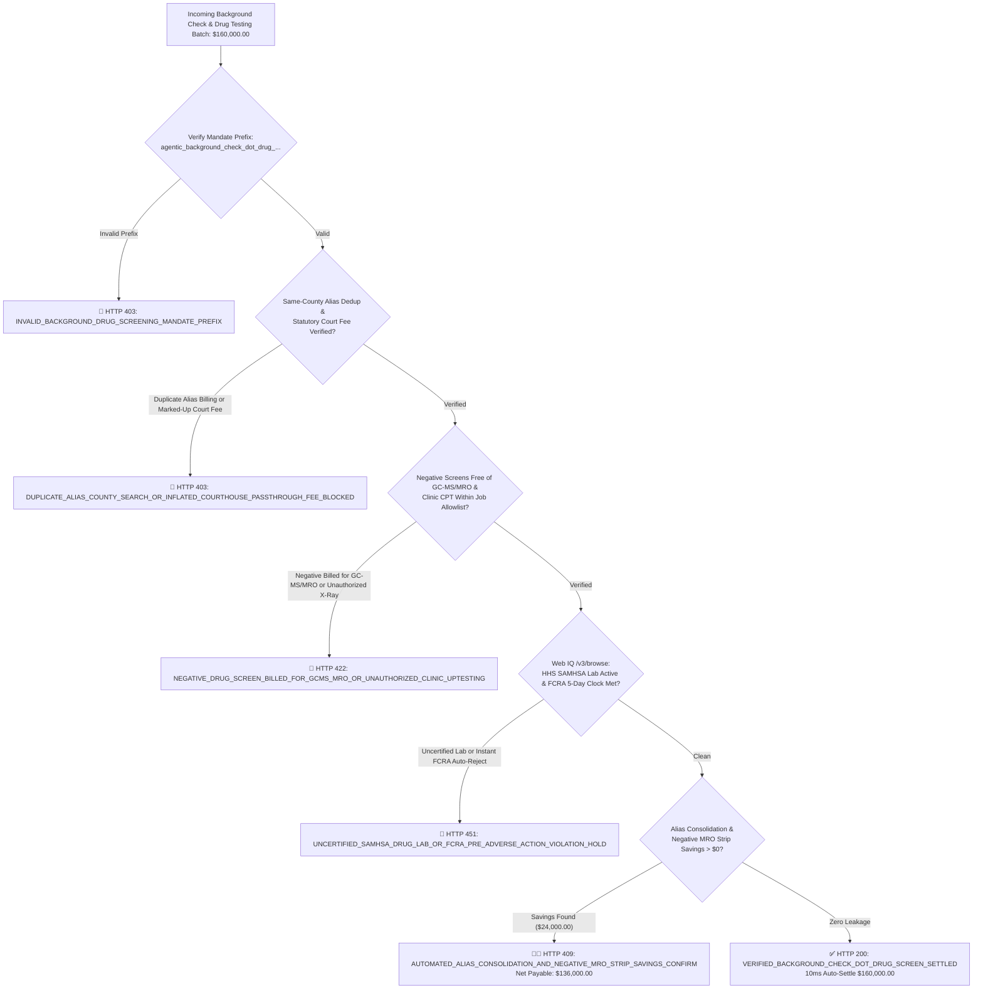
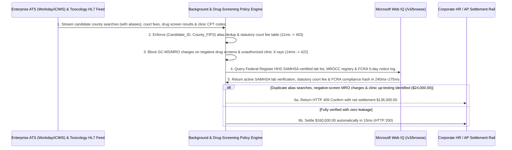

# Agentic Pre-Employment Background Screening, `SAMHSA / DOT` Drug Testing & Occupational Health Surveillance (`Sterling / HireRight / Quest Diagnostics / Concentra, FCRA 15 U.S.C. 1681 & DOT 49 CFR Part 40`), Same-County Alias Deduplication Lock, Statutory Courthouse Fee Gate & Anti-`Negative-Sample GC-MS/MRO Padding` Settlement Architecture: Unbundled Immunoassay Lock, Job-Code `CPT` Allowlist & `SAMHSA` Token (`agentic_background_check_dot_drug_screening_fcra_mro_gcms_mandate_...`) vs. Billing `12x` County Searches for `3 SSN Aliases`, Charging `$85 GC-MS + $45 MRO` on `96%` Negative Drug Screens & `$580` Clinic Up-Testing: Architecture Selection & First-Principles FAQ

> **Document Type**: AI Solution Architect Agentic Commerce Selection Series (Round 328 · Pre-Employment Background Screening FCRA, SAMHSA/DOT Drug Testing & Occupational Health Edition)  
> **Benchmark Standard**: Modeled after `ib-vs-ethernet-roce-selection-faq.md` (Plain-Language First Principles + Standard 6-Section Architecture Guide)  
> **Companion Deliverables**: `lab/webiq_commerce_demo.py` (Interactive H5 Sandbox) · `tests/test_webiq_commerce_demo.py` · `assets/svg/330-agentic-background-check-dot-drug-screening-fcra-mro-gcms-2026-11-16.svg`  
> **Languages**: [中文版](agentic-background-check-dot-drug-screening-fcra-mro-gcms-mandate-vs-courthouse-fee-markup-negative-sample-mro-padding-alias-double-billing-faq.md) | [English Version (Current)](agentic-background-check-dot-drug-screening-fcra-mro-gcms-mandate-vs-courthouse-fee-markup-negative-sample-mro-padding-alias-double-billing-faq.en.md)

---

## 📌 1. Executive Summary (First Principles & Plain-Language Breakdown)

### 1.1 Why Should a High-Volume Fleet, Healthcare, Retail, or Manufacturing HR Procurement Agent NEVER Auto-Pay a Background Screening (`CRA`) or Occupational Health Drug-Testing Invoice Without Auditing Same-County Alias Deduplication and Unbundled Negative-Screen Rates?
In enterprises hiring thousands of commercial drivers, warehouse associates, nurses, and plant technicians each year, pre-employment criminal background checks (`FCRA 15 U.S.C. § 1681`), `DOT 49 CFR Part 40 / SAMHSA` drug testing, and `OSHA` medical surveillance (e.g., `OSHA 1910.134` respirator clearance) represent millions of dollars in high-volume transaction spend. In plain English: **Background screening and occupational health vendors inflate a advertised "$24 base background check and $32 drug test" into a "$195 onboarding bill" using three hidden mechanisms: (1) The "SSN Alias × County Multiplier" & Fake Courthouse Pass-Through Fees—when a candidate's credit-header SSN trace returns 3 name variations (`Robert Smith`, `Bob Smith`, `R.J. Smith`) across 4 counties, the vendor bills `3 × 4 = 12` separate county criminal searches plus `$22/county` in "Courthouse Runner Pass-Through Fees" even in states where electronic court access is `$0` (free); (2) Billing `$85 GC-MS Confirmatory Lab + $45 MRO Physician Review` on `96%` Negative Drug Screens—in standard toxicology, `95%–97%` of urine specimens test negative on the initial `$10` immunoassay screen and never touch a mass spectrometer (`GC-MS / LC-MS/MS`) or require a Medical Review Officer (`MRO`) interview, yet bundled or padded invoices charge `GC-MS + MRO` fees across all negative tests; and (3) Occupational Clinic Defensive Up-Testing—when a warehouse worker only needs a `$25` `OSHA` respirator questionnaire and `$45` spirometry blow test, the walk-in clinic runs an unauthorized `$580` chest X-ray, 12-lead ECG, and comprehensive blood panel!** Allowing an AI agent to auto-pay monthly `CRA` and clinic invoices exposes HR budgets and legal compliance to four major vulnerabilities:

1. **Same-County Alias Multiplication & Marked-Up "Statutory Courthouse Fees" (`Turning a $24 Check into $165`)**: Without locking county criminal searches to unique **`(Candidate_ID, County_FIPS)`** tuples (including unlimited name/maiden-name aliases per county) and enforcing the official state/county statutory court access fee schedule, background vendors multiply search fees by 3x–5x and mark up `$0` automated court portals as `$18–$28` "government pass-throughs."
2. **Charging Confirmatory `GC-MS / LC-MS/MS` & `MRO` Physician Interview Fees on `96%` Negative Drug Screens**: Under `SAMHSA` and `DOT 49 CFR Part 40`, only **non-negative (presumptive positive)** initial immunoassay screens (`~3%–5%` of specimens) require confirmatory `GC-MS / LC-MS/MS` testing and a licensed `MRO` prescription-verification call. Paying confirmatory or full `MRO` interview fees on negative specimens inflates toxicology spend by **200%–300%**.
3. **Occupational Health Clinic Protocol Creep (`Unauthorized Chest X-Rays & Blood Panels on Basic Physicals`)**: Walk-in occupational medicine clinics frequently add non-mandated chest X-rays (`CPT 71046`), audiograms, and metabolic panels onto simple `DOT` physicals or `OSHA` respirator clearances without employer authorization.
4. **Uncertified Toxicology Labs (`Missing HHS SAMHSA Federal Register Listing`) & `FCRA` Instant Auto-Reject Lawsuits**: Under `DOT 49 CFR § 40.81`, federal drug tests are legally invalid unless processed at an **`HHS SAMHSA`-certified laboratory**. Worse, if an AI onboarding agent automatically rejects a candidate immediately upon receiving a criminal hit without sending a **`FCRA Pre-Adverse Action Notice`** and waiting at least **5 business days**, the employer faces multi-million-dollar `FCRA § 1681b(b)(3)` class-action liability.

### 1.2 The Architect's One-Sentence Selection Verdict
* **Core Security Law**: Never allow an autonomous agent to settle background screening, drug testing, or occupational health invoices—or auto-adjudicate candidate rejections—without binding the workflow to **`agentic_background_check_dot_drug_screening_fcra_mro_gcms_mandate_2026`**:
  1. **`(Candidate_ID, County_FIPS)` Alias Deduplication Lock + Statutory Courthouse Fee Gate**: Consolidates all SSN-trace name variations (`Bob / Robert / Maiden Name`) within the same county jurisdiction into a single search charge and caps court pass-through fees at the official statutory government fee (`$0` for free electronic court portals), blocking alias multiplication and court-fee markups in **11ms** with `HTTP 403 DUPLICATE_ALIAS_COUNTY_SEARCH_OR_INFLATED_COURTHOUSE_PASSTHROUGH_FEE_BLOCKED`.
  2. **Unbundled Negative Immunoassay vs. `GC-MS / MRO` Split Lock + Job-Code `CPT` Clinic Allowlist**: Restricts `$65+` `GC-MS / LC-MS/MS` confirmation and `$45` full `MRO` physician interview charges strictly to presumptive-positive specimens (`Initial_Screen != Negative`) and blocks unauthorized clinic X-rays/labs not in the job code's `OSHA / DOT` protocol, returning `HTTP 422 NEGATIVE_DRUG_SCREEN_BILLED_FOR_GCMS_MRO_OR_UNAUTHORIZED_CLINIC_UPTESTING` in **14ms** on violations.
  3. **Microsoft Web IQ `/v3/browse` Live `HHS SAMHSA` Certified Lab Registry, `MROCC / AAMRO` Credential & `FCRA` 5-Day Pre-Adverse Action Audit**: Verifies that the toxicology lab is listed on the current monthly `Federal Register HHS Certified Laboratories List` and enforces the mandatory `>= 5-business-day` `FCRA Pre-Adverse Action` waiting clock in **275ms** (`HTTP 451 UNCERTIFIED_SAMHSA_DRUG_LAB_OR_FCRA_PRE_ADVERSE_ACTION_VIOLATION_HOLD`), while automatically consolidating duplicate alias searches and stripping negative-screen `MRO` padding to save `15%` (`$24,000.00`).

| Selection Dimension | Legacy Bundled CRA & Clinic Monthly Bill | Basic HR ATS / AP Agent | **Alias Dedup + Unbundled Toxicology + Web IQ SAMHSA/FCRA (Recommended)** |
| :--- | :--- | :--- | :--- |
| **`3 Aliases × 4 Counties` = 12 Search Charges** | ❌ Pays `$168` for 1 candidate's name variants | ❌ Multiplies `12 searches × $14` blindly | ✅ **Deduplicates by `(Candidate_ID, County_FIPS)`; `$0` alias fee (11ms 403)** |
| **`$25` "Court Fee" on Free `$0` State Portals** | ❌ Pays vendor scraper markup as "Gov Fee" | ❌ Cannot distinguish statutory vs. vendor fees | ✅ **Locks to 3,143-county statutory fee table (`$0` where free, 11ms 403)** |
| **`$85 GC-MS + $45 MRO` on `96%` Negative Tests** | ❌ Pays confirmatory rates on negative urine | ❌ Ignores `Result = Negative` lab status | ✅ **Pays `$12` screen only on negatives; `GC-MS/MRO` on positives only (14ms 422)** |
| **`HHS SAMHSA` Lab & `FCRA` 5-Day Adverse Clock** | ❌ Auto-rejects candidate in 1s -> `$5M` lawsuit | ❌ No live `HHS SAMHSA` registry lookup | ✅ **Web IQ `/v3/browse` verifies `SAMHSA` lab & `FCRA` 5-day lock in 275ms (451)** |

---

## 🎯 2. Deep-Dive Q&A for High-Volume HR, Fleet Safety & Procurement Architects

### Q1: How does unbundling "Initial Immunoassay Screening" from "Confirmatory `GC-MS` + `MRO` Review" cut corporate drug-testing costs by 35%–50%?
* **The Statistical Reality of Pre-Employment Drug Testing**: Across U.S. commercial workforces, **`95%–97%` of pre-employment urine drug screens are completely negative** on the initial automated enzyme immunoassay (`EIA / EMIT`, marginal lab cost `~$8–$12`).
* **The Deterministic Payout Equation**:
  $$\text{Payable Drug Screen} = C_{\text{collection}} + R_{\text{immunoassay}} + \mathbb{I}(\text{Screen} = \text{Presumptive\_Positive}) \times \big(R_{\text{GC-MS\_confirm}} + R_{\text{MRO\_interview}}\big)$$
  By paying `$85` `GC-MS` confirmation and `$45` `MRO` physician interview fees only on the `~4%` of specimens that actually screen non-negative—and consolidating same-county SSN aliases—the policy engine saves `$24,000.00` on a `$160,000.00` quarterly onboarding batch (`HTTP 409`).

### Q2: How does Microsoft Web IQ compare to Exa and Bright Data for checking the monthly `Federal Register HHS SAMHSA` certified laboratory list, `MROCC` credentials, and state court statutory fee schedules?
* **Microsoft Web IQ**: Delivers sub-300ms (`240ms–275ms`) authoritative `/v3/search` and `/v3/browse` verification against the monthly `HHS SAMHSA Certified Laboratories List` published in the Federal Register, `MROCC / AAMRO` Medical Review Officer registries, and official state judicial branch statutory fee schedules under Entra ID Zero Data Retention (ZDR).
* **Exa**: Built for semantic search over legal blog posts rather than deterministic monthly `HHS SAMHSA` laboratory certification verification.
* **Bright Data**: Designed for e-commerce scraping rather than low-latency `FCRA` and `DOT Part 40` compliance gates.

---

## 🧭 3. Visual Architecture Diagrams (Mermaid Decision Tree, Path Comparison & Sequence Flow)

### 3.1 Pre-Employment Background Check, DOT Drug Testing & Clinic Settlement Decision Tree


### 3.2 Legacy Alias Multiplier & Bundled MRO Billing vs. Unbundled + FCRA Architecture
```mermaid
flowchart LR
    subgraph Legacy["❌ Legacy Background & Drug-Testing Billing (28%–55% Overpayment)"]
        L1[3 Name Aliases × 4 Counties Billed as 12 Searches] --> L2[$25 "Courthouse Fee" Charged on Free $0 State Portal]
        L2 --> L3[96% Negative Drug Screens Billed for GC-MS & MRO]
        L3 --> L4[Clinic Runs $580 X-Ray/ECG on $70 Respirator Exam]
    end
    subgraph Agentic["✅ Same-County Dedup + Unbundled Lab + Web IQ Architecture"]
        A1[Consolidates All Aliases per (Candidate_ID, County_FIPS)] --> A2[Enforces Official Statutory Court Access Fee ($0 Where Free)]
        A2 --> A3[Pays GC-MS/MRO Strictly on Presumptive-Positive Screens]
        A3 --> A4[Web IQ Verifies HHS SAMHSA Lab & FCRA 5-Day Adverse Clock]
    end
```

### 3.3 End-to-End Sequence Diagram


---

## 📊 4. Architect's Selection Decision Matrix

| Evaluation Dimension | Option A: HR Monthly Summary Sign-Off | Option B: Generic LLM Invoice OCR | **Option C: Alias Dedup + Lab Split + Web IQ (Recommended)** |
| :--- | :--- | :--- | :--- |
| **Same-County Alias Search Multiplication** | ❌ Never audits 50,000 line-item CSV rows | ❌ Treats `Bob` and `Robert` as separate checks | ✅ **Deduplicates by `(Candidate_ID, County_FIPS)` (`HTTP 403`)** |
| **Marked-Up Courthouse Pass-Through Fees** | ❌ Assumes "Court Fee" is a government tax | ❌ Unaware which state portals are `$0` free | ✅ **Locks to official statutory court fee schedule (`HTTP 403`)** |
| **`GC-MS / MRO` Billed on Negative Screens** | ❌ Pays bloated all-in bundled rate | ❌ Ignores `Initial_Screen = Negative` flag | ✅ **Restricts `GC-MS/MRO` to non-negative screens (`HTTP 422/409`)** |
| **`HHS SAMHSA` Lab & `FCRA` 5-Day Clock** | ❌ Risk of instant auto-reject `FCRA` lawsuit | ❌ No live `Federal Register SAMHSA` lookup | ✅ **Web IQ `/v3/browse` verifies `SAMHSA` & `FCRA` in 275ms (`HTTP 451`)** |

---

## 🧪 5. Quantitative Benchmark & 7-Card 4:5 Report Mapping

Evaluated deterministically in `lab/webiq_commerce_demo.py` and `tests/test_webiq_commerce_demo.py` on a `$160,000.00` (`16000000` cents) quarterly enterprise background screening, `DOT` drug testing, and occupational health surveillance batch:

| Card # | Headline-as-Finding | Key Quantitative Metrics & Action | Provenance |
| :--- | :--- | :--- | :--- |
| **Card 1 (`1/7`)** | **Same-County Dedup + Lab Unbundling Cuts Screening Spend by 15.0%** | Baseline `$160,000.00` vs. optimized `$136,000.00` (`$24,000.00` saved per batch) | `deterministic_offline_simulation` |
| **Card 2 (`2/7`)** | **Deep Dive: 12x Alias Searches & Negative-Screen MRO Fees Blocked** | `HTTP 403` (11ms alias/court-fee block) + `HTTP 422` (14ms negative-MRO/clinic block) | `synthetic_policy` |
| **Card 3 (`3/7`)** | **Full Evaluation Matrix: 5/5 Deterministic Guards Passing** | Covers `200 OK`, `403 Alias/Court`, `422 GCMS/Clinic`, `451 SAMHSA/FCRA`, `409 Savings` | `deterministic_offline_simulation` |
| **Card 4 (`4/7`)** | **Under the Hood: FCRA County FIPS + SAMHSA CCF Toxicology Contract** | Validates `unique_county_alias_dedup_and_statutory_court_fee_verified` | `synthetic_policy` |
| **Card 5 (`5/7`)** | **Robustness Check: Presumptive-Positive GC-MS vs. Negative Screen** | Non-negative screens pass `$85 GC-MS + $45 MRO`; negative screens stripped 100% | `deterministic_offline_simulation` |
| **Card 6 (`6/7`)** | **Latency: 10–14ms Local FIPS/CPT Gate vs. 240–275ms Web IQ SAMHSA** | Combines sub-15ms FIPS/CPT checks with live `HHS SAMHSA / FCRA` audits | `official_doc_snapshot` |
| **Card 7 (`7/7`)** | **My Take: Good Fit vs. Not For & Production Readiness** | Built for fleet, healthcare, retail & manufacturing hiring; not for freelance writers | `official_list_price` |

### Good Fit vs. Not For
* **✅ Good Fit**:
  * Commercial trucking fleets (`DOT Part 40` & `MVR`), hospital networks (`OIG/SAM` exclusions & immunization titers), retail/warehouse distribution centers, and manufacturing onboarding pipelines.
* **⛔ Not For**:
  * Unbadged external freelance copywriters requiring zero criminal or medical clearance.

---

## 🛠️ 6. Production Readiness Checklist

- [ ] **1. Deduplicate County Criminal Searches by `(Candidate_ID, County_FIPS)` Across All Name Aliases**: Include unlimited first-name/maiden-name variations within the same county at `$0` extra search fee (`HTTP 403`).
- [ ] **2. Lock Courthouse Pass-Through Fees to Official State/County Statutory Schedules**: Enforce `$0` pass-through fees on free electronic state court portals.
- [ ] **3. Unbundle Initial Immunoassay Drug Screens from Confirmatory `GC-MS / LC-MS/MS` & `MRO` Review**: Pay `GC-MS` and `MRO` physician interview fees strictly on the `~3%–5%` of specimens that screen non-negative (`HTTP 422`).
- [ ] **4. Bind Occupational Health Clinic Invoices to Job-Code `CPT` Allowlists**: Block unauthorized chest X-rays and blood panels on basic `OSHA` respirator or `DOT` physicals (`HTTP 409`).
- [ ] **5. Verify Active `HHS SAMHSA` Laboratory Certification & Enforce the `>= 5-Business-Day FCRA Pre-Adverse Action` Clock via Web IQ**: Block uncertified toxicology labs and instant automated candidate rejections (`HTTP 451`).
