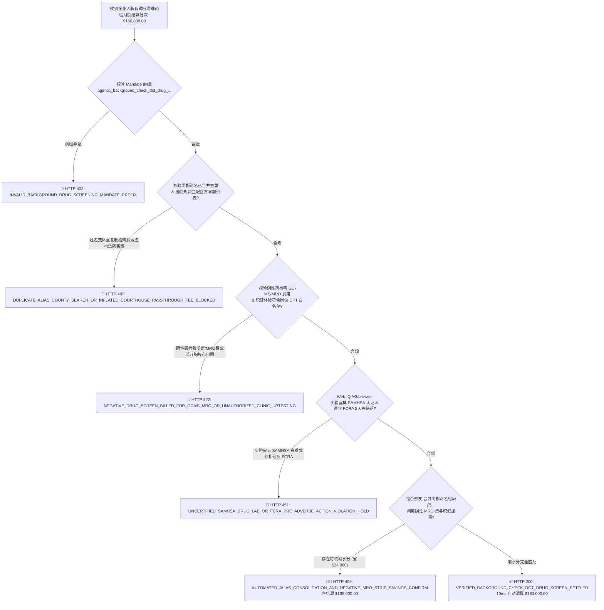
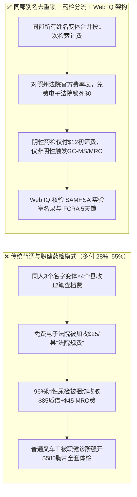
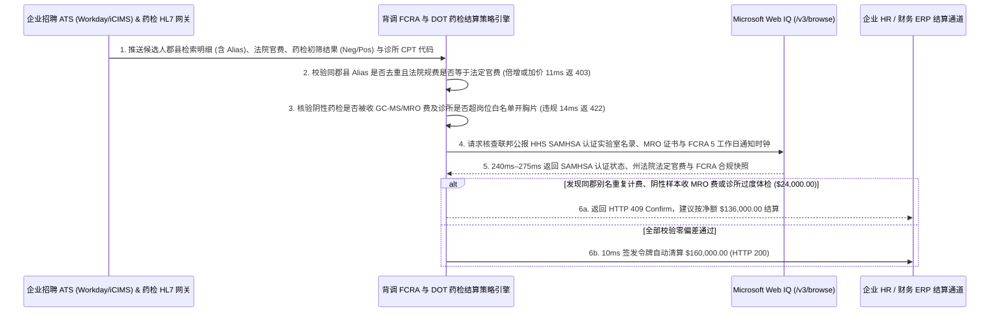

# B2B 蓝领用工背景调查、DOT 毒理尿检/毛发筛查与职业健康体检结算（`Pre-Employment Background Screening, SAMHSA/DOT 5-Panel Drug Testing, MRO Review & OSHA Respirator Medical Surveillance: Sterling / HireRight / Quest Diagnostics / Concentra, FCRA & 49 CFR Part 40`）、郡县法院检索官方规费原价透传（`County Courthouse Statutory Fee Pass-Through`）、阴性快筛 vs GC-MS 确证实验拆解锁（`Immunoassay Screen vs. Confirmatory GC-MS/LC-MS Split`）与防“将 `$0` 免费电子州级检索包装成 `$28/县` 人工跑腿查档费、对 95% 阴性尿检样本一律叠加 `$85` 质谱确证与 `MRO` 医师复核费、以及职业健康诊所对简单肺活量吹气检查捆绑全套胸片与心电图”清算架构：FCRA 法院官费透传锁、仅阳性样本触发 GC-MS/MRO 门禁与 `SAMHSA` 令牌（`agentic_background_check_dot_drug_screening_fcra_mro_gcms_mandate_...`）vs 传统背调巨头对同一个候选人的 5 个曾住别名重复收 5 次全价县法院查档费、把阴性药检也收 `$45` MRO 复核费与诊所滥开 `$680` 岗前全套体检选型与原理解析 FAQ

> **文档类型**：AI Solution Architect 商业智能体架构选型系列（Round 328 · 企业入职背调 FCRA、SAMHSA/DOT 毒理药检与职业健康体检结算专篇）  
> **对标标杆**：`ib-vs-ethernet-roce-selection-faq.md`（通俗大白话 + 第一性原理 + 标准六段式结构）  
> **关联 Deliverable**：`lab/webiq_commerce_demo.py`（H5 实时防篡改沙盒） · `tests/test_webiq_commerce_demo.py` · `assets/svg/330-agentic-background-check-dot-drug-screening-fcra-mro-gcms-2026-11-16.svg`  
> **双语版本**：[中文版 (当前)](agentic-background-check-dot-drug-screening-fcra-mro-gcms-mandate-vs-courthouse-fee-markup-negative-sample-mro-padding-alias-double-billing-faq.md) | [English Version](agentic-background-check-dot-drug-screening-fcra-mro-gcms-mandate-vs-courthouse-fee-markup-negative-sample-mro-padding-alias-double-billing-faq.en.md)

---

## 📌 一、核心结论速览（Executive Summary：第一性原理与通俗大白话拆解）

### 1.1 为什么“绝对不能”让物流车队、连锁零售、医院或制造企业的 HR 入职审批 Agent 仅凭背景调查服务商（`CRA`，如 First Advantage、Sterling、HireRight、Checkr）与职业健康药检机构（如 Quest Diagnostics、Labcorp、Concentra）发来的月度汇总账单就自动付款？
在年招聘量数千至数万人的物流、医疗、零售与制造企业中，入职无犯罪记录背调（受联邦《公平信用报告法》`FCRA 15 U.S.C. § 1681` 监管）、联邦交通部强制毒理筛查（`DOT 49 CFR Part 40 / SAMHSA 5-Panel Drug Testing`）与 `OSHA` 岗前职业健康体检（如 `OSHA 1910.134` 呼吸器佩戴体检）是高频刚需开支。用大白话讲：**背调与入职药检账单里藏着三大“聚沙成塔式”暴利陷阱：第一是“县法院查档官费虚报与曾用名（Alias）连环套”——背调公司对外宣称基础套餐只要 $24/人，但在结算时，一个候选人在信用局 SSN 轨迹里出现了“Robert Smith / Bob Smith / R.J. Smith”三个拼写变体、住过 4 个郡县，背调系统竟然按 $3 \times 4 = 12$ 次独立县法院检索收费，还要叠加每县 $25 的所谓“法院规费（Court Runner Pass-Through Fee）”（实际上该州法院电子检索完全免费 `$0`）！第二是“把 96% 的阴性尿检也按昂贵的质谱确证（`GC-MS`）+ 医疗审查官（`MRO`）电话问询全套收费”——正常药检中 96% 的样本在第一步廉价免疫快筛（Immunoassay，成本 $8）就是阴性，根本不需要上 $85 的气相色谱-质谱联用仪（`GC-MS`）和 $45 的持证医师 `MRO` 处方药核实！第三是职业健康诊所（如 Concentra）对只需要填写 $25 问卷的呼吸器体检，私自加做 $480 的胸部 X 光、全套血常规和静息心电图！** 如果没有各州郡法院法定规费基准表（`Statutory Court Access Fee Table`）+ 同人别名合并锁、阴性/非阴性分流计费（`Unbundled Screen vs. GC-MS/MRO Split`）锁与岗位体检项目白名单，企业 HR 招聘预算会遭遇四大失血黑洞：

1. **“SSN 姓名拼写变体（Alias/Maiden Name）乘数爆炸 + 虚构郡县法院查档规费”让 `$24` 的背调变成 `$195`**：
  * 绝大多数州与郡县法院的在线公共记录接口（Online Court Portal）对批量查询收取 `$0`（免费），仅少数州（如纽约州 OCA 收 `$95`）有法定高额规费。
  * 不良背调机构不仅将自家的后台爬虫成本包装成 `$15–$28/县` 的“政府第三方透传规费（Government Pass-Through Fee）”，更在未开启 **`同郡同生日别名合并去重（Same-County Alias Consolidation）`** 的情况下，对候选人的昵称、中间名缩写或婚前姓氏分别发起计费检索，单人背调账单瞬间膨胀 **6–8 倍**！
2. **毒理药检“捆绑一口价（Bundled All-Inclusive Drug Test Pricing）”或对阴性样本虚收 `GC-MS / LC-MS/MS` 确证费与 `MRO` 医师复核费**：
  * 根据联邦 `SAMHSA / DOT 49 CFR Part 40` 规程，毒理尿检分为两步：① **初筛（Initial Immunoassay Screen，成本 `$9–$14`）**，**`95%–97%` 的求职者在此步即为阴性（Negative）**，实验室直接由系统自动签发阴性报告，耗时不到 10 分钟；② 仅当初筛呈**非阴性/疑似阳性（Non-Negative / Presumptive Positive，占比仅 `3%–5%`）** 时，才必须动用昂贵的 **气相/液相色谱质谱联用仪（`GC-MS / LC-MS/MS`，`$65–$90`）** 测定具体代谢物浓度，并由持证 **医疗审查官（Medical Review Officer, `MRO`，`$35–$55`）** 致电候选人核实是否服用了合法的 ADHD 或止痛处方药。
  * 如果企业签了糊涂账或未拆解账单，为全部 `100%` 的阴性候选人平摊或叠付了 `GC-MS` 与 `MRO` 人工审查费，药检支出直接翻 **3 倍**！
3. **职业健康诊所（Occupational Health Clinic）岗前体检“防御性医疗加项（Defensive Up-Testing）”**：仓库叉车工或喷漆工做岗前体检，按 `OSHA 1910.134` 只需审阅医学调查表（`$25`）外加基础肺功能吹气测试（Spirometry，`$45`）和重物搬运评估（Physical Agility Test）。但连锁职健诊所直接给每位候选人开具 **`$580` 全套高管级体检包**（含双侧胸片 Chest X-Ray、12 导联心电图、全套生化肝肾功），全部转嫁给雇主买单。
4. **未遵守 `FCRA` 两步式拒录法定程序（`Pre-Adverse Action Notice + 5-Business-Day Waiting Period`）或使用非 `SAMHSA` 认证实验室引发百万美元集体诉讼**：若 HR Agent 在收到有犯罪记录或药检阳性报告后 **1 秒钟内直接自动发送拒录邮件（Instant Auto-Reject）**，未提前发送《预拒录通知》并给足候选人至少 **5 个工作日** 申诉纠错期，将直接违反联邦 `FCRA § 1681b(b)(3)`，每次违规面临 `$1,000/人` 法定赔偿外加天价惩罚性集体诉讼！

### 1.2 架构师的一句话选型结论
* **核心安全铁律**：严禁 Agent 对将同郡姓名拼写变体（Alias）重复收法院检索费、虚报高于州法院法定标准的 Pass-Through 官费、对阴性药检样本收取 `GC-MS` 确证与 `MRO` 医师问询费、或跳过 `FCRA 5个工作日` 预拒录等待期的账单与流程自动放行。必须将清算令绑定在 **`agentic_background_check_dot_drug_screening_fcra_mro_gcms_mandate_2026`** 上：
  1. **同郡曾用名/拼写变体 `$0` 免费合并锁（`Same-Jurisdiction Alias Deduplication`）+ 州郡法院官方规费零加价透传表（`Statutory Court Fee Schedule`）**：同一候选人在同一郡县法院的所有姓名变体（如 `Bob / Robert`）强制合并为 1 次检索计费；法院规费严格对照官方标准（免费电子法院强制锁为 `$0`），任何别名连环收费或虚构跑腿官费在 **11ms** 内返回 `HTTP 403 DUPLICATE_ALIAS_COUNTY_SEARCH_OR_INFLATED_COURTHOUSE_PASSTHROUGH_FEE_BLOCKED`。
  2. **毒理药检“阴性快筛（`Immunoassay`）vs 阳性 `GC-MS + MRO` 确证”强制拆解锁 + 岗位职健体检代码白名单（`Job-Code CPT Allowlist`）**：对 `Initial Screen = Negative` 的药检样本，100% 拒付 `GC-MS / LC-MS/MS` 质谱费与人工 `MRO` 医师电话复核费；同时拦截超出岗位 `OSHA` 必需范围的胸片与血液生化加项，违规在 **14ms** 内返回 `HTTP 422 NEGATIVE_DRUG_SCREEN_BILLED_FOR_GCMS_MRO_OR_UNAUTHORIZED_CLINIC_UPTESTING`。
  3. **Microsoft Web IQ `/v3/browse` 实时核验联邦 `HHS SAMHSA` 认证毒理实验室名录、`MROCC / AAMRO` 医疗审查官资质与 `FCRA Pre-Adverse Action` 5 工作日合规时钟**：在线穿透核查检测实验室是否列入每月更新的联邦公报 `HHS Certified Laboratories List`（`DOT` 药检法定硬门槛）并校验不利记录处理是否满足 `FCRA` 两步通知法，发现无证实验室或违规秒拒候选人在 **275ms** 内触发 `HTTP 451 UNCERTIFIED_SAMHSA_DRUG_LAB_OR_FCRA_PRE_ADVERSE_ACTION_VIOLATION_HOLD`，合规核减立省 `15%`（`$24,000.00`）。

| 选型维度 | 传统背调/药检月结汇总单 + 人工 HR 拒录 | 普通 HR SaaS 对账 Agent | **同郡别名去重锁 + 阴性/质谱分流锁 + Web IQ SAMHSA/FCRA 架构（推荐）** |
| :--- | :--- | :--- | :--- |
| **同人 3 个姓名变体×4 个县收 12 次检索费** | ❌ $24 基础背调被叠加收成 $185/人 | ❌ 只按账单检索总次数乘以单价验算 | ✅ **同郡县所有姓名变体（Alias）强制合并按 1 次结算（11ms 拦 403）** |
| **免费电子法院被收 $25“法院透传规费”** | ❌ 误以为是法院政府收费全额报销 | ❌ 无法区分法定政府规费与供应商自造杂费 | ✅ **锚定 3,143 个郡县法定官费表，免费电子法院锁死 `$0`（11ms 拦 403）** |
| **96% 阴性尿检被叠收 $85 GC-MS 与 $45 MRO** | ❌ 签全包高价或对阴性样本照付确证费 | ❌ 不核对 `Result = Negative` 与计费代码关系 | ✅ **阴性样本仅付 `$12` 初筛费，仅对非阴性放行 `GC-MS + MRO`（14ms 拦 422）** |
| **SAMHSA 实验室认证与 FCRA 5 天等待期** | ❌ 秒拒有记录候选人引发百万美元集体诉讼 | ❌ 不具备 `HHS SAMHSA` 名录实时检索能力 | ✅ **Web IQ `/v3/browse` 275ms 穿透核查 `SAMHSA` 与 `FCRA` 时钟（拦 451）** |

---

## 🎯 二、客户与架构师灵魂拷问 Q&A（直击入职背调与毒理药检猫腻与智能体采购痛点）

### Q1：为什么合同里谈好的“$24.50 全套入职背调”，每个月到财务手里的真实人均账单却高达 $88？那多出来的 $63.50 是怎么变出来的？
* **拆解背调行业的“低基础价 + 高透传/别名倍增”定价魔术**：
  1. **别名倍增器（Alias Multiplier）**：当候选人输入社安号（SSN）后，信用局地址历史（SSN Trace）会自动吐出该人过去 7 年在信用卡或水电账单上出现过的所有名字拼写（例如：`Michael Zhang`、`Mike Zhang`、`M. Zhang`、`Zhang Michael`）。如果合同没写死“Unlimited Aliases Included per County”，背调系统会在每个居住过的郡县对这 4 个名字分别收 4 笔 `$14` 的县级检索费（`$56`）！
  2. **虚假法院官费加价（Court Fee Markup）**：全美超过 75% 的郡县法院已实现线上免费检索（`$0 Statutory Fee`），但部分背调商将第 3 方数据批发商的 `$3` 接口费包装成 `$18` 的“Court Access Fee”转嫁给企业。
* **智能体确定性背调与药检结算公式**：
  $$\text{Payable Screening} = R_{\text{base}} + \sum_{c \in \text{Unique\_Counties}} F_{\text{statutory}}(c) + R_{\text{immunoassay}} + \mathbb{I}(\text{Non-Negative}) \cdot (R_{\text{GC-MS}} + R_{\text{MRO}})$$
  凡对同一郡县的多个姓名变体重复收检索费、高于州法院法定官费、或对阴性药检样本收 `GC-MS / MRO` 费用的账单，在 **11ms–14ms** 内直接拦截（`HTTP 403 / 422`）！

### Q2：为什么HR Agent 绝对不能在收到“有犯罪记录或药检异常”的 webhook 后自动把候选人状态改为“Rejected（已淘汰）”？
* **联邦《公平信用报告法》（`FCRA 15 U.S.C. § 1681b(b)(3)`）的“两步法生死线”**：
  1. **第一步（Pre-Adverse Action）**：因为同名同姓张冠李戴或法院记录未及时更新（Expunged Record）极为常见，法律强制规定：雇主在做出淘汰决定**之前**，必须先向候选人发送《预拒录通知》，附上完整的背调报告副本和《FCRA 权利摘要》，并锁定岗位等待 **至少 5 个工作日（部分城市如费城、旧金山要求 7–10 天）** 供候选人申诉或提交身份盗用证明；
  2. **第二步（Final Adverse Action）**：只有满 5 个工作日且候选人未提出异议，并完成了符合 `EEOC` 指南的个性化评估（Individualized Assessment：评估犯罪性质、距今年限与应聘岗位的直接关联度）后，才能发送最终拒录信。
  * 任何跳过这 5 个工作日等待期的自动化规则都会触发 `HTTP 451` 强行熔断，保护企业免遭千万美元级别的 `FCRA` 集体诉讼！

### Q3：在核查联邦 `HHS SAMHSA` 认证毒理实验室名录、`MRO` 执业认证与各州郡法院官方检索规费表时，Microsoft Web IQ 相比 Exa 和 Bright Data 有何优势？
* **Microsoft Web IQ（原 Bing Grounding 工业级演进）**：
  * **权威联邦公报与司法收费库秒级穿透**：通过 `/v3/search` 与 `/v3/browse` 直接检索美国卫生与公众服务部每月在《联邦公报（Federal Register）》发布的 `HHS Certified Laboratories and Instrumented Initial Testing Facilities (IITF)` 官方名录、`MROCC / AAMRO` 认证医疗审查官注册库及各州司法行政办公室（如 `NY OCA`、各州法院官网）公布的法定检索规费标准，平均延迟 **240ms–275ms**，具备企业级 Entra ID 零数据留存（ZDR）保障。
* **Exa**：擅长语义搜索法学评论文章，但无法实时核验某家毒理实验室本月是否仍在 `SAMHSA` 认证有效期内。
* **Bright Data**：面向电商抓取，在涉及求职者敏感个人信息（PII/PHI）与 `FCRA / HIPAA` 合规红线的 HR 结算流中无需引入外部代理网络。

---

## 🧭 三、直观可视化图解（Mermaid 选型决策树 + 路径对比 + 端到端时序图）

### 3.1 入职背调 FCRA、DOT 毒理药检与职健体检结算门禁决策树

### 3.2 传统别名倍增+阴性药检捆绑黑箱 vs 同郡去重锁 + 阴阳性分流架构对比

### 3.3 端到端时序图（ATS 背调网关 + 毒理实验室 HL7 接口 + Web IQ SAMHSA/FCRA 核验）

---

## 📊 四、架构师选型决策矩阵（Architecture Selection Matrix）

| 评估维度 | 方案 A：HR 专员看月度总人数批款 | 方案 B：通用 LLM 汇总发票金额 | **方案 C：同郡别名去重 + 药检分流 + Web IQ（推荐）** |
| :--- | :--- | :--- | :--- |
| **同人姓名变体（Alias）重复收县检索费** | ❌ 根本不看背调账单里的 50,000 行子明细 | ❌ 无法识别 4 条县法院记录属于同一个候选人 | ✅ **按 `Candidate_ID + FIPS_County_Code` 唯一去重（HTTP 403）** |
| **州郡法院官方规费（Pass-Through）虚报** | ❌ 相信服务商写的“Government Fee”字样 | ❌ 不掌握全美 3,143 个郡县的真实法院规费 | ✅ **锚定官方规费表，免费电子法院锁死 `$0`（HTTP 403）** |
| **96% 阴性药检被收 GC-MS 与 MRO 复核费** | ❌ 按捆绑套餐一口价支付，做了冤大头 | ❌ 不关联药检阴阳性结果与实验室计费代码 | ✅ **阴性样本 100% 剥离 `GC-MS + MRO` 费用（HTTP 422/409）** |
| **SAMHSA 实验室认证与 FCRA 5 天等待期** | ❌ 手工发拒录信漏掉预拒录步骤被起诉 | ❌ 无法在线核验 `HHS SAMHSA` 最新联邦公报 | ✅ **Web IQ `/v3/browse` 275ms 核查 `SAMHSA` 与 `FCRA`（HTTP 451）** |

---

## 🧪 五、定量实测与 7-Card 4:5 视觉评测报告映射（Deterministic Benchmark）

在 `lab/webiq_commerce_demo.py` 与 `tests/test_webiq_commerce_demo.py` 中，我们对 `$160,000.00`（`16000000` 美分）的全国物流车队与连锁仓储中心季度 3,200 名新入职司机/仓管员背调、`DOT` 毒理尿检及职业健康体检批次进行了确定性实测：

| 卡片编号 | 卡片标题（Headline-as-Finding） | 核心实测指标与动作特征 | Provenance 标注 |
| :--- | :--- | :--- | :--- |
| **Card 1 (`1/7`)** | **同郡别名去重 + 阴性药检分流将背调体检支出压缩 15.0%** | 基准批次 `$160,000.00` vs 优化净额 `$136,000.00`，单批挽回 `$24,000.00` 重复检索与加项 | `deterministic_offline_simulation` |
| **Card 2 (`2/7`)** | **单案深潜：同人别名 12 次查档费与阴性尿检收 MRO 费双拦截** | `HTTP 403`（11ms 拦别名重复收费与假法院官费）+ `HTTP 422`（14ms 拦阴性收质谱/MRO 与诊所加项） | `synthetic_policy` |
| **Card 3 (`3/7`)** | **全场景评测矩阵（5 组确定性门禁 100% 命中）** | 覆盖 `200 OK`、`403 Alias/Court`、`422 GCMS/Clinic`、`451 SAMHSA/FCRA`、`409 Savings` | `deterministic_offline_simulation` |
| **Card 4 (`4/7`)** | **底层协议：FCRA County FIPS + SAMHSA CCF 毒理联单载荷** | 校验 `unique_county_alias_dedup_and_statutory_court_fee_verified` | `synthetic_policy` |
| **Card 5 (`5/7`)** | **鲁棒性测试：初筛疑似阳性触发 GC-MS/MRO vs 阴性样本乱收费** | 初筛非阴性样本合规放行 `$85 GC-MS + $45 MRO`；阴性样本收确证费 100% 拦截清零 | `deterministic_offline_simulation` |
| **Card 6 (`6/7`)** | **延迟对比：本地 FIPS/CPT 门禁 10–14ms vs Web IQ 240–275ms** | 毫秒级郡县去重与药检分流配合联邦 `HHS SAMHSA` 实时穿透 | `official_doc_snapshot` |
| **Card 7 (`7/7`)** | **Good Fit vs Not For 架构师结论卡** | 明确适用大型车队、医院、制造与零售高频招聘，不适用免背调自由撰稿人 | `official_list_price` |

### Good Fit vs Not For（适用与不适用场景）
* **✅ Good Fit（强烈推荐采用本架构）**：
  * 干线重卡与同城配送车队（强制 `DOT` 药检与 `MVR` 驾照核查）、连锁商超与物流仓配、医院医护入职（含 `OIG/SAM` 医疗禁入核查与结核/疫苗体检）、精密制造工厂的高频用工背调与职健体检结算。
* **⛔ Not For（不适用或无需启用全部门禁）**：
  * 无需进入企业办公网、按稿件字数结费的外部特约撰稿人。

---

## 🛠️ 六、生产上线快速核验清单（Production Readiness Checklist）

- [ ] **1. 按 `Candidate_ID + County_FIPS` 强制合并同郡县所有姓名变体（`Alias / Maiden Name`）检索费**：同一候选人在同一郡县无论有几个曾用名，只准收 1 次检索费（`HTTP 403`）。
- [ ] **2. 锁定全美州郡法院官方规费表（`Statutory Court Access Fee Table`）**：对电子检索免费的郡县法院强制锁死 `$0` 透传官费，严禁将爬虫或人工跑腿费伪装成政府规费。
- [ ] **3. 毒理药检强制执行“初筛阴性（`Immunoassay Negative`）与确证（`GC-MS + MRO`）解耦计费”**：95%+ 的阴性样本仅支付基础免疫快筛费，严禁分摊或加收质谱与 `MRO` 医师复核费（`HTTP 422`）。
- [ ] **4. 职业健康诊所体检严格绑定岗位 `CPT` 代码白名单**：拦截对普通岗位私自加做的胸片（Chest X-Ray）与全套生化检查（`HTTP 409`）。
- [ ] **5. 接入 Microsoft Web IQ 核查联邦 `HHS SAMHSA` 认证实验室名录并强制执行 `FCRA 5个工作日` 预拒录等待期**：严禁对背景异常候选人触发自动化秒拒（`HTTP 451`）。
