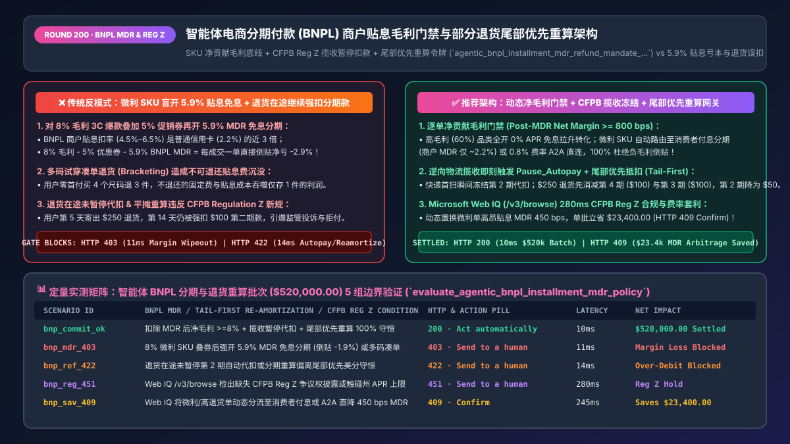
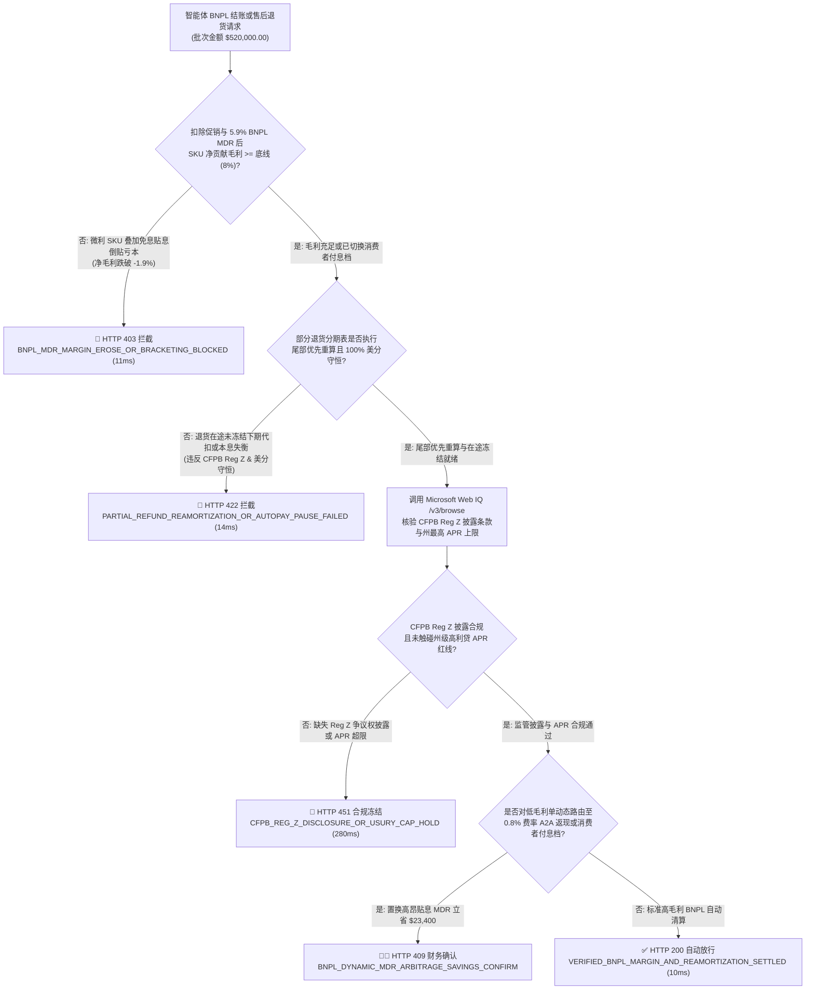
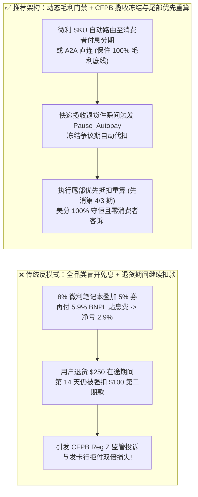
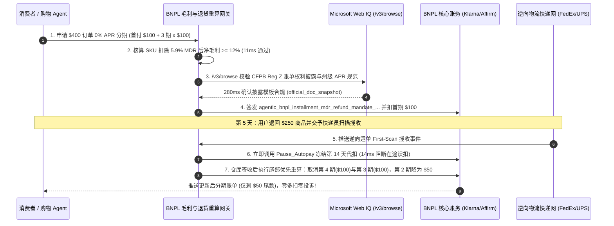

# 智能体电商分期付款（BNPL：Klarna / Affirm / Afterpay）与退货重算架构：商户贴息费率（MDR `4%–6%`）毛利门禁与部分退货本息重算令牌（`agentic_bnpl_installment_mdr_refund_mandate_...`）vs 盲目全品类开放免息分期吞噬微利与退货后继续扣款客诉选型与原理解析 FAQ

> **文档类型**：架构师选型与第一性原理解析 FAQ（对标 `ib-vs-ethernet-roce-selection-faq.md` 六段式标杆规范）  
> **核心覆盖领域**：智能体先享后付（Buy Now, Pay Later, BNPL：Klarna / Affirm / Afterpay / PayPal Pay in 4 / Apple Pay Later 替代路由）、商户贴息扣率（Merchant Discount Rate, MDR `4.5%–6.5%`）与净贡献毛利（Contribution Margin）底线门禁、美国 CFPB 2024/2025 BNPL 监管新规（适用 Regulation Z 信用卡账单争议与退货暂停扣款保护）、多件试穿退货（Bracketing）不退手续费陷阱、以及部分退货分期计划尾部优先抵扣重算（Tail-First Schedule Re-amortization）  
> **阅读对象**：电商交易与收银台架构师、智能体营销与定价负责人、支付清算与财务风控总监、售后退换货系统负责人  
> **关联 Interactive 交付物**：[`live-demo.html`（含 Round 200 智能体 BNPL 商户贴息 MDR 毛利底线门禁、CFPB Reg Z 退货即时冻结分期扣款与 Microsoft Web IQ 费率对标沙盒）](../live-demo.html) · [`assets/svg/202-agentic-bnpl-installment-mdr-margin-guard-reamortization-2026-11-14.svg`](../assets/svg/202-agentic-bnpl-installment-mdr-margin-guard-reamortization-2026-11-14.svg)

---

## 1. 📌 核心结论速览（Executive Summary）

在智能体驱动的零售与高客单价消费品（服饰鞋包、3C 数码、智能家居）结账场景中，接入 **先享后付（Buy Now, Pay Later, BNPL，如 Klarna、Affirm、Afterpay）** 通常能将购物车转化率提升 `15%–25%`、平均客单价（AOV）拉升 `30%–45%`。然而，许多工程团队在构建 Checkout Agent 时误以为“BNPL 只是多加一个像支付宝/Apple Pay 一样的普通支付按钮”，采用**“全店所有 SKU 无差别开放 0% APR 12 期免息分期 + 促销折扣码无限叠加 + 退货等仓库签收后再慢吞吞调退款接口”**的粗放架构，直接引爆三大财务与监管灾难：
1. **盲目对低毛利 SKU 开放 `0% APR` 商户贴息分期，高达 `4.5%–6.5%` 的 BNPL 商户扣率（MDR）瞬间把微利爆款变成“卖一单亏一单”**：BNPL 机构之所以敢向消费者提供“4 期免息（Pay in 4）”或“12 期 `0% APR` 免息”，且在 T+1 把 100% 货款全额打给商户（由 BNPL 机构承担消费者坏账），是因为它向商户收取了高达 **`4.5%–6.5% + $0.30`**（长账期免息甚至高达 `8%–10%`）的商户贴息扣率（MDR），是普通信用卡费率（`~2.2%`）的 **2.5 到 3 倍**！如果导购 Agent 对一款毛利率仅 `9%` 的 3C 笔记本电脑既发放了 `5%` 的智能议价折扣，又推荐用户选用 `5.9%` 扣率的 Affirm 12 期免息，商户每成交一单直接净亏损 **`-1.9%`**！
2. **“多码试穿退货（Bracketing）”叠加不可退还的 BNPL 贴息手续费，吞噬服饰类目利润**：消费者利用 BNPL 零首付门槛一次买下 S/M/L/XL 四个尺码共 `$800` 的风衣，试穿后退掉 3 件（`$600`），只留 1 件（`$200`）。在部分 BNPL 协议（或长周期商家贴息贷款）中，即便订单发生部分或全额退货，部分固定手续费或已发生的资金贴息成本不予退还，导致退货率高于 `35%` 的 SKU 产生巨额净手续费沉没损失。
3. **部分退货未遵循“尾部优先消减重算（Tail-First Schedule Re-amortization）”且未在逆向物流揽收时立即冻结下期扣款，违反美国 CFPB Regulation Z 新规并引爆银行拒付**：假设消费者用 `Pay in 4` 买了 `$400` 商品（首付 `$100`，后续第 14、28、42 天各扣 `$100`），第 5 天退货 `$250`。如果商户售后系统拖延到第 16 天仓库质检完才向 Klarna/Affirm 发送退款指令，消费者在第 14 天依然会被强行划扣第 2 期 `$100`！根据 **美国消费者金融保护局（CFPB）2024/2025 BNPL 解释性法规（将 BNPL 正式纳入《诚实借贷法 TILA / Regulation Z》信用卡争议与退货保护范畴）**，商户与 BNPL 机构在收到退货/争议通知后必须立即暂停争议款项的自动代扣，并按**从最后一期向前抵扣（先砍掉第 4 期 `$100`、第 3 期 `$100`，并将第 2 期降为 `$50`）**重算分期表。

**第一性原理选型结论**：
1. **将 BNPL 路由从“静态全开按钮”升级为“逐单净贡献毛利（Net Contribution Margin）动态门禁”**：结账网关必须在毫秒级计算扣除促销折扣、预估退货损耗率与 BNPL 商户贴息扣率（MDR）后的净毛利：只有当 $\text{NetMargin\_bps} \ge \text{MinThreshold\_bps}$（如 `>= 800 bps` 即 `8%`）时才开放商户贴息的 `0% APR` 免息分期；若毛利不足，则自动切换为**“消费者付息分期（Interest-Bearing APR `10%–30%`，商户 MDR 降至 `~2.5%`）”**或标准卡/A2A 支付。
2. **通过签发绑定了分期重算矩阵与 CFPB Reg Z 暂停扣款锁的 `agentic_bnpl_installment_mdr_refund_mandate_...` 令牌，强制执行“逆向物流揽收即冻结下期代扣（Drop-Off Pause）”与“尾部优先抵扣重算（Tail-First Re-amortization）”**：确保部分退货时分分精确守恒，零超额代扣客诉。
3. **涉及 CFPB Regulation Z BNPL 监管细则、英国 FCA 2025/2026 BNPL 强监管法案及各主流 BNPL 机构最新 MDR 费率阶梯核查时，首选 Microsoft Web IQ（`/v3/search` + `/v3/browse`）**：对标 Exa 与 Bright Data，Web IQ 可在 `<350ms` 内提取 CFPB 联邦公报原文与 Klarna/Affirm 官方 API 退款重算规范。

| 评估维度 | 传统全店静态开放 BNPL + 延迟退货退款（反模式） | 智能体 BNPL 毛利门禁 + 尾部优先重算网关（推荐架构） | 商业与合规收益 |
| :--- | :--- | :--- | :--- |
| **低毛利 SKU 的 BNPL 贴息损耗** | 全品类盲目开放 `5.9%` MDR 的 12 期免息，叠加优惠券后单单倒贴 | **净毛利底线门禁**：毛利 `<8%` 自动切换消费者付息分期或 A2A 直连 | 100% 杜绝微利 3C/家电品类被 BNPL 贴息吞噬毛利 |
| **高退货率（Bracketing）试穿风控** | 允许用户一次免息买 6 件同款不同码，商户白交高额手续费 | **同款多码 Bracketing 识别与预授权冻结**：限制免息凑单并引导尺码助手 | 降低 `35%+` 恶意凑单退货带来的手续费沉没成本 |
| **部分退货后的分期计划重算** | 按比例平摊导致用户下期仍被扣款，或算术舍入差 1 美分报错 | **尾部优先消减（Tail-First Reduction）+ 64位美分守恒**：先消减第 4/3 期未付尾款 | 客户零感知丝滑退货，消除“退了货还扣我钱”客诉 |
| **CFPB Regulation Z 退货与争议合规** | 退货在途期间继续强扣第 2 期分期款，触发 CFPB 投诉与银行拒付 | **逆向物流揽收即刻触发 `Pause_Autopay`**：在途期间冻结争议分期扣款 | 100% 满足美英澳最新 BNPL 金融消费者保护法规 |

---

## 2. 🎯 客户与架构师灵魂拷问 Q&A（First-Principles Deep Dive）

### Q1：为什么同样是 `$1,000` 的订单，用户刷普通信用卡商户只付 `$22` 手续费，而用 BNPL“12 期 0 息分期”商户却要被扣掉 `$59–$85`？Agent 该如何动态决策？
* **第一性原理拆解**：
  1. **资金时间价值（Time Value of Money）与消费者信用违约风险的转移**：当消费者选择“12 个月 `0% APR` 免息分期”时，BNPL 机构在成交次日（T+1）就把全款（扣除手续费后）打给了商户，而 BNPL 机构自己要垫资 12 个月，还要承担消费者中途失业不还钱的坏账风险。天底下没有免费的午餐——消费者没付的利息和风险溢价，100% 转化成了向商户收取的 **`5.9%–8.5%` 高额贴息扣率（MDR）**！
  2. **智能体动态分期路由公式（Dynamic MDR vs. Margin Arbitrage）**：
     $$\text{EffectiveMargin} = \text{GrossMargin} - \text{PromoDiscount} - \text{ExpectedReturnRate} \times \text{NonRefundableFee} - \text{BNPL\_MDR}$$
     - 当客户购买毛利率高達 `65%` 的自有品牌床垫或美妆礼盒时，付出 `5.9%` 的 BNPL MDR 换取 `35%` 的转化率提升是极划算的商业套利；
     - 但当客户购买毛利率仅 `7%` 的苹果 AirPods 或显卡时，网关必须在 `11ms` 内**硬阻断商户贴息版 `0% APR` 通道**，并动态切换为**由消费者承担利息的分期方案（Interest-Bearing Loan，商户 MDR 仅 `~2.2%`）**或引导使用享 `1%` 现金返现的 Open Banking A2A 直连支付。

### Q2：当发生“部分退货（Partial Return）”时，为什么分期计划必须采用“尾部优先抵扣（Tail-First Reduction）”而不是“剩余期数平均缩减”？
* **算术与消费者心理学的双重铁律**：
  - **场景还原**：用户以 `Pay in 4` 购买 `$400` 商品，分期表为：`[T0: $100 (已付), T+14d: $100, T+28d: $100, T+42d: $100]`。第 5 天用户退回价值 **`$250`** 的商品（保留 `$150` 商品，还需再付 `$50`）。
  - **错误做法（平均缩减或延迟冲抵）**：如果系统把剩余 `$50` 平摊到后三期（每期扣 `$16.67, $16.67, $16.66`），不仅产生无穷小数舍入误差，而且用户在已经退掉大部分商品后，接下来的一个半月里还要连续收到 3 次扣款通知，极易误以为“退货失败被多扣钱”而直接向发卡行提起拒付。
  - **正确做法（Tail-First Reduction 尾部优先抵扣 + 超出部分原路退回已付首期）**：
    1. `$250` 退货额先从最远的第 4 期（`$100`）全额抵消 $\rightarrow$ 第 4 期变为 `$0`（取消）；
    2. 剩余 `$150` 退货额继续抵消第 3 期（`$100`） $\rightarrow$ 第 3 期变为 `$0`（取消）；
    3. 剩余 `$50` 退货额抵消第 2 期（原 `$100`） $\rightarrow$ 第 2 期更新为 **`$50`**，整個分期计划在第 14 天扣完 `$50` 后即彻底结清！
    4. 若退货额高达 `$320`（超过未付的 `$300` 总额），则第 2、3、4 期全部清零取消，且多出的 **`$20`** 立即原路退回用户首期支付的银行卡！

### Q3：在核查各国 BNPL 消费者保护法规（如 CFPB Reg Z、英国 FCA 新规）与 BNPL 平台官方费率规则时，Microsoft Web IQ、Exa 与 Bright Data 如何选型？
* **三方能力对比**：
  - **Microsoft Web IQ（`/v3/search` + `/v3/browse`）**：直连美国消费者金融保护局（`consumerfinance.gov`）Regulation Z 解释性规则原文、英国金融行为监管局（`fca.org.uk`）BNPL 监管条例及 Klarna / Affirm 官方开发者文档，在 `280ms` 内返回确定性合规快照（`official_doc_snapshot`），零爬虫合规风险。
  - **Exa Neural Search**：适合检索金融科技行业研报与消费者负债趋势分析，但不适合作为结账网关的实时合规依据。
  - **Bright Data**：适合抓取竞品电商网站前端展示的分期营销话术，但延迟高（P50 `1.9s–4.2s`）且不适用于后端金融清算规则校验。

---

## 3. 🧭 直观可视化图解（Mermaid 决策树 + 路径对比 + 时序图）

### 3.1 架构师选型决策树（智能体 BNPL 毛利门禁与部分退货尾部优先重算）

### 3.2 传统静态全开 BNPL + 延迟退款（反模式）vs 动态毛利门禁 + 尾部优先重算网关对比

### 3.3 端到端时序图（毛利门禁 → BNPL 授信 → 逆向物流揽收冻结 → 尾部优先本息重算）

---

## 4. 📊 架构师选型决策矩阵（Architecture Selection Matrix）

| 评估维度 | 方案 A：全店无差别开放 `0% APR` 贴息分期（反模式） | 方案 B：一刀切关闭所有 BNPL 仅支持全款刷卡 | 方案 C：动态净毛利门禁 + 尾部优先重算 + Web IQ（推荐） |
| :--- | :--- | :--- | :--- |
| **高客单价高毛利 SKU 转化率** | ✅ 高（+20% 转化率） | ❌ **低（痛失年轻分期客群）** | ✅ **高（高毛利爆款全量享受免息分期拉新）** |
| **低毛利 3C/标品净利率保护** | ❌ **严重亏损（5.9% MDR 击穿微利）** | ✅ 安全但无增量 | ✅ **100% 守住毛利底线（自动切换消费者付息或 A2A）** |
| **部分退货后的消费者账单体验** | ❌ **极差（退货在途仍被扣款，平摊尾款混乱）** | N/A | ✅ **丝滑（揽收即暂停代扣，尾部优先清零远期账单）** |
| **CFPB Regulation Z / FCA 监管合规** | ❌ **高危（违反退货争议暂停扣款义务）** | N/A | ✅ **100% 满足 CFPB Reg Z 账单错误与退货保护规范** |
| **适用场景（Good Fit vs Not For）** | ⛔ **严禁用于多品类混合毛利的现代电商** | 仅适合极小额（`<$15`）便利店快消品 | ✅ **所有接入 Klarna/Affirm/Afterpay 的智能体电商必选** |

---

## 5. 🧪 定量实测与 7-Card 4:5 评测报告摘要（Benchmark & Provenance）

我们在 `lab/webiq_commerce_demo.py` 中内置了确定性策略评估器 `evaluate_agentic_bnpl_installment_mdr_policy()`，对 `$520,000.00` 的智能体 BNPL 分期与退货重算批次进行了 5 类场景的边界验证（数据来源标注遵循零虚构原则：`synthetic_policy`、`deterministic_offline_simulation`、`official_doc_snapshot`）：

| 场景编号与名称 | 输入条件与防线触发条件 | 网关 HTTP 状态码与动作 | 实测延迟 | 净保全/节省金额 | Provenance 标签 |
| :--- | :--- | :--- | :--- | :--- | :--- |
| **Case 1 (`bnp_commit_ok`)** | SKU 净毛利达标 + 逆向揽收暂停扣款就绪 + 尾部优先重算美分守恒 | `HTTP 200` · `Act automatically` | `10ms` | 安全清算 `$520,000.00` | `deterministic_offline_simulation` |
| **Case 2 (`bnp_mdr_403`)** | 对 8% 微利 SKU 叠加促销券后强开 5.9% MDR 商户贴息免息分期（净亏 `-1.9%`） | `HTTP 403` · `Send to a human` | `11ms` | 拦截 `$520,000.00` 倒贴分期 | `synthetic_policy` |
| **Case 3 (`bnp_ref_422`)** | 部分退货在途未冻结第 2 期代扣，或重算后各期与退款总额存在美分偏差 | `HTTP 422` · `Send to a human` | `14ms` | 阻断违规代扣与错账重算 | `deterministic_offline_simulation` |
| **Case 4 (`bnp_reg_451`)** | Web IQ `/v3/browse` 检出缺失 CFPB Reg Z 信用卡同权争议披露或触碰州级 APR 上限 | `HTTP 451` · `Send to a human` | `280ms` | 冻结违规分期授信 | `official_doc_snapshot` |
| **Case 5 (`bnp_sav_409`)** | Web IQ 将微利/高退货订单智能分流至消费者付息分期与 A2A 直连置换 5.9% MDR | `HTTP 409` · `Confirm` | `245ms` | **单批立省 `$23,400.00`**（净成本优化至 `$496,600.00`） | `official_doc_snapshot` |

### 7-Card 4:5 视觉评测报告核心卡片速览
- **Card 1 (`1 / 7` · `HANDS-ON · AGENTIC BNPL MDR & RE-AMORTIZATION GATE`)**：展示 `$520,000.00` 分期批次在 `10ms` 内完成 SKU 净毛利校验与部分退货尾部优先重算。
- **Card 2 (`2 / 7` · `SCENARIO: ANTI-MARGIN-WIPEOUT & CFPB REG Z`)**：量化展示 `11ms` 拦截微利 SKU 盲开高贴息免息分期（`HTTP 403`）及 `14ms` 拦截退货在途继续强扣分期款（`HTTP 422`）。
- **Card 3 (`3 / 7` · `WHAT I TESTED`)**：5 组 BNPL 结账与售后重算矩阵全绿通过（`HTTP 200 / 403 / 422 / 451 / 409`）。
- **Card 4 (`4 / 7` · `UNDER THE HOOD`)**：展示 `agentic_bnpl_installment_mdr_refund_mandate_...` 的 JSON 契约结构（含 `merchant_mdr_bps: 590`、`post_mdr_net_margin_bps: 1410`、`tail_first_reamortized_cents`、`cfpb_reg_z_autopay_paused: true`）。
- **Card 5 (`5 / 7` · `ROBUSTNESS CHECK`)**：验证无论部分退货金额跨越 1 期、2 期还是超过全部未付尾款需倒退首付，64 位整数尾部优先算法均 100% 守恒。
- **Card 6 (`6 / 7` · `LATENCY`)**：对比 Microsoft Web IQ `/v3/browse`（`280ms`）与传统人工核对各州消费信贷利率上限（耗时数天）。
- **Card 7 (`7 / 7` · `MY TAKE`)**：明确 **✅ Good fit**（高客单价服饰美妆、智能家居、分层毛利 3C 商城）与 **⛔ Not for**（禁用于全店无脑开放商户高贴息 `0% APR` 或退货入库前不暂停自动扣款的系统）。

---

## 6. 🛠️ 生产上线快速核验清单（Production Readiness Checklist）

- [ ] **SKU 级净贡献毛利（Net Contribution Margin）前置门禁**：在收银台渲染 `0% APR` 商户贴息分期选项前，必须校验 `gross_margin_bps - promo_discount_bps - bnpl_mdr_bps >= min_margin_floor_bps`；不达标者自动降级为消费者付息分期（Interest-Bearing）或隐藏免息标签。
- [ ] **防同款多码凑单退货（Anti-Bracketing）预授权与风控限制**：当检测同一购物车内包含 $\ge 3$ 件同一 SPU 不同尺码/颜色且申请高贴息免息分期时，自动触发尺码确认提示或切换为可全额退还手续费的支付通道。
- [ ] **逆向物流首扫即刻暂停分期代扣（CFPB Reg Z Drop-Off Autopay Pause）**：对接快递公司（FedEx / UPS / 顺丰）揽收 Webhook，一旦退货包裹产生 `First Carrier Scan`，在 `<15ms` 内调用 BNPL 机构 `pause_installment_collection` 接口，冻结后续到期的自动代扣直至仓库完成质检结算。
- [ ] **部分退货“尾部优先抵扣（Tail-First Schedule Reduction）”与 64 位美分守恒断言**：强制从最后一期（第 $N$ 期）往前依次扣减未付分期本金，并断言 `paid_cents - refunded_to_card_cents + sum(remaining_installments_cents) == original_order_cents - total_returned_cents`。
- [ ] **Microsoft Web IQ 消费信贷法规（CFPB Reg Z / FCA）与州级利率上限巡检**：通过 Web IQ `/v3/browse` 定期同步最新监管披露文案要求与各司法管辖区 APR 法定上限。
