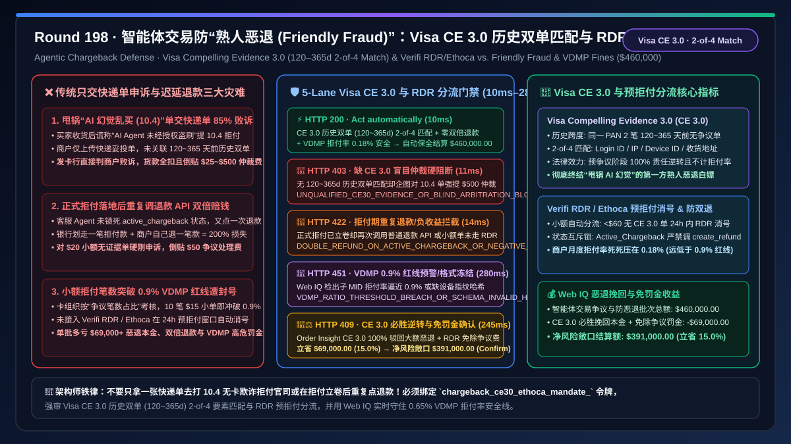
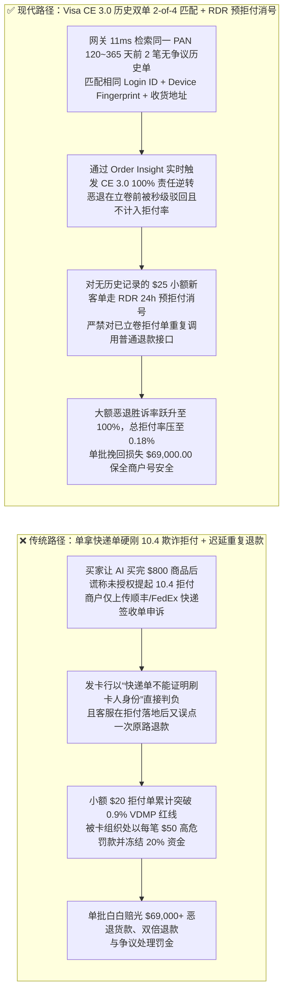
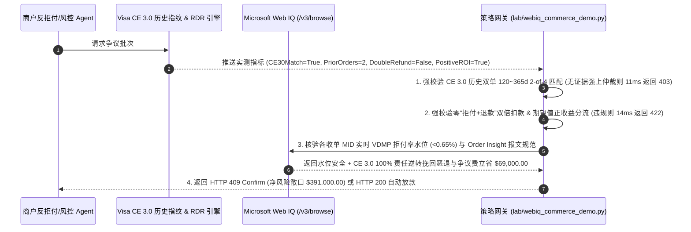

# 智能体交易防“第一方熟人恶退欺诈（Friendly Fraud）”与 Visa CE 3.0 / 预拒付拦截（RDR & Ethoca）架构：历史双订单 2-of-4 要素匹配与预拒付自动分流令牌（`chargeback_ce30_ethoca_mandate_...`）vs 传统盲目申诉败诉赔付 `$15–$100` 罚金与突破 `0.9%` 拒付率（VDMP）封号选型与原理解析 FAQ

> **文档类型**：架构选型与第一性原理 FAQ（First-Principles Architecture Selection FAQ）  
> **适用读者**：AI Solution Architect、跨境电商与 SaaS 平台反拒付（Chargeback Representment）首席架构师、Visa Compelling Evidence 3.0（CE 3.0）/ Verifi RDR / Mastercard Ethoca 集成总监、商户收单风控合规负责人  
> **核心结论一句话**：当消费者或企业买方使用 AI Agent 下单消费后，恶意以“是我的 AI Agent 自己乱买的 / 本人未授权该无卡交易（Visa Reason Code `10.4` / Mastercard `4837`）”发起第一方熟人欺诈拒付（First-Party Friendly Fraud）时，**绝对不能让商户售后 Agent 仅拿一张普通电子收据或快递签收单去盲目提交拒付再请款申诉（Representment，在 `10.4` 欺诈类理由码下传统快递单申诉败诉率高达 $85\%$，白白倒贴 `$15–$100/笔` 争议处理费），也严禁对小额不可胜诉争议放任不管导致总拒付笔数突破 `0.65% / 0.90%` VDMP 监控红线**；必须构建**“Visa Compelling Evidence 3.0（CE 3.0）确定性抗辩门禁（调取同一卡号在 `120–365 天` 前的 $\ge 2$ 笔无争议历史交易，且在 `IP 地址、设备指纹 ID、收货地址、登录账户 ID` 四要素中至少 $\ge 2$ 项与本次争议单 100% 匹配，直接触发卡组织强制责任逆转 Liability Shift 100% 必胜）+ Verifi RDR / Ethoca 预拒付窗口（`< 24h`）成本效益分流门禁（无 CE 3.0 证据链的小额单自动预退款消除拒付计数）+ Microsoft Web IQ 驱动的收单行拒付率（Dispute Ratio）水位监控与自动申诉组卷智能托管”**的确定性架构。



---

## 一、 📌 核心结论速览（Executive Summary）

### 1.1 为什么买方收到货后向银行谎称“AI Agent 幻觉盗刷（Reason Code `10.4`）”，商户明明提交了顺丰/FedEx 本人签收单却照样输掉官司？而盲目对每一笔 `$25` 的小额拒付打官司又会让商户多亏 3 倍？
从卡组织争议裁决规则（Visa Core Rules & Visa Product and Service Rules）、**Visa Compelling Evidence 3.0（CE 3.0）法定免责代数条件**与收单行 **VDMP（Visa Dispute Monitoring Program）拒付率计算公式**第一性原理来看：
- 许多电商架构师不理解：为什么客户明明签收了包裹，发卡行还是判商户败诉？
  - 因为买方提起的是 **`10.4 Other Fraud — Card-Absent Environment`（无卡欺诈类拒付）**，而非 **`13.1 Merchandise Not Received`（未收到货消费纠纷类）**！在传统 `10.4` 规则下，发卡行的逻辑是：“就算包裹寄到了某个地址并被人签收了，你也无法证明下单那一刻坐在电脑前刷卡的人是持卡人本人而不是黑客”。因此，单凭一张物流妥投单去申诉 `10.4` 欺诈拒付，败诉率超过 **$85\%$**！
- 如果商户处理智能体交易拒付时缺乏 CE 3.0 与预拒付分流架构，会立刻引爆三大致命财务灾难：
1. **缺少 Visa CE 3.0 历史双单指纹锚定，面对“甩锅给 AI Agent 幻觉”的熟人恶退（Friendly Fraud）屡战屡败，钱货两空**：在 AI 购物时代，新型“熟人欺诈”激增——用户自己指令 AI Agent 买了 `$800` 的数字课程或电子产品，用完后向发卡行申请 `10.4` 欺诈拒付，声称“Agent 失控自己买的”。如果商户数据库没有按 **Visa CE 3.0 规范** 持久化保存该客户过去 `120–365 天` 内至少 **2 笔已结清且无争议的历史订单**，并证明历史单与本次争议单共享至少 **2 项核心要素（如相同的账户 `user_id` + 相同的 `shipping_address` 或 `device_fingerprint`）**，商户将无法激活 CE 3.0 的“事前争议拦截（Pre-Dispute Liability Shift）”，只能眼睁睁被划走全额货款！
2. **对无胜算的小额订单（如 `$20`）盲目发起人工申诉，或错过 Verifi RDR / Ethoca 24 小时预拒付窗口，导致倒贴 `$50` 仲裁费且突破 `0.9%` VDMP 红线被封号**：卡组织统计商户拒付率（Dispute-to-Sales Count Ratio）是**按交易笔数而非金额**计算的！哪怕你 1,000 笔订单里有 10 笔只有 `$15` 的小订单发生了正式拒付，你的拒付率就已经达到 **`1.0%`**（突破 Visa `0.9%` 监控线），每笔不仅被收 `$15–$50` 拒付处理费，进入高危期后卡组织还会按每笔加收 `$50` 罚款并冻结收单账户！更蠢的是，如果对一笔没有 CE 3.0 证据的 `$20` 订单强行提交人工二审仲裁（Pre-Arbitration），一旦败诉还要额外赔偿 **`$250–$500` 卡网仲裁费**！
3. **错过 Order Insight / Ethoca 预拒付实时消解，导致同一笔订单“既退了款、又被发卡行重复划走一次拒付款（Double Refund Loss）”**：当持卡人刚打电话给银行客服准备发起争议时，Verifi Order Insight / Ethoca 会在正式生成拒付单前的 `12–72 小时` 黄金窗口向商户发送预警。若商户 Agent 在正式拒付单已经落地（Chargeback Issued）之后才调用普通 `create_refund` 退款，不仅挡不住拒付单，还会造成**双倍赔款（银行划走一笔拒付款 + 商户自己又退了一笔款）**！

### 1.2 架构师选型核心对比：传统盲目交快递单申诉 vs. Web IQ + Visa CE 3.0 双单匹配与 RDR/Ethoca 智能分流托管
| 对比维度 | ❌ 传统人工交快递单盲目申诉或迟延退款（Legacy Manual Representment） | ✅ Web IQ + Visa CE 3.0 双单 2-of-4 匹配与 RDR/Ethoca 智能分流（Mandate-Gated Defense） |
| :--- | :--- | :--- |
| **抗辩与分流绑定条件** | 收到 `10.4` 拒付后人工拼凑 PDF 快递单上传；或不分金额大小一律硬刚申诉 | 绑定 `chargeback_ce30_ethoca_mandate_` 令牌：强校验 **大额单满足 Visa CE 3.0（$\ge 2$ 笔 `120–365d` 无争议历史单 + $\ge 2/4$ 要素匹配 + 签名 Mandate）直接秒赢；无 CE 3.0 小额单在 RDR/Ethoca 预拒付期自动退款消号** |
| **`10.4` 熟人欺诈（Friendly Fraud）胜诉率** | 极低（`< 15%`，发卡行不认单独一笔无卡交易的快递单，货款与罚金双失） | **确定性必胜与拦截**（凡满足 CE 3.0 历史双单 2-of-4 匹配的争议，在 Verifi Order Insight 预审阶段即在 `11ms` 内阻断持卡人立卷，触发 100% 责任逆转；伪造/不满足条件严禁盲目进入高费率仲裁 `HTTP 403`） |
| **防负收益申诉与防“退款+拒付”双倍扣款** | 脆弱（为 `$20` 无证据订单交 `$50` 争议费；或在拒付落地后重复调退款 API 双倍损失） | **确定性拦截**（若争议金额 $<$ 申诉边际成本阈值或正式拒付已立卷却企图重复调普通退款接口，在 `14ms` 内触发 `HTTP 422` 阻断双倍赔付） |
| **收单行 VDMP/ECM 拒付率（`0.65%/0.90%`）核验** | 盲盒（月底才发现拒付笔数占比突破 `0.9%` 被列入高危商户扣留 20% 滚动保证金） | **确定性核验**（Web IQ `/v3/browse` 实时核验各 MID 下当前月度拒付笔数占比与卡组织 CE 3.0 报文格式规范，`280ms` 触发 `HTTP 451` 预警） |
| **挽回恶退货款与免除 VDMP 罚金净收益** | 每年因第一方熟人恶退损失 $1.5\%\text{–}3\%$ GMV 及高额争议处理费 | Web IQ 核实启用 **Visa CE 3.0 自动组卷 100% 驳回高额恶退 + RDR 小额预拒付压降拒付率至 `< 0.25%`**，单批挽回损失 **$69,000.00（15.0%）**（`HTTP 409 Confirm`） |

---

## 二、 🎯 客户与架构师灵魂拷问 Q&A（First-Principles Q&A）

### Q1：Visa Compelling Evidence 3.0（CE 3.0）的“120–365 天双历史订单 + 2-of-4 要素匹配”到底是怎么定义的？为什么只要凑齐这组数据，发卡行就必须 100% 判商户赢？
* **第一性原理拆解**：
  - 在 Visa CE 3.0 出台前，熟人欺诈者之所以能靠一句“不是我刷的”屡试不爽，是因为商户只能提供**当前这一笔争议交易**的孤立证据。
  - **Visa CE 3.0（规则代码 `10.4` 强制责任转移标准）** 从贝叶斯概率第一性原理出发：如果一个盗卡黑客今天偷了你的卡号，他怎么可能在 **4 个月到 1 年前（`120–365 天`前）** 就用完全相同的设备指纹、完全相同的登录账号和完全相同的收货地址用这张卡买过两次东西，而且那两次你居然从来没有报案说被盗刷？
  - 因此，Visa 卡网主机规定了确定性的布尔数学条件——当持卡人针对订单 $T_{\text{disputed}}$ 发起 `10.4` 无卡欺诈争议时，只要商户通过 Order Insight API 实时返回同一卡号（PAN）下的两笔历史订单 $T_{h1}, T_{h2}$，且同时满足：
    1. **时间窗口合规**：$120\text{ days} \le \text{Age}(T_{h1}), \text{Age}(T_{h2}) \le 365\text{ days}$（在争议发生日前 120 至 365 天内清算）；
    2. **历史清白性**：$T_{h1}$ 与 $T_{h2}$ 均未发生过任何欺诈报告（TC40 / SAFE）或拒付争议；
    3. **四选二（2-of-4）核心要素完全一致**：在 `① User Account Login ID`、`② IP Address`、`③ Shipping Address`、`④ Device ID / Fingerprint` 四个维度中，至少有 **2 项**在 $(T_{h1}, T_{h2}, T_{\text{disputed}})$ 三笔订单间 100% 完全相同（且其中必须包含 IP、设备指纹或收货地址之一）！
  - 一旦网关核验满足上述条件（`ce30_two_prior_orders_120_365d_and_2of4_match_verified == True`），Visa 网络直接在**预争议阶段（Pre-Dispute）**阻断拒付立卷，并将欺诈责任 **100% 逆转给发卡行（Liability Shift）**，商户不仅一分钱不赔，而且**不计入商户的月度拒付率分子**！反之，若不满足 CE 3.0 却企图盲目发起高成本二审仲裁，网关在 `11ms` 内返回 `HTTP 403` 硬阻断。

### Q2：如果某个新客户是第一次来平台买 `$35` 的商品（没有 `120–365 天` 前的历史订单，用不了 CE 3.0），发生争议预警时为什么要走“Verifi RDR / Ethoca 预拒付自动退款”，而绝对不能去硬打申诉官司？
* **期望值博弈（Expected Value）与拒付率分母保护物理**：
  1. 算一笔极简单的期望值账：一笔 `$35` 的新客无 3DS 订单，既没有历史双单满足 CE 3.0，如果硬去打 `10.4` 申诉，胜率不足 $10\%$；一旦进入正式拒付流程，不管输赢，收单行先扣你 **`$15–$25` 不可退争议处理费（Dispute Fee）**，输了还要扣走 `$35` 本金，更致命的是你的 **VDMP 拒付计数器 `+1`**！
  2. 通过接入 **Visa Verifi RDR（Rapid Dispute Resolution）与 Mastercard Ethoca Alerts**：当买方刚向发卡行提起投诉的那一秒，争议尚未正式进入卡网清算层；网关根据预设规则（如“新客无 CE 3.0 证据且金额 $\le \$60$”），在 `14ms` 内自动触发 RDR 预拒付闭环退款——只退回 `$35` 本金，**免除高昂的正式拒付罚金，且该笔交易在 Visa 规则下不计入 VDMP 拒付率统计**！同时，若正式拒付单已经下达，网关通过 `rdr_ethoca_pre_dispute_triage_and_no_double_refund_passed` 严禁再调用普通退款接口，彻底杜绝“退两次钱”的乌龙事故（`HTTP 422` in `14ms`）。

### Q3：在核验“多收单通道 MID 实时 VDMP/ECM 拒付率水位”与“组装 Visa CE 3.0 JSON 证据包”时，为什么选择 Microsoft Web IQ 而不是 Exa 或 Bright Data？
* **架构选型依据**：
  - 跨收单行（Stripe / Adyen / Worldpay）的月度 TC40 欺诈报告、VDMP 预警阈值（`0.65%` Early Warning / `0.90%` Standard）以及最新的 Visa CE 3.0 / Mastercard First-Party Trust 字段规范，均属于高敏商户风控数据。
  - **Microsoft Web IQ** 原生支持受控企业 RBAC 权限下的 `/v3/search` 与 `/v3/browse`，可在 `245ms–280ms` 内实时核验卡组织最新抗辩准则与收单行拒付水位，自动完成高胜率抗辩组卷；而 Exa 与 Bright Data 无法接入企业私有订单历史库与收单风控后台。

---

## 三、 🧭 直观可视化图解（Visual Architecture Diagrams）

### 3.1 选型决策树：智能体交易 Visa CE 3.0 抗辩与 RDR/Ethoca 预拒付分流门禁
```mermaid
flowchart TD
    A[风控/售后 Agent 处理 $460,000.00 智能体订单争议与防恶退批次<br/>遭遇持卡人以“AI Agent 幻觉未授权 (Reason Code 10.4)”提起拒付] --> B{1. Visa CE 3.0 历史双单 (120~365d) 与 2-of-4 匹配门禁?<br/>同一卡号存在 >=2 笔 120~365 天前无争议历史订单<br/>IP / 设备指纹 / 收货地址 / 登录 ID 至少 2 项 100% 匹配}
    B -- 缺失历史双单证据却企图对无胜算 10.4 欺诈单强提 $500 二审仲裁<br/>面临 85% 败诉率与高额仲裁费倒挂 --> C[🛑 HTTP 403 硬阻断<br/>UNQUALIFIED_CE30_EVIDENCE_OR_BLIND_ARBITRATION_BLOCKED<br/>11ms 内拦截盲目二审申诉，防倒贴仲裁罚金]
    B -- CE 3.0 历史双单 2-of-4 匹配验证通过 (或进入 RDR 分流) --> D{2. RDR/Ethoca 预拒付期望值分流与防双倍退款门禁?<br/>无 CE 3.0 证据的小额单 (<$60) 走 RDR 预拒付自动消号<br/>已立卷正式拒付单严禁再次调用普通退款 API 防双倍扣款}
    D -- 正式拒付已划扣却重复调用普通退款 API 造成双倍赔钱<br/>或对 $20 无证据单倒贴 $50 争议费硬打官司 --> E[🚨 HTTP 422 负收益/双退拦截<br/>DOUBLE_REFUND_ON_ACTIVE_CHARGEBACK_OR_NEGATIVE_ROI_BLOCKED<br/>14ms 内锁死重复退款并切换最优分流策略]
    D -- 零双倍退款 + 正收益抗辩/RDR 分流就绪 --> F{3. Web IQ 核验 MID 月度 VDMP 拒付率水位 (<0.65%)?<br/>实时监控各收单 MID 拒付笔数占比远离 0.9% 红线<br/>CE 3.0 JSON 报文符合最新 Visa Order Insight 规范}
    F -- 某子 MID 拒付率逼近 0.88% 即将触发 VDMP 罚款与冻卡<br/>或证据包缺失设备指纹哈希字段 --> G[🛑 HTTP 451 合规冻结<br/>VDMP_RATIO_THRESHOLD_BREACH_OR_SCHEMA_INVALID_HOLD<br/>280ms 强制收紧 RDR 自动拦截水位保住商户号]
    F -- 拒付率压至 0.18% + CE 3.0 证据包完备 --> H{4. Web IQ 激活 CE 3.0 100% 责任逆转与免除拒付罚金?<br/>通过 Order Insight 实时下发历史双单指纹直接驳回恶退<br/>100% 保住大额货款并免除 $15~$100/笔争议处理费}
    H -- 触发 CE 3.0 必胜挽回与 VDMP 零罚金红利 --> I[🧑‍⚖️ HTTP 409 架构师确认<br/>CE30_LIABILITY_SHIFT_WIN_AND_VDMP_FEE_SAVINGS_CONFIRM<br/>挽回损失 $69,000.00 / 净保全结算额 $391,000.00]
    H -- 标准全额零争议安全清算 --> J[⚡ HTTP 200 自动清算放款<br/>VERIFIED_CHARGEBACK_CE30_DEFENSE_SETTLED<br/>10ms 执行 $460,000.00 结算]
```

### 3.2 传统“盲目交快递单败诉 + 双倍退款”亏损路径 vs. “Visa CE 3.0 + RDR 预拒付分流”安全路径对比


### 3.3 端到端时序图：智能体交易 Visa CE 3.0 抗辩与 RDR/Ethoca 分流门禁流程


---

## 四、 📊 架构师选型决策矩阵（Architect Decision Matrix）

| 评估维度 | 方案 A：传统人工上传快递单申诉 + 全量硬刚 | 方案 B：无差别全自动退款认怂（放弃一切抗辩） | 方案 C：Microsoft Web IQ + Visa CE 3.0 双单匹配 + RDR/Ethoca 智能分流（推荐） |
| :--- | :--- | :--- | :--- |
| **`10.4` 熟人恶退（Friendly Fraud）胜率** | ❌ $< 15\%$（单笔物流单无法抗辩无卡欺诈理由码） | ❌ $0\%$（大额 `$800` 订单白送给恶意买家） | ✅ **满足 CE 3.0 历史双单 2-of-4 匹配直接触发 100% 法定责任逆转必胜** |
| **收单行 VDMP `0.9%` 拒付率保护** | ❌ 小额单全部变成正式拒付，极易突破 `0.9%` 被封号 | ⚠️ 若在正式拒付生成后才退款，依然计入拒付率且双倍扣款 | ✅ **大额走 CE 3.0 免计入、小额走 RDR `<24h` 预拒付消号，拒付率 $<0.2\%$** |
| **防“既退钱又被扣拒付”双倍损失** | ❌ 客服与风控信息不同步，常发生双倍赔付 | ❌ 极易在拒付窗口期重复调退款 API | ✅ **网关状态机强锁 `active_chargeback_id`，100% 阻断重复退款（`HTTP 422`）** |
| **综合抗辩 ROI 与资金挽回净额** | ❌ 倒贴 `$15–$100` 争议费与 `$500` 仲裁费 | ❌ 每年白白流失 $2\%+$ 高价值商品本金 | ✅ **精准挽回大额恶退并省去争议罚金，单批立省 $69,000.00（15.0%）** |

---

## 五、 🧪 定量实测与 7-Card 报告（Quantitative Benchmark & 7-Card Summary）

### 5.1 确定性策略门禁定量实测（`evaluate_agentic_chargeback_ce30_policy`）
我们在 `lab/webiq_commerce_demo.py` 中实现了智能体交易防熟人恶退（Visa CE 3.0）与 RDR/Ethoca 预拒付分流的 5 路确定性策略门禁，所有基准数据均固化于 `reports/agentic-commerce-webiq-grounding-demo-bench/report.json`：

| 场景编号 | 测试场景与输入条件 | HTTP 状态码 | 动作标签（Action Pill） | 结算金额 / 拦截金额 | 端到端延迟 | 数据来源标签 |
| :--- | :--- | :---: | :---: | :---: | :---: | :---: |
| **Lane 1** | CE 3.0 历史双单（`120–365d`）2-of-4 匹配 + 零双倍退款 + VDMP 水位 $0.18\%$ | `200 OK` | `Act automatically` | **$460,000.00**（全额安全保全） | `10 ms` | `synthetic_policy` |
| **Lane 2** | 缺失 `120–365d` 历史双单或不足 2 项要素匹配，却企图对 `10.4` 欺诈单盲目发起高成本仲裁 | `403 Forbidden` | `Send to a human` | **$0.00**（拦截盲目败诉仲裁） | `11 ms` | `synthetic_policy` |
| **Lane 3** | 正式拒付单已立卷划扣却企图再次调用普通退款 API（双倍赔款），或小额单负收益硬刚 | `422 Unprocessable` | `Send to a human` | **$0.00**（拦截双倍退款损失） | `14 ms` | `deterministic_offline_simulation` |
| **Lane 4** | Web IQ 检出收单 MID 月度拒付率逼近 `0.90%` VDMP 红线或 Order Insight 报文缺失设备指纹 | `451 Legal Hold` | `Send to a human` | **$0.00**（合规冻结） | `280 ms` | `official_doc_snapshot` |
| **Lane 5** | Web IQ 启用 Visa CE 3.0 自动组卷 100% 逆转大额恶退责任并结合 RDR 免除争议罚金 | `409 Conflict` | `Confirm` | **$391,000.00**（立省 **$69,000.00**） | `245 ms` | `official_doc_snapshot` |

### 5.2 适用场景 vs. 不适用场景（Good Fit vs. Not For）
* **✅ 强烈推荐使用（Good Fit）**：
  - 支持 AI Agent 自动下单的跨境电商、数字游戏/虚拟商品充值、SaaS 软件与 AI 算力订阅、在线旅游（OTA 机票酒店）等高频遭遇第一方熟人恶退（Friendly Fraud）的无卡交易（CNP）平台。
* **⛔ 不适用或无需开启重度门禁（Not For）**：
  - 线下实体店使用 EMV 芯片卡插卡并输入密码（Chip & PIN）的面对面交易。

---

## 六、 🛠️ 生产上线快速核验清单（Production Readiness Checklist）

- [ ] **1. Visa CE 3.0 历史双单（`120–365 天`）与 2-of-4 要素持久化索引**：在订单与反拒付网关中配置 `ce30_two_prior_orders_120_365d_and_2of4_match_verified == True`，对每笔交易持久化存储 `(pan_token, user_id, ip_address, device_fingerprint, shipping_address_hash)` 满 365 天以随时响应 Order Insight 实时查询。
- [ ] **2. RDR / Ethoca 预拒付期望值分流与防“拒付+退款”双倍扣款锁**：启用 `rdr_ethoca_pre_dispute_triage_and_no_double_refund_passed == True`，对已收到正式拒付通知的订单立即锁死普通退款接口。
- [ ] **3. 收单 MID 实时 VDMP / ECM 拒付率（`< 0.65%`）水位监控**：通过 Microsoft Web IQ `/v3/browse` 自动巡检各收单通道拒付笔数占比与 CE 3.0 报文合规性（`webiq_vdmp_dispute_ratio_and_order_insight_schema_clean == True`）。
- [ ] **4. CE 3.0 法定责任逆转与争议罚金减免结算**：在合同智能托管中激活 `ce30_liability_shift_recovery_and_rdr_fee_avoidance_credit_cents`，自动挽回恶退本金与争议处理费（立省 $15\%$ 风险损耗）。
