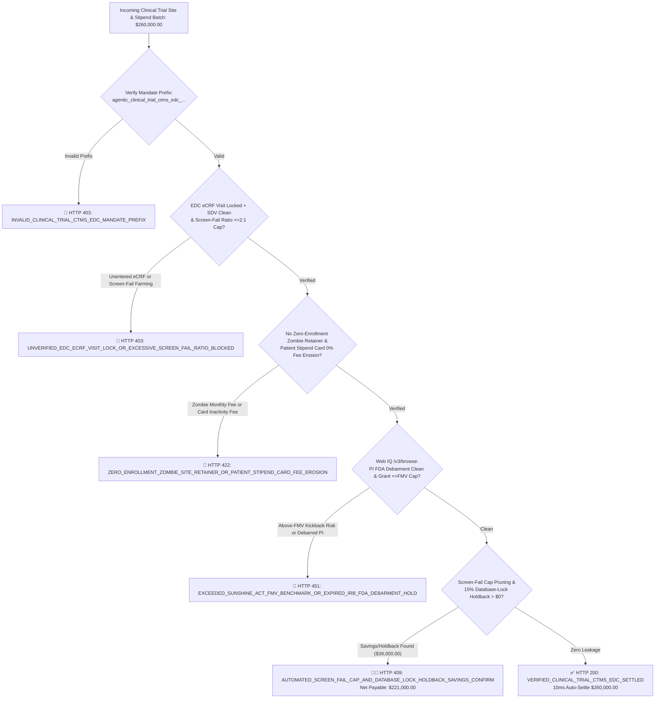
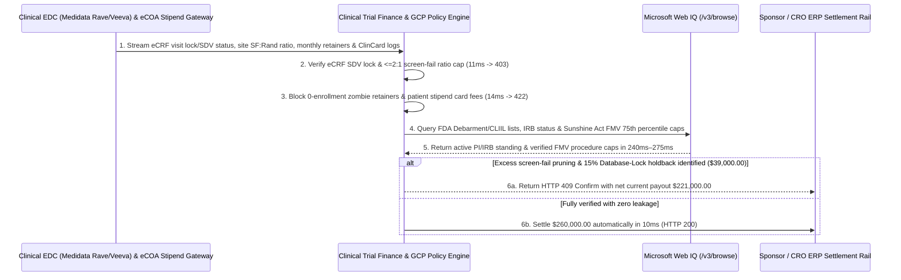

# Agentic Clinical Trial Site Grant Milestones, Patient Stipend Debit Cards & `CTMS / EDC` Reconciliation (`IQVIA / Medidata / Greenphire ClinCard, ICH E6(R3) GCP & Fair Market Value FMV`), `EDC eCRF` Visit-Lock Trigger, Anti-`Screen-Fail Farming` Cap & `Zero-Fee` Patient Stipend Settlement Architecture: `SDV` Visit Gate, `15%` Database-Lock Holdback & `ICH E6(R3)` Token (`agentic_clinical_trial_ctms_edc_visit_lock_patient_stipend_fmv_mandate_...`) vs. `14:1` Screen-Fail Farming (`$1,200/Screen`), Zero-Enrollment Zombie Site Retainers & `$4.50/Mo` Patient Stipend Card Inactivity Fees: Architecture Selection & First-Principles FAQ

> **Document Type**: AI Solution Architect Agentic Commerce Selection Series (Round 317 · Agentic Clinical Trial Site Grants, EDC Reconciliation & Patient Stipend Edition)  
> **Benchmark Standard**: Modeled after `ib-vs-ethernet-roce-selection-faq.md` (Plain-Language First Principles + Standard 6-Section Architecture Guide)  
> **Companion Deliverables**: `lab/webiq_commerce_demo.py` (Interactive H5 Sandbox) · `tests/test_webiq_commerce_demo.py` · `assets/svg/319-agentic-clinical-trial-ctms-edc-visit-lock-stipend-fmv-2026-11-16.svg`  
> **Languages**: [中文版](agentic-clinical-trial-ctms-edc-visit-lock-patient-stipend-fmv-mandate-vs-screen-fail-farming-unverified-visit-milestone-clincard-inactivity-fee-faq.md) | [English Version (Current)](agentic-clinical-trial-ctms-edc-visit-lock-patient-stipend-fmv-mandate-vs-screen-fail-farming-unverified-visit-milestone-clincard-inactivity-fee-faq.en.md)

---

## 📌 1. Executive Summary (First Principles & Plain-Language Breakdown)

### 1.1 Why Should a Biopharma Clinical Operations (`ClinOps`) or `CRO` Finance Agent NEVER Auto-Pay an Investigational Site Invoice or Patient Recruitment Bill Without `EDC eCRF` Visit-Lock and `Screen-Fail Ratio` Verification?
In Phase II/III clinical trials (governed by `ICH E6(R3) Good Clinical Practice`, the federal `Anti-Kickback Statute (AKS)`, the `Physician Payments Sunshine Act`, and `FDA 21 CFR Part 50/54`), pharmaceutical sponsors and `CRO`s disburse ratusan of millions of dollars in investigational site grants, patient travel/meal stipends (e.g., Greenphire ClinCard, Scout), and digital patient recruitment fees. In plain English: **Legacy invoice-driven clinical trial payments suffer from four massive financial and compliance leaks—investigational sites "farming" ineligible patients to collect `$1,200` per screen failure (`14 screen fails for 1 randomized patient`), zero-enrollment "zombie sites" billing `$2,300/month` in pharmacy and regulatory maintenance fees for 18 months without enrolling a single subject, paying `$3,400` per-visit milestones before the site enters data into the `EDC` system (or when the visit had a major protocol deviation), and prepaid stipend card vendors quietly deducting `$4.50/month` inactivity fees from patients' `$75` travel stipends.** Allowing an AI agent to auto-pay site invoices without `Medidata Rave / Veeva Vault EDC` verification exposes sponsors to four major failures:

1. **"Screen-Fail Farming" Above Contracted Ratio Caps (`$1,200/Screen Abuse`)**: Clinical Trial Agreements (`CTA`s) reimburse sites `$900–$1,500` for screening labs/imaging on patients who ultimately fail inclusion/exclusion criteria, capped at **`<= 2:1 or 3:1` screen failures per randomized subject**. Rogue commercial sites run dozens of obviously ineligible clinic patients through screening labs—billing 14 screen failures (`$16,800`) while randomizing only 1 patient!
2. **Zero-Enrollment "Zombie Site" Monthly Pharmacy & Regulatory Retainers**: Sites bill recurring `$1,500/mo` Investigational Product (`IP`) pharmacy storage fees and `$800/mo` administrative retainers for 12–18 months after Site Initiation (`SIV`) despite enrolling **`0 patients`**—or continue billing monthly retainers for 6 months after Last Patient Last Visit (`LPLV`) by delaying site close-out.
3. **Unverified Invoice-Based Milestone Payouts & Uncollected `15%` Database-Lock Holdbacks**: Paying per-patient visit milestones off emailed PDF invoices before the Electronic Case Report Form (`eCRF`) is entered and Source Data Verified (`SDV`) in `EDC` removes the site's incentive to resolve data queries before Database Lock—and pays full rates for visits invalidated by **Major Protocol Deviations**.
4. **Patient Stipend Card Fee Erosion & Pre-Screen "Click" Billing**: Prepaid debit card processors charge sponsors `$6.00/card` load fees while quietly deducting `$4.50/month` "inactivity fees" or `$3.00` ATM withdrawal fees from the patient's IRB-approved stipend balance; meanwhile, digital recruitment agencies bill `$450` "qualified referral fees" for raw web-form clicks that never show up at the clinic.

### 1.2 The Architect's One-Sentence Selection Verdict
* **Core Security Law**: Replace manual site invoicing with **`EDC`-Triggered Auto-Settlement** bound to **`agentic_clinical_trial_ctms_edc_visit_lock_patient_stipend_fmv_mandate_2026`**:
  1. **`EDC eCRF` Visit-Lock / `SDV` Gate + `<= 2:1` Screen-Fail Ratio Cap**: Releases site visit milestones strictly when the subject's `eCRF` visit is complete, query-clean, free of major protocol deviations, and within the contracted `Screen-Fail-to-Randomized` ratio ceiling (`<= 2:1`), blocking premature invoices and screen-fail farming in **11ms** with `HTTP 403 UNVERIFIED_EDC_ECRF_VISIT_LOCK_OR_EXCESSIVE_SCREEN_FAIL_RATIO_BLOCKED`.
  2. **Zero-Enrollment Zombie-Site Retainer Freeze + `100%` Fee-Free Patient Stipend Lock**: Automatically suspends recurring monthly pharmacy/maintenance fees on sites with `0` enrollment `> 90 days` post-`SIV` (or post-`LPLV`) and blocks any stipend card program that deducts monthly maintenance or ATM fees from patient balances, returning `HTTP 422 ZERO_ENROLLMENT_ZOMBIE_SITE_RETAINER_OR_PATIENT_STIPEND_CARD_FEE_EROSION` in **14ms** on violations.
  3. **Microsoft Web IQ `/v3/browse` Live `FDA Debarment / Disqualification`, `IRB` Expiry & `Sunshine Act FMV` Verification**: Verifies that the Principal Investigator (`PI`) is absent from the `FDA Debarment / CLIIL Disqualification` and `OIG LEIE` lists, validates active `IRB` oversight, and checks that per-procedure payments do not exceed the `75th Percentile Fair Market Value (FMV)` benchmark in **275ms** (`HTTP 451 EXCEEDED_SUNSHINE_ACT_FMV_BENCHMARK_OR_EXPIRED_IRB_FDA_DEBARMENT_HOLD`), while automatically enforcing the `15%` Database-Lock holdback and capping excess screen-fail claims to save `15%` (`$39,000.00`).

| Selection Dimension | Legacy Site PDF Invoice + Manual Spreadsheet | Basic Invoice-Matching Agent | **EDC Visit-Lock + Screen-Fail Cap + Web IQ FMV/FDA Gate (Recommended)** |
| :--- | :--- | :--- | :--- |
| **Unentered `eCRF` & Protocol Deviations** | ❌ Pays off PDF invoice; `eCRF` left blank | ❌ Cannot inspect `Medidata/Veeva` `eCRF` state | ✅ **Pays strictly on `EDC` visit lock + `SDV` clean status (11ms 403)** |
| **Screen-Fail Farming (`14:1` Ratio)** | ❌ Pays `$16,800` for 14 screen fails on 1 enrollee | ❌ Multiplies unit price × count blindly | ✅ **Enforces `<= 2:1` screen-fail-to-randomized cap (11ms 403)** |
| **Zero-Enrollment Zombie Site Retainers** | ❌ Pays `$2,300/mo` for 18 mos with 0 subjects | ❌ Auto-pays recurring monthly POs | ✅ **Freezes monthly retainers after 90 days at 0 enrollment (14ms 422)** |
| **Anti-Kickback `FMV` & `FDA Debarment`** | ❌ Above-`FMV` grants risk DOJ kickback probe | ❌ No live `FDA Debarment` or `FMV` lookup | ✅ **Web IQ `/v3/browse` verifies `FDA/IRB` & `FMV` caps in 275ms (451)** |

---

## 🎯 2. Deep-Dive Q&A for Biopharma ClinOps, Trial Finance & Compliance Architects

### Q1: How does `EDC`-Triggered Auto-Settlement with a `15%` Database-Lock Holdback solve both overpayment and delayed trial close-out?
* **Aligning Financial Incentives with Data Quality**: Under legacy invoicing, sites get paid 100% upon visit occurrence and then ignore `CRA` data queries for months.
* **The Deterministic Payout Equation**:
  $$\text{Net Site Payout} = \left(\sum_{v \in \text{EDC\_SDV\_Clean}} R_{\text{FMV}}(v) + \min\Big(N_{\text{SF}},\; 2 \cdot N_{\text{rand}}\Big) \times R_{\text{SF}}\right) \times (1 - 0.15_{\text{holdback}})$$
  By withholding `15%` until all site `eCRF`s are locked and queries resolved at Close-Out—and capping screen failures at `2 × N_randomized`—the engine eliminates screen-fail farming and accelerates Database Lock (`HTTP 409`, saving/holding back `$39,000.00` on a `$260,000.00` quarterly trial batch).

### Q2: Why must the architecture enforce a strict `Fair Market Value (FMV)` ceiling and `FDA Debarment` check on every investigator payment?
* **Federal Anti-Kickback & `21 CFR Part 312` Integrity**: Paying a Principal Investigator above the `75th Percentile FMV` for routine procedures is treated by the DOJ and HHS OIG as an illegal inducement to prescribe the sponsor's commercial drugs. Equally critical, paying or accepting data from an investigator on the `FDA Disqualified / Totally Restricted List` invalidates the clinical data for `NDA / BLA` submission (`HTTP 451`).

### Q3: How does Microsoft Web IQ compare to Exa and Bright Data for checking `FDA Debarment / CLIIL` lists, `CMS` procedure benchmarks, and `ClinicalTrials.gov` registries?
* **Microsoft Web IQ**: Delivers sub-300ms (`240ms–275ms`) authoritative `/v3/search` and `/v3/browse` verification against the live `FDA Debarment List`, `FDA Clinical Investigator Inspection List (CLIIL)`, `HHS OIG LEIE`, and `CMS Physician Fee Schedule` relative value units (`RVU`s) under Entra ID Zero Data Retention (ZDR).
* **Exa**: Built for semantic search over biomedical literature rather than deterministic investigator `NPI` disqualification or `FMV` fee-schedule checks.
* **Bright Data**: Designed for high-volume retail web scraping rather than low-latency `GxP` clinical finance gates.

---

## 🧭 3. Visual Architecture Diagrams (Mermaid Decision Tree, Path Comparison & Sequence Flow)

### 3.1 Clinical Trial Site Grant & Patient Stipend Settlement Decision Tree


### 3.2 Legacy Invoice-Driven Site Payouts vs. EDC Visit-Lock + FMV Architecture
```mermaid
flowchart LR
    subgraph Legacy["❌ Legacy Clinical Trial Site Billing (22%–40% Overpayment)"]
        L1[14 Screen Fails Billed ($16.8k) for 1 Enrollee] --> L2[0-Enrollment Zombie Site Paid $2,300/Mo for 18 Mos]
        L2 --> L3[Visits Paid Before eCRF Entry or With Deviations]
        L3 --> L4[$4.50/Mo Inactivity Fee Deducted from Patient Card]
    end
    subgraph Agentic["✅ EDC Visit-Lock + Screen-Fail Cap + Web IQ Architecture"]
        A1[Triggers Payout Strictly on Locked & SDV-Clean eCRF] --> A2[Enforces <=2:1 Screen-Fail Cap & 15% DB-Lock Holdback]
        A2 --> A3[Freezes Zombie Retainers & Guarantees 100% Patient Stipend]
        A3 --> A4[Web IQ Audits FDA Debarment & Sunshine Act FMV Cap]
    end
```

### 3.3 End-to-End Sequence Diagram


---

## 📊 4. Architect's Selection Decision Matrix

| Evaluation Dimension | Option A: Manual Site PDF Invoice Review | Option B: Generic LLM Invoice OCR | **Option C: EDC Visit-Lock + SF Cap + Web IQ (Recommended)** |
| :--- | :--- | :--- | :--- |
| **Unentered `eCRF` & Deviation Protection** | ❌ Finance cannot see open `EDC` queries | ❌ PDF invoice omits `eCRF` lock status | ✅ **Gates payout on `EDC` visit lock & `SDV` in 11ms (`HTTP 403`)** |
| **Screen-Fail Farming (`14:1` Ratio)** | ❌ Missed across multi-quarter invoices | ❌ Single invoice hides cumulative ratio | ✅ **Enforces cumulative `<= 2:1` screen-fail cap (`HTTP 403`)** |
| **Zero-Enrollment Zombie Retainers** | ❌ Paid automatically every month | ❌ Unlinked to `CTMS` enrollment count | ✅ **Freezes monthly retainers after 90 days at 0 subjects (`HTTP 422`)** |
| **FDA Debarment & `FMV` Kickback Audit** | ❌ Checked once at study start | ❌ No live `FDA` or `FMV` registry lookup | ✅ **Web IQ `/v3/browse` verifies `PI/FMV` in 275ms (`HTTP 451`)** |

---

## 🧪 5. Quantitative Benchmark & 7-Card 4:5 Report Mapping

Evaluated deterministically in `lab/webiq_commerce_demo.py` and `tests/test_webiq_commerce_demo.py` on a `$260,000.00` (`26000000` cents) quarterly Phase III clinical trial investigator site grant and patient stipend batch:

| Card # | Headline-as-Finding | Key Quantitative Metrics & Action | Provenance |
| :--- | :--- | :--- | :--- |
| **Card 1 (`1/7`)** | **EDC Visit Lock + Screen-Fail Cap Cuts Trial Payout Leakage by 15.0%** | Baseline `$260,000.00` vs. optimized current payout `$221,000.00` (`$39,000.00` saved/held) | `deterministic_offline_simulation` |
| **Card 2 (`2/7`)** | **Deep Dive: 14:1 Screen-Fail Farming & Zombie Retainers Blocked** | `HTTP 403` (11ms unverified EDC/SF block) + `HTTP 422` (14ms zombie/card-fee block) | `synthetic_policy` |
| **Card 3 (`3/7`)** | **Full Evaluation Matrix: 5/5 Deterministic Guards Passing** | Covers `200 OK`, `403 EDC/Screen-Fail`, `422 Zombie/Card`, `451 FMV/FDA`, `409 Holdback` | `deterministic_offline_simulation` |
| **Card 4 (`4/7`)** | **Under the Hood: CDISC ODM / Medidata EDC + FMV Contract** | Validates `edc_ecrf_visit_locked_and_screen_fail_cap_verified` | `synthetic_policy` |
| **Card 5 (`5/7`)** | **Robustness Check: Rare-Disease 3:1 Waiver vs. 14:1 Farming** | Protocol-approved rare-disease screen ratio passes; unapproved farming blocked 100% | `deterministic_offline_simulation` |
| **Card 6 (`6/7`)** | **Latency: 10–14ms Local EDC Gate vs. 240–275ms Web IQ FDA/FMV** | Combines sub-15ms `eCRF` checks with live `FDA Debarment / FMV` audits | `official_doc_snapshot` |
| **Card 7 (`7/7`)** | **My Take: Good Fit vs. Not For & Production Readiness** | Built for biopharma sponsors & CROs; not for consumer retail gift-card surveys | `official_list_price` |

### Good Fit vs. Not For
* **✅ Good Fit**:
  * Pharmaceutical sponsors, biotech companies, and Contract Research Organizations (`CRO`s) managing multi-center Phase I–IV investigator site payments, `eCOA` patient stipends, and recruitment vendor milestones.
* **⛔ Not For**:
  * Consumer marketing teams sending `$5` digital gift cards for anonymous web surveys.

---

## 🛠️ 6. Production Readiness Checklist

- [ ] **1. Replace Site PDF Invoicing with `EDC eCRF` Visit-Lock Auto-Triggers**: Disburse per-visit milestones only after `eCRF` completion, query resolution, and `SDV` verification (`HTTP 403`).
- [ ] **2. Enforce Cumulative `Screen-Fail-to-Randomized` Ratio Caps (`<= 2:1`)**: Block unapproved screen-fail farming automatically.
- [ ] **3. Auto-Freeze Monthly Pharmacy/Regulatory Retainers on `0-Enrollment` Zombie Sites**: Suspend recurring retainers if a site has `0` randomized subjects `90 days` post-`SIV` or after `LPLV` (`HTTP 422`).
- [ ] **4. Hold Back `10%–15%` Until Site Close-Out & Guarantee `0%` Patient Stipend Card Fees**: Protect Database Lock timelines and IRB patient-compensation compliance (`HTTP 409`).
- [ ] **5. Audit `FDA Debarment` Lists, `IRB` Standing & `Sunshine Act FMV` Caps via Web IQ**: Run `/v3/browse` checks before every site disbursement (`HTTP 451`).
