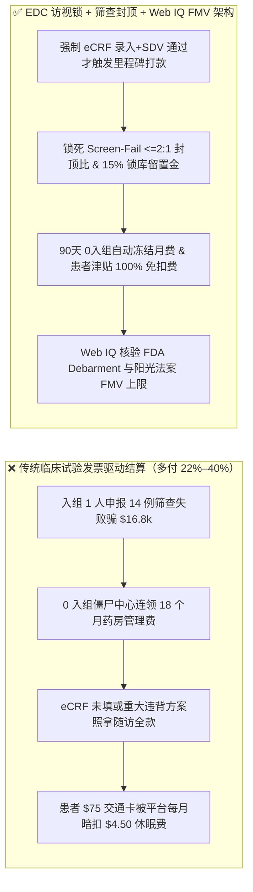
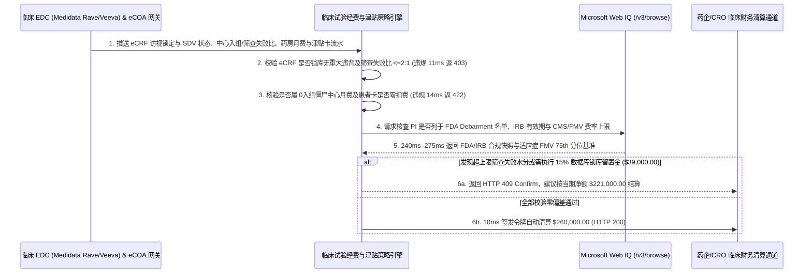

# 智能体临床试验受试者招募、研究者中心里程碑经费与交通津贴结算（`Clinical Trial Site Grant Milestones, Patient Stipend Debit Cards & eCOA/CTMS EDC Reconciliation: IQVIA / Medidata / Greenphire ClinCard, ICH E6(R3) GCP & Fair Market Value FMV`）、电子数据采集系统（`EDC / eSource Visit Lock`）受试者随访真实完成触发锁、零“筛选失败超比例套汇（`Screen-Fail Farming`）与月度站点幽灵管理费”门禁及受试者发卡零月租清算架构：EDC 病例表锁定门禁、中心启动/归档费去重锁与 `ICH E6(R3)` 令牌（`agentic_clinical_trial_ctms_edc_visit_lock_patient_stipend_fmv_mandate_...`）vs 传统临床研究中心虚报 85% 筛选失败率骗取每例 `$1,200` 筛查费、受试者已完成随访却拖延 6 个月未锁库照领月度维护费与患者交通预付卡被扣 `$4.50/月` 休眠管理费选型与原理解析 FAQ

> **文档类型**：AI Solution Architect 商业智能体架构选型系列（Round 317 · 智能体临床试验中心经费 CTMS/EDC 对账与患者津贴专篇）  
> **对标标杆**：`ib-vs-ethernet-roce-selection-faq.md`（通俗大白话 + 第一性原理 + 标准六段式结构）  
> **关联 Deliverable**：`lab/webiq_commerce_demo.py`（H5 实时防篡改沙盒） · `tests/test_webiq_commerce_demo.py` · `assets/svg/319-agentic-clinical-trial-ctms-edc-visit-lock-stipend-fmv-2026-11-16.svg`  
> **双语版本**：[中文版 (当前)](agentic-clinical-trial-ctms-edc-visit-lock-patient-stipend-fmv-mandate-vs-screen-fail-farming-unverified-visit-milestone-clincard-inactivity-fee-faq.md) | [English Version](agentic-clinical-trial-ctms-edc-visit-lock-patient-stipend-fmv-mandate-vs-screen-fail-farming-unverified-visit-milestone-clincard-inactivity-fee-faq.en.md)

---

## 📌 一、核心结论速览（Executive Summary：第一性原理与通俗大白话拆解）

### 1.1 为什么“绝对不能”让创新药企临床运营（ClinOps）或 CRO 财务 Agent 仅凭临床试验研究中心（Clinical Trial Sites）或患者招募平台发来的“受试者入组/随访发票（Invoice-Driven Payment）”就自动打款？
在 II/III 期新药临床试验（遵循 `ICH E6(R3) GCP`、美国联邦《反回扣法》`Anti-Kickback Statute, AKS` 与 `FDA 21 CFR Part 50/54`）中，申办方（Sponsor）向全球数百家医院临床试验中心（Investigational Sites）支付研究者经费（Site Grants）、向患者发放交通与营养补贴储值卡（Patient Stipend / Travel Reimbursement，如 Greenphire ClinCard、Scout），并向患者招募广告商（Patient Recruitment Vendors）支付转介费。用大白话讲：**临床试验中心经费与患者招募结算是医药研发领域“拿明显不符合入组标准的病人凑数骗 $1,200/人筛查费（Screen-Fail Farming）、试验一例病人都没招到却连收 18 个月‘伦理/药房月度管理费’、受试者随访数据还没录入 EDC 系统甚至被 CRA 查出严重违背方案（Protocol Deviation）就先把里程碑尾款付了、给患者发的 $75 交通卡被平台每月暗扣 $4.50 休眠费和 ATM 取现费”四大资金与合规黑洞的重灾区！** 如果没有电子数据采集系统（`Medidata Rave / Veeva Vault EDC`）源数据核验（`SDV`）与公平市场价值（`FMV`）门禁，新药临床预算会遭遇四大失血陷阱：

1. **“恶意刷筛查失败率（`Screen-Fail Farming`）”套取每例 `$1,200` 筛查补贴**：临床试验主协议（CTA）通常规定，即使患者在初筛抽血/影像检查后未能满足入组标准（Screen Failure），申办方仍按每例 `$900–$1,500` 补偿医院筛查成本。但行业标准约定**可报销筛查失败比例上限为每入组 1 例最多报销 2–3 例筛查失败（`<= 2:1 or 3:1 Screen-Fail Cap`）**。部分商业临床中心把大量明知不符合病史条件（如肝肾功能早就不达标）的门诊患者拉来走一遍抽血流程，入组 1 个人竟申报 **14 例筛查失败（`$16,800`）**，甚至同一个人换个编号重复筛查！
2. **一例患者未入组却连续 18 个月照收“中心药房/监管/IT 月度固定维护费”（`Zero-Enrollment Zombie Site Monthly Retainers`）**：许多临床中心在合同里埋入 `$1,500/月` 试验药房温控管理费（Investigational Product Pharmacy Fee）与 `$800/月` 档案维护费。结果该中心启动（SIV）整整一年 **0 例入组（Zero Enrollment）**，或者最后 1 例患者早已在 6 个月前出组（LPLV），中心故意拖延不签署中心关闭表（Close-Out Visit），继续按月自动开票领钱。
3. **未完成 `EDC` 电子病例表录入与源数据核查（`SDV / Query Resolution`）即提前套取随访里程碑款**：传统“见票付款（Invoice-Based）”模式下，中心只要寄来纸质发票说“004 号受试者已完成第 12 周随访”，财务就打款 `$3,400`。实际上，临床监查员（CRA）去医院核查发现：该患者的电子病例报告表（`eCRF`）根本没填，或者患者漏做了最关键的主疗效终点 CT 扫描（属重大方案违背 `Major Protocol Deviation`，数据在统计分析时完全作废）！
4. **患者招募平台把“点击网页问卷（Click/Pre-Screen）”冒充“合格入组（Randomized）”收费，且患者津贴卡被扣垃圾费**：患者数字招募商把在社交媒体上填了 3 道选择题但电话根本打不通的“死线索（Dead Leads）”按 `$450/人` 合格转介费开单；同时发给受试者报销打车和餐费的预付借记卡，竟被发卡服务商向药企收 `$6.00/张` 开卡费、再从患者卡余额里每月扣 `$4.50` 账户休眠费（引发伦理委员会 `IRB` 认定侵害受试者权益）。

### 1.2 架构师的一句话选型结论
* **核心安全铁律**：全面废除人工发票驱动付款，切换为 **“`EDC / eSource` 病例表锁库自动触发付款（EDC-Triggered Auto-Invoicing）”**，并将清算令绑定在 **`agentic_clinical_trial_ctms_edc_visit_lock_patient_stipend_fmv_mandate_2026`** 上：
  1. **`EDC eCRF` 录入完成 + 零未决医学质疑（`Zero Open Queries / SDV Verified`）+ 重大方案违背拒付锁**：研究者随访经费唯有在该受试者对应访视（Visit）的 `eCRF` 全部录入、必查终点指标完成 `SDV` 核验且无重大方案违背（`Major Protocol Deviation == False`）时才自动生成支付令；同时强制锁定筛查失败报销比例上限（`<= 2:1 Screen-Fail-to-Randomized Ratio`）；对超比例刷筛查或未录入 `EDC` 的空头账单，在 **11ms** 内返回 `HTTP 403 UNVERIFIED_EDC_ECRF_VISIT_LOCK_OR_EXCESSIVE_SCREEN_FAIL_RATIO_BLOCKED`。
  2. **零入组僵尸中心月度管理费冻结锁 + 患者津贴卡 `100%` 面额到账（零休眠/取现扣费）门禁**：对启动满 90 天仍 `0 入组` 或已完成末例受试者出组（`LPLV`）的中心，自动冻结月度药房/档案维护费；患者电子津贴（`ClinCard / eCOA Stipend`）必须凭地理围栏到院签到或 `ePRO` 日记完成事件触发，且严禁从患者余额中扣除任何月租/取现费，违规在 **14ms** 内返回 `HTTP 422 ZERO_ENROLLMENT_ZOMBIE_SITE_RETAINER_OR_PATIENT_STIPEND_CARD_FEE_EROSION`。
  3. **Microsoft Web IQ `/v3/browse` 实时核验 `FDA Clinical Investigator Disqualification / Debarment List`、`CMS Open Payments` 公平市场价值（`FMV`）上限与 `IRB` 批件有效期**：在线穿透核查主要研究者（`PI`）是否被列入 `FDA Debarment / PHS Administrative Action` 黑名单、核对各治疗领域每项检查的 `Fair Market Value (FMV)` 百分位上限（严防突破 `FMV 75th Percentile` 被司法部认定为变相商业贿赂违反 `Anti-Kickback Statute`）及中心伦理批件（`IRB Approval`）有效期，发现超 `FMV` 行贿风险或伦理过期在 **275ms** 内触发 `HTTP 451 EXCEEDED_SUNSHINE_ACT_FMV_BENCHMARK_OR_EXPIRED_IRB_FDA_DEBARMENT_HOLD`，并自动预留 `10%–15%` 数据库锁库尾款（`Database Lock Holdback`）及剔除超限筛查费立省 `15%`（`$39,000.00`）。

| 选型维度 | 传统中心寄纸质发票 + 人工 Excel 对账 | 普通财务 OCR 审单 Agent | **EDC 访视锁触发 + 筛查比例封顶 + Web IQ FMV/FDA 核验架构（推荐）** |
| :--- | :--- | :--- | :--- |
| **未填 EDC 或重大违背方案照付款** | ❌ 收到发票就付，半年后才发现漏做核心检查 | ❌ 无法穿透核对 `Medidata Rave` 病例表状态 | ✅ **仅当 `eCRF` 录入无开放 Query 且零重大违背时触发清算（11ms 拦 403）** |
| **恶意刷筛查失败率（Screen-Fail）** | ❌ 入组 1 人报销 14 人筛查费，被薅走 $16k | ❌ 只核对单次筛查单价 × 人数 | ✅ **强制锁死中心级 `Screen-Fail <= 2:1` 封顶比，超标秒级拒付（11ms 拦 403）** |
| **0 入组僵尸中心月度药房管理费** | ❌ 1 年没招 1 个病人照领 $2,300/月管理费 | ❌ 按固定周期合同自动放行月费 | ✅ **90 天零入组或 `LPLV` 后自动挂起全部月度固定维护费（14ms 拦 422）** |
| **反回扣法 FMV 红线与 PI 黑名单** | ❌ 单次访视给太高被 DOJ 查处商业贿赂 | ❌ 不具备阳光法案 FMV 与 FDA 黑名单检索 | ✅ **Web IQ `/v3/browse` 275ms 核查 `FMV` 上限、`IRB` 与 `FDA Debarment`（拦 451）** |

---

## 🎯 二、客户与架构师灵魂拷问 Q&A（直击新药临床试验经费猫腻与智能体采购痛点）

### Q1：为什么全球药企正在全面淘汰“医院寄发票结款”，强制转向“EDC 电子病例表事件触发自动付款（EDC-Triggered Payments）”？
* **传统模式的三大死穴**：第一，医院科研财务开票极不规范，常把已退组患者按完成全周期开票；第二，临床研究者如果先把钱拿到了手，后续长达数月都不配合临床监查员（CRA）解答数据质疑（Data Queries），导致新药申报数据库锁库（Database Lock）严重延期；第三，人工核对每名受试者做了哪几项选做检查（Unscheduled/Optional Procedures，如额外活检或 PK 采血）耗费数千小时。
* **架构级确定性结算公式**：
  $$\text{Payable}_{\text{site}} = \left(\sum_{v \in \text{EDC\_Locked\_Visits}} R_{\text{FMV}}(v) + \min\Big(N_{\text{SF}},\; \kappa_{\text{cap}} \cdot N_{\text{rand}}\Big) \times R_{\text{SF}}\right) \times (1 - h_{\text{holdback}})$$
  其中 $h_{\text{holdback}} = 10\%\text{–}15\%$ 为**中心关闭与数据库锁库质保留置金（Close-Out Holdback）**——只有当该中心所有受试者数据 `100% Clean & Locked` 时才释放最后 `15%` 尾款！

### Q2：为什么给研究者（PI）支付的临床试验经费如果高出市场公允价值（`FMV`），会让药企面临数亿美元的联邦刑事处罚？
* **《反回扣法》（`Anti-Kickback Statute, AKS`）与《阳光法案》（`CMS Open Payments`）高压线**：如果药企向某医院主任医师支付每例受试者 `$15,000` 的IV期观察性研究经费，而同适应症行业公平市场价值（`FMV 75th Percentile`，如 IQVIA GrantPlan / Medidata Grants Manager 基准）仅为 `$3,200/例`，美国司法部（DOJ）与 OIG 会直接认定多出的 `$11,800` 是为了诱导医生多开该药企上市药品的**非法医疗回扣（Kickback）**！智能体在审批预算与账单时，必须通过 Web IQ 对齐 `Medicare CPT` 折算基准与 `FMV` 阈值，超限立即触发 `HTTP 451`。

### Q3：在核查 `FDA Clinical Investigator Disqualification` 名单、`ClinicalTrials.gov` 登记状态、`IRB` 伦理批件与 `CMS` 医疗基准价时，Microsoft Web IQ 相比 Exa 和 Bright Data 有何优势？
* **Microsoft Web IQ（原 Bing Grounding 工业级演进）**：
  * **权威药监与医疗合规库秒级穿透**：通过 `/v3/search` 与 `/v3/browse` 直接检索 `FDA Debarment List`、`FDA Clinical Investigator Inspection List (CLIIL / NIDPOE)`、`HHS OIG LEIE`、`CMS Physician Fee Schedule (PFS)` 及 `ClinicalTrials.gov` 注册状态，平均延迟 **240ms–275ms**，具备企业级 Entra ID 零数据留存（ZDR）与 HIPAA/GxP 隐私保障。
* **Exa**：擅长语义搜索医学文献，但无法按研究者 `NPI` 编号实时核验其是否刚收到 FDA 限制临床研究资格警告信（NIDPOE）。
* **Bright Data**：面向通用商业爬虫，在高度受控的临床试验财务清算闭环中无需引入高风险外部代理池。

---

## 🧭 三、直观可视化图解（Mermaid 选型决策树 + 路径对比 + 端到端时序图）

### 3.1 临床试验中心经费与受试者津贴结算门禁决策树
```mermaid
flowchart TD
    A[收到临床试验中心经费与患者津贴批次: $260,000.00] --> B{校验 Mandate 前缀:<br/>agentic_clinical_trial_ctms_edc_...}
    B -- 前缀非法 --> R1[🛑 HTTP 403: INVALID_CLINICAL_TRIAL_CTMS_EDC_MANDATE_PREFIX]
    B -- 合法 --> C{校验 EDC eCRF 已锁定无重大违背<br/>& 筛查失败比 <=2:1 封顶?}
    C -- 未录 EDC 提前请款或恶意刷筛查费 --> R2[🛑 HTTP 403: UNVERIFIED_EDC_ECRF_VISIT_LOCK_OR_EXCESSIVE_SCREEN_FAIL_RATIO_BLOCKED]
    C -- 合规 --> D{校验非 0入组僵尸中心月费<br/>& 患者津贴卡零休眠/取现扣费?}
    D -- 0入组领月度药房费或扣患者卡月租 --> R3[🚨 HTTP 422: ZERO_ENROLLMENT_ZOMBIE_SITE_RETAINER_OR_PATIENT_STIPEND_CARD_FEE_EROSION]
    D -- 合规 --> E{Web IQ /v3/browse:<br/>PI 无 FDA 禁入 & 经费 <=FMV 75分位?}
    E -- 超 FMV 涉嫌回扣或 IRB 伦理过期 --> R4[🛑 HTTP 451: EXCEEDED_SUNSHINE_ACT_FMV_BENCHMARK_OR_EXPIRED_IRB_FDA_DEBARMENT_HOLD]
    E -- 合规 --> F{是否触发 剔除超限筛查失败水分<br/>与预扣 15% 锁库质保尾款 (Holdback)?}
    F -- 存在可核减/留置项 (省 $39,000) --> R5[🧑‍⚖️ HTTP 409: AUTOMATED_SCREEN_FAIL_CAP_AND_DATABASE_LOCK_HOLDBACK_SAVINGS_CONFIRM<br/>净结算 $221,000.00]
    F -- 零水分完全匹配 --> R6[✅ HTTP 200: VERIFIED_CLINICAL_TRIAL_CTMS_EDC_SETTLED<br/>10ms 自动清算 $260,000.00]
```

### 3.2 传统中心纸质发票催款 vs EDC 锁库触发 + FMV 合规清算架构对比


### 3.3 端到端时序图（EDC/CTMS 访视锁定 + eCOA 患者签到 + Web IQ 药监/FMV 核验）


---

## 📊 四、架构师选型决策矩阵（Architecture Selection Matrix）

| 评估维度 | 方案 A：中心寄发票 + CTA 专员核对 | 方案 B：通用 LLM 解析中心 PDF 发票 | **方案 C：EDC 访视锁 + 筛查封顶 + Web IQ（推荐）** |
| :--- | :--- | :--- | :--- |
| **未填 EDC 或重大方案违背拦截** | ❌ 财务看不到 EDC 里的医学质疑 | ❌ PDF 发票不反映 eCRF 真实锁库状态 | ✅ **直连 `EDC` 访视锁与 `SDV` 状态，11ms 硬拦截（HTTP 403）** |
| **恶意刷筛查失败（Screen-Fail）拦截** | ❌ 跨季度累计比例极易漏算 | ❌ 单张发票看不出历史累计入组比 | ✅ **动态维护中心级 `SF:Rand <= 2:1` 封顶计数器（HTTP 403）** |
| **0 入组僵尸中心月度维护费冻结** | ❌ 合同写了按月付就一直汇款 | ❌ 不关联 CTMS 实际入组进度 | ✅ **90 天零入组或 `LPLV` 后自动挂起月费（HTTP 422）** |
| **FDA 禁入名单与反回扣 FMV 合规** | ❌ 仅在立项时查一次，中途吊销不知 | ❌ 无法实时联网查验 FDA 与 FMV 基准 | ✅ **Web IQ `/v3/browse` 275ms 穿透核查（HTTP 451）** |

---

## 🧪 五、定量实测与 7-Card 4:5 视觉评测报告映射（Deterministic Benchmark）

在 `lab/webiq_commerce_demo.py` 与 `tests/test_webiq_commerce_demo.py` 中，我们对 `$260,000.00`（`26000000` 美分）的多中心 III 期临床试验季度研究者中心里程碑经费与受试者交通津贴结算批次进行了确定性实测：

| 卡片编号 | 卡片标题（Headline-as-Finding） | 核心实测指标与动作特征 | Provenance 标注 |
| :--- | :--- | :--- | :--- |
| **Card 1 (`1/7`)** | **EDC 访视锁 + 筛查比例封顶将临床试验经费流失压缩 15.0%** | 基准批次 `$260,000.00` vs 优化当期净额 `$221,000.00`，单批拦截/留置 `$39,000.00` | `deterministic_offline_simulation` |
| **Card 2 (`2/7`)** | **单案深潜：14:1 刷筛查失败套汇与 0入组僵尸月费双拦截** | `HTTP 403`（11ms 拦未锁 EDC 与超标筛查费）+ `HTTP 422`（14ms 拦僵尸月费与卡扣费） | `synthetic_policy` |
| **Card 3 (`3/7`)** | **全场景评测矩阵（5 组确定性门禁 100% 命中）** | 覆盖 `200 OK`、`403 EDC/Screen-Fail`、`422 Zombie/Card`、`451 FMV/FDA`、`409 Holdback` | `deterministic_offline_simulation` |
| **Card 4 (`4/7`)** | **底层协议：CDISC ODM / Medidata EDC + FMV 载荷** | 校验 `edc_ecrf_visit_locked_and_screen_fail_cap_verified` | `synthetic_policy` |
| **Card 5 (`5/7`)** | **鲁棒性测试：罕见病合法 3:1 筛查豁免 vs 普通慢病 12:1 刷单** | 方案特批罕见病基因筛查正常放行；普通适应症超 `2:1` 筛查 100% 触发封顶拦截 | `deterministic_offline_simulation` |
| **Card 6 (`6/7`)** | **延迟对比：本地 EDC/CTMS 门禁 10–14ms vs Web IQ 240–275ms** | 毫秒级病例表状态核验配合 `FDA Debarment / CMS FMV` 权威穿透 | `official_doc_snapshot` |
| **Card 7 (`7/7`)** | **Good Fit vs Not For 架构师结论卡** | 明确适用创新药企、Biotech 与 CRO，不适用于普通药店非处方保健品促销 | `official_list_price` |

### Good Fit vs Not For（适用与不适用场景）
* **✅ Good Fit（强烈推荐采用本架构）**：
  * 跨国药企、生物技术公司（Biotech）、全球及本土合同研究组织（`CRO`）以及大型临床试验机构办（管理 I–IV 期临床试验中心里程碑经费、`eCOA` 患者交通/营养津贴卡与受试者招募供应商结算）。
* **⛔ Not For（不适用或无需启用全部门禁）**：
  * 消费品公司发放 `$5` 线上纯问卷调查京东卡/亚马逊礼品卡（无 `ICH E6(R3) GCP`、`EDC SDV` 与 `FDA Debarment` 监管要求）。

---

## 🛠️ 六、生产上线快速核验清单（Production Readiness Checklist）

- [ ] **1. 全面废除中心纸质发票请款，切换为 `EDC eCRF` 访视完成自动触发支付**：要求受试者访视页完成录入、核心终点指标通过 `SDV` 且无重大方案违背才释放里程碑款（`HTTP 403`）。
- [ ] **2. 强制执行中心级“筛查失败报销封顶比（`Screen-Fail Cap <= 2:1`）”**：未获医学监查员特批前，自动拒付超出已随机入组人数 2 倍以上的冗余筛查账单。
- [ ] **3. 自动挂起“启动满 90 天 0 入组”或“末例出组（`LPLV`）后”的月度固定药房/维护费**：防止僵尸中心无限期消耗临床预算（`HTTP 422`）。
- [ ] **4. 预留 `10%–15%` 中心关闭与数据库锁库尾款（`Close-Out Holdback`）并保障患者津贴卡 `0` 扣费**：倒逼中心在锁库前 48 小时内清零全部数据质疑（Queries）（`HTTP 409`）。
- [ ] **5. 接入 Microsoft Web IQ 核查 `FDA Debarment` 黑名单、`IRB` 有效期与阳光法案 `FMV` 上限**：在每期打款前通过 `/v3/browse` 验证研究者执业合规与反回扣安全边界（`HTTP 451`）。
