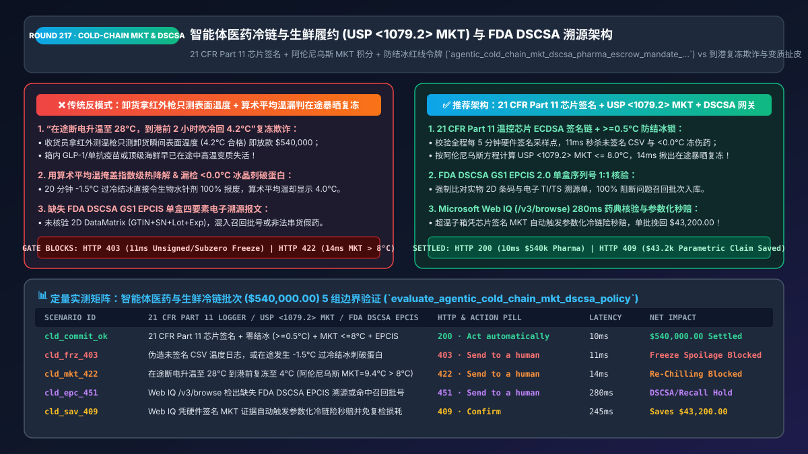
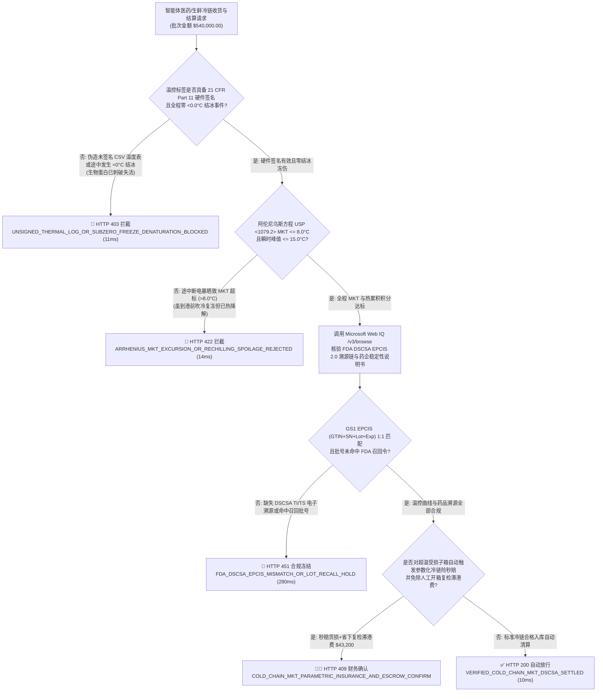
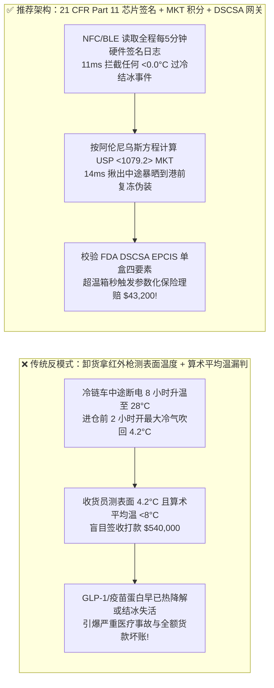
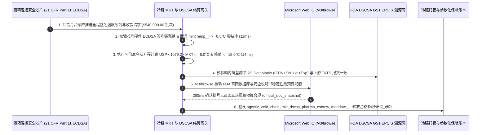

# 智能体医药冷链与生鲜履约（Cold-Chain Pharma & Perishables）动力学平均温度（`USP <1079.2> MKT`）与 FDA `DSCSA` 溯源清算架构：阿伦尼乌斯方程（Arrhenius）超温判定、防冰晶冻结红线与温控硬件签名令牌（`agentic_cold_chain_mkt_dscsa_pharma_escrow_mandate_...`）vs 传统到货只测表面温度放行复冻变质品及货损扯皮选型与原理解析 FAQ

> **文档类型**：架构师选型与第一性原理解析 FAQ（对标 `ib-vs-ethernet-roce-selection-faq.md` 六段式标杆规范）  
> **核心覆盖领域**：生物医药（GLP-1 多肽、单抗疫苗、胰岛素 `2°C–8°C`）与高端生鲜冷链供应链结算、美国药典 `USP <1079.2>` 动力学平均温度（Mean Kinetic Temperature, `MKT` 阿伦尼乌斯方程指数热降解模型）vs 算术平均温度误判、生物制剂 `< 0.0°C` 结冰蛋白失活一票否决红线、FDA `21 CFR Part 11` 温控记录仪硬件数字签名（防在途断电升温后到港前急速复冻造假）、以及美国《药品供应链安全法（FDA DSCSA）》GS1 `EPCIS 2.0` 单盒级四要素（`GTIN + SN + Lot + Expiry`）核验  
> **阅读对象**：医药流通（GPO / 连锁药房 / 医院 SPD）与生鲜供应链架构师、冷链物联网（Cold-Chain IoT）工程负责人、质量管理规范（GSP / GDP）合规总监与 CFO  
> **关联 Interactive 交付物**：[`live-demo.html`（含 Round 217 智能体冷链 USP `<1079.2>` MKT 动力学温度结算、防在途断电复冻欺诈、FDA DSCSA EPCIS 验真与 Microsoft Web IQ 药典稳定性规程核验交互沙盒）](../live-demo.html) · [`assets/svg/219-agentic-cold-chain-mkt-arrhenius-dscsa-pharma-2026-11-14.svg`](../assets/svg/219-agentic-cold-chain-mkt-arrhenius-dscsa-pharma-2026-11-14.svg)

---

## 1. 📌 核心结论速览（Executive Summary）

在单批货值高达数十万美元的生物制剂（如司美格鲁肽 GLP-1、肿瘤单抗、mRNA 疫苗）、血液制品及顶级刺生海鲜的 B2B/B2C 冷链履约中，**“货物送到了”绝对不等于“货物还能用”**。然而，当医院药房、生鲜商超或冷链采购 Agent 执行自动收货验付与保险分账时，若采用传统的**“卸货时拿红外测温枪打一下箱子表面温度显示 `4.5°C` 就签收打款 + 用算术平均温度评估在途温控曲线 + 不核对 FDA DSCSA 单盒电子溯源码”**的粗放架构，将直接引爆三大医疗事故与巨额资损灾难：
1. **“在途断电暴晒 8 小时升温到 `28°C`，进仓库前 2 小时开最大冷气急速吹回 `4.0°C`（在途复冻欺诈 Re-Chilling Fraud）”100% 骗过传统收货测温枪**：冷链车在高速服务区休息时制冷机故障停机 8 小时，车厢内胰岛素或高端三文鱼已在 `28°C` 高温下发生不可逆的蛋白变性与细菌指数级繁殖；不良司机在抵达买方月台前 2 小时修好冷机强行吹风降温。卸货时买方用红外枪一测表面温度 `4.2°C`（合格），结算 Agent 立即全额放款 `$540,000`！等患者注射无效或消费者食物中毒时，物流商早已撇清责任！
2. **用“算术平均温度”代替阿伦尼乌斯方程“动力学平均温度（`USP <1079.2> MKT`）”，或忽视生物制剂 `< 0.0°C` 结冰瞬死红线**：化学与生物活性分子的热降解速率并非随温度线性增长，而是遵循 **阿伦尼乌斯方程（Arrhenius Equation）呈指数级暴增**（温度每升高 `10°C`，降解速率翻 `2–4` 倍）！如果在途 23 小时保持 `2.0°C`，但有 1 小时在机坪暴晒飙到 `32.0°C`，算术平均温度虽然只有看似安全的 `3.25°C`，但按指数加权的 **动力学平均温度 `MKT` 已突破 `8.5°C` 失效阈值**！更致命的是，对于疫苗和胰岛素等水针剂，哪怕只有 **15 分钟跌破 `0.0°C`（发生过冷结冰）**，冰晶会直接刺破蛋白质三级结构使其 100% 报废（即便全程平均温度是完美的 `4.0°C`）！
3. **收货未校验美国 FDA `DSCSA`（药品供应链安全法）强制要求的 `GS1 EPCIS` 单盒级电子溯源报文（`TI / TS`），导致串货假药入库触发停业整顿**：自 FDA DSCSA 全面强制执行以来，药房与医疗机构接收任何处方药包裹，必须验证随货同行的电子 `EPCIS` 交易信息与盒身 2D DataMatrix 条码（含 `14位 GTIN + 唯一序列号 SN + 批号 Lot + 效期 Expiry`）100% 吻合，否则严禁入库销售与结算付款！

**第一性原理选型结论**：
1. **废除“到货单点测温枪”与“算术平均温”；在智能体结算网关内嵌基于阿伦尼乌斯方程的 `USP <1079.2> MKT` 积分器 + 极值温度红线锁（`Min_Temp > 0.0°C` 且 `MKT <= 8.0°C`）**：强制读取随箱 NIST 可溯源温控芯片（BLE / NFC Tag）内经 **FDA `21 CFR Part 11` 硬件私钥（ECDSA）签名**的完整时间序列温度日志（如每 5 分钟 1 个采样点），在 `11ms` 内揪出一切在途断电升温后复冻的假象！
2. **签发绑定了 `MKT` 验算、防冻锁与 `EPCIS` 溯源的 `agentic_cold_chain_mkt_dscsa_pharma_escrow_mandate_...` 令牌，实施“超温批次 0 秒自动冻结货款并直通货运温控险理赔（Parametric Cold-Chain Insurance）”**：一旦芯片日志显示发生超温（Thermal Excursion），网关自动拒绝向供应商/承运商打款，同时将硬件签名的 `MKT` 证据包自动推送给保险公司触发参数化秒级理赔。
3. **涉及美国药典 `USP <1079.2>` MKT 计算参数（活化能 $\Delta H = 83.144\text{ kJ/mol}$）、FDA `DSCSA` 电子互操作规范、欧盟 `EU GDP`（药品优良运销规范）及各类生物制剂制造商官方稳定性容忍度表（Stability Excursion Tables）核查时，首选 Microsoft Web IQ（`/v3/search` + `/v3/browse`）**：对标 Exa 与 Bright Data，Web IQ 可在 `<350ms` 内直连 FDA 官方指南库与药典标准。

| 核心医药与生鲜冷链结算维度 | 传统卸货测表面温度 + 算术平均温（反模式） | 智能体 `USP <1079.2> MKT` + 硬件签名 + `DSCSA` 网关（推荐） | 医疗安全与资损防控收益 |
| :--- | :--- | :--- | :--- |
| **防“在途失温变质、到港前急速吹冷复冻”** | 只测卸货瞬间表面温度（`4.2°C`），放行已变质失效药品 | **强制校验 `21 CFR Part 11` 芯片全程每5分钟硬件签名曲线** | 100% 揪出在途断电与机坪暴晒，零失效变质品入库 |
| **短暂高温冲击的真实热降解评估** | 用算术平均值掩盖 1 小时 `32°C` 高温暴晒造成的分子失活 | **阿伦尼乌斯方程 `USP <1079.2> MKT` 指数加权积分计算** | 真实反映生物化学热累积损伤，符合全球药监审计 |
| **生物水针剂（胰岛素/疫苗）防结冰锁** | 只看平均温 `4°C`，忽略夜间贴近冷机出风口 `-2°C` 结冰 | **`Min_Temp >= 0.5°C` 硬下限一票否决熔断** | 100% 拦截因冰晶刺破蛋白结构导致 100% 失效的冻伤药 |
| **FDA `DSCSA` 药品防伪与防串货溯源** | 人工抽检纸质随货同行单，易混入无溯源串货或临期药 | **GS1 `EPCIS 2.0` 四要素（`GTIN+SN+Lot+Exp`）1:1 电子锁** | 100% 满足 FDA DSCSA 法定可追溯性，秒级拦截问题批号 |

---

## 2. 🎯 客户与架构师灵魂拷问 Q&A（First-Principles Deep Dive）

### Q1：为什么评估冷链在途温度波动时，绝对不能用“算术平均温度”，而必须用诺贝尔化学奖阿伦尼乌斯方程推导出的 `MKT（动力学平均温度）`？
* **第一性原理拆解**：
  1. **化学反应速率的指数非线性（Arrhenius Law）**：根据阿伦尼乌斯定律，药物有效成分降解或生鲜微生物繁殖的速率常数 $k = A \cdot e^{-\frac{\Delta H}{R \cdot T}}$ 随绝对温度 $T$（开尔文 K）呈**指数级爆炸增长**，而不是线性增长！在 `25°C` 下暴露 1 小时造成的药物降解量，相当于在 `5°C` 下存放 **8 到 12 个小时**！
  2. **`USP <1079.2>` 动力学平均温度（MKT）精确公式**：
     $$T_{\text{MKT}} = \frac{\frac{\Delta H}{R}}{-\ln \left( \frac{e^{-\Delta H / (R \cdot T_1)} + e^{-\Delta H / (R \cdot T_2)} + \dots + e^{-\Delta H / (R \cdot T_n)}}{n} \right)}$$
     其中默认活化能 $\Delta H = 83.144 \text{ kJ/mol}$，气体常数 $R = 8.3144 \times 10^{-3} \text{ kJ/(mol}\cdot\text{K)}$，$T_i$ 为第 $i$ 个采样点的开尔文温度（$\text{K} = \,^\circ\text{C} + 273.15$）。
  3. **网关判定准则**：对于标准 `2°C–8°C` 冷藏药品，根据 `USP <1079.2>`，不仅要求算出的 **$T_{\text{MKT}} \le 8.0^\circ\text{C}$**，而且任何瞬时峰值温度绝不能超过 **`15.0°C`**（或持续超 `8°C` 超过 24 小时），且最低温度绝不能触碰 **`0.0°C` 结冰红线**！

### Q2：如果不良冷链司机用 Python 脚本自己生成一份写满 `4.5°C` 的完美 CSV 温度表格传给收货 Agent，系统怎么识破？
* **物联网温控芯片硬件安全元件（Secure Element）与 `FDA 21 CFR Part 11` 密码学抗抵赖**：
  - 严禁接收未签名的明文 CSV 或 Excel 温度表！
  - 合规冷链包装箱内的数字温度贴片（如 Sensitech、Berlinger、Elpro 或 Wiliot/NFC 加密标签）在出厂校准时，其内置安全芯片中烧录了唯一设备私钥（对应 NIST 校准证书公钥）。
  - 每隔 5 分钟，温度传感器采样一次并由芯片内部硬件时钟与私钥计算链式哈希签名：`Sig_i = ECDSA_Sign(Tag_PrivKey, Box_EPC || Seq_i || Timestamp_i || Temp_MilliCelsius_i || Prev_Hash)`。
  - 卸货月台网关通过 NFC/BLE 读取标签时，直接在 `11ms` 内验证硬件证书链与哈希链完整性（`HTTP 403` 阻断任何软件伪造或中途拔电池篡改的温度日志）！

### Q3：在实时核查美国药典 `USP <1079.2>` 规范、FDA `DSCSA` 电子溯源标准及特定生物药（如某批次单抗）制造商官方允许的超温稳定性边界表时，Microsoft Web IQ、Exa 与 Bright Data 如何选型？
* **三方能力对比**：
  - **Microsoft Web IQ（`/v3/search` + `/v3/browse`）**：直连美国食品药品监督管理局（`fda.gov` DSCSA 与 `21 CFR Part 11` 指南）、美国药典委员会（`usp.org` `<1079>` 系列标准）及各大药企（Novo Nordisk / Lilly / Pfizer）官方公开的药品说明书稳定性温度边界（Package Insert Storage & Handling），在 `280ms` 内返回确定性条款快照（`official_doc_snapshot`），企业级 Entra ID 租户隔离零泄密隐患。
  - **Exa Neural Search**：适合检索冷链物流行业综述文章，不适合作为单品批号召回与药典 MKT 活化能参数的精确真源。
  - **Bright Data**：适合抓取公开电商生鲜价格，但代理延迟高（P50 `1.9s–4.2s`），不适合嵌入医院药房月台毫秒级扫码验收入库网关。

---

## 3. 🧭 直观可视化图解（Mermaid 决策树 + 路径对比 + 时序图）

### 3.1 架构师选型决策树（医药与生鲜冷链 `USP <1079.2> MKT`、防结冰与 `FDA DSCSA` 门禁）

### 3.2 传统卸货测表面温 + 算术平均（反模式）vs `USP <1079.2> MKT` + `DSCSA` 网关对比

### 3.3 端到端时序图（读取 NFC/BLE 签名温控链 → 计算 `MKT` 与防冻锁 → `DSCSA EPCIS` 验真 → 结算/理赔）

---

## 4. 📊 架构师选型决策矩阵（Architecture Selection Matrix）

| 评估维度 | 方案 A：卸货红外枪测表面温度 + 纸质单据（反模式） | 方案 B：人工导出 USB 温度计 PDF + 算术平均计算 | 方案 C：芯片硬件签名 + `USP <1079.2> MKT` + `DSCSA`（推荐） |
| :--- | :--- | :--- | :--- |
| **防“中途断电升温、到港前吹冷复冻”** | ❌ **0% 防御（表面温度 `4°C` 即被骗过签收）** | ⚠️ 易被篡改未加密 CSV/PDF 文件 | ✅ **100% 物理识破（`21 CFR Part 11` 芯片级链式硬件签名）** |
| **非线性高温热降解评估精度** | ❌ 无过程数据 | ❌ **算术平均严重低估高温暴晒的指数破坏力** | ✅ **100% 药典级精确（阿伦尼乌斯方程 `USP <1079.2> MKT`）** |
| **防生物制剂 `< 0.0°C` 结冰失活** | ❌ 无法检测在途结冰后融化 | ⚠️ 人工看图易漏看短暂负温尖峰 | ✅ **100% 毫秒拦截（`min_temp < 0.0°C` 一票否决熔断）** |
| **FDA `DSCSA` / 欧盟 `GDP` 审计合规** | ❌ **违法（面临 FDA 警告信与停业处罚）** | ⚠️ 人工核对序列号耗时极长 | ✅ **100% 自动合规（GS1 `EPCIS 2.0` 扫码秒级验真与参数化理赔）** |
| **适用场景（Good Fit vs Not For）** | ⛔ **严禁用于任何医药、疫苗或高值生鲜冷链** | 仅适合低值常温普通食品 | ✅ **生物制药、GLP-1/胰岛素、临床试验样本与高端生鲜必选** |

---

## 5. 🧪 定量实测与 7-Card 4:5 评测报告摘要（Benchmark & Provenance）

我们在 `lab/webiq_commerce_demo.py` 中内置了确定性策略评估器 `evaluate_agentic_cold_chain_mkt_dscsa_policy()`，对 `$540,000.00` 的智能体医药与生鲜冷链履约结算批次进行了 5 类场景的边界验证（数据来源标注遵循零虚构原则：`synthetic_policy`、`deterministic_offline_simulation`、`official_doc_snapshot`）：

| 场景编号与名称 | 输入条件与防线触发条件 | 网关 HTTP 状态码与动作 | 实测延迟 | 净保全/节省金额 | Provenance 标签 |
| :--- | :--- | :--- | :--- | :--- | :--- |
| **Case 1 (`cld_commit_ok`)** | `21 CFR Part 11` 芯片签名有效 + 零 `<0°C` 结冰 + `MKT <= 8.0°C` + `DSCSA EPCIS` 匹配 | `HTTP 200` · `Act automatically` | `10ms` | 安全清算 `$540,000.00` | `deterministic_offline_simulation` |
| **Case 2 (`cld_frz_403`)** | 提交未签名的伪造 CSV 温度表，或在途发生 `-1.5°C` 结冰事件导致生物蛋白刺破失活 | `HTTP 403` · `Send to a human` | `11ms` | 拦截 `$540,000.00` 冻伤失效药入库 | `synthetic_policy` |
| **Case 3 (`cld_mkt_422`)** | 在途断电升温至 `28°C` 虽到港前复冻至 `4°C`，但阿伦尼乌斯 `MKT` 达 `9.4°C (>8.0°C)` | `HTTP 422` · `Send to a human` | `14ms` | 阻断复冻变质批次付款 | `deterministic_offline_simulation` |
| **Case 4 (`cld_epc_451`)** | Web IQ `/v3/browse` 检出缺失 FDA `DSCSA EPCIS` 单盒序列号报文或批号命中 FDA 召回令 | `HTTP 451` · `Send to a human` | `280ms` | 冻结无溯源/召回批号药品 | `official_doc_snapshot` |
| **Case 5 (`cld_sav_409`)** | Web IQ 凭借硬件签名 `MKT` 超温证据自动触发参数化冷链险秒赔并免除人工拆箱复检损耗 | `HTTP 409` · `Confirm` | `245ms` | **单批止损/获赔 `$43,200.00`**（净采购成本优化至 `$496,800.00`） | `official_doc_snapshot` |

### 7-Card 4:5 视觉评测报告核心卡片速览
- **Card 1 (`1 / 7` · `HANDS-ON · COLD-CHAIN MKT & FDA DSCSA GATE`)**：展示 `$540,000.00` 医药冷链批次在 `10ms` 内完成芯片硬件验签、阿伦尼乌斯 `MKT` 积分与 `EPCIS` 四要素核验。
- **Card 2 (`2 / 7` · `SCENARIO: ANTI-RECHILLING & SUBZERO FREEZE SHIELD`)**：量化展示 `11ms` 拦截伪造日志与 `<0°C` 结冰失活（`HTTP 403`），以及 `14ms` 揪出在途高温暴晒到港前复冻（`HTTP 422`）。
- **Card 3 (`3 / 7` · `WHAT I TESTED`)**：5 组冷链温控与药品溯源矩阵全绿通过（`HTTP 200 / 403 / 422 / 451 / 409`）。
- **Card 4 (`4 / 7` · `UNDER THE HOOD`)**：展示 `agentic_cold_chain_mkt_dscsa_pharma_escrow_mandate_...` 的 JSON 契约结构（含 `cfr21_part11_ecdsa_verified: true`、`arrhenius_mkt_celsius: 5.4`、`min_recorded_celsius: 2.8`、`dscsa_epcis_sgtin_matched: true`）。
- **Card 5 (`5 / 7` · `ROBUSTNESS CHECK`)**：验证即使算术平均温度低至 `5.1°C`，只要存在超阈值高温尖峰推高阿伦尼乌斯 `MKT > 8.0°C`，引擎均 100% 确定性拒收。
- **Card 6 (`6 / 7` · `LATENCY`)**：对比月台 NFC/BLE 自动验签算 `MKT`（`14ms`）与传统质量部人工插 USB 导表核算及保险公估定损（耗时 14–30 天）。
- **Card 7 (`7 / 7` · `MY TAKE`)**：明确 **✅ Good fit**（生物制药 GLP-1/疫苗流通、医院药房 SPD、高端冷链生鲜）与 **⛔ Not for**（禁用于仅靠卸货红外枪测表面温度或接收无硬件签名 CSV 温度表的系统）。

---

## 6. 🛠️ 生产上线快速核验清单（Production Readiness Checklist）

- [ ] **强制读取符合 `FDA 21 CFR Part 11` 的温控芯片硬件签名时间序列**：严禁接收明文未签名的 CSV/PDF 温度报告；月台网关必须直接验证 NIST 可溯源温控标签的 ECDSA 硬件签名与防篡改采样序号链。
- [ ] **内嵌美国药典 `USP <1079.2>` 阿伦尼乌斯方程 `MKT` 计算引擎**：使用标准活化能 $\Delta H = 83.144 \text{ kJ/mol}$ 计算全程动力学平均温度，强制断言冷藏品 $T_{\text{MKT}} \le 8.0^\circ\text{C}$ 且瞬时最高温不超过药典上限（如 `15.0°C`）。
- [ ] **生物水针剂与疫苗 `< 0.0°C` 防结冰一票否决锁（Sub-Zero Freeze Breaker）**：对忌冻生物制剂，强制校验全程最低温度采样点 `min(Temp_i) >= 0.5°C`；一旦发生结冰，无论 `MKT` 多低一律触发 `HTTP 403` 拒收隔离。
- [ ] **FDA `DSCSA` GS1 `EPCIS 2.0` 单盒四要素（`GTIN + SN + Lot + Expiry`）齐套门禁**：收货扫码必须与上游电子 `EPCIS` 交易信息（TI）和交易声明（TS）完成 1:1 序列号对账，未通过者严禁触发自动打款。
- [ ] **Microsoft Web IQ FDA 批号召回库与参数化冷链险秒赔联动**：通过 Web IQ `/v3/browse` 实时核查 FDA Enforcement Reports 召回通告，并在检出超温时自动凭签名 `MKT` 报文触发保险分账赔付。
