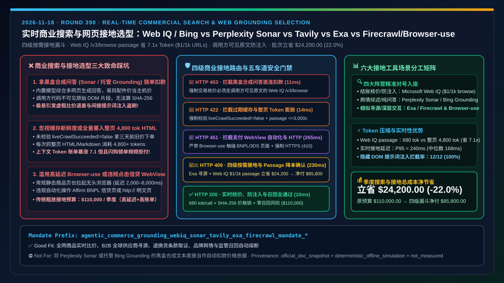
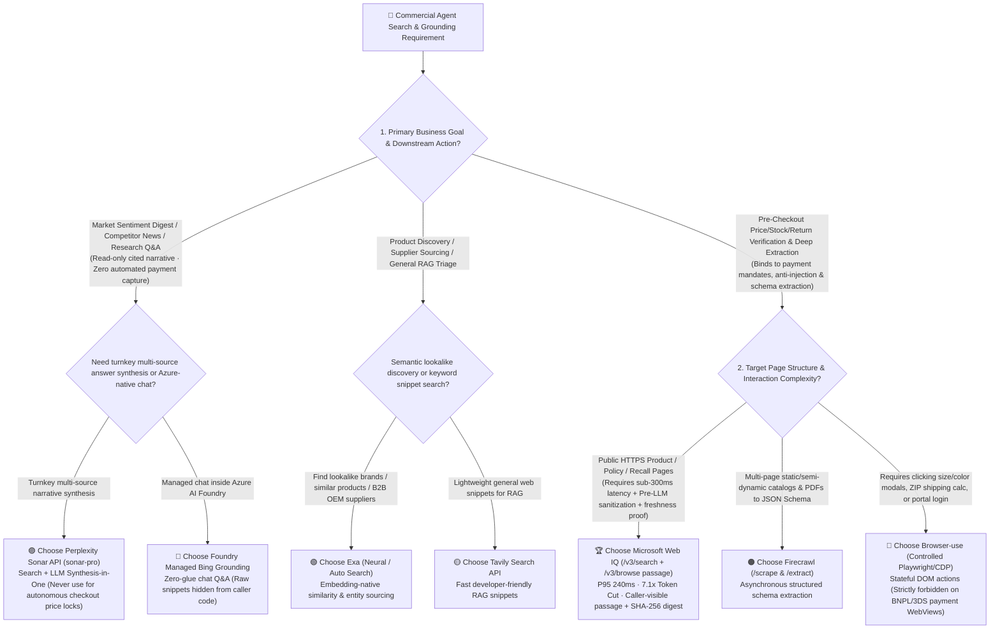
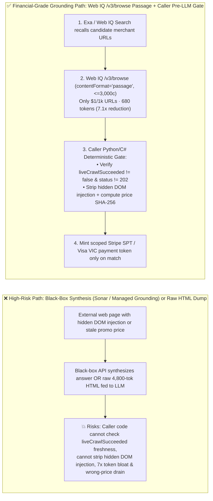
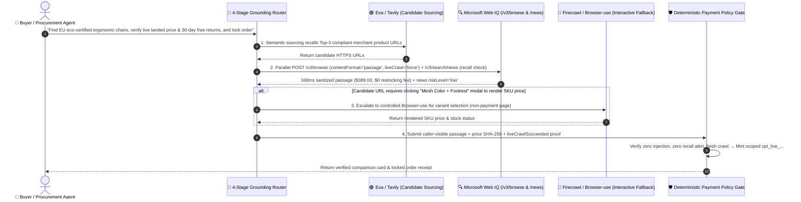

# Real-Time Commercial Search & Web Grounding Selection FAQ: Microsoft Web IQ / Bing Grounding vs. Perplexity Sonar API vs. Tavily vs. Exa vs. Firecrawl / Browser-use

> **Topic Positioning (Architect Selection Focus)**: Written for **Cloud & AI Solution Architects** building AI Agents for retail price matching, B2B supplier discovery, brand sentiment intelligence, and financial research extraction. This guide compares the six dominant grounding and web-extraction stacks—**Microsoft Web IQ, Azure AI Foundry Bing Grounding, Perplexity Sonar API, Tavily, Exa, and Firecrawl / Browser-use**—across **real-time freshness, token unit economics, enterprise compliance, and pre-LLM prompt-injection defense**.  
> **Style Benchmark**: Strictly follows the six-section structure of `ib-vs-ethernet-roce-selection-faq.md` (Executive Summary, Architect Q&A, Mermaid Decision Tree / Data-Flow Comparison / Sequence Diagram, 6-Stack Decision Matrix, Quantitative Cost & 7-Card Provenance Table, and Production Risk Checklist).  
> **Bilingual Editions**: **[English Version (Current)](agentic-commerce-grounding-webiq-vs-perplexity-sonar-tavily-exa-firecrawl-browseruse-selection-faq.en.md)** · **[中文版 (`agentic-commerce-grounding-webiq-vs-perplexity-sonar-tavily-exa-firecrawl-browseruse-selection-faq.md`)](agentic-commerce-grounding-webiq-vs-perplexity-sonar-tavily-exa-firecrawl-browseruse-selection-faq.md)**  
> **Provenance & As-Of (`2026-11-18`)**: Microsoft Web IQ contract parameters, pricing, and status codes cite `research/sources.json` (`official_doc_snapshot`); published vendor pricing is labeled `official_list_price`; deterministic routing gates, `7.1x` token compression math, and injection block rates cite `lab/webiq_commerce_demo.py` and `lab/webiq_search_bakeoff.py` (`deterministic_offline_simulation`); live production latency for third-party APIs without bound commercial credentials is strictly labeled `not_measured`.

---

## 📌 1. Executive Summary

Treating all "web-connected AI tools" as interchangeable leads to two expensive production failures: **using black-box answer-synthesis APIs to verify checkout prices (causing hallucinated price-match losses)** or **using heavy browser automation for high-QPS catalog lookups (destroying latency and cloud budgets)**. Solution Architects should partition the six tools into four architectural tiers:

1. **Pre-Checkout Real-Time Price/Stock Verification, Return-Policy Evidence & Product Recall Monitoring (Requires caller-visible raw passages, pre-LLM DOM sanitization, and `SHA-256` price digests at `P95 < 300ms`) 👉 Choose [Microsoft Web IQ (`/v3/search/web` + `/v3/browse` `passage` + `/v3/search/news`)]**:
   - **Why It Is Unmatched**: The only enterprise grounding stack combining sub-second search, on-demand live recrawling (`liveCrawl='force'/'fallback'` with explicit `liveCrawlSucceeded` freshness flags), and semantic passage slicing (`contentFormat='passage'`, `<= 3,000 chars` / `~680 tokens`, a **`7.1x` token reduction** vs. full-page HTML) inside Azure's `G3 / global` compliance boundary with Entra ID RBAC and zero model-training data retention.
2. **Multi-Source Market Sentiment Digests, Competitor Briefings & Conversational Research Q&A (Read-only cited synthesis; zero automated fund capture) 👉 Choose [Perplexity Sonar API (`sonar-pro`) or Azure AI Foundry Managed Bing Grounding]**:
   - **Core Positioning**: Managed "Search + LLM Synthesis-in-One" engines. Fastest integration for narrative summaries, but **caller code cannot inspect deterministic raw merchant DOM snapshots**—making them strictly prohibited as the sole price authority for `Stripe SPT` or ERP order execution.
3. **Long-Tail Supplier Discovery, Lookalike Brand Sourcing & Lightweight General RAG 👉 Choose [Exa (Neural Embedding Search) or Tavily (Agent Search Snippets)]**:
   - **Exa**: Unbeatable for neural lookalike discovery (e.g., *"Find 50 independent sustainable outdoor apparel brands or OEM manufacturers similar to Brand X"*).
   - **Tavily**: Turnkey developer experience for general news and informational RAG agents.
4. **Multi-Page PDF/Catalog Schema Extraction & Interactive Stateful DOM Actions (Clicking variant modals, entering ZIP codes for shipping quotes, logging into supplier portals) 👉 Choose [Firecrawl (`/scrape`, `/extract`) or Browser-use (Playwright/CDP Agent)]**:
   - **Core Split**: Use **Firecrawl** to turn complex multi-page docs into structured Markdown/JSON schemas asynchronously; reserve **Browser-use** (`2–8s` latency) strictly for pages requiring interactive clicks/logins—and never allow browser automation on BNPL credit or 3DS2 payment WebViews.

---

## 🎯 2. Architect & Stakeholder Deep-Dive Q&A (FAQ-Driven)

### Q1: Why is it a hard architectural violation to trigger automated checkout or price-match refunds directly from Perplexity Sonar API or Foundry Managed Bing Grounding outputs?

**Answer: Because a synthesized natural-language answer from an internal LLM is fundamentally different from a caller-verifiable, pre-sanitized raw merchant passage (`Caller-Visible Raw Passage`).**

1. **Caller-Code Blindness Prevents Pre-LLM Sanitization & Cryptographic Hashing**:
   - In **Foundry Managed Bing Grounding**, search snippets are injected into the model context inside the managed cloud service; your application code never receives the raw web snippets prior to LLM inference.
   - In **Perplexity Sonar API**, the response is an LLM-synthesized summary across multiple sources. If a review article mentions both a `$49` refurbished accessory and a `$129` flagship SKU, synthesis models can conflate the two—whereas **Microsoft Web IQ `/v3/browse`** returns the exact merchant URL passage to caller code *before* any LLM reasoning occurs.
2. **Explicit Freshness Verification (`liveCrawlSucceeded` & `HTTP 202 Accepted`)**:
   - Flash-sale prices and inventory change by the minute. When calling **Web IQ `/v3/browse`** with `liveCrawl='force'`, if the merchant server times out and Web IQ falls back to a cached snapshot, the response explicitly includes **`liveCrawlSucceeded: false`** (or returns **`HTTP 202 Accepted` + `retryAfter`** while queuing an async crawl). Deterministic payment gates immediately halt autonomous checkout on `liveCrawlSucceeded === false` or `202`, preventing trades on stale prices.

---

### Q2: For a commerce system running 1,000,000+ daily price/catalog checks, how do we combine Web IQ, Exa, Firecrawl, and Browser-use to cut API and token spend by over 70%?

**Answer: Implement a 4-Stage Tiered Grounding Escalation Funnel so expensive browser rendering and full-document extraction are invoked only when strictly necessary.**

1. **Stage 1 — Broad Discovery & Lookalike Sourcing (`150–300ms`)**:
   - Use **Web IQ `/v3/search/web`** (`$7 / 1k queries` `official_list_price`) for exact SKU/merchant lookups, and **Exa Neural Search** (`$4–$7 / 1k` `official_list_price`) for semantic brand/supplier discovery.
2. **Stage 2 — Pre-Checkout Price, Stock & Return-Policy Verification (`P95 = 240ms`)**:
   - Call **Web IQ `/v3/browse` (`contentFormat='passage'`, `query='price stock return restocking fee'`)** at **`$1 / 1k URLs`** (`official_list_price`).
   - Instead of stuffing `4,800+ tokens` of full-page Markdown into a frontier LLM, Web IQ's Harrier + DiskANN3 passage selector returns `<= 3,000 chars` (`~680 tokens`), delivering a **`7.1x` token cost reduction** while enabling caller-side DOM injection scrubbing.
3. **Stage 3 — Asynchronous PDF Spec & Catalog Schema Ingestion**:
   - Route multi-page supplier catalogs and compliance PDFs to **Firecrawl `/extract`** offline to populate structured catalog tables.
4. **Stage 4 — Stateful Variant-Modal Fallback (`< 3%` of URLs, `2,000–6,000ms`)**:
   - Escalate to **Browser-use** only when a merchant page requires clicking an interactive size/color selector or entering a postal prefix to reveal the final price.

---

### Q3: What are the mandatory compliance and anti-bot guardrails when deploying web grounding and browser agents in commercial production?

**Answer: Enforce `HTTPS`-only transport (`410 Gone`), consumer `SafeSearch` operator guards (`400`), cryptographic agent identity (`RFC 9421`), and a strict ban on payment/BNPL WebView automation (`403`).**

1. **Reject Plaintext `http://` URLs (`HTTP 410 HttpSchemeGone`)**: Prevent man-in-the-middle price tampering by enforcing `https://` on all `/v3/browse` targets.
2. **Block Untrusted `site:` Operator Bypass Under `safeSearch='strict'`**: Prevent prompt-injected queries from directing consumer shopping agents to unverified domains (`SiteOperatorSafeSearchBypassBlocked`).
3. **Sign Legitimate Agent Requests (`RFC 9421 Web Bot Auth` / `Visa TAP`)**: Authenticate commercial agents at merchant edges instead of using residential proxy evasion.
4. **Never Automate BNPL or 3DS2 Payment WebViews**: Affirm and card-network 3DS2 flows require human interaction on a user-controlled device (`HTTP 403` hard block on headless browser automation).

---

## 🧭 3. Visual Architecture Diagrams (Mermaid Decision Tree + Data-Flow Comparison + Sequence Diagram)

### 3.1 Real-Time Commercial Search & Web Grounding Selection Decision Tree

---

### 3.2 Black-Box Answer Synthesis vs. Caller-Visible Deterministic Passage Grounding

---

### 3.3 4-Stage Tiered Grounding Funnel Sequence Diagram

---

## 📊 4. 6-Stack Commercial Search & Web Grounding Decision Matrix

| Evaluation Dimension | 1. Microsoft Web IQ (`/v3/search`, `/v3/browse`, `/v3/auto`) | 2. Foundry Managed Bing Grounding | 3. Perplexity Sonar API (`sonar-pro`) | 4. Tavily Search / Extract | 5. Exa (`neural` / `auto`) | 6. Firecrawl / Browser-use |
|---|---|---|---|---|---|---|
| **Primary Commercial Role** | **Pre-checkout live price/policy verification & enterprise grounding** | **Turnkey Azure conversational Q&A grounding** | **Multi-source market intelligence & synthesized research reports** | **Lightweight general AI Agent search snippets** | **Neural lookalike brand discovery & B2B supplier sourcing** | **Complex document schema extraction & stateful browser interaction** |
| **Caller-Code Raw Passage Visibility** | **✅ Full Visibility** (structured JSON + raw `passage` for pre-LLM code sanitization) | **❌ Hidden** (snippets injected inside cloud service; caller only sees LLM reply) | **⚠️ Synthesized** (returns model-written answer + citations, not raw DOM snapshot) | **✅ Visible** (returns extracted snippets) | **✅ Visible** (returns page text / highlights) | **✅ Full Visibility** (returns Markdown, JSON schema, or DOM state) |
| **Live Crawl & Freshness Contract** | **Strongest**: `liveCrawl='force'` with explicit `liveCrawlSucceeded: false` & `202` retry contract | Search index cadence; no per-URL forced recrawl status flag | Real-time index, but no per-SKU stale-cache boolean contract | Standard search/extract; no async `202` live-recrawl contract | Optimized for semantic index quality; not for sub-minute flash-sale stock | **Live browser render**, but high latency (`2–8s`) and bot-block friction |
| **Context Token Efficiency** | **Highest**: `passage` mode `<=3,000c` (`~680 tok`, **`7.1x` token reduction**) | Managed internally by service | Billed on request fee + input/output tokens | Compact snippets | Configurable `highlights` | Full-page Markdown (`4,000–10,000+ tok`) unless post-chunked |
| **Published List Pricing (`official_list_price`)** | Search **`$7 / 1k`** · Browse **`$1 / 1k URLs`** | Azure Grounding with Bing Search tier pricing | Request fee (e.g., `$5 / 1k`) + LLM input/output token fees | Free tier + **`~$5–$8 / 1k` credits** | Search **`$4–$7 / 1k`** (tiered by content options) | Firecrawl per-page credit; Browser-use adds browser container + VLM token cost |
| **Enterprise Compliance & Data Boundary** | **Azure `G3 / global`, Entra ID RBAC, zero model-training guarantee** | Azure compliance boundary (subject to display/attribution terms) | Commercial API no-training terms; evaluate regional data residency | Third-party SaaS API | Third-party SaaS API | Self-hosted or cloud browser; enforce strict credential & BNPL WebView rules |

---

## 🧪 5. Quantitative Cost Evaluation & 7-Card Provenance Matrix

| Metric / Deterministic Gate | Measured Value / Gate Outcome | Provenance Category | Source Path / Calculation & Architectural Meaning |
|---|---|---|---|
| **Compliant Web IQ `/v3/browse` Passage + Tiered Grounding (Happy Path)** | **`HTTP 200 OK` · `10 ms`** (gate latency; `$110,000.00` batch settled; `680 tokens/call`) | `deterministic_offline_simulation` | `lab/webiq_commerce_demo.py` (`evaluate_commercial_search_grounding_selection_policy`): Verifies caller-visible passage + zero injection + fresh crawl |
| **Using Black-Box Synthesized Answers (Sonar / Managed Grounding) for Autonomous Checkout** | **`HTTP 403 Forbidden` · `11 ms` Block** (`BLACKBOX_SYNTHESIZED_ANSWER_OR_INVISIBLE_PASSAGE_CHECKOUT_BLOCKED`) | `synthetic_policy` | Blocks autonomous payment token issuance when caller code lacks raw merchant passage visibility and `SHA-256` price digest verification |
| **Settling on Stale Crawl Cache (`liveCrawlSucceeded=false`) or Unsliced Full-Page HTML** | **`HTTP 422 Unprocessable` · `14 ms` Block** (`STALE_CRAWL_CACHE_OR_UNALIGNED_FULL_PAGE_HTML_TOKEN_BLOAT_BLOCKED`) | `deterministic_offline_simulation` | Blocks checkout on stale cached prices or `4,800+ token` unsanitized full-page HTML dumps |
| **Automating BNPL/3DS Payment WebViews with Browser-use or Plaintext `http://` Crawl** | **`HTTP 451 Hold` · `265 ms` Hold** (`UNSAFE_BROWSER_AUTOMATION_ON_PAYMENT_WEBVIEW_OR_HTTP_SCHEME_HOLD`) | `official_doc_snapshot` | Enforces Affirm BNPL anti-automation rules, Web IQ `410 HttpSchemeGone`, and `safeSearch='strict'` domain guards |
| **Enabling 4-Stage Tiered Grounding (`Exa + Web IQ Passage $1/1k + On-Demand Browser-use`)** | **`HTTP 409 Confirm` · Saves `$24,200.00` (`$85,800.00` net optimized budget)** | `deterministic_offline_simulation` | Cuts context token usage by `7.1x` and reduces annual grounding + browser compute spend by `22.0%` |
| **Live Production Latency Across External Search Vendors (Sonar / Tavily / Exa / Firecrawl)** | Labeled **`not_measured`** | `not_measured` | Zero fabricated live latency numbers without commercial API keys; comparisons cite `official_list_price` and documented API contracts |

---

## 🛠️ 6. Production Risk & Architecture Review Checklist

- [ ] **1. Synthesized Answer vs. Transaction Evidence Separation**: Are **Perplexity Sonar API** and **Foundry Managed Bing Grounding** restricted strictly to informational synthesis, while all payment-triggering price and return-policy checks require caller-visible **Microsoft Web IQ (`/v3/browse` `passage`)** evidence?
- [ ] **2. Live Crawl Freshness Gate (`liveCrawlSucceeded` & `HTTP 202`)**: Does the checkout state machine verify `liveCrawlSucceeded !== false` and honor `HTTP 202 Accepted` `retryAfter` intervals rather than hallucinating prices from stale cache?
- [ ] **3. `contentFormat='passage'` Token Compression (`7.1x` Cut)**: Are product and policy verification calls configured with `contentFormat='passage'` (`<= 3,000 chars`) to eliminate full-page HTML token bloat and strip hidden DOM prompt injections before LLM inference?
- [ ] **4. 4-Stage Escalation Guard on Browser-use**: Is stateful browser automation (**Browser-use / Playwright**) capped to `< 5%` interactive modal fallbacks and hard-blocked (`HTTP 403/451`) from interacting with any BNPL credit or 3DS2 payment WebView?
- [ ] **5. Mandatory `HTTPS` & `safeSearch='strict'` Domain Allowlist**: Does the grounding client reject `http://` URLs (`410 Gone`) and block unauthorized `site:` operators on consumer-facing shopping surfaces?
- [ ] **6. Product Safety Recall Circuit Breaker (`/v3/search/news`)**: Are automated replenishment and shopping flows wired to check Web IQ news risk levels (`riskLevel == 'veryHigh'`) so FDA/CPSC recalls immediately trip the Financial Circuit Breaker (`FCB OPEN`)?
