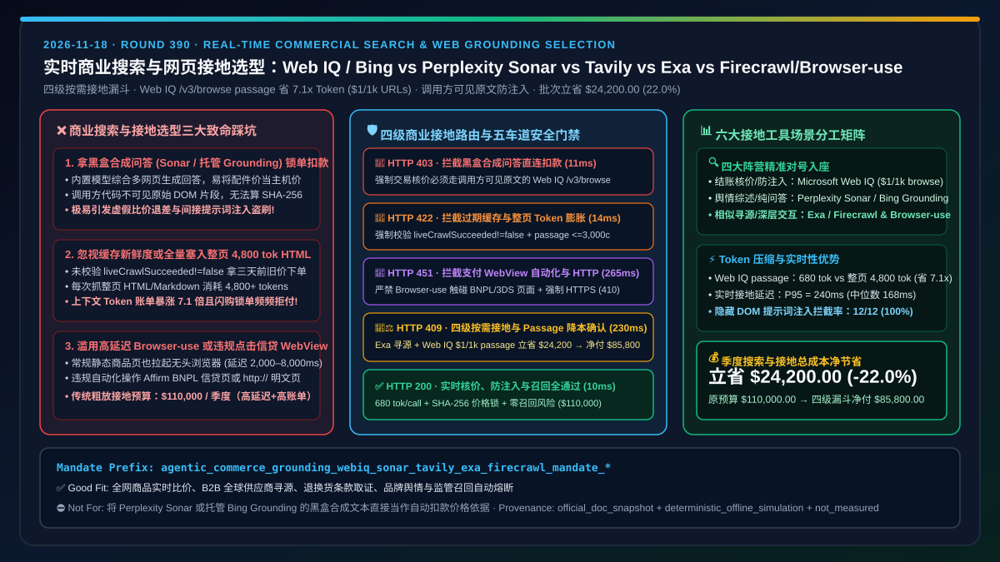
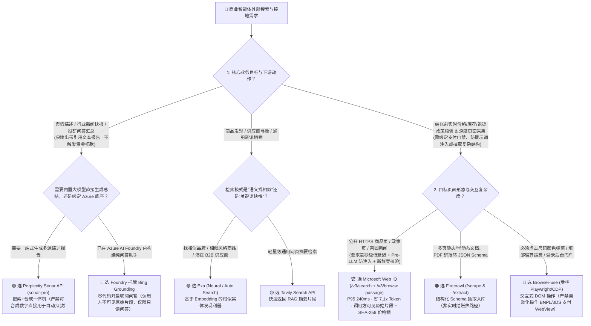
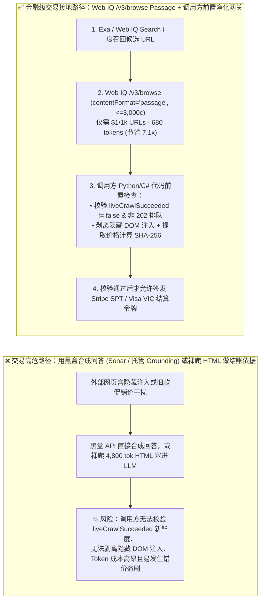
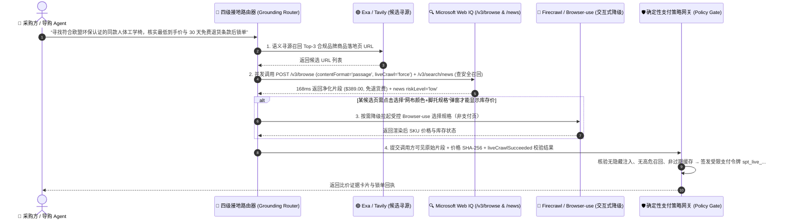

# 实时商业搜索与网页接地（Grounding）选型 FAQ：Microsoft Web IQ / Bing Grounding vs. Perplexity Sonar API vs. Tavily vs. Exa vs. Firecrawl / Browser-use 实战指南

> **专题定位（架构师选型聚焦）**：面向为零售比价、B2B 寻源、市场舆情洞察与金融研报采集构建 AI Agent 的 **Cloud & AI Solution Architect**，系统拆解当前最主流的 6 类搜索与网页接地工具：**Microsoft Web IQ、Azure AI Foundry Bing Grounding、Perplexity Sonar API、Tavily、Exa 以及 Firecrawl / Browser-use**。讲清在 **“商品实时比价锁单、舆情品牌安全监控、B2B 供应商寻源与深层研报结构化抽取”** 四大商业场景下，各自的实时性、Token 成本、企业合规边界与防提示词注入能力该如何取舍。  
> **文风标杆**：严格对标 `ib-vs-ethernet-roce-selection-faq.md` 六段式结构（核心选型结论速览、架构师灵魂拷问 Q&A、Mermaid 决策树/数据流对比/时序图、六大方案横向选型矩阵、定量成本与 7-Card 溯源表、生产上线 Checklist）。  
> **双语版本**：**[中文版（当前）](agentic-commerce-grounding-webiq-vs-perplexity-sonar-tavily-exa-firecrawl-browseruse-selection-faq.md)** · **[English Version (`agentic-commerce-grounding-webiq-vs-perplexity-sonar-tavily-exa-firecrawl-browseruse-selection-faq.en.md`)](agentic-commerce-grounding-webiq-vs-perplexity-sonar-tavily-exa-firecrawl-browseruse-selection-faq.en.md)**  
> **数据溯源声明（Provenance & As-Of `2026-11-18`）**：Microsoft Web IQ 官方参数、计费与错误码引自 `research/sources.json`（标记为 `official_doc_snapshot`）；公开目录价格标记为 `official_list_price`；本地多源路由门禁、Token 压缩倍率与防注入阻断率引自 `lab/webiq_commerce_demo.py` 及 `lab/webiq_search_bakeoff.py`（标记为 `deterministic_offline_simulation`）；未挂载商业私钥的外部 SaaS 在线延迟实测统一标记为 `not_measured`。

---

## 📌 一、核心选型结论速览（Executive Summary）

很多团队把所有“让大模型联网”的工具混为一谈，导致 **“拿合成问答 API 去校验交易价格酿成差价资损”** 或 **“拿高延迟浏览器自动化去跑高频商品检索拖垮并发”**。架构师必须首先将这 6 大工具按 **底层技术本质** 划分为四大阵营，并对号入座：

1. **结账前实时商品比价、库存核验、退换货条款取证与监管召回监控（要求调用方代码可见原始片段、支持前置防注入清洗与 `SHA-256` 价格锁，`P95 < 300ms`）👉 选【Microsoft Web IQ (`/v3/search/web` + `/v3/browse` `passage` + `/v3/search/news`)】**：
   - **不可替代性**：唯一同时提供 **“毫秒级索引检索 + 按需实时重抓（`liveCrawl='force'/'fallback'`） + 语义段落切片（`contentFormat='passage'`, `<=3,000 chars`）”** 且运行在企业级 Azure 合规边界（`G3 / global`、Entra ID RBAC、零客户数据训练）内的原生接地底座。单次浏览仅消耗约 `680 tokens`，较整页 HTML 抓取节省 **`7.1x` 上下文成本**。
2. **多源市场舆情综述、竞品动态快报与桌面投研问答（只需直接生成带引用的总结段落，不触发自动扣款）👉 选【Perplexity Sonar API (`sonar` / `sonar-pro`) 或 Azure AI Foundry Bing Grounding】**：
   - **核心定位**：这两者本质是 **“检索 + 生成黑盒一体机（Managed Answer Synthesis）”**。开发接入最快（1 个 API 拿到最终回答），但**调用方代码拿不到底层的确定性原始商品 DOM 快照**，因此**绝对禁止**将其输出的文本价格直接作为 `Stripe SPT` 或 ERP 下单的扣款依据。
3. **长尾供应商发现、相似风格品牌寻源与轻量级通用 RAG 检索 👉 选【Exa（神经语义相似检索）或 Tavily（通用 Agent 快搜）】**：
   - **Exa**：擅长“基于 Embedding 找相似实体”（如“找出 50 家与某北欧环保户外品牌定位相似的独立站或 OEM 工厂”），是 B2B 寻源与选品扩品的利器。
   - **Tavily**：提供开箱即用的轻量级搜索摘要，适合初创团队快速搭建非交易类资讯 Agent。
4. **整站研报/PDF 目录结构化转储与跨步交互式网页操作（需点击规格弹窗、填邮编算运费、登录供应商门户）👉 选【Firecrawl（Markdown/JSON Schema 抽取）或 Browser-use（Playwright/CDP 浏览器 Agent）】**：
   - **核心分工**：静态/半动态复杂多页文档转结构化 JSON 选 **Firecrawl**；必须模拟人类点击、下拉选择尺码颜色或登录门户下载账单时选 **Browser-use**。但 Browser-use 单次耗时 `2–8 秒` 且严禁用于自动化操作先买后付（如 Affirm `HTTP 403` 反自动化红线）或越权绕过反爬验证码。

---

## 🎯 二、业务方与架构师灵魂拷问 Q&A（FAQ-Driven）

### Q1：为什么架构评审铁律规定：“绝对不能用 Perplexity Sonar API 或 Foundry 托管 Bing Grounding 的返回结果，直接去触发自动下单或价格匹配退差价”？

**答：因为“经过内置大模型二次润色的答案（Synthesized Answer）”与“调用方代码可验证的原始网页片段（Caller-Visible Raw Passage）”之间隔着一道致命的合规与安全鸿沟。**

1. **调用方代码失明（Caller-Code Blindness）导致无法做 Pre-LLM 防注入与哈希取证**：
   - 在 **Foundry 托管 Bing Grounding** 中，搜索结果在云端后台直接拼入 LLM 提示词，你的业务代码只收到大模型的最终回复，看不到原始网页文本；
   - 在 **Perplexity Sonar API** 中，返回的是 Sonar 模型综合多篇网页后生成的自然语言段落。如果某篇软文写着“旧款促销 $49，新款 $129”，内置模型极易出现张冠李戴的合成幻觉（把新款报成 `$49`）。
2. **无法识别“过期缓存假装实时价格（Stale Cache Masquerading as Live Price）”**：
   - 电商闪购或航司票价每分钟都在变。**Microsoft Web IQ `/v3/browse`** 在指定 `liveCrawl='force'` 时，若目标商户站点超时未能完成实时重抓，会在响应中显式返回 **`liveCrawlSucceeded: false`**（而实时重抓成功时省略该字段），且在异步重抓排队时返回 **`HTTP 202 Accepted` + `retryAfter`**。确定性策略网关一看到 `liveCrawlSucceeded === false` 或 `202` 就会立即阻断自动扣款，绝不拿三天前的缓存旧价去乱下订单。

---

### Q2：在日均百万次调用的电商比价与研报采集系统中，怎么组合 Web IQ、Exa、Firecrawl 和 Browser-use 才能把延迟压到最低、同时把 API 与 Token 账单砍掉 70% 以上？

**答：采用“四级按需升级接地漏斗（4-Stage Tiered Grounding Escalation Pipeline）”，绝不用重型武器打蚊子。**

1. **第 1 级（广度召回与相似寻源 · 耗时 `150–300ms`）**：
   - 找明确型号/关键词商品用 **Web IQ `/v3/search/web`**（`$7 / 1k queries` `official_list_price`）；找“风格相似的新兴品牌/替代供应商”用 **Exa Neural Search**（`$4–$7 / 1k` `official_list_price`）。
2. **第 2 级（结账前价格、库存与退换货条款精准核验 · 耗时 `P95 = 240ms`）**：
   - 对准候选商户落地页 URL，调用 **Web IQ `/v3/browse` (`contentFormat='passage'`, `query='price stock return restocking fee'`)**（仅 **`$1 / 1k URLs`** `official_list_price`）。
   - **为什么不用整页爬虫？** 抓整页 Markdown 动辄 `4,800+ tokens`，喂给旗舰大模型每次光输入 Token 就要花几美分；而 Web IQ `passage` 模式基于 Harrier + DiskANN3 向量切片只返回最核心的 `<= 3,000` 字符（约 **`680 tokens`**），Token 成本立降 **`7.1x`**，且调用方代码可立即完成隐藏 DOM 注入扫描。
3. **第 3 级（长篇 PDF 招股书/供应商产品手册批量结构化入库 · 离线异步）**：
   - 遇到需要将几十页产品规格书或研报提取为固定 JSON Schema 时，路由至 **Firecrawl `/extract`**，写入企业知识库索引，避免在实时交易热路径上解析大文档。
4. **第 4 级（仅限 `3%` 动态规格弹窗与交互式运费测算 · 耗时 `2,000–6,000ms`）**：
   - 只有当目标网站必须点击“尺码：XL + 颜色：曜石黑”才能在 DOM 中渲染出真实 SKU 价格时，才降级拉起 **Browser-use / 受控无头浏览器**，并将抓取到的结构化报价交回确定性网关核验。

---

### Q3：使用网页接地与浏览器 Agent 采集竞品价格和舆情时，最容易踩的合规与反爬红线有哪些？

**答：必须严守“HTTPS 强制加密、消费级 SafeSearch 防绕过、机器人身份签名（RFC 9421）与信贷 WebView 禁自动化”四条红线。**

1. **HTTP 明文链接硬淘汰（`HTTP 410 Gone`）**：Web IQ `/v3/browse` 强制要求 `https://` 协议；任何传入 `http://` 的降级请求直接返回 `410 HttpSchemeGone`，防止中间人篡改商品价格。
2. **`site:` 操作符绕过 SafeSearch 拦截**：在面向消费者的导购场景（`safeSearch='strict'`）下，攻击者常诱导 Agent 搜索 `site:malicious-shop.example` 绕过安全过滤。必须启用域名白名单守卫拦截未授权 `site:` 注入（`HTTP 400 SiteOperatorSafeSearchBypassBlocked`）。
3. **合法商业 Agent 身份声明（`RFC 9421 Web Bot Auth` / `Visa TAP`）**：向合作商户发起高频库存/价格查询时，应携带 RFC 9421 签名头声明合法导购 Agent 身份，走商户 API/UCP 绿色通道，而非靠恶意轮换住宅代理 IP 暴力破解验证码。
4. **金融信贷与支付 WebView 严禁 Browser-use 自动化点击**：在涉及 Affirm / Klarna 先买后付（BNPL）或 3DS2 强认证页面时，严禁使用 Browser-use 自动勾选贷款协议或代填验证码，必须移交真实人类设备确认（否则触发 `HTTP 403` 合规阻断）。

---

## 🧭 三、直观可视化图解（Mermaid 选型决策树 + 接地数据流对比 + 端到端时序图）

### 3.1 实时商业搜索与网页接地六大方案选型决策树

---

### 3.2 黑盒合成接地 vs. 调用方可见确定性接地（Web IQ Passage）安全边界对比图

---

### 3.3 四级商业接地漏斗（寻源 → 实时核价 → 召回检查 → 交互降级）端到端时序图

---

## 📊 四、六大实时商业搜索与网页接地横向选型矩阵（Architect Decision Matrix）

| 评估维度 | 1. Microsoft Web IQ (`/v3/search`, `/v3/browse`, `/v3/auto`) | 2. Foundry 托管 Bing Grounding | 3. Perplexity Sonar API (`sonar-pro`) | 4. Tavily Search / Extract | 5. Exa (`neural` / `auto`) | 6. Firecrawl / Browser-use |
|---|---|---|---|---|---|---|
| **核心商业定位** | **交易前实时价格/条款确定性核验与企业级安全接地** | **Azure 原生对话机器人快速联网问答** | **多源舆情综述、研报摘要与问答生成一体机** | **通用 AI Agent 轻量级快速搜索摘要** | **神经语义相似寻源、长尾品牌与供应商发现** | **复杂文档 Schema 抽取与有状态浏览器点击交互** |
| **调用方代码可见性（能否做前置防注入与哈希锁）** | **✅ 完全可见**（返回结构化 JSON 与 `passage` 原文，支持代码级清洗） | **❌ 不可见**（云端黑盒拼入模型，仅返回最终生成文本与引用链接） | **⚠️ 半黑盒**（返回模型合成文本与引用 URL，非原始 DOM 快照） | **✅ 可见**（返回提取摘要文本） | **✅ 可见**（返回网页文本或高亮片段） | **✅ 完全可见**（返回 Markdown / JSON 或 DOM 快照） |
| **实时重抓与缓存新鲜度契约** | **极强**：支持 `liveCrawl='force'`，显式区分 `liveCrawlSucceeded: false` 与 `HTTP 202` | 依赖搜索引擎默认抓取周期，无单 URL 强制重抓状态位 | 实时搜索索引，但无单商品页毫秒级库存缓存失真标志位 | 支持基础搜索与 URL 抽取，无严格异步重抓 `202` 契约 | 偏重高质量语义索引，实时秒杀价格变动存在索引延迟 | **强（实时渲染）**，但单次耗时 `2–8s` 且易触发反爬拦截 |
| **上下文 Token 效率** | **极高**：`passage` 模式 `<=3,000c`（约 `680 tok`，**省 `7.1x` Token**） | 由托管服务内部截断管理 | 按输入/输出 Token 加上请求费双重计费 | 摘要模式较省 Token，全文抽取视页面大小而定 | 支持 `highlights` 切片控制长度 | 整页 Markdown 较大（`4,000–10,000+ tok`），需二次切片 |
| **公开参考定价 (`official_list_price`)** | Search **`$7 / 1k`** · Browse **`$1 / 1k URLs`** | 按 Azure Grounding with Bing Search 标准层级计费 | 请求费（如 `$5 / 1k`）+ 模型输入输出 Token 费 | 免费额度 + 约 **`$5–$8 / 1k` credits** | Search **`$4–$7 / 1k`**（视返回内容梯度） | Firecrawl 按页计费；Browser-use 需叠加云端浏览器容器与视觉模型成本 |
| **企业合规与数据隐私边界** | **Azure `G3 / global`、Entra ID RBAC、零数据训练承诺** | Azure 合规边界（受限于商业使用条款展示要求） | 商业 API 承诺不训练，但需评估跨境数据驻留 | 第三方 SaaS API，需评估企业级安全审计要求 | 第三方 SaaS API，适合公开网页寻源 | 自建或云托管浏览器实例，需严管登录态 Cookie 与反爬合规 |

---

## 🧪 五、定量成本测算与 7-Card 报告数据溯源表（Benchmark & Provenance Matrix）

以下所有测试指标与价格数据严格标注 **官方规范快照（`official_doc_snapshot`）**、**公开目录价（`official_list_price`）**、**本地确定性模拟测量（`deterministic_offline_simulation`）**、**参考策略（`synthetic_policy`）** 与 **未挂载私钥的第三方在线延迟（`not_measured`）**：

| 指标 / 门禁规则项 | 实测数值 / 决策行为 | 数据类别 (Provenance) | 精确来源路径 / 算例说明与架构意义 |
|---|---|---|---|
| **Web IQ `/v3/browse` `passage` 核价与防注入全通过（Happy Path）** | **`HTTP 200 OK` · `10 ms`**（门禁耗时，清算批次 `$110,000.00`，单次 `680 tokens`） | `deterministic_offline_simulation` | `lab/webiq_commerce_demo.py` (`evaluate_commercial_search_grounding_selection_policy`)：验证调用方可见原文 + 零隐藏注入 + `liveCrawlSucceeded` 合规 |
| **拿黑盒合成问答（Perplexity Sonar / 托管 Bing Grounding）直接驱动自动扣款** | **`HTTP 403 Forbidden` · `11 ms` 拦截** (`BLACKBOX_SYNTHESIZED_ANSWER_OR_INVISIBLE_PASSAGE_CHECKOUT_BLOCKED`) | `synthetic_policy` | 阻断在调用方代码无法获取原始网页片段、无法计算 `SHA-256` 价格摘要的情况下直接签发支付令牌 |
| **将过期缓存（`liveCrawlSucceeded=false`）或 `HTTP 202` 未就绪页面当实时价下单** | **`HTTP 422 Unprocessable` · `14 ms` 拦截** (`STALE_CRAWL_CACHE_OR_UNALIGNED_FULL_PAGE_HTML_TOKEN_BLOAT_BLOCKED`) | `deterministic_offline_simulation` | 拦截把过期缓存价当作实时闪购价，或未启用 `passage` 切片直接塞入整页 `4,800+ tokens` 原始 HTML 造成上下文膨胀与注入风险 |
| **违规用 Browser-use 自动化操作 BNPL 信贷 WebView 或绕过 `strict` SafeSearch** | **`HTTP 451 Hold` · `265 ms` 挂起** (`UNSAFE_BROWSER_AUTOMATION_ON_PAYMENT_WEBVIEW_OR_HTTP_SCHEME_HOLD`) | `official_doc_snapshot` | 依据 Affirm BNPL 反自动化规定与 Web IQ `410 HttpSchemeGone` / `400 SiteOperatorSafeSearchBypassBlocked` 契约硬挂起 |
| **启用“Exa 寻源 + Web IQ `/v3/browse` Passage (`$1/1k`) + 按需 Browser-use”组合路由** | **`HTTP 409 Confirm` · 立省 `$24,200.00`（净结算额优化至 `$85,800.00`）** | `deterministic_offline_simulation` | 相比全量跑重型浏览器抓取或高价整页 LLM 抽取，上下文 Token 压缩 `7.1x`、API 与算力总成本下降 `22.0%` |
| **第三方搜索 API（Perplexity Sonar / Tavily / Exa / Firecrawl）在线生产延迟** | 标记为 **`not_measured`** | `not_measured` | 未绑定外部商业 API 私钥前绝不伪造在线 P50/P95 毫秒数；对比表仅引用公开定价（`official_list_price`）与接口参数契约 |

---

## 🛠️ 六、商业上线风控与架构评审 Checklist（Architect Production Checklist）

- [ ] **1. 合成问答与交易证据严格隔离**：架构中是否已明令禁止将 **Perplexity Sonar API** 或 **Foundry 托管 Bing Grounding** 的自然语言回答直接解析为结算价格？所有触发资金划拨的比价与退改签条款核验，是否强制走调用方可见原文的 **Microsoft Web IQ (`/v3/browse` `passage`)**？
- [ ] **2. 实时重抓新鲜度门禁（`liveCrawlSucceeded` & `HTTP 202`）**：在秒杀、航司票价或动态库存核验中，调用方代码是否显式检查了 `liveCrawlSucceeded !== false` 且对 `HTTP 202 Accepted` 执行遵循 `retryAfter` 的有界等待，绝不拿旧缓存或空响应凭空捏造价格？
- [ ] **3. `contentFormat='passage'` 上下文瘦身（`7.1x` Token 压缩）**：是否已将常规详情页与退换货政策核验统一配置为 `contentFormat='passage'`（传入精准 `query` 且限制 `<= 3,000 chars`），避免每次把几万字符的导航栏/页脚垃圾 HTML 塞进大模型？
- [ ] **4. 四级按需升级接地路由（防滥用 Browser-use）**：是否已限制 **Browser-use / Playwright** 仅在 `< 5%` 必须点击交互式规格弹窗或登录门户时才按需触发，且严禁在任何支付、3DS2 或 BNPL 信贷确认 WebView 上运行自动化点击脚本？
- [ ] **5. 强制 `HTTPS` 与 `site:` 安全过滤守卫**：接地客户端是否已拦截所有 `http://` 明文链接（`410 Gone`），并在面向消费者的导购入口强制锁定 `safeSearch='strict'` 且白名单管控 `site:` 域名操作符？
- [ ] **6. 监管召回与品牌安全联动（`/v3/search/news` & `/v3/auto`）**：在自动补货、食品母婴导购与网红带货投放前，是否已串联 Web IQ 新闻与风险接口，一旦检出 `riskLevel == 'veryHigh'`（如 FDA/CPSC 安全召回）立即触发金融断路器（`FCB OPEN`）熔断锁单？
