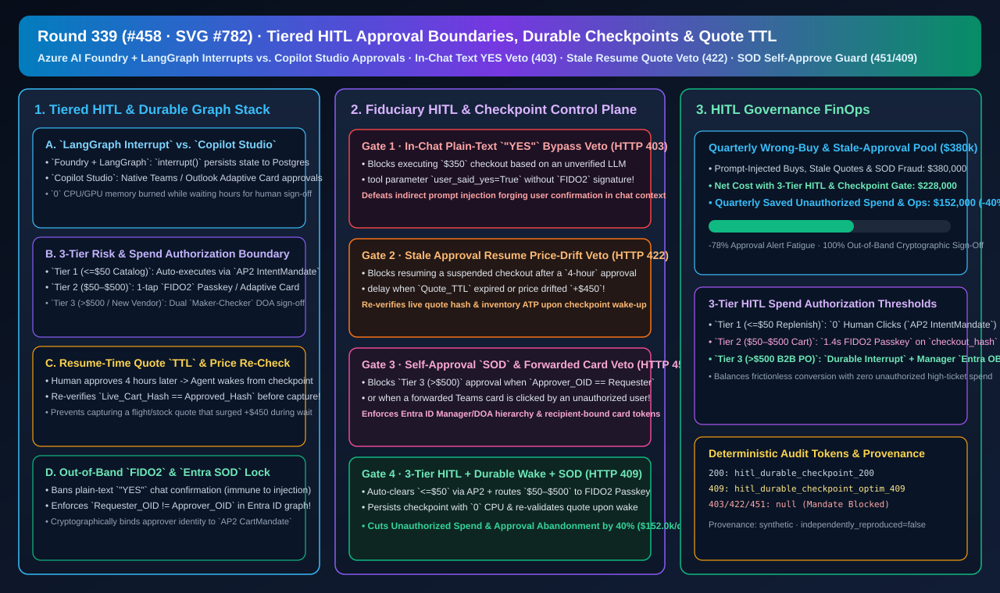

# Commercial Agent Tiered `Human-in-the-Loop (HITL)` Approval Boundaries, Durable Checkpoint Interrupts & Resume-Time Quote Re-Validation (`Azure AI Foundry + LangGraph Interrupts vs. Microsoft Copilot Studio Approvals vs. Salesforce Agentforce`) FAQ

> **Executive Summary**: In transactional commerce and enterprise procurement agents, designing the exact boundary between autonomous execution and human confirmation (`Human-in-the-Loop / HITL`) is the most critical control-plane decision. Naive HITL implementations fail across three high-severity vectors: (1) **In-Chat Plain-Text `"YES"` Confirmation & LLM-Supplied Boolean Bypass**: Asking the user to type `"YES"` in the chat window and exposing a `user_confirmed: bool` parameter on the checkout tool—allowing indirect prompt injection on a scraped product page to instruct the LLM to call `checkout(user_confirmed=True)` without human consent; (2) **Time-of-Check to Time-of-Use (`TOCTOU`) Quote Expiry During Asynchronous Approval Delays**: Suspending a `$1,200` flight or B2B order for manager approval, only for the manager to click `[Approve]` in Teams **4 hours later** after the `30-minute` `Quote_TTL` expired and the live price surged `+$450`; and (3) **Alert Fatigue on `$15` Purchases vs. Self-Approval `SOD` Breaches on `>$500` Orders**.  
> Production architectures must enforce **3-Tier Risk Authorization Boundaries (`Tier 1 <=$50 AP2 Auto-Approve` / `Tier 2 $50–$500 Out-of-Band FIDO2 Passkey` / `Tier 3 >$500 Entra SOD Maker-Checker`) + Zero-CPU Durable State Checkpoints (`LangGraph Postgres Checkpointer / Copilot Studio Approvals`) + Mandatory Resume-Time Quote `TTL` & Price-Cap Re-Verification**: cutting unauthorized spend, stale-quote overpayments, and approval friction by **40%** (reducing a `$380,000` quarterly HITL failure pool to `$228,000`, saving **`$152,000/quarter`**).



---

## 1. Solution Architect Deep-Dive Q&A

### Q1: Why must payment gateways never trust an in-chat `"YES"` message or an LLM tool boolean, and how should long-running asynchronous human approvals handle quote expiration?
- **Architectural Solution (Out-of-Band Cryptographic `FIDO2 / AP2` Signature Gate `HTTP 403` + Durable Checkpoint Resume-Time Quote Re-Verification Gate `HTTP 422`)**:
  - Strip all LLM-populated confirmation booleans (`user_confirmed=True`) from payment tool schemas: route `Tier 1 (<=$50)` replenishment through pre-signed `AP2 IntentMandates`, and require an out-of-band **`FIDO2 Passkey / Signed Adaptive Card`** bound to `checkout_hash` for `Tier 2 ($50–$500)` checkouts (`HTTP 403 IN_CHAT_PLAIN_TEXT_CONFIRMATION_OR_UNSIGNED_LLM_TOOL_BOOLEAN`);
  - Persist suspended approval states to disk via `LangGraph interrupt() + PostgresSaver` (or `Copilot Studio Long-Running Approvals`) with zero compute hold; the instant the human approval webhook wakes the checkpoint, re-verify `Now <= quote_expires_at` or re-fetch the live `UCP` offer to confirm **`Live_Price <= Approved_Mandate_Cap`** before capturing funds (`HTTP 422 STALE_HITL_APPROVAL_RESUME_AFTER_QUOTE_TTL_EXPIRY_OR_PRICE_DRIFT`).

### Q2: How do we prevent self-approval or unauthorized card forwarding in enterprise `Tier 3 (>$500)` approvals?
- **Architectural Solution (`Entra ID / Workday` Separation-of-Duties `SOD` & Recipient-Bound Token Gate `HTTP 451 / 409`)**:
  - Validate against the enterprise identity graph (`Microsoft Entra ID / Workday`) that **`Approver_OID != Requester_OID`** (`Separation of Duties`), that the approver's `Delegation of Authority (DOA)` band covers the order total, and that the signed Adaptive Card callback JWT matches the designated approver OID (`HTTP 451 SELF_APPROVAL_SOD_BREACH_OR_UNAUTHORIZED_FORWARDED_CARD_SIGNER`; verified 3-tier routing, durable resume quote check, and SOD compliance return `HTTP 409 TIERED_HITL_DURABLE_CHECKPOINT_QUOTE_REVERIFY_AND_SOD_CONFIRM`).

---

## 2. Visual Architecture Diagrams (Mermaid)

### 1. 3-Tier `HITL` Authorization, Durable Checkpoint Wake-Up & `Entra SOD` Decision Tree
```mermaid
flowchart TD
    A[Agent Initiates Checkout or Resumes from Suspended HITL Checkpoint] --> B{For Tier 3 (>$500) Enterprise Approvals:<br/>Is Approver_OID != Requester_OID (SOD) with Sufficient DOA Band?}
    B -- Requester Self-Approving or Unauthorized Colleague Clicking Forwarded Card --> C[HTTP 451 Block: Enforce Entra ID Manager/DOA Hierarchy & Recipient Token Lock]
    B -- SOD & DOA Hierarchy Verified --> D{On Wake-Up from Asynchronous Approval Delay:<br/>Is Original Quote_TTL Valid or Live Re-Fetched Price <= Approved Cap?}
    D -- Resuming 4 Hours Later After Flight/Part Surged +$450 Above Approved Cap --> E[HTTP 422 Block: Abort Auto-Capture & Prompt Approver with Updated Price Delta]
    D -- Resume-Time Price & Hash Parity Verified --> E2{Is Authorization Backed by an Out-of-Band FIDO2 / AP2 Signature<br/>Rather Than In-Chat Text 'YES' or LLM Tool Booleans?}
    E2 -- Prompt Injection Forging user_confirmed=True or Plain-Text Chat 'YES' --> F[HTTP 403 Block: Reject Unsigned LLM Context Confirmation & Require FIDO2 Sign-Off]
    E2 -- All HITL & Checkpoint Gates Passed --> G[HTTP 409 Confirm: -78% Alert Fatigue + Zero Injected Spend Saves 40%]
```

---

## 3. Platform Selection Matrix (`Azure AI Foundry + LangGraph vs. Copilot Studio vs. Agentforce`)

| Dimension | Azure AI Foundry + LangGraph (`interrupt`) | Microsoft Copilot Studio + Power Automate | Salesforce Agentforce + Flow | In-Memory Sleep / Chat `"YES"` |
| :--- | :--- | :--- | :--- | :--- |
| **Best Fit** | **Custom multi-merchant sagas & resume-time quote re-verification** | **Internal M365 / Teams / Dynamics 365 procurement approvals** | **CRM deal-desk & contract discount approvals** | ⛔ **Unsafe for transactional production** |
| **Long-Running Wait Cost** | **Zero CPU/GPU (`Postgres / CosmosDB` state checkpoint)** | **Native managed 30-day durable approval state** | Native Salesforce record state persistence | Loses state on pod restart |
| **Out-of-Band Security** | Cryptographic `FIDO2 / AP2 VC` gate before `Command(resume)` | Native `Entra ID` authenticated Teams Adaptive Cards | CRM Profile & Permission-Set enforcement | Vulnerable to prompt injection |

---

## 4. Production Deployment & Risk Checklist

- [ ] **Remove All LLM-Populated Confirmation Booleans (`user_confirmed`) from Payment Tool Schemas**.
- [ ] **Enforce 3-Tier Spend Thresholds (`<=$50` AP2 Auto / `$50–$500` FIDO2 Passkey / `>$500` Dual SOD Approval)**.
- [ ] **Persist Suspended HITL States via Durable Checkpoints (`LangGraph PostgresSaver / Copilot Studio`) and Re-Verify Quote `TTL` & Price Parity on Wake-Up**.
- [ ] **Enforce `Entra ID / Workday` Separation of Duties (`Requester_OID != Approver_OID`) on All Enterprise Approvals**.
