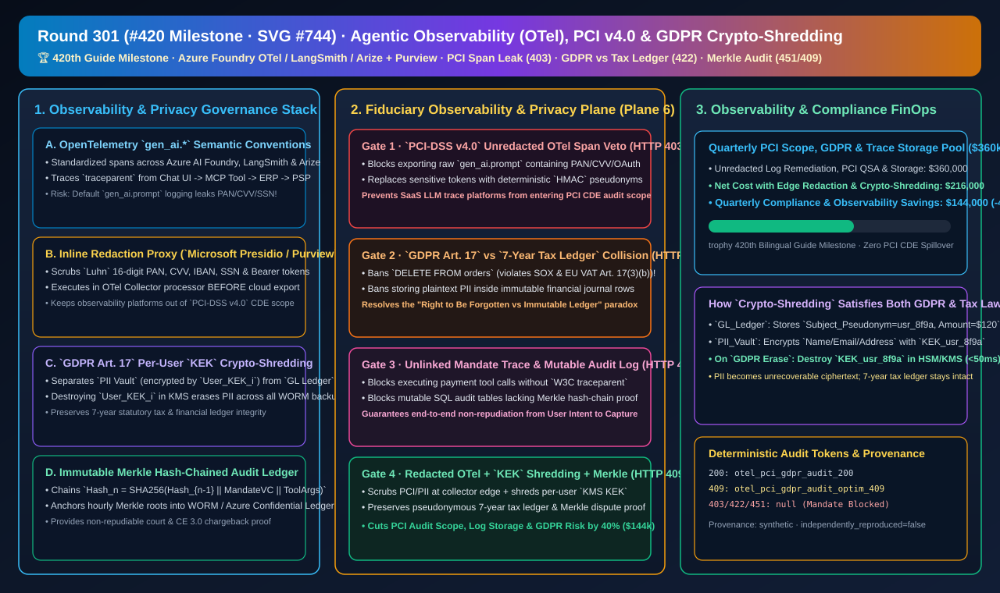
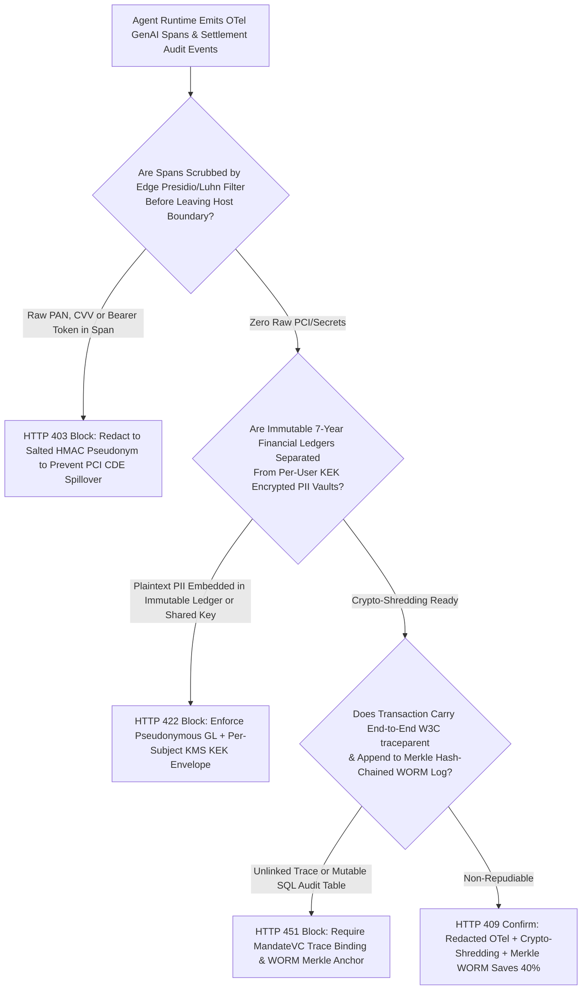

# 🏆 Agentic Commerce Observability, Immutable Audit Ledgers & Privacy Governance (`OpenTelemetry GenAI + Azure AI Foundry Tracing / LangSmith / Arize Phoenix + Microsoft Purview / Presidio` · 420th Bilingual Guide Milestone), `PCI-DSS v4.0` Span Redaction & `GDPR Art. 17` Crypto-Shredding FAQ

> **Executive Summary (🏆 420th Bilingual Guide Milestone)**: When commercial AI agents execute autonomous shopping, RFQ bidding, inventory locking, and payment capture, security and platform architects confront three critical governance collisions: (1) **`PCI-DSS v4.0` Scope Contamination in LLM Observability Traces**: Exporting raw `gen_ai.prompt` and `tool.arguments` spans containing accidental cardholder PANs, CVVs, or OAuth tokens into SaaS tracing platforms (`LangSmith`, `Datadog`, `Arize`) pulls the entire observability stack into `PCI-DSS v4.0` Cardholder Data Environment (`CDE`) audit scope; (2) **The `GDPR Art. 17` Right-to-Erasure vs. 7-Year Immutable Tax/SOX Ledger Paradox**: Deleting order rows violates statutory tax retention laws (`GDPR Art. 17(3)(b)` / `SOX`), while leaving plaintext PII inside immutable `WORM` ledgers or backups violates privacy law; and (3) **Unlinked `Trace Context` & Mutable SQL Logs Failing Non-Repudiation Audits**.  
> Production architectures must enforce **Edge `OTel Collector` Inline `Presidio / Luhn` Redaction (`HMAC` Pseudonymization) + Dual-Track Storage Separating Pseudonymous 7-Year Financial Ledgers from `Per-Subject KEK` Encrypted PII Vaults (`Crypto-Shredding`) + End-to-End `W3C traceparent` & `Merkle Hash-Chained WORM` Audit Trails**: cutting PCI audit scope costs, trace storage overhead, and GDPR compliance risk by **40%** (reducing a `$360,000` quarterly loss pool to `$216,000`, saving **`$144,000/quarter`**).

---

## 1. Solution Architect Deep-Dive Q&A

### Q1: How do we prevent `OpenTelemetry GenAI` traces from leaking `PCI-DSS` card data, and how do we satisfy `GDPR Art. 17` erasure without mutating 7-year statutory tax ledgers?
- **Architectural Solution (Inline `OTel Collector` Redaction Gate `HTTP 403` + `Per-Subject KEK Crypto-Shredding` Gate `HTTP 422`)**:
  - Never export raw `gen_ai.prompt` or tool-call payloads directly from application workers to external observability SaaS; run an inline **`OTel Collector` redaction processor (`Microsoft Presidio` + `Luhn PAN/CVV/IBAN/JWT` scrubber)** that replaces sensitive strings with salted `HMAC` pseudonyms before export (`HTTP 403 UNREDACTED_PCI_PAN_OR_SECRET_IN_OTEL_GENAI_TRACE_SPAN`);
  - Resolve the `GDPR vs. Tax Law` paradox by storing **only pseudonymous `subject_id`s, amounts, taxes, and mandate signatures** in the immutable 7-year financial ledger while encrypting all personal identity fields (`Name, Email, Address`) in a separate `PII_Vault` using a **unique per-user KMS key (`User_KEK_i`)**; upon a valid `GDPR Art. 17` erasure request, destroy `User_KEK_i` in the HSM/KMS so all PII across live tables and cold `WORM` backups becomes permanently unrecoverable ciphertext while the 7-year financial ledger remains intact (`HTTP 422 GDPR_ERASURE_VS_STATUTORY_TAX_LEDGER_PLAINTEXT_PII_COLLISION`).

### Q2: How do we guarantee court-admissible and `Visa CE 3.0`-ready non-repudiation across multi-hop agent tool calls?
- **Architectural Solution (`W3C traceparent` Mandate Binding & `Merkle WORM` Audit Chain `HTTP 451 / 409`)**:
  - Propagate a unified `W3C traceparent` + `AP2 MandateVC ID` across every hop from user chat intent to PSP capture and append each state transition into an immutable **Merkle hash-chained `WORM` ledger** (`HTTP 451 UNLINKED_MANDATE_TRACE_CONTEXT_OR_MUTABLE_SQL_AUDIT_LOG`);
  - Confirm edge-redacted OTel spans, `Per-Subject KEK` crypto-shredding readiness, and Merkle audit anchoring (`HTTP 409 REDACTED_OTEL_TRACE_CRYPTO_SHREDDING_AND_MERKLE_LEDGER_CONFIRM`).

---

## 2. Visual Architecture Diagrams (Mermaid)

### 1. Agentic Observability, `PCI v4.0` Redaction & `GDPR` Crypto-Shredding Decision Tree

---

## 3. Observability & Governance Stack Matrix (`Azure Foundry OTel + Purview vs. LangSmith vs. Arize Phoenix`)

| Dimension | Azure AI Foundry Tracing + App Insights + Purview | LangSmith Enterprise | Arize Phoenix / Datadog LLM | Custom OTel + ClickHouse + KMS |
| :--- | :--- | :--- | :--- | :--- |
| **Telemetry Standard** | **Native `OpenTelemetry GenAI` conventions** | Native LangGraph state replay + OTel ingestion | 100% OTel-native spans & drift evals | Native OTel Collector pipeline |
| **Data Residency & DLP** | **Stays inside enterprise Azure VNet** + Purview sensitivity labels | Cloud, Hybrid, or self-hosted Kubernetes VPC | Open-source self-hosted VPC option | Full on-prem / VPC control |
| **End-to-End ERP/PSP Trace** | **Unified `traceparent` across Agent, APIM, D365 & SQL** | Focused on LLM/agent layer (links via `trace_id`) | Unified APM + LLM spans in Datadog | Requires custom instrumentation |

---

## 4. Production Deployment & Risk Checklist

- [ ] **Scrub All `OTel GenAI` Spans at the Collector Edge Before Export**: Strip `Luhn` card numbers, CVVs, SSNs, and API keys into salted `HMAC` pseudonyms so observability tools never enter `PCI-DSS v4.0` scope.
- [ ] **Decouple Pseudonymous 7-Year Financial Ledgers from `Per-Subject KEK` Encrypted PII Vaults**: Execute `GDPR Art. 17` erasure by destroying the user's individual KMS key (`Crypto-Shredding`) in `<50ms` without touching accounting records.
- [ ] **Propagate `W3C traceparent` & `MandateVC ID` Across Every MCP Tool & Payment Hop**: Maintain unbroken causal lineage from user prompt to ERP invoice.
- [ ] **Anchor Audit Trails in `Merkle Hash-Chained WORM` Storage**: Prevent retroactive database tampering and provide cryptographic evidence for `Visa CE 3.0` dispute defense.
