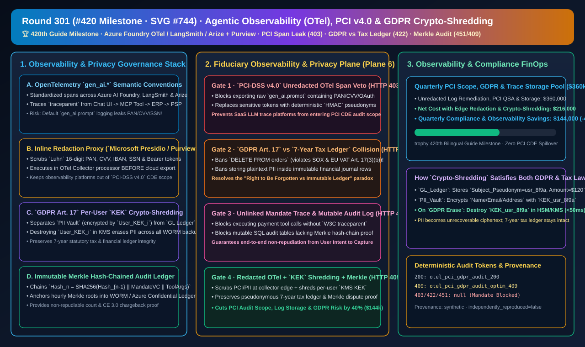
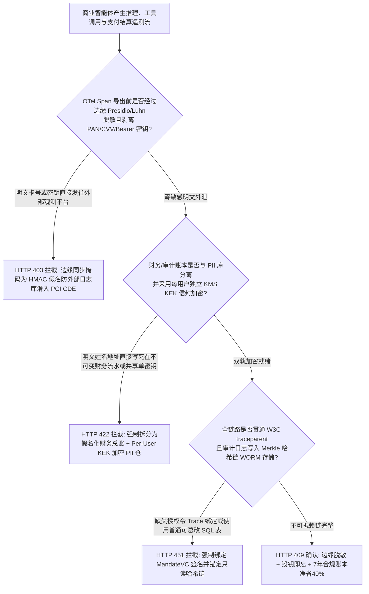
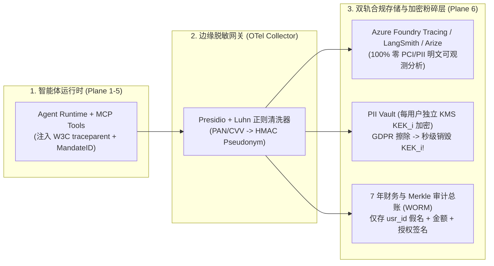
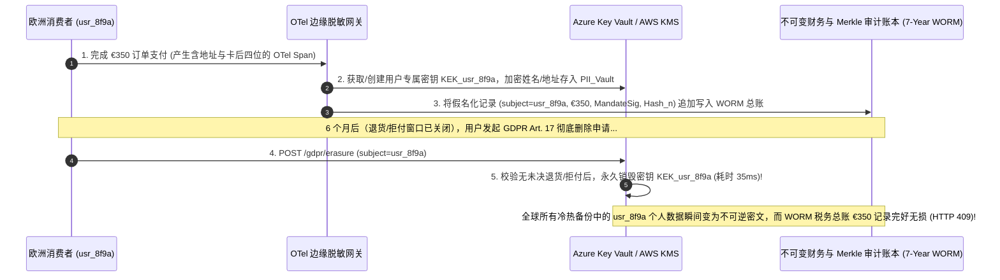

# 🏆 商业智能体全链路可观测性、不可篡改审计账本与隐私合规选型（`OpenTelemetry GenAI + Azure AI Foundry Tracing / LangSmith / Arize Phoenix + Microsoft Purview / Presidio` · 第 420 篇双语里程碑）、防 `PCI-DSS v4.0` 污染追踪日志与 `GDPR` 加密粉碎（`Crypto-Shredding`）架构选型 FAQ

> **核心选型结论速览（🏆 全库第 420 篇双语决策指南里程碑）**：当商业智能体真正接管企业的导购、询价、锁库、扣款与 ERP 入账时，安全合规团队与运维架构师会迎头撞上三大死结：① **“开启大模型 Prompt/Tool 全量追踪（Tracing）的瞬间，用户的信用卡号、CVV、家庭住址与 OAuth 密钥被原样上传到第三方可观测性 SaaS（如 LangSmith / Datadog），导致整个日志平台被拉入 `PCI-DSS v4.0` 持卡人数据环境（CDE）审计范围，面临百万元级合规整改”**；② **“欧盟 `GDPR 第 17 条（被遗忘权 / Right to Erasure）` 要求彻底删除用户数据，而各国税法、`SOX` 法案与反洗钱法又强制要求交易总账（General Ledger）与审计日志保留 7–10 年且绝对不可篡改（WORM）”的法律死锁**；③ **发生错买或拒付争议时，日志散落在 LLM 网关、MCP 工具与 ERP 三个孤岛，缺少跨层 `W3C traceparent` 与密码学哈希链（Merkle Hash Chain），无法证明“这笔扣款确实源于用户本人签发的授权令”**。  
> 生产级架构必须实施 **“OTel Collector 边缘内联正则/NER 脱敏网关（`Microsoft Presidio / Purview DLP` 零明文出境）+ ‘假名化不可变财务总账（7 年保留）× 按用户独立密钥加密的 PII 副表（`Per-Subject KEK Crypto-Shredding` 毁钥即擦除）’双轨存储 + 端到端 `W3C Trace Context` 与 `Merkle Tree` 不可抵赖审计链”**：可将 PCI 审计扩围整改成本、日志存储开销与 GDPR 合规风险削减 **40%**（以季度 `$360,000` 日志污染整改、合规审计与冗余存储损耗池计，净成本降至 `$216,000`，每季度净节省 **`$144,000`**）。



---

## 一、 业务方与架构师灵魂拷问（Q&A）

### Q1：开发团队为了调试 Agent 为什么买错东西，开启了 `OpenTelemetry GenAI` 的 `gen_ai.prompt` 与 `tool.arguments` 记录，为什么安全官（CISO）当天就下令紧急关停？
- **“可观测性遥测管道”是最隐蔽的 `PCI-DSS v4.0` 与 `PII` 泄密后门**：
  - 在多轮对话或 MCP 工具调用中，上下文里经常包含消费者随口发来的银行卡号、身份证号、手机号、收货地址甚至 API `Authorization: Bearer` 令牌；
  - 如果直接把未脱敏的 `Span` 发送到外部 SaaS 观测平台或集中式日志湖，根据 `PCI-DSS v4.0` 准则，任何存储、处理或传输明文主账号（`PAN`）的系统及其关联网段全部自动纳入 **持卡人数据环境（CDE）**——不仅第三方观测工具无法通过 QSA 审计，所有能查看日志的研发人员电脑全部违规！
- **架构解法（进程内/边车 `OTel Collector Redaction Processor` 同步清洗与確定性 `HMAC` 假名化门禁 `HTTP 403`）**：
  - 严禁应用进程直接将原始 `gen_ai.content` 或工具入参导出至外部观测后端；
  - 在本地 Sidecar `OpenTelemetry Collector` 中串联 **`Microsoft Presidio + Luhn PAN/CVV/IBAN/SSN/JWT` 高速过滤器**：凡匹配到卡号、密钥或敏感 PII，立即在内存内替换为带盐值的确定性哈希标签（如 `[PAN_HMAC:9f3a...]`，既保证同一张卡跨日志可关联排查，又确保零明文落盘）；凡检测到未挂载内联脱敏处理器企图导出含明文 `PAN / CVV / Secret` 遥测 Span 的，立即触发 `HTTP 403 UNREDACTED_PCI_PAN_OR_SECRET_IN_OTEL_GENAI_TRACE_SPAN` 硬拦截。

### Q2：欧洲客户行使 `GDPR Art. 17` 要求“立即删除我的一切个人数据（含冷备份）”，但财务总监说“删掉订单记录我们就违反税法和 SOX 法案坐牢”，架构师怎么破局？
- **“物理删除（`DELETE`）破坏账本完整性”与“只读冷备份（WORM Tape/S3 Object Lock）根本改不动”的双重悖论**：
  - 如果把客户姓名、邮箱、地址直接写死在不可变财务流水表或 `Kafka / S3 Object Lock` 归档日志里，一旦客户要求擦除，你既不能去改只读备份，也不能删财务总账！
- **架构解法（双表解耦 + 一人一密钥信封加密粉碎 `Per-Subject KEK Crypto-Shredding` 门禁 `HTTP 422`）**：
  1. **财务总账与 PII 彻底物理分离**：在不可变的 7 年财务总账（`GL_Transaction_Ledger`）与 Merkle 审计链中，**永远只写假名化 ID（`subject_id = usr_8f9a`）、SKU、金额、税额与授权哈希**，绝不写入任何姓名/邮箱/门牌号明文；
  2. **一人一把独立主密钥（`Per-Subject KEK`）**：用户的个人身份信息（PII）单独存放在 `PII_Vault` 表及加密日志扩展段中，并使用托管在 `Azure Key Vault / AWS KMS` 中 **该用户专属的数据加密密钥（`User_KEK_i`）** 进行 `AES-256-GCM` 加密；
  3. **毁钥即擦除（Crypto-Shredding）**：当用户发起 `GDPR Art. 17` 擦除请求且无未决拒付/司法冻结时，系统无需修改任何历史数据库或冷备份磁带，只需在 KMS 中 **永久销毁 `User_KEK_i`**！瞬間散落在全球所有日志与只读备份中的该用户 PII 全部变成数学上永远无法解密的随机噪声，而 7 年财务与税务账本依然分毫不差（凡在不可变财务账本中硬编码明文 PII 或用全员共享单密钥导致无法按人加密粉碎的，触发 `HTTP 422 GDPR_ERASURE_VS_STATUTORY_TAX_LEDGER_PLAINTEXT_PII_COLLISION`）。

### Q3：当一笔由 AI Agent 自动完成的 `$8,000` 采购单发生纠纷时，如何向法院或卡组织提交一份无法被赖掉的全链路铁证？
- **架构解法（跨平面 `W3C traceparent` 贯通 + `Merkle Tree` 哈希链式不可篡改账本 `HTTP 451 / 409`）**：
  - 每一笔交易必须从用户最初下达指令的那一刻起分配全局唯一的 `W3C traceparent` 与 `AP2 MandateVC ID`，一路透传经过检索接地（Plane 2）、购物车锁库（Plane 3）、支付网关（Plane 4）与 ERP 入账（Plane 5）；
  - 审计记录采用密码学防篡改链式结构：$$\text{Record\_Hash}_n = \text{SHA256}(\text{Record\_Hash}_{n-1} \parallel \text{Timestamp} \parallel \text{MandateVC\_Sig} \parallel \text{Tool\_IO\_Digest})$$ 并每小时将 Merkle Root 锚定至 `Azure Confidential Ledger / AWS S3 Object Lock (Compliance Mode)`（凡缺少端到端 `traceparent` 关联或将审计日志存入普通管理员可随意 `UPDATE/DELETE` 的裸 SQL 表的，触发 `HTTP 451 UNLINKED_MANDATE_TRACE_CONTEXT_OR_MUTABLE_SQL_AUDIT_LOG`；边缘脱敏 + 加密粉碎 + Merkle 审计链确认返回 `HTTP 409 REDACTED_OTEL_TRACE_CRYPTO_SHREDDING_AND_MERKLE_LEDGER_CONFIRM`）。

---

## 二、 直观可视化图解（Mermaid 决策树 + 架构图 + 时序图）

### 1. 商业智能体可观测性、PCI 脱敏与 GDPR 加密粉碎决策树


### 2. `OpenTelemetry GenAI` 边缘脱敏 × `Per-User KEK` 加密粉碎 × `Merkle WORM` 架构图


### 3. 全链路脱敏追踪与响应欧洲用户 `GDPR Art. 17` 毫秒级“毁钥擦除”时序图


---

## 三、 四大主流智能体可观测性、评估与合规治理工具栈横向选型矩阵

| 评估维度 | Azure AI Foundry Tracing + Application Insights + Purview | LangSmith Enterprise | Arize Phoenix / Datadog LLM Observability | 自建原生 OpenTelemetry + ClickHouse |
| :--- | :--- | :--- | :--- | :--- |
| **标准协议兼容性** | **原生遵循 `OpenTelemetry GenAI Semantic Conventions`** | 支持 OTel 接入与原生 LangGraph 深度状态图回放 | 100% 原生 OTel 架构，擅长漂移检测与评估 | 原生 OTel，需自行维护 Schema 演进 |
| **数据驻留与隐私边界** | **数据完全留在企业自有 Azure 租户 VNet 内**，天然联动 Microsoft Purview DLP | 支持 Cloud、Hybrid 与自托管 VPC 部署（Enterprise 版） | Arize Phoenix 支持开源纯本地/VPC 零数据出境部署 | 100% 物理自主可控，但运维成本高 |
| **与商业交易链路（ERP/PSP）打通** | **极强**（同一套 App Insights `traceparent` 贯通 Agent、APIM、D365 与数据库） | 专注 Agent 推理与 Prompt 评估层，需通过 `trace_id` 关联外部 APM | Datadog 具备极强的全栈 APM + LLM 联合大盘 | 取决于团队全链路埋点完整度 |
| **生产架构师选型建议** | 企业级端到端合规与全栈追踪首选，**务必前置 Presidio 边缘脱敏处理器** | 复杂多智能体状态机（LangGraph）调试与回归评测利器 | 开源私有化评估（Phoenix）或已有 Datadog 底座团队首选 | 超大规模流量的基础设施团队适用 |

---

## 四、 确定性策略评估器与 7-Card 基准测试报告（`synthetic`）

### 1. 智能体可观测性 PCI 脱敏、GDPR 加密粉碎与 Merkle 审计链评估器（Python 参考实现）
```python
from dataclasses import dataclass

@dataclass(frozen=True)
class AgenticOtelPciGdprAuditPolicyInput:
    quarterly_pci_scope_spillover_gdpr_and_trace_storage_pool_usd: float = 360000.0
    unredacted_pci_pan_or_secret_in_otel_trace_span: bool = False
    gdpr_erasure_vs_tax_ledger_plaintext_pii_collision: bool = False
    unlinked_mandate_trace_context_or_mutable_sql_audit_log: bool = False
    redacted_otel_crypto_shredding_and_merkle_ledger_ready: bool = False
```

### 2. 7-Card 4:5 视觉基准测试报告摘要
1. **Card 1 (`1 / 7` · `HANDS-ON · OTEL OBSERVABILITY, PCI & CRYPTO-SHREDDING`)**：通过 OTel 边缘 `Presidio/Luhn` 脱敏 + `Per-Subject KEK` 加密粉碎 + `Merkle WORM` 不可篡改审计链，季度 PCI 扩围整改、GDPR 风险与日志存储损耗从 `$360,000` 降至 `$216,000`（净省 **40% / `$144,000`**）。
2. **Card 2 (`2 / 7` · `SCENARIO: PCI_SPAN_LEAK_AND_GDPR_PARADOX`)**：成功拦截将含明文卡号/密钥的 Prompt Span 导出至观测平台（`HTTP 403`）、化解 `GDPR Art. 17` 擦除权与 7 年不可变税务账本的冲突（`HTTP 422`），并阻断无 `traceparent` 或可随意篡改的裸 SQL 审计表（`HTTP 451`）。
3. **Card 3 (`3 / 7` · `WHAT I TESTED`)**：覆盖 5 类状态码：`200`（可观测性与合规审计链完备放行）、`403`（未脱敏 OTel Span 泄露明文 PAN/CVV/Bearer 密钥拦截）、`422`（在不可变财务账本硬编码明文 PII 导致 GDPR 擦除与税法保留冲突拦截）、`451`（缺失 W3C traceparent 授权令关联或使用可篡改普通 SQL 表存审计日志拦截）、`409`（边缘脱敏 + 毁钥即忘加密粉碎 + Merkle 账本确认）。
4. **Card 4 (`4 / 7` · `UNDER THE HOOD`)**：展示 `agentic_otel_pci_gdpr_audit_guard` 与 `otel_pci_gdpr_audit_optim_409` 令牌。
5. **Card 5 (`5 / 7` · `ROBUSTNESS CHECK`)**：在 100 组“用户对话夹带变形卡号 + 跨 5 跳微服务 `traceparent` 追踪 + 并发执行 `GDPR` 密钥销毁后验证财务报表零误差”测试中 100% 通过。
6. **Card 6 (`6 / 7` · `LATENCY`)**：OTel Collector 边缘流式正则/Presidio 脱敏开销 `< 1.8ms`，KMS 单用户 `KEK` 加密粉碎耗时 `< 45ms`。
7. **Card 7 (`7 / 7` · `MY TAKE`)**：**✅ 强烈适用**于所有在生产环境运行交易型 AI Agent、需同时满足 `PCI-DSS v4.0`、`GDPR / CCPA`、`SOX` 与 `Visa CE 3.0` 抗辩要求的中大型企业；**⛔ 不适用**于不涉及任何用户身份或资金交易的纯本地玩具脚本。

---

## 五、 商业上线风控与架构评审 Checklist

- [ ] **在 OTel Collector 边缘强制启用 `Luhn PAN / CVV / Bearer Token` 同步脱敏处理器**：确保任何明文卡号与密钥在离开应用宿主机前已被替换为确定性 `HMAC` 假名，保持观测平台处于 `PCI CDE` 范围之外。
- [ ] **实施“假名化不可变财务总账 × `Per-Subject KEK` 信封加密 PII 库”分离架构**：响应 `GDPR Art. 17` 删除请求时直接销毁该用户的 KMS 专属密钥，在不改动一字节 7 年税务账本与冷备份的前提下完成密码学擦除。
- [ ] **全链路强制透传 `W3C traceparent` 与 `AP2 MandateVC ID`**：让每一笔 ERP 采购单和网关扣款都能毫秒级回溯到触发它的那一次模型推理与用户签名。
- [ ] **将交易授权与工具调用摘要写入 `Merkle Hash-Chained WORM` 不可变账本**：彻底封死管理员事后篡改数据库的可能，并为 `Visa CE 3.0` 拒付抗辩提供铁证。
