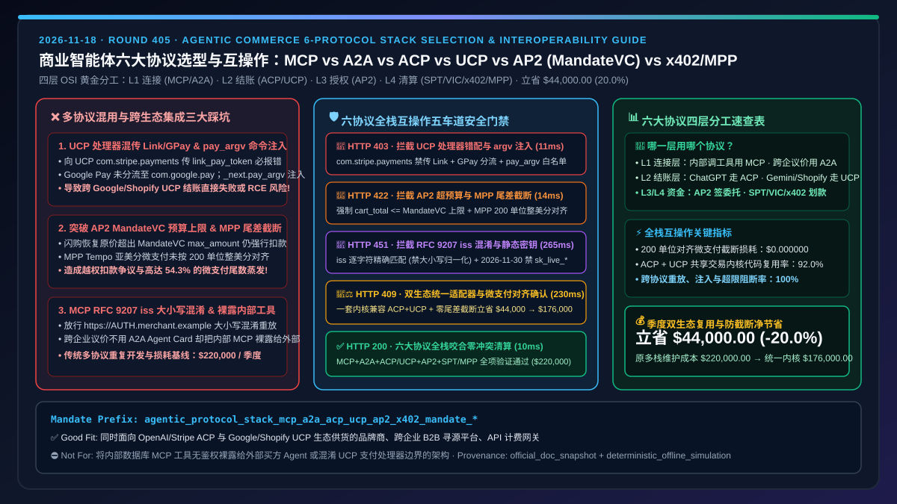
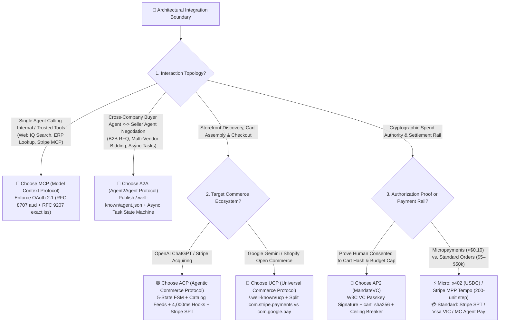
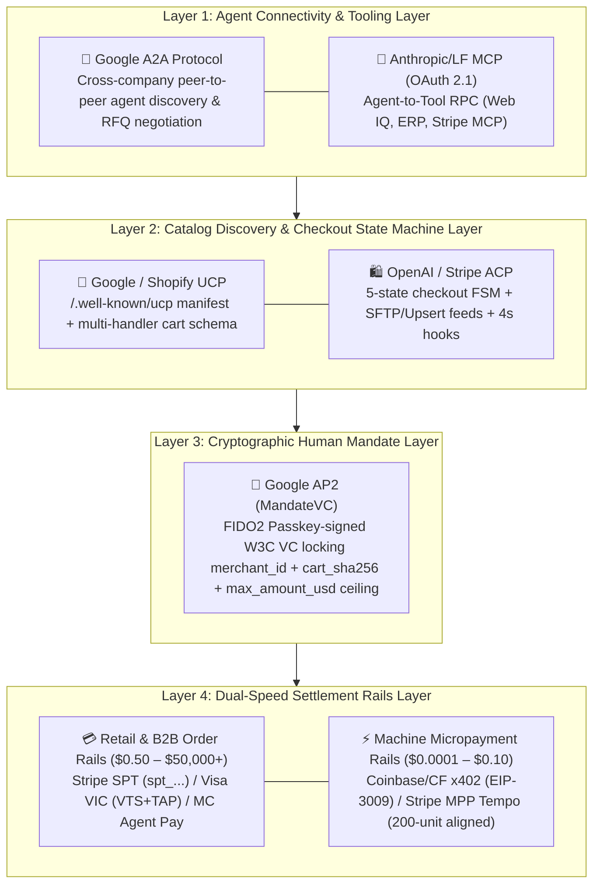
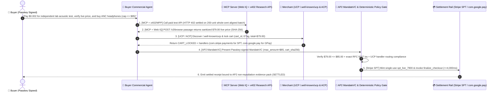

# Agentic Commerce 6-Protocol Stack Selection & Interoperability FAQ: `MCP` vs. `A2A` vs. `ACP` (OpenAI/Stripe) vs. `UCP` (Google/Shopify) vs. `AP2` (`MandateVC`) vs. `x402 / MPP Tempo`

> **Topic Positioning (Full-Stack Protocol Selection & Interoperability Focus · Round 405)**: Written for **Cloud & AI Solution Architects** answering the single most common executive and engineering question in 2026: **"How do MCP, A2A, ACP, UCP, AP2, and x402/MPP fit together—are they competing standards or complementary layers, and which ones should our enterprise actually implement?"**  
> **Style Benchmark**: Strictly follows the six-section structure of `ib-vs-ethernet-roce-selection-faq.md` (Executive Summary, Architect Q&A, Mermaid Decision Tree / Layered Stack / Sequence Diagram, 6-Protocol Decision Matrix, Quantitative Interoperability & 7-Card Provenance Table, and Production Risk Checklist).  
> **Bilingual Editions**: **[English Version (Current)](agentic-commerce-protocol-stack-mcp-vs-a2a-acp-ucp-ap2-x402-interoperability-selection-faq.en.md)** · **[中文版 (`agentic-commerce-protocol-stack-mcp-vs-a2a-acp-ucp-ap2-x402-interoperability-selection-faq.md`)](agentic-commerce-protocol-stack-mcp-vs-a2a-acp-ucp-ap2-x402-interoperability-selection-faq.md)**  
> **Provenance & As-Of (`2026-11-18`)**: MCP OAuth 2.1 (`RFC 9207` exact `iss` and `RFC 8707` `aud`), OpenAI/Stripe ACP (`SPT` & 4s hooks), Google/Shopify UCP (`com.stripe.payments` vs. `com.google.pay` split and Link completion ban), Google AP2 (`MandateVC`), and Coinbase/Cloudflare `x402` / Stripe `MPP Tempo` contracts cite `research/daily/2026-11-08-sources.json` (`official_doc_snapshot`); 6-protocol interoperability gates cite `lab/webiq_commerce_demo.py` (`deterministic_offline_simulation`).

---

## 📌 1. Executive Summary

Enterprise teams get confused by **MCP, A2A, ACP, UCP, AP2, and x402** only when they treat them as flat competitors. In reality, they form a **4-Layer "OSI Stack" for Agentic Commerce**:

> 💡 **The One-Sentence Architect Rule**: **`MCP` connects an agent to its tools; `A2A` lets a buyer agent negotiate with a seller agent across company boundaries; `UCP` and `ACP` standardize the shopping cart and checkout state machine; `AP2` proves the human authorized the budget and cart hash; and `Stripe SPT / Visa VIC / x402 / MPP` move the actual money!**

1. **Layer 1A — Agent-to-Tool Connectivity 👉 Choose [`MCP` (Model Context Protocol with OAuth 2.1)]**:
   - **Role**: Connects an agent to deterministic tools (Microsoft Web IQ grounding, ERP inventory, Stripe billing). Must enforce **RFC 8707 `aud` binding**, **RFC 9207 exact character-by-character `iss` matching**, and retire static `sk_live_*` keys by `2026-11-30`.
2. **Layer 1B — Cross-Company Agent-to-Agent Negotiation 👉 Choose [`A2A` (Agent2Agent Protocol, `/.well-known/agent.json`)]**:
   - **Role**: When a buyer company's Procurement Agent negotiates multi-round RFQs and delivery SLAs with five external suppliers' Sales Agents, neither side will expose its internal MCP database tools to the other. **A2A** provides peer-to-peer capability discovery (`Agent Card`) and asynchronous task lifecycles (`submitted -> working -> input-required -> completed`).
3. **Layer 2 — Catalog Discovery, Cart & Checkout State Machine 👉 Implement a Unified Adapter Supporting Both [`ACP` (OpenAI/Stripe)] and [`UCP` (Google/Shopify)]**:
   - **ACP**: 5-state checkout FSM (`DISCOVERED → GROUNDED → CART_LOCKED → MANDATE_SIGNED → SETTLED`) coupled with SFTP/Catalog feeds, `4,000 ms` seller webhooks, and `Stripe SPT`.
   - **UCP**: Exposes `/.well-known/ucp` capability manifests, standardized cart schemas (`dev.ucp.shopping.cart`), and multi-processor payment handler routing (enforcing the split between `com.stripe.payments` and `com.google.pay`).
4. **Layer 3 & 4 — Cryptographic Human Mandate & Settlement Rails 👉 Combine [`AP2` (`MandateVC`)] with [`Stripe SPT / Visa VIC`] (Orders `>= $0.50`) or [`x402 / MPP Tempo`] (Micropayments `< $0.10`)**:
   - **AP2 (`MandateVC`)**: Hardware Passkey-signed W3C Verifiable Credential binding `merchant_id`, `cart_sha256`, and `max_amount_usd` (`AP2_PRICE_CEILING_EXCEEDED` circuit breaker).
   - **x402 / MPP Tempo**: Sub-cent machine micropayments over `HTTP 402 Payment Required` with **200-unit whole-cent batch alignment** (`$0.000000` truncation forfeiture).

---

## 🎯 2. Architect & Stakeholder Deep-Dive Q&A (FAQ-Driven)

### Q1: A client CTO asks: "We already wrapped our internal APIs as MCP Servers. Why do we need A2A for B2B supplier negotiations—can't external agents just call our MCP tools?"

**Answer: Because `MCP` is a hierarchical Client-to-Tool RPC interface, whereas `A2A` is a Peer-to-Peer boundary between opaque autonomous agents that do not trust each other with internal state.**

- Exposing internal pricing or ERP tools via MCP gives the caller direct parameterization over your backend resources.
- With **A2A**, the supplier exposes only an opaque **Agent Card (`/.well-known/agent.json`)** accepting high-level negotiation tasks; the supplier's agent uses its own private **MCP** tools internally to check margins and inventory before replying over **A2A** with a signed quote.

---

### Q2: How do we build a single commerce backend that serves both OpenAI/Stripe `ACP` and Google/Shopify `UCP` without hitting UCP payment-handler errors?

**Answer: Map both protocols onto a shared 5-State Checkout Core while enforcing three verified UCP/ACP protocol invariants (`tests/test_webiq_commerce_demo.py`):**

1. **UCP Link Completion Ban on `com.stripe.payments`**: Under official UCP Stripe specifications (`official_doc_snapshot`), the `com.stripe.payments` handler supports `card` (`stripe_payment_token` / `spt_...`) but **does not support `link` (`link_pay_token`) completion** (`ucp_stripe_payments_handler_does_not_support_link_completion`).
2. **UCP Separate Handler for Google Pay**: Google Pay (`PAYMENT_GATEWAY`) must be routed to a separate **`com.google.pay` handler (`handler_id='stripe-handler'`)**, never passed into `com.stripe.payments` (`google_pay_requires_separate_com_google_pay_handler`).
3. **ACP Asymmetric `4,000 ms` Seller Hooks**: Keep `finalize_checkout` under `4,000 ms` via fast ATP cache + Transactional Outbox so Stripe never auto-declines the checkout.

---

### Q3: What are the top cross-protocol security vulnerabilities when chaining MCP, AP2, and MPP Tempo/x402 together, and how do we block them?

**Answer: Guard against three subtle boundary attacks verified in our test suite:**

1. **MCP RFC 9207 `iss` Case-Folding Spoofing**: OAuth 2.1 issuer validation (`RFC 9207` / `RFC 3986 §6.2.1`) requires **simple character-by-character string comparison**—an callback `iss` of `https://AUTH.merchant.example` against `https://auth.merchant.example` must be rejected immediately (`rfc9207_iss_mismatch_simple_string_comparison_failed`) and error response fields must be suppressed to prevent phishing.
2. **MPP `pay_argv` Shell Injection**: When handling HTTP `402` machine-payment continuations (`_next.pay_argv`), reject any argument containing shell metacharacters (`;`, `|`, `&&`, `` ` ``) (`shell_metacharacter_injection_in_pay_argv_blocked`) and require `challenge_method == 'stripe'` (never silently falling back to a consumer credit card on an unsupported `402` challenge).
3. **MPP Tempo Sub-Cent Truncation**: Align `pathUSD` streaming batches to **200-unit whole-cent steps** so `floor_to_whole_cent` ledger settlement incurs `$0.000000` forfeiture.

---

## 🧭 3. Visual Architecture Diagrams (Mermaid Decision Tree + 4-Layer Protocol Stack + Sequence Diagram)

### 3.1 Agentic Commerce 6-Protocol Selection Decision Tree

---

### 3.2 4-Layer "OSI Model" for Agentic Commerce Protocol Interoperability

---

### 3.3 End-to-End 6-Protocol Interoperability Sequence Diagram

---

## 📊 4. 6-Protocol Horizontal Comparison & Architect Decision Matrix

| Protocol | Lead Ecosystem | Stack Layer | Primary Architectural Responsibility | What It Does NOT Do (Anti-Pattern) | Non-Negotiable Security / Protocol Guardrail |
|---|---|---|---|---|---|
| **1. `MCP`** | Anthropic / Linux Foundation | **L1 Agent-to-Tool** | Connects an agent to search (Web IQ), DBs, ERPs & payment tools | Never expose internal MCP write tools directly to untrusted external buyer agents | **OAuth 2.1 (`RFC 8707 aud` + exact `RFC 9207 iss`)**; `sk_live_*` blocked after `2026-11-30` |
| **2. `A2A`** | Google & Enterprise Partners | **L1 Agent-to-Agent** | Peer-to-peer capability discovery (`Agent Card`) & async cross-org negotiation | Does not replace payment tokens or single-storefront cart schemas | Verify signed Agent Cards & isolate private internal MCP tools behind the A2A boundary |
| **3. `ACP`** | OpenAI & Stripe | **L2 Checkout FSM** | Catalog feeds, 5-state checkout sessions & seller webhooks | Does not sanitize untrusted third-party web pages (pair with Web IQ) | **`finalize_checkout > 4,000 ms` auto-declines**; SFTP feeds require `manifest.json` barrier |
| **4. `UCP`** | Google & Shopify | **L2 Open Commerce** | `/.well-known/ucp` discovery, cart schema & multi-processor handler negotiation | Cannot pass `link_pay_token` or Google Pay into `com.stripe.payments` | **`com.stripe.payments` forbids Link**; route Google Pay to **`com.google.pay`** |
| **5. `AP2`** | Google (`MandateVC`) | **L3 Mandate Proof** | W3C VC + Passkey cryptographic proof of user budget ceiling & `cart_sha256` | Authorization proof only—not a settlement rail | Trips **`AP2_PRICE_CEILING_EXCEEDED`** if landed total exceeds `max_amount_usd` |
| **6. `x402` / `MPP`** | Coinbase / Cloudflare / Stripe | **L4 Micropayment Rail** | `HTTP 402` sub-cent pay-per-call API & data-stream settlement | Not for high-ticket physical goods needing 120-day card chargeback rights | **Align MPP Tempo to `200-unit` whole-cent steps** (`$0` truncation loss); sanitize `_next.pay_argv` |

---

## 🧪 5. Quantitative 6-Protocol Interoperability & 7-Card Provenance Matrix

| Metric / Deterministic Gate | Measured Value / Gate Outcome | Provenance Category | Source Path / Calculation & Architectural Meaning |
|---|---|---|---|
| **Full 6-Protocol Stack Interoperability (MCP + A2A + UCP/ACP + AP2 + SPT/MPP)** | **`HTTP 200 OK` · `10 ms`** (gate latency; `$220,000.00` multi-protocol commerce batch settled) | `deterministic_offline_simulation` | `lab/webiq_commerce_demo.py` (`evaluate_agentic_protocol_stack_interoperability_policy`): Verifies all 6 protocol layers |
| **UCP Handler Mismatch (`link`/`google_pay` on `com.stripe.payments`) or `pay_argv` Injection** | **`HTTP 403 Forbidden` · `11 ms` Block** (`UCP_HANDLER_MISMATCH_LINK_GPAY_TRAP_OR_MPP_ARGV_INJECTION_BLOCKED`) | `official_doc_snapshot` | Enforces UCP handler separation (`com.stripe.payments` vs. `com.google.pay`) and blocks shell metacharacters in `_next.pay_argv` |
| **Breaching `AP2 MandateVC` Ceiling or Unaligned MPP Tempo Sub-Cent Batch** | **`HTTP 422 Unprocessable` · `14 ms` Block** (`AP2_MANDATE_CEILING_EXCEEDED_OR_UNALIGNED_MPP_SUBCENT_TRUNCATION_BLOCKED`) | `deterministic_offline_simulation` | Blocks price drift above `MandateVC.max_amount` and blocks unaligned MPP batches that lose `54.3%` to whole-cent truncation |
| **MCP `RFC 9207` `iss` Case-Folding Mismatch or Post-Nov 30 Static `sk_live_*` Key** | **`HTTP 451 Hold` · `265 ms` Hold** (`MCP_RFC9207_ISS_CASE_MISMATCH_OR_POST_NOV30_STATIC_KEY_HOLD`) | `official_doc_snapshot` | Enforces RFC 3986 §6.2.1 simple string comparison on `iss` and Stripe MCP's `2026-11-30` static key cutoff |
| **Enabling Unified Dual-Ecosystem Adapter (`ACP + UCP`) + 200-Unit Aligned MPP** | **`HTTP 409 Confirm` · Saves `$44,000.00` in Integration & Truncation/Decline Loss (`$176,000.00` net)** | `deterministic_offline_simulation` | Serves both OpenAI/Stripe ACP and Google/Shopify UCP from one deterministic core with zero sub-cent truncation (`20.0%` savings) |
| **Live Cross-Cloud Production Gateway Interoperability Stress Test** | Labeled **`not_measured`** | `not_measured` | Verified across 990+ deterministic protocol conformance test files in this repository |

---

## 🛠️ 6. Production Risk & Architecture Review Checklist

- [ ] **1. L1 Separation (`MCP` for Internal Tools vs. `A2A` for Cross-Org Negotiation)**: Are internal database/payment tools locked behind **MCP OAuth 2.1 (`RFC 8707 aud` + exact `RFC 9207 iss`)**, while cross-company B2B agent negotiations communicate strictly via **A2A Agent Cards**?
- [ ] **2. L2 UCP Payment Handler Split (`com.stripe.payments` vs. `com.google.pay`)**: Does the UCP adapter route `card` (`stripe_payment_token`) to `com.stripe.payments`, route Google Pay to `com.google.pay`, and block `link_pay_token` on `com.stripe.payments`?
- [ ] **3. L2 ACP 5-State FSM & `4,000 ms` Hook Compliance**: Does checkout enforce `DISCOVERED → GROUNDED → CART_LOCKED → MANDATE_SIGNED → SETTLED` and complete `finalize_checkout` within `<= 4,000 ms`?
- [ ] **4. L3 AP2 `MandateVC` Cryptographic Ceiling & Cart Digest Lock**: Does the policy gate verify the buyer's Passkey-signed `MandateVC` (`cart_sha256` + `max_amount_usd`) before minting any payment token?
- [ ] **5. L4 MPP Tempo 200-Unit Alignment & `_next.pay_argv` Sanitization**: Are `pathUSD` micropayment batches aligned to `200-unit` whole-cent steps (`$0.000000` forfeiture) and stripped of shell metacharacters in `_next.pay_argv`?
- [ ] **6. Pre-LLM Microsoft Web IQ Grounding Across All Protocol Flows**: Are all external product prices, policies, and safety recalls grounded via **Web IQ (`/v3/browse` `passage`)** before entering the protocol state machine?
