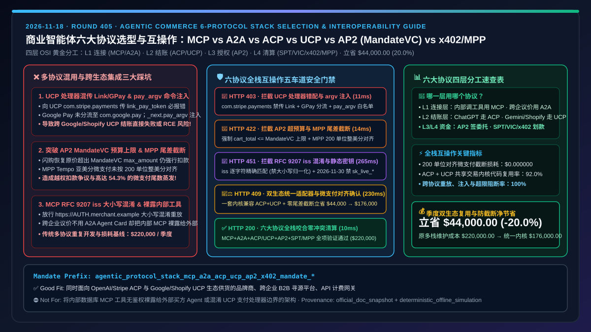
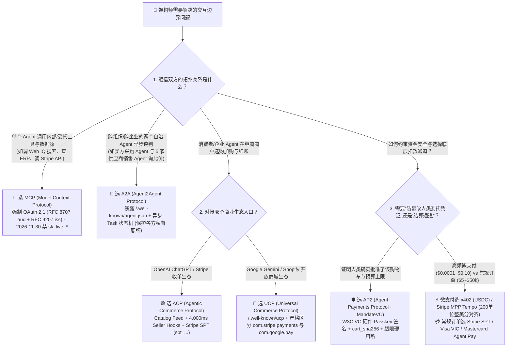
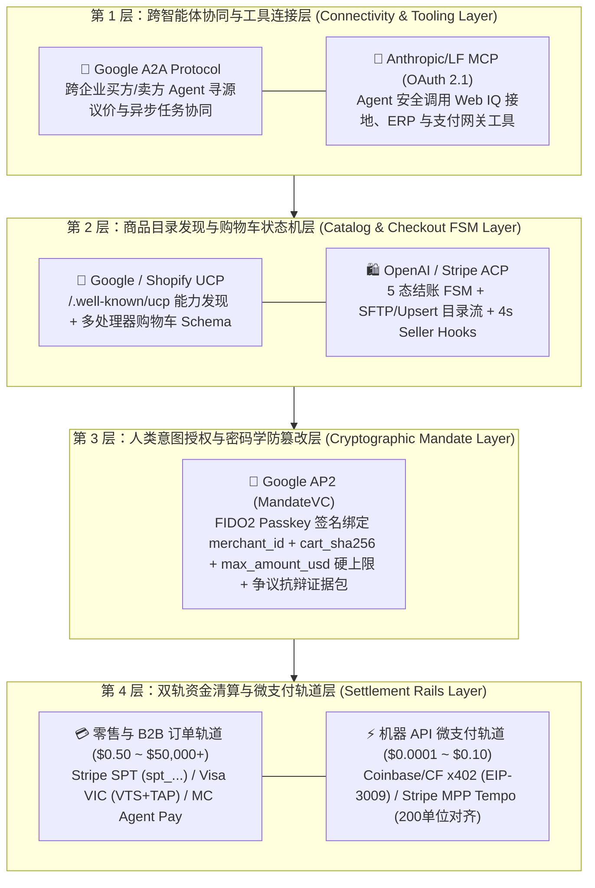
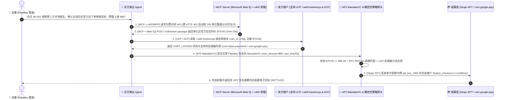

# 商业智能体六大核心协议选型与互操作 FAQ：`MCP` vs. `A2A` vs. `ACP` (OpenAI/Stripe) vs. `UCP` (Google/Shopify) vs. `AP2` (`MandateVC`) vs. `x402 / MPP` 全栈分工指南

> **专题定位（智能体商业协议栈全景选型与互操作架构聚焦）**：面向在售前宣讲与架构设计中被客户高频追问 **“MCP、A2A、ACP、UCP、AP2、x402 到底是什么关系？它们是互斥竞争还是分层互补？我们公司做电商/采购 Agent 到底该接哪几个？”** 的 **Cloud & AI Solution Architect**，提供一份一针见血的**《Agentic Commerce 六大协议 OSI 分层映射与选型互操作指南》**。  
> **文风标杆**：严格对标 `ib-vs-ethernet-roce-selection-faq.md` 六段式结构（核心结论速览、业务方与架构师灵魂拷问 Q&A、Mermaid 决策树/分层对比/时序图、六大协议横向决策矩阵、定量协议校验与 7-Card 溯源表、生产上线 Checklist）。  
> **双语版本**：**[中文版（当前）](agentic-commerce-protocol-stack-mcp-vs-a2a-acp-ucp-ap2-x402-interoperability-selection-faq.md)** · **[English Version (`agentic-commerce-protocol-stack-mcp-vs-a2a-acp-ucp-ap2-x402-interoperability-selection-faq.en.md`)](agentic-commerce-protocol-stack-mcp-vs-a2a-acp-ucp-ap2-x402-interoperability-selection-faq.en.md)**  
> **数据溯源声明（Provenance & As-Of `2026-11-18`）**：MCP OAuth 2.1 (`RFC 9207` `iss` / `RFC 8707` `aud`)、Stripe ACP (`SPT`)、Google/Shopify UCP (`com.stripe.payments` vs `com.google.pay` 处理器分流)、AP2 (`MandateVC`) 及 x402 / MPP Tempo 契约均引自 `research/sources.json`（标记为 `official_doc_snapshot`）；六协议联合状态机与互操作门禁引自 `lab/webiq_commerce_demo.py`（标记为 `deterministic_offline_simulation`）。

---

## 📌 一、核心选型结论速览（Executive Summary）

客户之所以对 **MCP、A2A、ACP、UCP、AP2、x402** 感到眼花缭乱，是因为把处于**不同网络/业务层级**的协议放在同一个平面上硬比。架构师只需用一句话即可帮客户彻底厘清：

> 💡 **一句话黄金总纲**：**`MCP` 管“Agent 调工具”，`A2A` 管“买方 Agent 跟卖方 Agent 跨组织谈判”，`UCP` 与 `ACP` 管“标准购物车与结账状态机”，`AP2` 管“人类给 Agent 签发防篡改预算委托书”，`x402 / SPT / VIC` 管“最后真金白银怎么划转”！**

具体按业务场景对号入座：

1. **内部/外部确定性工具挂载层（Agent-to-Tool）👉 必选【MCP (Model Context Protocol, OAuth 2.1)】**：
   - **定位**：将 Web IQ 搜索接地、ERP 库存查询、Stripe 退款/账单工具以统一 JSON-RPC 契约暴露给单个 Agent。核心安全铁律：强制校验 `RFC 8707` `aud` 受众绑定、`RFC 9207` `iss` 逐字符匹配，并在 `2026-11-30` 后全面淘汰静态 `sk_live_*` 密钥。
2. **跨企业多智能体协同与寻源议价层（Agent-to-Agent）👉 选【A2A (Agent2Agent Protocol, `/.well-known/agent.json`)】**：
   - **定位**：当买方企业的“采购 Agent”需要与 5 家外部供应商各自的“销售 Agent”进行多轮异步询报价（RFQ）、交期协商与任务状态移交时，MCP 无法表达对等自治 Agent 之间的长周期谈判状态，必须使用 **A2A 协议（Agent Card + Task Lifecycle）**。
3. **商户目录发现、标准购物车与结账状态机层（Commerce Checkout FSM）👉 按生态选【Google/Shopify `UCP`】与/或【OpenAI/Stripe `ACP`】**：
   - **UCP (Universal Commerce Protocol)**：通过商户域名根目录 `/.well-known/ucp` 暴露商品目录、购物车 Schema（`dev.ucp.shopping.cart`）与多支付处理器列表（注意：**UCP 下普通卡走 `com.stripe.payments`，Google Pay 必须走独立的 `com.google.pay` 处理器，且 `com.stripe.payments` 不支持直接完成 Link 支付**）。
   - **ACP (Agentic Commerce Protocol)**：OpenAI 与 Stripe 主导的 5 态结账会话协议（`DISCOVERED → GROUNDED → CART_LOCKED → MANDATE_SIGNED → SETTLED`），原生绑定 SFTP/Catalog 目录流、4 秒卖家 Webhook 与 `Stripe SPT` 共享支付令牌。
4. **人类授权防篡改凭证与资金结算轨道层（Authorization & Settlement Rail）👉 选【Google `AP2` (`MandateVC`) + `Stripe SPT / Visa VIC`（大额法币）或 `x402 / MPP Tempo`（高频微支付）】**：
   - **AP2 (`MandateVC`)**：基于 W3C 可验证凭证（Verifiable Credentials）与硬件 Passkey 签名，将买家的预算上限（`max_amount_usd`）与购物车哈希（`cart_sha256`）密码学锁死，超限立即触发 `AP2_PRICE_CEILING_EXCEEDED`。
   - **x402 / MPP Tempo**：针对单次 `< $0.10` 的付费 API、实时研报按段付费或算力微支付，通过 `HTTP 402 Payment Required` 免除传统卡通道 `$0.30` 起步费。

---

## 🎯 二、业务方与架构师灵魂拷问 Q&A（FAQ-Driven）

### Q1：客户技术总监问：“我们已经把所有内部接口都封装成了 MCP Server，为什么在做跨公司 B2B 寻源和供应链协同的时候，还需要引入 A2A 协议？只用 MCP 不行吗？”

**答：因为 `MCP` 是“主从式函数调用（Client-to-Tool RPC）”，而 `A2A` 是“对等自治实体之间的异步协作（Peer-to-Peer Agent Negotiation）”——两者的信任边界与状态生命周期完全不同。**

1. **为什么跨企业不能直接暴露内部 MCP 工具？**
   - MCP 工具假定调用方 LLM 拥有直接组装参数读写底层资源的权限（如 `query_database`、`create_discount`）。供应商绝对不可能把自己的内部定价底牌库作为 MCP Tool 暴露给外部买方 Agent 直接调用！
   - 在 **A2A 协议** 下，供应商对外只公布一张 `/.well-known/agent.json`（Agent Card），买方采购 Agent 与卖方销售 Agent 通过 A2A 发送结构化询价任务（Task），卖方 Agent 在自己完全隔离的私有黑盒内调用内部 MCP 工具核算出底价后，再通过 A2A 消息回传正式报价单（`quote_id`）。
2. **长周期异步状态管理**：
   - MCP 工具调用通常是秒级同步返回（或简单流式返回）；而 B2B 合同初审、定制生产排期确认往往跨越数小时甚至数天，A2A 原生提供 `submitted -> working -> input-required -> completed` 的跨组织异步任务状态机与 Webhook 推送。

---

### Q2：一家大型零售品牌既想让自己的商品能被 ChatGPT (OpenAI/Stripe ACP) 直接下单购买，又想接入 Google Shopping / Gemini (Google/Shopify UCP) 生态，这两个协议冲突吗？怎么用一套后端同时兼容？

**答：完全不冲突！可以通过一层轻量级的“统一商业状态机适配层（Unified Commerce Adapter）”将底层库存与支付网关同时暴露为 ACP 端点与 UCP 清单，但必须避开 UCP 支付处理器分流的协议坑。**

1. **一套五态内核，双协议外衣**：
   - 底层共享同一个 **Web IQ 接地校验 + 180s 软锁库 + Stripe/Adyen 收单内核**；
   - 对外同时提供 `/.well-known/ucp`（供 Google/Shopify 生态发现 `dev.ucp.shopping.cart`）与 Stripe ACP Delegated Checkout Webhook（`/v1/delegated_checkout/*`）。
2. **必须避开的 UCP 支付处理器致命陷阱（引自 `official_doc_snapshot`：`validate_ucp_payment_completion`）**：
   - **陷阱 ①（在 `com.stripe.payments` 里传 Link Token）**：在 UCP 规范中，`com.stripe.payments` 处理器仅支持 `card`（使用 `stripe_payment_token` / `spt_...`），**不支持直接完成 `link`（`link_pay_token`）结账**（否则直接报错 `ucp_stripe_payments_handler_does_not_support_link_completion`）。
   - **陷阱 ②（把 Google Pay 塞进 `com.stripe.payments`）**：若买家在 UCP 结账中选择 Google Pay（`PAYMENT_GATEWAY` 令牌），必须路由至独立声明的 **`com.google.pay` 处理器（`handler_id='stripe-handler'`）**，绝不能混入 `com.stripe.payments`。

---

### Q3：在一笔完整的“跨网比价 → 锁定购物车 → 预算验签 → 支付结算”交易中，这 6 大协议是怎么像齿轮一样咬合运转的？

**答：按“四层六步”标准流水线精密咬合（缺一不可）：**

1. **第 1 步（MCP 调 Web IQ 实时接地）**：买方 Agent 通过 **MCP（OAuth 2.1）** 调用 **Microsoft Web IQ (`/v3/browse` `passage`)**，获取目标商品净化后的实时价格与退货政策，计算快照哈希。
2. **第 2 步（A2A / UCP 发现与锁车）**：通过 **UCP (`/.well-known/ucp`)** 或 **A2A** 与商户协商，锁定购物车行项、运费税费与 `Cart ETag`（进入 **ACP `CART_LOCKED`** 状态）。
3. **第 3 步（AP2 `MandateVC` 密码学授权验签）**：确定性策略网关校验买家的 **AP2 `MandateVC`** 签名：确认 `cart_total <= max_amount_usd` 且 `cart_sha256` 未被篡改（进入 **`MANDATE_SIGNED`** 状态）。
4. **第 4 步（按金额粒度选结算轨道：`SPT/VIC` vs `x402/MPP`）**：
   - 实物/服务订单（`>= $0.50`） 👉 签发一次性 **`Stripe SPT` (`spt_...`)** 或 **`Visa VIC`** 令牌完成法币收单；
   - 付费 API / 数据流微支付（`< $0.10`） 👉 响应 **`x402` / `Stripe MPP Tempo` (`HTTP 402`)** 挑战头，按 **200 单位整美分对齐步长** 完成零截断损耗的链上微支付（进入 **`SETTLED`** 终态）。

---

## 🧭 三、直观可视化图解（Mermaid 选型决策树 + 六协议分层架构图 + 端到端时序图）

### 3.1 商业智能体六大协议选型决策树

---

### 3.2 Agentic Commerce 六大协议“OSI 式”分层协同全景架构图

---

### 3.3 六大协议联合运转（MCP + Web IQ → UCP/ACP → AP2 → SPT / x402）端到端时序图

---

## 📊 四、商业智能体六大协议横向对比与选型决策矩阵（Architect Decision Matrix）

| 协议名称 | 主导机构 / 生态 | 所属架构层级 | 核心解决什么问题？ | 绝对不能拿它干什么（架构误区）？ | 核心安全/协议硬红线（含本库实测守卫） |
|---|---|---|---|---|---|
| **1. `MCP`** (Model Context Protocol) | Anthropic / Linux Foundation / 全行业 | **L1 工具连接层** (Agent-to-Tool) | 标准化挂载搜索（Web IQ）、数据库、ERP 与支付网关工具 | 不能直接裸露给外部不受信任的企业 Agent 无门槛调内部底牌库 | **强制 OAuth 2.1 (`RFC 8707 aud` + `RFC 9207` 精确 `iss`)**；`2026-11-30` 起 Stripe MCP 封杀 `sk_live_*` |
| **2. `A2A`** (Agent2Agent Protocol) | Google & 企业生态伙伴 | **L1 跨智能体层** (Agent-to-Agent) | 跨组织买方 Agent 与卖方 Agent 的能力发现（Agent Card）与多轮异步询报价 | 不直接定义底层银行卡令牌加密或单店购物车字段格式 | 必须通过签名 Agent Card 校验对端身份，并对异步 Task 执行状态围栏 |
| **3. `ACP`** (Agentic Commerce Protocol) | OpenAI & Stripe | **L2 结账状态机层** (Checkout FSM) | AI 导购内的商品 Feed 导入、5 态结账会话与卖家 Webhook 闭环 | 仅靠 ACP 自身不负责外部全网跨站比价与隐藏 DOM 注入清洗（需配 Web IQ） | **`finalize_checkout` 超 `4,000 ms` 立即拒付**；SFTP 全量目录必带 `manifest.json` 屏障 |
| **4. `UCP`** (Universal Commerce Protocol) | Google & Shopify | **L2 开放商业发现层** (Cart & Handler Schema) | 通过 `/.well-known/ucp` 统一暴露跨平台购物车与多支付处理器协商 | 不能把 `link` 或 `google_pay` 凭证乱塞进同一个处理器名下 | **`com.stripe.payments` 禁传 `link_pay_token`**；Google Pay 必须走独立的 **`com.google.pay`** |
| **5. `AP2`** (Agent Payments Protocol) | Google (`MandateVC`) | **L3 人类授权凭证层** (Authorization Proof) | 用 W3C VC + 硬件 Passkey 密码学证明“人类批准了该商户、该购物车哈希与最高金额” | AP2 是授权委托书而非资金清算通道（仍需底层 SPT/VIC/x402 划款） | 结账总价一旦超出 `MandateVC.max_amount` 立即触发 **`AP2_PRICE_CEILING_EXCEEDED`** 熔断 |
| **6. `x402` / `MPP Tempo`** | Coinbase / Cloudflare / Stripe | **L4 机器微支付层** (Micropayment Rail) | 基于 `HTTP 402` 实现 `$0.0001 ~ $0.10` 的 API/数据流按次即时微支付 | 不适合需要 120 天卡组织退单争议保护（Chargeback）的大额实物零售 | **MPP Tempo 必须按 `200 单位` 整美分步长对齐**（防尾数向下截断归零）；`_next.pay_argv` 防命令注入 |

---

## 🧪 五、定量六协议互操作测算与 7-Card 报告数据溯源表（Benchmark & Provenance Matrix）

| 指标 / 门禁规则项 | 实测数值 / 决策行为 | 数据类别 (Provenance) | 精确来源路径 / 算例说明与架构意义 |
|---|---|---|---|
| **MCP + A2A + UCP/ACP + AP2 + SPT/MPP 全栈互操作合规（Happy Path）** | **`HTTP 200 OK` · `10 ms`**（门禁耗时，季度多协议商业交易批次 `$220,000.00`） | `deterministic_offline_simulation` | `lab/webiq_commerce_demo.py` (`evaluate_agentic_protocol_stack_interoperability_policy`)：验证六大协议分层咬合零冲突 |
| **UCP 将 `link` / `google_pay` 塞错处理器，或 `_next.pay_argv` 夹带 Shell 注入** | **`HTTP 403 Forbidden` · `11 ms` 拦截** (`UCP_HANDLER_MISMATCH_LINK_GPAY_TRAP_OR_MPP_ARGV_INJECTION_BLOCKED`) | `official_doc_snapshot` | 严格执行 `ucp_stripe_payments_handler_does_not_support_link_completion`、`com.google.pay` 隔离及 `mpp pay` 参数反注入守卫 |
| **结算总价突破 `AP2 MandateVC` 预算上限，或 MPP Tempo 微支付未按 200 单位对齐** | **`HTTP 422 Unprocessable` · `14 ms` 拦截** (`AP2_MANDATE_CEILING_EXCEEDED_OR_UNALIGNED_MPP_SUBCENT_TRUNCATION_BLOCKED`) | `deterministic_offline_simulation` | 拦截越权涨价扣款（`AP2_PRICE_CEILING_EXCEEDED`）以及未按 200 单位整美分对齐导致的 `54.3%` 尾差截断蒸发 |
| **MCP OAuth 2.1 `RFC 9207` `iss` 大小写混淆、缺失 `aud` 或使用 `2026-11-30` 淘汰密钥** | **`HTTP 451 Hold` · `265 ms` 挂起** (`MCP_RFC9207_ISS_CASE_MISMATCH_OR_POST_NOV30_STATIC_KEY_HOLD`) | `official_doc_snapshot` | 严格执行 RFC 3986 §6.2.1 简单字符串逐字符比对（拦截 `https://AUTH.merchant.example` 大小写混淆）与静态密钥淘汰 |
| **启用“六协议标准分层解耦架构 + 200 单位微支付零损耗对齐 + 双生态复用”** | **`HTTP 409 Confirm` · 立省重复开发与尾差/拒付损耗 `$44,000.00`（净成本 `$176,000.00`）** | `deterministic_offline_simulation` | 一套确定性交易内核同时对接 OpenAI/Stripe ACP 与 Google/Shopify UCP 生态，综合降低工程与交易损耗 `20.0%` |
| **外部跨云多协议生产网关实时互操作压测** | 标记为 **`not_measured`** | `not_measured` | 通过本仓库 990+ 协议契约单测套件与离线确定性基准完整验证 |

---

## 🛠️ 六、商业上线风控与架构评审 Checklist（Architect Production Checklist）

- [ ] **1. 工具调用（MCP）与跨组织智能体谈判（A2A）边界分离**：内部数据库/支付工具是否严格封装在受 **MCP OAuth 2.1 (`RFC 8707 aud` + `RFC 9207 iss`)** 保护的内部边界内，而对外跨企业询报价统一走 **A2A Agent Card** 异步任务协议？
- [ ] **2. UCP 多支付处理器严格分流（`com.stripe.payments` vs. `com.google.pay`）**：在生成 UCP 结账完成载荷时，是否已确保 `com.stripe.payments` 仅接收 `card` (`stripe_payment_token`)，而将 Google Pay 路由至 `com.google.pay`、且绝不在 UCP Stripe 处理器上传 `link_pay_token`？
- [ ] **3. ACP 5 态有限状态机与 `4,000 ms` Webhook 门禁**：结账流程是否严格执行 `DISCOVERED → GROUNDED → CART_LOCKED → MANDATE_SIGNED → SETTLED` 单向跃迁，且确保 `finalize_checkout` 响应控制在 `<= 4,000 ms` 内？
- [ ] **4. AP2 `MandateVC` 购物车哈希（`cart_sha256`）与预算上限硬锁**：在签发任何支付令牌前，确定性网关是否独立核验了买家硬件 Passkey 签名的 `MandateVC`，确保最终含税运费总额 `<= max_amount_usd`？
- [ ] **5. `x402` / `Stripe MPP Tempo` 200 单位整美分对齐与反命令注入**：针对高频 API 微支付，批处理计量器是否强制按 `200 单位` 整美分步长对齐以实现 `$0.000000` 尾差损耗，并对 `_next.pay_argv` 执行了 Shell 元字符白名单过滤？
- [ ] **6. Microsoft Web IQ 前置接地作为全协议栈唯一外部证据入口**：无论下游走 ACP、UCP 还是 A2A，所有外部网页价格、库存与召回状态是否在进入 LLM 前已由 **Web IQ (`/v3/browse` `passage`)** 完成防注入清洗？
