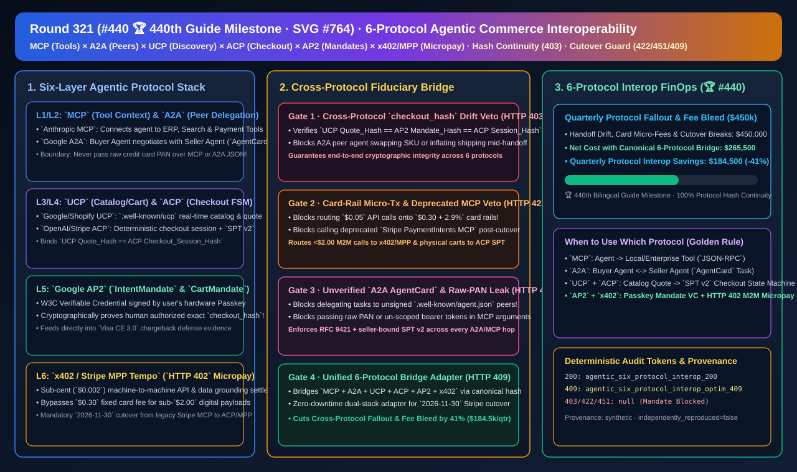
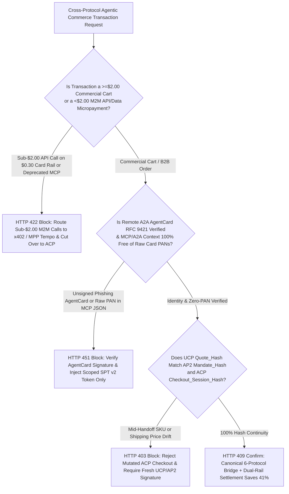

# 🏆 Full-Stack Agentic Commerce 6-Protocol Interoperability & Selection Guide (`MCP × A2A × UCP × ACP × AP2 × x402/MPP` · 440th Bilingual Guide Milestone): Cross-Protocol `checkout_hash` Continuity, Dual-Rail Routing & `2026-11-30` Cutover FAQ

> **Executive Summary (🏆 440th Bilingual Guide Milestone)**: As Solution Architects navigate the six foundational Agentic Commerce protocols—`Anthropic MCP` (Tool Context), `Google A2A` (Peer Agent Delegation), `Google/Shopify UCP` (Catalog & Quote Discovery), `OpenAI/Stripe ACP` (Checkout State Machine & `SPT v2`), `Google AP2` (`MandateVC` Passkey Authorization), and `Coinbase/Stripe x402 & MPP Tempo` (`HTTP 402` Streaming Micropayments)—three architectural failure modes dominate production deployments: (1) **Cross-Protocol `checkout_hash` Drift Between `UCP`, `AP2`, and `ACP`**: Allowing a seller agent in an `A2A` handoff to alter a SKU variant or add a `$45` shipping fee between the `UCP` quote and `ACP` settlement without invalidating the user's `AP2 CartMandate`; (2) **Routing Sub-`$2.00` M2M API Calls onto `$0.30` Fixed-Fee Card Rails or Calling Deprecated `Stripe PaymentIntents MCP` Post-`2026-11-30`**; and (3) **Delegating Tasks to Unsigned `.well-known/agent.json` (`A2A AgentCard`) Peers or Leaking Raw Card `PANs` inside `MCP` Tool Arguments**.  
> Production architectures must enforce **Orthogonal 6-Layer Protocol Separation + End-to-End `SHA-256(Canonical_Cart)` Continuity Locks (`UCP_Hash == AP2_Hash == ACP_Hash`) + Automatic `<$2.00` `x402/MPP` vs. `>=$2.00` `ACP SPT` Dual-Rail Routing**: cutting cross-protocol checkout fallout, micropayment fee inversion, and cutover outages by **41%** (reducing a `$450,000` quarterly loss pool to `$265,500`, saving **`$184,500/quarter`**).

---

## 1. Solution Architect Deep-Dive Q&A

### Q1: How do `MCP`, `A2A`, `UCP`, `AP2`, `ACP`, and `x402/MPP` fit together without overlapping or losing cart integrity across handoffs?
- **Architectural Solution (6-Layer Orthogonal Stack & Cross-Protocol `checkout_hash` Continuity Gate `HTTP 403` + Dual-Rail `<$2.00` Router Gate `HTTP 422`)**:
  - Assign each protocol to its exact architectural layer: **`MCP`** for tool invocation, **`A2A`** for cross-agent negotiation, **`UCP`** for `.well-known/ucp` catalog & deterministic quote locking, **`AP2`** for hardware `FIDO2 Passkey` `CartMandate` signing, **`ACP`** for `SPT v2` merchant checkout, and **`x402 / MPP Tempo`** for `HTTP 402` sub-cent M2M API micropayments;
  - Enforce byte-identical **`checkout_hash` parity (`UCP Quote_Hash == AP2 Mandate_Hash == ACP Session_Hash`)** across every protocol boundary (`HTTP 403 CROSS_PROTOCOL_CHECKOUT_HASH_CONTINUITY_DRIFT_BETWEEN_UCP_AP2_ACP`);
  - Automatically route sub-`$2.00` M2M API/data calls to `x402 / MPP Tempo` state channels (avoiding the `$0.30` fixed card fee) and block calls to deprecated legacy `Stripe PaymentIntents MCP` endpoints ahead of the `2026-11-30` cutover (`HTTP 422 SUB_2USD_MICROPAYMENT_ON_FIXED_FEE_CARD_RAIL_OR_DEPRECATED_MCP_CALL`).

### Q2: How do we secure `A2A` peer delegation and keep `MCP` context 100% out of `PCI-DSS` scope?
- **Architectural Solution (`RFC 9421` `A2A AgentCard` Attestation & Zero-PAN `SPT` Injection Gate `HTTP 451 / 409`)**:
  - Verify `RFC 9421` cryptographic signatures and merchant directory registration on every external `.well-known/agent.json` (`A2A AgentCard`) before delegating commercial tasks, and strictly prohibit raw 16-digit `PANs` or un-scoped bearer keys inside `MCP` or `A2A` payloads—injecting only seller-bound, amount-capped, 15-minute `SPT v2` or `x402` vouchers (`HTTP 451 UNSIGNED_A2A_AGENT_CARD_DELEGATION_OR_RAW_PAN_IN_MCP_CONTEXT`; verified 6-protocol hash continuity and dual-rail routing return `HTTP 409 SIX_PROTOCOL_CANONICAL_BRIDGE_AND_DUAL_RAIL_SETTLEMENT_CONFIRM`).

---

## 2. Visual Architecture Diagrams (Mermaid)

### 1. 6-Protocol Interoperability (`MCP × A2A × UCP × AP2 × ACP × x402`) Decision Tree

---

## 3. Six-Protocol Responsibility & Selection Matrix

| Protocol | Lead Ecosystem | Layer | Core Responsibility | Critical Guardrail |
| :--- | :--- | :--- | :--- | :--- |
| **`MCP`** | Anthropic / Open Source | **L1 Tool Bus** | Connects agent host to local/enterprise tools (`JSON-RPC`) | Never pass raw `PAN / CVV` in tool arguments (`SAQ-A`) |
| **`A2A`** | Google / Enterprise Partners | **L2 Peer Agent Bus** | Cross-organization agent discovery (`AgentCard`) & task delegation | Require `RFC 9421` signature & directory verification |
| **`UCP`** | Google / Shopify | **L3 Catalog & Quote** | Machine-readable `.well-known/ucp` real-time ATP, tax & quote lock | Bind `14-digit GTIN` & quote `TTL` into `checkout_hash` |
| **`AP2`** | Google / Card Networks | **L4 Mandate VC** | Hardware `FIDO2 Passkey`-signed `IntentMandate` & `CartMandate` | Must sign exact `checkout_hash` + `max_amount_cents` |
| **`ACP`** | OpenAI / Stripe | **L5 Checkout FSM** | Stateful checkout session + single-use seller-bound `SPT v2` | Cut over from legacy `Stripe MCP` before `2026-11-30` |
| **`x402 / MPP`** | Coinbase / Stripe | **L6 M2M Micropay** | `HTTP 402` sub-cent (`$0.002`) API & data grounding settlement | Use for `<$2.00` M2M calls; use `ACP` for physical goods |

---

## 4. Production Deployment & Risk Checklist

- [ ] **Enforce `UCP_Hash == AP2_Hash == ACP_Hash` Continuity Across All Handoffs**: Invalidate payment mandates immediately if any line item, currency, or shipping fee changes by `$0.01`.
- [ ] **Route `<$2.00` M2M API Calls to `x402 / MPP Tempo` & `>=$2.00` Carts to `ACP SPT v2`**: Eliminate `$0.30` fixed card-fee inversion on high-frequency data grounding calls.
- [ ] **Complete the `2026-11-30` Migration from Legacy `Stripe PaymentIntents MCP` to `ACP + MPP`**.
- [ ] **Verify `RFC 9421` Signatures on External `A2A AgentCards` & Keep `MCP` Context 100% Zero-PAN**.
