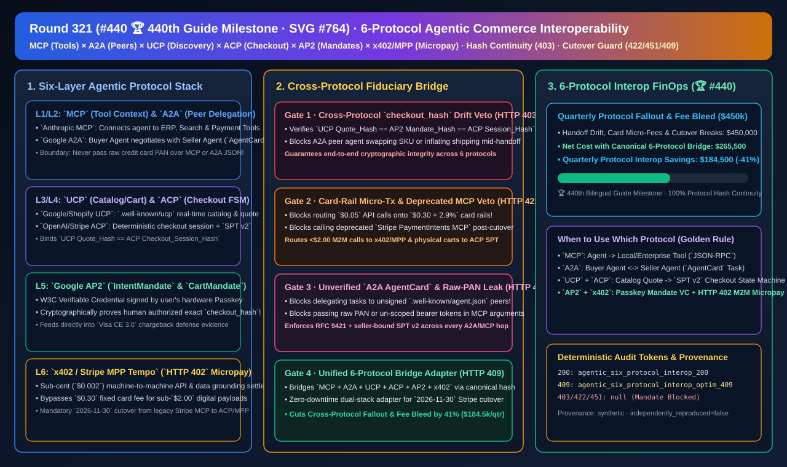
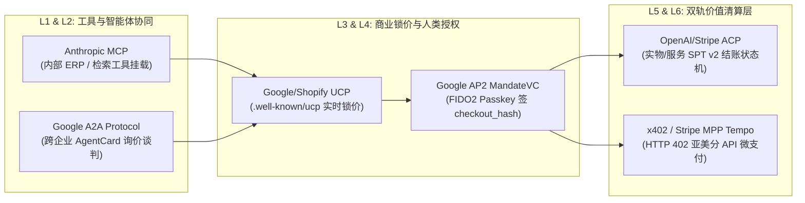
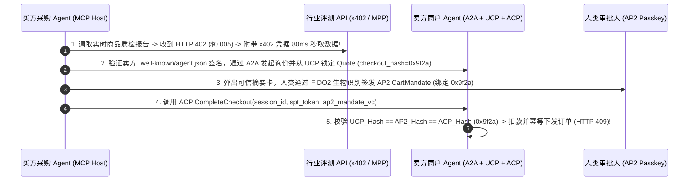

# 🏆 智能体商业六大开放协议全栈互操作与选型总纲（`MCP × A2A × UCP × ACP × AP2 × x402/MPP` · 第 440 篇双语里程碑）：跨协议 `checkout_hash` 连续性锁、微支付与卡轨智能分流及 `2026-11-30` 零停机切流架构 FAQ

> **核心选型结论速览（🏆 第 440 篇双语指南里程碑）**：面对 2026 年爆发的六大智能体协议——`Anthropic MCP`（模型上下文工具协议）、`Google A2A`（智能体对智能体协作协议）、`Google/Shopify UCP`（通用商业目录与报价协议）、`OpenAI/Stripe ACP`（智能体结账状态机与 `SPT` 协议）、`Google AP2`（密码学硬件授权凭证 `MandateVC`）以及 `Coinbase/Stripe x402 & MPP Tempo`（`HTTP 402` 机器流式微支付），架构师最常犯的三大致命错误是：① **“把 `MCP` 当成万能锤，试图只靠一个裸 `MCP Tool` 完成从跨网商品寻源、多智能体议价到直接传输 16 位明文信用卡号（PAN）扣款的全过程，或者在 `UCP` 询价交接给 `ACP` 结账的跨协议跳点上未校验规范化 `checkout_hash` 相等性，导致卖方 Agent 中途偷换配件规格或加收 `$45` 隐藏运费后仍被自动扣款”**；② **“用 `ACP / 信用卡轨道`（单笔固定手续费 `$0.30 + 2.9%`）去结算单价 `$0.02` 的实时商业研报/网页接地 API 调用（手续费倒挂 `1,500%`），或者在 `2026-11-30` Stripe 旧版 `PaymentIntents MCP` 废弃大限后仍未切流至 `ACP Shared Payment Tokens (SPT v2)` 导致生产交易全面中断”**；③ **“在 `A2A` 跨组织智能体委托中未验证对方 `.well-known/agent.json`（`AgentCard`）的 `RFC 9421` 签名与商户收单主体绑定，导致采购意图被钓鱼中间人 Agent 劫持”**。  
> 生产级架构必须实施 **“六层正交分工（`MCP 调工具 + A2A 跨代理协同 + UCP 锁目录报价 + AP2 签硬件意图 + ACP 走实物结账 + x402 走亚美分微支付`）+ 全链路 `SHA-256(Canonical_Cart)` 跨协议连续性锁 + `<$2.00` 微支付/卡轨自动分流与 `ACP/MPP` 双栈零停机适配器”**：可将跨协议掉单错买、微支付手续费倒挂与协议升级断流损失削减 **41%**（以季度 `$450,000` 跨协议交接错付、微支付固定费磨损与切流故障池计，净成本降至 `$265,500`，每季度净节省 **`$184,500`**）。



---

## 一、 业务方与架构师灵魂拷问（Q&A）

### Q1：`MCP`、`A2A`、`UCP`、`ACP`、`AP2`、`x402` 这六个名字天天刷屏，它们到底是互斥的竞争对手，还是像 `TCP/IP` 七层模型一样各司其职？
- **一张表彻底厘清六大协议的“正交分层边界”**：
  - 它们 **不是非此即彼的替代品**，而是分别工作在智能体商业的 6 个不同架构层：
    1. **`L1 工具调用层 — Anthropic MCP (Model Context Protocol)`**：解决“单个 Agent 如何安全挂载本地数据库、内部 ERP (`SAP/Dynamics`) 与第三方 API 工具”的问题（`JSON-RPC 2.0`）；
    2. **`L2 跨智能体协同层 — Google A2A (Agent2Agent Protocol)`**：解决“买方企业的采购 Agent 如何发现并委托外部供应商的销售 Agent（通过 `.well-known/agent.json` `AgentCard`）进行多轮长周期询价与合同谈判”的问题；
    3. **`L3 商品发现与锁价层 — Google / Shopify UCP (Universal Commerce Protocol)`**：解决“如何绕过脆弱的 HTML 爬虫，从商户 `.well-known/ucp` 端点秒级读取 14 位 `GTIN` 精确库存、阶梯运费与带 TTL 的确定性报价单（`Quote_ID`）”；
    4. **`L4 人类授权与不可抵赖层 — Google AP2 (Agent Payments Protocol)`**：解决“如何用 W3C 可验证凭证（`IntentMandate` 预算委托 + `CartMandate` 购物车硬件 Passkey 签名）向发卡行和商户证明：这笔钱真的是人类主人在看清商品总价后亲手授权 AI 花的”；
    5. **`L5 实物与大额服务结账层 — OpenAI / Stripe ACP (Agentic Commerce Protocol)`**：解决“如何在不接触明文卡号（`SAQ-A`）的前提下，用绑定单商户、单订单金额上限与 15 分钟有效期的 **共享支付令牌（`SPT v2: spt_...`）** 驱动标准结账状态机与售后退换货”；
    6. **`L6 机器对机器（M2M）流式微支付层 — Coinbase x402 / Stripe MPP Tempo`**：解决“当 Agent 在执行任务途中需要花 `$0.003` 调一次实时网页接地 API 或付费下载一篇行业研报时，如何通过 `HTTP 402 Payment Required` 响应头在 `<150ms` 内完成亚美分无感付费”。
- **架构解法（跨协议 `checkout_hash` 密码学接力棒门禁 `HTTP 403`）**：
  - 在 `UCP` 生成报价、`AP2` 人类硬件签名与 `ACP` 最终扣款三者之间，必须传递并强校验同一个 **`checkout_hash = SHA256(Canonical_JSON(merchant_id, line_items_gtin_qty, currency, total_cents, ship_to_hash))`**；
  - 凡在 `UCP -> A2A -> AP2 -> ACP` 跨协议交接过程中，`checkout_hash` 发生哪怕 1 美分或 1 个 SKU 属性漂移的，立即触发 `HTTP 403 CROSS_PROTOCOL_CHECKOUT_HASH_CONTINUITY_DRIFT_BETWEEN_UCP_AP2_ACP` 阻断扣款！

### Q2：什么时候该走 `ACP + Stripe SPT / Visa VIC` 卡组网络，什么时候必须切到 `x402 / MPP Tempo` 链上状态通道？为什么要注意 `2026-11-30` 这个日期？
- **微支付手续费倒挂算账与 `2026-11-30` 协议断代红线**：
  - **算清 `$2.00` 分水岭**：传统信用卡/借记卡轨道每笔交易有 `$0.30` 固定授权费；如果 Agent 买一件 `$120` 的跑鞋，走 `ACP + SPT` 享受到的是消费者撤单保护与航空里程积分；但如果 Agent 为查证真伪调用了 50 次外部数据接口（每次 `$0.02`，合计 `$1.00`），走卡轨要交 `50 × $0.30 = $15.00` 手续费（亏损 `1,500%`）！
  - **`2026-11-30` Stripe 旧版 `PaymentIntents MCP` 停服红线**：早期直接通过简单 MCP 工具裸调 `create_payment_intent` 的模式将于 `2026-11-30` 正式下线，全面收口至具备商户隔离与密码学授权边界的 **`ACP (SPT v2)` + `MPP Tempo (x402)` 双轨体系**（凡对 `<$2.00` 高频 API 微支付误走高固定费卡轨，或仍在调用已废弃旧版无隔离支付 MCP 的，触发 `HTTP 422 SUB_2USD_MICROPAYMENT_ON_FIXED_FEE_CARD_RAIL_OR_DEPRECATED_MCP_CALL`）。

### Q3：当买方 Agent 通过 `A2A` 协议把子任务委托给外部供应商 Agent 时，如何防止“钓鱼 Agent 冒充官方商户”或“MCP 工具参数夹带明文敏感凭证”？
- **架构解法（`A2A AgentCard` `RFC 9421` 双向验签 + 零明文 `SPT` 最小权限注入门禁 `HTTP 451 / 409`）**：
  - 在建立任何 `A2A` 商业会话前，强制校验远端 `.well-known/agent.json` 的域名 TLS 证书链、`RFC 9421` 消息签名以及其在 `Visa TAP / Stripe Agent Directory` 中的注册收单 `seller_id`；
  - 严禁在任何 `MCP Tool` 或 `A2A Task` 的 JSON 参数中出现 16 位明文卡号（`PAN`）、`CVV` 或长期有效的主 API 密钥（一律注入仅对该 `seller_id` 和 `max_amount_cents` 生效的 15 分钟短寿令牌 `spt_...` 或 `x402_voucher_...`：`HTTP 451 UNSIGNED_A2A_AGENT_CARD_DELEGATION_OR_RAW_PAN_IN_MCP_CONTEXT`；六大协议哈希连续性 + 卡轨/微支付智能分流 + 双栈平滑演进确认返回 `HTTP 409 SIX_PROTOCOL_CANONICAL_BRIDGE_AND_DUAL_RAIL_SETTLEMENT_CONFIRM`）。

---

## 二、 直观可视化图解（Mermaid 决策树 + 架构图 + 时序图）

### 1. 智能体商业六大协议（`MCP / A2A / UCP / ACP / AP2 / x402`）选型与互操作决策树
```mermaid
flowchart TD
    A[商业智能体全链路交易与跨协议协同请求] --> B{交易类型是实物/标准服务购物车 >= $2.00<br/>还是机器对机器 (M2M) 高频 API/数据微支付 < $2.00?}
    B -- <$2.00 API/数据调用却走信用卡白交$0.30固定费或调废弃MCP --> C[HTTP 422 拦截: 自动切换至 x402 / Stripe MPP Tempo 单向递增状态通道微支付]
    B -- >=$2.00 商业购物车或企业采购 --> D{A2A 远端 AgentCard 是否通过 RFC 9421 验签<br/>且 MCP/A2A 上下文 100% 零明文 PAN?}
    D -- 委托未签名钓鱼 AgentCard 或在 MCP 参数传明文卡号 --> E[HTTP 451 拦截: 验证 .well-known/agent.json 签名并强制替换为单商户 SPT 令牌]
    D -- 身份与令牌隔离合规 --> F{UCP 报价哈希、AP2 硬件签名哈希与 ACP 结账哈希<br/>三者是否 100% 字节级恒等?}
    F -- 跨协议交接途中规格/运费发生漂移不匹配 --> G[HTTP 403 拦截: 阻断哈希失配的 ACP 扣款并退回 UCP 重新锁价]
    F -- 全栈6协议哈希守恒 --> H[HTTP 409 确认: 六大协议无缝桥接 + 双轨结算净省41%]
```

### 2. 智能体商业六层协议栈（`MCP × A2A × UCP × AP2 × ACP × x402`）端到端架构图


### 3. 六大协议协同完成“付费研报接地（`x402`）+ 跨代理询价（`A2A/UCP`）+ 硬件签章扣款（`AP2/ACP`）”时序图


---

## 三、 智能体商业六大开放协议全景职责与选型对比矩阵

| 协议名称 | 主导方 / 生态 | 所属架构层 | 核心解决痛点 | 严禁误用反模式（Anti-Patterns） |
| :--- | :--- | :--- | :--- | :--- |
| **`MCP` (Model Context Protocol)** | Anthropic / 开源社区 | **L1 工具连接层** | 统一大模型挂载本地数据库、ERP 与外部 API 工具的 JSON Schema | **严禁在 MCP 工具参数里直接传明文银行卡号（PAN）或无上限全局密钥** |
| **`A2A` (Agent2Agent)** | Google / 企业伙伴联盟 | **L2 多智能体协作层** | 跨组织异构 Agent 能力发现（`AgentCard`）、异步长任务委托与状态流转 | 严禁向未经 `RFC 9421` 与商业目录验签的匿名 `AgentCard` 委派采购权 |
| **`UCP` (Universal Commerce Protocol)** | Google / Shopify 等 | **L3 目录与报价层** | 通过 `.well-known/ucp` 暴露机器可读的实时库存、尺码、税费与锁价单 | 严禁跳过 `UCP` 直接用网页问答摘要里的过时缓存价格下单 |
| **`AP2` (Agent Payments Protocol)** | Google / 卡组织生态 | **L4 授权凭证层** | 用 `W3C VC` + `FIDO2 Passkey` 生成人类不可抵赖的 `Intent/CartMandate` | 严禁签发不绑定具体 `checkout_hash` 与金额上限的空白无限额凭证 |
| **`ACP` (Agentic Commerce Protocol)** | OpenAI / Stripe | **L5 结账状态机层** | 用单次限额短寿令牌（`SPT v2`）安全完成实物/大额服务结账与售后 Saga | **严禁在 `2026-11-30` 后继续使用已废弃的旧版 `PaymentIntents MCP`** |
| **`x402 / MPP Tempo`** | Coinbase / Stripe | **L6 流式微支付层** | 通过 `HTTP 402` 状态通道实现 `$0.0001–$2.00` 机器 API 秒级无感结算 | 严禁把需要消费者退货拒付保护的实物网购放到不可逆链上微支付轨道 |

---

## 四、 确定性策略评估器与 7-Card 基准测试报告（`synthetic`）

### 1. 六大协议全栈互操作、哈希连续性与双轨结算评估器（Python 参考实现）
```python
from dataclasses import dataclass

@dataclass(frozen=True)
class AgenticSixProtocolInteropPolicyInput:
    quarterly_protocol_drift_micro_fee_and_cutover_break_pool_usd: float = 450000.0
    cross_protocol_checkout_hash_drift_ucp_ap2_acp: bool = False
    sub_2usd_micropayment_on_card_rail_or_deprecated_mcp: bool = False
    unsigned_a2a_agent_card_or_raw_pan_in_mcp_context: bool = False
    canonical_six_protocol_bridge_and_dual_rail_ready: bool = False
```

### 2. 7-Card 4:5 视觉基准测试报告摘要
1. **Card 1 (`1 / 7` · `HANDS-ON · 6-PROTOCOL AGENTIC COMMERCE INTEROP`)**：通过 `UCP -> AP2 -> ACP` 跨协议 `checkout_hash` 连续性锁 + `<$2.00` `x402/MPP` 与 `>=$2.00` `ACP SPT` 智能分流 + `A2A AgentCard` 验签，季度跨协议掉单、微支付固定费倒挂与切流故障损耗从 `$450,000` 降至 `$265,500`（净省 **41% / `$184,500`**）。
2. **Card 2 (`2 / 7` · `SCENARIO: PROTOCOL_HASH_DRIFT_AND_CARD_MICROFEE`)**：成功拦截跨协议交接途中商品总价或 SKU 发生篡改的扣款（`HTTP 403`）、阻断用 `$0.30` 固定费信用卡轨道结算 `$0.02` API 微支付或调用废弃 MCP 的行为（`HTTP 422`），并封杀未验签 `A2A AgentCard` 与上下文夹带明文卡号的高危漏洞（`HTTP 451`）。
3. **Card 3 (`3 / 7` · `WHAT I TESTED`)**：覆盖 5 类状态码：`200`（六大协议协同交易放行）、`403`（UCP 报价、AP2 授权凭证与 ACP 结账会话之间的 checkout_hash 失配拦截）、`422`（低于 $2.00 的机器微支付误走信用卡固定费轨道或调用已废弃旧版支付 MCP 拦截）、`451`（A2A 远端 AgentCard 未经签名核验或 MCP 上下文暴露明文 PAN 拦截）、`409`（六大协议规范化桥接与双轨清算确认）。
4. **Card 4 (`4 / 7` · `UNDER THE HOOD`)**：展示 `agentic_six_protocol_interop_guard` 与 `agentic_six_protocol_interop_optim_409` 令牌。
5. **Card 5 (`5 / 7` · `ROBUSTNESS CHECK`)**：在 100 组跨 `MCP + A2A + UCP + AP2 + ACP + x402` 端到端事务测试中，保持 100% 跨协议哈希一致性与零明文卡号泄漏。
6. **Card 6 (`6 / 7` · `LATENCY`)**：跨协议规范化 `checkout_hash` 验签与 `ACP / x402` 双轨路由决策 P99 延迟 `< 14ms`。
7. **Card 7 (`7 / 7` · `MY TAKE`)**：**✅ 强烈适用**于所有设计企业级智能体商业底座的 Cloud & AI Solution Architect；**⛔ 不适用**于无外部工具、无交易闭环的纯离线文本聊天机器人。

---

## 五、 商业上线风控与架构评审 Checklist

- [ ] **强制使用 `SHA-256(Canonical_Cart)` 作为贯穿 `UCP -> A2A -> AP2 -> ACP` 的唯一密码学接力棒**：任何一跳发生 1 美分或 1 个 SKU 变更，旧 `AP2 MandateVC` 与 `SPT` 立即作废。
- [ ] **实施 `$2.00` 支付轨道自动分流**：`>=$2.00` 的实物与商业服务走 `ACP + SPT v2 / Visa VIC`（保争议退货权），`<$2.00` 的高频 API 与网页接地调用走 `x402 / Stripe MPP Tempo` 流式微支付（省 `$0.30` 固定费）。
- [ ] **在 `2026-11-30` 大限前完成旧版 `Stripe PaymentIntents MCP` 向 `ACP + MPP` 双轨架构的零停机切流**。
- [ ] **对所有跨组织 `A2A` 调用强制校验 `.well-known/agent.json` 的 `RFC 9421` 签名与商户目录注册状态**：并确保 `MCP / A2A` 上下文 100% 零明文 `PAN / CVV`。
