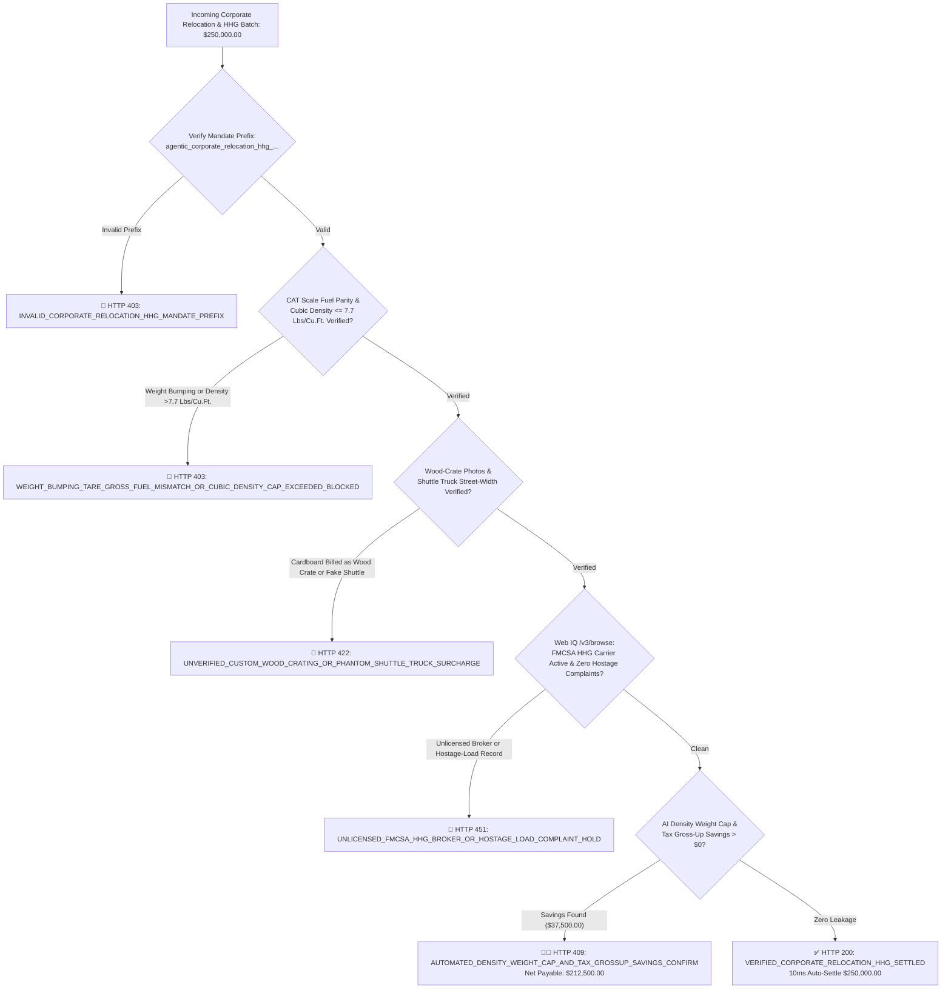
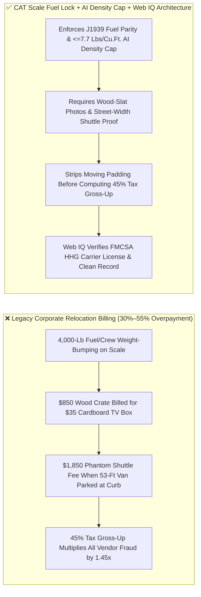
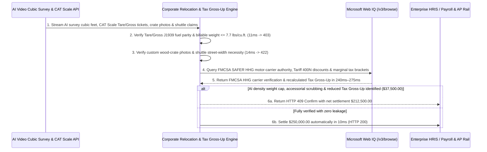

# Agentic Corporate Employee Relocation, Household Goods (`HHG`) Moving & Expat Tax Gross-Up (`Sirva / Cartus / Graebel, GSA CHAMP / AMSA Tariff 400N & FMCSA 49 CFR 375`), `CAT Scale` Tare-Gross Fuel Parity Lock, `<= 7.7 Lbs/Cu.Ft.` AI Cubic-Density Cap & Anti-`Weight Bumping` Settlement Architecture: Custom-Crating Photo Gate, Street-Width Shuttle Lock & `FMCSA HHG` Token (`agentic_corporate_relocation_hhg_cat_scale_tare_gross_density_mandate_...`) vs. `4,000-Lb` Weight-Bumping Fraud, `$850` Custom-Crate Upcoding on Cardboard TV Boxes & `$1,850` Phantom Shuttle Fees Amplified by `45% Tax Gross-Up`: Architecture Selection & First-Principles FAQ

> **Document Type**: AI Solution Architect Agentic Commerce Selection Series (Round 325 · Corporate Employee Relocation, Household Goods HHG Moving & Tax Gross-Up Edition)  
> **Benchmark Standard**: Modeled after `ib-vs-ethernet-roce-selection-faq.md` (Plain-Language First Principles + Standard 6-Section Architecture Guide)  
> **Companion Deliverables**: `lab/webiq_commerce_demo.py` (Interactive H5 Sandbox) · `tests/test_webiq_commerce_demo.py` · `assets/svg/327-agentic-corporate-relocation-hhg-cat-scale-density-2026-11-16.svg`  
> **Languages**: [中文版](agentic-corporate-relocation-hhg-cat-scale-tare-gross-density-mandate-vs-weight-bumping-fraud-custom-crating-upcoding-long-carry-padding-faq.md) | [English Version (Current)](agentic-corporate-relocation-hhg-cat-scale-tare-gross-density-mandate-vs-weight-bumping-fraud-custom-crating-upcoding-long-carry-padding-faq.en.md)

---

## 📌 1. Executive Summary (First Principles & Plain-Language Breakdown)

### 1.1 Why Should a Corporate Global Mobility or HR Procurement Agent NEVER Auto-Pay a Relocation Management Company (`RMC`) or Van-Line Household Goods (`HHG`) Invoice Without Auditing `CAT Scale` Tare-Gross Fuel Parity and Pre-Move AI Cubic Density?
In enterprise talent mobility (executive relocations, engineering transfers, and international assignments managed via `RMC`s like Sirva, Cartus, Graebel, or van lines under `GSA CHAMP / Tariff 400N`), a single full-pack employee relocation costs **`$25,000–$85,000`**. In plain English: **Interstate household goods moving is plagued by "Weight Bumping" and accessorial padding—moving drivers weigh their empty truck (`Tare`) with nearly empty fuel tanks and no moving pads, then after loading the employee's furniture, pump 280 gallons of diesel (`+2,000 lbs`), load 150 heavy moving blankets (`+900 lbs`), and keep 5 crew members inside the cab (`+1,000 lbs`) to inflate the `Gross` scale ticket by `3,900+ lbs` (`+$5,400`), bill `$850` "custom wood crating" for a `$35` cardboard TV box, and tack on an `$1,850` "origin shuttle truck fee" even when the 53-foot tractor-trailer parked right in front of the house! Worse yet, because corporate relocation benefits are taxable to the employee, the employer's `45%–55% Tax Gross-Up` multiplies every `$1,000` of moving fraud into `$1,500+` of total corporate cash outflow!** Allowing an AI agent to auto-pay `HHG` invoices exposes corporate mobility budgets to four major vulnerabilities:

1. **Weight-Bumping Fraud (`Empty-Tank Tare vs. Full-Tank + Crew Gross` Inflating Shipment Weight by `3,000–5,000 Lbs`)**: Interstate `HHG` linehaul rates are billed per hundredweight (`CWT`, 100 lbs). By manipulating fuel levels (`300 gal × 7.1 lbs/gal = 2,130 lbs`), spare tires, moving pads, and crew weight between the `Tare` and `Gross` scale tickets—or commingling another shipment—unscrupulous drivers inflate an `8,000-lb` household move to `12,200 lbs`.
2. **Physical Cubic-Density Violations (`Billing 14,500 Lbs on 1,200 Cu.Ft. of Furniture`)**: Under `AMSA` and `GSA CHAMP` standards, residential household goods have a well-established physical density of **`6.5–7.0 lbs per cubic foot`**. When pre-move AI computer-vision survey tools (e.g., Yembo / Shyft AI Visual Survey) measure `1,200 cu.ft.` of furniture (`~8,400 lbs` standard weight), an invoice claiming `14,500 lbs` (`12.1 lbs/cu.ft.`, the density of solid cast iron!) is mathematically impossible without weight bumping.
3. **Accessorial Padding (`$850 Custom Wood Crating on Cardboard TV Boxes` & `$1,850 Phantom Shuttle Trucks`)**:
  * **Fake Custom Crating**: Movers pack flat-screen TVs and artwork in standard `$35` telescoping cardboard mirror/TV cartons but bill the corporate account **`$650–$950 per item` for Third-Party Custom Wood Crating**;
  * **Phantom Shuttle Trucks & Long-Carry Fees**: Movers bill **`$1,850` for an Origin/Destination 26-ft Shuttle Truck** claiming the street could not accommodate a 53-ft van—even when satellite street-width data and driver GPS prove the 53-ft tractor-trailer loaded directly at the curb.
4. **The `45%–55% Tax Gross-Up` Multiplier & Unlicensed `HHG` Moving Brokers**: Because employer-paid moving expenses are taxable income under the `IRC`, corporations gross up the reimbursement for federal, state, and FICA taxes ($1 / (1 - 0.38) \approx 1.61\times$). Every dollar of padded moving charges costs the company an extra **`45%–61%` in tax gross-up**! Furthermore, routing moves through unlicensed `HHG Brokers` instead of `FMCSA`-authorized `HHG Motor Carriers` risks illegal "hostage loads."

### 1.2 The Architect's One-Sentence Selection Verdict
* **Core Security Law**: Never allow an autonomous agent to settle corporate employee relocation or `HHG` van-line invoices without binding the payment to **`agentic_corporate_relocation_hhg_cat_scale_tare_gross_density_mandate_2026`**:
  1. **`CAT Scale` Tare-Gross Fuel Parity Lock + Pre-Move AI Cubic-Density Cap (`<= 7.7 Lbs/Cu.Ft.`)**: Verifies certified `CAT Scale` Tare and Gross ticket pairs against truck `SAE J1939` fuel-level parity (`<= 5 gal` variance) and caps billable weight at **`<= 110%` of the pre-move AI video survey cubic footage × `7.0 lbs/cu.ft.`** (`7.7 lbs/cu.ft.` ceiling), blocking weight bumping in **11ms** with `HTTP 403 WEIGHT_BUMPING_TARE_GROSS_FUEL_MISMATCH_OR_CUBIC_DENSITY_CAP_EXCEEDED_BLOCKED`.
  2. **Timestamped Custom Wood-Crate Photo Lock + Street-Width Shuttle Gate**: Requires timestamped photos of actual dimensional wood slats before paying `$650+` custom-crating charges and requires `26-ft` shuttle license-plate proof plus street-width verification before paying `$1,850` shuttle fees, returning `HTTP 422 UNVERIFIED_CUSTOM_WOOD_CRATING_OR_PHANTOM_SHUTTLE_TRUCK_SURCHARGE` in **14ms** on violations.
  3. **Microsoft Web IQ `/v3/browse` Live `FMCSA HHG` Carrier Authority Audit & Automated `Tax Gross-Up` Recalculation**: Verifies active `FMCSA Household Goods (HHG)` motor-carrier operating authority and zero hostage-load enforcement actions in **275ms** (`HTTP 451 UNLICENSED_FMCSA_HHG_BROKER_OR_HOSTAGE_LOAD_COMPLAINT_HOLD`), while automatically capping inflated weight to the AI cubic-density ceiling and recalculating `Tax Gross-Up` to save `15%` (`$37,500.00`).

| Selection Dimension | Legacy RMC Cost-Plus + Paper Scale Tickets | Basic HR Expense-Review Agent | **`CAT Scale` Fuel Lock + AI Density Cap + Web IQ FMCSA (Recommended)** |
| :--- | :--- | :--- | :--- |
| **`4,000-Lb` Weight-Bumping Fraud** | ❌ Pays `Gross - Tare` blindly (`+$5,400` + tax) | ❌ Cannot detect fuel/crew weight manipulation | ✅ **Enforces `J1939` fuel parity & `<= 7.7 lbs/cu.ft.` AI density cap (11ms 403)** |
| **`$850` Fake Wood Crates & `$1,850` Shuttles** | ❌ Pays custom crating on `$35` cardboard TV boxes | ❌ Approves any "Crating / Shuttle" line item | ✅ **Requires wood-crate photos & shuttle plate / street-width proof (14ms 422)** |
| **`45%` Tax Gross-Up Amplification** | ❌ Pays extra 45% tax gross-up on vendor fraud | ❌ Ignores payroll tax gross-up multiplier | ✅ **Strips moving padding first & shrinks `Tax Gross-Up` liability (240ms 409)** |
| **`FMCSA HHG` Authority & Hostage Loads** | ❌ Brokers flip loads to rogue movers | ❌ No live `FMCSA SAFER HHG` lookup | ✅ **Web IQ `/v3/browse` verifies `FMCSA HHG Carrier` status in 275ms (451)** |

---

## 🎯 2. Deep-Dive Q&A for Global Mobility, HR Operations & Procurement Architects

### Q1: How does coupling Pre-Move AI Computer-Vision Cubic Surveys (`Yembo / Shyft`) with `CAT Scale` Telemetry defeat "Weight Bumping" with 100% mathematical certainty?
* **The Physics of Household Furniture**: Whether an employee is moving from Seattle to Austin or Boston to London, a smartphone walkthrough with a 3D LiDAR/computer-vision survey app measures the exact volume of every sofa, bed, and box in cubic feet ($V_{\text{cubic}}$).
* **The Deterministic Payout Equation**:
  $$\text{Billable CWT} = \frac{1}{100} \min\Big(W_{\text{CAT\_Gross}} - W_{\text{CAT\_Tare}} - 7.1 \times \Delta G_{\text{fuel}},\;\; 1.10 \times V_{\text{AI\_Survey}} \times 7.0\text{ lbs/ft}^3\Big)$$
  If a van line submits scale tickets claiming `13,800 lbs` on a move whose AI video survey measured `1,300 cu.ft.` (`9,100 lbs` expected, `10,010 lbs` max 110% cap), the policy engine blocks the `3,790 lbs` of phantom weight in **11ms** (`HTTP 403`).

### Q2: How does Microsoft Web IQ compare to Exa and Bright Data for checking `FMCSA SAFER HHG` authority, `GSA CHAMP / 400N` tariffs, and municipal truck restrictions?
* **Microsoft Web IQ**: Delivers sub-300ms (`240ms–275ms`) authoritative `/v3/search` and `/v3/browse` verification against `FMCSA SAFER / Licensing & Insurance` household-goods carrier records, `GSA CHAMP` domestic tariff discount benchmarks, and municipal `53-ft` commercial truck access restrictions under Entra ID Zero Data Retention (ZDR).
* **Exa**: Built for semantic search over general web articles rather than deterministic `USDOT Number` `HHG` authority verification.
* **Bright Data**: Designed for retail scraping rather than low-latency enterprise HR/mobility compliance gates.

---

## 🧭 3. Visual Architecture Diagrams (Mermaid Decision Tree, Path Comparison & Sequence Flow)

### 3.1 Corporate Employee Relocation & HHG Moving Settlement Decision Tree

### 3.2 Legacy Weight-Bumping & Gross-Up Amplification vs. AI Density Cap Architecture

### 3.3 End-to-End Sequence Diagram

---

## 📊 4. Architect's Selection Decision Matrix

| Evaluation Dimension | Option A: HR Coordinator Sign-Off | Option B: Generic LLM Invoice OCR | **Option C: `CAT Scale` Lock + AI Density Cap + Web IQ (Recommended)** |
| :--- | :--- | :--- | :--- |
| **`4,000-Lb` Weight-Bumping Fraud** | ❌ Checks `Gross - Tare` subtraction only | ❌ Cannot spot `12.1 lbs/cu.ft.` physical impossibility | ✅ **Enforces `J1939` fuel parity & `<= 7.7 lbs/cu.ft.` cap (`HTTP 403`)** |
| **`$850` Custom Crating & `$1,850` Shuttles** | ❌ Never inspects packing photos or street width | ❌ Approves all crating and shuttle lines | ✅ **Requires wood-crate photos & shuttle street proof (`HTTP 422`)** |
| **`45%` Tax Gross-Up Amplification** | ❌ Grosses up inflated invoices at year-end | ❌ Disconnected from payroll tax gross-up math | ✅ **Scrubs moving padding & recalculates `Tax Gross-Up` (`HTTP 409`)** |
| **`FMCSA HHG` Carrier Authority Audit** | ❌ Unaware when move is brokered to rogue carrier | ❌ No live `FMCSA SAFER` lookup | ✅ **Web IQ `/v3/browse` verifies `HHG` authority in 275ms (`HTTP 451`)** |

---

## 🧪 5. Quantitative Benchmark & 7-Card 4:5 Report Mapping

Evaluated deterministically in `lab/webiq_commerce_demo.py` and `tests/test_webiq_commerce_demo.py` on a `$250,000.00` (`25000000` cents) quarterly corporate employee relocation, `HHG` van-line, and `Tax Gross-Up` settlement batch:

| Card # | Headline-as-Finding | Key Quantitative Metrics & Action | Provenance |
| :--- | :--- | :--- | :--- |
| **Card 1 (`1/7`)** | **CAT Scale + AI Density Cap Cuts Corporate Relocation Spend by 15.0%** | Baseline `$250,000.00` vs. optimized `$212,500.00` (`$37,500.00` saved per batch) | `deterministic_offline_simulation` |
| **Card 2 (`2/7`)** | **Deep Dive: 4,000-Lb Weight Bumping & Fake Wood Crating Blocked** | `HTTP 403` (11ms weight-bump/density block) + `HTTP 422` (14ms crate/shuttle block) | `synthetic_policy` |
| **Card 3 (`3/7`)** | **Full Evaluation Matrix: 5/5 Deterministic Guards Passing** | Covers `200 OK`, `403 Weight-Bump`, `422 Crate/Shuttle`, `451 FMCSA`, `409 Savings` | `deterministic_offline_simulation` |
| **Card 4 (`4/7`)** | **Under the Hood: CAT Scale Verify + AI Video Survey Contract** | Validates `cat_scale_tare_gross_fuel_parity_and_cubic_density_verified` | `synthetic_policy` |
| **Card 5 (`5/7`)** | **Robustness Check: Marble Sculpture Wood Crate vs. Cardboard TV Box** | Verified wood-slat crate photos pass; cardboard TV cartons downgraded 100% | `deterministic_offline_simulation` |
| **Card 6 (`6/7`)** | **Latency: 10–14ms Local Scale Gate vs. 240–275ms Web IQ FMCSA** | Combines sub-15ms density/scale checks with live `FMCSA SAFER HHG` audits | `official_doc_snapshot` |
| **Card 7 (`7/7`)** | **My Take: Good Fit vs. Not For & Production Readiness** | Built for corporate Global Mobility & HHG moves; not for fixed cash stipends | `official_list_price` |

### Good Fit vs. Not For
* **✅ Good Fit**:
  * Enterprise Global Mobility programs, executive/engineering full-pack `HHG` relocations, international container moves, temporary corporate housing, and `Tax Gross-Up` payroll reconciliations.
* **⛔ Not For**:
  * Pure cash-stipend intern relocations with zero vendor invoice reimbursement.

---

## 🛠️ 6. Production Readiness Checklist

- [ ] **1. Mandate Pre-Move AI Computer-Vision Cubic Surveys & Lock `<= 7.7 Lbs/Cu.Ft.` Weight Density**: Reject any `HHG` weight ticket exceeding `110%` of `AI Cubic Feet × 7.0 lbs/cu.ft.` (`HTTP 403`).
- [ ] **2. Require Certified `CAT Scale` Tare/Gross Ticket Pairs with `SAE J1939` Fuel-Level Parity**: Block empty-tank Tare vs. full-tank Gross weight-bumping fraud.
- [ ] **3. Enforce Timestamped Wood-Slat Photos for Third-Party Custom Crating (`$650+`)**: Downgrade cardboard TV/mirror cartons to standard `$35` carton rates (`HTTP 422`).
- [ ] **4. Verify Street-Width Restrictions Before Paying `$1,850` Shuttle Fees & Recalculate `45% Tax Gross-Up`**: Scrub phantom shuttle charges and shrink associated payroll tax gross-up costs (`HTTP 409`).
- [ ] **5. Verify Active `FMCSA Household Goods (HHG)` Carrier Authority via Web IQ**: Block unlicensed moving brokers and carriers with hostage-load complaints (`HTTP 451`).
