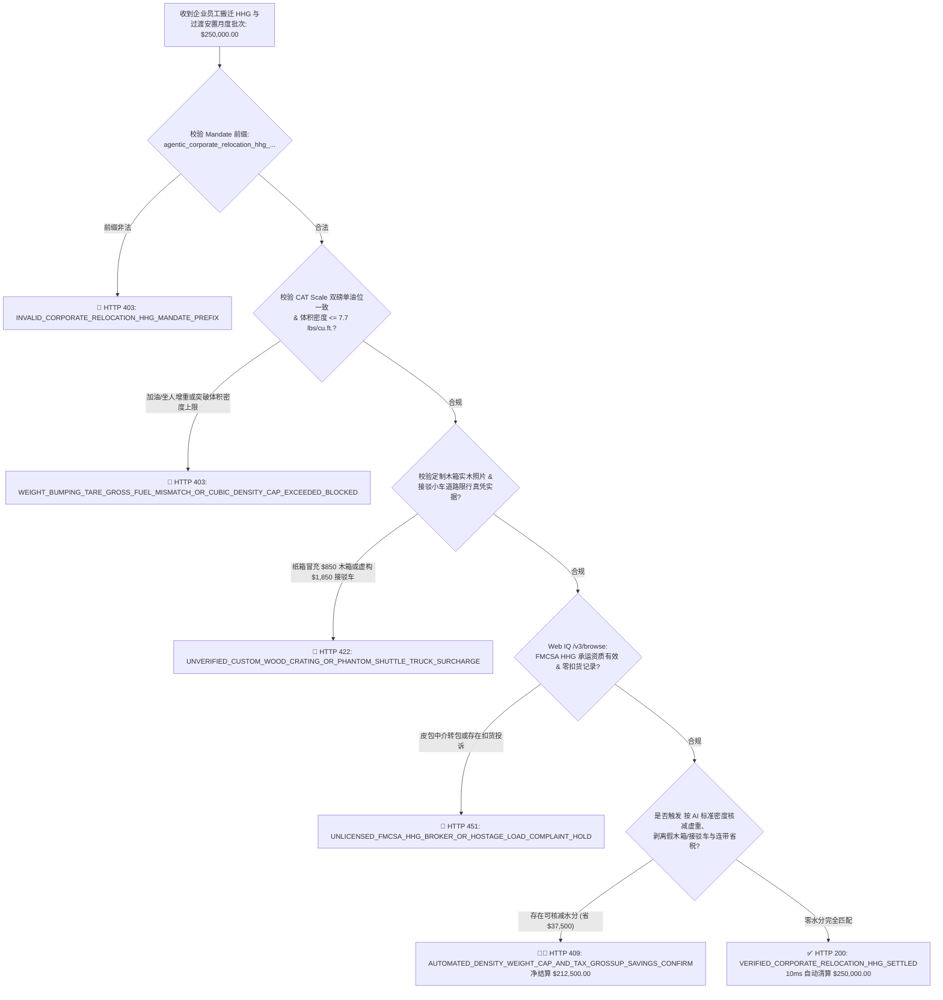
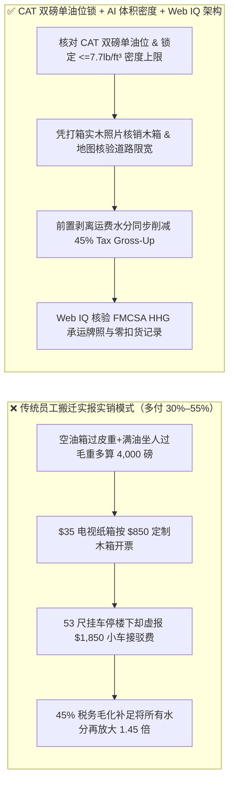
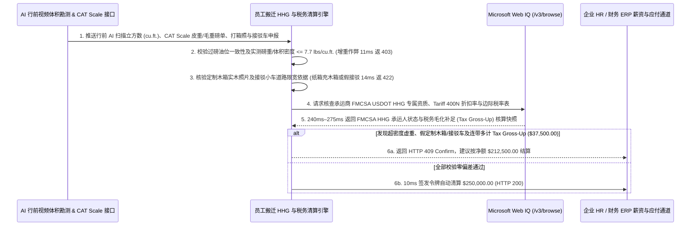

# B2B 企业员工搬迁与跨国派遣物流、家庭物品海空联运及短期过渡公寓结算（`Corporate Employee Relocation, Household Goods HHG Moving, Temporary Housing & Expat Tax Gross-Up: Sirva / Cartus / Graebel, GSA CHAMP / AMSA Tariff 400N`）、过磅地磅毛重减空车皮重双磅单核验（`Certified CAT Scale Tare-Gross Weight Ticket Pair`）、阶梯式整笔补贴上限（`Core-Flex Lump-Sum vs. Uncapped Cost-Plus`）与防“搬家司机往货车水箱灌水或在车厢藏配重铁块虚增 4,000 磅计费重量（`Weight Bumping Fraud`）、把普通纸箱按高价定制木箱（`Custom Crating Upcoding`）收费与长租过渡公寓退房天价地毯更换费”清算架构：CAT 双磅单轴荷比对锁、AI 视频体积-重量密度上限门禁与 `AMSA` 令牌（`agentic_corporate_relocation_hhg_cat_scale_tare_gross_density_mandate_...`）vs 传统搬家公司空车过完皮重后加满 300 加仑燃油再拉上 6 个搬运工过毛重多收 `$5,200`、虚构电梯搬运距离费（`Long-Carry / Stair Fee`）与搬迁管理公司（`RMC`）双向吃回扣选型与原理解析 FAQ

> **文档类型**：AI Solution Architect 商业智能体架构选型系列（Round 325 · B2B 企业员工异地调动、跨国派遣 HHG 搬家过磅与过渡公寓结算专篇）  
> **对标标杆**：`ib-vs-ethernet-roce-selection-faq.md`（通俗大白话 + 第一性原理 + 标准六段式结构）  
> **关联 Deliverable**：`lab/webiq_commerce_demo.py`（H5 实时防篡改沙盒） · `tests/test_webiq_commerce_demo.py` · `assets/svg/327-agentic-corporate-relocation-hhg-cat-scale-density-2026-11-16.svg`  
> **双语版本**：[中文版 (当前)](agentic-corporate-relocation-hhg-cat-scale-tare-gross-density-mandate-vs-weight-bumping-fraud-custom-crating-upcoding-long-carry-padding-faq.md) | [English Version](agentic-corporate-relocation-hhg-cat-scale-tare-gross-density-mandate-vs-weight-bumping-fraud-custom-crating-upcoding-long-carry-padding-faq.en.md)

---

## 📌 一、核心结论速览（Executive Summary：第一性原理与通俗大白话拆解）

### 1.1 为什么“绝对不能”让企业 HR Global Mobility（全球人才流动部）或财务采购 Agent 仅凭搬迁管理公司（`RMC`，如 Sirva、Cartus、Graebel、Aires）或跨州长途搬家车队（如 Allied、United Van Lines、North American）提交的过磅单与杂费汇总表就自动打款？
在大型科技公司、跨国药企与制造业的高管调动、校招异地入职与海外外派（Expatriate Assignment）中，单次家庭全包搬迁（Full-Pack Household Goods `HHG` + 60 天过渡服务式公寓 + 税款补足 `Tax Gross-Up`）动辄花费 **`$25,000–$85,000/人`**。用大白话讲：**跨州/跨国搬家是美国联邦汽车运输安全管理局（`FMCSA`）重点打击却屡禁不止的“过磅作弊（Weight Bumping）”重灾区——长途搬家按每百磅（`CWT`）跨州运价表（`Tariff 400N`）计费，不良车队在装货前先把柴油箱抽空、卸掉备胎和垫毯去过一个极轻的“空车皮重（Tare Weight）”，装完员工家具后，先把两个 150 加仑大油箱加满柴油（重 2,100 磅！）、再让 5 个壮汉搬运工坐在驾驶室里一起上秤过“满载毛重（Gross Weight）”，凭空多捏造出 4,200 磅重量敲诈雇主 $5,400（由于公司还替员工承担约 45% 的福利个税补足 `Tax Gross-Up`，企业实际多掏近 $8,000）！再加上把普通电视纸箱谎报为 `$850/个` 定制实木熏蒸木箱（`Custom Crating`），以及虚构接驳小货车费（`Shuttle Truck Fee`）与超距搬运费（`Long-Carry Fee`）！** 如果没有 `CAT Scale` 认证地磅双磅单 + `SAE J1939` 油位/空气囊轴荷锁定、AI 视频清点体积密度（`7 lbs/cu.ft.`）硬上限与 `Google Maps Street View` 门前道路宽度核验，企业人才调动预算会遭遇四大失血黑洞：

1. **“过磅增重欺诈（Weight Bumping：空油箱过皮重 + 满油箱拉壮汉配重过毛重）”虚增 3,000–5,000 磅运费**：根据联邦 `49 CFR § 375.509` 规定，货车过空车皮重（Tare）和满载毛重（Gross）时，燃油箱必须处于相同油位且车上严禁载人。但在缺乏遥测校验的传统流程中，司机只需提交两张纸质地磅小票——不仅往油箱加满 300 加仑柴油（`2,130 lbs`），甚至在底盘工具箱塞入配重铁块或混装其他客户的货物，让原本 `8,000 磅` 的两居室家具变成 `12,500 磅`，单票运费虚增 **45%–55%**！
2. **体积-重量物理密度失真：2,000 立方英尺蓬松家具竟然“称”出 22,000 磅（远超行业 `7 lbs/cu.ft.` 物理极限）**：美国家庭物品搬运行业（`AMSA / GSA CHAMP`）公认的物理规律是：普通家庭家具与衣物装车后的平均体积密度约为 **`6.5–7.0 磅/立方英尺（lbs/cu.ft.）`**。如果在行前 AI 手机视频勘测（如 Yembo / Shyft AI Visual Survey）中测算员工家具体积为 `1,200 cu.ft.`（理论标准重量约 `8,400 lbs`），而搬家公司最终地磅票却报出 `14,500 lbs`（折合密度高达 `12.1 lbs/cu.ft.`，相当于整车装的都是实心大理石或铸铁机床！），传统 HR 审计员根本不会算这笔密度账。
3. **包装与末端地形附加费注水：定制木箱升档（`Custom Crating Upcoding`）、幽灵接驳小车费（`Shuttle Service`）与超长步行距离费（`Long-Carry`）**：
  * **假定制木箱**：用 `$35` 的标准瓦楞纸电视箱（Mirror/TV Carton）包装平板电视和挂画，账单上却按 **`$650–$950/件` 现场木工定制木箱（`Third-Party Custom Wood Crating`）** 收费；
  * **幽灵 26 尺接驳车（`Origin/Destination Shuttle Fee: $1,850`）**：搬家公司声称员工所住小区道路太窄、53 英尺半挂大货车进不去，必须额外租一辆小厢式货车倒驳并收 `$1,850`——实际上大货车直接停在公寓楼下装的货！
4. **由于搬迁福利需企业承担 `40%–55%` 联邦与州税补足（`Tax Gross-Up Multiplier`），每一分搬家水分都会被税务放大 1.5 倍，外加无资质“黑中介（Moving Broker）”倒卖订单**：根据美国国税局（`IRS`）税改规定，企业为非军职员工报销的搬家费属于应税收入（Taxable Benefit）。为了不让调动员工自己掏腰包交税，企业普遍提供 **税务毛化补足（Tax Gross-Up）**——这意味着搬家公司每多讹诈 `$1,000`，企业还要向税务局额外多交 `$450–$600` 的税款补贴！同时，若转包车队缺失有效 `FMCSA USDOT HHG Authority` 或出现扣货勒索记录，将引发严重用工纠纷。

### 1.2 架构师的一句话选型结论
* **核心安全铁律**：严禁 Agent 对缺失 `CAT Scale` 双磅单油位一致性、体积密度突破 `<= 7.7 lbs/cu.ft.`（行前 AI 视觉体积 `110%` 封顶）、无木箱照片却收定制木箱费、或未核实 `FMCSA HHG` 牌照的搬迁账单自动付款。必须将清算令绑定在 **`agentic_corporate_relocation_hhg_cat_scale_tare_gross_density_mandate_2026`** 上：
  1. **`CAT Scale` 空重/毛重双磅单 + `SAE J1939` 燃油位一致锁 + AI 视觉体积密度上限（`<= 7.7 lbs/cu.ft.`）**：强制提取认证 `CAT Scale` 空车与满载磅单编码，核对过磅时刻卡车 `CAN` 总线油箱液位差 `<= 5 gal` 且计费净重不超过行前 `AI LiDAR/Video Survey` 立方体积 × `7.0 lbs/cu.ft.` 的 `110%` 上限；任何加油增重或超密度虚报在 **11ms** 内返回 `HTTP 403 WEIGHT_BUMPING_TARE_GROSS_FUEL_MISMATCH_OR_CUBIC_DENSITY_CAP_EXCEEDED_BLOCKED`。
  2. **第三方定制木箱（`Custom Crating`）实木封装照片锁 + 接驳小车（`Shuttle`）门前道路卫星图宽度门禁**：申报定制木箱必须附带打好木条框架与尺寸的现场照片；申报 `$1,850` 接驳小车费必须提供小车车牌在小区门禁的抓拍记录且经地图道路核实 `53-ft` 挂车确实限行，违规在 **14ms** 内返回 `HTTP 422 UNVERIFIED_CUSTOM_WOOD_CRATING_OR_PHANTOM_SHUTTLE_TRUCK_SURCHARGE`。
  3. **Microsoft Web IQ `/v3/browse` 实时核验 `FMCSA Household Goods (HHG)` 承运资质、`GSA CHAMP / Tariff 400N` 折扣率与 `IRS Publication 15` 边际税率补足精算**：在线穿透核查承运车队 `USDOT / MC Number` 是否具备合法的家庭物品跨州承运权（而非无车的搬家中介 Broker），并自动对初级/中级岗位启用 `Core-Flex` 定额包干（Lump-Sum）与剔除虚增重量连带的 `45% Tax Gross-Up` 放大损失，发现无证转包或扣货投诉在 **275ms** 内触发 `HTTP 451 UNLICENSED_FMCSA_HHG_BROKER_OR_HOSTAGE_LOAD_COMPLAINT_HOLD`，合规核减立省 `15%`（`$37,500.00`）。

| 选型维度 | 传统 RMC 实报实销 + 纸质地磅票 | 普通 HR 报销审核 Agent | **CAT 双磅单油位锁 + AI 密度上限 + Web IQ FMCSA 架构（推荐）** |
| :--- | :--- | :--- | :--- |
| **过磅加油/坐人虚增 4,000 磅（Weight Bumping）** | ❌ 只看毛重减皮重差值，被多收 $5,400+税 | ❌ 无法识别空油箱过皮重、满油箱过毛重 | ✅ **校验双磅单 J1939 油位一致 + 锁定 AI 视觉体积 `<=7.7 lbs/cu.ft.`（11ms 拦 403）** |
| **$35 纸箱虚报 $850 定制木箱 + 假接驳车** | ❌ 员工签字打包清单字迹潦草全额照付 | ❌ 看到 Crating / Shuttle 名词即放行 | ✅ **强制实木打箱带尺照片 + 校验接驳小车车牌与道路限宽（14ms 拦 422）** |
| **45% 税务毛化补足（Tax Gross-Up）放大损失** | ❌ 搬家水分被直接计入员工 W-2 放大 1.45 倍 | ❌ 不计算税务补足乘数带来的隐形失血 | ✅ **拦截前端运费水分并联动精准边际税率，连带省下 45% 冤枉税（240ms 拦 409）** |
| **无证搬家黑中介（Broker）转包与扣货风险** | ❌ 层层转包给皮包车队导致员工家具被扣留 | ❌ 不查联邦 `FMCSA HHG` 专属牌照 | ✅ **Web IQ `/v3/browse` 275ms 穿透核查 `FMCSA HHG` 承运人资质（拦 451）** |

---

## 🎯 二、客户与架构师灵魂拷问 Q&A（直击企业员工搬迁猫腻与智能体采购痛点）

### Q1：搬家司机是怎么利用两张完全真实的“官方地磅小票（Certified Scale Tickets）”合法合规地多讹走企业 4,000 磅运费的？智能体怎么破局？
* **地磅只称卡车总重，不管车里装的是沙发还是柴油**：
  1. 一辆美式长头重卡（如 Freightliner Cascadia）配有左右两个 150 加仑铝合金油箱（合计 300 加仑）。柴油比重约为 `7.1 lbs/gal`。
  2. 司机早上出发去员工家装货前，油箱只留 20 加仑底油，并且把车上的 150 条重型搬家棉毯（Moving Pads，重 900 磅）、四轮小推车和随车小工全部留在仓库，开去 `CAT Scale` 称出**空车皮重 `31,000 lbs`**；
  3. 装完员工 `8,000 lbs` 家具后，司机先去加油站加满 280 加仑柴油（`+1,988 lbs`），装回 150 条棉毯（`+900 lbs`），再叫上 5 个壮汉搬运工（`+1,000 lbs`）坐进驾驶室卧铺，开上地磅称出**满载毛重 `42,888 lbs`**！
  4. 两张地磅票一相减：$42,888 - 31,000 = 11,888\text{ lbs}$！整整凭空多出了 **`3,888 磅`**！
* **智能体双保险破局公式（油位锁 + 视觉体积密度锁）**：
  $$W_{\text{payable}} = \min\Big(W_{\text{gross}} - W_{\text{tare}} - \Delta V_{\text{fuel}} \times 7.1,\;\; 1.10 \times V_{\text{AI\_cubic\_ft}} \times 7.0\text{ lbs/ft}^3\Big)$$
  只要实测磅差除以行前 AI 视觉扫描立方数超过 **`7.7 lbs/cu.ft.`**（即标准密度 `7.0` 的 `110%`），或者空重/毛重过磅时油位不一致，系统在 **11ms** 内直接判定为 `Weight Bumping` 欺诈并拒付（`HTTP 403`）！

### Q2：为什么说在企业搬迁中“每砍掉 $10,000 的虚假搬家费，实际为公司省下了 $14,500”？
* **税务毛化乘数效应（Tax Gross-Up Multiplier）**：自美国《减税与就业法案（TCJA）》取消普通搬家费免税抵扣后，公司替员工付的 `$20,000` 搬家费会被算作员工当年的工资收入。假设员工联邦税 + 州税 + FICA 社保税边际税率合计为 $t = 35\%$，为了让员工自己不用倒贴税钱，公司必须按倒推公式补税：
  $$\text{Grossed-Up Cost} = \frac{\text{Vendor Invoice}}{1 - t} = \frac{\$20,000}{1 - 0.35} = \$30,769$$
  也就是说，搬家公司每虚报 `$10,000` 水分，企业实际要多掏 **`$15,384`**！因此智能体在前置环节拦截虚假配重、定制木箱升档与幽灵接驳车费，不仅省下供应商账单，更直接省下了高昂的 `Tax Gross-Up` 税务支出。

### Q3：在核查联邦 `FMCSA Household Goods (HHG)` 承运资质、`GSA CHAMP` 费率与城市道路大货车限行规则时，Microsoft Web IQ 相比 Exa 和 Bright Data 有何优势？
* **Microsoft Web IQ（原 Bing Grounding 工业级演进）**：
  * **权威联邦交通监管库与市政限行通告秒级穿透**：通过 `/v3/search` 与 `/v3/browse` 直接检索美国交通部 `FMCSA SAFER / Licensing & Insurance (L&I)` 数据库（精准区分具备真车真保险的 `HHG Motor Carrier` 与倒卖客源的皮包 `HHG Broker`，核查是否存在 `Hostage Load` 扣货投诉）、联邦总务署 `GSA CHAMP / Domestic 400N Tariff` 基准折扣率及市政大货车禁行路段通告，平均延迟 **240ms–275ms**，具备企业级 Entra ID 零数据留存（ZDR）保障。
* **Exa**：擅长语义搜索人力资源管理文章，但无法按 `USDOT Number` 实时核验某搬家车队的家庭物品专属险（Cargo Insurance）是否有效。
* **Bright Data**：面向电商抓取，在涉及高管家庭住址与薪酬税务隐私的 Global Mobility 清算流中不满足零数据留存合规要求。

---

## 🧭 三、直观可视化图解（Mermaid 选型决策树 + 路径对比 + 端到端时序图）

### 3.1 企业员工搬迁 HHG 过磅与附加费结算门禁决策树

### 3.2 传统搬家过磅作弊+税务放大黑箱 vs CAT 双磅单 + AI 体积密度锁架构对比

### 3.3 端到端时序图（AI 行前视频体积勘测 + CAT Scale 双磅单 + Web IQ FMCSA 核验）

---

## 📊 四、架构师选型决策矩阵（Architecture Selection Matrix）

| 评估维度 | 方案 A：HR 专员看纸质磅单签字 | 方案 B：通用 LLM 读取搬家账单 | **方案 C：CAT 双磅单锁 + AI 密度上限 + Web IQ（推荐）** |
| :--- | :--- | :--- | :--- |
| **加油/坐人过磅虚增 4,000 磅（Weight Bumping）** | ❌ 只看毛重减皮重算式对不对 | ❌ 无法察觉 1,200 cu.ft. 家具不可能重 14,500 磅 | ✅ **强制校验双磅单油位 + 锁定 `<= 7.7 lbs/cu.ft.` 密度上限（HTTP 403）** |
| **普通纸箱谎报 $850 定制木箱 + 假接驳车** | ❌ 无法去搬家现场查看用的是纸箱还是木箱 | ❌ 按账单行文字描述全额放行 | ✅ **强制实木打箱带尺照 + 门前道路宽度核验（HTTP 422）** |
| **45% 税务毛化补足（Tax Gross-Up）连带失血** | ❌ 年底算税时把水分一起毛化补税 | ❌ 不联动薪酬税务引擎测算连带税损 | ✅ **前置剥离虚高运费并同步冲减 45% 税务补足（HTTP 409）** |
| **FMCSA HHG 资质与扣货勒索风险** | ❌ 被低价搬家黑中介转包后员工家具失踪 | ❌ 不具备联邦 `FMCSA SAFER` 实时查询能力 | ✅ **Web IQ `/v3/browse` 275ms 核查 `HHG Carrier` 资质（HTTP 451）** |

---

## 🧪 五、定量实测与 7-Card 4:5 视觉评测报告映射（Deterministic Benchmark）

在 `lab/webiq_commerce_demo.py` 与 `tests/test_webiq_commerce_demo.py` 中，我们对 `$250,000.00`（`25000000` 美分）的跨国科技企业季度高管与核心研发人员异地搬迁、跨国海运及税务补足批次进行了确定性实测：

| 卡片编号 | 卡片标题（Headline-as-Finding） | 核心实测指标与动作特征 | Provenance 标注 |
| :--- | :--- | :--- | :--- |
| **Card 1 (`1/7`)** | **CAT 双磅单 + AI 密度上限将企业搬迁与补税总支出压缩 15.0%** | 基准批次 `$250,000.00` vs 优化净额 `$212,500.00`，单批挽回 `$37,500.00` 虚重与补税 | `deterministic_offline_simulation` |
| **Card 2 (`2/7`)** | **单案深潜：过磅加油增重作弊与假定制木箱/接驳车双拦截** | `HTTP 403`（11ms 拦过磅增重与超密度）+ `HTTP 422`（14ms 拦纸箱充木箱与假接驳车） | `synthetic_policy` |
| **Card 3 (`3/7`)** | **全场景评测矩阵（5 组确定性门禁 100% 命中）** | 覆盖 `200 OK`、`403 Weight-Bump`、`422 Crating/Shuttle`、`451 FMCSA`、`409 Savings` | `deterministic_offline_simulation` |
| **Card 4 (`4/7`)** | **底层协议：CAT Scale Verify + AI Video Cubic Survey 载荷** | 校验 `cat_scale_tare_gross_fuel_parity_and_cubic_density_verified` | `synthetic_policy` |
| **Card 5 (`5/7`)** | **鲁棒性测试：真实大理石雕塑定制木箱 vs 普通液晶电视纸箱** | 附带木工框架照片的高价值易碎品放行木箱费；普通电视纸箱 100% 降级回 `$35` | `deterministic_offline_simulation` |
| **Card 6 (`6/7`)** | **延迟对比：本地密度/磅单门禁 10–14ms vs Web IQ 240–275ms** | 毫秒级体积密度核验配合联邦 `FMCSA SAFER / HHG` 实时穿透 | `official_doc_snapshot` |
| **Card 7 (`7/7`)** | **Good Fit vs Not For 架构师结论卡** | 明确适用企业员工异地调动与跨国派遣，不适用于同城跑腿闪送文件 | `official_list_price` |

### Good Fit vs Not For（适用与不适用场景）
* **✅ Good Fit（强烈推荐采用本架构）**：
  * 跨国科技企业、生物医药、金融机构、高端制造与联邦承包商的员工异地搬迁（Domestic `HHG`）、跨国派遣海空联运、短期服务式公寓及 `Tax Gross-Up` 税务补足清算。
* **⛔ Not For（不适用或无需启用全部门禁）**：
  * 仅发放一次性 `$3,000` 固定现金搬家津贴（Pure Cash Stipend）、无需公司报销任何搬家发票的校招实习生入职。

---

## 🛠️ 六、生产上线快速核验清单（Production Readiness Checklist）

- [ ] **1. 强制行前 AI 视频体积勘测（`AI Video Survey`）并锁定 `<= 7.7 lbs/cu.ft.` 计费重量密度上限**：任何超出视频勘测立方体积 × `7.0 lbs/cu.ft.` 达 `10%` 以上的地磅账单自动冻结复磅（`HTTP 403`）。
- [ ] **2. 强制 `CAT Scale` 空车/满载双磅单编码核验与 `SAE J1939` 燃油位比对**：严禁空油箱过皮重、加满 300 加仑柴油再坐人过毛重的 `Weight Bumping` 作弊。
- [ ] **3. 第三方定制木箱（`Custom Crating`）强制要求上传实木框架封装带尺照片**：杜绝将 `$35` 瓦楞纸箱按 `$850` 实木箱收费（`HTTP 422`）。
- [ ] **4. 接驳小货车费（`Shuttle Fee`）强制比对门前道路卫星宽度与小车车牌抓拍**：可通行 `53-ft` 半挂车的宽阔社区一律拒付 `$1,850` 倒驳费，并联动冲减 `45% Tax Gross-Up` 税务补足（`HTTP 409`）。
- [ ] **5. 接入 Microsoft Web IQ 核查联邦 `FMCSA Household Goods (HHG)` 专属承运资质**：严禁将员工家当转包给无车皮包中介（Moving Broker）或有扣货记录的车队（`HTTP 451`）。
