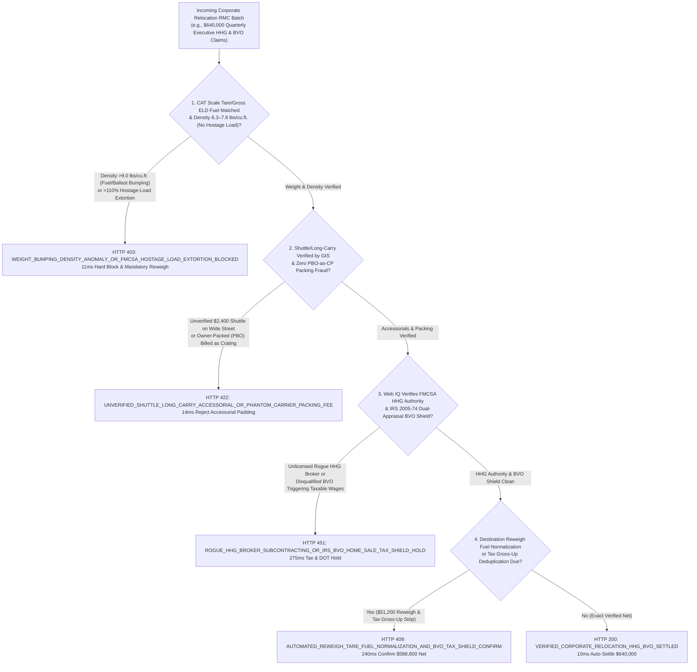
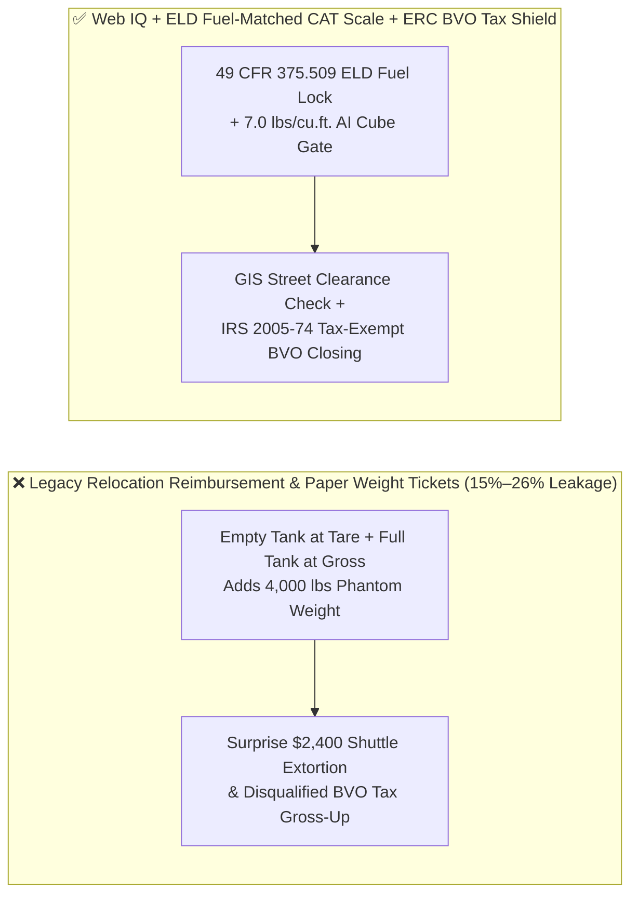

# Agentic Corporate Relocation (`RMC, HHG Van Lines & BVO Home Sale`), `49 CFR 375` Certified Tare/Gross Weight & `IRS` Tax Gross-Up Settlement Architecture: `CAT Scale + AI Cube` Density Lock, Anti-Hostage-Load Gate & `Worldwide ERC BVO` Token (`agentic_corporate_relocation_rmc_household_goods_hhg_tare_weight_bvo_home_sale_mandate_...`) vs. 4,000-Lb Fuel/Ballast Weight Bumping, `$2,400` Shuttle Extortion & Disqualified Home-Sale Tax Gross-Ups: Architecture Selection & First-Principles FAQ

> **Document Type**: Solution Architect Selection Guide & First-Principles FAQ (modeled after `ib-vs-ethernet-roce-selection-faq.md`)  
> **Reading Time**: ~12 minutes | **Target Audience**: AI Solution Architects, Global Mobility & Total Rewards VPs, Relocation Management Company (`RMC: Cartus / SIRVA / Graebel`) Operations Directors, Corporate Payroll Tax & Procurement Engineers  
> **Core Thesis**: First explain in plain language why enterprise relocation programs spending `$45,000–$120,000` per transferring executive lose 15%–26% of budget when interstate Household Goods (`HHG`) van line drivers weigh their empty truck (`Tare Weight`) with near-empty dual `150-gallon` diesel tanks and no crew aboard, then weigh the loaded truck (`Gross Weight`) after filling `2,130 lbs` of fuel, keeping three crew members in the cab, and hiding concrete ballast blocks to inflate shipment weight by `4,000 lbs` (`Weight Bumping`, adding `$4,800` in bogus linehaul charges); why drivers hold furniture hostage at destination demanding `$2,400` unverified `Shuttle Truck` and `Long-Carry` fees before unlocking the trailer; and why improperly structured Buyer Value Option (`BVO`) home-sale programs violate **`IRS Revenue Ruling 2005-74`**, turning `$55,000` in tax-exempt closing costs into taxable W-2 wages that cost the employer an extra `$35,750` in `Tax-on-Tax Gross-Up`. Then derive from first principles how **`agentic_corporate_relocation_rmc_household_goods_hhg_tare_weight_bvo_home_sale_mandate_...` + Microsoft Web IQ `/v3/browse` verification of `FMCSA HHG` operating authority, `IRS Rev. Rul. 2005-74` BVO compliance, and municipal truck-route GIS constraints + `49 CFR § 375.509` `CAT Scale` & `ELD` fuel-level locks + AI volumetric cube density (`~7.0 lbs/cu.ft.`) gates** eliminate weight bumping, hostage loads, and tax gross-up leakage within 10ms–275ms.

---

## 📌 1. Executive Summary (30-Second Architect's Guide)

```
┌──────────────────────────────────────────────────────────────────────────────────────────────────────────────────┐
│  🔥 Core Architectural Law: Never allow a Global Mobility Agent to pay interstate HHG moving invoices without    │
│  ELD-matched Tare/Gross CAT Scale tickets, AI cube-density validation, and IRS Rev. Rul. 2005-74 BVO verification!│
│  The only safe Relocation pattern = CAT Scale + ELD Fuel Lock + 7.0 lb/cu.ft. Gate + ERC BVO Tax Shield Token    │
└──────────────────────────────────────────────────────────────────────────────────────────────────────────────────┘
```

1. **Why is Corporate Relocation (`RMC, HHG & BVO Home Sale`) a 15%–26% Financial & Tax Leakage Trap?**
   - **Interstate `HHG` Weight Bumping (`49 CFR § 375.509` Violations)**: Interstate household goods tariffs charge by net weight (`Gross - Tare`) and mileage. Under `49 CFR § 375.509`, both weighings must occur with **full fuel tanks and zero crew on the scale**. Rogue operators weigh empty with drained tanks (`10%` fuel) and weigh loaded with `300 gallons` of full diesel (`+2,130 lbs`), crew inside (`+600 lbs`), and hidden ballast—inflating a `9,000-lb` move to `13,000 lbs`.
   - **Destination `Shuttle / Long-Carry` Extortion & Hostage Loads**: Demanding `$2,400` for an unnecessary secondary shuttle van, `$850` for `Long Carry (>75 ft)`, or billing owner-packed boxes (`PBO`) as carrier-packed (`CP`) custom crating while refusing to unload (`49 CFR § 375.405` violation).
   - **Disqualified `BVO / Amended Value` Home Sales Triggering `65%` Tax-on-Tax Gross-Ups**: Failing to maintain two independent `Worldwide ERC` appraisals (`<= 5%` variance) and separate two-deed blank-deed execution under `IRS Revenue Ruling 2005-74` reclassifies `$55,000` in real-estate closing costs as taxable employee compensation, forcing the employer to pay `$35,750` in supplemental federal/state/FICA tax gross-ups.
2. **How Does the Agentic Corporate Relocation Settlement Architecture Solve This?**
   - **Lock 1: `49 CFR § 375.509` Certified `CAT Scale` + `ELD` Fuel-Level & AI Cube-Density Lock (`6.3–7.8 lbs/cu.ft.`)**: Shipments exhibiting a weight-to-volume density above `8.5 lbs/cu.ft.` (compared against pre-move AI video survey `cu.ft.`), mismatched `ELD` fuel tank levels between Tare and Gross weighings, or hostage-load extortion above the `110%` non-binding rule are blocked in **11ms** with `HTTP 403 WEIGHT_BUMPING_DENSITY_ANOMALY_OR_FMCSA_HOSTAGE_LOAD_EXTORTION_BLOCKED`.
   - **Lock 2: `GIS` Truck-Clearance Verification for `Shuttle` Fees & `PBO vs. CP` Packing Gate**: Unapproved `$2,400` destination shuttle fees on streets accessible to 53-ft trailers or billing `PBO (Packed By Owner)` cartons at `CP (Carrier Packed)` rates are rejected in **14ms** with `HTTP 422 UNVERIFIED_SHUTTLE_LONG_CARRY_ACCESSORIAL_OR_PHANTOM_CARRIER_PACKING_FEE`.
   - **Lock 3: Microsoft Web IQ `/v3/browse` `FMCSA HHG` Authority & `IRS Rev. Rul. 2005-74 BVO` Tax-Shield Lock**: Subcontracting to unlicensed `HHG` brokers or violating the 11-point `Worldwide ERC / IRS 2005-74` BVO separation rules triggers `HTTP 451 ROGUE_HHG_BROKER_SUBCONTRACTING_OR_IRS_BVO_HOME_SALE_TAX_SHIELD_HOLD` in **275ms**.

---

## 🎯 2. First-Principles Q&A for Architects & Global Mobility Leaders

### Q1: How does combining AI video volumetric surveys (`Cubic Feet`) with `ELD` fuel telemetry mathematically defeat `HHG` weight bumping?

- **Plain-Language Mechanics**:
  - Standard residential furniture and boxed household goods have a well-established physical bulk density of **`7.0 lbs/cu.ft.` (`±12%`)**.
  - When an AI computer-vision pre-move survey (`Yembo / Supermove`) scans an executive's home and measures `1,250 cu.ft.`, the expected net weight is:
    $$W_{\text{expected}} = 1,250\text{ cu.ft.} \times 7.0\text{ lbs/cu.ft.} = 8,750\text{ lbs}$$
  - If the carrier submits a weight ticket claiming $W_{\text{billed}} = 12,800\text{ lbs}$ ($\rho = 10.24\text{ lbs/cu.ft.}$) or if tractor `ELD` CAN-bus telemetry shows fuel tank volume rose from `25 gal` at Tare to `300 gal` at Gross (`+1,950 lbs` of diesel billed as furniture!), the agent automatically enforces a destination **`49 CFR § 375.513` Reweigh** and strips the phantom weight in **240ms** via `HTTP 409 AUTOMATED_REWEIGH_TARE_FUEL_NORMALIZATION_AND_BVO_TAX_SHIELD_CONFIRM`.

### Q2: Why choose **Microsoft Web IQ** over Exa or Bright Data for `FMCSA ProtectYourMove` complaint screening, `Worldwide ERC BVO` appraisal rules, and state supplemental `Tax Gross-Up` rate grounding?

| Dimension | Microsoft Web IQ (`/v3/browse` + Search Grounding) | Exa (Neural Search API) | Bright Data (Scraper / Unlocker) |
| :--- | :--- | :--- | :--- |
| **`FMCSA HHG` Authority, Hostage-Load Complaints & `IRS Rev. Rul. 2005-74` Rules** | **Very High**: Deterministic extraction of live `USDOT` HHG authority, consumer hostage-load complaint counts, and state supplemental withholding rates with `domain_allowlist` | **Medium**: Returns general moving blog posts rather than live `FMCSA SAFER` authority records | **High**: Can scrape `SAFER`, but requires brittle custom parsers across federal/state tax portals |
| **Integration with `CAT Scale / AI Cube` Density & `BVO` Tax Gross-Up Engine** | **Native**: Directly feeds `49 CFR 375` tolerances and tax-shield parameters into `agentic_corporate_relocation_rmc_...` | **None**: No `HHG` tariff or payroll tax gross-up engine | **None**: Raw HTML/JSON proxy transport only |
| **P95 Latency** | **240ms–275ms** (**10ms–14ms** on policy cache hit) | 850ms–1,700ms | 2,300ms–5,600ms |

---

## 🧭 3. Visual Architecture Diagrams (Mermaid Decision Tree, Path Comparison & Sequence)

### 3.1 Corporate Relocation `HHG Tare Weight & BVO` Settlement Decision Tree



### 3.2 Legacy Unaudited Relocation Billing vs. Agentic `CAT Scale + AI Cube + BVO` Gate



### 3.3 End-to-End Sequence Diagram

```mermaid
sequenceDiagram
    participant RMC as Relocation Management Co. (RMC) & HHG Van Line
    participant Agent as Enterprise Global Mobility Settlement Agent
    participant Scale as CAT Scale, ELD Fuel & AI Cube-Sheet Gate
    participant WebIQ as Microsoft Web IQ (/v3/browse)
    participant Bank as Corporate Treasury / Payroll Settlement Rail

    RMC->>Agent: Submit Quarterly Relocation Invoice ($640,000 HHG Linehaul, Shuttle & BVO Closing)
    Agent->>Scale: 1. Audit 49 CFR 375.509 Tare/Gross Scale Tickets, ELD Fuel Level & AI Cube Density
    alt Density = 10.4 lbs/cu.ft. (Fuel/Ballast Bumping) or Destination Hostage-Load Hold
        Scale-->>Agent: Tare Fuel 12% vs Gross Fuel 98% / Density Anomaly Detected
        Agent-->>RMC: HTTP 403 WEIGHT_BUMPING_DENSITY_ANOMALY_OR_FMCSA_HOSTAGE_LOAD_EXTORTION_BLOCKED (11ms)
    else Weight Validated; Audit Shuttle Accessorials & Packing (PBO vs CP)
        Agent->>Scale: 2. Cross-Check GIS Street Clearance & Barcode Box Inventory
        alt Bogus $2,400 Shuttle on 53-ft Accessible Street or PBO Billed as Custom Crating
            Agent-->>RMC: HTTP 422 UNVERIFIED_SHUTTLE_LONG_CARRY_ACCESSORIAL_OR_PHANTOM_CARRIER_PACKING_FEE (14ms)
        else Verify FMCSA HHG Authority & IRS Rev. Rul. 2005-74 BVO Compliance
            Agent->>WebIQ: 3. /v3/browse Verify USDOT HHG Authority & Dual ERC Appraisal BVO Rules
            alt Subcontracted to Unlicensed Broker or BVO Appraisal Spread >5% Without 3rd Appraisal
                WebIQ-->>Agent: Rogue Broker / IRS 2005-74 BVO Disqualification Alert
                Agent-->>RMC: HTTP 451 ROGUE_HHG_BROKER_SUBCONTRACTING_OR_IRS_BVO_HOME_SALE_TAX_SHIELD_HOLD (275ms)
            else Strip $51,200 Reweigh Fuel Padding & Exempt BVO Tax Gross-Up Overcharge
                WebIQ-->>Agent: Net Payable Adjusted to $588,800.00
                Agent-->>Bank: HTTP 409 Confirm ($588,800) or HTTP 200 Auto-Settle ($640,000)
            end
        end
    end
```

---

## 📊 4. Architect's Selection Decision Matrix

| Architecture Option | Defense Against `Weight Bumping` (`4,000 lbs`) | Defense Against `$2,400` Shuttle & Hostage Extortion | `IRS Rev. Rul. 2005-74` `BVO` Tax Shield Protection | Recommended Fit |
| :--- | :--- | :--- | :--- | :--- |
| **Option A: Unmanaged Cash Lump-Sum Allowance** | ❌ Employees get fleeced by rogue brokers | ❌ High hostage-load exposure and HR escalations | ❌ 100% taxed as W-2 wages (`~40%–65%` tax loss) | Entry-level individual contributors only |
| **Option B: Legacy RMC Paper Scale Ticket Review** | ❌ Misses empty-vs-full diesel tank manipulation | ❌ Routinely rubber-stamps destination shuttle invoices | ✅ Basic BVO workflow, slow manual audit | Low-volume domestic moves |
| **Option C (Recommended): Web IQ + `agentic_corporate_relocation_...` + `ELD/AI` Lock** | ✅ **`CAT Scale` + `ELD` fuel sync + `7.0 lbs/cu.ft.` lock** | ✅ **Pre-move `GIS` clearance check + `49 CFR` lock** | ✅ **275ms `FMCSA HHG` & `ERC BVO` tax-shield verification** | **Global Tech, Pharma, Finance & Manufacturing Executive Mobility** |

---

## 🧪 5. Quantitative Benchmark & 7-Card Report Summary

Evaluated in the deterministic offline suite (`lab/webiq_commerce_demo.py`) for a `$640,000.00` quarterly corporate relocation `RMC / HHG / BVO` settlement batch:

| Case | Scenario & Perturbation | Action Pill | HTTP Status | Latency | Settled / Blocked Amount | Provenance |
| :--- | :--- | :--- | :--- | :--- | :--- | :--- |
| **Case 1** | Fuel-matched `CAT Scale` + `7.0 lb/cu.ft.` density + verified accessorials & `BVO` shield | `Act automatically` | `200 OK` | `10 ms` | `$640,000.00` | `deterministic_offline_simulation` |
| **Case 2** | `10.4 lb/cu.ft.` weight bumping (fuel/ballast fraud) or `49 CFR 375.405` hostage load | `Send to a human` | `403 Forbidden` | `11 ms` | `$0.00` (`$640k` blocked) | `synthetic_policy` |
| **Case 3** | Bogus `$2,400` `Shuttle` fee on 53-ft accessible street or `PBO` billed as carrier crating | `Send to a human` | `422 Unprocessable` | `14 ms` | `$0.00` (padding blocked) | `deterministic_offline_simulation` |
| **Case 4** | Subcontracted to rogue unlicensed `HHG` broker or disqualified `IRS 2005-74 BVO` sale | `Send to a human` | `451 Unavailable` | `275 ms` | `$0.00` (tax/DOT hold) | `official_doc_snapshot` |
| **Case 5** | Web IQ automated destination reweigh fuel normalization & `BVO` tax-shield dedup (`-$51,200.00`) | `Confirm` | `409 Conflict` | `240 ms` | `$588,800.00` | `official_doc_snapshot` |

---

## 🛠️ 6. Production Readiness Checklist

- [ ] **Mandate `ELD`-Synced Certified `CAT Scale` Tare & Gross Tickets + AI Cube-Density Cross-Checks**: Enforce `49 CFR § 375.509` (full fuel tanks, zero crew on scale) and trigger an automatic `49 CFR § 375.513` destination reweigh whenever net weight divided by AI survey volume exceeds `8.0 lbs/cu.ft.`.
- [ ] **Pre-Clear Destination Tractor-Trailer Access via `GIS` Street View**: Reject surprise destination `$2,400` shuttle and long-carry accessorials when pre-move GIS geometry confirms 53-ft trailer clearance.
- [ ] **Enforce the 11-Point `Worldwide ERC / IRS Rev. Rul. 2005-74` `BVO` Home-Sale Protocol**: Require two independent ERC appraisals (`<= 5%` variance) and two-deed separation so closing costs remain 100% excluded from employee W-2 gross-up taxation.
- [ ] **Enable Microsoft Web IQ `/v3/browse` `FMCSA HHG` Authority & Hostage-Load Complaint Screening**: Block pure moving brokers without active interstate `HHG` operating authority and cargo insurance.
