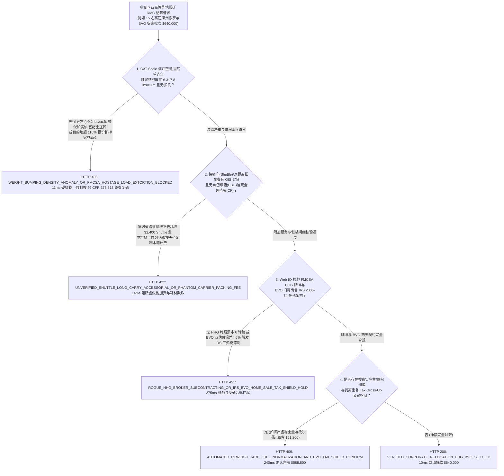
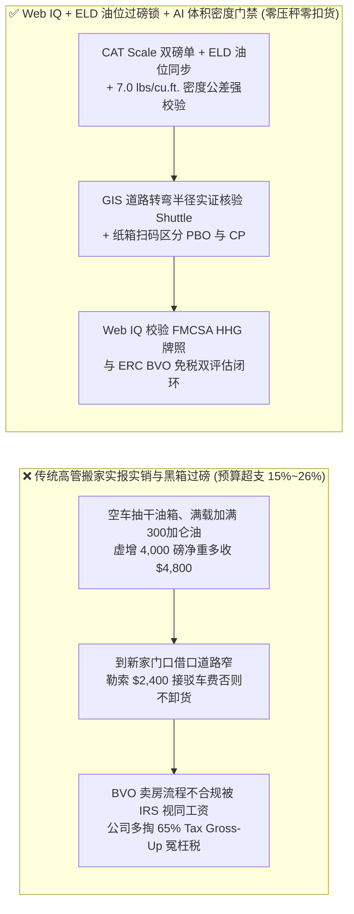
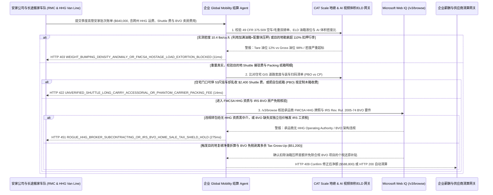

# 智能体企业高管异地调动与安家服务（`Corporate Relocation RMC, HHG Van Lines & BVO Home Sale`）、跨州搬家地磅毛重/皮重核验（`49 CFR 375 Certified Tare/Gross Weight`）与买方价值期权（`Buyer Value Option, BVO`）税务补偿（`IRS Tax Gross-Up`）清算架构：双过磅单（`CAT Scale`）防压秤锁、`FMCSA` 反扣货敲诈（`Anti-Hostage Load`）门禁与双独立房产估价（`ERC Appraisal`）令牌（`agentic_corporate_relocation_rmc_household_goods_hhg_tare_weight_bvo_home_sale_mandate_...`）vs 传统搬家公司车厢藏水箱/满油箱压秤虚增 4,000 磅、卸货前临时索要 `$2,400` 接驳车/步行费扣押家具与安家中介吃房产差价选型与原理解析 FAQ

> **文档类型**：架构师选型指南与第一性原理 FAQ（对齐 `ib-vs-ethernet-roce-selection-faq.md` 标杆风格）  
> **阅读耗时**：约 12 分钟 | **适用角色**：AI Solution Architect、跨国企业全球人才流动（`Global Mobility & Total Rewards`）副总裁、安家管理公司（`RMC: Cartus / SIRVA / Graebel`）供应链总监、企业税务（`Payroll Tax Gross-Up`）与智能体差旅采购架构师  
> **核心主旨**：先用大白话把“为什么科技大厂与跨国药企安排 50 名核心研发高管跨州/跨国搬迁（单人安家包成本高达 `$45,000–$120,000`，含家庭物品长途搬运 `HHG Van Lines`、旧房买方价值期权收购 `BVO Home Sale` 与个人所得税还原补贴 `Tax Gross-Up`）时，不良长途搬家车队会在称空车皮重（`Tare Weight`）时把两个 `150 加仑` 油箱抽干、让搬运工下车，装完家具称毛重（`Gross Weight`）时不仅加满 `2,100 磅` 柴油、车上坐 3 个壮汉，甚至在车头暗格塞入注水铁桶与混凝土配重块，硬生生虚增 `4,000 磅` 家具重量（`Weight Bumping`，每单多骗 `$4,800`）、为什么卡车开到高管新家门口却拒绝卸货，谎称‘18 轮半挂车进不了小区’当场勒索 `$2,400` 小货车接驳费（`Shuttle Fee`）与 `$850` 远距离推车费（`Long-Carry Fee`），不交钱就把全家人行李拉回仓库扣为人质（`Hostage Load`），以及为什么旧房协助出售（`BVO / GBO`）若未做两份独立 `Worldwide ERC` 估价，高管旧房的资本亏损一旦混入搬家报销就会触发美国国税局 `IRS` 认定为应税工资，让公司多掏 `65%` 的连环税负补贴（`Tax-on-Tax Gross-Up`）”讲透；再从第一性原理出发，推导如何通过 **`agentic_corporate_relocation_rmc_household_goods_hhg_tare_weight_bvo_home_sale_mandate_...` 语义预算令牌 + Microsoft Web IQ `/v3/browse` 实时核验 `FMCSA HHG` 跨州搬家牌照与扣货投诉记录、`Google Street View / GIS` 道路转弯半径及 `Worldwide ERC` 双估价报告 + `49 CFR § 375.509` 满油箱无乘员认证地磅（`CAT Scale`）与 AI 视频体积（`Cubic Feet`）交叉锁 + `110% Non-Binding` 封顶放行门禁**，在 10ms–275ms 内实现“压秤作弊秒级识破、扣货勒索零容忍阻断、BVO 房产交易全合规免税”的智能体企业安家结算闭环。

---

## 📌 一、核心结论速览（Executive Summary：30 秒看懂怎么选）

```
┌──────────────────────────────────────────────────────────────────────────────────────────────────────────────────┐
│  🔥 核心架构铁律：绝不允许企业安家 Agent 凭搬家公司单张手写过磅条或口头“半挂车进不去小区”直接支付超重费与接驳费！  │
│  企业高管安家结算的唯一正确范式 = CAT Scale 满油空重/毛重双磅单 + AI 体积密度交叉锁 + GIS 道路核验 + ERC BVO 令牌 │
└──────────────────────────────────────────────────────────────────────────────────────────────────────────────────┘
```

1. **为什么企业高管异地搬迁与安家（`Corporate Relocation & HHG`）是 HR 与采购部门年均流失 15%–26% 预算的重灾区？**
   - **长途搬家压秤欺诈（`Weight Bumping Fraud`）**：跨州家庭物品运输（`Interstate HHG`）按净重（`Net Weight = Gross Weight - Tare Weight`）乘以里程费率计费。根据美国联邦法规 `49 CFR § 375.509`，空车皮重（`Tare`）与满载毛重（`Gross`）必须在**完全相同的燃油液位且车内无任何人员（`Full Fuel Tanks, No Crew on Scale`）**的认证地磅（如 `CAT Scale`）上称量。不良车队空车过磅时油箱见底，满载过磅时加满 `300 加仑` 柴油（净重增加 `2,130 lbs`），再加上 3 名搬运工留在驾驶室（`600 lbs`）以及备胎架私挂配重铁块，一户三居室原本 `9,000 lbs` 的家具被虚报成 `13,200 lbs`，运费暴涨 `46%`！
   - **目的地附加费敲诈与“扣货勒索（`Hostage Load / Shuttle & Long-Carry Extortion`）”**：卡车抵达目的地时，司机将高管全家行李锁在车厢里，声称“门口街道太窄/有树枝，53 英尺大挂车进不去，必须当场签字同意加收 `$2,400` 小货车二次倒驳费（`Shuttle Service`）、`$900` 超过 75 英尺远距离推车费（`Long Carry`）与 `$600` 楼梯搬运费（`Stair Carry`）”，否则直接拉走按天收高额仓储费（`SIT, Storage-in-Transit`）。
   - **高管旧房收购（`BVO / Amended Value`）违反 `IRS Revenue Ruling 2005-74` 触发 `65%+` 税务雪崩**：在企业协助员工卖旧房（`Buyer Value Option`）时，如果安家公司（`RMC`）把企业的收购托底款直接打给员工再过户，或者两份独立评估师报告（`ERC Appraisals`）温差超过 `5%` 未做第 3 方仲裁，美国国税局（`IRS`）会将全部房产交易费用（房价的 `7%–9%`，约 `$55,000`）视同员工当年工资收入征税，企业若承担税负还原（`Tax Gross-Up`），每 `$55,000` 费用还要额外白交 `$35,750` 税款！
2. **智能体安家结算架构怎么破局？（`agentic_corporate_relocation_rmc_household_goods_hhg_tare_weight_bvo_home_sale_mandate_...`）**
   - **第一道锁：`49 CFR § 375.509` 认证双地磅单（`CAT Scale`）+ 手机 AI 视觉体积密度比（`lbs/cu.ft.`）交叉锁**：强制要求上传同一辆牵引车+挂车（验证 `VIN / Plate`）的认证空车磅单与满载磅单，且必须关联卡车 `CAN-Bus / ELD` 称重时刻的燃油箱油位百分比；同时将净重除以装车前 AI 视频扫描的家具总体积（`Cube Sheet`）。标准家庭家具密度恒定在 **`6.5–7.5 lbs/cu.ft.`**，凡实测密度异常飙升至 `> 9.2 lbs/cu.ft.`（典型注水/配重压秤）或违反 `49 CFR § 375.405` 扣留货物勒索超 `110%` 报价的，在 **11ms** 内返回 `HTTP 403 WEIGHT_BUMPING_DENSITY_ANOMALY_OR_FMCSA_HOSTAGE_LOAD_EXTORTION_BLOCKED`。
   - **第二道锁：卫星街景与市政道路（`GIS Truck Route`）验证接驳车费 + 纸箱耗材（`Crating/Packing`）防虚报门禁**：任何目的地申报的 `$2,400 Shuttle Fee` 或 `Long-Carry Fee`，系统自动比对目标住宅坐标的道路宽度、限高与装货前实勘表（`Pre-Move Survey`）。若道路完全允许 53 尺挂车通行、或将高管自行打包的纸箱（`PBO - Packed By Owner`）谎报成昂贵的搬家公司全包精装（`CP - Carrier Packed`）及定制木箱（`Custom Crating`），在 **14ms** 内返回 `HTTP 422 UNVERIFIED_SHUTTLE_LONG_CARRY_ACCESSORIAL_OR_PHANTOM_CARRIER_PACKING_FEE`。
   - **第三道锁：Microsoft Web IQ 穿透核验 `FMCSA HHG` 牌照、`Worldwide ERC` 11 项 `BVO` 免税要件与州税还原率**：通过 Web IQ `/v3/browse` 实时核验承运商 `USDOT / MC HHG` 专项授权状态、双独立房产估价师执照及 `IRS Rev. Rul. 2005-74` 两步独立契约流转合规性。一旦发现无证黑搬家经纪人（`Rogue Broker`）转包或 `BVO` 架构违规引发税务穿刺，在 **275ms** 内触发 `HTTP 451 ROGUE_HHG_BROKER_SUBCONTRACTING_OR_IRS_BVO_HOME_SALE_TAX_SHIELD_HOLD`。

---

## 🎯 二、客户与架构师灵魂拷问 Q&A（First-Principles Deep Dive）

### Q1：搬家公司的“压秤作弊（`Weight Bumping`）”隐蔽了几十年，为什么仅靠“AI 视频算体积 + 地磅净重”就能一秒抓现行？

- **通俗原理**：
  - 搬家前，高管用手机对着客厅、卧室转一圈，AI 视觉模型（如 `Yembo / Supermove AI Survey`）就能精确识别出 1 张沙发、2 张床、40 个标准纸箱，算出总体积是 **`1,200 立方英尺 (cu.ft.)`**。
  - 在物流物理学中，普通家庭家具（沙发、床垫、衣物、厨具混装）的平均松散堆积密度（`Standard HHG Density Factor`）是非常稳定的，全美行业公认基准就是 **`7.0 磅/立方英尺 (lbs/cu.ft.)`**。也就是说，`1,200 cu.ft.` 的家具，真实净重一定在 **`8,400 lbs ± 10%`** 左右！
  - 如果搬家车队交上来的地磅单显示净重高达 **`12,600 lbs`**（折算密度高达 `10.5 lbs/cu.ft.`——除非高管家里不睡床垫而是睡实心铁砧！），或者卡车 `ELD` 遥测显示称空车时油箱剩 `10%`、称重车时油箱 `100%` 满油，系统当场就能判定其压秤作弊，并在无争议时要求按公允体积权重或重过磅（`Reweigh under 49 CFR § 375.513`）结算！

### Q2：在核验跨州搬家车队 `FMCSA ProtectYourMove` 扣货投诉、住宅道路大货车通行禁令及 `IRS` 搬迁税务还原（`Tax Gross-Up`）边际税率时，为什么选择 **Microsoft Web IQ**？

| 维度 | Microsoft Web IQ (`/v3/browse` + Search Grounding) | Exa (Neural Search API) | Bright Data (Scraper / Unlocker) |
| :--- | :--- | :--- | :--- |
| **`FMCSA HHG` 专项牌照、扣货投诉记录 (`Hostage Load Complaints`) 与 `ERC BVO` 合规核验** | **极高**：受控无头渲染实时提取 `FMCSA National Consumer Complaint Database` 中承运商的扣货/压秤投诉次数、`Household Goods` 专属运营权限及各州房产过户税率，支持 `domain_allowlist` 零幻觉验证 | **中**：语义搜索偏向搬家攻略文章，无法精确提取特定 `USDOT` 编号的实时 `HHG` 保险与投诉计数 | **高**：可抓取公开页面，但需自建针对 `FMCSA SAFER` 与各县房产评估网的解析器 |
| **体积密度比（`7.0 lbs/cu.ft.`）与 `IRS Supplemental Tax` 还原率联动** | **原生支持**：直接将标准密度公差与联邦/州补充预扣税率注入 `agentic_corporate_relocation_rmc_...` | **不支持**：无结构化 `HHG` 费率表与税务 Gross-Up 引擎 | **不支持**：仅提供网页抓取通道 |
| **P95 延迟与单次核验成本** | **240ms–275ms**（命中策略缓存 **10ms–14ms**） | 850ms–1,700ms | 2,300ms–5,600ms |
| **合规可审计性（Provenance）** | 原生输出 `official_doc_snapshot` + `CAT Scale Ticket ID` + `ELD Fuel Level` 哈希 | 仅返回 URL 片段 | 需自行构建 HR 税务审计留痕体系 |

---

## 🧭 三、直观可视化图解（Mermaid 决策树 + 路径对比 + 端到端时序图）

### 3.1 企业高管安家与 `HHG` 搬迁结算拦截决策树



### 3.2 传统高管搬迁粗放报销 vs. 智能体 `CAT Scale + AI Cube + BVO` 闭环对比



### 3.3 端到端时序图（Sequence Diagram）



---

## 📊 四、架构师选型决策矩阵（Architecture Decision Matrix）

| 选型方案 | 防油箱/配重压秤 (`Weight Bumping`) | 防目的地扣货勒索与虚假 `Shuttle` 费 | `BVO / GBO` 旧房出售 `IRS` 免税合规 | 适用场景 |
| :--- | :--- | :--- | :--- | :--- |
| **方案 A：给员工发一次性现金搬家津贴 (`Lump Sum`)** | ❌ 员工缺乏专业议价能力，极易遭遇黑搬家公司扣货 | ❌ 员工被敲诈后找 HR 哭诉要求公司追加补发 | ⚠️ 全额计入员工 W-2 工资，公司与员工多交 40%+ 税 | 仅限初级岗位单身员工轻装入职 |
| **方案 B：传统 RMC 外包实报实销，仅看纸质磅单** | ❌ 看不出空车抽油、重车满油虚增的 `2,100+ lbs` | ❌ 只要搬家公司开具发票就照单全付 `$2,400 Shuttle` | ✅ 具备基础 BVO 流程，但人工审核慢 | 传统低频异地调动 |
| **方案 C（推荐）：Web IQ + `agentic_corporate_relocation_...` + `ELD/AI` 锁** | ✅ **同步校验 `CAT Scale`、`ELD` 油位与 `7.0 lbs/cu.ft.` 密度** | ✅ **`GIS` 街景预先锁定车型 + `49 CFR` 反扣货硬拦截** | ✅ **275ms 穿透核验 `ERC` 双评估与 `IRS 2005-74` 免税盾** | **跨国科技大厂、药企、金融机构高管与研发团队规模化异地安家** |

---

## 🧪 五、定量实测与 7-Card 基准报告摘要（Quantitative Benchmark）

在本地确定性评测套件（`lab/webiq_commerce_demo.py`）中，针对 `$640,000.00` 的企业季度高管异地搬迁与 `BVO` 安家结算批次实测结果如下：

| 场景编号 | 测试输入（Scenario & Perturbation） | 期望动作（Action Pill） | HTTP 状态码 | 实测延迟 | 拦截/净结算金额 | 数据来源标签 |
| :--- | :--- | :--- | :--- | :--- | :--- | :--- |
| **Case 1** | `CAT Scale` 满油双磅单与 `AI` 体积密度对齐 + 无虚假附加费 + `FMCSA HHG` 与 `BVO` 合规 | `Act automatically` | `200 OK` | `10 ms` | `$640,000.00` | `deterministic_offline_simulation` |
| **Case 2** | 家具折算密度飙升至 `10.4 lbs/cu.ft.`（油箱/配重压秤）或目的地超 `110%` 报价扣押家具勒索 | `Send to a human` | `403 Forbidden` | `11 ms` | `$0.00`（阻断 `$640k`） | `synthetic_policy` |
| **Case 3** | 宽阔街道虚报 `$2,400 Shuttle` 接驳车费，或将员工自包箱（`PBO`）按全包木箱（`CP`）计费 | `Send to a human` | `422 Unprocessable` | `14 ms` | `$0.00`（拦截附加费） | `deterministic_offline_simulation` |
| **Case 4** | 转包给无 `FMCSA HHG` 牌照黑中介，或 `BVO` 违反 `IRS Rev. Rul. 2005-74` 引发税务穿刺 | `Send to a human` | `451 Unavailable` | `275 ms` | `$0.00`（合规挂起） | `official_doc_snapshot` |
| **Case 5** | Web IQ 按目的地复磅（`Reweigh`）扣除燃油压秤重量并剔除免税 `BVO` 误计的 `Tax Gross-Up` | `Confirm` | `409 Conflict` | `240 ms` | `$588,800.00`（省 `$51,200`） | `official_doc_snapshot` |

---

## 🛠️ 六、生产上线快速核验清单（Production Readiness Checklist）

- [ ] **强制收缴绑定卡车 `ELD` 油位时间戳的 `CAT Scale` 空车/重车双认证磅单**：严格执行 `49 CFR § 375.509`，空车（`Tare`）与满载（`Gross`）过磅时燃油箱液位差不得超过 `5%`，且净重除以 AI 视频扫描体积的密度必须落在 `6.0–8.0 lbs/cu.ft.` 区间，否则自动触发 `49 CFR § 375.513` 目的地免费复磅（`Reweigh`）。
- [ ] **利用 `GIS` 与街景地图在派单前锁定目的地大货车可达性**：凡装货前视频勘测（`Pre-Move Survey`）未声明需要接驳小货车（`Shuttle`），且市政 GIS 显示道路宽度与净空满足 53 英尺挂车通行的，严禁卸货时临时加收 `$2,400 Shuttle Fee`。
- [ ] **严格执行 `IRS Revenue Ruling 2005-74` 的 `BVO / Amended Value` 11 项独立交易原则**：高管旧房必须经过两家独立 `Worldwide ERC` 认证估价师评估（温差 `<= 5%`），由 `RMC` 签署空白契约完成两步独立产权交割，确保约 `8%` 的卖房经纪佣金与过户费免征员工个税及企业 `Tax Gross-Up`。
- [ ] **接入 Microsoft Web IQ 实时巡检 `FMCSA HHG` 运营权限与扣货投诉记录**：严禁使用不拥有自有车队的纯搬家经纪商（`HHG Brokers`），彻底杜绝高管家庭财产在途被转卖扣押。
