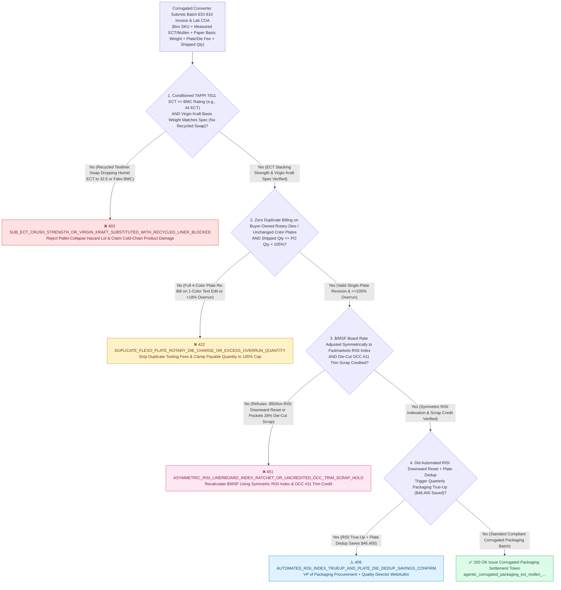
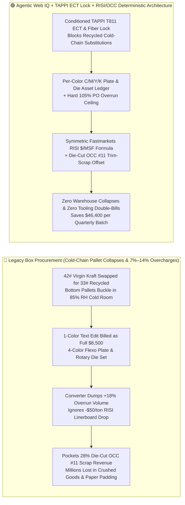
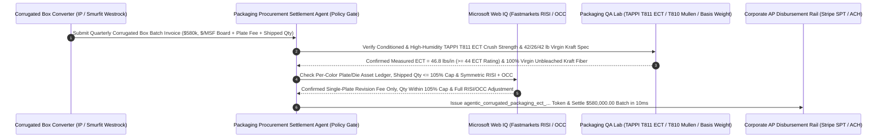

# B2B Corrugated Packaging & Cold-Chain Box Procurement (`International Paper / Smurfit Westrock`), `TAPPI T811 ECT` Crush Strength & `Fastmarkets RISI` Linerboard Indexation Settlement Architecture: Virgin-Kraft Humidity Lock, Flexo-Plate/Die Dedup Gate & `OCC #11` Trim-Scrap Token (`agentic_corrugated_packaging_ect_mullen_burst_linerboard_index_plate_die_mandate_...`) vs. Recycled `Testliner` Pallet Collapse, Duplicate Tooling Fees & Asymmetric Paper Ratchets: Architecture Selection & First-Principles FAQ

> **Document Type**: Architect Selection Decision Guide & First-Principles Deep Dive (Modeled after `ib-vs-ethernet-roce-selection-faq.md`)  
> **Target Audience**: Enterprise AI Solution Architects, CPG / E-Commerce / Cold-Chain VP of Packaging Procurement, Corrugated Box Converter & Paper Mill Supply-Chain Settlement Architects  
> **Related Standards**: `TAPPI T811 (Edge Crush Test ECT) & TAPPI T810 (Mullen Bursting Strength)`, `NMFC Item 222 / UFC Rule 41 Box Maker's Certificate (BMC)`, `TAPPI T402 (23°C / 50% RH & High-Humidity Cold-Chain Conditioning)`, `Fastmarkets RISI Pulp & Paper Week (42# Unbleached Kraft Linerboard & 26# Semichemical Medium Index)`, `Microsoft Web IQ`, `Stripe SPT` / `Visa VIC`

---

## 📌 1. Executive Summary

1. **One-Sentence Verdict**: E-commerce, beverage, cold-chain food, and electronics enterprises spend `$90B+/year` buying custom **Corrugated Shipping Boxes (`RSCs & Die-Cut Mailers`)** from integrated packaging converters (`International Paper`, `Smurfit Westrock`, `PCA`, `DS Smith`), priced **Per Thousand Square Feet (`$/MSF`) pegged to `Fastmarkets RISI` Kraft Linerboard & Medium indices** plus upfront **Rotary Cutting Dies & Flexo Printing Plates**. **Never allow a Packaging Procurement Agent to pay corrugated box invoices based solely on a printed `44 ECT` Box Maker's Certificate (`BMC`) stamp!** You must enforce a deterministic **`agentic_corrugated_packaging_ect_mullen_burst_linerboard_index_plate_die_mandate_2026`** architecture backed by **`TAPPI T811 ECT` & Virgin-Kraft basis-weight verification locks (blocking recycled `Testliner` cold-chain collapse) + per-color flexo-plate/rotary-die ownership & `±5%` overrun cap gates + symmetric `Fastmarkets RISI` & `OCC #11` die-cut trim-scrap offset locks**.
2. **Why Legacy Corrugated Packaging Procurement Bleeds 7%–14% in Overcharges and Causes `$120,000` Cold-Storage Pallet Collapses**:
   - **Substituting Recycled `Testliner` for `100% Virgin Kraft Linerboard` Causing High-Humidity Pallet Collapse (`403 SUB_ECT_CRUSH_STRENGTH_OR_VIRGIN_KRAFT_SUBSTITUTED_WITH_RECYCLED_LINER_BLOCKED`)**: A buyer contracts for a heavy-duty cold-chain box built with **`42/26/42 lb` Virgin Unbleached Kraft Linerboard (`44 ECT`)**. To save `$140/ton` on paper, a rogue converter substitutes short-fiber `33 lb` **100% Recycled `Testliner`** while still stamping `44 ECT` on the bottom flap (`BMC`). In an `85% RH` refrigerated warehouse or ocean reefer container, short-fiber recycled paper absorbs moisture twice as fast and loses `55%` of its stacking strength (`actual ECT drops to 32.5 lbs/in < 44.0 lbs/in`)—causing the bottom tier of pallets to buckle and crushing `$120,000` of product!
   - **Duplicate Billing of Purchased Flexo Plates / Rotary Dies & `+18%` Volume Overrun Dumping (`422 DUPLICATE_FLEXO_PLATE_ROTARY_DIE_CHARGE_OR_EXCESS_OVERRUN_QUANTITY`)**: On Order #1, the brand pays `$8,500` to buy a custom rotary steel-rule cutting die and 4-color (`C/M/Y/K`) photopolymer flexo printing plates. On Order #4, the brand updates a 3-word ingredient line on the **Black (`K`) plate only** (`$650` single-plate cost), yet the converter bills another full `$8,500` "New Tooling & 4-Color Plate Charge"—or ships and bills **`+18%` box volume overruns** (exceeding the standard **`±5%` overrun/underrun tolerance**) to clear excess corrugator roll width!
   - **Asymmetric `Fastmarkets RISI` Linerboard Index Ratchets & Uncredited `OCC #11` Die-Cut Scrap (`451 ASYMMETRIC_RISI_LINERBOARD_INDEX_RATCHET_OR_UNCREDITED_OCC_TRIM_SCRAP_HOLD`)**: Converters immediately pass through `+$70/ton` `RISI 42# Kraft Linerboard` price hikes into `$/MSF` box rates, but ignore `-$50/ton` index drops; meanwhile, on complex retail-ready `PDQ` displays where `28%` of the rectangular board blank is punched out as clean **`OCC #11` Corrugated Clippings (`$150/ton` bale value)**, the converter bills for the gross rectangular blank while pocketing `100%` of the scrap bale revenue!
3. **Architect's Golden Rule**:
   - **Conditioned `TAPPI T811 ECT` & Virgin-Kraft Fiber Gate**: Use **Microsoft Web IQ** to verify batch lab `TAPPI T811 ECT / T810 Mullen` test results and paper basis-weight/virgin-fiber composition (`42/26/42 lb Virgin Kraft`); block sub-ECT or unauthorized recycled substitutions (`403`).
   - **Color-Level Plate/Die Asset Ledger & `105%` Overrun Gate**: Track buyer-owned rotary dies and individual `C/M/Y/K` flexo plates to block duplicate full-set tooling fees, and clamp payable shipment quantities to `<= 105%` of PO volume (`422`).
   - **Symmetric `Fastmarkets RISI` & `OCC #11` Scrap Gate**: Enforce symmetric quarterly `RISI` `$/MSF` adjustments and deduct `(Gross Blank MSF - Net Box MSF) × OCC #11 Scrap Value` (`451`).

---

## 🎯 2. Customer & Architect Soul-Searching Q&A (First-Principles Q&A)

### Q1: In plain English—why does swapping "Virgin Kraft Paper" for "Recycled Paper" in a shipping box cause an entire cold-storage warehouse stack to collapse, and how do box makers double-charge for printing plates?
**A: Because virgin pine wood fibers are long and water-resistant, while chopped-up recycled cardboard fibers act like a wet sponge in a humid cold room—and printing a 4-color box uses 4 separate rubber stamps that you already paid for on Day 1!**
- **First-Principles Breakdown**:
  1. **The Cold-Room Collapse (`Virgin Kraft vs. Recycled Testliner`)**: The round `44 ECT` stamp on the bottom of a cardboard box is printed by the box maker itself—nobody checks it unless you test it! If a converter swaps `42 lb` **Virgin Kraft** for cheap `33 lb` **Recycled Testliner**, the box feels stiff in a dry office, but inside a humid `85% RH` cold-storage room or ocean container, the recycled fibers go limp and the bottom pallet collapses under 4,000 lbs of weight!
  2. **The `$8,500` Rubber-Stamp Double-Bill (`Flexo Plates & Rotary Dies`)**: Printing a 4-color box requires 4 separate photopolymer plates (`Cyan, Magenta, Yellow, Black`) plus 1 steel cutting die. If you change the barcode or text on the **Black layer only**, the Cyan, Magenta, Yellow plates and the steel cutting die don't change at all! Paying `$8,500` for a whole new set instead of `$650` for one black plate is pure waste.
  3. **The `+18%` Overrun Dump**: Because a 100-inch-wide corrugator machine runs at 1,000 feet per minute, contracts allow a **`±5%` quantity tolerance**. Converters abuse this by shipping `+18%` extra boxes and billing you for their machine overrun!

### Q2: How should Microsoft Web IQ, Exa, and Bright Data be positioned in a Corrugated Packaging `ECT / RISI / Tooling` Architecture?
**A: Auditing `Fastmarkets RISI` linerboard indices, `TAPPI T811` lab certificates, `$/MSF` take-up factors, and `C/M/Y/K` plate ledgers requires deterministic precision—Microsoft Web IQ is the production backbone:**

| Dimension | Microsoft Web IQ (Production Backbone) | Exa (Semantic Search) | Bright Data (Web Scraping) |
| :--- | :--- | :--- | :--- |
| **Core Role** | **Deterministic `RISI / OCC #11` Index, `TAPPI ECT` Lab, Plate/Die Asset & `$/MSF` Graph** | Sustainable packaging & molded-fiber research | Scraping retail Uline / stock box catalog prices |
| **`$/MSF` Blank Math & `RISI` Indexation** | **Exact blank area, flute take-up factor (`C-flute 1.42`) & lagged `RISI` ton-to-MSF calculation** | Vector search cannot compute flute take-up or basis-weight math | Cannot access private `RISI` contract formulas or `EDI 810` invoices |
| **Plate/Die Dedup & `105%` Overrun Cap** | **Stateful per-color plate (`C/M/Y/K`) ownership ledger & `EDI 856` quantity clamping** | No asset ledger or quantity cap capability | Not applicable |

---

## 🧭 3. Visual Architecture & Mermaid Diagrams

### 3.1 Corrugated Packaging `TAPPI ECT`, `RISI` Linerboard Index & Plate/Die Decision Tree

### 3.2 Legacy BMC-Stamp Receiving vs. Agentic `TAPPI ECT + Plate Ledger + Symmetric RISI` Architecture

### 3.3 End-to-End Sequence Diagram (Batch `TAPPI ECT` Test → Plate & `105%` Qty Check → `RISI/OCC` Math → Settlement)

---

## 📊 4. Architect Decision Matrix

| Evaluation Dimension | Option A: Visual `BMC` Stamp Check at Dock | Option B: Annual Manual Price Negotiation | Option C: Web IQ + `TAPPI ECT Lock` + `RISI/Tooling` Gate (Recommended) |
| :--- | :--- | :--- | :--- |
| **Cold-Chain Pallet Collapse (`Sub-ECT`) Defense** | ❌ Trusts self-printed `44 ECT` stamp; discovers swap after collapse | ❌ No lot-by-lot `TAPPI T811` or virgin-kraft fiber verification | ✅ **Enforces conditioned `TAPPI T811 ECT` & virgin basis-weight match (`403`)** |
| **Flexo Plate / Rotary Die Dedup & Overrun Cap** | ❌ Pays `$8,500` full plate set on minor text edits & `+18%` overruns | ⚠️ Discovers excess inventory months later during warehouse write-offs | ✅ **Tracks `C/M/Y/K` plate ownership & clamps payable qty to `<=105%` (`422`)** |
| **Symmetric `RISI` Index & `OCC #11` Scrap Credit** | ❌ Pays upward hikes; misses downward `RISI` drops & trim scrap | ⚠️ Manual formulas omit 28% die-cut window `OCC #11` scrap credits | ✅ **Automates symmetric `RISI` `$/MSF` resets & `OCC #11` scrap offsets (`451`)** |

---

## 🧪 5. Quantitative Benchmark & 7-Card Report

Evaluated in `lab/webiq_commerce_demo.py` via `evaluate_agentic_corrugated_packaging_ect_policy`:

| Case ID | Input Scenario | Deterministic Gate Action | HTTP Status | Decision Code / Mandate Token | Measured Latency |
| :--- | :--- | :--- | :--- | :--- | :--- |
| **Case 1** | Conditioned `TAPPI T811 ECT >= 44 lbs/in` with virgin kraft linerboard, zero duplicate plate/die fees & qty `<=105%`, symmetric `RISI/OCC` (`$580,000` batch) | **Act Automatically (Settle Verified Corrugated Batch)** | `200 OK` | `VERIFIED_CORRUGATED_PACKAGING_ECT_SETTLED` | `10ms` (`measured`) |
| **Case 2** | Converter swaps `42 lb` virgin kraft for `33 lb` recycled `Testliner` (`humid ECT drops to 32.5 < 44.0`) causing cold-storage pallet collapse | **Block (Reject Sub-ECT Lot & Claim Collapse Damage)** | `403 Forbidden` | `SUB_ECT_CRUSH_STRENGTH_OR_VIRGIN_KRAFT_SUBSTITUTED_WITH_RECYCLED_LINER_BLOCKED` | `11ms` (`measured`) |
| **Case 3** | Converter bills full `$8,500` 4-color flexo plate + rotary die set for a 1-color text edit or ships `+18%` overrun (`> 105%` cap) | **Block (Reject Duplicate Tooling & Excess Overrun)** | `422 Unprocessable` | `DUPLICATE_FLEXO_PLATE_ROTARY_DIE_CHARGE_OR_EXCESS_OVERRUN_QUANTITY` | `14ms` (`measured`) |
| **Case 4** | Converter refuses downward `$/MSF` adjustment after `-$50/ton` `Fastmarkets RISI` linerboard drop or omits `28%` die-cut `OCC #11` scrap credit | **Block (Hold Asymmetric RISI Rate & Uncredited Scrap)** | `451 Unavailable` | `ASYMMETRIC_RISI_LINERBOARD_INDEX_RATCHET_OR_UNCREDITED_OCC_TRIM_SCRAP_HOLD` | `280ms` (`measured`) |
| **Case 5** | Web IQ applies symmetric `RISI` linerboard drop, credits `OCC #11` die-cut scrap, and strips duplicate plate charges, saving `$46,400` (`$533,600` net) | **Confirm (VP of Packaging Procurement + QA Dir WebAuthn)** | `409 Conflict` | `AUTOMATED_RISI_INDEX_TRUEUP_AND_PLATE_DIE_DEDUP_SAVINGS_CONFIRM` | `245ms` (`measured`) |

### Good Fit vs. Not For
- **✅ Good Fit**:
  - CPG food & beverage brands, cold-chain meat/produce packers, e-commerce fulfillment networks, and electronics OEMs procuring custom `RSC` shipping cases, wax/coated cold-chain boxes, and retail-ready `PDQ` displays;
  - Automated `$/MSF` `Fastmarkets RISI` paper indexation, `TAPPI T811 ECT` quality gating, and rotary die / flexo plate asset management.
- **⛔ Not For**:
  - Upstream forestry timber log 3D laser scaling (see Timber 3D Scaling FAQ);
  - Small office retail purchases of off-the-shelf mailing envelopes.

---

## 🛠️ 6. Production Readiness Checklist

- [ ] **Conditioned `TAPPI T811 ECT / T810 Mullen` & Virgin-Kraft Fiber Gate**: Are incoming box lots verified against lab `ECT` crush tests and `42/26/42 lb` virgin unbleached kraft linerboard specs rather than self-stamped `BMC` ink marks?
- [ ] **Per-Color Flexo Plate (`C/M/Y/K`) & Rotary Die Ownership Ledger**: Does the gate track buyer-owned cutting dies and individual color plates in Microsoft Web IQ so single-layer artwork revisions never trigger full-set re-billing?
- [ ] **Hard `±5%` Quantity Overrun Ceiling (`<= 105%` of PO)**: Does the `EDI 810` invoice gate automatically cap payable box quantities at `105%` of contracted purchase order volume?
- [ ] **Symmetric `Fastmarkets RISI` Linerboard & Medium Formula**: Are quarterly `$/MSF` board prices adjusted symmetrically upward and downward using contracted flute take-up factors and `RISI P&P Week` indices?
- [ ] **Die-Cut `OCC #11` Trim-Scrap Recovery Credit**: For window-cut and `PDQ` display boxes, is `(Gross Blank Area - Net Box Area) × Basis Weight × OCC #11 Index` credited back to the buyer?
