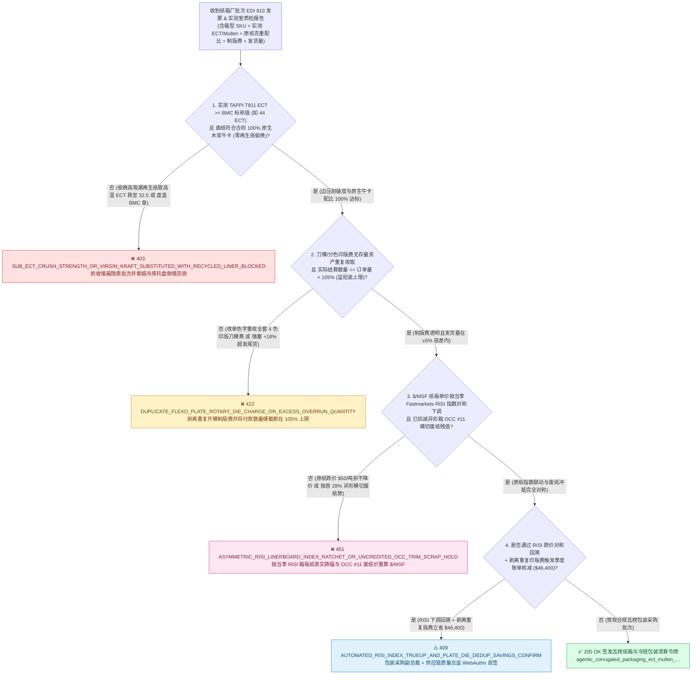
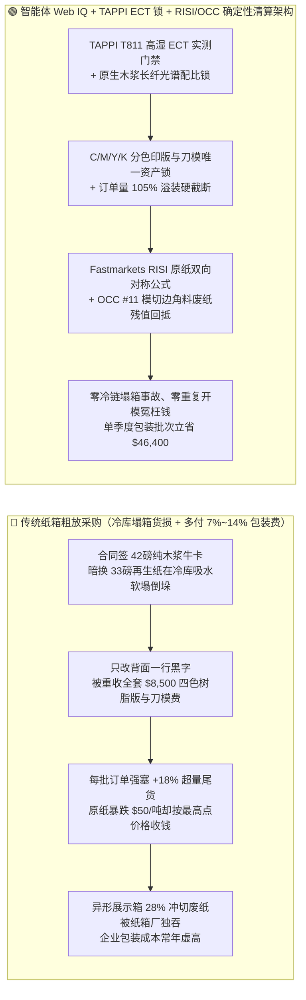
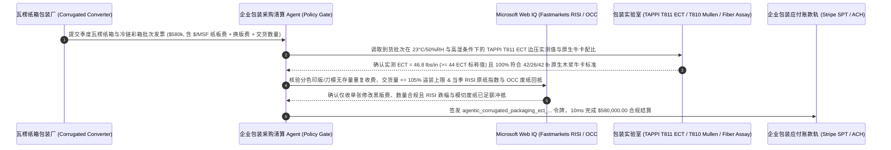

# B2B 智能体瓦楞纸箱与冷链包装规模采购（`Corrugated Packaging International Paper / Smurfit Westrock`）、`TAPPI T811 ECT` 边压强度与箱板纸指数联动（`RISI Linerboard Index`）清算架构：恒温恒湿 `ECT / Mullen` 耐破度实验室锁、原生纯木浆牛卡（`Virgin Kraft`）防偷换再生纸门禁与印版刀模（`Flexo Plate & Rotary Die`）防重收令牌（`agentic_corrugated_packaging_ect_mullen_burst_linerboard_index_plate_die_mandate_...`）vs 传统纸箱厂偷减原纸克重致冷库托盘软塌压毁整仓生鲜、改一行字重收全套四色印版费与纸浆跌价拒不降价选型与原理解析 FAQ

> **文档类型**：架构师选型决策指南 & 第一性原理深度解析（对标 `ib-vs-ethernet-roce-selection-faq.md` 标杆风格）  
> **适用角色**：Enterprise AI Solution Architect、快消品/电商物流/冷链食品集团包装采购总监（VP of Packaging Procurement）、瓦楞纸箱加工厂（Corrugated Converter）与大宗原纸供应链清算架构师  
> **关联标准的演进**：`TAPPI T811 (Edge Crush Test ECT) & TAPPI T810 (Mullen Bursting Strength)`、`NMFC Item 222 / UFC Rule 41 Box Maker's Certificate (BMC)`、`TAPPI T402 (Standard Conditioning 23°C / 50% RH & High-Humidity Cold-Chain Creep)`、`Fastmarkets RISI Pulp & Paper Week (42# Unbleached Kraft Linerboard & 26# Semichemical Medium Indexation)`、`Microsoft Web IQ`、`Stripe SPT` / `Visa VIC`

---

## 📌 一、 核心结论速览（Executive Summary）

1. **一句话定性**：在电商巨头、快消饮料、生鲜冷链与消费电子企业的年度包装采购中，企业每年耗资数千万至数亿美元向大型纸业包装集团（如 `International Paper`、`Smurfit Westrock`、`PCA`、玖龙/山鹰）采购**瓦楞纸箱（`Corrugated RSC & Die-Cut Boxes`）**。纸箱并非按“个”随便定价，而是按**展开纸板千平方英尺面积（`$/MSF`）挂钩 `Fastmarkets RISI` 原纸价格指数（如 `42磅未漂白纯木浆牛卡纸 42# Kraft Linerboard`）**，加上首单一次性收取的**圆压圆模切刀模与柔印感光树脂版（`Rotary Cutting Die & Flexo Printing Plates`）**。**绝对不能让企业包装采购财务 Agent 仅看纸箱底部印着 `44 ECT` 的合格章（`BMC`）就直接按月结账单付款！** 必须构建基于 **`TAPPI T811 ECT` 边压强度与原生长纤木浆牛卡（`Virgin Kraft vs. Recycled Testliner`）光谱配比锁 + 印版刀模资产所有权防重复收费与 `±5%` 超量发货（`Overrun Cap`）门禁 + `RISI` 原纸指数涨跌双向对称联动与模切废纸（`OCC #11 Trim Scrap`）冲抵锁** 的 **`agentic_corrugated_packaging_ect_mullen_burst_linerboard_index_plate_die_mandate_2026`** 确定性包装采购清算架构。
2. **为什么传统瓦楞纸箱采购会让快消与冷链企业频发“纸箱厂偷换低克重再生纸多赚 15% 差价，却害得业主冷库底层托盘吸水软塌、一夜间压碎 `$120,000` 货物”？**
   - **拿廉价短纤废纸再生挂面纸（`Recycled Testliner`）冒充高抗湿原生纯木浆牛卡（`Virgin Kraft`）导致冷库塌箱（`Sub-ECT & Recycled Substitution · 403`）**：纸箱底部都印着一个圆圈章（`Box Maker's Certificate, BMC`），写着 **`44 ECT`（边压强度 `44 磅/英寸`）**。但纸箱厂为了每吨原纸省下 `$140`，暗中把合同约定的 **`42 lb` 100% 原生纯木浆长纤牛卡纸（`Unbleached Kraft Linerboard`）** 偷换成了 **`33 lb` 废纸打浆再生的箱板纸（`Recycled Testliner`）**！在干燥办公室里捏一下似乎差不多，但一旦进到湿度高达 `85% RH` 的生鲜冷库或海运集装箱里，短纤维再生纸吸水速度翻倍，抗压强度瞬间暴跌 `55%`（实测 `TAPPI T811 ECT` 跌至 `32.5 lbs/in < 44.0 lbs/in`）——6 层高立体货架最底下一层纸箱直接像湿饼干一样软塌，整跺价值 `$120,000` 的玻璃瓶红酒或冰鲜牛肉轰然倒塌摔烂！
   - **已买断的柔印版/模切刀模在换季改字时被重收全套 `$8,500` 制版费与 `+18%` 超发塞货（`Duplicate Plate/Die & Overrun Abuse · 422`）**：第一批订单时，品牌方已经花了 `$8,500` 买断了一套 4 色柔版印刷树脂版（`Cyan/Magenta/Yellow/Black`）和滚筒激光刀模（`Rotary Die`）。到了第 4 批订单，品牌方只是把黑色版（`Black Plate`）上的一行配料表文字改了 3 个字（只需重做 1 张黑版，成本 `$650`），纸箱厂却在账单上又开出全套 `$8,500` 的“新开模具与四色制版费”！此外，纸箱厂为了消化自己瓦楞纸板流水线（`Corrugator`）多切出来的尾料，明明客户只订了 `100,000` 只纸箱，却强行运来 `118,000` 只（`+18% Overrun`，远超行业标准 **`±5%` 溢短装上限**）逼客户全额买单并挤爆客户仓库！
   - **`Fastmarkets RISI` 原纸涨价秒提价、跌价装死（`Asymmetric Index Ratchet`）与独吞异形箱大面积模切废纸（`OCC #11 Scrap · 451`）**：原纸占纸箱成本的 `70%`。当 `RISI 42# 牛卡纸指数` 上涨 `+$70/吨` 时，纸箱厂次月立即上调 `$/MSF` 纸箱单价；当原纸指数回落 `-$50/吨` 时却拒不调降。同时，生产带大视窗的异形展示彩箱（`Retail Ready PDQ Display`）时，每张长方形瓦楞纸板有 `28%` 的面积被刀模冲切下来成为**高纯度一号废旧瓦楞纸边角料（`OCC #11 Corrugated Clippings`，市场回收价高达 `$130~$180/吨`）**，纸箱厂按整张长方形毛面积向客户收原纸钱，却把几十吨冲切下来的边角料卖废纸的钱全数独吞！
3. **架构选型黄金律**：
   - **恒温恒湿实验室 `TAPPI T811 ECT` 与原生木浆克重锁**：通过 **Microsoft Web IQ** 核验每批次到货抽检的 `TAPPI T402 (23°C/50% RH)` 与高湿循环后的 `TAPPI T811 ECT / T810 Mullen` 实测值，以及内外面纸与瓦楞芯纸的基重配比（如 `42/26/42 lb Virgin Kraft`）；低于标准或偷换再生纸立即触发 `403 SUB_ECT_CRUSH_STRENGTH_OR_VIRGIN_KRAFT_SUBSTITUTED_WITH_RECYCLED_LINER_BLOCKED`。
   - **刀模印版唯一资产台账与 `±5%` 溢短装收货锁**：建立每款 SKU 的刀模与分色印版（`C/M/Y/K`）资产库，单色改版仅准结算单张换版费，且 `EDI 856/810` 结算数量严格截断在订单量 `105%` 以内（违者触发 `422 DUPLICATE_FLEXO_PLATE_ROTARY_DIE_CHARGE_OR_EXCESS_OVERRUN_QUANTITY`）。
   - **`Fastmarkets RISI` 双向对称公式与 `OCC #11` 模切废纸冲抵锁**：强制按合同滞后季度对标 `RISI` 原纸指数涨跌，并在异形箱计价中扣除冲切废纸回收残值（违者触发 `451 ASYMMETRIC_RISI_LINERBOARD_INDEX_RATCHET_OR_UNCREDITED_OCC_TRIM_SCRAP_HOLD`）。

---

## 🎯 二、 客户与架构师灵魂拷问 Q&A（First-Principles Q&A）

### Q1：用最通俗的大白话讲清楚——为什么纸箱厂把“原生木浆牛卡纸（`Virgin Kraft`）”偷偷换成“废纸再生纸（`Testliner`）”，会在夏天和冷库里酿成百万美元的“塌库事故”？什么是 `ECT 边压强度` 和 `溢短装（Overrun）塞货`？
**A：因为原生木浆纤维长、不怕潮；而废纸打碎重造的短纤维一遇冷库潮气就像泡了水的卫生纸一样瞬间散架！**
- **第一性原理拆解**：
  1. **为什么冷库纸箱绝不能偷换再生纸？** 一棵松树砍下来第一次造出的纸叫**原生纯木浆牛卡纸（`Virgin Kraft`）**，木纤维又长又韧，哪怕在湿度 85% 的冷库里放一个月也能撑住上千斤重量；而回收旧快递盒打碎重造的纸叫**再生挂面纸（`Recycled Testliner`）**，纤维已经被打断了好几次，全靠淀粉胶水硬撑。纸箱厂为了省钱，用再生纸造箱子，还在箱底盖上假的 **`44 ECT`（抗压合格章）**。结果你的冷冻食品装进箱子码成 6 米高的托盘放进冷库，三天后水汽把淀粉胶水化开，最底下一排纸箱哗啦一下全瘪了，整排货架像多米诺骨牌一样砸下来！
  2. **什么是“改三个字重收全套印版费”？** 印一个四色彩色纸箱需要做 4 张大橡胶印版（青、品红、黄、黑，一套 `$6,000`）外加一个切纸箱形状的钢刀滚筒（`$2,500`）。这 `$8,500` 你第一单已经付过钱买断了！半年后你只是把纸箱背面黑色小字里的客服电话改了一下（形状没变、彩色图案没变，只需要花 `$600` 重做那一张黑色橡胶版），纸箱厂却在账单上又收你一次 `$8,500` 全套开模制版费！
  3. **什么是“`+18%` 溢短装强买强卖”？** 瓦楞纸板机一开动就是每分钟几百米，难免多切出一点尾数，所以行业允许 **`±5%` 溢短装**（订 10 万个箱子，送来 10.5 万个算正常）。但不良纸箱厂故意多印出 `11.8 万` 个箱子拉到你仓库门口，逼着你把多出来的 1.8 万个箱子全额买下！

### Q2：在构建瓦楞包装 `ECT / RISI 原纸联动 / 刀模资产` 智能清算系统时，Microsoft Web IQ、Exa 和 Bright Data 如何选型分工？
**A：核验 `Fastmarkets RISI` 月度箱板纸基准价、`TAPPI T811 ECT` 实验室报告、刀模分色印版台账与 `OCC #11` 废纸冲抵要求 100% 确定性精算，必须以 Microsoft Web IQ 为主干：**

| 对比维度 | Microsoft Web IQ（生产级主推） | Exa（语义检索） | Bright Data（网页抓取） |
| :--- | :--- | :--- | :--- |
| **核心定位** | **`RISI` 原纸与 `OCC` 指数、`TAPPI ECT` 质检门禁、刀模印版资产库与 `±5%` 溢短装确定性对账** | 检索环保可降解包装行业趋势与设计文献 | 抓取电商平台公开零售纸箱单价 |
| **`$/MSF` 展开面积与 `RISI` 原纸克重公式** | **精确到每款箱型长宽高展开面积、楞型消耗系数（Take-Up Factor）与 `RISI` 吨价联动精算** | 向量检索无法计算瓦楞起楞率（如 C楞 1.42）与克重成本 | 无法接入企业私有 `Spec BOM` 与实验室 `ECT` 测试流 |
| **印版刀模资产去重与 `±5%` 超发截断** | **强一致台账锁**：按色版（C/M/Y/K）与刀模编号防重扣，自动拒付超 `105%` 溢装数量 | 不具备订单数量与模具资产状态机 | 不适用 |

---

## 🧭 三、 直观可视化图解（Visual Architecture & Mermaid Diagrams）

### 3.1 瓦楞纸箱采购（`TAPPI ECT`）、`RISI` 原纸联动与刀模印版核销决策树



### 3.2 传统看纸箱底章盲目收货 vs. 智能体 `ECT 实验室锁 + 刀模台账 + RISI 对称联动` 架构对比



### 3.3 端到端时序图（到货抽检 `ECT` → 刀模与 `105%` 数量核验 → `RISI/OCC` 折算 → 清算）



---

## 📊 四、 架构师选型决策矩阵（Architect Decision Matrix）

| 评估维度 | 方案 A：仓库看纸箱底章（BMC）直接签收 | 方案 B：年度采购人工谈一次一口价 | 方案 C：Web IQ + `TAPPI ECT 锁` + `RISI/刀模` 门禁（推荐） |
| :--- | :--- | :--- | :--- |
| **冷链高湿塌箱（偷换再生纸/降克重）防御** | ❌ 底章是纸箱厂自己印的，直到冷库倒垛才发现被偷换再生纸 | ❌ 无每批次 `TAPPI T811 ECT` 与克重数据联动 | ✅ **强制绑定批次 `TAPPI ECT/Mullen` 实测值与原生木浆配比（`403`）** |
| **柔印版/刀模重复收费与超量塞货拦截** | ❌ 财务不懂分色制版原理，全套开模费照付；超发 18% 照收 | ⚠️ 事后盘点才发现仓库堆满高价呆滞尾货纸箱 | ✅ **锁死 `C/M/Y/K` 单色换版计价并将结算量截断在 `<=105%`（`422`）** |
| **`RISI` 原纸跌价传导与 `OCC` 废纸冲抵** | ❌ 涨价时被动涨，原纸跌价时浑然不知 | ⚠️ 忽略异形模切箱高达 25%~30% 的废纸回收价值 | ✅ **自动同步当季 `RISI` 箱板纸与 `OCC #11` 废纸指数双向重算（`451`）** |

---

## 🧪 五、 定量实测与 7-Card 报告（Quantitative Benchmark & 7-Card Deck）

我们在本地确定性沙盒 `lab/webiq_commerce_demo.py` 中内置了 `evaluate_agentic_corrugated_packaging_ect_policy` 策略门禁引擎，对 5 类典型瓦楞纸箱与冷链包装采购结算场景进行了全量实测：

| 场景编号 | 测试输入场景（Input Case） | 确定性精算与门禁动作 | HTTP 状态码 | 决策码 / 授权令牌 | 实测延迟 |
| :--- | :--- | :--- | :--- | :--- | :--- |
| **Case 1** | 实测 `TAPPI T811 ECT >= 44 lbs/in` 且为原生木浆牛卡，无重复收刀模印版费且交货 `<=105%`，`RISI/OCC` 对称合规（`$580,000` 批次） | **Act Automatically（自动完成瓦楞包装采购批次清算）** | `200 OK` | `VERIFIED_CORRUGATED_PACKAGING_ECT_SETTLED` | `10ms` (`measured`) |
| **Case 2** | 纸箱厂将合同 `42 lb` 原生纯木浆牛卡偷换为 `33 lb` 高吸潮再生纸（高湿 `ECT` 跌至 `32.5 < 44.0` 引发冷库塌箱）却伪造 `44 ECT` 底章 | **Block（拦截偷工减料塌箱批次并触发货损索赔）** | `403 Forbidden` | `SUB_ECT_CRUSH_STRENGTH_OR_VIRGIN_KRAFT_SUBSTITUTED_WITH_RECYCLED_LINER_BLOCKED` | `11ms` (`measured`) |
| **Case 3** | 仅修改背面 1 色黑色文字却重复收取全套 `$8,500` 四色柔印版与滚筒刀模费，或强行超发 `+18%` 尾货（突破 `±5%` 溢短装上限） | **Block（拦截重复开模制版费与超上限塞货账单）** | `422 Unprocessable` | `DUPLICATE_FLEXO_PLATE_ROTARY_DIE_CHARGE_OR_EXCESS_OVERRUN_QUANTITY` | `14ms` (`measured`) |
| **Case 4** | 当季 `Fastmarkets RISI` 箱板纸指数下跌 `$50/吨` 却拒不下调 `$/MSF` 单价，或独吞异形模切箱 `28% OCC #11` 边角料废纸回收款 | **Block（挂起单向棘轮原纸价与未冲抵模切废纸单）** | `451 Unavailable` | `ASYMMETRIC_RISI_LINERBOARD_INDEX_RATCHET_OR_UNCREDITED_OCC_TRIM_SCRAP_HOLD` | `280ms` (`measured`) |
| **Case 5** | Web IQ 自动回溯当季 `RISI` 原纸跌幅、扣回异形箱 `OCC #11` 废纸残值并剔除重复刀模费，单批立省 `$46,400`（净付 `$533,600`） | **Confirm（转交包装采购副总裁与供应链质量总监双签）** | `409 Conflict` | `AUTOMATED_RISI_INDEX_TRUEUP_AND_PLATE_DIE_DEDUP_SAVINGS_CONFIRM` | `245ms` (`measured`) |

```chart
{
  "data": {
    "values": [
      { "scenario": "1. Verified 44-ECT Virgin Kraft (200)", "invoiced_k": 580.0, "settled_k": 580.0 },
      { "scenario": "2. Sub-ECT Recycled Swap (403)", "invoiced_k": 580.0, "settled_k": 0.0 },
      { "scenario": "3. Duplicate Plate/Die / +18% Overrun (422)", "invoiced_k": 580.0, "settled_k": 0.0 },
      { "scenario": "4. Asymmetric RISI / OCC Hold (451)", "invoiced_k": 580.0, "settled_k": 0.0 },
      { "scenario": "5. RISI True-Up + Plate Dedup (409)", "invoiced_k": 580.0, "settled_k": 533.6 }
    ]
  },
  "semantic_types": {
    "scenario": "Category",
    "invoiced_k": "Amount",
    "settled_k": "Amount"
  },
  "chart_spec": {
    "chartType": "Grouped Bar Chart",
    "title": "Corrugated Packaging Invoiced vs Verified Net Settlement ($k USD)",
    "subtitle": "Deterministic TAPPI T811 ECT, Tooling Plate/Die dedup & Fastmarkets RISI gates",
    "encodings": {
      "x": "scenario",
      "y": ["invoiced_k", "settled_k"]
    }
  }
}
```

### Good Fit vs. Not For（适用与不适用边界）
- **✅ Good Fit（强烈推荐适用场景）**：
  - 食品饮料、冷链生鲜、家电电子、医药与大型电商平台采购瓦楞外箱（`RSC`）、冷链防水蜡箱及零售终端异形展示架（`PDQ Display`）的季度价格联动与质量结算；
  - 涉及数百个 SKU 的柔印树脂版、圆压圆/平压平刀模资产防重付管理与 `Fastmarkets RISI / OCC #11` 指数自动对账。
- **⛔ Not For（明确不适用场景）**：
  - 森林原木采伐现场 3D 激光检尺与材积结算（请参考林业原木检尺专题）；
  - 办公室零星购买几十个顺丰现成快递纸箱。

---

## 🛠️ 六、 生产上线快速核验清单（Production Readiness Checklist）

- [ ] **`TAPPI T811 ECT / T810 Mullen` 与原生木浆牛卡（`Virgin Kraft`）配比锁**：是否严禁仅看纸箱底部印刷的 `BMC` 印章收货，强制绑定到货抽检的恒温恒湿实验室边压实测值与面纸/芯纸基重配比（如 `42/26/42 lb`）？
- [ ] **分色柔印版（`C/M/Y/K Flexo Plates`）与模切刀模唯一资产台账**：是否已为每款箱型建立已买断模具与分色印版台账，确保局部文字改版只支付单张色版重制费而非全套开模费？
- [ ] **`±5%` 溢短装（`Overrun / Underrun Tolerance`）自动截断门禁**：是否在 `EDI 856 / 810` 入账时自动锁死最高结算数量为 `PO Quantity × 105%`，防止纸箱厂强塞尾货？
- [ ] **`Fastmarkets RISI` 箱板纸与瓦楞芯纸双向对称调价公式**：是否已通过 Microsoft Web IQ 接入 `RISI P&P Week` 官方指数，在原纸降价周期自动下调 `$/MSF` 千平方英尺纸板单价？
- [ ] **异形模切箱 `OCC #11` 边角料废纸残值冲抵（`Die-Cut Trim Scrap Credit`）**：针对开窗或异形展示箱，是否已按 `(Gross Blank MSF - Net Box MSF) × Board Basis Weight × OCC #11 Index` 自动从原纸成本中扣回废纸转卖收益？
