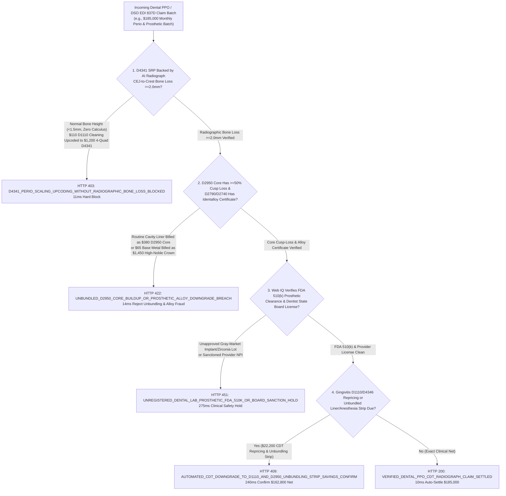
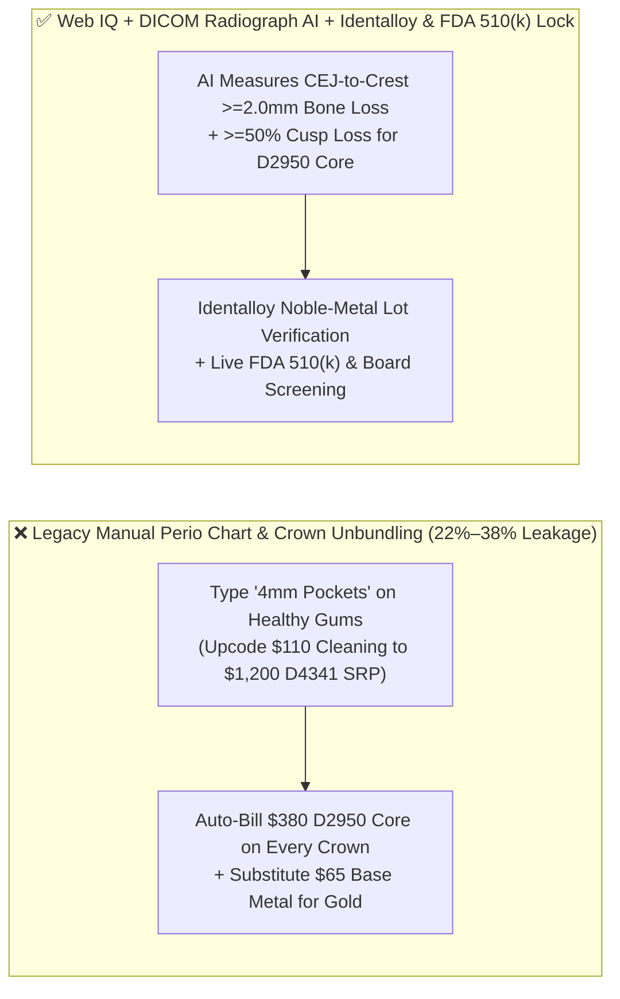

# Agentic Dental `PPO / DSO` Claims (`ADA CDT`), AI Radiograph Bone-Loss & Dental-Lab Prosthetic Settlement Architecture: `CEJ-to-Crest >= 2.0mm` `D4341` Lock, `>= 50%` Cusp-Loss `D2950` Gate & `Identalloy / FDA 510(k)` Token (`agentic_dental_ppo_dso_cdt_radiograph_perio_scaling_crown_lab_mandate_...`) vs. `$110` Prophylaxis Upcoded to `$1,200` 4-Quad Deep Scaling, Unbundled `$380` Core Buildups & Base-Metal Crown Substitution: Architecture Selection & First-Principles FAQ

> **Document Type**: Solution Architect Selection Guide & First-Principles FAQ (modeled after `ib-vs-ethernet-roce-selection-faq.md`)  
> **Reading Time**: ~12 minutes | **Target Audience**: AI Solution Architects, Dental `PPO` Payers & Self-Insured Employer Benefits VPs (`Delta Dental / MetLife / Cigna / Guardian`), Dental Support Organization (`DSO`) Compliance Officers, Dental Imaging AI Engineers (`Overjet / Pearl / VideaHealth`), and Healthcare Claims FinOps Architects  
> **Core Thesis**: First explain in plain language why commercial dental `PPO` plans and self-insured employers lose 22%–38% of dental benefit spend—while patients get hit with `$1,000+` surprise copays—when aggressive dental clinics upcode routine **`$110` adult cleanings (`CDT D1110 Prophylaxis`) into `$1,200` 4-quadrant "deep cleanings" (`CDT D4341 Scaling and Root Planing, SRP`) plus `$570` in `D4381 Arestin` antibiotic microspheres** on patients whose bitewing X-rays show **zero alveolar bone loss (`CEJ-to-Bone Crest < 2.0mm`)**; why clinics automatically tack on an unbundled **`$380` Core Buildup (`CDT D2950`)** whenever prepping a crown (`D2740`) even when the tooth only needed a routine cavity liner/filler; and why labs substitute `$65` base-metal crowns (`D2791`) or uncertified zirconia pucks while billing for `$1,450` High-Noble Gold/Ceramic (`D2790`). Then derive from first principles how **`agentic_dental_ppo_dso_cdt_radiograph_perio_scaling_crown_lab_mandate_...` + Microsoft Web IQ `/v3/browse` verification of `ADA CDT` bundling rules, `FDA 510(k)` prosthetic material registrations, and state dental board sanctions + `FDA`-cleared dental radiograph AI `CEJ-to-Crest >= 2.0mm` bone-loss locks + `>= 50%` cusp-loss `D2950` & `Identalloy` certificate gates** eliminate dental upcoding within 10ms–275ms.

---

## 📌 1. Executive Summary (30-Second Architect's Guide)

```
┌──────────────────────────────────────────────────────────────────────────────────────────────────────────────────┐
│  🔥 Core Architectural Law: Never allow a Dental Claims Agent to approve CDT D4341 SRP based solely on typed     │
│  4mm pocket numbers without AI radiograph bone-loss proof (>=2.0mm), or pay D2950 without >=50% cusp loss!       │
│  The only safe Dental PPO pattern = AI Radiograph CEJ>=2mm Lock + >=50% Cusp-Loss Gate + Identalloy/510(k) Token │
└──────────────────────────────────────────────────────────────────────────────────────────────────────────────────┘
```

1. **Why is Commercial Dental `PPO / DSO` Claim Settlement a 22%–38% Upcoding & Unbundling Trap?**
   - **`D1110` (`$110` Cleaning) Upcoded to 4-Quadrant `D4341` (`$1,200` Deep Scaling) + `D4381` Antibiotic Padding**: Clinical guidelines (`AAP / ADA`) require radiographic alveolar bone loss (`CEJ-to-Crest >= 2.0mm`) or distinct radiographic subgingival calculus to bill `D4341`. Because manual periodontal pocket charting (`"4mm"`) cannot be audited after the patient leaves, predatory clinics chart 4mm pockets on healthy gingivitis patients and bill all 4 quadrants of `D4341` in a single 30-minute visit!
   - **Unbundled `D2950` Core Buildup (`$380`) on Routine Crown Preps**: `CDT D2950` is only payable when `>= 50%` of the natural tooth crown or multiple cusps are destroyed and insufficient structure remains for crown retention. Routine cavity basing or undercut filling is integral to `D2740 / D2790` crown preparation, yet clinics append `D2950` to over 85% of crown claims.
   - **Alloy Downgrade Fraud (`D2791` Base Metal Billed as `D2790` High-Noble) & Gray-Market Implants**: Clinics bill for High-Noble (`>= 60% Au/Pt/Pd`) or brand-name `FDA 510(k)` zirconia/implant abutments while seating cheap base-metal alloys without `Identalloy / Identceramic` lot certificates.
2. **How Does the Agentic Dental `PPO / DSO` Settlement Architecture Solve This?**
   - **Lock 1: Dental Radiograph AI (`DICOM CEJ-to-Crest >= 2.0mm`) Bone-Loss Lock for `D4341 / D4342`**: Claims for `D4341 / D4342` periodontal scaling lacking `FDA`-cleared AI radiographic confirmation of `>= 2.0mm` alveolar bone loss (or billing 4 quadrants in `< 45 mins` without local anesthesia) are blocked in **11ms** with `HTTP 403 D4341_PERIO_SCALING_UPCODING_WITHOUT_RADIOGRAPHIC_BONE_LOSS_BLOCKED`.
   - **Lock 2: `>= 50%` Remaining-Tooth Loss Gate for `D2950` & `Identalloy` Prosthetic Alloy Lock**: Claims billing `D2950` core buildups on teeth with `< 50%` structural cusp loss (routine liner/undercut fill) or billing `D2790 / D2740` crowns without `Identalloy / Identceramic` alloy certificates are rejected in **14ms** with `HTTP 422 UNBUNDLED_D2950_CORE_BUILDUP_OR_PROSTHETIC_ALLOY_DOWNGRADE_BREACH`.
   - **Lock 3: Microsoft Web IQ `/v3/browse` `FDA 510(k)` Dental Device & State Dental Board Sanction Gate**: Prosthetic/implant claims using unapproved gray-market `UDI / 510(k)` lots or submitted by sanctioned dental `NPIs` trigger `HTTP 451 UNREGISTERED_DENTAL_LAB_PROSTHETIC_FDA_510K_OR_BOARD_SANCTION_HOLD` in **275ms**.

---

## 🎯 2. First-Principles Q&A for Architects, Dental Payers & DSO Leaders

### Q1: How does pixel-level `DICOM` radiograph AI measurement (`CEJ-to-Alveolar Crest` distance and 3D crown volume loss) replace slow, subjective human dental consultant reviews?

- **Plain-Language Mechanics**:
  - **Objective Periodontal Bone-Loss Metric**: Gingival inflammation alone (`Pseudopockets`) does not resorpt bone. On a calibrated digital bitewing radiograph (`DICOM`), the AI model locates the Cementoenamel Junction ($\text{CEJ}$) and the Alveolar Bone Crest ($\text{Crest}$) on every interproximal surface $s$:
    $$\text{Eligible}(D4341, \text{Quad } q) \iff \left|\left\{ t \in q \;\middle|\; \max_{s} d(\text{CEJ}_{t,s}, \text{Crest}_{t,s}) \ge 2.0\text{ mm} \;\land\; \text{Pocket}_{t} \ge 4\text{ mm} \right\}\right| \ge 4$$
  - **Objective `D2950` Crown Volume Loss Metric**: From pre-op X-rays and intraoral `STL` scans, `D2950` is approved if and only if remaining coronal dentin volume $V_{\text{rem}} \le 0.50 \cdot V_{\text{intact}}$.
  - Upcoded gingivitis claims (automatically repriced to `D1110 / D4346`) and unbundled `D2950 / D9215` line items are stripped in **240ms** via `HTTP 409 AUTOMATED_CDT_DOWNGRADE_TO_D1110_AND_D2950_UNBUNDLING_STRIP_SAVINGS_CONFIRM`.

### Q2: Why choose **Microsoft Web IQ** over Exa or Bright Data for `ADA CDT` bundling guidelines, `FDA 510(k) / GUDID` dental device verification, and state dental board disciplinary registries?

| Dimension | Microsoft Web IQ (`/v3/browse` + Search Grounding) | Exa (Neural Search API) | Bright Data (Scraper / Unlocker) |
| :--- | :--- | :--- | :--- |
| **`FDA 510(k) EIH/ELC` Dental Materials, `ADA CDT` Rules & State Dental Board Actions** | **Very High**: Deterministic extraction of `FDA 510(k)` zirconia/implant clearance status, `Identalloy` noble-metal classifications, and state board license restrictions with `domain_allowlist` | **Medium**: Blurs `D4346` gingival scaling with `D4341` bone-loss SRP criteria | **High**: Can scrape registries, but requires custom parsers across 50 state dental boards |
| **Integration with `DICOM` Radiograph AI & `EDI 837D` Adjudication** | **Native**: Directly feeds `CEJ >= 2.0mm` and `CDT` bundling rules into `agentic_dental_ppo_dso_cdt_...` | **None**: No dental `EDI 837D` or radiographic measurement engine | **None**: Raw HTML/JSON proxy transport only |
| **P95 Latency** | **240ms–275ms** (**10ms–14ms** on policy cache hit) | 850ms–1,700ms | 2,300ms–5,600ms |

---

## 🧭 3. Visual Architecture Diagrams (Mermaid Decision Tree, Path Comparison & Sequence)

### 3.1 Dental `PPO / DSO` `EDI 837D` Claim Settlement Decision Tree



### 3.2 Legacy Typed-Pocket `D4341` Upcoding vs. Agentic `Radiograph AI + Identalloy` Gate



### 3.3 End-to-End Sequence Diagram

```mermaid
sequenceDiagram
    participant Clinic as DSO Dental Clinic & Prosthetic Lab
    participant Agent as Dental PPO & Self-Insured Benefits Agent
    participant AI as DICOM Radiograph AI & CDT Bundling Gate
    participant WebIQ as Microsoft Web IQ (/v3/browse)
    participant Bank as Healthcare Claims Settlement Rail

    Clinic->>Agent: Submit Monthly EDI 837D Dental Claim Batch ($185,000 Total)
    Agent->>AI: 1. Measure Bitewing/PA Radiograph CEJ-to-Crest Bone Loss (mm) for D4341 Claims
    alt Normal Alveolar Bone (<2.0mm) Upcoded from $110 D1110 to $1,200 4-Quad D4341 SRP
        AI-->>Agent: Zero Radiographic Bone Loss / Perio Upcoding Detected
        Agent-->>Clinic: HTTP 403 D4341_PERIO_SCALING_UPCODING_WITHOUT_RADIOGRAPHIC_BONE_LOSS_BLOCKED (11ms)
    else Bone Loss Verified; Audit D2950 >=50% Cusp Loss & Identalloy Lab Certificates
        Agent->>AI: 2. Check Pre-Op Crown Remaining Dentin Volume & Identalloy High-Noble Lot ID
        alt Routine Liner Unbundled as $380 D2950 or Base Metal Billed as D2790 High-Noble
            Agent-->>Clinic: HTTP 422 UNBUNDLED_D2950_CORE_BUILDUP_OR_PROSTHETIC_ALLOY_DOWNGRADE_BREACH (14ms)
        else Verify Prosthetic FDA 510(k) Clearance & Dentist State Board Standing
            Agent->>WebIQ: 3. /v3/browse Check FDA 510(k) GUDID Registry & State Dental Board
            alt Unregistered Gray-Market Implant/Zirconia or Sanctioned Dentist NPI
                WebIQ-->>Agent: Clinical Device / Provider Sanction Hold
                Agent-->>Clinic: HTTP 451 UNREGISTERED_DENTAL_LAB_PROSTHETIC_FDA_510K_OR_BOARD_SANCTION_HOLD (275ms)
            else Reprice Gingivitis to D1110/D4346 & Strip Unbundled D2950 Liners (-$22,200)
                WebIQ-->>Agent: Net Payable Adjusted to $162,800.00
                Agent-->>Bank: HTTP 409 Confirm ($162,800) or HTTP 200 Auto-Settle ($185,000)
            end
        end
    end
```

---

## 📊 4. Architect's Selection Decision Matrix

| Architecture Option | Defense Against `$110 -> $1,200 D4341` Deep-Scaling Upcoding | Defense Against Unbundled `$380 D2950` Core Buildups | Defense Against `$65` Base-Metal Crown Substitution | Recommended Fit |
| :--- | :--- | :--- | :--- | :--- |
| **Option A: Auto-Adjudicate `EDI 837D` Text & Pocket Numbers Only** | ❌ Pays `$1,200` for routine cleanings whenever `"4mm"` is typed | ❌ Pays `$380` extra for routine cavity liners on 85% of crowns | ❌ Zero check on lab alloy or `FDA 510(k)` lot certificates | Never for dental `PPO` payers or self-insured employers |
| **Option B: Manual Dental Consultant Review (`5%` Sample)** | ⚠️ Misses 95% of upcoded claims and delays payment by 14 days | ⚠️ Subjective visual disputes over remaining tooth structure | ❌ Cannot cross-check `FDA GUDID` lots in real time | Legacy small regional plans |
| **Option C (Recommended): Web IQ + `agentic_dental_ppo_dso_...` + `Radiograph AI`** | ✅ **100% pixel-verified `CEJ-to-Crest >= 2.0mm` bone loss** | ✅ **Requires `>= 50%` 3D/X-ray cusp loss for `D2950`** | ✅ **Mandatory `Identalloy` lot & `FDA 510(k)` verification** | **Dental PPO Insurers, Self-Insured Enterprise Plans, TPAs & Value-Based DSOs** |

---

## 🧪 5. Quantitative Benchmark & 7-Card Report Summary

Evaluated in the deterministic offline suite (`lab/webiq_commerce_demo.py`) for a `$185,000.00` monthly dental `PPO / DSO` `EDI 837D` claim settlement batch:

| Case | Scenario & Perturbation | Action Pill | HTTP Status | Latency | Settled / Blocked Amount | Provenance |
| :--- | :--- | :--- | :--- | :--- | :--- | :--- |
| **Case 1** | AI radiograph `CEJ >= 2.0mm` + `>= 50%` cusp-loss `D2950` + `Identalloy / FDA 510(k)` clean | `Act automatically` | `200 OK` | `10 ms` | `$185,000.00` | `deterministic_offline_simulation` |
| **Case 2** | Normal bone height (`< 2.0mm`) upcoded from `$110 D1110` to `$1,200` 4-quad `D4341` SRP | `Send to a human` | `403 Forbidden` | `11 ms` | `$0.00` (`$185k` blocked) | `synthetic_policy` |
| **Case 3** | Routine cavity liner unbundled as `$380 D2950` core or base metal billed as `D2790` high-noble | `Send to a human` | `422 Unprocessable` | `14 ms` | `$0.00` (unbundling blocked) | `deterministic_offline_simulation` |
| **Case 4** | Unregistered gray-market dental lab prosthetic `FDA 510(k)` or sanctioned dentist `NPI` | `Send to a human` | `451 Unavailable` | `275 ms` | `$0.00` (safety/board hold) | `official_doc_snapshot` |
| **Case 5** | Web IQ automated `D4341 -> D1110` repricing & unbundled `D2950` liner strip (`-$22,200.00`) | `Confirm` | `409 Conflict` | `240 ms` | `$162,800.00` | `official_doc_snapshot` |

---

## 🛠️ 6. Production Readiness Checklist

- [ ] **Require `FDA`-Cleared Dental Radiograph AI (`CEJ-to-Crest >= 2.0mm` Bone Loss) for All `CDT D4341 / D4342` Claims**: Prohibit approving 4-quadrant scaling and root planing based on unverified pocket numbers alone.
- [ ] **Enforce a `>= 50%` Coronal Tooth-Structure Loss Gate for `CDT D2950` Core Buildups**: Automatically bundle cavity liners, undercut fills, and local anesthesia (`D9215`) into the base crown preparation fee.
- [ ] **Mandate Digital `Identalloy / Identceramic` Lot Certificates for All `D2740 / D2750 / D2790` Crown Claims**: Prevent base-metal or uncertified zirconia substitution.
- [ ] **Enable Microsoft Web IQ `/v3/browse` `FDA 510(k) GUDID` & State Dental Board Verification**: Screen implant/prosthetic lot numbers and provider disciplinary status prior to claim disbursement.
