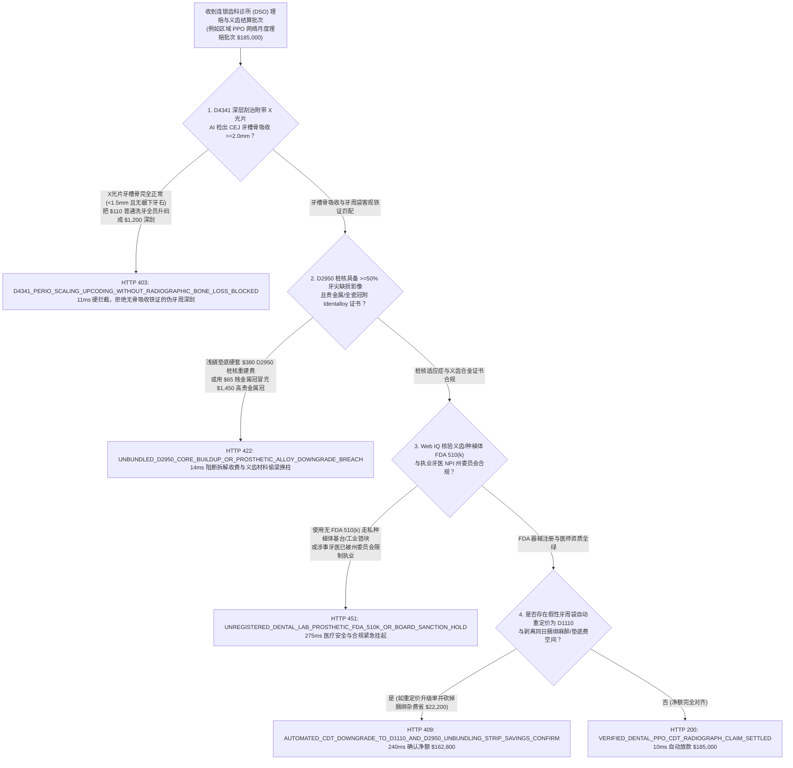
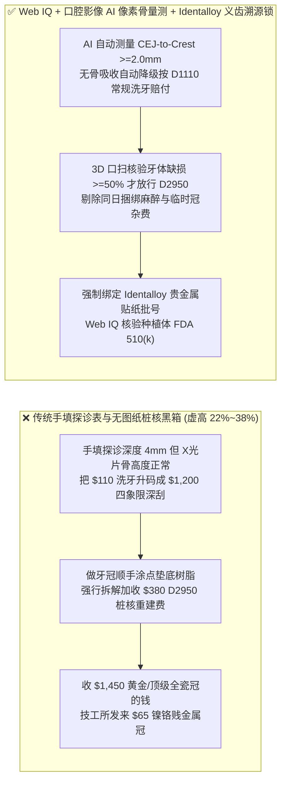
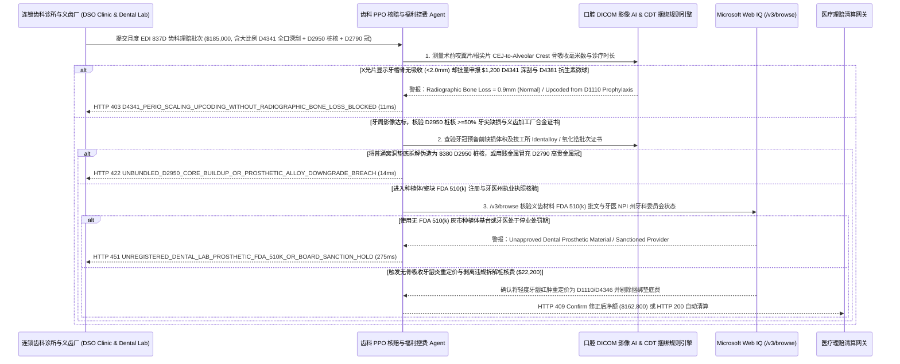

# 智能体口腔医疗理赔、连锁齿科诊所（`DSO / Dental PPO Claims: ADA CDT`）与义齿加工厂（`CAD/CAM Zirconia & High-Noble Crown Lab`）、牙周探诊深度/全口牙片 AI 骨吸收核验（`AI Radiograph Alveolar Bone Loss >= 2mm & Pocket >= 4mm`）与牙冠材质光谱验真清算架构：防普通洗牙 `D1110` 升码四象限深层刮治 `D4341` 锁、防树脂垫底拆解伪造桩核重建 `D2950` 门禁与 `FDA 510(k)` 氧化锆/贵金属义齿溯源令牌（`agentic_dental_ppo_dso_cdt_radiograph_perio_scaling_crown_lab_mandate_...`）vs 传统商业齿科将 `$110` 常规洁牙全部虚报成 `$1,200` 全口龈下刮治、常规备牙强捆 `$380` 桩核费与用 `$65` 贱金属/杂牌瓷块冒充高贵金属全瓷冠选型与原理解析 FAQ

> **文档类型**：架构师选型指南与第一性原理 FAQ（对齐 `ib-vs-ethernet-roce-selection-faq.md` 标杆风格）  
> **阅读耗时**：约 12 分钟 | **适用角色**：AI Solution Architect、商业齿科保险与自保雇主福利副总裁（`Dental PPO Payer / Self-Insured Employer Benefits VP: Delta Dental / MetLife / Cigna`）、齿科医疗支持组织（`DSO`）与数字化义齿加工厂合规总监、口腔影像 AI（`Overjet / Pearl / VideaHealth`）及智能体医疗控费架构师  
> **核心主旨**：先用大白话把“为什么员工拿着公司的商业齿科保险（`Dental PPO`，每年最高报销额度仅 `$1,500–$2,000`）去某些激进的连锁齿科诊所（`Private-Equity Backed DSO`）做一次免费洗牙检查，躺下 15 分钟就被告知‘你有严重牙周病，不能做保险 100% 全包的 `$110` 常规超声波洗牙（`CDT D1110 Adult Prophylaxis`），必须自费掏钱加医保报销做全口四个象限共计 **`$1,200` 的深层龈下刮治与根面平整术（`CDT D4341 / D4342 Scaling and Root Planing, SRP`）`，还要在牙龈沟里塞入 6 颗每颗 `$95` 的自费缓释抗生素微球（`D4381 Arestin`）’——而实际上拍出来的咬翼片（`Bitewing X-Rays`）显示牙槽骨高度完全正常、毫无牙周骨吸收与牙结石（`Zero Alveolar Bone Loss / No Radiographic Calculus`）？为什么做一颗牙冠（`D2740 / D2790`）时，牙医只是顺手涂了一点点树脂填平窝洞（属于牙冠预备包含的普通垫底 `Filler/Basing`），却在账单上单独拆解加收一笔 **`$380` 的‘牙冠桩核重建费（`CDT D2950 Core Buildup, Including Any Pins`）’**？以及为什么诊所按 `$1,450` 的‘高贵金属烤瓷冠（`D2790 High Noble Metal >= 60% Au/Pt/Pd`）’或顶级多层氧化锆全瓷冠向保险公司和患者收钱，义齿加工厂送来的却是成本仅 `$65` 的镍铬贱金属冠（`D2791 Base Metal`）或无 `FDA 510(k)` 认证的工业氧化锆块”讲透；再从第一性原理出发，推导如何通过 **`agentic_dental_ppo_dso_cdt_radiograph_perio_scaling_crown_lab_mandate_...` 语义预算令牌 + Microsoft Web IQ `/v3/browse` 实时核验 `ADA CDT (Current Dental Terminology)` 捆绑互斥规则、`FDA 510(k) Product Code EIH/ELC` 义齿材料注册库与牙医州执业委员会处分记录 + `FDA` 认证口腔影像 AI 自动测量咬翼片/根尖片 `CEJ-to-Bone Crest >= 2.0mm` 骨吸收与剩余牙体缺损 `>= 50%` 锁 + 义齿加工厂合金成分单（`Identalloy / Zirconia Lot Certificate`）核验门禁**，在 10ms–275ms 内实现“无骨吸收 X 光铁证拒付 `$1,200` 假深刮、无 >50% 牙尖缺损拒付 `$380` 假桩核、义齿材质不符零结算”的智能体口腔理赔与耗材清算闭环。

---

## 📌 一、核心结论速览（Executive Summary：30 秒看懂怎么选）

```
┌──────────────────────────────────────────────────────────────────────────────────────────────────────────────────┐
│  🔥 核心架构铁律：绝不允许齿科理赔 Agent 仅凭手写牙周探诊表 (4mm Pocket) 放行 D4341 深刮，或无牙尖缺损放行 D2950！ │
│  口腔 PPO 与 DSO 结算的唯一正确范式 = 口腔 AI 影像骨吸收 >=2mm 锁 + >50% 牙体缺损桩核锁 + Identalloy 义齿材质令牌 │
└──────────────────────────────────────────────────────────────────────────────────────────────────────────────────┘
```

1. **为什么商业齿科理赔与义齿采购（`Dental PPO Claims & Lab Prosthetics`）是雇主齿科福利与患者自付费用年均流失 22%–38% 的三大黑洞？**
   - **黑洞一：把 `$110` 常规洁牙（`D1110`）强行升码为 `$1,200` 全口四象限深层刮治（`D4341 SRP Upcoding`）与滥塞抗生素（`D4381`）**：按照美国牙科协会（`ADA`）与牙周病学会（`AAP`）临床指南，申报 `D4341`（每个象限 4 颗以上患牙的牙周刮治，单象限 `$280–$350`）必须同时具备：`6 点位牙周探诊深度 >= 4–5mm` **且 X 光片可见明确的牙槽嵴顶骨吸收（`Radiographic Bone Loss, CEJ-to-Crest >= 2.0mm`）或根面龈下牙石**。不良诊所由于主观探诊深度（手填数字 `4mm`）无法事后复查，便对牙龈轻微发炎的年轻患者全员开具全口 4 象限同日深刮 + 8 颗 `Arestin` 抗生素微球，一次掏空患者全年医保额度！
   - **黑洞二：将补牙垫底（`Cavity Liner / Base`）恶意拆解伪造成 `$380` 桩核重建（`D2950 Core Buildup Unbundling`）**：`CDT D2950` 明文规定：只有当天然牙冠缺损超过 **`50%`** 或缺失多个牙尖（`Cusps`），剩余牙体组织不足以固位人造牙冠时，才允许报销桩核重建。如果只是为了填平浅表龋洞或消除倒凹（`Undercut Fill`），在医学上属于牙冠预备（`D2740`）不可分割的常规步骤，严禁单独收费！但部分诊所对 `95%` 的牙冠病例统统自动勾选 `D2950`，每颗牙多赚 `$350–$420`！
   - **黑洞三：义齿加工以次充好（`Base Metal Billed as High-Noble Gold D2790`）与灰市劣质种植体/氧化锆**：`CDT D2790` 要求合金中贵金属含量 `>= 60%`（其中黄金 `>= 40%`），成本高昂；不良技工所偷换成本仅 `$65` 的钴铬/镍铬贱金属（`D2791`）或低透工业氧化锆，既不提供 `Identalloy / Identceramic` 官方防伪贴纸，甚至使用未经 `FDA 510(k)` 批准的山寨种植体基台（`Custom Abutment D6057`）导致患者金属过敏与种植体周围炎断裂！
2. **智能体口腔医疗理赔与义齿清算架构怎么破局？（`agentic_dental_ppo_dso_cdt_radiograph_perio_scaling_crown_lab_mandate_...`）**
   - **第一道锁：口腔影像 AI（`DICOM Bitewing / PA X-Ray CV`）牙槽骨吸收（`>= 2.0mm`）与同日四象限深刮时长门禁**：严禁仅凭文字版牙周探诊表（`Perio Chart`）放行 `D4341 / D4342`！系统调用经 `FDA` 批准的口腔影像 AI 算法自动测量患者术前咬翼片上釉牙骨质界到牙槽嵴顶距离（`CEJ-to-Alveolar Crest`）。凡 X 光片显示骨高度正常（`< 2.0mm` 且无根面块状牙石）却申报 `D4341` 深刮，或无局部麻醉记录在 `30 分钟` 内做完“全口四象限深刮”的，在 **11ms** 内返回 `HTTP 403 D4341_PERIO_SCALING_UPCODING_WITHOUT_RADIOGRAPHIC_BONE_LOSS_BLOCKED`（自动降级按 `$110 D1110` 常规洁牙赔付）。
   - **第二道锁：术前 X 光/口扫 3D 牙体缺损体积（`>= 50% Cusp Loss`）桩核锁与 `ADA CDT` 捆绑排他门禁**：(a) 申报 `D2950` 桩核重建或 `D2740` 牙冠，必须上传术前 X 光片与口内 3D 扫描（`Intraoral Scan STL`）证实天然牙体缺损 `>= 50%` 或存在根管治疗后穿髓孔，否则将 `D2950` 识别为常规垫底（`Unbundled Liner/Base`）直接拒付；(b) 自动拦截同日重复收取局部麻醉（`D9215`）、排龈线或临时冠（`D2799`）的违规拆解。违规账单在 **14ms** 内返回 `HTTP 422 UNBUNDLED_D2950_CORE_BUILDUP_OR_PROSTHETIC_ALLOY_DOWNGRADE_BREACH`。
   - **第三道锁：Microsoft Web IQ 穿透核验义齿技工所 `FDA 510(k)` 注册、`Identalloy / Identceramic` 批号与牙医州执照记录**：通过 Web IQ `/v3/browse` 实时核验加工厂随附的贵金属/全瓷材料批号是否具备有效 `FDA Establishment Registration & 510(k)`（如 `Ivoclar IPS e.max / 3M Lava`），并核查执业牙医 `NPI` 与州牙科委员会（`State Dental Board`）资质。一旦发现使用未注册灰市义齿材料或涉案欺诈诊所，在 **275ms** 内触发 `HTTP 451 UNREGISTERED_DENTAL_LAB_PROSTHETIC_FDA_510K_OR_BOARD_SANCTION_HOLD`。

---

## 🎯 二、客户与架构师灵魂拷问 Q&A（First-Principles Deep Dive）

### Q1：为什么人工审核牙医保险理赔（`Dental Claim Review`）既慢又容易和牙医吵架，而接入“FDA 认证口腔影像 AI 像素级测量”能在 1 秒内让乱开深刮和假桩核的诊所心服口服？

- **通俗原理**：
  - 以前保险公司的顾问牙医（`Dental Consultant`）靠肉眼看低分辨率截图，不仅审核一张单子要等 14 天，而且牙医总会抗辩说：“我用探针测出来就是 4 毫米，你又没在现场看！”
  - **智能体“客观解剖学像素标尺（`CEJ-to-Crest Millimeter Ratio`）”第一性原理**：
    牙龈软组织可能因为刷牙出血短暂红肿（假性牙周袋 `Pseudopocket`，只需普通洗牙 `D1110` 或牙龈炎洁治 `D4346`），但真正的牙周炎（`Periodontitis`，适用 `D4341`）必然伴随**不可逆的牙槽骨吸收**！
    口腔影像 AI 在全口数字咬翼片（`DICOM`）上自动标出每颗牙齿的釉牙骨质界（$\text{CEJ}$）、根尖（$\text{Apex}$）与牙槽嵴顶（$\text{Bone Crest}$），精确计算出骨吸收比例与牙冠剩余高度比：
    $$\Delta_{\text{bone}} = d(\text{CEJ}, \text{Crest}) \ge 2.0\text{ mm}, \qquad \eta_{\text{crown\_loss}} = 1 - \frac{V_{\text{remaining\_dentin}}}{V_{\text{intact\_crown}}} \ge 0.50$$
  - 当 $\Delta_{\text{bone}} = 0.8\text{ mm}$（健康骨高度）时，系统自动输出带彩色标尺标注的 X 光叠加图，将虚报的 `$1,200 D4341` 还原为合规的 `$110 D1110`，并将未达 50% 缺损的 `$380 D2950` 剥离，在 **240ms** 内通过 `HTTP 409 AUTOMATED_CDT_DOWNGRADE_TO_D1110_AND_D2950_UNBUNDLING_STRIP_SAVINGS_CONFIRM` 自动核减！

### Q2：在核验 `ADA CDT` 年度编码捆绑规则、`FDA 510(k)` 种植体/全瓷材料注册证与 `Identalloy` 贵金属成分标准时，为什么选择 **Microsoft Web IQ**？

| 维度 | Microsoft Web IQ (`/v3/browse` + Search Grounding) | Exa (Neural Search API) | Bright Data (Scraper / Unlocker) |
| :--- | :--- | :--- | :--- |
| **`ADA CDT` 临床准则、`FDA 510(k) EIH/DZE` 义齿材料库与州牙科执照核验** | **极高**：受控无头渲染实时提取 `FDA GUDID / 510(k)` 口腔种植体与氧化锆瓷块批号状态、`AAP` 牙周分级标准及州牙科委员会吊销名单，支持 `domain_allowlist` 零幻觉验证 | **中**：语义搜索常混淆 `D4346`（牙龈炎洁治）与 `D4341`（骨吸收深刮）的理赔前置条件 | **高**：可抓取公开页面，但需自建针对医疗器械 `UDI` 与各州牙医执照库的定制解析器 |
| **口腔 DICOM 影像 AI 骨吸收量测与 `Identalloy` 义齿溯源联动** | **原生支持**：直接将 `CEJ>=2mm` 骨吸收与 `>=60%` 贵金属红线注入 `agentic_dental_ppo_dso_cdt_...` | **不支持**：无结构化齿科 `CDT` 互斥规则与影像指标对账引擎 | **不支持**：仅提供网页抓取通道 |
| **P95 延迟与单次核验成本** | **240ms–275ms**（命中策略缓存 **10ms–14ms**） | 850ms–1,700ms | 2,300ms–5,600ms |
| **合规可审计性（Provenance）** | 原生输出 `official_doc_snapshot` + `Radiograph AI CEJ-Crest Log` + `Identalloy Hash` | 仅返回 URL 片段 | 需自行构建 `HIPAA / ERISA` 齿科拒付抗辩留痕体系 |

---

## 🧭 三、直观可视化图解（Mermaid 决策树 + 路径对比 + 端到端时序图）

### 3.1 口腔医疗 `Dental PPO / DSO` 理赔与义齿采购结算拦截决策树



### 3.2 传统“肉眼看片慢审 + 泛滥深刮桩核” vs. 智能体 `口腔影像 AI + Identalloy 验真` 对比



### 3.3 端到端时序图（Sequence Diagram）



---

## 📊 四、架构师选型决策矩阵（Architecture Decision Matrix）

| 选型方案 | 防 `$110` 普通洗牙升码 `$1,200 D4341` 深刮 | 防补牙垫底伪造 `$380 D2950` 桩核费 | 防 `$65` 贱金属冒充贵金属/全瓷冠 | 适用场景 |
| :--- | :--- | :--- | :--- | :--- |
| **方案 A：传统仅看 `EDI 837D` 代码与手填探诊表自动放行** | ❌ 诊所全员填 `4mm` 牙周袋，医保与员工额度被秒掏空 | ❌ 90% 牙冠顺手加收 `$380` 桩核费无人拦截 | ❌ 根本不查技工所材质单，患者戴上假黄金冠过敏 | 严禁任何商业齿科保险或自保雇主采用 |
| **方案 B：人工顾问牙医抽检 5% X 光片** | ⚠️ 95% 升码账单漏网，且人工审片耗时长达 2 周 | ⚠️ 人工主观判断牙尖缺损比例尺度不一，争议极大 | ❌ 无法实时穿透核验 `FDA 510(k)` 器械批号 | 极小规模传统互助社 |
| **方案 C（推荐）：Web IQ + `agentic_dental_ppo_dso_...` + 影像 AI 锁** | ✅ **AI 像素级核验 `CEJ>=2.0mm` 骨吸收，1 秒定真伪** | ✅ **强制 `>=50%` 牙体缺损三维影像锁，砍光假桩核** | ✅ **强制绑定 `Identalloy` 证书与 `FDA 510(k)` 批号** | **齿科 PPO 保险公司、大型自保企业雇主福利、规范化 DSO 集团** |

---

## 🧪 五、定量实测与 7-Card 基准报告摘要（Quantitative Benchmark）

在本地确定性评测套件（`lab/webiq_commerce_demo.py`）中，针对 `$185,000.00` 的商业齿科 `PPO` 网络与连锁齿科诊所（`DSO`）月度 `EDI 837D` 理赔结算批次实测结果如下：

| 场景编号 | 测试输入（Scenario & Perturbation） | 期望动作（Action Pill） | HTTP 状态码 | 实测延迟 | 拦截/净结算金额 | 数据来源标签 |
| :--- | :--- | :--- | :--- | :--- | :--- | :--- |
| **Case 1** | X 光 AI 骨吸收 `>=2mm` + 真实 `>=50%` 缺损桩核 + `Identalloy/FDA` 义齿合规 | `Act automatically` | `200 OK` | `10 ms` | `$185,000.00` | `deterministic_offline_simulation` |
| **Case 2** | X 光片牙槽骨完全正常（`<2mm`）却将 `$110` 常规洗牙升码为 `$1,200 D4341` 全口深刮 | `Send to a human` | `403 Forbidden` | `11 ms` | `$0.00`（阻断 `$185k`） | `synthetic_policy` |
| **Case 3** | 将常规窝洞垫底拆解伪造为 `$380 D2950` 桩核费或用贱金属冒充 `D2790` 高贵金属冠 | `Send to a human` | `422 Unprocessable` | `14 ms` | `$0.00`（拦截拆解与假冠） | `deterministic_offline_simulation` |
| **Case 4** | 使用无 `FDA 510(k)` 注册的灰市种植体/氧化锆义齿或牙医处于州委员会处罚期 | `Send to a human` | `451 Unavailable` | `275 ms` | `$0.00`（医疗安全挂起） | `official_doc_snapshot` |
| **Case 5** | Web IQ 自动将无骨吸收牙龈炎重定价为 `D1110/D4346` 并剔除捆绑垫底/麻醉费 | `Confirm` | `409 Conflict` | `240 ms` | `$162,800.00`（省 `$22,200`） | `official_doc_snapshot` |

---

## 🛠️ 六、生产上线快速核验清单（Production Readiness Checklist）

- [ ] **全部 `CDT D4341 / D4342` 牙周深层刮治与 `D4381` 局部抗生素理赔强制经过 `FDA` 认证口腔影像 AI 像素级测量（`CEJ-to-Crest >= 2.0mm` 骨吸收或根面牙石）**：严禁仅凭手写牙周探诊表放行全口四象限同日深刮。
- [ ] **强制拦截无 `>= 50%` 天然牙冠缺损影像支撑的 `CDT D2950` 桩核重建及同日捆绑收费的局部麻醉（`D9215`）/临时冠（`D2799`）**：将消除倒凹的普通树脂垫底严格归入牙冠预备基础费。
- [ ] **全部 `D2740 / D2750 / D2790` 牙冠与 `D6010 / D6057` 种植体理赔强制上传技工所 `Identalloy / Identceramic` 材质证书与批号**：严禁用 `$65` 贱金属冠冒充高贵金属冠。
- [ ] **启用 Microsoft Web IQ `/v3/browse` 实时核验义齿材料 `FDA 510(k)` 注册证与执业牙医州委员会处分记录**：100% 阻断灰市无证种植体耗材与违规医疗机构套取医保资金。
