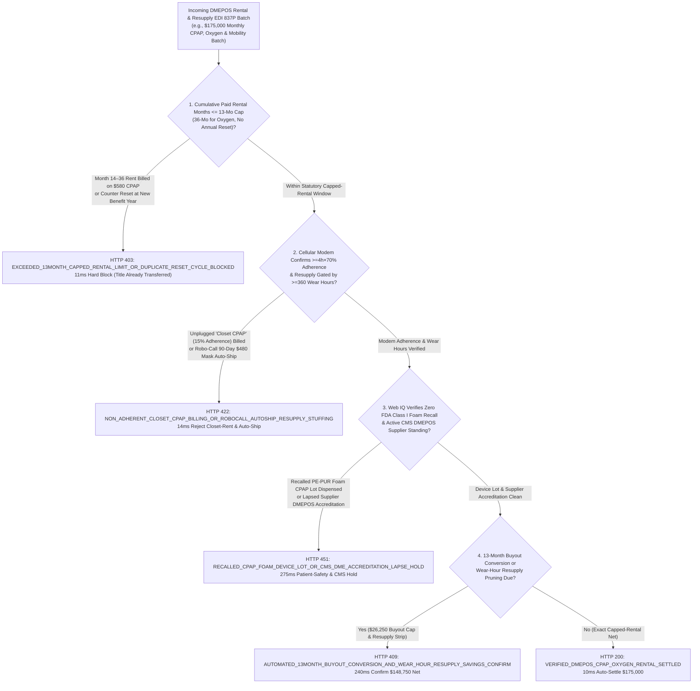
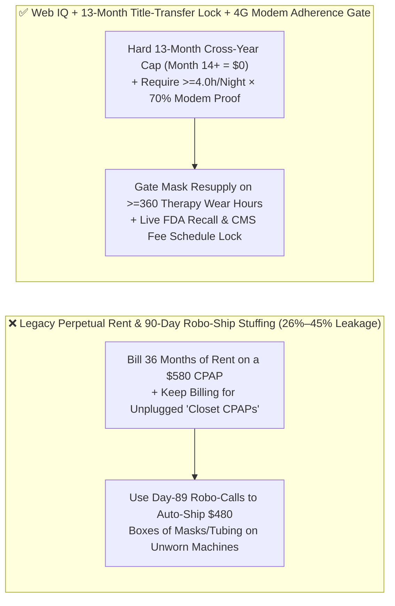

# Agentic Durable Medical Equipment (`DMEPOS: CPAP / BiPAP, Home Oxygen & Power Mobility CMS HCPCS E0601 / E1390`), `13-Month` Capped-Rental Title Transfer & Cellular Sleep-Adherence Settlement Architecture: `13-Month` Buyout Ledger Lock, `>= 4h/Night × 70%` Modem Adherence Gate & Anti-Auto-Ship Resupply Token (`agentic_dmepos_cpap_oxygen_13month_capped_rental_sleep_adherence_mandate_...`) vs. Perpetual Uncapped Rent on `$580` CPAPs, Billing for Non-Adherent "Closet CPAPs" & Robo-Call 90-Day Mask Resupply Stuffing: Architecture Selection & First-Principles FAQ

> **Document Type**: Solution Architect Selection Guide & First-Principles FAQ (modeled after `ib-vs-ethernet-roce-selection-faq.md`)  
> **Reading Time**: ~12 minutes | **Target Audience**: AI Solution Architects, Health Plan `DMEPOS` & Payment-Integrity VPs, Self-Insured Employer Benefits Directors, Sleep Medicine & Home Respiratory Providers (`Apria / Lincare / AdaptHealth / Rotech / ResMed`), and Healthcare Claims FinOps Engineers  
> **Core Thesis**: First explain in plain language why commercial health plans, self-insured employers, and patients end up paying **`$4,200–$6,800` over three years for an Auto-CPAP machine (`HCPCS E0601`) that costs `$580` wholesale**: because legacy Durable Medical Equipment (`DME`) suppliers exploit calendar-year deductible resets and missing `KH/KI/KJ` modifiers to **bill perpetual monthly rent past the statutory `13-Month Capped Rental` buyout limit (`42 CFR § 414.229`)**; why suppliers keep billing monthly rent and shipping quarterly supply boxes for **"Closet CPAPs" (`35%` of machines sitting unused in a closet with `0.0 hours` on their built-in 4G cellular modem)**; and why automated robo-callers trick patients into pressing `"1"` every 90 days to ship `$480` boxes of masks (`A7030`), cushions (`A7031`), and heated tubing (`A4604`) when the patient's existing mask has barely been worn. Then derive from first principles how **`agentic_dmepos_cpap_oxygen_13month_capped_rental_sleep_adherence_mandate_...` + Microsoft Web IQ `/v3/browse` verification of `CMS DMEPOS` state fee schedules, `LCD L33718` adherence rules, and `FDA Class I` device recall registries + cross-year `13-Month` title-transfer locks (`Month 14+ Rent = $0`) + cellular modem therapy-hour (`>= 4.0h/night on 70% of nights`) and wear-hour-gated resupply locks** eliminate perpetual DME rent and resupply stuffing within 10ms–275ms.

---

## 📌 1. Executive Summary (30-Second Architect's Guide)

```
┌──────────────────────────────────────────────────────────────────────────────────────────────────────────────────┐
│  🔥 Core Architectural Law: Never allow a Medical Claims Agent to pay DMEPOS capped-rental claims past Month 13  │
│  (36 for oxygen) or approve CPAP mask/tubing resupply shipments triggered by automated 90-day robo-calls!        │
│  The only safe DMEPOS pattern = 13-Mo Title-Transfer Lock + 4G Modem >=70% Adherence Gate + Wear-Hour Resupply   │
└──────────────────────────────────────────────────────────────────────────────────────────────────────────────────┘
```

1. **Why is `DMEPOS` (`CPAP / Oxygen / Mobility`) Claim Adjudication a 26%–45% Perpetual-Rent & Resupply-Stuffing Trap?**
   - **Perpetual Rent Beyond the `13-Month Capped Rental` Buyout (`42 CFR § 414.229`)**: Under `CMS` and standard commercial DME rules, capped-rental items (`E0601 CPAP`, `E0470 BiPAP`, `K0823 Power Wheelchair`) are billed for at most `13 months` (`10%` of purchase price in Months 1–3, `7.5%` in Months 4–13 = `105%` total), at which point **legal title transfers to the patient for `$0`**. Suppliers omit `KH/KI/KJ` rental-month modifiers or reset the counter at open enrollment to bill 36+ months of rent on a `$580` machine!
   - **Billing for Non-Adherent "Closet CPAPs" (`0 Hours` on Built-In 4G Cellular Modems)**: Roughly `35%` of obstructive sleep apnea (`OSA`) patients abandon CPAP therapy within 60 days. Even though every modern CPAP uploads nightly usage (`hours of mask-on breathing pressure`) via its internal cellular modem, suppliers keep billing monthly rental and shipping supplies for machines sitting unplugged in a closet!
   - **Robo-Call `90-Day` Auto-Ship Resupply Stuffing (`A7030 / A7031 / A4604`)**: Payer guidelines set *maximum allowable* replacement frequencies (e.g., 1 full-face mask `A7030` per 90 days), not mandatory ship dates. Suppliers use automated IVR robo-calls on Day 89 to ship full `$480` resupply bundles regardless of actual mask wear hours.
2. **How Does the Agentic `DMEPOS` & Sleep-Resupply Settlement Architecture Solve This?**
   - **Lock 1: Cross-Year Cumulative `13-Month` Capped-Rental Ledger (`36-Month` Oxygen `E1390`) & Automatic Title-Transfer Lock**: Rental claims (`RR` modifier) submitted after 13 cumulative paid months for capped-rental DME (or resetting the 13-month counter across benefit years) are blocked in **11ms** with `HTTP 403 EXCEEDED_13MONTH_CAPPED_RENTAL_LIMIT_OR_DUPLICATE_RESET_CYCLE_BLOCKED`.
   - **Lock 2: Cellular Modem Sleep-Adherence (`>= 4.0h/Night on >= 70% of 30 Days`) & Therapy-Hour Resupply Gate**: Month 4–13 rental claims or `A-Code` resupply claims (`A7030–A7046`) lacking cellular modem telemetry proving `>= 4.0 hours/night` of actual mask-on breathing on `>= 70%` of nights—or triggered by automated robo-call subscriptions without `>= 360` cumulative therapy wear hours since the last shipment—are rejected in **14ms** with `HTTP 422 NON_ADHERENT_CLOSET_CPAP_BILLING_OR_ROBOCALL_AUTOSHIP_RESUPPLY_STUFFING`.
   - **Lock 3: Microsoft Web IQ `/v3/browse` `FDA Class I` CPAP/Ventilator Recall & `CMS DMEPOS` Accreditation Gate**: Claims dispensing serial numbers on the `FDA` polyester-based polyurethane (`PE-PUR`) sound-abatement foam recall list or billed by unaccredited `DMEPOS` suppliers trigger `HTTP 451 RECALLED_CPAP_FOAM_DEVICE_LOT_OR_CMS_DME_ACCREDITATION_LAPSE_HOLD` in **275ms**.

---

## 🎯 2. First-Principles Q&A for Architects, Health Plans & Sleep-Medicine Leaders

### Q1: How does replacing "Calendar 90-Day Auto-Ship" with "Cellular Modem Therapy-Hour (`>= 360h`) Gating" and a "Cross-Year 13-Month Ledger" cut DME spend by 30%?

- **Plain-Language Mechanics**:
  - **1. Cross-Year `13-Month` Cap**: The agent maintains a persistent patient-device ledger $m \in \{1..13\}$. For months $1..3$, payable rent is $0.10 \cdot P_{\text{fee}}$; for months $4..13$, $0.075 \cdot P_{\text{fee}}$; at $m = 13$, the device status flips permanently to `PATIENT_OWNED (NU)` and all future `RR` rental claims resolve to `$0.00`.
  - **2. Therapy-Hour Resupply Gate**: Silicone mask cushions degrade as a function of **actual pressurized breathing hours** $H_{\text{mask\_on}}$, not calendar days. A new mask/cushion shipment $s$ is authorized if and only if:
    $$\int_{t_{s-1}}^{t_{s}} H_{\text{mask\_on}}(t)\,dt \ge 360\text{ hours} \;\land\; \text{Adherence}_{30\text{d}} \ge 0.70 \;\land\; \text{PatientInitiatedRequest} = \text{True}$$
  - Converting over-billed rentals to `13-Month` buyouts and stripping robo-shipped supplies on low-hour/closet machines saves `$26,250` in **240ms** via `HTTP 409 AUTOMATED_13MONTH_BUYOUT_CONVERSION_AND_WEAR_HOUR_RESUPPLY_SAVINGS_CONFIRM`.

### Q2: Why choose **Microsoft Web IQ** over Exa or Bright Data for `CMS DMEPOS` state Rural/Non-Rural fee schedules, `DME MAC LCD L33718` rules, and `FDA` recall serial verification?

| Dimension | Microsoft Web IQ (`/v3/browse` + Search Grounding) | Exa (Neural Search API) | Bright Data (Scraper / Unlocker) |
| :--- | :--- | :--- | :--- |
| **`CMS DMEPOS` Quarterly State Fee Schedules (`NR/R`), `LCD L33718` & `FDA` Recalls** | **Very High**: Deterministic extraction of state-specific `KH/KI/KJ` rental ceilings, `Noridian/CGS` adherence policies, and `FDA` recalled device serial ranges with `domain_allowlist` | **Medium**: Cannot reliably query state-level quarterly `DMEPOS` Rural vs. Non-Rural tables | **High**: Can scrape portals, but requires custom parsers across `CMS` and `FDA` databases |
| **Integration with Cellular CPAP Modem APIs & `13-Month` Ledgers** | **Native**: Directly feeds `>= 4h × 70%` modem logs and `13-month` caps into `agentic_dmepos_cpap_oxygen_...` | **None**: No cellular sleep-modem or `13-month` rental ledger engine | **None**: Raw HTML/JSON proxy transport only |
| **P95 Latency** | **240ms–275ms** (**10ms–14ms** on policy cache hit) | 850ms–1,700ms | 2,300ms–5,600ms |

---

## 🧭 3. Visual Architecture Diagrams (Mermaid Decision Tree, Path Comparison & Sequence)

### 3.1 `DMEPOS` (`CPAP / Oxygen / Mobility`) Settlement Decision Tree



### 3.2 Legacy Perpetual Rent & Robo-Call Resupply vs. Agentic `13-Month + Modem` Gate



### 3.3 End-to-End Sequence Diagram

```mermaid
sequenceDiagram
    participant DME as DMEPOS Supplier (Apria / Lincare / AdaptHealth)
    participant Agent as Health Plan & Employer DME Claims Agent
    participant Modem as Cellular CPAP Modem Cloud & 13-Mo Ledger Gate
    participant WebIQ as Microsoft Web IQ (/v3/browse)
    participant Bank as Healthcare Claims Settlement Rail

    DME->>Agent: Submit Monthly DMEPOS Rental & A-Code Resupply Batch ($175,000 Total)
    Agent->>Modem: 1. Audit Cross-Year Cumulative Rental Month Counter (KH/KI/KJ <= 13 Months)
    alt Month 14+ Rent Billed on Capped-Rental CPAP or Counter Reset at New Year
        Modem-->>Agent: 13-Month Capped-Rental Overbilling Detected
        Agent-->>DME: HTTP 403 EXCEEDED_13MONTH_CAPPED_RENTAL_LIMIT_OR_DUPLICATE_RESET_CYCLE_BLOCKED (11ms)
    else Rental Month Valid; Audit 4G Modem Sleep Adherence (>=4h×70%) & Resupply Wear Hours
        Agent->>Modem: 2. Check 30-Day Mask-On Breathing Hours & Cumulative Wear Hours Since Last Resupply
        alt Non-Adherent Closet CPAP (<70% Nights) or Robo-Call Auto-Ship Resupply Stuffing
            Agent-->>DME: HTTP 422 NON_ADHERENT_CLOSET_CPAP_BILLING_OR_ROBOCALL_AUTOSHIP_RESUPPLY_STUFFING (14ms)
        else Verify FDA Class I Device Recall Registry & CMS DMEPOS State Fee Schedule
            Agent->>WebIQ: 3. /v3/browse Check FDA Recall Serial List & CMS DME MAC Jurisdiction Rates
            alt Recalled PE-PUR Foam Device Lot or Lapsed DMEPOS Supplier Accreditation
                WebIQ-->>Agent: FDA Patient-Safety / CMS Accreditation Hold
                Agent-->>DME: HTTP 451 RECALLED_CPAP_FOAM_DEVICE_LOT_OR_CMS_DME_ACCREDITATION_LAPSE_HOLD (275ms)
            else Convert Completed Rentals to Buyout & Prune Unworn Resupply Boxes (-$26,250)
                WebIQ-->>Agent: Net Payable Adjusted to $148,750.00
                Agent-->>Bank: HTTP 409 Confirm ($148,750) or HTTP 200 Auto-Settle ($175,000)
            end
        end
    end
```

---

## 📊 4. Architect's Selection Decision Matrix

| Architecture Option | Defense Against Month `14–36` Perpetual CPAP Rent | Defense Against Billing for Unplugged `Closet CPAPs` | Defense Against `90-Day` Robo-Call Mask Auto-Shipping | Recommended Fit |
| :--- | :--- | :--- | :--- | :--- |
| **Option A: Auto-Pay `RR` Rental & `A-Code` Lines Per Benefit Year** | ❌ Counter resets every Jan 1; pays 3x machine value | ❌ Pays rent & supplies for 35% of abandoned machines | ❌ Approves `$1,920/yr` in auto-shipped masks per member | Never for health plans, TPAs or self-insured employers |
| **Option B: One-Time Day-90 Paper Compliance Check** | ⚠️ Does not stop cross-year rental counter resets | ⚠️ Misses patients who quit using CPAP in Month 4 | ❌ Allows maximum-frequency calendar auto-shipping | Legacy regional plans |
| **Option C (Recommended): Web IQ + `agentic_dmepos_cpap_...` + `Modem` Lock** | ✅ **Cross-year `13-month` ledger transfers title at `$0`** | ✅ **Continuous monthly `4G` modem `>= 4h × 70%` check** | ✅ **Requires `>= 360` therapy wear hours + patient request** | **Commercial Health Plans, Self-Insured Employers, Medicare Advantage & TPAs** |

---

## 🧪 5. Quantitative Benchmark & 7-Card Report Summary

Evaluated in the deterministic offline suite (`lab/webiq_commerce_demo.py`) for a `$175,000.00` monthly `DMEPOS` (`CPAP / Oxygen / Mobility`) rental and resupply settlement batch:

| Case | Scenario & Perturbation | Action Pill | HTTP Status | Latency | Settled / Blocked Amount | Provenance |
| :--- | :--- | :--- | :--- | :--- | :--- | :--- |
| **Case 1** | `<= 13-month` rental cap + `>= 70%` modem adherence + wear-hour resupply + `FDA/CMS` clean | `Act automatically` | `200 OK` | `10 ms` | `$175,000.00` | `deterministic_offline_simulation` |
| **Case 2** | Rental billed past `13-month` capped-rental limit or benefit-year counter reset | `Send to a human` | `403 Forbidden` | `11 ms` | `$0.00` (`$175k` blocked) | `synthetic_policy` |
| **Case 3** | Non-adherent "closet CPAP" (`< 70%` nights) billed or robo-call auto-ship resupply stuffing | `Send to a human` | `422 Unprocessable` | `14 ms` | `$0.00` (closet/stuffing block) | `deterministic_offline_simulation` |
| **Case 4** | `FDA Class I` recalled `PE-PUR` foam CPAP lot dispensed or lapsed `DMEPOS` accreditation | `Send to a human` | `451 Unavailable` | `275 ms` | `$0.00` (FDA/CMS hold) | `official_doc_snapshot` |
| **Case 5** | Web IQ automated `13-month` buyout conversion & wear-hour resupply pruning (`-$26,250.00`) | `Confirm` | `409 Conflict` | `240 ms` | `$148,750.00` | `official_doc_snapshot` |

---

## 🛠️ 6. Production Readiness Checklist

- [ ] **Maintain a Cross-Year Cumulative `13-Month Capped Rental` Ledger (`36-Month` for Oxygen `E1390`)**: Automatically transfer device title to the member after Month 13 and block all subsequent `RR` rental charges.
- [ ] **Require Continuous Cellular Modem Sleep-Adherence Telemetry (`>= 4.0h/Night on >= 70% of Nights`)**: Suspend rental and resupply payments for abandoned "closet CPAP" machines.
- [ ] **Ban Automated IVR Robo-Call Resupply Subscriptions & Gate `A-Code` Shipments on `>= 360` Therapy Wear Hours**: Require affirmative member-initiated requests backed by actual mask-on usage hours.
- [ ] **Enable Microsoft Web IQ `/v3/browse` `CMS DMEPOS` Fee Schedule & `FDA` Recall Serial Grounding**: Screen every dispensed device serial number against active `FDA` recall notices before releasing payment.
