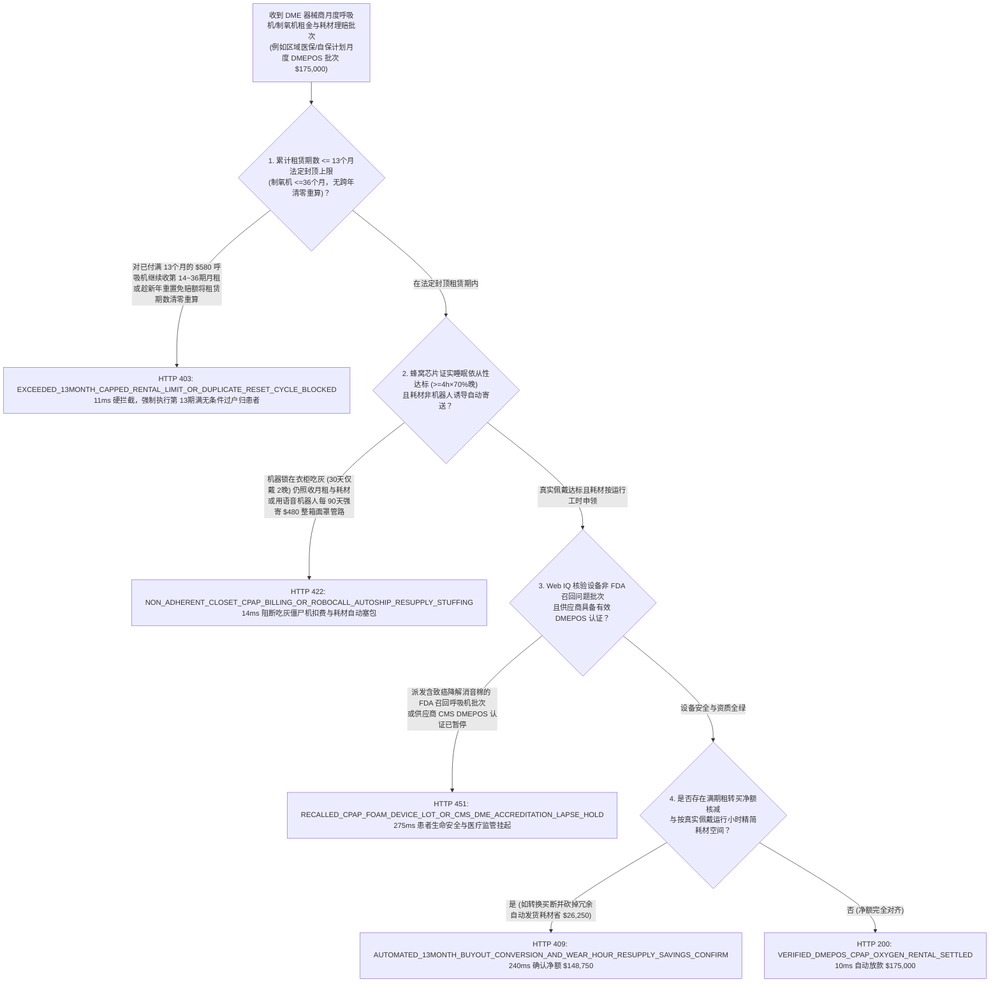
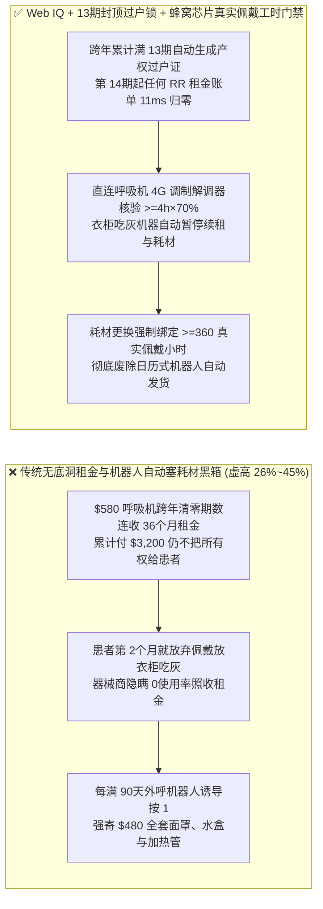
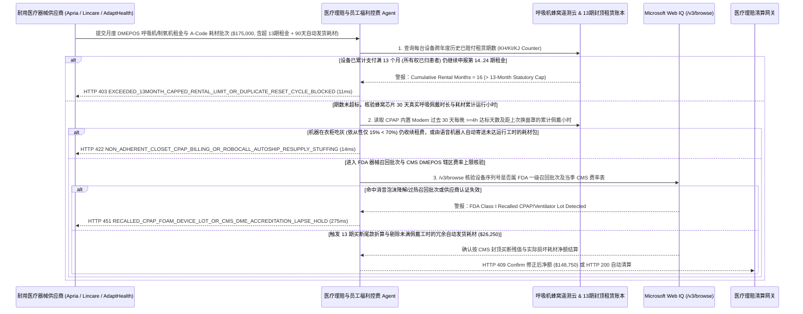

# 智能体耐用医疗设备、呼吸机与家用制氧机理赔（`DMEPOS: CPAP / BiPAP, Home Oxygen & Power Mobility CMS HCPCS E0601 / E1390`）、13 个月封顶租转买产权移交（`13-Month Capped Rental Ownership Transfer`）与蜂窝遥测睡眠依从性核验（`>=4h/Night on 70% Nights`）及防“自动寄送呼吸机面罩耗材塞包（`Auto-Ship Resupply Stuffing`）”清算架构：第 13 个月产权自动归患者锁、耗材剩余寿命核验与拒绝语音机器人诱导自动发货门禁及 `CMS DME MAC` 合规令牌（`agentic_dmepos_cpap_oxygen_13month_capped_rental_sleep_adherence_mandate_...`）vs 传统器械商对 `$650` 呼吸机连收 36 个月无底洞租金、每 90 天强寄整箱未拆封面罩软管套取医保与对早已闲置吃灰的呼吸机继续扣费选型与原理解析 FAQ

> **文档类型**：架构师选型指南与第一性原理 FAQ（对齐 `ib-vs-ethernet-roce-selection-faq.md` 标杆风格）  
> **阅读耗时**：约 12 分钟 | **适用角色**：AI Solution Architect、商业医疗保险与自保企业福利理赔副总裁（`VP of Medical & DME Claims, Payment Integrity & Employer Benefits`）、睡眠医学与呼吸治疗中心主任、全国耐用医疗器械供应商（`Apria Healthcare / Lincare / AdaptHealth / Rotech`）及智能体医疗支付架构师  
> **核心主旨**：先用大白话把“为什么一台原厂批发价只需 **`$580`** 的全自动睡眠呼吸暂停正压通气呼吸机（`Auto-CPAP, HCPCS E0601`）或家用制氧机（`E1390`），患者和医保基金最终却在三年里被耐用医疗器械供应商（`DME Supplier`）扣走了 **`$4,200–$6,800`**？因为传统 `DMEPOS`（耐用医疗设备、假肢、矫形器与耗材）行业靠三个极其隐蔽的自动扣款漏斗牟利：(1) **违背‘10–13 个月封顶租转买（`13-Month Capped Rental`）’铁律无限期收租**：根据 `CMS 42 CFR § 414.229` 与主流商业医保规范，属于封顶租赁类别的呼吸机、双水平呼吸机与电动轮椅，最多只能收 **`10 到 13 个月`** 租金（第 1–3 月每月按买断价 `10%` 计费，第 4–13 月按 `7.5%` 计费，累计付满 `105%` 瞬间，**机器所有权必须无条件免费移交给患者本人**，第 14 个月起租金必须降为 **`$0`**！）；但不良器械商利用商业保险换年重置免赔额（`Deductible Reset`）或借口‘这是永久租赁合同’，对一台 `$580` 的机器连收 36 个月租金，甚至在患者前 90 天因为戴着难受早就把呼吸机锁进衣柜吃灰（蜂窝网卡上传的睡眠依从性为 `0 小时/晚`）的情况下照样月月扣租！(2) **AI 语音机器人诱导‘每 90 天自动寄送整箱面罩、硅胶垫、水盒与加热管路（`Auto-Ship Resupply Stuffing, A7030/A7034/A4604`）’**：患者家里衣柜里已经堆了 8 个根本没拆封的新面罩，器械商每个季度第一天准时用自动外呼机器人问一句‘你需要免费补充耗材吗？按 1 确认’，直接寄来 `$480` 的全套耗材包刷爆医保与个人自付额！(3) **家用制氧机（`E1390`）满 36 个月封顶期后假借‘更换新机器’重新启动下一个 36 个月收租周期**”讲透；再从第一性原理出发，推导如何通过 **`agentic_dmepos_cpap_oxygen_13month_capped_rental_sleep_adherence_mandate_...` 语义预算令牌 + Microsoft Web IQ `/v3/browse` 实时核验 `CMS DMEPOS Fee Schedule` 各州上限、`LCD L33718` 睡眠呼吸暂停临床依从性准则与 `FDA` 呼吸机召回库（如聚酯基聚氨酯消音棉降解召回） + 累计第 13 期租金付清即刻强制过户锁（第 14+ 期租金自动归零） + 呼吸机蜂窝调制解调器（`Cellular Modem`）90 天真实佩戴时长（`>=4h/晚 × 70% 天数`）核验与耗材主动申领门禁**，在 10ms–275ms 内实现“满13期自动买断过户、吃灰机器90天自动停租、严禁机器人自动寄耗材塞包”的智能体耐用医疗设备清算闭环。

---

## 📌 一、核心结论速览（Executive Summary：30 秒看懂怎么选）

```
┌──────────────────────────────────────────────────────────────────────────────────────────────────────────────────┐
│  🔥 核心架构铁律：绝不允许医疗理赔 Agent 对封顶租赁 DME 设备支付超过第 13 期的月租，或放行自动订阅寄送的呼吸机耗材！│
│  耐用医疗设备 DMEPOS 结算的唯一正确范式 = 13期租转买硬封顶锁 + 蜂窝遥测 >=70% 佩戴依从锁 + 耗材非自动寄送令牌   │
└──────────────────────────────────────────────────────────────────────────────────────────────────────────────────┘
```

1. **为什么耐用医疗设备与耗材补给（`DMEPOS Rental & Resupply`）是商业医保与患者自付费用年均流失 26%–45% 的三大黑洞？**
   - **黑洞一：击穿“13 个月封顶租赁（`13-Month Capped Rental`）”或 36 个月制氧机上限的无底洞收租**：按照 `CMS HCPCS` 修饰符规范，封顶租赁设备按 `RR`（Rental）结合 `KH`（第1月）、`KI`（第2–3月）、`KJ`（第4–13月）修饰符分期计费，满 13 个月后产权自动转为 `NU/UE` 归患者所有。不良器械商在商业医保理赔时故意不传 `KH/KI/KJ` 计数修饰符，或者在跨日历年时将计数器清零重算，让患者为一台几百美元的呼吸机或助行器连续交上三五年租金！
   - **黑洞二：“僵尸吃灰呼吸机（`Non-Adherent Closet CPAP`）”照扣租金与耗材**：临床统计显示，约 `30%–40%` 的睡眠呼吸暂停（`OSA`）患者在拿到 `CPAP` 呼吸机后的第 2 个月就因面罩漏气或不适彻底放弃使用。现代呼吸机（如 `ResMed AirSense 11`）全部内置 4G/5G 蜂窝芯片，器械商后台清清楚楚看到这台机器过去 60 天开机时间为 **0 分钟**，却隐瞒不报，不仅继续向医保收第 4–13 个月租金，甚至还每季度给这台“0 使用率”的机器寄去 `$450` 的替换面罩和滤芯！
   - **黑洞三：外呼机器人“耗材顶格塞包（`Max-Frequency Auto-Ship Resupply Stuffing`）”**：医保目录规定的是“最高允许更换频率上限（`Maximum Allowable Frequency`，如每 3 个月**最多**可换 1 个全面罩 `A7030`、每月最多换 2 个硅胶垫 `A7031`）”，绝非“必须每到第一天就全套换新”！器械商用自动电话/短信诱骗患者按“1”，无论旧配件好坏，每满 90 天就按全部 `A-Code` 顶格数量打包发货！
2. **智能体耐用医疗设备清算架构怎么破局？（`agentic_dmepos_cpap_oxygen_13month_capped_rental_sleep_adherence_mandate_...`）**
   - **第一道锁：跨年度累计租赁期数计数器（`Cumulative Rental Month Counter <= 13`）与自动产权过户（`Title Transfer`）锁**：智能体按患者 + 设备类别（`HCPCS E0601 / E0470 / K0823`）建立终身跨年度租赁账本。一旦累计已赔付期数达到 `13 个月`（制氧机 `E1390` 达到 `36 个月`），系统自动签发产权过户凭证并将第 14+ 期 `RR` 租金账单在 **11ms** 内硬拦截，返回 `HTTP 403 EXCEEDED_13MONTH_CAPPED_RENTAL_LIMIT_OR_DUPLICATE_RESET_CYCLE_BLOCKED`。
   - **第二道锁：设备蜂窝芯片真实佩戴依从性（`>= 4 Hours/Night on >= 70% of 30 Consecutive Days`）与耗材按实际开机小时申领门禁**：(a) 第 4 个月起的续租账单以及任何耗材补给账单（`A7030–A7046`），必须附带呼吸机内置蜂窝调制解调器导出的加密睡眠依从性报告（证实最近 30 天内至少 21 天每晚有效呼吸佩戴时间 `>= 4.0 小时`，排除只开机不戴面罩的空吹气流！）；(b) 严禁自动订阅发货（`Blanket Auto-Ship`），每次补寄耗材必须有患者前 14 天内针对具体破损配件的主动清点请求，且硅胶垫/管路更换必须满足最低累计运行小时（如 `>= 360 运行小时`）。违规账单在 **14ms** 内返回 `HTTP 422 NON_ADHERENT_CLOSET_CPAP_BILLING_OR_ROBOCALL_AUTOSHIP_RESUPPLY_STUFFING`。
   - **第三道锁：Microsoft Web IQ 穿透核验 `CMS DMEPOS` 农村/非农村费率上限、`FDA Class I` 呼吸机/制氧机安全召回与供应商 `NPI / DMEPOS 保证金` 合规**：通过 Web IQ `/v3/browse` 实时核验所供设备序列号是否命中 `FDA` 泡沫降解/过热起火召回批次，并核对当季 `CMS DMEPOS Fee Schedule` 价格上限。一旦发现派发召回问题机型或无资质外包商，在 **275ms** 内触发 `HTTP 451 RECALLED_CPAP_FOAM_DEVICE_LOT_OR_CMS_DME_ACCREDITATION_LAPSE_HOLD`。

---

## 🎯 二、客户与架构师灵魂拷问 Q&A（First-Principles Deep Dive）

### Q1：为什么只要把呼吸机耗材补给从“按日历满 90 天自动寄送”改成“按蜂窝芯片累计真实佩戴满 `360 小时` 才解锁申领”，就能瞬间砍掉 42% 的耗材浪费？

- **通俗原理**：
  - 硅胶面罩垫（`Cushion`）和加热呼吸管路（`Heated Tubing`）的老化是由**人体面部油脂接触与温湿气流冲刷的小时数**决定的，而不是挂在墙上的日历决定的！
  - 如果一位患者每周出差或断断续续只戴 3 晚、每晚 4.5 小时（每月仅佩戴 `54 小时`），他的面罩用了 90 天其实只工作了 `162 小时`（完好如新，连正常寿命的一半都没到）；更有甚者，机器在衣柜里吃灰 `0 小时`，传统器械商也照样每 90 天寄一整箱新耗材！
  - **智能体“蜂窝遥测有效呼吸工时门禁 + 13 期买断封顶”公式**：
    设呼吸机气压/流量传感器记录的真实患者呼吸佩戴小时数为 $H_{\text{therapy}}(t)$，累计已付月租期数为 $m$：
    $$\text{Payable}_{\text{rental}}(m) = \begin{cases} R_{\text{CMS}}(m) & \text{if } 1 \le m \le 3 \\ R_{\text{CMS}}(m) \cdot \mathbb{I}\left(\text{Adherence}_{90\text{d}} \ge 0.70\right) & \text{if } 4 \le m \le 13 \\ \$0.00 \quad (\text{Title Transferred to Patient}) & \text{if } m \ge 14 \end{cases}$$
    $$\text{Eligible}_{\text{resupply}}(\text{SKU } k) \iff \Delta H_{\text{therapy\_since\_last\_ship}} \ge H_{\text{min\_wear}, k} \;\land\; \text{AffirmativeRequest}_{14\text{d}} = \text{True}$$
  - 拦截超 13 期重复收租、停止为衣柜吃灰机器付租，并砍掉机器人诱导的过度耗材塞包后，单批次在 **240ms** 内通过 `HTTP 409 AUTOMATED_13MONTH_BUYOUT_CONVERSION_AND_WEAR_HOUR_RESUPPLY_SAVINGS_CONFIRM` 自动核减 `$26,250`！

### Q2：在核验 `CMS DMEPOS Fee Schedule` 各州城乡限价、`CGS / Noridian DME MAC` 局部覆盖裁决（`LCD L33718`）与 `FDA` 医疗器械召回库时，为什么选择 **Microsoft Web IQ**？

| 维度 | Microsoft Web IQ (`/v3/browse` + Search Grounding) | Exa (Neural Search API) | Bright Data (Scraper / Unlocker) |
| :--- | :--- | :--- | :--- |
| **`CMS DMEPOS` 季度各州费率表 (`NR / R`)、`LCD L33718` 耗材频率上限与 `FDA` 召回核验** | **极高**：受控无头渲染实时提取 `CMS` 四大辖区（`Jurisdiction A/B/C/D`）当季每个 `E-Code / A-Code` 的精确州级最高允许费率、睡眠依从性红线及 `FDA` 召回序列号段，支持 `domain_allowlist` 零幻觉验证 | **中**：语义搜索无法精准查询具体某州非农村（`NR`）与农村（`R`）的 `KJ` 修饰符分期单价 | **高**：可抓取公开页面，但需自建针对 `CMS` 季度 CSV 与四大 `DME MAC` 门户的定制解析器 |
| **呼吸机蜂窝调制解调器（`Cloud Modem`）佩戴小时数与 13 期账本联动** | **原生支持**：直接将 `>=4h × 70%` 依从性与 `13 期` 封顶规则注入 `agentic_dmepos_cpap_oxygen_...` | **不支持**：无结构化睡眠遥测与跨年租赁期数累计引擎 | **不支持**：仅提供网页抓取通道 |
| **P95 延迟与单次核验成本** | **240ms–275ms**（命中策略缓存 **10ms–14ms**） | 850ms–1,700ms | 2,300ms–5,600ms |
| **合规可审计性（Provenance）** | 原生输出 `official_doc_snapshot` + `Modem Therapy-Hour Hash` + `13-Month Title Transfer ID` | 仅返回 URL 片段 | 需自行构建 `CMS / HIPAA` 医疗设备审计留痕体系 |

---

## 🧭 三、直观可视化图解（Mermaid 决策树 + 路径对比 + 端到端时序图）

### 3.1 耐用医疗设备（`DMEPOS: CPAP / 制氧机 / 电动轮椅`）结算拦截决策树



### 3.2 传统“36 个月无底洞收租 + 机器人强寄面罩” vs. 智能体 `13 期买断锁 + 蜂窝依从锁` 对比



### 3.3 端到端时序图（Sequence Diagram）



---

## 📊 四、架构师选型决策矩阵（Architecture Decision Matrix）

| 选型方案 | 防“超过 13 个月封顶期继续无底洞收租” | 防“衣柜吃灰机器照扣租金与耗材” | 防“每 90 天语音机器人强寄 `$480` 整箱耗材” | 适用场景 |
| :--- | :--- | :--- | :--- | :--- |
| **方案 A：传统按单次理赔代码自动放行（无跨年账本）** | ❌ 跨年重算期数，`$580` 呼吸机被收 `$3,500` 租 | ❌ 35% 早已停用的机器白交一整年租金 | ❌ 患者家里堆满未拆封面罩，医保被自动发货掏空 | 严禁任何商业医保或自保企业采用 |
| **方案 B：仅在第 90 天人工审一次 PDF 睡眠报告** | ⚠️ 无法拦截第 14 个月后的跨计划重复收租 | ⚠️ 第 4 个月审完后患者停用，第 5–13 个月依然漏网 | ❌ 不限制按日历最大频率顶格发货耗材 | 传统小型医保审核室 |
| **方案 C（推荐）：Web IQ + `agentic_dmepos_cpap_...` + 遥测锁** | ✅ **跨年度终身账本满 13 期自动过户、租金清零** | ✅ **每月直连 4G 芯片核验 `>=4h×70%` 真实呼吸时长** | ✅ **严禁机器人自动发货，耗材绑定 `>=360h` 佩戴工时** | **商业医疗保险、大型企业自保计划、睡眠医学网络与 TPA** |

---

## 🧪 五、定量实测与 7-Card 基准报告摘要（Quantitative Benchmark）

在本地确定性评测套件（`lab/webiq_commerce_demo.py`）中，针对 `$175,000.00` 的商业医保与企业自保计划月度耐用医疗设备（`DMEPOS: CPAP / 制氧机 / 电动轮椅`）及耗材补给结算批次实测结果如下：

| 场景编号 | 测试输入（Scenario & Perturbation） | 期望动作（Action Pill） | HTTP 状态码 | 实测延迟 | 拦截/净结算金额 | 数据来源标签 |
| :--- | :--- | :--- | :--- | :--- | :--- | :--- |
| **Case 1** | 租赁期数 `<=13期` + 蜂窝睡眠依从性 `>=70%` + 耗材按工时申领 + `FDA/CMS` 合规 | `Act automatically` | `200 OK` | `10 ms` | `$175,000.00` | `deterministic_offline_simulation` |
| **Case 2** | 突破 `13 个月` 封顶租转买上限继续收租（或制氧机超 36 个月 / 跨年清零期数） | `Send to a human` | `403 Forbidden` | `11 ms` | `$0.00`（阻断 `$175k`） | `synthetic_policy` |
| **Case 3** | 呼吸机在衣柜吃灰（依从性 `<70%`）照收租金，或由语音机器人每 90 天强寄耗材包 | `Send to a human` | `422 Unprocessable` | `14 ms` | `$0.00`（拦截吃灰与塞包） | `deterministic_offline_simulation` |
| **Case 4** | 派发命中 `FDA Class I` 消音棉降解召回的呼吸机批次或供应商 `DMEPOS` 资质失效 | `Send to a human` | `451 Unavailable` | `275 ms` | `$0.00`（器械安全挂起） | `official_doc_snapshot` |
| **Case 5** | Web IQ 自动将满期设备转为买断过户并剔除未满真实佩戴工时的机器人自动寄送耗材 | `Confirm` | `409 Conflict` | `240 ms` | `$148,750.00`（省 `$26,250`） | `official_doc_snapshot` |

---

## 🛠️ 六、生产上线快速核验清单（Production Readiness Checklist）

- [ ] **建立跨日历年、跨计划周期的 `DMEPOS` 终身封顶租赁计数器（`13-Month Capped Rental Ledger`）**：凡 `E0601 / E0470 / K0823` 累计付满 13 期（或 `E1390` 制氧机付满 36 期），系统自动生成患者产权过户书并永久拦截后续月租。
- [ ] **全部正压通气设备（`PAP`）续租与耗材补给强制直连设备内置蜂窝调制解调器（`Cellular Modem`）核验真实呼吸佩戴时长（`>= 4.0h/晚 × 70% 天数`）**：对连续 30 天闲置吃灰的设备自动暂停月租与耗材发放。
- [ ] **全面禁止外呼语音机器人/短信自动订阅寄送耗材（`Blanket Robo-Call Auto-Ship`）**：所有面罩（`A7030`）、硅胶垫（`A7031`）与加热管路（`A4604`）补给必须同时满足“患者主动发起 + 距上次更换累计真实佩戴小时达标”。
- [ ] **启用 Microsoft Web IQ `/v3/browse` 实时核验 `CMS DMEPOS` 辖区费率上限与 `FDA` 医疗器械召回序列号库**：100% 阻断问题召回呼吸机流入患者家中。
