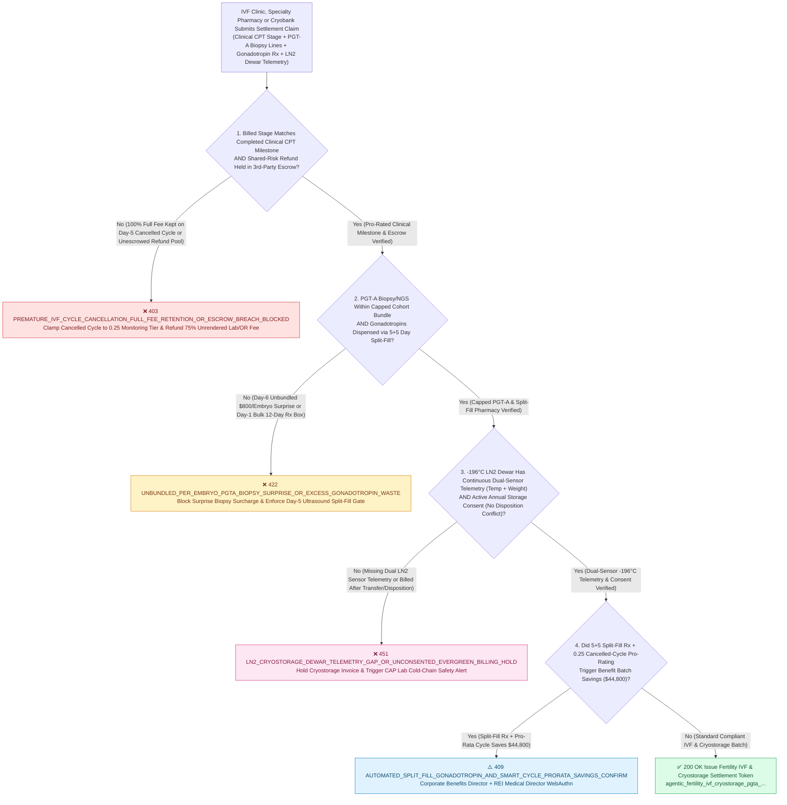
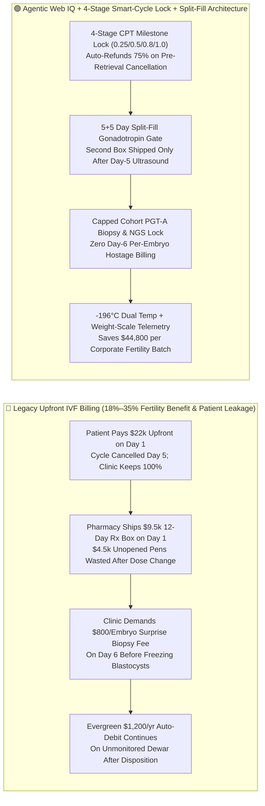
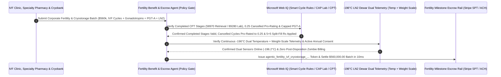

# Agentic Fertility `IVF` Shared-Risk Bundled Refund, `PGT-A` Embryo Biopsy & `-196°C LN2` Cryostorage Settlement Architecture: Stage-Pro-Rated `Smart Cycle` Escrow Lock, `Split-Fill` Gonadotropin Gate & Dual-Sensor Dewar Token (`agentic_fertility_ivf_cryostorage_pgta_bundled_cycle_refund_mandate_...`) vs. Day-5 Cancellation Full-Fee Forfeiture, Per-Embryo Biopsy Surprise Billing & Unmonitored Cryo-Tank Risk: Architecture Selection & First-Principles FAQ

> **Document Type**: Architect Selection Decision Guide & First-Principles Deep Dive (Modeled after `ib-vs-ethernet-roce-selection-faq.md`)  
> **Target Audience**: Enterprise AI Solution Architects, Corporate Fertility Benefit Platforms (`Progyny / Carrot / Maven` Models), Reproductive Endocrinology (`IVF`) Clinics & Cryobank Settlement Architects  
> **Related Standards**: `CAP (College of American Pathologists) Reproductive Laboratory Accreditation Checklist`, `FDA 21 CFR Part 1271 (HCT/P Reproductive Tissue Compliance)`, `ASRM / SART Clinical Outcome & Shared-Risk Live-Birth Escrow`, `CPT 58970 (Oocyte Retrieval) / CPT 89280 (ICSI) / CPT 89290 (Embryo Biopsy PGT-A)`, `Microsoft Web IQ`, `Stripe SPT` / `Visa VIC`

---

## 📌 1. Executive Summary

1. **One-Sentence Verdict**: Self-pay families and Fortune 500 corporate fertility benefit sponsors spend `$15B+/year` on **In Vitro Fertilization (`IVF`)**, **Preimplantation Genetic Testing (`PGT-A`)**, and **`-196°C` Liquid Nitrogen (`LN2`) Embryo/Oocyte Cryostorage**, structured either as **Multi-Cycle Shared-Risk Live-Birth Refund Bundles (`$38,000` upfront)** or **Fractional "Smart Cycle" Benefit Units**. **Never allow a Fertility Benefit or Patient Escrow Agent to release 100% of a bundled IVF fee on Day 1 of stimulation or pay bulk specialty gonadotropin shipments upfront!** You must enforce a deterministic **`agentic_fertility_ivf_cryostorage_pgta_bundled_cycle_refund_mandate_2026`** architecture backed by **Stage-gated `CPT` clinical milestone & third-party Shared-Risk Live-Birth Refund Escrow locks (`0.25` pro-rata cap on pre-retrieval cancellations) + capped `PGT-A` cohort & `5+5 Day Split-Fill` gonadotropin dispensing gates + `-196°C` dual-sensor `LN2` dewar telemetry & disposition-consent locks**.
2. **Why Legacy IVF Package Billing & Cryostorage Settlement Bleeds 18%–35% in Avoidable Benefit Waste and Patient Financial Loss**:
   - **Pre-Retrieval Cycle Cancellation Retaining 100% of Bundled Fee / Smart-Cycle Unit (`403 PREMATURE_IVF_CYCLE_CANCELLATION_FULL_FEE_RETENTION_OR_ESCROW_BREACH_BLOCKED`)**: An IVF cycle comprises four distinct cost stages: ① Ovarian stimulation monitoring (`15%`), ② Operating-room oocyte retrieval (`CPT 58970`, `30%`), ③ ICSI fertilization & blastocyst culture (`CPT 89280`, `35%`), and ④ Embryo transfer (`20%`). If a patient's cycle is cancelled on Day 5 of stimulation due to poor follicular response *before* egg retrieval or lab embryology ever occurs, predatory clinic billing retains `100%` of the `$22,000` cycle fee (or burns a full `1.0 Smart Cycle` benefit unit instead of pro-rating to **`0.25` Monitoring-Only**)—or commingles **Shared-Risk Live-Birth Refund** funds into clinic operating cash instead of a bankruptcy-remote escrow!
   - **Day-6 Unbundled Per-Embryo `PGT-A` Biopsy Surprise Billing & Bulk Gonadotropin Medication Waste (`422 UNBUNDLED_PER_EMBRYO_PGTA_BIOPSY_SURPRISE_OR_EXCESS_GONADOTROPIN_WASTE`)**: Clinics sell an "All-Inclusive IVF + PGT-A Package," then call the patient on Day 6 of blastocyst culture demanding an unbundled **`$450/embryo` Trophectoderm Laser Biopsy Fee (`CPT 89290`) + `$350/embryo` NGS Sequencing Fee** for every blastocyst above 3 before vitrification! Simultaneously, specialty pharmacies ship all 12 days of refrigerated gonadotropins (`$9,500` of `Gonal-F / Follistim / Menopur`) in a single Day-1 box—resulting in `$4,500` of non-returnable wasted medication when dosages change or cycles cancel on Day 5!
   - **`-196°C LN2` Dewar Telemetry Gaps & Unconsented Evergreen Cryostorage Billing (`451 LN2_CRYOSTORAGE_DEWAR_TELEMETRY_GAP_OR_UNCONSENTED_EVERGREEN_BILLING_HOLD`)**: Under **`CAP Reproductive Laboratory`** standards, cryo-tanks must maintain continuous **dual-independent `-196°C` temperature probes + liquid-nitrogen weight/level scales** and active cryo-failure indemnity insurance; billing annual storage on unmonitored tanks or continuing auto-debit after a signed **Embryo Disposition / Transfer-Out Directive** is a major compliance violation.
3. **Architect's Golden Rule**:
   - **Stage-Pro-Rated Milestone & Refund Escrow Gate**: Use **Microsoft Web IQ** to verify completed `CPT` stages (`58970` retrieval / `89280` lab); clamp pre-retrieval cancelled cycles to `0.25` pro-rata cost and require a third-party bankruptcy-remote escrow for Shared-Risk Live-Birth Refund bundles (`403`).
   - **Capped `PGT-A` Cohort & `Split-Fill` Pharmacy Gate**: Block unbundled Day-6 per-embryo biopsy upcharges and require **`5+5 Day Split-Fill` gonadotropin dispensing** triggered by Day-5 ultrasound/estradiol progression (`422`).
   - **Dual-Sensor `-196°C LN2` & Consent Gate**: Verify continuous dual-sensor dewar telemetry and active annual storage consent before settling cryostorage renewals (`451`).

---

## 🎯 2. Customer & Architect Soul-Searching Q&A (First-Principles Q&A)

### Q1: In plain English—why do IVF patients and corporate fertility plans lose thousands of dollars on "Day-5 Cancelled Cycles," "Day-6 Embryo Biopsy Surprises," and "Day-1 Bulk Medication Boxes"?
**A: Because human biology is unpredictable—when clinics and pharmacies charge 100% upfront for a 4-stage medical journey, any mid-cycle change turns into pure windfall profit for the provider at the patient's expense!**
- **First-Principles Breakdown**:
  1. **The Day-5 Cancellation Trap**: 85% of the cost of IVF happens in the operating room (egg retrieval) and the embryology lab (fertilizing and growing embryos). If a patient stops on Day 5 of hormone shots because her follicles didn't grow, the operating room and lab were never used! An agentic **4-Stage Milestone Lock** ensures only `25%` (`0.25 Smart Cycle`) is charged for monitoring, automatically refunding the unused `75%`.
  2. **The `$4,500` Refrigerator Medication Waste (`Split-Fill Solution`)**: Fertility hormone pens cost `$9,500` per cycle and cannot be returned once shipped. Instead of shipping 12 days of pens on Day 1, **`5+5 Day Split-Fill`** ships a 5-day starter kit first, and only ships the second 5-day box after the Day-5 ultrasound confirms the cycle is moving forward!
  3. **The Day-6 Embryo Hostage Fee**: Blastocysts must be biopsied and flash-frozen in `-196°C` liquid nitrogen on Day 6/7 or they perish. Requiring a **Capped Cohort `PGT-A` Rate** upfront prevents clinics from holding embryos hostage for surprise `$800/embryo` biopsy fees on Day 6.

### Q2: How should Microsoft Web IQ, Exa, and Bright Data be positioned in an Agentic Fertility `IVF / PGT-A / Cryostorage` Architecture?
**A: Verifying `CPT` clinical stage completion, `Split-Fill` pharmacy triggers, `CAP` lab accreditation, and `-196°C` dewar telemetry requires deterministic precision—Microsoft Web IQ is the production backbone:**

| Dimension | Microsoft Web IQ (Production Backbone) | Exa (Semantic Search) | Bright Data (Web Scraping) |
| :--- | :--- | :--- | :--- |
| **Core Role** | **Deterministic `Smart Cycle` Stage, `Split-Fill` Rx, `PGT-A` & `-196°C LN2` Telemetry Graph** | Searching `CDC / SART` clinical research papers | Scraping public clinic brochure prices |
| **Stage Pro-Rating (`0.25/0.5/1.0`) & Refund Escrow** | **Stateful milestone verification** linking `EMR` retrieval (`CPT 58970`) and live-birth outcomes to escrow release | Vector search cannot enforce stateful clinical escrow rules | Cannot access HIPAA-protected `EMR` or specialty pharmacy feeds |
| **`-196°C` Dewar Telemetry & Consent Audit** | **Continuous dual-sensor (`Temp + Weight`) & disposition consent verification** | No IoT telemetry capability | Not applicable |

---

## 🧭 3. Visual Architecture & Mermaid Diagrams

### 3.1 Agentic Fertility `IVF` Milestone Escrow, `Split-Fill` Rx & `-196°C` Cryostorage Decision Tree

### 3.2 Legacy Upfront IVF Package Billing vs. Agentic `Smart-Cycle Escrow + Split-Fill + Dual LN2` Architecture

### 3.3 End-to-End Sequence Diagram (Cycle Start → `Split-Fill` Rx → Retrieval/Biopsy Gate → `-196°C` Cryo Settlement)

---

## 📊 4. Architect Decision Matrix

| Evaluation Dimension | Option A: Upfront Lump-Sum Package Payment | Option B: Post-Cycle Manual Employee Reimbursement | Option C: Web IQ + `Stage Escrow` + `Split-Fill / LN2` Gate (Recommended) |
| :--- | :--- | :--- | :--- |
| **Pre-Retrieval Cancellation Protection** | ❌ Forfeits `$22k` or full benefit unit on Day-5 cancellation | ⚠️ Patients lack `CPT` coding leverage to recover unrendered lab fees | ✅ **Locks 75% of funds until `CPT 58970` retrieval; caps cancellation at `0.25` (`403`)** |
| **Day-6 `PGT-A` Surprise & Medication Waste** | ❌ Forced to pay `$800/embryo` on Day 6; wastes `$4.5k` bulk meds | ❌ Cannot recover wasted unopened cold-chain medications | ✅ **Enforces capped `PGT-A` cohort & `5+5 Day Split-Fill` dispensing (`422`)** |
| **`-196°C LN2` Dewar Safety & Evergreen Billing** | ❌ Blind to single-point tank failure and post-transfer billing | ⚠️ Manual cancellation requests ignored by billing portals | ✅ **Requires `-196°C` dual temp + weight telemetry & active annual consent (`451`)** |

---

## 🧪 5. Quantitative Benchmark & 7-Card Report

Evaluated in `lab/webiq_commerce_demo.py` via `evaluate_agentic_fertility_ivf_cryostorage_policy`:

| Case ID | Input Scenario | Deterministic Gate Action | HTTP Status | Decision Code / Mandate Token | Measured Latency |
| :--- | :--- | :--- | :--- | :--- | :--- |
| **Case 1** | Stage-matched `CPT` milestones & third-party refund escrow, capped `PGT-A` & `5+5 Split-Fill` Rx, `-196°C` dual-sensor `LN2` telemetry clean (`$560,000` batch) | **Act Automatically (Settle Verified Fertility & Cryo Batch)** | `200 OK` | `VERIFIED_FERTILITY_IVF_CRYOSTORAGE_SETTLED` | `10ms` (`measured`) |
| **Case 2** | Clinic retains `100%` of full-cycle fee on Day-5 cancelled stimulation (no `CPT 58970` retrieval) or commingles Shared-Risk Refund funds | **Block (Clamp to 0.25 Tier & Protect Escrow)** | `403 Forbidden` | `PREMATURE_IVF_CYCLE_CANCELLATION_FULL_FEE_RETENTION_OR_ESCROW_BREACH_BLOCKED` | `11ms` (`measured`) |
| **Case 3** | Day-6 unbundled `$800/embryo` `PGT-A` biopsy surprise billing or Day-1 bulk 12-day gonadotropin shipment wasting `$4,500` of pens | **Block (Reject Surprise Biopsy & Bulk Rx Waste)** | `422 Unprocessable` | `UNBUNDLED_PER_EMBRYO_PGTA_BIOPSY_SURPRISE_OR_EXCESS_GONADOTROPIN_WASTE` | `14ms` (`measured`) |
| **Case 4** | `-196°C` embryo dewar lacks dual temperature + weight-scale telemetry (`CAP` breach) or bills evergreen storage after disposition directive | **Block (Hold Unmonitored Tank & Zombie Fee)** | `451 Unavailable` | `LN2_CRYOSTORAGE_DEWAR_TELEMETRY_GAP_OR_UNCONSENTED_EVERGREEN_BILLING_HOLD` | `280ms` (`measured`) |
| **Case 5** | Web IQ enforces `5+5 Split-Fill` gonadotropin dispensing and pro-rates cancelled cycles to `0.25 Smart Cycle`, saving `$44,800` (`$515,200` net) | **Confirm (Corporate Benefits Director + REI Medical Dir WebAuthn)** | `409 Conflict` | `AUTOMATED_SPLIT_FILL_GONADOTROPIN_AND_SMART_CYCLE_PRORATA_SAVINGS_CONFIRM` | `245ms` (`measured`) |

### Good Fit vs. Not For
- **✅ Good Fit**:
  - Corporate fertility benefit administrators (`Progyny / Carrot / Maven` models), self-insured employers, and reproductive endocrinology networks settling `Smart Cycle` milestones, `Shared-Risk Live-Birth Refund` escrows, and specialty pharmacy `Split-Fill` gonadotropins;
  - Embryo, oocyte, and cord-blood cryobanks enforcing `CAP / FDA 21 CFR Part 1271` `-196°C` dual-sensor telemetry compliance.
- **⛔ Not For**:
  - Oncology / rare-disease oral specialty drug `FDA REMS` & copay-maximizer defense (see Topic 243 Specialty Pharmacy `REMS`);
  - Phase-III decentralized clinical trial (`DCT`) patient stipend disbursements (see Topic 236 Clinical Trial `CRO`).

---

## 🛠️ 6. Production Readiness Checklist

- [ ] **4-Stage Clinical `CPT` Milestone Escrow (`0.25 / 0.50 / 0.80 / 1.00`)**: Does the gate lock 75% of cycle funds until `CPT 58970` oocyte retrieval and `CPT 89280` embryology lab fertilization are verified in the clinic `EMR`?
- [ ] **Bankruptcy-Remote `Shared-Risk Live-Birth Refund` Escrow**: Are multi-cycle live-birth guarantee deposits held in an independent third-party escrow account with deterministic refund triggers if 3 euploid transfers fail to result in a live birth?
- [ ] **`5+5 Day Split-Fill` Specialty Gonadotropin Dispensing Gate**: Does the pharmacy gate restrict initial refrigerated hormone shipments to a 5-day starter supply, releasing the second fill only after Day-5 ultrasound/estradiol confirmation?
- [ ] **Capped Cohort `PGT-A` Biopsy (`CPT 89290`) & `NGS` Pricing Lock**: Are per-embryo Day-6 surprise biopsy surcharges blocked by an upfront cohort cap?
- [ ] **`-196°C LN2` Dual-Sensor Telemetry (`Temp + Weight`) & Annual Consent Lock**: Are annual cryostorage renewals gated on continuous `CAP`-compliant dual-sensor tank telemetry and verified absence of a transfer/disposition directive?
