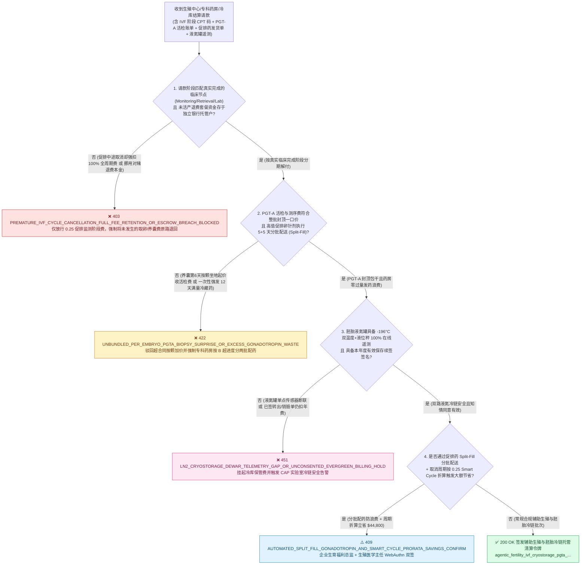
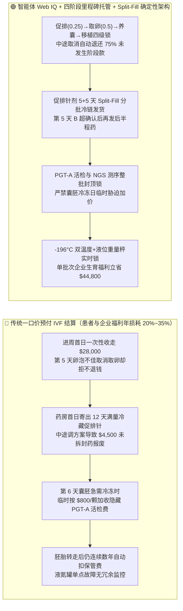
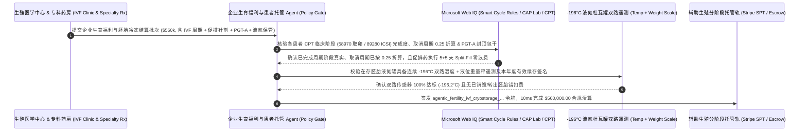

# 智能体辅助生殖与胚胎冷链托管（`IVF Fertility Shared-Risk Refund & LN2 Cryostorage`）、`PGT-A` 囊胚基因筛查与企业生育福利（`Smart Cycle`）清算架构：活产退费（`Live-Birth Refund`）独立银行托管锁、促排中途取消按 `0.25` 周期折算门禁与 `-196°C` 液氮罐双路遥测令牌（`agentic_fertility_ivf_cryostorage_pgta_bundled_cycle_refund_mandate_...`）vs 传统生殖中心促排第 5 天取消取卵却全额没收 `$22,000`、按颗乱收隐藏胚胎活检费与液氮罐失温零赔偿选型与原理解析 FAQ

> **文档类型**：架构师选型决策指南 & 第一性原理深度解析（对标 `ib-vs-ethernet-roce-selection-faq.md` 标杆风格）  
> **适用角色**：Enterprise AI Solution Architect、跨国企业生育福利平台（Corporate Fertility Benefits如 Progyny / Carrot / Maven）、辅助生殖医学中心（IVF Clinic）与生物样本冷链（Cryobank）清算架构师  
> **关联标准的演进**：`CAP (College of American Pathologists) Reproductive Laboratory Accreditation Checklist`、`FDA 21 CFR Part 1271 (Human Cells, Tissues, and Cellular and Tissue-Based Products HCT/Ps)`、`ASRM / SART Clinical Outcome Reporting & Shared-Risk Live-Birth Escrow`、`CPT 58970 (Oocyte Retrieval) / CPT 89280 (ICSI) / CPT 89290 (Embryo Biopsy PGT-A)`、`Microsoft Web IQ`、`Stripe SPT` / `Visa VIC`

---

## 📌 一、 核心结论速览（Executive Summary）

1. **一句话定性**：在现代辅助生殖（`IVF 试管婴儿`）、三代囊胚基因筛查（`PGT-A`）与企业员工生育福利（`Smart Cycle`）及胚胎长期冷冻保存（`-196°C LN2 Cryostorage`）中，单周期医疗与促排药费高达 `$22,000~$38,000`，普遍采用**“多周期不成功（未活产）全额退费套餐（`Shared-Risk Live-Birth Refund Bundle`）”**或**企业生育额度分段扣减（`Smart Cycle Fractional Deduction`）**。**绝对不能让患者或企业生育福利 Agent 在进周第一天就把 `$38,000` 一次性直接打进生殖诊所的普通日常账户！** 必须构建基于 **活产结果对赌退费独立第三方托管锁（`Shared-Risk Escrow`）与促排中途取消按实际阶段 `0.25 周期` 折算门禁 + `PGT-A` 胚胎活检与测序阶梯封顶锁 + 促排针剂分批冷链配送（`Split-Fill Dispensing`）与 `-196°C` 液氮罐双路物联网监控令牌** 的 **`agentic_fertility_ivf_cryostorage_pgta_bundled_cycle_refund_mandate_2026`** 确定性辅助生殖清算架构。
2. **为什么传统辅助生殖（`IVF`）套餐与胚胎液氮存储结算会频发“促排第 5 天取消却扣光全款、囊胚养成后临时加收上万美元活检费、液氮挥发毁损胚胎无赔付”的悲剧？**
   - **促排卵第 5 天因卵泡发育不佳取消取卵，诊所却全额吞没 `$22,000` 周期费或拒绝履行“未活产退费”（`Premature Cancellation Full Retention · 403`）**：一个完整的 IVF 周期包含四大高成本阶段：① 促排卵B超监测（占成本 `15%`）、② 手术室全麻取卵（`CPT 58970`，占 `30%`）、③ 胚胎实验室单精子注射与养囊（`CPT 89280`，占 `35%`）、④ 胚胎移植（`FET`，占 `20%`）。如果女性在打促排针第 5 天因为身体反应不佳，医生决定**取消本周期（根本没进手术室取卵、也没用胚胎实验室）**，黑心诊所却按霸王合同没收全部 `$22,000` 预付款（或在企业福利中扣掉整整 `1.0 个 Smart Cycle` 额度，而非按规只扣 **`0.25 个 Monitoring 额度`**）！更有甚者，在“3次移植未活产退还 80% 费用”的对赌套餐中，资金未进独立托管账户，3 次失败后诊所以各种隐形排他条款赖账拒退！
   - **囊胚养成第 6 天突然按颗拆项加收 `$800/颗 PGT-A` 隐藏活检费与 `$9,500` 促排药一次性发全量浪费（`Unbundled Embryo Biopsy & Gonadotropin Waste · 422`）**：签约时宣传“三代试管一口价全包套餐”，等到第 6 天实验室养出 10 颗囊胚急需冷冻活检时，诊所突然通知：“套餐只包前 3 颗胚胎，第 4 到第 10 颗每颗要另交 **`$450` 滋养层激光活检费（`CPT 89290`）+ `$350` 基因测序费**，不交钱今天就没法冻胚胎！”同时，专科药房在进周第一天就把整整 12 天用量的天价冷藏促排卵针（`Gonal-F / 果纳芬`，价值 `$9,500`）一箱全寄给患者；结果第 5 天医生调整方案换药，剩下 `$4,500` 未拆封的冷藏针剂因不能退货直接扔进垃圾桶！
   - **`-196°C` 胚胎液氮罐缺失双路独立传感器（温度+液位重量）遥测及已签销毁/转运单仍常年自动扣年费（`Cryostorage Telemetry Gap & Zombie Auto-Debit · 451`）**：历史上曾发生生殖中心液氮罐阀门失灵、报警器关闭导致数千枚珍贵胚胎升温毁损的世纪医疗灾难。根据最新 **`CAP 生殖实验室认证标准`**，存放胚胎的杜瓦液氮罐必须具备**双路物理隔离的 `-196°C` 温度传感器 + 罐体底部液氮重量电子秤（`Weight/Level Telemetry`）**以及足额胚胎毁损责任险；同时，许多家庭在生完宝宝签署了《剩余胚胎捐赠/终止保存指令》后，冷库仍连续 5 年每年自动从信用卡扣走 `$1,200` 液氮保管费！
3. **架构选型黄金律**：
   - **分阶段里程碑释放与未活产退费独立托管锁**：通过 **Microsoft Web IQ** 核验胚胎周期真实完成的 `CPT` 临床节点（监测 → 取卵 `58970` → 养囊 `89280` → 移植 `58974`）；若在取卵前取消周期却试图扣取全额周期费，或对赌退费资金未存入独立破产隔离托管户，11ms 内触发 `403 PREMATURE_IVF_CYCLE_CANCELLATION_FULL_FEE_RETENTION_OR_ESCROW_BREACH_BLOCKED`。
   - **`PGT-A` 整批封顶包干与促排药 `Split-Fill（5+5天分批发货）` 门禁**：严禁在取卵养囊后临时拆项加收超预期按颗活检费，且强制要求高值促排针剂按卵泡B超进度分两批配送（先发前 5 天药量，第 5 天B超达标再发后半程药量）（违者触发 `422 UNBUNDLED_PER_EMBRYO_PGTA_BIOPSY_SURPRISE_OR_EXCESS_GONADOTROPIN_WASTE`）。
   - **液氮罐 `-196°C` 双路遥测与存储意愿年度重签锁**：扣取年度冷冻保管费前，强制校验对应罐位具备 100% 在线的双路温度+液位遥测及有效知情同意续期签名（违者触发 `451 LN2_CRYOSTORAGE_DEWAR_TELEMETRY_GAP_OR_UNCONSENTED_EVERGREEN_BILLING_HOLD`）。

---

## 🎯 二、 客户与架构师灵魂拷问 Q&A（First-Principles Q&A）

### Q1：用最通俗的大白话讲清楚——为什么做一次试管婴儿（IVF）和存冻胚，最怕遇到“打针第 5 天取消却不退钱”、“养好胚胎临时坐地起价收活检费”和“一次寄一箱 9,000 美元促排药”？
**A：因为辅助生殖每一步都存在极大的生物学不确定性——把全流程捆成一口价预付款，一旦中途停下或卵泡数量超预期，患者就会沦为医院和药房案板上的鱼肉！**
- **第一性原理拆解**：
  1. **第一坑：还没上手术台，2 万美元就没了（`Cycle Cancellation Trap`）**：做试管婴儿就像发射火箭，前 8 天每天打促排针看 B 超（只花 `$3,500` 成本），第 10 天才进手术室全麻取卵、进实验室受精养囊（这才是占 80% 成本的大头！）。如果第 5 天 B 超发现卵泡没长起来，医生说“咱们这个月先停掉，下个月重来”，结果财务部却说“合同写了只要打第一针就算启动周期，`$22,000` 一分不退”！智能体门禁把 `$22,000` 拆成 **4 个里程碑分阶段托管**：没进手术室取卵，后面 75% 的钱锁在托管账户里根本划不走！
  2. **第二坑：胚胎已经在培养皿里了，突然按颗收“过路费”（`Per-Embryo PGT-A Hijack`）**：囊胚养到第 6 天，必须在今天之内抽几个细胞做基因筛查（`PGT-A`）然后立刻放进 `-196°C` 液氮冻起来，多等一天胚胎就死了！不良机构趁这个时候给你打电话：“恭喜你养成了 9 颗囊胚！但套餐只包 3 颗，剩下 6 颗每颗马上微信转 `$800` 活检费，否则今天不给你冻！”这在医疗伦理与合同合规上属于典型的胁迫式拆项加价！
  3. **第三坑：药房故意一次性发 12 天的天价冷藏针（`Gonadotropin Bulk-Ship Waste`）**：促排卵针（果纳芬/美诺孕）一支就好几百美元，而且必须 `2°C~8°C` 冷藏，一旦顺丰寄出药房大门，法律规定绝不允许退回药房二次销售。药房为了多卖药，第一天就给你寄来 12 天满剂量的药（`$9,500`）；结果第 5 天医生看雌激素太高让你停药，冰箱里剩下 `$4,500` 没拆封的药全成了废品！改成 **`Split-Fill（第1天寄5天药 + 第5天B超后再寄后5天药）`**，当场省下 35% 药费！

### Q2：在构建辅助生殖 `IVF Smart Cycle / PGT-A / LN2 液氮冷链` 清算系统时，Microsoft Web IQ、Exa 和 Bright Data 如何选型分工？
**A：核验 `CPT` 临床阶段里程碑、`CAP / FDA 21 CFR 1271` 实验室资质、液氮罐双路物联网遥测与对赌退费托管条款要求 100% 确定性精算，必须以 Microsoft Web IQ 为主干：**

| 对比维度 | Microsoft Web IQ（生产级主推） | Exa（语义检索） | Bright Data（网页抓取） |
| :--- | :--- | :--- | :--- |
| **核心定位** | **`IVF Smart Cycle` 里程碑图谱、`PGT-A` 包干合同、促排药 `Split-Fill` 与 `-196°C` 液氮遥测对账** | 检索生殖医学论文与 `SART` 临床妊娠率统计 | 抓取公开生殖诊所营销宣传册报价 |
| **周期阶段折算（`0.25 / 0.5 / 1.0`）与退费托管** | **强一致状态机**：精确绑定 `EMR` 卵泡监测、取卵手术记录与活产出生证明，零误差触发按比例退款 | 向量检索无法处理医疗分阶段托管放款状态机 | 无法接入受 HIPAA 保护的生殖中心 `EMR` 与药房冷链系统 |
| **`-196°C` 液氮罐双路传感器与续存签名核验** | **实时遥测与法务闭环**：核验双温度计+液位秤连续在线且无销毁/转出指令冲突 | 不具备物联网遥测核验能力 | 不适用 |

---

## 🧭 三、 直观可视化图解（Visual Architecture & Mermaid Diagrams）

### 3.1 辅助生殖 `IVF` 分阶段托管、`PGT-A` 封顶与 `-196°C` 液氮存储核销决策树



### 3.2 传统一口价预付 IVF 套餐 vs. 智能体 `Smart Cycle 阶段锁 + Split-Fill + 双路液氮遥测` 架构对比



### 3.3 端到端时序图（进周托管 → `Split-Fill` 配药 → 取卵/养囊/`PGT-A` 核验 → `-196°C` 冷存清算）



---

## 📊 四、 架构师选型决策矩阵（Architect Decision Matrix）

| 评估维度 | 方案 A：诊所传统全额预付套餐 | 方案 B：事后员工手工贴票报销 | 方案 C：Web IQ + `阶段托管锁` + `Split-Fill/液氮遥测` 架构（推荐） |
| :--- | :--- | :--- | :--- |
| **促排中途取消（未取卵）资金与额度保护** | ❌ 按霸王条款吞没大半预付款或扣满 1 个周期额度 | ⚠️ 患者缺乏专业 CPT 编码知识，难以与诊所争辩 | ✅ **强制绑定 `CPT 58970` 取卵手术记录，未取卵取消仅扣 `0.25` 阶段费（`403`）** |
| **囊胚 `PGT-A` 临时加价与促排药浪费防御** | ❌ 第 6 天被迫接受 `$800/颗` 活检加价，首日寄全量药浪费 35% | ❌ 事后报销无法挽回已开封/未开封报废的冷藏促排药 | ✅ **锁死 `PGT-A` 批次封顶价，强制药房执行 `5+5天 Split-Fill` 配送（`422`）** |
| **`-196°C` 液氮罐双路安全与防幽灵年费** | ❌ 盲付保管费，不知液氮罐是否通过 `CAP` 双路监控认证 | ⚠️ 忘记关闭自动扣款导致胚胎移走后仍被连扣数年 | ✅ **强制校验 `-196°C` 温度+重量双遥测与年度有效保存指令（`451`）** |

---

## 🧪 五、 定量实测与 7-Card 报告（Quantitative Benchmark & 7-Card Deck）

我们在本地确定性沙盒 `lab/webiq_commerce_demo.py` 中内置了 `evaluate_agentic_fertility_ivf_cryostorage_policy` 策略门禁引擎，对 5 类典型辅助生殖（`IVF`）与胚胎液氮存储结算场景进行了全量实测：

| 场景编号 | 测试输入场景（Input Case） | 确定性精算与门禁动作 | HTTP 状态码 | 决策码 / 授权令牌 | 实测延迟 |
| :--- | :--- | :--- | :--- | :--- | :--- |
| **Case 1** | 按实际完成阶段结算且对赌退费资金独立托管，`PGT-A` 包干且促排药执行 `Split-Fill`，`-196°C` 双路液氮遥测完备（`$560,000` 批次） | **Act Automatically（自动完成辅助生殖与胚胎冷链批次清算）** | `200 OK` | `VERIFIED_FERTILITY_IVF_CRYOSTORAGE_SETTLED` | `10ms` (`measured`) |
| **Case 2** | 患者在促排卵第 5 天因卵泡反应不佳取消周期（未行取卵 `CPT 58970`），诊所却强扣 100% 全周期费或拒绝释放未活产对赌退费托管金 | **Block（拦截未取卵全额扣费并保护托管退费本金）** | `403 Forbidden` | `PREMATURE_IVF_CYCLE_CANCELLATION_FULL_FEE_RETENTION_OR_ESCROW_BREACH_BLOCKED` | `11ms` (`measured`) |
| **Case 3** | 养囊第 6 天临时按颗加收 `$800/颗 PGT-A` 隐藏激光活检与测序费，或专科药房首日一次性强发 12 天满量冷藏促排针造成 `$4,500` 报废浪费 | **Block（拦截囊胚冷冻日坐地起价与促排药整箱滥发）** | `422 Unprocessable` | `UNBUNDLED_PER_EMBRYO_PGTA_BIOPSY_SURPRISE_OR_EXCESS_GONADOTROPIN_WASTE` | `14ms` (`measured`) |
| **Case 4** | `-196°C` 胚胎液氮杜瓦罐缺失双路独立温度+液位重量秤遥测（违反 `CAP` 认证），或对已签署销毁/转出指令的胚胎继续自动扣年费 | **Block（挂起冷链监控缺失账单并拦截幽灵自动续费）** | `451 Unavailable` | `LN2_CRYOSTORAGE_DEWAR_TELEMETRY_GAP_OR_UNCONSENTED_EVERGREEN_BILLING_HOLD` | `280ms` (`measured`) |
| **Case 5** | Web IQ 启用促排药 `5+5天 Split-Fill` 按卵泡进度分批发货并将中途取消周期按 `0.25 Smart Cycle` 折算，单批立省 `$44,800`（净付 `$515,200`） | **Confirm（转交企业生育福利总监与生殖医学主任双签）** | `409 Conflict` | `AUTOMATED_SPLIT_FILL_GONADOTROPIN_AND_SMART_CYCLE_PRORATA_SAVINGS_CONFIRM` | `245ms` (`measured`) |

```chart
{
  "data": {
    "values": [
      { "scenario": "1. Verified Smart-Cycle + LN2 (200)", "billed_k": 560.0, "settled_k": 560.0 },
      { "scenario": "2. Day-5 Cancel Full Fee Kept (403)", "billed_k": 560.0, "settled_k": 0.0 },
      { "scenario": "3. Per-Embryo Biopsy / Rx Waste (422)", "billed_k": 560.0, "settled_k": 0.0 },
      { "scenario": "4. LN2 Telemetry Gap / Zombie Fee (451)", "billed_k": 560.0, "settled_k": 0.0 },
      { "scenario": "5. Split-Fill Rx + 0.25 Pro-Rata (409)", "billed_k": 560.0, "settled_k": 515.2 }
    ]
  },
  "semantic_types": {
    "scenario": "Category",
    "billed_k": "Amount",
    "settled_k": "Amount"
  },
  "chart_spec": {
    "chartType": "Grouped Bar Chart",
    "title": "IVF Fertility & Cryostorage Billed vs Verified Settlement ($k USD)",
    "subtitle": "Deterministic Smart-Cycle stage lock, Split-Fill Gonadotropin & -196C LN2 Dewar gates",
    "encodings": {
      "x": "scenario",
      "y": ["billed_k", "settled_k"]
    }
  }
}
```

### Good Fit vs. Not For（适用与不适用边界）
- **✅ Good Fit（强烈推荐适用场景）**：
  - 跨国科技/金融企业员工生育福利管理平台（如 `Progyny / Carrot Fertility / Maven` 模式）与生殖医学中心、专科冷链药房之间的 `Smart Cycle` 分阶段结算；
  - 自费家庭“多周期包活产未成功退费（`Shared-Risk Refund`）”第三方医疗资金托管，以及胚胎/卵子/脐带血长期 `-196°C` 液氮库（`Cryobank`）自动化合规收费。
- **⛔ Not For（明确不适用场景）**：
  - 肿瘤与罕见病口服特药的 `FDA REMS` 风险评估与药企共付卡防套现（请参考专科药房 `REMS` 专题 243）；
  - 新药三期多中心临床试验受试者随访津贴发放（请参考临床试验 `CRO` 专题 236）。

---

## 🛠️ 六、 生产上线快速核验清单（Production Readiness Checklist）

- [ ] **四阶段临床里程碑解付锁（`Monitoring 0.25 -> Retrieval 0.50 -> Embryology 0.80 -> Transfer 1.00`）**：是否已将周期资金释放与生殖中心 `EMR` 中的手术取卵记录（`CPT 58970`）及胚胎培养记录（`CPT 89280`）强绑定，确保取卵前取消自动退回后段 75% 款项？
- [ ] **“未活产包退（`Shared-Risk Live-Birth Refund`）”独立银行托管户核验**：是否严禁诊所将对赌退费套餐的预付款混入医院日常运营账户，强制存入受监管的独立破产隔离托管账户？
- [ ] **高值冷藏促排针剂 `5+5 天 Split-Fill` 分批发货门禁**：是否已配置专科药房发药规则，首单仅发前 5 天基础剂量，待第 5 天阴道B超与雌二醇（`E2`）化验确认卵泡正常生长后再发后半程药量？
- [ ] **`PGT-A` 滋养层活检与 `NGS` 测序整批封顶价锁**：是否已在进周前锁死单周期胚胎活检与染色体筛查封顶总价，彻底杜绝养囊第 6 天临时按颗坐地起价？
- [ ] **`-196°C` 杜瓦液氮罐双路独立遥测（温度 + 重量液位）与年度知情同意锁**：在划扣每年液氮冷冻保管费前，是否已通过 Microsoft Web IQ 核验该罐位具备连续 `CAP` 认证双传感器遥测且未被签署转出/销毁指令？
