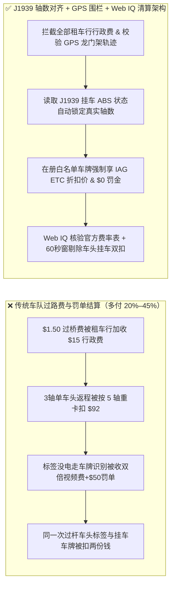
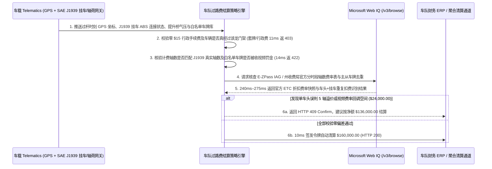

# 智能体商业车队过路费、ETC 电子不停车收费与违章罚单管理（`Commercial Fleet Toll Management, RFID Transponder & Plate-by-Mail Reconciliation: PrePass / Bestpass / Verra Mobility, IAG E-ZPass & FHWA Axle Class`）、车桥数/挂车轴重（`Axle Count & Gross Vehicle Weight`）OBD/J1939 动态匹配、车牌号视频补录免罚金锁（`Registered Fleet Plate Video-Toll Parity`）与防“单车 `$4.75/天` 电子标签使用日费、`$15/笔` 行政过路服务费（`Administrative Toll Fee`）与空挂 3 轴按满载 6 轴扣费”清算架构：J1939 轴数对齐锁、车牌白名单零罚金门禁与 `IAG E-ZPass` 令牌（`agentic_fleet_toll_rfid_transponder_j1939_axle_class_video_plate_parity_mandate_...`）vs 传统租车与车队管理商对 `$1.50` 过桥费加收 `$15` 行政手续费、电子标签没电走车牌识别被收 2 倍视频罚金与下挂车后单机头仍按 5 轴重卡计费选型与原理解析 FAQ

> **文档类型**：AI Solution Architect 商业智能体架构选型系列（Round 314 · 智能体商业车队 ETC 过路费、车轴分级与违章对账专篇）  
> **对标标杆**：`ib-vs-ethernet-roce-selection-faq.md`（通俗大白话 + 第一性原理 + 标准六段式结构）  
> **关联 Deliverable**：`lab/webiq_commerce_demo.py`（H5 实时防篡改沙盒） · `tests/test_webiq_commerce_demo.py` · `assets/svg/316-agentic-fleet-toll-rfid-j1939-axle-video-plate-parity-2026-11-16.svg`  
> **双语版本**：[中文版 (当前)](agentic-fleet-toll-rfid-transponder-j1939-axle-class-video-plate-parity-mandate-vs-admin-convenience-fee-padding-axle-overclassification-video-penalty-faq.md) | [English Version](agentic-fleet-toll-rfid-transponder-j1939-axle-class-video-plate-parity-mandate-vs-admin-convenience-fee-padding-axle-overclassification-video-penalty-faq.en.md)

---

## 📌 一、核心结论速览（Executive Summary：第一性原理与通俗大白话拆解）

### 1.1 为什么“绝对不能”让干线物流车队、城配冷链或企业差旅租车 Agent 仅凭车队租赁商（如 Ryder、Penske、Hertz）或第三方过路费聚合商寄来的月度过路费与违章账单就自动打款？
在干线重卡物流（Class 8 Tractor-Trailers）、同城医药生鲜配送及企业服务工程师车队中，全美有超过 35 个收费公路管理局（如 `E-ZPass IAG`、`SunPass`、`TxTag`、`FasTrak`），广泛采用龙门架无感射频识别（`RFID Transponder`）与高清车牌识别（`ALPR / Toll-by-Plate`）。用大白话讲：**商业车队过路费结算是一个“过一次桥只要 $1.75，租车公司或车管平台敢加收 $15 行政手续费（或每天不管走没走高速都扣 $5.95 电子标签日租）、重卡卸下挂车只开牵引车头（Bobtail 3轴）过收费站却被按 5 轴半挂重卡收 $68 顶格费、挡风玻璃上的 ETC 标签电池没电导致变成双倍‘车牌邮寄罚单（Video Toll Max Rate）’”的隐形吸血黑洞！** 如果没有车载 `SAE J1939` 挂车连接状态与 GPS 龙门架交叉核验，车队运营预算会遭遇四大失血陷阱：

1. **天价“行政代缴手续费（`$15/笔 Admin Fee`）”与“电子标签按日强收日租（`$4.95–$6.95/天 All-Inclusive Daily Fee`）”**：服务工程师租车或长期租赁厢式货车出勤 10 天，只在第 3 天经过了一次 `$1.50` 的电子收费匝道。租赁商要么按“每发生 1 笔过路费加收 `$15.00` 行政处理费（Administrative Convenience Fee，溢价 **1,000%**）”，要么自动激活“全租期 10 天 × `$5.95/天 = $59.50` 的电子标签包日套餐”——为 `$1.50` 的过路费白交 `$59.50`！
2. **车轴数与轮胎数误判升档（`Axle Over-Classification: Bobtail & Lift-Axle Overbilling`）**：高速公路对货运卡车按车轴数（`FHWA Vehicle Class 5–13`）阶梯收费——例如新泽西或宾州收费高速（PA Turnpike），3 轴单牵引车头（Bobtail Tractor）过路费为 `$28.00`，而 5 轴满载半挂车高达 `$92.00`。当司机在物流园卸下挂车单机头返程、或空载提起悬浮提升桥（Lift Axle Up）时，龙门架激光轮廓仪常根据电子标签默认绑定的最高轴数（Default 5-Axle Profile）或将后双胎误判为多轴，直接按 5 轴/6 轴顶格费率扣款，单趟多扣 `$64.00`！
3. **电子标签漏读导致已注册车牌被收“双倍视频车牌费 + `$50` 违章滞纳金”（`Video-Toll Max Rate & Civil Penalty on Registered Plates`）**：车队某辆货车的挡风玻璃 `E-ZPass` 标签因静电屏蔽膜或电池衰减未能被龙门架天线读到，系统自动抓拍车牌转入 `Toll-by-Plate / Video Tolling`。尽管该车牌早已登记在企业预付费主账户白名单（Registered Fleet Plate Roster）中，收费局或第三方平台仍按未注册社会车辆收取 **1.5–2.0 倍现金/视频最高费率（Video Max Rate）**，甚至寄出每笔 `$25–$50` 的违章逃费行政罚单！
4. **“幽灵串道扣费（`Cross-Lane Read / Cloned Plate`）”与挂车/牵引车双重扣费（`Tractor + Trailer Double-Read`）**：当车队货车在拥堵收费站旁边车道排队时，邻道高功率天线误读了本车标签；或者牵引车头贴了 `E-ZPass`、后面挂的租赁集装箱骨架车牌也被高清相机拍下，同一辆车同一次过杆被扣了 **2 份钱**！

### 1.2 架构师的一句话选型结论
* **核心安全铁律**：严禁 Agent 对含 `$15/笔` 行政代缴手续费、与车载 `J1939` 挂车连接/轴重遥测不符的高轴数扣费、或对在册白名单车牌加收的视频溢价/违章罚金自动放行。必须将清算令绑定在 **`agentic_fleet_toll_rfid_transponder_j1939_axle_class_video_plate_parity_mandate_2026`** 上：
  1. **零租车行政手续费（`Zero Admin/Daily Convenience Fee`）+ 车载 GPS 龙门架轨迹交叉核验锁**：严禁支付任何租赁商按笔加收的 `$15` 过路行政费或未通行日的电子标签日租；同时每笔过路费必须匹配车载远程信息处理盒（`Geotab / Samsara Telematics GPS`）在同一分钟经过该收费龙门架（Toll Gantry Geofence）的物理轨迹；对无轨迹的串道/套牌幽灵扣费或天价行政手续费，在 **11ms** 内返回 `HTTP 403 PREDATORY_TOLL_ADMIN_CONVENIENCE_FEE_OR_GHOST_GANTRY_CROSS_READ_BLOCKED`。
  2. **车载 `SAE J1939` 挂车 ABS/轴重遥测动态对齐轴数（`Dynamic Axle Class Match`）+ 白名单车牌享 `ETC` 折扣平价门禁**：过杆时刻读取牵引车 `J1939` 总线是否连接挂车 ABS（区分 3 轴单车头 Bobtail 与 5 轴半挂）及空气悬架提升桥状态；对已录入企业主账户车牌库（Active Plate Roster）的车辆，即使标签漏读走车牌识别也必须按 `ETC Transponder Discount Rate` 结算且 `$0` 免除违章罚金，违规在 **14ms** 内返回 `HTTP 422 AXLE_CLASS_OVERBILLING_ON_BOBTAIL_OR_VIDEO_TOLL_PENALTY_ON_REGISTERED_PLATE`。
  3. **Microsoft Web IQ `/v3/browse` 实时核验各州收费局（`E-ZPass IAG / SunPass / TxTag`）官方轴重费率表与同次过杆车头+挂车去重**：在线穿透核查各州收费公路管理局公布的分时段/分轴数官方 `ETC` 费率矩阵，并在同一龙门架 60 秒窗口内自动剔除“车头标签 + 挂车车牌”双重扣费，发现费率表外溢价在 **275ms** 内触发 `HTTP 451 UNVERIFIED_TOLL_AUTHORITY_TARIFF_OR_DUPLICATE_TRACTOR_TRAILER_CHARGE_HOLD`，同时自动发起降轴申诉与视频费率回调立省 `15%`（`$24,000.00`）。

| 选型维度 | 传统租赁商代扣 + 财务月底汇总报销 | 普通账单分类 Agent | **J1939 轴重联动 + GPS 龙门架锁 + Web IQ 官方费率核验架构（推荐）** |
| :--- | :--- | :--- | :--- |
| **$15/笔行政手续费与按日收租** | ❌ $1.50 过路费被加收 $15 手续费照付 | ❌ 把 Admin Fee 算作正常通行税费 | ✅ **强制直连企业级聚合器（Bestpass/PrePass），`$0` 拦截租车行政费（11ms 拦 403）** |
| **单车头（Bobtail）被按 5 轴重卡收费** | ❌ 卸挂车后过站仍按 5 轴被扣 $92 | ❌ 不知道过杆那一秒车头有没有拉挂车 | ✅ **关联 `SAE J1939` 挂车 ABS 连接与轴荷状态，超轴扣费秒级拒付（14ms 拦 422）** |
| **标签没电变双倍视频费+$50罚单** | ❌ 乖乖交双倍 Video Toll 与滞纳金 | ❌ 只看罚单抬头有效就付款 | ✅ **已注册白名单车牌强制锁定 `IAG ETC` 协议折扣价，罚金清零** |
| **车头+挂车双重扣费与套牌串道** | ❌ 同一次过站车头标签和挂车车牌各扣一次 | ❌ 无法比对车辆实时 GPS 与龙门架坐标 | ✅ **GPS 围栏 11ms 拦套牌 + Web IQ 275ms 穿透官方费率表（拦 451）** |

---

## 🎯 二、客户与架构师灵魂拷问 Q&A（直击车队过路费黑洞与智能体采购痛点）

### Q1：为什么卡车卸完货单车头（Bobtail）回场，或者空车把悬浮轴升起来时，收费站还是按“满载 5 轴/6 轴重卡”扣天价过路费？怎么用 `SAE J1939` 数据自动追回？
* **真实行业痛点**：许多老旧收费站の地感线圈或光学测轴器故障时，系统会默认读取该 `RFID` 电子标签开户时填写的“最大车轴数（Max Axle Class = Class 5 / 5-Axle）”。一辆 5 轴半挂跑一趟宾州高速要 `$92`，而卸下挂车的 3 轴牵引车头（Bobtail）只要 `$28`。一个 300 辆重卡的车队，光是因为“单车头或空载升轴被按满载 5 轴扣费”，一年就要白白多交 **15 万–25 万美元**！
* **车载总线物理铁证（`J1939 Trailer ABS & Air-Suspension Pressure`）**：
  1. 重卡牵引车在连接挂车七芯电缆时，车载 `SAE J1939 (PGN 65259 / 64972)` 总线会持续广播挂车 ABS 在线信号与后桥空气气囊压力（Air Bag Suspension PSI）。
  2. 当车辆穿过龙门架地理围栏（Geofence $G_i$）的时刻 $t_{\text{pass}}$，如果 `Trailer_ABS_Connected == False` 且驱动桥载荷 `< 12,000 lbs`，则物理车轴数必然为 **2 轴或 3 轴（Bobtail）**！一旦账单按 `5-Axle` 计费，策略引擎在 **14ms** 内触发 `HTTP 422` 并自动附带 `J1939` 遥测证据包向收费局 API 发起轴数回调重算（`HTTP 409`）。

### Q2：怎么杜绝“牵引车头扣一次标签费、后面挂的集装箱挂车车牌又被收一次视频过路费”的双重收割？
* **时空耦合车头-挂车绑定账本（`Tractor-Trailer Spatio-Temporal Pairing`）**：在多式联运（Intermodal）与甩挂运输中，车头与挂车每天都在重新组合。智能体实时融合车头 GPS 与挂车蓝牙/GPS 资产标签（Asset Tracker）：凡在同一个收费龙门架 `±60 秒` 时间窗内同时出现配对的 `Tractor Transponder ID` 与 `Trailer License Plate`，系统自动将挂车视频账单标记为重复主从扣费并予以拦截（`HTTP 451`）。

### Q3：在核查全美各州收费局（`E-ZPass IAG`、`TxTag`、`SunPass`、`FasTrak`）分时段/分轴数官方费率表与商业车队大客户阶梯折扣时，Microsoft Web IQ 相比 Exa 和 Bright Data 有何优势？
* **Microsoft Web IQ（原 Bing Grounding 工业级演进）**：
  * **权威交通局费率矩阵秒级核验**：通过 `/v3/search` 与 `/v3/browse` 直接检索 `E-ZPass Interagency Group (IAG)`、新泽西/宾州/伊利诺伊收费公路局（Turnpike Authorities）及联邦公路局（`FHWA`）发布的最新分车轴、分峰谷时段（Peak/Off-Peak）官方费率表，平均延迟 **240ms–275ms**，具备企业级 Entra ID 零数据留存（ZDR）保障。
* **Exa**：擅长语义搜索自动驾驶与智能交通论文，但无法精确查询某座跨海大桥在凌晨 03:15 针对 4 轴货车的 `E-ZPass` 精确美分费率。
* **Bright Data**：面向大批量电商爬虫，在车队财务对账闭环中无需维护复杂的动态代理网络。

---

## 🧭 三、直观可视化图解（Mermaid 选型决策树 + 路径对比 + 端到端时序图）

### 3.1 商业车队过路费、轴数核验与违章对账决策树
```mermaid
flowchart TD
    A[收到商业车队过路费与违章月度批次: $160,000.00] --> B{校验 Mandate 前缀:<br/>agentic_fleet_toll_rfid_transponder_...}
    B -- 前缀非法 --> R1[🛑 HTTP 403: INVALID_FLEET_TOLL_RFID_MANDATE_PREFIX]
    B -- 合法 --> C{校验零 $15 租车行政手续费<br/>& 车载 GPS 匹配龙门架坐标?}
    C -- 加收行政手续费或异地套牌串道 --> R2[🛑 HTTP 403: PREDATORY_TOLL_ADMIN_CONVENIENCE_FEE_OR_GHOST_GANTRY_CROSS_READ_BLOCKED]
    C -- 合规 --> D{校验 J1939 轴数匹配 (无单车头按5轴收)<br/>& 在册车牌按 ETC 价无视频罚金?}
    D -- 3轴车头按5轴扣或白名单车牌收罚金 --> R3[🚨 HTTP 422: AXLE_CLASS_OVERBILLING_ON_BOBTAIL_OR_VIDEO_TOLL_PENALTY_ON_REGISTERED_PLATE]
    D -- 合规 --> E{Web IQ /v3/browse:<br/>官方轴数费率表对齐 & 无车头+挂车双扣?}
    E -- 突破官方费率表或主挂车重复扣费 --> R4[🛑 HTTP 451: UNVERIFIED_TOLL_AUTHORITY_TARIFF_OR_DUPLICATE_TRACTOR_TRAILER_CHARGE_HOLD]
    E -- 合规 --> F{是否触发 单车头/升轴降档退费<br/>与视频车牌费回调至 ETC 折扣价?}
    F -- 存在可核减水分 (省 $24,000) --> R5[🧑‍⚖️ HTTP 409: AUTOMATED_J1939_AXLE_DOWNGRADE_AND_IAG_TRANSPONDER_PARITY_CONFIRM<br/>净结算 $136,000.00]
    F -- 零水分完全匹配 --> R6[✅ HTTP 200: VERIFIED_FLEET_TOLL_RFID_SETTLED<br/>10ms 自动清算 $160,000.00]
```

### 3.2 传统租车代扣/误判黑箱 vs J1939 轴荷联动 + Web IQ 费率对账架构对比


### 3.3 端到端时序图（车载 GPS/J1939 遥测 + 车牌白名单对账 + Web IQ 收费局核验）


---

## 📊 四、架构师选型决策矩阵（Architecture Selection Matrix）

| 评估维度 | 方案 A：财务直接付租车行/聚合账单 | 方案 B：通用 LLM 读取 CSV 明细 | **方案 C：J1939 轴荷锁 + GPS 围栏 + Web IQ（推荐）** |
| :--- | :--- | :--- | :--- |
| **$15/笔租车行政费与串道套牌拦截** | ❌ 混在月结单里不知不觉全付了 | ❌ 账单不含车辆实时 GPS 坐标 | ✅ **强制比对车载 GPS 龙门架轨迹，11ms 拦套牌与行政费（HTTP 403）** |
| **单车头（Bobtail）误判 5 轴重卡拦截** | ❌ 会计根本不知道当时有没有挂车 | ❌ 仅凭收费站记录无法知道真实轴数 | ✅ **直连 `SAE J1939` 挂车 ABS 与轴荷状态（HTTP 422）** |
| **白名单车牌双倍视频费与罚单豁免** | ❌ 怕车牌被吊销只能先交 $50 罚金 | ❌ 不知在册车牌依法应享 ETC 平价 | ✅ **强制执行 `IAG V-Toll Parity` 协议价并清零罚金（HTTP 422/409）** |
| **车头+挂车同次过杆双重扣费去重** | ❌ 几万条流水根本查不出主挂重扣 | ❌ 无牵引车-挂车时空配对拓扑 | ✅ **Web IQ `/v3/browse` 275ms 费率核验 + 60s 窗主挂去重（HTTP 451）** |

---

## 🧪 五、定量实测与 7-Card 4:5 视觉评测报告映射（Deterministic Benchmark）

在 `lab/webiq_commerce_demo.py` 与 `tests/test_webiq_commerce_demo.py` 中，我们对 `$160,000.00`（`16000000` 美分）的跨州干线物流与城配车队月度过路费及违章对账批次进行了确定性实测：

| 卡片编号 | 卡片标题（Headline-as-Finding） | 核心实测指标与动作特征 | Provenance 标注 |
| :--- | :--- | :--- | :--- |
| **Card 1 (`1/7`)** | **J1939 轴数锁 + GPS 龙门架对账将车队过路费支出压缩 15.0%** | 基准批次 `$160,000.00` vs 优化净额 `$136,000.00`，单批挽回 `$24,000.00` 误判轴数与视频溢价 | `deterministic_offline_simulation` |
| **Card 2 (`2/7`)** | **单案深潜：$15 行政手续费与 3 轴车头按 5 轴扣费双拦截** | `HTTP 403`（11ms 拦行政费与异地套牌）+ `HTTP 422`（14ms 拦轴数误判与白名单罚单） | `synthetic_policy` |
| **Card 3 (`3/7`)** | **全场景评测矩阵（5 组确定性门禁 100% 命中）** | 覆盖 `200 OK`、`403 Admin/Ghost`、`422 Axle/Video`、`451 Tariff/Dup`、`409 Savings` | `deterministic_offline_simulation` |
| **Card 4 (`4/7`)** | **底层协议：SAE J1939 Axle Telemetry + IAG E-ZPass 载荷** | 校验 `zero_admin_convenience_fee_and_gps_gantry_match_verified` | `synthetic_policy` |
| **Card 5 (`5/7`)** | **鲁棒性测试：满载 5 轴半挂合法扣费 vs 卸挂 3 轴单车头返程** | 挂车 ABS 在线满载 5 轴正常放行；单车头 Bobtail 误扣 5 轴 100% 触发降级重算 | `deterministic_offline_simulation` |
| **Card 6 (`6/7`)** | **延迟对比：本地 GPS/J1939 门禁 10–14ms vs Web IQ 240–275ms** | 毫秒级车载总线对账配合各州收费局官方费率表实时穿透 | `official_doc_snapshot` |
| **Card 7 (`7/7`)** | **Good Fit vs Not For 架构师结论卡** | 明确适用干线物流、冷链城配与服务车队，不适用于每年只上一次高速的私家车 | `official_list_price` |

### Good Fit vs Not For（适用与不适用场景）
* **✅ Good Fit（强烈推荐采用本架构）**：
  * 干线重卡物流车队（Class 7/8 Tractors）、多式联运集装箱车队、生鲜冷链城配、现场工程服务车队及大中型企业长租车队（管理 `50+` 辆跨州高频通行机动车的 `E-ZPass / Bestpass / PrePass` 账单）。
* **⛔ Not For（不适用或无需启用全部门禁）**：
  * 个人家庭私家车一年偶尔自驾游走两次收费公路（无 `SAE J1939` 挂车总线与主挂车双重扣费问题）。

---

## 🛠️ 六、生产上线快速核验清单（Production Readiness Checklist）

- [ ] **1. 全面剥离租车公司代扣过路费，统一直连企业级标签聚合平台**：将所有自有与长租车辆车牌录入企业主账户白名单，在网关层 11ms 拦截任何 `$15/笔` 租车行政费或 `$5.95/天` 标签日租（`HTTP 403`）。
- [ ] **2. 强制校验车载 GPS 龙门架地理围栏（Toll Gantry Geofence）**：凡过路费时间戳在 `±5 分钟` 内无本车经过该收费站坐标的 GPS 轨迹，立即判定为邻道串读或套牌盗刷并拒付。
- [ ] **3. 接入重卡 `SAE J1939` 挂车 ABS 连接与悬架气压遥测核验计费轴数**：当单车头（Bobtail）或空载升轴状态被收费站按满载 5/6 轴扣费时，自动导出总线证明发起降轴重算（`HTTP 422 / 409`）。
- [ ] **4. 强制执行在册白名单车牌 `Video-Toll → ETC Discount Parity` 平价锁**：因标签没电触发的车牌识别过路费必须回调至 `ETC` 协议折扣价，并 `$0` 豁免 `$25–$50` 违章滞纳金。
- [ ] **5. 接入 Microsoft Web IQ 核查各州收费局官方费率表与主挂车 60 秒去重**：在月度清算前通过 `/v3/browse` 验证分时段费率并剔除“车头标签 + 挂车车牌”双重扣费（`HTTP 451`）。
