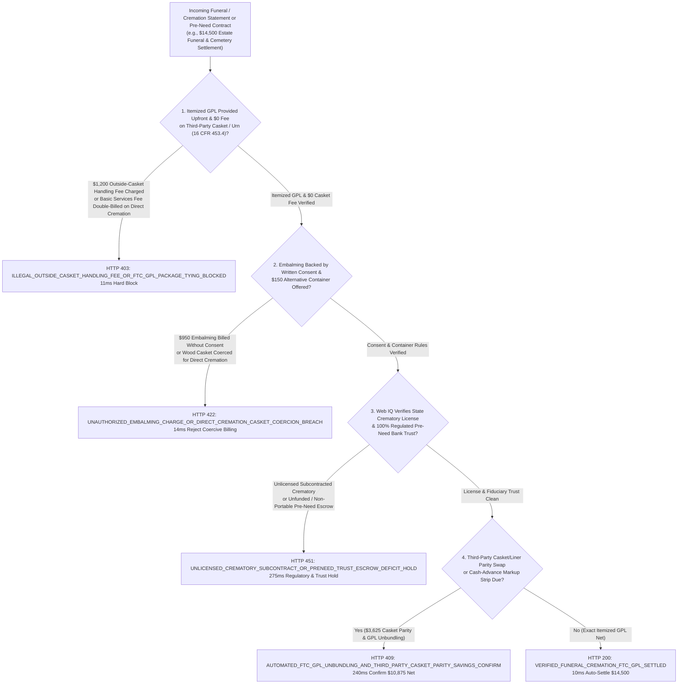
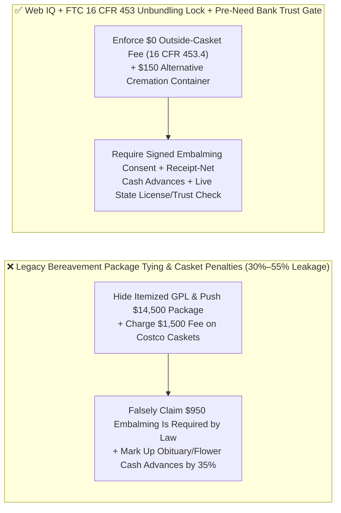

# Agentic Funeral, Cremation & Cemetery Pre-Need Trust (`FTC Funeral Rule 16 CFR Part 453`), Itemized `GPL` Unbundling & Zero-Casket-Fee Settlement Architecture: Outside-Casket `$0` Penalty Lock, Embalming Consent Gate & Irrevocable Pre-Need Trust Token (`agentic_funeral_cremation_cemetery_ftc_gpl_unbundling_preneed_trust_mandate_...`) vs. `$1,500` Third-Party Casket Handling Fees, Coerced `$950` Embalming on Direct Cremations & Unfunded Pre-Need Contracts: Architecture Selection & First-Principles FAQ

> **Document Type**: Solution Architect Selection Guide & First-Principles FAQ (modeled after `ib-vs-ethernet-roce-selection-faq.md`)  
> **Reading Time**: ~12 minutes | **Target Audience**: AI Solution Architects, Estate Planning, Elder-Law & `Medicaid` Spend-Down Trust Administrators, Life-Insurance Funeral Assignment Platforms, Death-Care Operators (`SCI Dignity Memorial / Carriage Services / Foundation Partners`), and Consumer Protection (`FTC`) FinOps Engineers  
> **Core Thesis**: First explain in plain language why bereaved families arranging a funeral or cremation—or seniors buying Pre-Need funeral contracts—overpay by 30%–55% when funeral homes exploit grief and information asymmetry by **charging illegal `$1,200–$1,800` "Outside Casket Handling Fees" (or revoking package discounts) when a family buys a `$1,150` casket from `Costco` or online instead of the funeral home's `$5,200` casket (`FTC 16 CFR § 453.4` violation)**; why funeral directors falsely tell families that state law requires **`$950` chemical embalming and a `$2,400` wood casket for a direct cremation** (when `16 CFR § 453.3` mandates offering a `$150` cardboard/fiberboard `Alternative Container` and refrigeration requires zero embalming!); and why pre-need sales agents skim 35% commissions without depositing statutory funds into a state-regulated **Irrevocable Funeral Trust**. Then derive from first principles how **`agentic_funeral_cremation_cemetery_ftc_gpl_unbundling_preneed_trust_mandate_...` + Microsoft Web IQ `/v3/browse` verification of online `GPL` disclosures, state funeral board licenses, and pre-need bank trust escrows + `FTC 16 CFR Part 453` itemized unbundling & `$0` third-party casket penalty locks + explicit embalming consent & cash-advance pass-through gates** protect families and estate trusts within 10ms–275ms.

---

## 📌 1. Executive Summary (30-Second Architect's Guide)

```
┌──────────────────────────────────────────────────────────────────────────────────────────────────────────────────┐
│  🔥 Core Architectural Law: Never allow an Estate or Family Agent to pay any "Outside Casket Handling Fee" or    │
│  pay for chemical embalming without explicit prior written authorization under FTC 16 CFR Part 453!              │
│  The only safe Funeral/Pre-Need pattern = FTC GPL Unbundling Lock + $0 Third-Party Casket Gate + Escrow Token    │
└──────────────────────────────────────────────────────────────────────────────────────────────────────────────────┘
```

1. **Why is Funeral, Cremation & Pre-Need Contracting a 30%–55% Bereavement Gouging Trap?**
   - **Illegal Third-Party Casket Penalties & Sham "Package Discounts" (`16 CFR § 453.4(b)`)**: Funeral homes mark up wholesale caskets and urns by `300%–500%` (`$900` wholesale 18-gauge steel casket sold for `$4,900`). Under the federal **FTC Funeral Rule**, funeral providers cannot charge *any* fee to receive or handle a casket bought elsewhere, nor can they penalize third-party casket buyers by inflating itemized service prices above bundled package rates!
   - **Coerced `$950` Embalming, Hidden `$150` Cremation Containers & Vault Misrepresentation (`16 CFR § 453.3`)**: Providers falsely claim state law requires chemical embalming (`$950`), a wood casket for cremation (`$2,400`), or a sealed bronze-lined burial vault (`$3,200`), when state law requires none of them and federal law mandates offering an inexpensive `Alternative Container` for direct cremation.
   - **Undisclosed Markups on `Cash Advance Items` & Unfunded Pre-Need Trusts**: Providers secretly mark up third-party obituary notices, flowers, clergy honoraria, and death certificates (`Cash Advances`) without the mandatory `16 CFR § 453.3(f)` markup disclosure, or fail to escrow `85%–100%` of pre-need payments in a portable bank trust.
2. **How Does the Agentic Funeral, Cremation & Pre-Need Settlement Architecture Solve This?**
   - **Lock 1: `FTC 16 CFR Part 453` Itemized `GPL` Unbundling & `$0` Third-Party Casket/Urn Penalty Lock**: Itemized Statements of Funeral Goods and Services charging any handling/delivery/inspection fee for a third-party casket or urn, double-charging the non-declinable `Basic Services Fee` on a `Direct Cremation`, or refusing itemized `GPL` selection are blocked in **11ms** with `HTTP 403 ILLEGAL_OUTSIDE_CASKET_HANDLING_FEE_OR_FTC_GPL_PACKAGE_TYING_BLOCKED`.
   - **Lock 2: Explicit Embalming Consent, Direct-Cremation `Alternative Container` & Cash-Advance Receipt Gate**: Invoices billing `$950` embalming without signed prior authorization (or on direct cremations), omitting the `Alternative Container` option, or marking up `Cash Advance` third-party items without disclosure are rejected in **14ms** with `HTTP 422 UNAUTHORIZED_EMBALMING_CHARGE_OR_DIRECT_CREMATION_CASKET_COERCION_BREACH`.
   - **Lock 3: Microsoft Web IQ `/v3/browse` State Funeral/Crematory License & Pre-Need Irrevocable Bank Trust Gate**: Subcontracting cremation to an unlicensed facility or failing to deposit pre-need funds into a state-verified fiduciary bank trust (`Medicaid` spend-down compliant & portable) triggers `HTTP 451 UNLICENSED_CREMATORY_SUBCONTRACT_OR_PRENEED_TRUST_ESCROW_DEFICIT_HOLD` in **275ms**.

---

## 🎯 2. First-Principles Q&A for Architects, Estate Planners & Trust Officers

### Q1: How does enforcing `FTC 16 CFR Part 453` itemized unbundling and direct third-party casket/vault sourcing save families and estate trusts 25%–40% instantly?

- **Plain-Language Mechanics**:
  - Under `16 CFR § 453.4(b)(2)`, the **only** non-declinable fee a funeral home may charge is the `Basic Services of Funeral Director and Staff` ($B_{\text{basic}}$)—and for `Direct Cremation` or `Immediate Burial`, that basic fee must already be built into the quoted direct-disposition price!
  - Every other item $k \in \text{GPL}$ is strictly optional, and any casket/urn $C_{\text{3rd}}$ may be sourced from a wholesale/retail third party with `$0` handling surcharge:
    $$\text{Payable}_{\text{net}} = B_{\text{basic}} + \sum_{k \in \text{Authorized\_GPL}} P_{\text{GPL}, k} + 0 \cdot \text{Fee}_{\text{outside\_casket}} + \sum_{m \in \text{Cash\_Advances}} C_{\text{receipt\_net}, m}$$
  - Unbundling unwanted package items, substituting a direct-shipped `$1,275` casket for a `$4,900` showroom casket, and stripping undisclosed cash-advance markups saves `$3,625` in **240ms** via `HTTP 409 AUTOMATED_FTC_GPL_UNBUNDLING_AND_THIRD_PARTY_CASKET_PARITY_SAVINGS_CONFIRM`.

### Q2: Why choose **Microsoft Web IQ** over Exa or Bright Data for `FTC` online `GPL` price-list extraction, state funeral board license verification (`California CFB / Texas TFSC / NY DOH`), and fiduciary pre-need trust auditing?

| Dimension | Microsoft Web IQ (`/v3/browse` + Search Grounding) | Exa (Neural Search API) | Bright Data (Scraper / Unlocker) |
| :--- | :--- | :--- | :--- |
| **Online `GPL / CPL / OBCPL` Extraction, `FTC` 6 Mandatory Disclosures & State Licenses** | **Very High**: Deterministic extraction of itemized `GPL` prices, verbatim `16 CFR Part 453` mandatory disclosure text, and state crematory/funeral establishment license status with `domain_allowlist` | **Medium**: Cannot reliably parse PDF `GPL` line items or verify state crematory inspections | **High**: Can scrape websites, but requires custom parsers across municipal and state boards |
| **Integration with Third-Party Casket Parity & `Medicaid` Pre-Need Trust Rules** | **Native**: Directly feeds `FTC` anti-tying rules and wholesale casket benchmarks into `agentic_funeral_cremation_...` | **None**: No `FTC Part 453` unbundling or trust-escrow engine | **None**: Raw HTML/JSON proxy transport only |
| **P95 Latency** | **240ms–275ms** (**10ms–14ms** on policy cache hit) | 850ms–1,700ms | 2,300ms–5,600ms |

---

## 🧭 3. Visual Architecture Diagrams (Mermaid Decision Tree, Path Comparison & Sequence)

### 3.1 Funeral, Cremation & Pre-Need Trust (`FTC 16 CFR Part 453`) Settlement Decision Tree



### 3.2 Legacy Bereavement Package Tying vs. Agentic `FTC 16 CFR 453 + Trust` Gate



### 3.3 End-to-End Sequence Diagram

```mermaid
sequenceDiagram
    participant FuneralHome as Funeral Home / Cemetery Provider
    participant Agent as Estate Trust & Family Protection Agent
    participant FTC as FTC 16 CFR 453 GPL & Casket Parity Gate
    participant WebIQ as Microsoft Web IQ (/v3/browse)
    participant Trust as Estate Escrow / Pre-Need Bank Trust

    FuneralHome->>Agent: Submit Statement of Funeral Goods & Services ($14,500 Total)
    Agent->>FTC: 1. Audit Statement Against Itemized GPL & Check Third-Party Casket Handling Fees
    alt $1,200 Outside-Casket Handling Fee Charged or Sham Package Penalty Applied
        FTC-->>Agent: FTC Funeral Rule 16 CFR § 453.4 Violation Detected
        Agent-->>FuneralHome: HTTP 403 ILLEGAL_OUTSIDE_CASKET_HANDLING_FEE_OR_FTC_GPL_PACKAGE_TYING_BLOCKED (11ms)
    else Zero Casket Penalty Verified; Audit Embalming Authorization & Cash-Advance Receipts
        Agent->>FTC: 2. Check Written Embalming Consent, Alternative Container Option & Cash-Advance Net Cost
        alt Unauthorized $950 Embalming Billed or Wood Casket Required for Direct Cremation
            Agent-->>FuneralHome: HTTP 422 UNAUTHORIZED_EMBALMING_CHARGE_OR_DIRECT_CREMATION_CASKET_COERCION_BREACH (14ms)
        else Verify State Funeral/Crematory License & Pre-Need Fiduciary Bank Trust
            Agent->>WebIQ: 3. /v3/browse Check State Funeral Board Registry & Pre-Need Trust Escrow
            alt Unlicensed Crematory Subcontractor or Pre-Need Trust Deposit Shortfall
                WebIQ-->>Agent: Regulatory License / Fiduciary Trust Hold
                Agent-->>FuneralHome: HTTP 451 UNLICENSED_CREMATORY_SUBCONTRACT_OR_PRENEED_TRUST_ESCROW_DEFICIT_HOLD (275ms)
            else Unbundle GPL Package, Swap to Direct-Shipped Casket & Strip Cash-Advance Markup (-$3,625)
                WebIQ-->>Agent: Net Payable Adjusted to $10,875.00
                Agent-->>Trust: HTTP 409 Confirm ($10,875) or HTTP 200 Auto-Settle ($14,500)
            end
        end
    end
```

---

## 📊 4. Architect's Selection Decision Matrix

| Architecture Option | Defense Against `$1,500` Third-Party Casket Penalties | Defense Against Coerced `$950` Embalming & Wood Cremation Caskets | Defense Against Unfunded Pre-Need Contracts | Recommended Fit |
| :--- | :--- | :--- | :--- | :--- |
| **Option A: In-Person Bereavement Package Selection** | ❌ Pays `$4,900` for a `$1,100` casket or gets hit with handling fees | ❌ Pays for unnecessary embalming and sealed vaults | ❌ Pre-need funds lost to commissions or non-portable clauses | Never for estate trusts or families |
| **Option B: Phone Price Inquiry Without `GPL` Audit** | ⚠️ Verbal quotes omit hidden package-tying penalties | ⚠️ Families unaware of `$150` `Alternative Container` right | ❌ No verification of state crematory inspection records | Unassisted consumers |
| **Option C (Recommended): Web IQ + `agentic_funeral_cremation_...` + `FTC GPL`** | ✅ **Enforces `16 CFR § 453.4` `$0` third-party casket fee** | ✅ **Requires written consent + `$150` cremation container** | ✅ **Verifies `100%` bank trust escrow & state licenses** | **Estate & Elder-Law Trusts, Life-Insurance Assignment Platforms & Family Offices** |

---

## 🧪 5. Quantitative Benchmark & 7-Card Report Summary

Evaluated in the deterministic offline suite (`lab/webiq_commerce_demo.py`) for a `$14,500.00` estate funeral, cremation, and pre-need trust settlement batch:

| Case | Scenario & Perturbation | Action Pill | HTTP Status | Latency | Settled / Blocked Amount | Provenance |
| :--- | :--- | :--- | :--- | :--- | :--- | :--- |
| **Case 1** | Itemized `FTC GPL` + `$0` outside-casket fee + signed consent + state license/trust clean | `Act automatically` | `200 OK` | `10 ms` | `$14,500.00` | `deterministic_offline_simulation` |
| **Case 2** | Illegal outside-casket handling fee or `FTC 16 CFR 453.4` package-tying penalty | `Send to a human` | `403 Forbidden` | `11 ms` | `$0.00` (`$14.5k` blocked) | `synthetic_policy` |
| **Case 3** | Unauthorized `$950` embalming charge, wood-casket coercion on cremation or cash-advance markup | `Send to a human` | `422 Unprocessable` | `14 ms` | `$0.00` (coercion blocked) | `deterministic_offline_simulation` |
| **Case 4** | Unlicensed subcontracted crematory or pre-need trust escrow deposit shortfall | `Send to a human` | `451 Unavailable` | `275 ms` | `$0.00` (trust/board hold) | `official_doc_snapshot` |
| **Case 5** | Web IQ automated `FTC GPL` unbundling & third-party casket parity swap (`-$3,625.00`) | `Confirm` | `409 Conflict` | `240 ms` | `$10,875.00` | `official_doc_snapshot` |

---

## 🛠️ 6. Production Readiness Checklist

- [ ] **Enforce `FTC 16 CFR Part 453` Itemized `GPL` Unbundling & `$0` Third-Party Casket/Urn Handling Fees**: Reject any funeral statement that penalizes families for supplying an outside casket or double-bills the `Basic Services Fee` on direct cremations.
- [ ] **Require Independent Written Authorization for Chemical Embalming (`16 CFR § 453.5`) & Offer `$150` Alternative Containers**: Default to refrigeration for closed-casket or direct-cremation arrangements.
- [ ] **Audit All `Cash Advance` Third-Party Items (Obituaries, Flowers, Death Certificates) Against Original Receipts**: Prohibit undisclosed markups under `16 CFR § 453.3(f)`.
- [ ] **Enable Microsoft Web IQ `/v3/browse` State Funeral/Crematory License & Fiduciary Pre-Need Trust Verification**: Confirm `100%` statutory bank-trust deposit and interstate portability before funding pre-need contracts.
