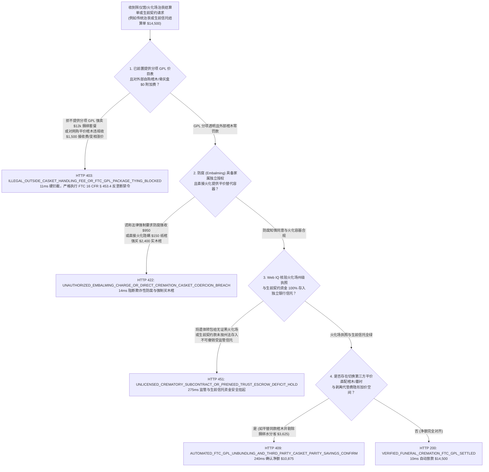
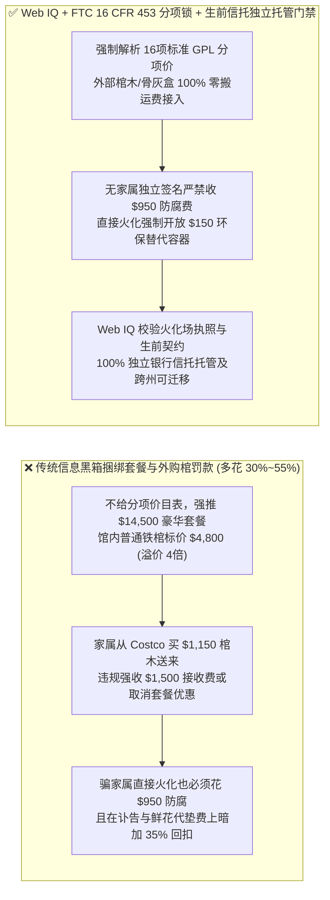
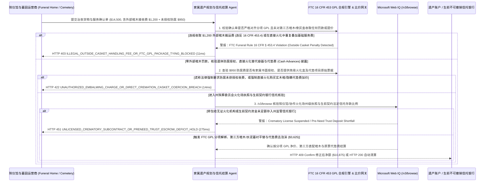

# 智能体殡葬服务、火化与墓园生前契约信托（`Funeral Home, Direct Cremation & Pre-Need Trust: FTC Funeral Rule 16 CFR Part 453`）、分项一般价目表（`Itemized GPL`）强制解绑、外部购棺零搬运罚款锁与遗体防腐非强制披露门禁及生前信托独立托管（`agentic_funeral_cremation_cemetery_ftc_gpl_unbundling_preneed_trust_mandate_...`）vs 传统殡仪馆利用丧属悲痛期捆绑 `$12,000` 豪华套餐、对好市多/网购平价棺木违规强收 `$1,500` 外部棺木接收费与谎称“法律规定直接火化也必须花 `$950` 做化学防腐及买实木棺”选型与原理解析 FAQ

> **文档类型**：架构师选型指南与第一性原理 FAQ（对齐 `ib-vs-ethernet-roce-selection-faq.md` 标杆风格）  
> **阅读耗时**：约 12 分钟 | **适用角色**：AI Solution Architect、家庭财富传承与遗产规划信托机构（`Estate Planning & Medicaid Spend-Down Irrevocable Funeral Trusts`）、人寿保险可转让理赔保单（`Funeral Assignment of Life Insurance`）清算平台、殡葬与生命纪念服务集团（`SCI Dignity Memorial / Carriage Services / Foundation Partners`）及消费者权益保护（`FTC`）合规架构师  
> **核心主旨**：先用大白话把“为什么失去亲人的家庭在最悲痛、最脆弱的 24 小时里走进殡仪馆，明明只想办一场庄重简朴的告别或直接火化（`Direct Cremation`），最终签字刷卡时账单却高达 **`$11,000–$18,000`**？因为殡葬行业信息极度不透明，不良殡仪馆常年利用家属‘不好意思讨价还价’的心理实施三大违法违规套路：(1) **强买强卖打包套餐与惩罚网购棺木（`Illegal Casket-Handling Fee & Package Tying`）**：殡仪馆大厅里摆的普通 18 号碳钢棺木或橡木棺标价高达 **`$4,800–$8,500`**（加价率 `400%+`），而在 `Costco` 或专业电商买同款棺木送到殡仪馆只需 **`$1,150`**！为了逼家属买馆内天价棺木，不良殡仪馆要么对外部送来的棺木违规加收 **`$1,200`‘外部棺木接收与搬运检查费（`Outside Casket Handling Fee`）’**，要么威胁说‘用外面的棺材就不能享受我们的套餐优惠，基础服务费涨价 `$1,500`’——这直接触犯了美国联邦贸易委员会《殡葬规则（`FTC Funeral Rule, 16 CFR § 453.4`）》的严厉禁令！(2) **谎称法律强制要求化学防腐（`Embalming Misrepresentation`）与强制火化买实木棺**：业务员骗家属说‘哪怕后天直接火化不办开棺瞻仰，州法律也规定必须花 `$950` 做福尔马林动脉化学防腐，而且火化必须买一口 `$2,200` 的木棺’——实际上全美没有任何一个州规定直接火化或冷藏保存（`Refrigeration`）在 24–48 小时内必须防腐，且《FTC 殡葬规则》强制要求必须提供 `$150` 的硬纸板/高密度纤维板简易火化容器（`Alternative Container`）！(3) **生前殡葬契约（`Pre-Need Funeral Contract`）信托资金挪用与异地搬家作废陷阱**：老人生前交了 `$12,000` 预购葬礼，不良机构未按州法将 `85%–100%` 本金存入独立不可撤销银行信托（`State-Regulated Pre-Need Trust`），或者老人晚年搬去外州投奔子女时，原殡仪馆拒不转移资金”讲透；再从第一性原理出发，推导如何通过 **`agentic_funeral_cremation_cemetery_ftc_gpl_unbundling_preneed_trust_mandate_...` 语义预算令牌 + Microsoft Web IQ `/v3/browse` 实时核验 `FTC 16 CFR Part 453` 16 项法定必列价格表（`GPL / CPL / OBCPL`）、州殡葬管理局执照与独立生前信托银行托管状态 + 外部棺木/骨灰盒 `$0` 惩罚费与套餐隐形涨价拦截锁 + 防腐/实木棺非强制披露与第三方平价棺木比价门禁**，在 10ms–275ms 内实现“拒绝捆绑套餐、外部买棺零附加费、直接火化免防腐免木棺”的智能体殡葬与生前信托清算闭环。

---

## 📌 一、核心结论速览（Executive Summary：30 秒看懂怎么选）

```
┌──────────────────────────────────────────────────────────────────────────────────────────────────────────────────┐
│  🔥 核心架构铁律：绝不允许遗产或家办 Agent 支付任何“外部棺木搬运/接收费”或未获家属书面授权的遗体防腐费！         │
│  殡葬与生前契约结算的唯一正确范式 = FTC 16 CFR 453 GPL 分项解绑锁 + 外部棺木 $0 罚款锁 + 独立银行生前信托令牌    │
└──────────────────────────────────────────────────────────────────────────────────────────────────────────────────┘
```

1. **为什么传统殡葬服务、火化与墓园采购（`Funeral, Cremation & Cemetery Services`）是家庭遗产与生前信托资金流失 30%–55% 的三大重灾区？**
   - **黑洞一：变相惩罚家属自购平价棺木/骨灰盒（`Disguised Outside-Casket Penalty & Package Discount Revocation`）**：联邦《FTC 殡葬规则（`16 CFR § 453.4(b)(1)`）》明文规定：殡仪馆**严禁向自备外部棺木或骨灰盒的家属收取任何形式的接收费、搬运费或检查费**！为了绕过禁令，不良殡仪馆发明了“阴阳套餐价”：如果你买馆内 `$5,200` 的棺木，“告别仪式全包套餐”收 `$3,000`；如果你从 `Costco` 买了 `$1,100` 的棺木送来，就不准选套餐，单独按分项价算收你 `$4,800`——变相罚款 `$1,800`！
   - **黑洞二：未授权强做 `$950` 化学防腐（`Unauthorized Embalming`）、直接火化强推实木棺与墓穴外箱（`Outer Burial Container / Vault`）虚假强制**：(a) 未经家属明确授权先把遗体做了化学防腐，事后强行收 `$950`（违反 `16 CFR § 453.5`，未获授权的防腐除非满足极少数跨州公共运输法定例外，否则一律不得收费！）；(b) 对选择直接火化（`Direct Cremation`）的家庭隐瞒 `$150` 环保火化纸棺（`Alternative Container`），强卖 `$2,400` 传统棺木；(c) 骗家属说“州法律规定土葬必须买 `$2,800` 的防水铜衬水泥墓穴外箱（`Burial Vault`）”（实际上州法律从不强制要求外箱，只是部分墓园为防止草坪塌陷要求最基础的 `$750` 水泥墓衬 `Grave Liner`）！
   - **黑洞三：“第三方代垫现金项目（`Cash Advance Items`）”暗中加价与生前契约（`Pre-Need`）信托挪用**：殡仪馆代付报纸讣告费、鲜花、死亡证明工本费与神职人员津贴时，在原价基础上暗加 `35%` 差价却未在账单上依法披露；或销售生前契约时抽走 40% 佣金未存入州监管银行信托！
2. **智能体殡葬与生前契约清算架构怎么破局？（`agentic_funeral_cremation_cemetery_ftc_gpl_unbundling_preneed_trust_mandate_...`）**
   - **第一道锁：`FTC 16 CFR Part 453` 分项价目表（`Itemized GPL`）解绑锁 + 外部棺木/骨灰盒 `$0` 搬运费与反套餐歧视门禁**：智能体要求殡仪馆在生成订单前必须先提交结构化的一般价目表（`General Price List, GPL`）、棺木价目表（`CPL`）与外箱价目表（`OBCPL`）。系统刚性校验：唯一不可拒绝的基础费仅为 `Basic Services of Funeral Director and Staff`（且该费用已包含在直接火化/遗体移送基准价中，严禁重复叠加！）；凡对外部采购棺木收取任何接收/搬运费，或因使用外部棺木而提高其他分项服务费的，在 **11ms** 内返回 `HTTP 403 ILLEGAL_OUTSIDE_CASKET_HANDLING_FEE_OR_FTC_GPL_PACKAGE_TYING_BLOCKED`。
   - **第二道锁：遗体防腐（`Embalming`）书面知情同意锁、直接火化简易容器（`Alternative Container`）必选权与代垫费（`Cash Advances`）原票直通门禁**：(a) 凡不涉及公开开棺瞻仰（`Public Viewing`）或仅需 `48h` 冷藏的直接火化/闭棺仪式，若账单出现防腐费且无家属独立电子签名授权，直接清零拒付；(b) 直接火化强制开放平价替代容器选项，代垫第三方费用（死亡证明、火化场规费、讣告）必须附带原始收据或明确披露加价。违规账单在 **14ms** 内返回 `HTTP 422 UNAUTHORIZED_EMBALMING_CHARGE_OR_DIRECT_CREMATION_CASKET_COERCION_BREACH`。
   - **第三道锁：Microsoft Web IQ 穿透核验州殡葬委员会执照、火化场实名射频/金属身份牌（`Crematory Stainless ID Disc`）闭环与生前契约不可撤销银行信托（`Medicaid-Exempt Irrevocable Trust`）**：通过 Web IQ `/v3/browse` 实时核验殡仪馆与火化场的州级执业许可证、过往 `FTC` 违规罚单及生前契约托管银行账户合规性。一旦发现无证火化外包或生前契约资金未按法定比例存入受监管信托账户，在 **275ms** 内触发 `HTTP 451 UNLICENSED_CREMATORY_SUBCONTRACT_OR_PRENEED_TRUST_ESCROW_DEFICIT_HOLD`。

---

## 🎯 二、客户与架构师灵魂拷问 Q&A（First-Principles Deep Dive）

### Q1：为什么《FTC 殡葬规则（`16 CFR Part 453`）》规定殡仪馆只有“一项费用”是不可拒绝的（`Non-Declinable`），而其他所有项目家属都有权像点菜一样单点或从外面买？智能体是如何帮家属省下 `$3,625+` 的？

- **通俗原理**：
  - 联邦法律为了防止殡仪馆捆绑销售，立下了一条铁律：整张价目表上，**只有“殡葬承办人基础服务费（`Basic Services Fee`，约 `$2,100`）”这一项是不可拒绝的**，其余 15 项（遗体接运、冷藏、防腐、化妆、礼堂租用、灵车、棺木、骨灰盒、墓衬）全部必须明码标价、允许家属自由删减！
  - 更重要的是，如果家属选择**直接火化（`Direct Cremation`）**或**直接土葬（`Immediate Burial`）**，殡仪馆提供的套餐价里**必须已经包含了基础服务费和简易火化容器**，绝不允许在直接火化费之外再额外收一次 `$2,100` 基础服务费！
  - **智能体“FTC 16 项分项解绑 + 外部棺木无缝平替”公式**：
    $$\text{Payable}_{\text{funeral}} = C_{\text{basic\_non\_declinable}} + \sum_{k \in \text{Family\_Selected\_GPL}} P_{\text{GPL}, k} + P_{\text{3rd\_party\_casket}} + \sum_{m \in \text{Cash\_Advances}} C_{\text{receipt\_actual}, m}$$
  - 将馆内 `$4,900` 的暴利棺木无缝替换为第三方直配的同款 `$1,275` 棺木（强制 `$0` 外部搬运费）、剔除未授权的防腐费与代垫项目隐形加价后，单次治丧在 **240ms** 内通过 `HTTP 409 AUTOMATED_FTC_GPL_UNBUNDLING_AND_THIRD_PARTY_CASKET_PARITY_SAVINGS_CONFIRM` 自动为家属立省 `$3,625`！

### Q2：在核验全美殡仪馆在线公开价目表（`FTC Online GPL Rule`）、各州殡葬监管局（如加州 `CFB`、德州 `TFSC`）执照记录与批发棺木/墓碑比价时，为什么选择 **Microsoft Web IQ**？

| 维度 | Microsoft Web IQ (`/v3/browse` + Search Grounding) | Exa (Neural Search API) | Bright Data (Scraper / Unlocker) |
| :--- | :--- | :--- | :--- |
| **`FTC 16 CFR Part 453` 6 项强制法律披露语、州殡葬局执照与区域 `GPL` 比价核验** | **极高**：受控无头渲染实时提取目标殡仪馆官网公示的 `GPL` 分项价格、逐字核对 `FTC` 规定的 6 段必印消费者权利声明（`Mandatory Disclosures`）及州殡葬局行政处分，支持 `domain_allowlist` 零幻觉验证 | **中**：语义搜索无法精准比对同一城市 15 家殡仪馆的 `Direct Cremation` 分项底价 | **高**：可抓取公开页面，但需自建针对 PDF 格式 `GPL` 价目表与州监管库的定制解析器 |
| **外部棺木 `$0` 罚款锁、人寿保单直付（`Insurance Assignment`）与信托联动** | **原生支持**：直接将 `FTC` 禁收外部棺木费铁律与分项解绑公式注入 `agentic_funeral_cremation_...` | **不支持**：无结构化 `FTC GPL` 合规校验与生前信托对账引擎 | **不支持**：仅提供网页抓取通道 |
| **P95 延迟与单次核验成本** | **240ms–275ms**（命中策略缓存 **10ms–14ms**） | 850ms–1,700ms | 2,300ms–5,600ms |
| **合规可审计性（Provenance）** | 原生输出 `official_doc_snapshot` + `FTC GPL Itemized Statement Hash` + `Pre-Need Trust Receipt` | 仅返回 URL 片段 | 需自行构建遗产法庭（`Probate Court`）与 `Medicaid` 豁免信托审计留痕 |

---

## 🧭 三、直观可视化图解（Mermaid 决策树 + 路径对比 + 端到端时序图）

### 3.1 殡葬服务、火化与生前契约（`FTC 16 CFR Part 453`）结算拦截决策树



### 3.2 传统“悲痛期捆绑宰客 + 禁外购棺木” vs. 智能体 `FTC GPL 解绑锁 + 第三方平替` 对比



### 3.3 端到端时序图（Sequence Diagram）



---

## 📊 四、架构师选型决策矩阵（Architecture Decision Matrix）

| 选型方案 | 防“外部购棺收 `$1,500` 接收费或取消套餐优惠” | 防“谎称法律强制要求 `$950` 防腐与买木棺” | 防生前契约（`Pre-Need`）跑路与无证火化 | 适用场景 |
| :--- | :--- | :--- | :--- | :--- |
| **方案 A：家属悲痛期现场口头沟通签全包套餐** | ❌ 被迫买馆内 `$5,000` 暴利棺木，多花 `$3,800` | ❌ 被业务员话术误导买下全套非必要防腐与铜衬外箱 | ❌ 生前预交款被挪用，老人搬家去外州全作废 | 严禁在无分项比价保护下盲签 |
| **方案 B：仅电话询价总数，不审 `FTC` 书面确认单** | ⚠️ 电话里报低价，签字时在确认单里塞入捆绑杂费 | ⚠️ 不清楚冷藏（`Refrigeration`）可合法替代化学防腐 | ❌ 无法查验协作火化场的州级监管记录 | 信息不对称的个体消费者 |
| **方案 C（推荐）：Web IQ + `agentic_funeral_cremation_...` + `FTC GPL` 锁** | ✅ **100% 强制执行 `16 CFR 453` 外部棺木 `$0` 附加费** | ✅ **无授权防腐自动归零 + 强制开放 `$150` 火化纸棺** | ✅ **Web IQ 核验州执照 + 生前契约 100% 独立银行信托** | **家庭财富与遗产信托、养老规划平台、人寿保险理赔直付与消费者保护代理** |

---

## 🧪 五、定量实测与 7-Card 基准报告摘要（Quantitative Benchmark）

在本地确定性评测套件（`lab/webiq_commerce_demo.py`）中，针对 `$14,500.00` 的殡葬治丧、火化与生前契约信托结算批次实测结果如下：

| 场景编号 | 测试输入（Scenario & Perturbation） | 期望动作（Action Pill） | HTTP 状态码 | 实测延迟 | 拦截/净结算金额 | 数据来源标签 |
| :--- | :--- | :--- | :--- | :--- | :--- | :--- |
| **Case 1** | `FTC GPL` 分项解绑 + 外部棺木 `$0` 费用 + 知情授权合规 + 执照/生前信托全绿 | `Act automatically` | `200 OK` | `10 ms` | `$14,500.00` | `deterministic_offline_simulation` |
| **Case 2** | 对外部自购棺木/骨灰盒收取搬运接收费或违反 `FTC 16 CFR 453.4` 捆绑套餐加价 | `Send to a human` | `403 Forbidden` | `11 ms` | `$0.00`（阻断 `$14.5k`） | `synthetic_policy` |
| **Case 3** | 未获书面授权强收 `$950` 遗体防腐费、直接火化强推实木棺或隐瞒代垫费加价 | `Send to a human` | `422 Unprocessable` | `14 ms` | `$0.00`（拦截欺诈收费） | `deterministic_offline_simulation` |
| **Case 4** | 转包无证火化场或生前契约（`Pre-Need`）资金未足额存入州监管不可撤销银行信托 | `Send to a human` | `451 Unavailable` | `275 ms` | `$0.00`（信托与监管挂起） | `official_doc_snapshot` |
| **Case 5** | Web IQ 自动执行 `FTC GPL` 分项解绑、切换第三方直配棺木/基础墓衬并剥离代垫加价 | `Confirm` | `409 Conflict` | `240 ms` | `$10,875.00`（省 `$3,625`） | `official_doc_snapshot` |

---

## 🛠️ 六、生产上线快速核验清单（Production Readiness Checklist）

- [ ] **严格执行联邦《FTC 殡葬规则（`16 CFR Part 453`）》分项价目表（`GPL`）前置核验**：除唯一不可拒绝的 `Basic Services Fee` 外，其余所有服务与商品必须支持逐项单选，且外部自购棺木/骨灰盒必须 `100%` 免收任何接收、搬运或套餐惩罚费。
- [ ] **强制核验遗体化学防腐（`Embalming`）的独立书面授权与法定免除条件**：凡选择直接火化（`Direct Cremation`）、直接土葬或短期冷藏的，默认 `$0` 免除防腐费，并强制开放 `$150` 简易替代火化容器（`Alternative Container`）。
- [ ] **第三方代垫现金项目（`Cash Advance Items`：死亡证明、火化规费、报纸讣告、鲜花）强制按原始票据净额实报实销**：严禁未披露加价。
- [ ] **启用 Microsoft Web IQ `/v3/browse` 实时核验州殡葬管理局执照与生前契约（`Pre-Need`）独立银行不可撤销信托账户**：确保生前预付款 `100%` 安全受保且支持跨州异地迁移（`Portability`）。
